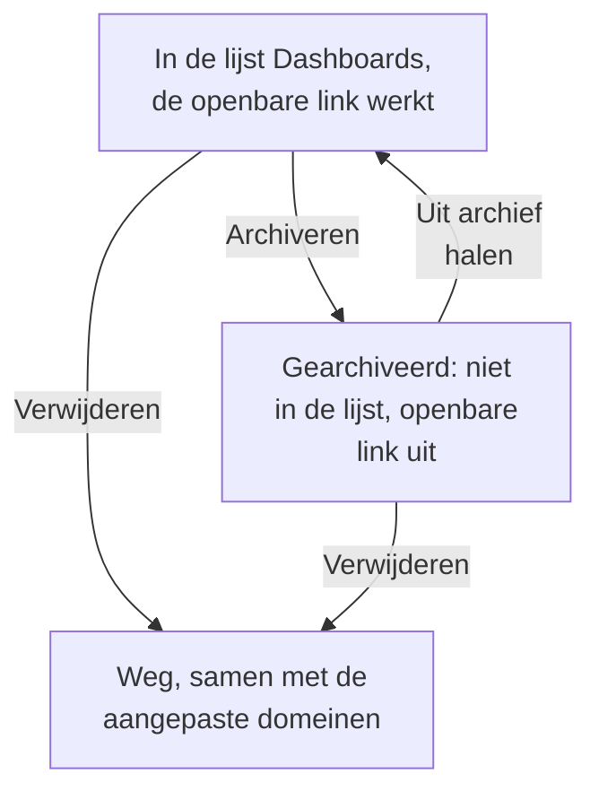

# Dashboard-configuratie en machtigingen

Zodra je een dashboard hebt dat het bewaren waard is, behandelt deze pagina wie het mag lezen en wijzigen, hoe eigenaren en labels je dashboards ordenen, en hoe je er een kopieert, exporteert, archiveert en verwijdert.

:::cards
- [Wie wat mag](#wie-wat-mag): De machtigingen achter elke actie, en wie ze heeft.
- [Eigenaren](#eigenaren): De gebruikers en teams waartoe een dashboard behoort.
- [Een dashboard dupliceren](#een-dashboard-dupliceren): Een veilige kopie, al voor je genummerd.
- [Een dashboard archiveren](#een-dashboard-archiveren): Een dashboard opbergen zonder het te verwijderen.
:::

## Wie wat mag

Dashboards volgen de [machtigingen](/docs/permissions/index) van je project. Elke actie vraagt een van deze, verkregen via een team:

| Om | Is nodig |
| --- | --- |
| Dashboards te lezen | `ReadDashboard`, of een projectrol: Project Owner, Project Admin, Project Member, Viewer of een Settings-rol |
| Dashboards te maken | `CreateDashboard`, Project Owner of Project Admin |
| Een dashboard te wijzigen: de widgets, variabelen, het delen en de huisstijl ervan, en het te archiveren | `EditDashboard`, Project Owner of Project Admin |
| Een dashboard te verwijderen | `DeleteDashboard`, Project Owner of Project Admin |
| Eigenaren toe te voegen en te verwijderen | De machtigingen voor dashboardeigenaren, Project Owner, Project Admin of Project Member |
| Aangepaste domeinen toe te voegen en te wijzigen | De machtigingen voor dashboarddomeinen, Project Owner, Project Admin, Project Member, Settings Admin of Settings Member |
| Eigenaarsregels en labelregels te maken | De machtigingen voor regels, Project Owner of Project Admin |

Een Project Member leest dus elk dashboard, maar heeft `CreateDashboard` en `EditDashboard` nodig om ze te bouwen. Lezen, bewerken en verwijderen kunnen elk worden beperkt tot de dashboards die een team bezit, of tot dashboards met bepaalde labels: zie [Bereik: hoe ver een toegestane machtiging reikt](/docs/permissions/index#bereik-hoe-ver-een-toegestane-machtiging-reikt).

Ken ze toe op de pagina **Machtigingen** van een team: open **Producten → Teams** en kies het team.

Wie een dashboard buiten het project kan zien, is een aparte vraag, die op de pagina **Delen** ervan wordt beantwoord: zie [Toegang tot openbare dashboards](#toegang-tot-openbare-dashboards).

## Eigenaren

De **eigenaren** van een dashboard zijn de gebruikers en teams waartoe het behoort. Voeg ze toe op de pagina **Eigenaren** van het dashboard, of selecteer meerdere dashboards in de lijst **Dashboards** en voeg in één keer eigenaren aan allemaal toe.

Eigenaren beperken de toegang als je daarom vraagt: een teammachtiging die is beperkt tot de dashboards die het team bezit, bereikt alleen de dashboards die dat team, of de persoon die handelt, als eigenaar noemen. Eigendom op zich geeft niets.

De lijst **Dashboards** toont de eigenaren van elk dashboard, en het filter **Eigenaar** ervan vindt de dashboards van een persoon of een team.

## Labels

Labels zijn tags om dashboards te ordenen. Voeg ze toe op de pagina **Overzicht** van het dashboard, waar je ook de naam en beschrijving bewerkt, of aan meerdere dashboards tegelijk vanuit de lijst **Dashboards**.

Gangbare patronen:

- **Per team**: `team:platform`, `team:checkout`, `team:growth`.
- **Per omgeving**: `env:prod`, `env:staging`.
- **Per doel**: `purpose:oncall`, `purpose:exec`, `purpose:investigation`.

Het filter **Labels** op de lijst **Dashboards** is de snelste manier om een dashboard te vinden in een project dat er veel heeft verzameld. Labels beperken ook machtigingen: een teammachtiging die tot bepaalde labels is beperkt, bereikt alleen de dashboards die een van die labels hebben.

## Eigenaars- en labelregels

In plaats van eigenaren en labels met de hand toe te voegen, laat je regels het doen. Onder **Instellingen** in het zijmenu van **Dashboards** voegen **Eigenaarsregels** eigenaren en **Labelregels** labels toe aan elk nieuw dashboard dat ermee overeenkomt: op basis van de labels die het al heeft, of van een patroon in de naam of beschrijving. [Label- en eigenaarsregels](/docs/configuration/label-and-owner-rules) legt uit hoe regels overeenkomen, en hoe je er een uitvoert op de dashboards die je al hebt.

## Toegang tot openbare dashboards

Wie een dashboard buiten het project kan zien, is één keuze op de pagina **Delen** ervan (ook **⋯ → Delen** op het dashboard zelf; zie [Delen en publieke dashboards](/docs/dashboards/sharing)):

1. **Alleen mensen in dit project** (de standaard): het dashboard heeft geen openbare link; het openbare adres toont een pagina 'niet gevonden'.
2. **Iedereen met de link**: iedereen die de openbare link heeft, kan het zien, zonder zich aan te melden.
3. **Iedereen met de link en een wachtwoord**: bezoekers voeren een wachtwoord in voordat het dashboard verschijnt.

Onder **Meer instellingen** op dezelfde pagina weigert de **IP-toelatingslijst** (abonnement Scale) verzoeken aan de openbare link vanaf elk IP-adres dat er niet op staat. De strengst afgeschermde openbare opzet is **Iedereen met de link en een wachtwoord** met een IP-toelatingslijst: handig voor partnerportalen waar je beide lagen wilt.

## Een dashboard dupliceren

Om een dashboard te kopiëren, open je het, ga je naar de pagina **Instellingen** ervan en klik je op **Dashboard dupliceren**. De naam van de kopie wordt voor je ingevuld: de naam van het dashboard, genummerd voorbij de namen die het project al heeft ("Checkout API" wordt gekopieerd als "Checkout API 2", en een kopie daarvan als "Checkout API 3"). Wijzig hem als je wilt, bevestig met **Dashboard dupliceren**, en de kopie opent. Ze heeft de widgets, variabelen, beschrijving en labels van het dashboard. Huisstijl en aangepaste domeinen blijven bij het origineel, en openbaar delen staat altijd eerst uit, zodat jij beslist of je het aanzet.

Dit is de juiste zet als je een sjabloon (zoals "ons on-call-dashboard") wilt afsplitsen tot een kopie voor één specifieke service.

## Exporteren en importeren

Een dashboard reist als JSON:

- **Dashboard exporteren**, op de pagina **Instellingen** van het dashboard, downloadt het als een JSON-bestand. Om er meerdere te exporteren, selecteer je ze in de lijst **Dashboards** en kies je **JSON exporteren**.
- **JSON importeren**, boven de lijst **Dashboards**, maakt dashboards uit zo'n bestand, in dit project of in een ander.

Een export bevat de eigen instellingen van het dashboard, waaronder de widgets en variabelen. De eigenaren en labels blijven erbuiten, en bij widgets die naar resources van dit project wijzen, zoals een SLO of een gegevensbron, moet je die in een ander project misschien opnieuw kiezen.

## Een dashboard archiveren

Archiveer een dashboard dat je niet meer gebruikt maar wel wilt bewaren. Een gearchiveerd dashboard verdwijnt uit de lijst **Dashboards** en, als het openbaar is, werkt de openbare link niet meer: de URL en de aangepaste domeinen antwoorden met "Dashboard not found". De widgets, variabelen, huisstijl, domeinen en openbare instellingen blijven allemaal bewaard, dus als je het uit het archief haalt, staat het er weer precies zoals het was, de openbare link inbegrepen.

Om één dashboard te archiveren, open je het, ga je naar de pagina **Instellingen** ervan en klik je op **Archiveren**. Om er meerdere te archiveren, selecteer je ze in de lijst **Dashboards** en kies je **Archiveren**. Om er een terug te halen, open je **Dashboards → Geavanceerd → Gearchiveerd**, selecteer je het en kies je **Uit archief halen**, of open je het en klik je op **Uit archief halen** in de banner bovenaan de pagina's ervan.

Archiveren is het omkeerbare alternatief voor verwijderen: kies het eerst als je twijfelt.

## Een dashboard verwijderen

Open de pagina **Verwijderen** van het dashboard. Verwijderen kan niet ongedaan worden gemaakt: het dashboard, de widgets en variabelen ervan, en alle aangepaste domeinen die eraan gekoppeld zijn, worden verwijderd. Je telemetrie wordt niet aangeraakt.

Als het dashboard openbaar is op een aangepast domein, antwoordt het adres niet meer zodra je het verwijdert. Om het adres te blijven aanbieden, voeg je het domein na het verwijderen van dit dashboard toe aan een ander dashboard: een domein hoort bij één dashboard tegelijk.

## Auditlogboeken

De pagina **Auditlogboeken** van het dashboard toont elke wijziging aan het dashboard, en wie die heeft gemaakt. Auditlogboeken horen bij het Enterprise-abonnement en de [Enterprise Edition](/docs/self-hosted/enterprise).

## Gegevensbewaring en back-ups

Dashboards zelf verlopen niet. De gegevens die ze tonen, volgen de bewaarinstellingen van je project: met het tijdsbereik op de afgelopen 3 maanden toont een project dat zijn logs 15 dagen bewaart, de laatste 15 dagen daarvan.

Als je OneUptime zelf host, is een regelmatige databaseback-up genoeg: de configuratie van een dashboard wordt samen met de rest van je project opgeslagen. In OneUptime Cloud worden back-ups voor je verzorgd. Voor een eigen kopie exporteer je het dashboard als JSON, of lees je het via de [OneUptime-API](/docs/api-reference/api-reference).

## Volgende stappen

:::cards
- [Delen en publieke dashboards](/docs/dashboards/sharing): Openbare links, wachtwoorden, IP-toelatingslijsten en aangepaste domeinen.
- [Gebruikers, teams en machtigingen](/docs/permissions/index): Teams, rollen, bereiken en blokkades.
- [Dashboard-variabelen en filters](/docs/dashboards/variables): Eén dashboard voor elke service.
- [Dashboards – Overzicht](/docs/dashboards/index): Het grote geheel.
:::
