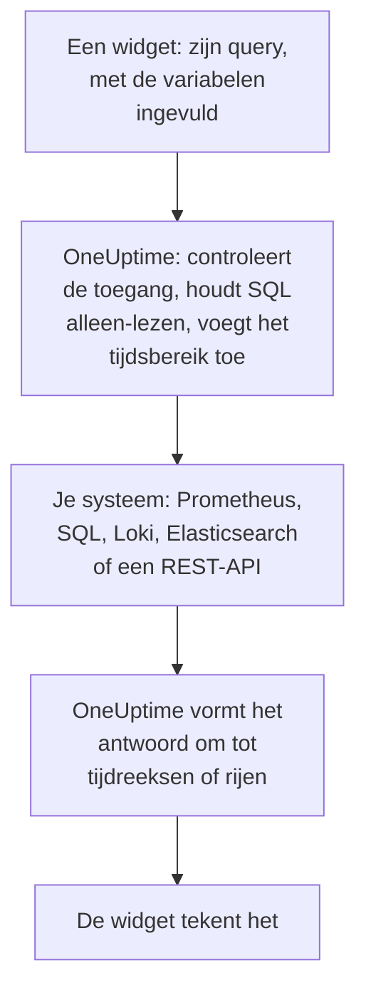

# Externe gegevensbronnen

Een externe gegevensbron koppelt een systeem buiten OneUptime, zoals Prometheus, een SQL-database, ClickHouse, Loki, Elasticsearch of een REST-API, zodat je dashboards de gegevens ervan naast die van jezelf in grafieken kunnen zetten. Je koppelt het systeem één keer; daarna voert elke widget een alleen-lezen query uit in de eigen taal van dat systeem.

:::cards
- [Een gegevensbron koppelen](#een-gegevensbron-koppelen): Kies het type, en geef dan aan waar het staat en hoe je je aanmeldt.
- [Een query schrijven](#een-query-schrijven): PromQL, SQL, LogQL, Query DSL of een verzoek.
- [Limieten](#limieten): De time-outs en plafonds die beide kanten beschermen.
- [Veiligheid](#veiligheid): Alleen-lezen query's en alleen-schrijven inloggegevens.
:::

## Hoe een query wordt uitgevoerd

De widget stuurt zijn query naar OneUptime, met de variabelen al ingevuld. OneUptime controleert of je de gegevensbron mag lezen, vult het tijdsbereik in, en bevraagt je systeem met de inloggegevens die het bewaart. Het vormt het antwoord om tot tijdreeksen of rijen die de widget tekent.



## Voordat je begint

- **Een abonnement waarin het zit.** In OneUptime Cloud vereist het maken en wijzigen van gegevensbronnen het abonnement **Growth**. Er een verwijderen werkt in elk abonnement.
- **Een machtiging om ze toe te voegen.** Projecteigenaren en -beheerders kunnen gegevensbronnen toevoegen; alle anderen hebben `CreateDataSource` nodig, met `EditDataSource` en `DeleteDataSource` om ze te wijzigen en te verwijderen. Iedereen die de gegevensbronnen van het project mag lezen, leden en kijkers inbegrepen, ziet de gegevens van hun widgets.
- **Een alleen-lezen account.** Dashboards lezen alleen. Koppel databases met een account dat alleen kan lezen, en HTTP-bronnen met een token dat alleen kan bevragen.
- **Een weg naar binnen.** De API-server van OneUptime maakt verbinding met je systeem, dus die moet het kunnen bereiken: zie [Veiligheid](#veiligheid) voor de adressen die worden geweigerd.

## Ondersteunde systemen

| Type | Querytaal | Werkt met |
| --- | --- | --- |
| Prometheus | PromQL | Prometheus, Thanos, Cortex, Mimir, VictoriaMetrics |
| PostgreSQL | SQL | PostgreSQL, TimescaleDB, CockroachDB |
| MySQL | SQL | MySQL, MariaDB |
| Microsoft SQL Server | T-SQL | SQL Server, Azure SQL |
| ClickHouse | SQL | ClickHouse, via de HTTP-interface |
| Grafana Loki | LogQL | Loki en Loki-compatibele endpoints |
| Elasticsearch | Query DSL (JSON) | Elasticsearch, OpenSearch |
| REST API | Verzoek (JSON) | Elke HTTP(S)-API die met JSON antwoordt |

## Een gegevensbron koppelen

:::steps
### Open de gegevensbronnen

Open **Producten → Dashboards**, klap **Instellingen** uit in het zijmenu en klik op **Gegevensbronnen**.

### Kies het type

Klik op **Data Source aanmaken**. Het dialoogvenster **Choose a Data Source Type** groepeert de typen naar wat ze bevatten: metrics, logs, databases, zoeken en API's. Klik er een aan.

### Geef haar een naam

Geef haar onder **Basisinformatie** een **Naam**, zoals "Productie-Prometheus", en desgewenst een **Beschrijving**.

### Geef aan waar ze staat

Onder **Verbinding** krijgt een HTTP-bron de **URL** waarop ze antwoordt. Een database krijgt haar **Database Host**, haar **Database Port** (laat leeg voor 5432, 3306, 1433 of 8123) en haar **Databasenaam**.

### Geef aan hoe je je aanmeldt

Vul onder **Authenticatie** een **Gebruikersnaam** en een **Wachtwoord** in, of voor een HTTP-bron een **API-token**, dat als bearer-token wordt verstuurd. **Meer velden** bevat **Custom HTTP Headers**, zoals `{ "X-Scope-OrgID": "tenant-1" }`, en **Additional Options**: `sslEnabled` en `sslRejectUnauthorized` voor databases, en `elasticsearchIndex` voor Elasticsearch, dat zonder deze optie elke index (`*`) leest.

### Test haar

Klik op **Data Source aanmaken** en daarna op **Testen** in haar rij. OneUptime maakt verbinding met de gegevens die je hebt opgegeven, en zegt of het werkte of wat er misging.
:::

Om een gegevensbron later te wijzigen, open je haar vanuit de lijst. **Bewerken** op **Data Source Details** wijzigt alles behalve de geheimen; **Inloggegevens bijwerken** vervangt het wachtwoord, het token of de headers, en laat de velden die je leeg laat zoals ze waren; **Testen** controleert haar opnieuw.

## Haar gebruiken in een widget

Bewerk een dashboard, klik op **Widget toevoegen** en kies een widget uit de groep Externe gegevensbronnen: een **Grafiek**, een **Waarde**, een **Meter** of een **Tabel**. In de instellingen ervan:

- Kies de **Data Source** en schrijf de **Query**. De editor noemt de querytaal en toont een voorbeeld voor het type.
- Op een grafiek legt **Query toevoegen** meer query's op dezelfde assen, en geeft **Legend (optional)** elke reeks een naam op basis van haar labels: `{{instance}} — errors` zet het label `instance` van de reeks vooraan.
- Op een waarde of een meter maakt **Reduce** van de punten één getal: de laatste waarde (de standaard), de eerste, het gemiddelde, de som, het minimum of het maximum. **Unit** voegt een achtervoegsel toe, en schaalt de bekende eenheden: `Bytes` leest als 1.5 MB, `ms` als 2.4 s.
- Op een tabel werkt elke alleen-lezen query, en de rijen worden getoond zoals ze terugkomen.

## Een query schrijven

Elk type neemt zijn eigen taal, met dezelfde regels voor wat er terugkomt:

- **Grafieken, waarden en meters hebben tijdreeksen nodig.** Een SQL-query geeft een tijdkolom terug met de naam `time`, `timestamp`, `date` of `ts`, en een numerieke kolom `value` (of de eerste numerieke kolom); elke andere kolom wordt een label van de reeks. Elasticsearch heeft een aggregatie `date_histogram` nodig, en Loki een metric-query zoals `rate()` of `count_over_time()`.
- **Tabellen tonen rijen** zoals de query ze teruggeeft: SQL-rijen, Prometheus-reeksen, Loki-logregels, Elasticsearch-hits, of de objecten op het `rowsPath` van een REST-API.

:::tabs
@tab Prometheus
```text title="PromQL"
sum by (job) (rate(http_requests_total{job=~"{{job}}"}[5m]))
```
@tab SQL
```sql title="SQL"
SELECT date_trunc('minute', created_at) AS time, COUNT(*) AS value
FROM orders
WHERE created_at BETWEEN $__startTime AND $__endTime
GROUP BY 1
ORDER BY 1
```
@tab Loki
```text title="LogQL"
sum by (app) (rate({app="api"} |= "error" [5m]))
```
@tab Elasticsearch
```json title="Query DSL"
{
  "query": { "range": { "@timestamp": { "gte": "$__startTime", "lte": "$__endTime" } } },
  "aggs": {
    "over_time": {
      "date_histogram": { "field": "@timestamp", "fixed_interval": "1m" }
    }
  }
}
```
@tab REST API
```json title="Request"
{
  "path": "/api/stats?from=$__startTimeMs&to=$__endTimeMs",
  "method": "GET",
  "rowsPath": "data.items",
  "timestampField": "time",
  "valueField": "count",
  "seriesField": "service"
}
```
:::

### Tijdmacro's

Prometheus en Loki krijgen het tijdsbereik van het dashboard bij elk verzoek mee, dus hun query's hebben verder niets nodig. De andere typen zetten het tijdsbereik op de plek waar je een macro schrijft:

| Macro | Wordt | In |
| --- | --- | --- |
| `$__startTime`, `$__endTime` | Het begin en einde van het bereik, in UTC: `'2026-10-13 09:00:00'` in SQL, elders ISO 8601 | SQL, Elasticsearch, REST API |
| `$__startTimeMs`, `$__endTimeMs` | Hetzelfde, als milliseconden sinds 1970 | SQL, Elasticsearch, REST API |
| `$__rangeSeconds` | De lengte van het bereik, in seconden | SQL |

SQL-macro's worden in UTC geschreven, dus laat je databasesessies in UTC draaien, of reken om in de query.

### Dashboardvariabelen

Schrijf `{{name}}` ergens in een query, en de widget zet daar de waarde van de variabele neer voordat hij de query verstuurt. Meerdere waarden van een variabele met meervoudige selectie worden samengevoegd met `|`, wat een reguliere-expressiematcher in PromQL of LogQL nodig heeft: `job=~"{{job}}"`. Een variabele zonder gekozen waarde laat de plaatsaanduiding staan zoals hij geschreven is, zodat de fout hem noemt. [Dashboard-variabelen en filters](/docs/dashboards/variables) laat zien hoe je er een toevoegt.

## Limieten

Elke query is begrensd, zodat een dashboard van twintig widgets dat elke minuut vernieuwt OneUptime of je systeem niet kan overbelasten:

| Limiet | Waarde |
| --- | --- |
| Verbinden | 10 seconden |
| Een query uitvoeren | 30 seconden |
| Punten in een tijdreeksantwoord | 11.000 |
| Rijen in een tabel | 1.000 |
| Reeksen in één antwoord | 100 |
| Antwoord van een HTTP-bron | 20 MB |

Bereikquery's van Prometheus en Loki vragen om ongeveer 250 punten over het tijdsbereik, niet dichter op elkaar dan 10 seconden en niet verder uit elkaar dan een dag.

## Veiligheid

- **SQL blijft alleen-lezen.** Een query moet één statement zijn dat begint met `SELECT`, `WITH`, `SHOW`, `EXPLAIN`, `DESCRIBE` of `DESC`. Woorden die schrijven of een sessie wijzigen, zoals `INSERT`, `UPDATE`, `DELETE`, `DROP`, `INTO` of `SET`, worden overal buiten strings en geciteerde namen geweigerd, dus zet een kolom die naar een daarvan heet tussen aanhalingstekens. Schrijf een aanhalingsteken in een string als twee aanhalingstekens (`''`): een backslash voor een aanhalingsteken wordt geweigerd. Sessies van PostgreSQL, MySQL en ClickHouse zijn ook alleen-lezen. SQL Server heeft geen alleen-lezen sessie, dus koppel die met een alleen-lezen login.
- **Inloggegevens zijn alleen-schrijven.** **Wachtwoord**, **API-token** en **Custom HTTP Headers** worden versleuteld opgeslagen, en de API geeft ze nooit terug, zelfs niet aan jou.
- **Adressen worden gecontroleerd.** Loopback-, link-local- (waar cloudmetadata staat) en andere gereserveerde adressen worden overal geweigerd. Privéadressen worden geweigerd in OneUptime Cloud, en toegestaan op een zelfgehoste installatie tenzij `DATA_SOURCE_BLOCK_PRIVATE_ADDRESSES` `true` is: zie [Toegang tot privénetwerk](/docs/self-hosted/private-network-access).
- **Openbare dashboards voeren ze nooit uit.** De widgets van Externe gegevensbronnen worden weggelaten uit een [openbaar dashboard](/docs/dashboards/sharing), query's en al.

## Problemen oplossen

:::details Testen meldt dat er geen verbinding kan worden gemaakt
Controleer de URL, of de host en poort, vanaf waar OneUptime draait: een firewall, een privéadres in OneUptime Cloud of een database die alleen op zijn eigen machine luistert, zien er vanaf hier allemaal hetzelfde uit. Voeg voor een database die TLS vereist `{ "sslEnabled": true }` toe onder **Additional Options**.
:::

:::details "Only read-only queries are allowed"
De query begint niet met `SELECT`, `WITH`, `SHOW`, `EXPLAIN`, `DESCRIBE` of `DESC`. Stuur één statement dat alleen leest: een tweede statement na een `;` wordt ook geweigerd, als "Only a single SQL statement is allowed per query."
:::

:::details "Query contains a keyword that is not allowed"
Een woord dat schrijft, staat buiten een string, vaak als kolomnaam, zoals `delete` of `set`. Zet het tussen aanhalingstekens zoals de database dat doet: `"delete"` in PostgreSQL, `[delete]` in SQL Server, en tussen backticks in MySQL en ClickHouse.
:::

:::details De grafiek blijft leeg, maar de tabel toont rijen
De query geeft rijen terug, maar geen tijdreeksen. Noem de tijdkolom `time` en het getal `value` in SQL, voeg een aggregatie `date_histogram` toe in Elasticsearch, of maak van een Loki-logquery een metric-query met `rate()` of `count_over_time()`.
:::

:::details Er ontbreken gegevens
Het antwoord heeft een [limiet](#limieten) bereikt. Verklein het tijdsbereik, filter de query, of aggregeer hem tot minder reeksen.
:::

## Volgende stappen

:::cards
- [Dashboard-widgets](/docs/dashboards/widgets): Elke widget, de groep Externe gegevensbronnen inbegrepen.
- [Dashboard-variabelen en filters](/docs/dashboards/variables): Variabelen om in je query's te gebruiken.
- [Toegang tot privénetwerk](/docs/self-hosted/private-network-access): Bereik systemen op een privénetwerk vanaf een zelfgehoste installatie.
- [Dashboard-configuratie en machtigingen](/docs/dashboards/configuration): Wie gegevensbronnen mag toevoegen, en wie ze leest.
:::
