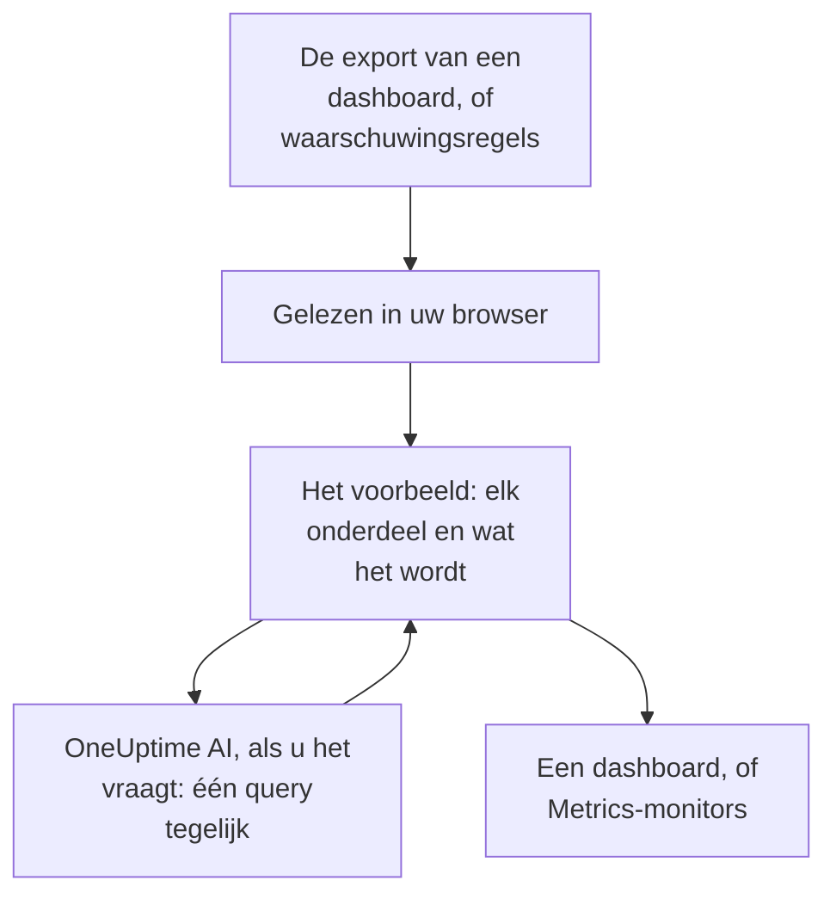

# Importeren uit Grafana en Datadog

Haal een dashboard dat u in Grafana of Datadog hebt gebouwd, of de waarschuwingsregels die u voor Prometheus, Grafana of Datadog hebt geschreven, naar OneUptime. U plakt of uploadt het bestand, ziet wat elk paneel en elke regel wordt, en pas dan maakt u het dashboard of de monitors aan.

:::cards
- [Een dashboard importeren](#een-dashboard-importeren): Het JSON-model van een Grafana-dashboard, of de export van een Datadog-dashboard.
- [Waarschuwingsregels importeren](#waarschuwingsregels-importeren): Prometheus-regelbestanden, Grafana-waarschuwingsregels en Datadog-monitors.
- [Hoe elk onderdeel wordt omgezet](#hoe-elk-onderdeel-wordt-omgezet): Precies, bij benadering of helemaal niet, en waarom.
- [Een query omzetten met OneUptime AI](#een-query-omzetten-met-oneuptime-ai): Voor een query die geen regel omzet.
:::

## Hoe een import werkt

OneUptime leest het bestand in uw browser en zet elk paneel, elke widget, elke variabele en elke regel apart om. Het voorbeeld toont ze allemaal met wat elk wordt. Er wordt niets aangemaakt voordat u ervoor kiest, en dan wordt het aangemaakt met uw eigen rechten, zoals de dashboard- en monitorformulieren het aanmaken.

## Voordat u begint

- De geïmporteerde widgets en monitors lezen de eigen metrics van dit project met PromQL. Stuur ze met Prometheus remote write, OpenTelemetry of de Datadog Agent, en ze houden de namen die ze daar hebben.
- Een dashboard importeren vraagt een rol die dashboards mag aanmaken, en waarschuwingsregels importeren een rol die monitors mag aanmaken.
- Een bestand mag tot 10 MB groot zijn, en tot 500 van zijn panelen of regels worden gelezen.

## Een dashboard importeren

:::steps
### De dashboardimport openen

Open **Producten → Dashboards** en daarna **Meer opties → Import from Grafana or Datadog**.

### Het dashboard plakken

Kopieer in Grafana het JSON-model uit de instellingen van het dashboard. Exporteer in Datadog de JSON van het dashboard. Plak het, of kies **Upload a File**, en kies daarna **Voorbeeld**.

### Het dashboard aanmaken

Controleer wat elk paneel en elke variabele wordt, geef het dashboard een naam en kies **Dashboard aanmaken**. Het nieuwe dashboard gaat open.
:::

De PromQL van Grafana blijft zoals hij geschreven is: OneUptime vult `$__interval`, `$__rate_interval` en `$__range` in zoals Grafana dat doet, en een variabele op All past op elke waarde. Een Datadog-query wordt PromQL over de metrics die de Datadog Agent heeft gestuurd: `avg:system.cpu.user{host:web-1}` leest `system_cpu_user{host="web-1"}`.

## Waarschuwingsregels importeren

:::steps
### De waarschuwingsimport openen

Open **Producten → Monitoren** en daarna **Meer opties → Import Alerts**.

### De regels plakken

Plak een Prometheus-regelbestand of een PrometheusRule-resource, de export van de waarschuwingsregels uit Grafana, of als JSON geëxporteerde Datadog-monitors, en kies daarna **Voorbeeld**.

### De monitors aanmaken

Vink elke regel uit die u niet wilt, kies onder **When a rule fires** wat een afgaande regel opent, en kies **Monitors aanmaken**.
:::

Elke regel wordt een Metrics-monitor met één PromQL-query, de voorwaarde van de regel en zijn venster. Hij opent een waarschuwing, of een incident, voor elke reeks die de drempel overschrijdt, en lost die op als de reeks herstelt. Titel en beschrijving komen uit de samenvatting of het bericht van de regel, met de labels van de reeks ingevuld.

## Hoe elk onderdeel wordt omgezet

| Status | Wat hij betekent |
| --- | --- |
| **Converted exactly** | Het leest dezelfde gegevens en toont ze op dezelfde manier. |
| **Converted approximately** | Het wordt aangemaakt, en de notities zeggen wat anders is. |
| **Not converted** | Er wordt niets voor aangemaakt, en de notities zeggen waarom. |

Opnameregels, waarschuwingsregels over logs, Datadog-widgets die logs, traces of gebeurtenissen lezen, en de anomalie-, uitschieter- en voorspellingsmonitors van Datadog worden niet omgezet.

## Een query omzetten met OneUptime AI

Een query die geen regel omzet, toont **Convert with OneUptime AI**, waarvoor AI voor het project aan moet staan. Alleen die query, met de namen van de variabelen van het dashboard, gaat naar de AI-provider van uw project. Het antwoord wordt gecontroleerd zoals elke query en aan u getoond: kies **Use This Query** om het te gebruiken. Er wordt niets aangemaakt totdat u het dashboard of de monitors aanmaakt.

## Volgende stappen

:::cards
- [Dashboard-widgets](/docs/dashboards/widgets): Wijzig wat een geïmporteerde widget toont.
- [Dashboard-variabelen en filters](/docs/dashboards/variables): De variabelen die een import heeft aangemaakt.
- [Metrics-monitor](/docs/monitor/metrics-monitor): De monitors die een import heeft aangemaakt.
- [PromQL](/docs/telemetry/promql): De taal die de geïmporteerde widgets en monitors lezen.
:::
