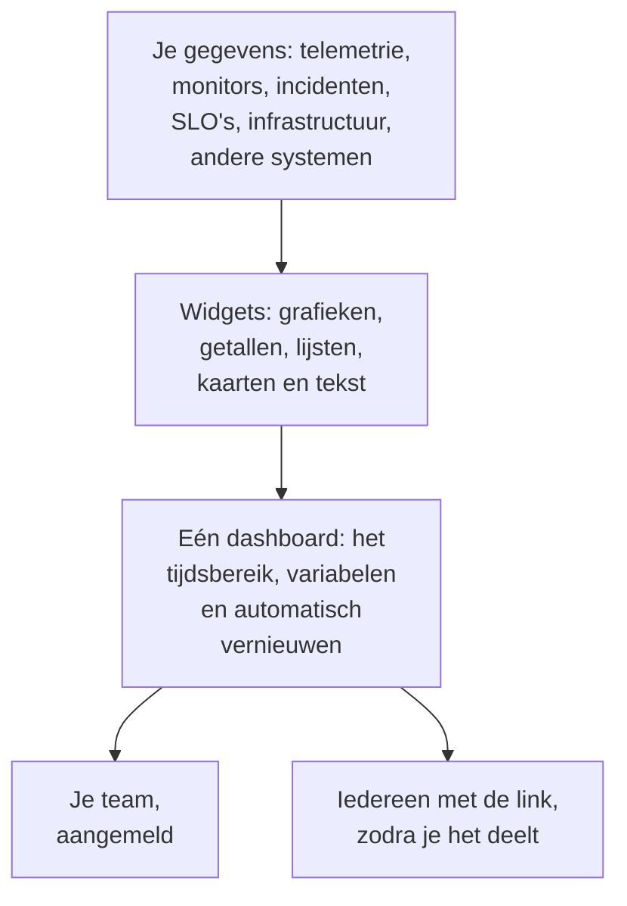

# Dashboards – Overzicht

Een dashboard is één pagina met widgets die je zelf indeelt: grafieken van je metrics, logs en traces, lijsten met incidenten, waarschuwingen en monitors, je SLO's en je infrastructuur, zelfs gegevens uit systemen buiten OneUptime. Maak er een voor het scherm van de dienstdoende, de ochtendcheck van een team of een pagina voor je klanten, en deel het met je project of met iedereen die de link heeft.

:::cards
- [Hoe een dashboard werkt](#hoe-een-dashboard-werkt): Waar de gegevens vandaan komen, en wie het ziet.
- [Je dashboards vinden](#je-dashboards-vinden): De lijst Dashboards en de eigen pagina's van elk dashboard.
- [Je eerste dashboard bouwen](#je-eerste-dashboard-bouwen): Van een sjabloon naar een gedeelde pagina in vijf stappen.
- [Een voorbeeld: een on-call-dashboard](#een-voorbeeld-een-on-call-dashboard): Eén pagina die voor elke service werkt.
:::

## Hoe een dashboard werkt

Elke widget leest uit één bron, binnen het tijdsbereik van het dashboard en gefilterd door de variabelen ervan. Iedereen die het dashboard opent, ziet dezelfde widgets: je team wanneer het zich aanmeldt, en bezoekers via de openbare link zodra je het deelt.

| Begrip | Wat het betekent |
| --- | --- |
| Dashboard | Eén pagina: een naam, een raster met widgets, een tijdsbereik, variabelen en een instelling voor automatisch vernieuwen. |
| Widget | Eén tegel in het raster: een grafiek, een getal, een lijst, een kaart, een klok of een blok tekst. |
| Variabele | Een kiezer in de werkbalk die elke widget die het ondersteunt beperkt tot één service, host of klant. |
| Tijdsbereik | Het venster dat elke grafiek en elk getal leest. Een dashboard opent op zijn standaard, het afgelopen uur tenzij iemand die het bewerkt een andere instelt, en elke kijker kan zelf kiezen. |
| Automatisch vernieuwen | Hoe vaak de widgets hun gegevens opnieuw lezen: uit, of elke 5 seconden tot elke 15 minuten. |
| Lezen en bewerken | Een dashboard opent om te lezen. Bewerken is een aparte stap die eindigt met het opslaan of verwerpen van je wijzigingen. |

## Waar dashboards goed voor zijn

- **Een "is alles in orde?"-pagina** voor de dienstdoende engineer, de standup van een team of een scherm aan de muur.
- **Verbanden zien**: een CPU-piek naast een stijgende latentie en een open incident valt op één pagina meteen op, en verdwijnt makkelijk uit beeld als het over drie pagina's verspreid is.
- **Onderzoeken**: zet de grafieken die je steeds opnieuw opent naast elkaar, en sleep over een piek om elke widget op dat moment te lezen.
- **Delen buiten het team**: een prestatiepagina voor een klant of partner, beschermd met een wachtwoord of een IP-toelatingslijst als je dat wilt.

## Je dashboards vinden

Open **Producten → Dashboards**. De lijst **Dashboards** toont de dashboards van het project met hun beschrijvingen, labels en eigenaren. Zoek op naam of beschrijving, verfijn de lijst met de filters **Eigenaar** en **Labels**, of selecteer meerdere dashboards om hun labels of eigenaren te wijzigen, ze te archiveren of ze als JSON te exporteren.

Het zijmenu van de lijst bevat de pagina's die al je dashboards beheren:

| Pagina | Wat je er doet |
| --- | --- |
| **Dashboards** | De dashboards van het project. Maak er een, of haal dashboards binnen met **JSON importeren**. |
| **Instellingen → Eigenaarsregels** | Automatisch eigenaren toevoegen aan nieuwe dashboards. |
| **Instellingen → Labelregels** | Automatisch labels toevoegen aan nieuwe dashboards. |
| **Instellingen → Gegevensbronnen** | Prometheus, SQL-databases, ClickHouse, Loki, Elasticsearch of een REST-API koppelen. |
| **Geavanceerd → Gearchiveerd** | Dashboards die je hebt gearchiveerd. Haal ze hier uit het archief. |

Open een dashboard, en het eigen zijmenu ervan heeft deze pagina's. Elke sectie behalve **Basis** begint ingeklapt: klik op de titel om haar te openen.

| Pagina | Wat je er doet |
| --- | --- |
| **Dashboard** | Het dashboard zelf. Lees het, of bewerk het via het menu **⋯**. |
| **Overzicht** | De naam, de beschrijving en de labels. |
| **Delen** | Wie het kan zien, de openbare link, en een IP-toelatingslijst onder Meer instellingen. |
| **Eigenaren** | De gebruikers en teams die eigenaar zijn. |
| **Huisstijl** | Paginatitel, beschrijving, logo, thema en favicon van het openbare dashboard. |
| **Aangepaste domeinen** | Het openbare dashboard op je eigen domein hosten. |
| **Instellingen** | Het dashboard dupliceren, exporteren of archiveren. |
| **Auditlogboeken** | Elke wijziging aan het dashboard, en wie die heeft gemaakt. |
| **Verwijderen** | Het dashboard definitief verwijderen. |

## Je eerste dashboard bouwen

:::steps
1. **Maken** — kies een sjabloon, of **Vanaf nul beginnen**. Een sjabloon vult de naam in en opent met zijn widgets; een dashboard vanaf nul opent zonder inhoud, met **Widget toevoegen** op het canvas.
2. **Widgets toevoegen** — kies een widget uit de catalogus, stel in de instellingen in wat hij leest, sleep hem daarna op zijn plek en pas het formaat aan.
3. **Variabelen toevoegen, als je ze nodig hebt** — met een variabele `service` kan één dashboard bijvoorbeeld elke service tonen.
4. **Opslaan** — klik op **Wijzigingen opslaan**. Niets wat je tijdens het bewerken verandert, blijft bewaard totdat je dat doet.
5. **(Optioneel) Openbaar delen** — kies **⋯ → Delen** op het dashboard en kies wie het mag zien: iedereen met de link, of iedereen met de link en een wachtwoord.
:::

[Een dashboard maken](/docs/dashboards/authoring) loopt elke stap door.

## Een voorbeeld: een on-call-dashboard

Het doel: één pagina voor de checkout-service, met de latentie, het foutpercentage, de open incidenten en de nieuwste logs, die ook voor elke andere service werkt.

1. Klik op **Dashboard aanmaken**, kies **Vanaf nul beginnen** en noem het dashboard "Checkout on-call".
2. Klik op **Widget toevoegen** en voeg een **Grafiek** toe van je metric voor de latentie van verzoeken, geaggregeerd als P95.
3. Voeg ernaast een **Waarde** toe van je foutpercentage, met een waarschuwingsdrempel van 1 en een kritieke drempel van 5.
4. Voeg eronder een **Incidentenlijst** toe, gefilterd op onopgeloste incidenten, en een **Logstroom** van de logs van de service.
5. Open **Variabelen**, voeg een variabele met de naam `service` toe met de bron Telemetry Attribute en de attribuutsleutel `service.name`, en geef haar de standaardwaarde `checkout`.
6. Klik op **Wijzigingen opslaan**. Kies `payments` in de kiezer `service` van de werkbalk: de grafiek, de waarde en de logstroom schakelen over naar de service payments, en de incidentenlijst blijft elk onopgelost incident tonen.

## Hoe dashboards passen bij de rest van OneUptime

- **Monitors en telemetrie** zijn waar de gegevens vandaan komen. Elke metric, log en trace die je verstuurt, kan op een widget komen.
- **Incidenten en waarschuwingen** verschijnen in de widgets **Incidentenlijst** en **Waarschuwingslijst**. Een dashboard toont ze alleen: je werkt eraan op hun eigen pagina's.
- **Statuspagina's** vertellen je klanten of je service werkt. Dashboards tonen tot in detail hoe hij zich gedraagt. De twee werken naast elkaar.
- **Workflows** handelen op wat er gebeurt. Dashboards zijn waar je het leest.

## Volgende stappen

:::cards
- [Een dashboard maken](/docs/dashboards/authoring): Maak een dashboard, bewerk het en sla je wijzigingen op.
- [Dashboard-widgets](/docs/dashboards/widgets): Elke widget, en welke je kiest.
- [Dashboard-variabelen en filters](/docs/dashboards/variables): Eén dashboard voor elke service, host of klant.
- [Delen en publieke dashboards](/docs/dashboards/sharing): Openbare links, wachtwoorden, IP-toelatingslijsten en aangepaste domeinen.
:::
