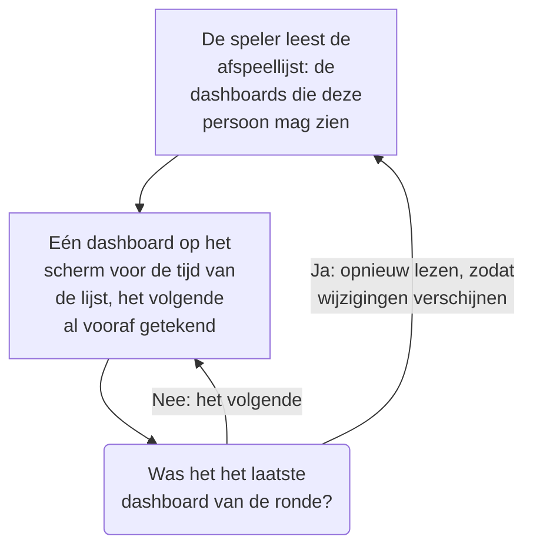

# Dashboard-afspeellijsten

Een afspeellijst toont een reeks dashboards na elkaar op een scherm dat niemand aanraakt, zoals een NOC-wand of de tv van een team: elk dashboard zo lang als je kiest, telkens opnieuw, tot iemand de lijst pauzeert. Maak de afspeellijst één keer, open de speler ervan op het scherm en laat hem lopen.

:::cards
- [Hoe een afspeellijst speelt](#hoe-een-afspeellijst-speelt): De volgorde, de beurten en wat elk dashboard toont.
- [Een afspeellijst maken](#een-afspeellijst-maken): Een naam, de dashboards op volgorde en hoe lang elk wordt getoond.
- [Afspelen op een scherm](#afspelen-op-een-scherm): De balk van de speler, de knoppen en de toetsen.
- [Wie wat ziet](#wie-wat-ziet): De machtigingen, en de dashboards die iemand niet mag lezen.
:::

## Hoe een afspeellijst speelt

De speler toont het eerste dashboard van de afspeellijst, dan het volgende als de tijd ervan om is, en begint na het laatste weer bij het eerste. Elk dashboard opent zoals de bewerkers het hebben opgeslagen: met een eigen standaardtijdsbereik, een eigen automatische vernieuwing en eigen variabelen, wat het adres van de speler ook zegt. Terwijl één dashboard op het scherm staat, tekent de speler het volgende buiten beeld, zodat het scherm nooit leeg is tussen twee dashboards.

Een afspeellijst noemt de dashboards en kopieert ze nooit: een wijziging die een bewerker in een dashboard opslaat, staat op het scherm zodra het weer aan de beurt is. De speler leest de afspeellijst vóór elke ronde opnieuw, zodat een toegevoegd, verplaatst of verwijderd dashboard binnen een ronde verschijnt, zonder het scherm te herladen; mislukt dat lezen, dan speelt het scherm de ronde die het heeft nog een keer.

## Een afspeellijst maken

:::steps
### Afspeellijsten openen
Open **Producten → Dashboards** en daarna **Afspeellijsten** in het zijmenu. De lijst toont hoeveel dashboards elke afspeellijst heeft en hoe lang elk wordt getoond, met **Afspelen** op elke rij.

### Een naam geven
Klik op **Afspeellijst aanmaken** en geef de lijst een **Naam** die zegt waar hij speelt, zoals "NOC-wand".

### De dashboards toevoegen
Kies onder **Dashboards** elk dashboard via **Dashboard toevoegen**, in de volgorde waarin het scherm ze toont. Met de knoppen op de rij van een dashboard schuif je het omhoog of omlaag, of verwijder je het. Gearchiveerde dashboards worden niet aangeboden.

### Kiezen hoe lang elk wordt getoond
**Elk dashboard tonen gedurende** begint bij een minuut; kies een tijd van 15 seconden tot een uur. Klik op **Afspeellijst aanmaken**.
:::

De pagina van de afspeellijst toont de dashboards op volgorde, hoe lang elk wordt getoond en de **Spelerlink**. **Afspeellijst bewerken** wijzigt de naam, de dashboards, hun volgorde en de tijd. **Dashboard-afspeellijst verwijderen**, onderaan de pagina, verwijdert de afspeellijst en nooit de dashboards ervan.

Via de API en Terraform is een afspeellijst een `name`, de `dashboards` als een lijst zoals `[{"dashboardId": "<id>"}]` in de volgorde waarin ze worden getoond, hoogstens 100, en `intervalInSeconds`, elk geheel aantal seconden van 10 tot 86400 (een dag). Een waarde daarbuiten wordt geweigerd, met wat er mis is.

## Afspelen op een scherm

Klik op **Afspelen** op de rij van de afspeellijst of op de pagina ervan. De speler vult het browservenster, over de rest van OneUptime heen; **Volledig scherm** vult het hele scherm. Om een scherm op zichzelf te starten, open je de **Spelerlink** erop en maak je er een bladwijzer van: de link opent de speler meteen.

De balk van de speler noemt het dashboard op het scherm, de afspeellijst, waar de ronde is ("2 van 5") en het dashboard dat hierna komt. Een lijn onder de balk vult zich terwijl een dashboard aan de beurt is. De knoppen van de balk gaan naar het vorige dashboard, pauzeren of spelen af, en gaan naar het volgende; op een computer doen deze toetsen hetzelfde:

| Toetsen | Wat het doet |
| --- | --- |
| `Space` | **Pauzeren of afspelen**. Gepauzeerd blijft het dashboard op het scherm en toont de balk **Gepauzeerd**. |
| `Right Arrow` | **Volgend dashboard**. |
| `Left Arrow` | **Vorig dashboard**. |
| `F` | **Volledig scherm**, of er weer uit. |
| `Esc` | **Speler verlaten**, terug naar de pagina van de afspeellijst. In volledig scherm verlaat de eerste `Esc` alleen het volledige scherm. |
| `?` | **Sneltoetsen tonen**. |

Een dashboard waar je naartoe gaat, het volgende of het vorige, krijgt een hele beurt. Op een pagina die van rechts naar links wordt gelezen, zoals in het Perzisch, wisselen de pijlen om: `Left Arrow` gaat naar het volgende dashboard. Zolang hij speelt, houdt de speler het scherm wakker, waar de browser dat toelaat.

## Wie wat ziet

Afspeellijsten hebben eigen machtigingen, die je net als die van dashboards via een team krijgt:

| Om | Is nodig |
| --- | --- |
| Afspeellijsten te zien en af te spelen | `ReadDashboardPlaylist`, of een projectrol: Project Owner, Project Admin, Project Member, Viewer of een Settings-rol |
| Afspeellijsten te maken | `CreateDashboardPlaylist`, Project Owner of Project Admin |
| Een afspeellijst te wijzigen: de naam, de dashboards en de tijd ervan | `EditDashboardPlaylist`, Project Owner of Project Admin |
| Een afspeellijst te verwijderen | `DeleteDashboardPlaylist`, Project Owner of Project Admin |

Een afspeellijst toont nooit iemand een dashboard dat die persoon niet mag lezen. De speler speelt alleen de dashboards af die de persoon die op het scherm is aangemeld mag lezen en die niet zijn gearchiveerd, en slaat de rest over: een verwijderd dashboard, een gearchiveerd dashboard of een dashboard dat de machtigingen van die persoon niet toelaten. De pagina van de afspeellijst zegt waarom hij elk ervan overslaat. Wie een afspeellijst opslaat, houdt de dashboards erin die hij zelf niet kan zien, zodat niets verloren gaat wat iemand anders erin heeft gezet.

| Als de speler vindt | Toont hij |
| --- | --- |
| Dashboards die hij mag tonen | Elk om de beurt. |
| Geen dashboard dat hij mag tonen | **Nog niets te tonen**, en hij kijkt elke minuut opnieuw. |
| De afspeellijst verwijderd, of niet leesbaar voor die persoon | **Afspeellijst niet gevonden**. |
| Een lezen dat mislukte | **Deze afspeellijst kon niet worden geladen**, en hij probeert het elke minuut opnieuw, of bij **Opnieuw proberen**. |

> [!NOTE]
> De speler is voor iemand die bij OneUptime is aangemeld. Om een afspeellijst op een scherm te laten lopen, meld je je op dat scherm aan met een account dat de afspeellijst en de dashboards ervan mag lezen, zoals een teamlid met de rol Viewer.

## Volgende stappen

:::cards
- [Een dashboard maken](/docs/dashboards/authoring): Bouw de dashboards die een afspeellijst toont.
- [Dashboard-variabelen en filters](/docs/dashboards/variables): De opgeslagen selectie waarmee elk dashboard opent.
- [Delen en publieke dashboards](/docs/dashboards/sharing): Toon één dashboard aan mensen die zich niet aanmelden.
- [Dashboard-configuratie en machtigingen](/docs/dashboards/configuration): Eigenaren, labels en wie een dashboard mag lezen.
:::
