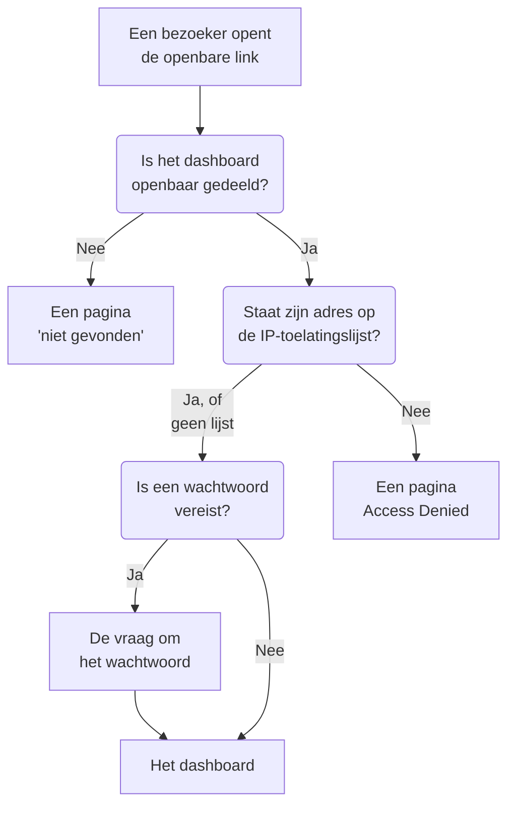

# Delen en publieke dashboards

Standaard is een dashboard privé voor je project: alleen mensen die zich bij je project aanmelden, kunnen het zien. Je kunt het ook delen via een openbare link, die link beschermen met een wachtwoord, hem beperken tot bepaalde IP-adressen, en het hosten op je eigen domein. Deze pagina behandelt alle vier.

:::cards
- [Wie een dashboard kan zien](#wie-een-dashboard-kan-zien): Eén keuze uit drie, met het abonnement dat elke keuze vereist.
- [Delen met een wachtwoord](#delen-met-een-wachtwoord): Deel de link, en daarna het wachtwoord, met de mensen die het moeten zien.
- [IP-toelatingslijst](#ip-toelatingslijst): Open de openbare link alleen voor je kantoor of je VPN.
- [Aangepaste domeinen](#aangepaste-domeinen): Bied het dashboard aan op je eigen domein, met een gratis certificaat.
:::

## Wat een bezoeker doorloopt

Een bezoeker die de openbare link van een dashboard opent, komt elk van deze controles op volgorde tegen. Projectleden die zich bij OneUptime aanmelden, zien het dashboard binnen het product, wat je hier ook kiest.



## Wie een dashboard kan zien

Open het dashboard en kies **⋯ → Delen**, of open **Delen** in het zijmenu van het dashboard. De kaart **Wie dit dashboard kan zien** is één keuze:

- **Alleen mensen in dit project** (de standaard): leden zien het dashboard als ze zich bij OneUptime aanmelden. Het heeft geen openbare link: het openbare adres toont dezelfde pagina 'niet gevonden' als een adres zonder dashboard, en niets over het dashboard, zelfs de naam niet.
- **Iedereen met de link**: het dashboard is openbaar. Iedereen die de link heeft, kan het zien, zonder zich aan te melden.
- **Iedereen met de link en een wachtwoord**: bezoekers openen de link en voeren daarna één wachtwoord in dat jij met hen deelt. Niemand heeft een account nodig.

Een keuze maken vraagt om bevestiging, met wat er voor bezoekers verandert, en wordt dan meteen toegepast. **Iedereen met de link en een wachtwoord** kiezen vraagt in hetzelfde dialoogvenster om het wachtwoord als het dashboard er nog geen heeft; zolang dat de keuze is, vervangt **Wachtwoord wijzigen** het. Zolang het dashboard openbaar is, staan de adressen waarop bezoekers het openen onder de keuze: eerst de aangepaste domeinen, dan de openbare link, elk met **Link kopiëren**. Een aangepast domein dat nog niet live is, is gemarkeerd met **Nog niet live**, met de reden.

Binnen het project bepalen eigenaren en labels wie wat ziet: zie [Dashboard-configuratie en machtigingen](/docs/dashboards/configuration). Wie het dashboard kan zien maar niet kan bewerken, ziet de keuze en kan de openbare link kopiëren, maar kan haar niet wijzigen.

In OneUptime Cloud vereist het delen van een dashboard het abonnement **Growth**: in een lager abonnement tonen de twee openbare keuzes het abonnement dat ze nodig hebben en kunnen ze niet worden gekozen. Een dashboard weer privé maken (**Alleen mensen in dit project**) werkt in elk abonnement, dus een dashboard dat openbaar bleef toen een proefperiode afliep, of na een overstap naar een lager abonnement, kan altijd stoppen met delen; het dialoogvenster zegt dat opnieuw delen **Growth** vereist. Wisselen tussen **Iedereen met de link** en **Iedereen met de link en een wachtwoord**, en het wachtwoord wijzigen, werkt in elk abonnement. Een dashboard dat via de API of Terraform wordt gemaakt, valt onder dezelfde abonnementen: openbaar aangemaakt vereist het **Growth**, en aangemaakt met een IP-toelatingslijst **Scale**.

De keuze wordt opgeslagen in drie kolommen, die de API en Terraform lezen en schrijven zoals voorheen: `isPublicDashboard`, `enableMasterPassword` en `masterPassword`. Alleen een openbaar dashboard heeft een openbare link, en de bezoekers ervan krijgen de vraag om het wachtwoord zolang `enableMasterPassword` aan staat. Een openbaar dashboard met `enableMasterPassword` aan maar zonder ingesteld wachtwoord laat niemand binnen via de openbare link: de pagina **Delen** toont het als **Iedereen met de link en een wachtwoord**, zegt dat nog niemand de link kan openen, en biedt **Wachtwoord instellen** aan. **Alleen mensen in dit project** kiezen zet ook `enableMasterPassword` uit en bewaart het wachtwoord, zodat opnieuw delen met een wachtwoord het kan hergebruiken.

## Openbare dashboards

Een openbaar dashboard:

- Opent altijd om te lezen. Bezoekers kunnen het niet bewerken, en zien de bewerkknoppen nooit.
- Bevat de variabelen die je hebt toegevoegd. Bezoekers kiezen uit dezelfde kiezers die je team gebruikt, en kunnen het tijdsbereik wijzigen, inzoomen, automatisch vernieuwen aanzetten en naar volledig scherm gaan. Het opent op de standaardperiode en het standaard automatisch vernieuwen van het dashboard, en de browser van elke bezoeker onthoudt diens eigen keuzes.
- Laat bezoekers [zijn lijsten en tabellen sorteren](/docs/dashboards/widgets#lijsten-en-tabellen-sorteren) door op een kolomkop te klikken, zoals je team dat doet. De browser van elke bezoeker onthoudt zijn eigen sortering, en OneUptime sorteert zelf de hele lijst, altijd op een van de kolommen van de widget.
- Gebruikt de huisstijl die je instelt op de pagina **Huisstijl** van het dashboard: paginatitel, beschrijving, logo, thema, favicon.
- Laat elke bezoeker met een knop met een zon of een maan in de werkbalk wisselen tussen het lichte en het donkere dashboard; [Thema](#thema) legt uit hoe.

Behandel het delen van een dashboard als het publiceren van een webpagina. Elke widget erop wordt leesbaar voor iedereen met de link. Kijk wat er op het canvas staat voordat je het deelt.

Elke widget publiceert alleen wat hij tekent, en alleen voor de resources waarop hij is ingesteld. Een SLO-widget publiceert bijvoorbeeld de kerncijfers van die SLO, maar nooit de definitie: zie [SLO](/docs/dashboards/widgets#slo). Widgets met een externe **Data Source** zijn de uitzondering: die worden helemaal uit een openbaar dashboard weggelaten in plaats van weergegeven, omdat hun configuratie de query zelf is. Nog een paar widgets kunnen niet worden weergegeven zonder aangemelde sessie, en melden dat op hun plek: [Op een openbaar dashboard](/docs/dashboards/widgets#op-een-openbaar-dashboard) noemt ze.

## Delen met een wachtwoord

Kies **Iedereen met de link en een wachtwoord** en voer het wachtwoord in het dialoogvenster in. Bezoekers zien een vraag om het wachtwoord voordat het dashboard verschijnt. Die vraag toont de naam, de paginatitel en het favicon van het dashboard, in het thema van het dashboard, en verder niets: de beschrijving, het logo en de widgets verschijnen zodra het wachtwoord is ingevoerd. Het wachtwoord wordt als hash opgeslagen: niemand kan het teruglezen. Een nieuw wachtwoord werkt meteen; mensen die het oude hebben ingevoerd, kunnen het dashboard nog maximaal 7 dagen blijven bekijken.

Gebruik een wachtwoord als:

- Je wilt delen met een partner of klant, maar niet wilt dat de URL bruikbaar is als hij uitlekt.
- Het dashboard "semi-openbaar" is: open genoeg dat je niet elke kijker als teamlid wilt uitnodigen, maar niet zo open dat je het op het open internet zet.

Voor strengere toegang (een eigen account per kijker, een audittrail van wie wat heeft bekeken) houd je het dashboard op **Alleen mensen in dit project** en nodig je kijkers in plaats daarvan uit als teamleden met alleen-lezen toegang.

## IP-toelatingslijst

Onder **Meer instellingen** op de pagina **Delen** beperkt de sectie **IP-toelatingslijst** (de kolom `ipWhitelist`) de openbare link tot de IP-adressen of IPv4-bereiken die je opgeeft, één per regel, bijvoorbeeld `203.0.113.7` of `10.0.0.0/8`. Ze geldt met of zonder wachtwoord; projectleden die zich aanmelden, merken er niets van. Laat haar leeg om elk adres toe te staan. Ze wordt apart van de keuze opgeslagen, en haar wijzigen vereist het abonnement **Scale** in OneUptime Cloud; haar leegmaken werkt in elk abonnement. Zolang er een lijst geldt, toont de ingeklapte kop van **Meer instellingen** **IP-toelatingslijst** met het aantal vermeldingen erin. Zelf gehost hoort het wijzigen bij de Enterprise Edition: in de Community Edition blijft een al ingestelde lijst gelden en kan die alleen worden verwijderd.

Gebruik dit als:

- Het dashboard alleen bereikbaar moet zijn vanaf je kantoor of je VPN.
- Een leveranciersportaal alleen bereikbaar moet zijn vanaf hun bekende IP's.
- Je extra bescherming wilt bovenop een wachtwoord.

Verzoeken vanaf elk ander IP worden geweigerd met een pagina **Access Denied** die niets over het dashboard toont: niet de naam, niet de huisstijl, en niet de vraag om het wachtwoord. Een regel die geen IP-adres of IPv4-bereik is, wordt bij het opslaan geweigerd, omdat de server hem zou overslaan.

## Aangepaste domeinen

Standaard wordt een openbaar dashboard aangeboden op zijn openbare link, op het eigen adres van OneUptime. Om het te hosten op een eigen subdomein zoals `dashboard.acme.com`, open je **Huisstijl → Aangepaste domeinen** in het zijmenu van het dashboard. Het werkt precies zoals de pagina **Aangepaste domeinen** van een statuspagina.

De kaart heet **Aangepaste domeinen** en zegt wat je moet doen: laat het CNAME-record van elk domein wijzen naar het dashboard-CNAME-record van je installatie, en OneUptime geeft het SSL-certificaat van het domein uit en verlengt het voor je. De tabel heeft twee kolommen, **Domein** en **Status**.

Het dashboard op je eigen domein zetten kost drie stappen, en alleen de eerste twee zijn voor jou:

1. **Voeg het domein toe**: een subdomein en een van je geverifieerde domeinen.
2. **Voeg het CNAME-record ervan toe** bij je DNS-provider. Het dialoogvenster **DNS-instelling** opent met het record zodra je het domein toevoegt.
3. **Het gratis SSL-certificaat wordt automatisch uitgegeven** zodra het record is gevonden. Er is geen knop om op te drukken.

Na verificatie is het dashboard bereikbaar op zowel je aangepaste domein als de oorspronkelijke URL.

### Het domein toevoegen

Klik op **Dashboard Domein aanmaken**. Het dialoogvenster is één pagina:

- **Subdomein**: alleen het label, met de plaatsaanduiding `dashboard (leave blank for root)`. Voer alleen `dashboard` in, niet de hele hostnaam. Laat het leeg of voer `@` in om het hoofddomein (apex) te gebruiken.
- **Domein**: de domeinen die zijn geverifieerd onder **Projectinstellingen → Geavanceerd → Domeinen**, waar je met een TXT-record bewijst dat een domein van jou is. Een domein dat je niet hebt geverifieerd, staat er niet tussen, omdat het zou worden geweigerd. De link **Domein toevoegen** naast het veld opent die pagina in een nieuw tabblad.
- **Meer velden**: ingeklapt. Zolang het is ingeklapt, zegt de kop welk certificaat het domein zal gebruiken: "We geven een gratis SSL-certificaat uit voor dit domein en verlengen het automatisch." Open het alleen om een eigen certificaat te gebruiken (zie hieronder).

Klik op **Dashboard Domein aanmaken**. Het dialoogvenster sluit en de **DNS-instelling** van het nieuwe domein opent. De volledige naam van een domein ligt vast zodra je het toevoegt, dus **Bewerken** wijzigt alleen het certificaat. Om een ander subdomein te gebruiken, voeg je dat domein toe en verwijder je het oude.

### DNS-instelling en Nu controleren

Het dialoogvenster **DNS-instelling** toont het record dat je bij je DNS-provider moet toevoegen, één veld per rij, elk met een kopieerknop: **Type** `CNAME`, **Naam** het volledige domein dat je hebt toegevoegd, en **Waarde** het dashboard-CNAME-record van je installatie. Voor een hoofddomein, zonder subdomein, voegt het dialoogvenster een opmerking toe: veel DNS-providers staan daar geen CNAME-record toe, dus gebruik in plaats daarvan het ALIAS-, ANAME- of CNAME-flattening-record van je provider, met dezelfde waarde.

OneUptime controleert elk ongeverifieerd domein elke 15 minuten, en wanneer de controle het record vindt, bestelt het in dezelfde controle het gratis Let's Encrypt-certificaat van het domein, of je nu terugkomt of niet. Om meteen te controleren, klik je op **Nu controleren**:

- **Het record is nog niet gevonden.** Het dialoogvenster blijft open en zegt naar welk record het heeft gezocht. Een nieuw DNS-record kan even duren voordat het verschijnt. Klik later opnieuw op **Nu controleren**, of laat het over aan de controle elke 15 minuten.
- **Het record is gevonden.** Het dialoogvenster zegt "Uw CNAME-record is geverifieerd." en wat er daarna met het certificaat gebeurt. Het gratis certificaat wordt op dat moment besteld, en is meestal binnen 15 minuten actief.

Totdat een domein is geverifieerd en het certificaat op zijn plek staat, heeft de rij een actie **DNS-instelling** die hetzelfde dialoogvenster opent. Op een geverifieerd domein waarvan de certificaatbestelling blijft mislukken, of waarvan het certificaat is verlopen, bestelt **Nu controleren** daar opnieuw en toont het waarom de laatste bestelling mislukte. Het bestelt hoogstens één keer per domein per 15 minuten; daartussen blijft OneUptime het zelf opnieuw proberen, en wacht het na elke opeenvolgende mislukking iets langer. Verlengen gaat automatisch, ruim voordat het certificaat verloopt, en een mislukte DNS-controle verwijdert nooit een certificaat dat nog geldig is.

### De kolom Status lezen

De kolom **Status** zegt waar elk domein is op weg naar HTTPS, in een van acht toestanden, dezelfde als bij statuspagina's. Als een bestelling is mislukt, staat de reden op de regel eronder.

| Wat de kolom Status zegt | Wat het betekent |
| --- | --- |
| Wachten op DNS: voeg het CNAME-record toe. | Het CNAME-record is nog niet gevonden. Open **DNS-instelling** voor het record, voeg het toe bij je DNS-provider, en klik dan op **Nu controleren** of wacht op de controle elke 15 minuten. |
| Gratis certificaat wordt uitgegeven, meestal binnen 15 minuten. | Het record is geverifieerd, en het certificaat wordt besteld of weggeschreven. Er hoeft niets te gebeuren. |
| Gratis certificaat kon nog niet worden uitgegeven. We blijven het proberen. | Het record is geverifieerd, maar het bestellen van het certificaat is mislukt, om de reden op de regel eronder. Los de oorzaak op, open dan **DNS-instelling** en klik op **Nu controleren** om meteen opnieuw te bestellen. |
| Certificaat verlopen. We blijven proberen het te verlengen. | Het certificaat van het domein is verlopen omdat de verlengingen mislukten. Open **DNS-instelling** en klik op **Nu controleren** om het meteen te verlengen en te zien waarom. |
| Certificaat uitgegeven, wordt automatisch verlengd. | Klaar. Het domein biedt zijn certificaat aan via HTTPS, en OneUptime verlengt het. |
| Certificaat uitgegeven, maar verlengen is mislukt. We blijven het proberen. | Het domein biedt nog een geldig certificaat aan, maar de laatste verlenging is mislukt, om de reden op de regel eronder. OneUptime probeert het opnieuw ruim voordat het certificaat verloopt. |
| Gebruikt uw geüploade certificaat. | Het record is geverifieerd, en het domein wordt aangeboden met het certificaat dat je hebt geüpload. |
| Geverifieerd. Gebruikt de HTTPS van uw eigen proxy. | Op een zelfgehoste installatie zonder Let's Encrypt-accountsleutel is het record geverifieerd en is het domein bereikbaar. Het HTTPS ervan is aan uw eigen proxy, tenzij u een certificaat uploadt. |

Als een bestelling mislukt, zijn de gebruikelijke oorzaken een CAA-record op je domein dat `letsencrypt.org` niet toestaat en, op een zelfgehoste installatie, een server die Let's Encrypt niet kan bereiken op poort 80.

### Je eigen certificaat, en opnieuw uitgeven

Om in plaats daarvan je eigen certificaat te gebruiken, open je **Meer velden** bij het toevoegen van het domein, zet je **Aangepast certificaat uploaden** aan, en plak je het **Certificaat** en de **Privésleutel van certificaat**. OneUptime biedt het binnen 15 minuten aan in plaats van een Let's Encrypt-certificaat te bestellen, en het neemt de plaats in van elk Let's Encrypt-certificaat dat het domein eerder had. Een geüpload certificaat verlengen is aan jou: bewerk het domein en plak het nieuwe. Als het domein eerder een gratis certificaat had, blijft OneUptime dat verlengen terwijl het jouwe in gebruik is, dus terugschakelen gaat direct.

Zodra er een gratis certificaat voor een domein is besteld, toont de rij **Reissue SSL**, dat Let's Encrypt om een gloednieuw certificaat vraagt als je er een wilt vóór de automatische verlenging. Elk domein kan eens per 24 uur opnieuw worden uitgegeven.

Op een zelfgehoste installatie worden aangepaste domeinen voor dashboards ingeschakeld met de omgevingsvariabele `DASHBOARD_CNAME_RECORD` (`dashboard.cnameRecord` in de Helm-chart), het doel waar je CNAME-records naar wijzen. Zonder die variabele zeggen de kaart en het dialoogvenster **DNS-instelling** "Custom Domains not enabled for this OneUptime installation" in plaats van een record te tonen, en verifieert OneUptime geen domeinen en bestelt het geen certificaten voor dashboards. Een installatie zonder Let's Encrypt-accountsleutel (`LETS_ENCRYPT_ACCOUNT_KEY`, `letsEncrypt.accountKey` in de Helm-chart) bestelt geen certificaten: een dashboarddomein is bereikbaar zodra het record is geverifieerd, en wordt aangeboden met het HTTPS van je eigen proxy of een certificaat dat je uploadt.

### Wie mag controleren en opnieuw uitgeven

**Nu controleren**, het bestellen van het certificaat van een domein en **Reissue SSL** wijzigen het domein, dus ze vereisen de machtiging om het te bewerken: **Edit Dashboard Domain**, of een rol die die machtiging bevat (Project Owner, Project Admin, Project Member, Settings Admin of Settings Member).

Wie het domein alleen mag lezen, zoals een Viewer of een Settings Viewer, ziet nog steeds de kolom **Status** en het toe te voegen record in **DNS-instelling**. Voor hen zijn **Nu controleren** en **Reissue SSL** vergrendeld, en zeggen ze welke machtiging nodig is. OneUptime blijft hoe dan ook zelf elk domein controleren en het certificaat ervan bestellen.

Hetzelfde geldt voor API-sleutels. Een sleutel die alleen dashboarddomeinen mag lezen, kan `verify-cname`, `order-ssl` of `reissue-ssl` op `/dashboard-domain` niet aanroepen. Geef hem **Read Dashboard Domain** en **Edit Dashboard Domain** als hij dat nodig heeft.

Een domein hoort bij één dashboard van het project tegelijk. Je kunt meer dan één aangepast domein aan één dashboard koppelen als je dezelfde inhoud aan meerdere doelgroepen aanbiedt: een klantgericht dashboard in je eigen huisstijl, een co-branded partnerdashboard, of een openbare gezondheidspagina met een eigen URL. Een naam die een statuspagina of een formulier al gebruikt, in welk project ook, wordt geweigerd: één domein toont één statuspagina, dashboard of formulier.

## Huisstijl

Op de pagina **Huisstijl** van het dashboard kun je instellen:

- **Paginatitel**: wat er in het browsertabblad en bovenaan de pagina staat.
- **Paginabeschrijving**: de beschrijving die zoekmachines en previews op sociale media gebruiken.
- **Logo**: een afbeelding in de kop van het openbare dashboard.
- **Thema**: licht, donker of zoals het apparaat van elke bezoeker is ingesteld; zie [Thema](#thema).
- **Favicon**: het kleine pictogram in het browsertabblad.

Het logo en het favicon zijn bestanden die in het eigen project van het dashboard zijn geüpload, en dat wordt gecontroleerd telkens als er een wordt opgeslagen: vanuit het dashboard, de API, Terraform of een workflow. Een bestand dat in een ander project is geüpload, wordt geweigerd met de woorden die een bestand krijgt dat niet meer bestaat: "The logo's file could not be found. Upload the logo again." of "The favicon's file could not be found. Upload the favicon again." Het openbare dashboard toont alleen afbeeldingen uit zijn eigen project.

De paginatitel en de beschrijving staan ook bovenaan de werkbalk van het dashboard voor je team, in plaats van de naam en de beschrijving ervan. Het logo, het thema en het favicon gelden alleen voor het openbare dashboard.

Bezoekers zien de huisstijl pas als ze het dashboard mogen bekijken. Voordat het wachtwoord is ingevoerd, toont een dashboard dat met een wachtwoord is gedeeld alleen zijn paginatitel, favicon en thema, en zien zoekmachines en linkpreviews de paginatitel maar niet de paginabeschrijving. Een dashboard met een IP-toelatingslijst toont zijn huisstijl alleen aan de adressen op de lijst, en zoekmachines en linkpreviews zien er niets van.

### Thema

De kaart **Thema**, direct onder het logo, bepaalt hoe het openbare dashboard er voor zijn bezoekers uitziet. Kies een van de drie keuzes en die wordt meteen opgeslagen; er is geen knop **Bewerken**.

| Keuze | Wat bezoekers zien |
| ------ | ----------------- |
| **Licht** | Het lichte dashboard, hoe hun apparaat ook is ingesteld. Dashboards die gemaakt zijn voordat de instelling bestond, staan op **Licht**, dus ze zien eruit zoals altijd. |
| **Donker** | Het donkere dashboard, hoe hun apparaat ook is ingesteld. |
| **Zoals het apparaat van elke bezoeker** | Licht of donker, zoals hun apparaat is ingesteld, en het dashboard wisselt mee met het apparaat zolang het open is. |

Wat je ook kiest, met een knop met een zon of een maan in de werkbalk van het dashboard kan elke bezoeker wisselen naar het lichte of het donkere dashboard, of terug naar het thema dat jij hebt ingesteld, en hun browser onthoudt de keuze voor elk openbaar dashboard op dat adres. Op het donkere dashboard staat het logo op een lichte achtergrond, zodat ook een logo dat gemaakt is voor een witte pagina goed zichtbaar blijft.

Een dashboard dat vanaf nu wordt gemaakt, begint met **Zoals het apparaat van elke bezoeker**. Via de API en Terraform heet het veld `theme`, met een van de waarden `Light`, `Dark` of `System` (**Zoals het apparaat van elke bezoeker**), precies zo geschreven; elke andere waarde wordt geweigerd. Een Terraform-configuratie die geen `theme` instelt, krijgt `Light`, zodat een configuratie die vóór de instelling is geschreven nooit een wijziging plant op een dashboard dat ze beheert.

Het thema staat in de HTML van het dashboard, dus het dashboard wordt er vanaf het begin in getekend: een donker dashboard flitst niet wit tijdens het laden, en ook de vraag om het wachtwoord wordt erin getekend. Elke widget volgt het; de eigen code van een HTML-widget kan het donkere thema opmaken, zoals [HTML](/docs/dashboards/widgets#html) uitlegt. De pagina's **Access Denied** en 'niet gevonden' tonen niets van een dashboard, dus volgen ze de bezoeker: zijn eigen keuze, anders zijn apparaat.

## Insluiten

Je kunt een openbaar dashboard in je eigen site insluiten met een iframe, op de openbare link of op een van de aangepaste domeinen:

```html title="embed.html"
<iframe
  src="https://dashboard.acme.com"
  width="100%"
  height="800"
  frameborder="0"
></iframe>
```

Als het dashboard met een wachtwoord is gedeeld, zien bezoekers de vraag om het wachtwoord in het iframe.

Om een ingesloten dashboard de stijl van je site te geven, voeg je `?theme=light` of `?theme=dark` toe aan het adres, zoals in `https://dashboard.acme.com/?theme=dark`: het dashboard wordt dan in dat thema getekend voor iedereen die dat adres opent, wat het eigen thema en de keuze van de bezoeker ook zijn, en de werkbalk heeft geen themaknop. `?theme=system` volgt het apparaat van elke bezoeker. Het thema blijft behouden via de vraag om het wachtwoord.

## Een link sturen

De openbare link opent het dashboard op de opgeslagen standaardwaarden. Om een link te sturen die op een bepaalde waarde opent, voeg je de variabele eraan toe als `?var-<name>=<value>`, zoals de adresbalk doet als een bezoeker een waarde kiest; meerdere waarden worden gescheiden door komma's. Om het op een eigen tijdsbereik of automatisch vernieuwen te openen, voeg je op dezelfde manier `range` en `refresh` toe: `?range=1d&refresh=1m` opent op de afgelopen dag en vernieuwt elke minuut, zoals een wandscherm zou doen. `range` accepteert `5m`, `15m`, `30m`, `1h`, `2h`, `3h`, `1d`, `2d`, `7d`, `14d`, `1mo` of `3mo`, en `refresh` accepteert `off`, `5s`, `10s`, `30s`, `1m`, `5m` of `15m`. Ze gaan voor op de standaardwaarden van het dashboard en de eigen keuzes van de bezoeker, die ze nog steeds kan wijzigen. Om het dashboard in een thema te openen, voeg je `theme=light`, `theme=dark` of `theme=system` toe, zoals [Insluiten](#insluiten) beschrijft.

## Volgende stappen

:::cards
- [Dashboard-configuratie en machtigingen](/docs/dashboards/configuration): Eigenaren, labels en wie het delen mag wijzigen.
- [Dashboard-variabelen en filters](/docs/dashboards/variables): De kiezers die bezoekers gebruiken, en links die een selectie bewaren.
- [Dashboard-widgets](/docs/dashboards/widgets): Wat elke widget op een openbaar dashboard publiceert.
- [Statuspagina's – Overzicht](/docs/status-pages/index): Vertel klanten of je service werkt.
:::
