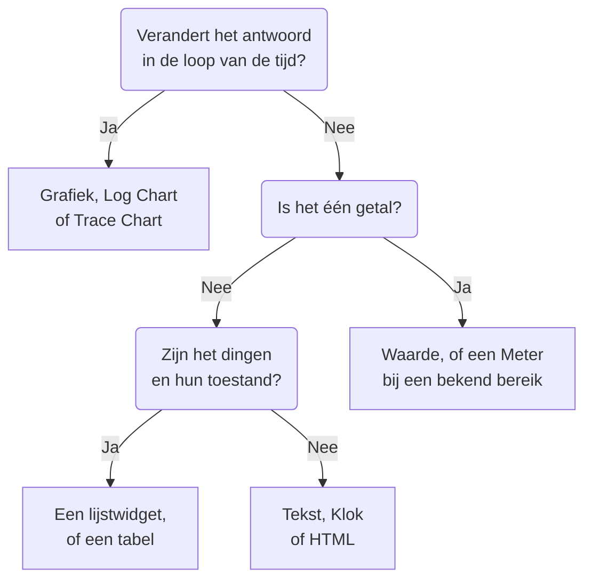

# Dashboard-widgets

Een widget is één tegel op een dashboard. Deze pagina beschrijft elke widget uit de catalogus **Widget toevoegen**, wat hij toont en de instellingen die ertoe doen, in de groepen van de catalogus zelf. Om widgets op het raster te plaatsen en op te slaan, zie [Een dashboard maken](/docs/dashboards/authoring).

:::cards
- [Welke widget moet ik gebruiken?](#welke-widget-moet-ik-gebruiken): Kies op basis van de vraag die de tegel beantwoordt.
- [Grafieken en getallen](#grafieken-en-getallen): Grafiek, Waarde, Meter en Tabel, vanuit een metrics-query.
- [Logs, traces en beveiliging](#logs-traces-en-beveiliging): Volumegrafieken, live stromen en lijsten.
- [Lijsten en tabellen sorteren](#lijsten-en-tabellen-sorteren): Sorteer op een kolom, en stel de volgorde in die iedereen ziet.
- [Als een widget niet kan worden weergegeven](#als-een-widget-niet-kan-worden-weergegeven): Wat een kapotte widget toont, en hoe je hem herstelt.
:::

## Welke widget moet ik gebruiken?

Begin bij de vraag die de tegel moet beantwoorden:

| De vraag | De widget |
| --- | --- |
| Hoe is een metric in de loop van de tijd veranderd? | **Grafiek** |
| Hoeveel logs, van welke ernst, in de loop van de tijd? | **Logboekgrafiek** |
| Hoe snel zijn verzoeken, en hoeveel mislukken er, in de loop van de tijd? | **Tracegrafiek** |
| Wat is één getal op dit moment? | **Waarde**, of **Meter** als het een bekend bereik heeft |
| Welke hosts, services of endpoints springen eruit? | **Tabel** of **Tracetabel** |
| Wat gebeurt er op dit moment? | **Logstroom**, **Tracelijst**, **Incidentenlijst** of **Waarschuwingslijst** |
| Zijn al onze sites in de lucht? | **Monitorlijst** |
| Halen we de betrouwbaarheid die we hebben beloofd? | **SLO** of **SLO-lijst** |
| In welke toestand zijn onze clusters en hosts? | Een widget uit de groep Infrastructuur |
| Waar ter wereld ligt ons netwerk, en wat ligt er plat? | **Netwerkkaart** |
| Een kop, een notitie, de tijd op een ander kantoor? | **Tekst** of **Klok** |
| Gegevens die buiten OneUptime staan? | Een widget uit de groep Externe gegevensbronnen |
| Iets wat geen enkele widget dekt? | **HTML**, zodra je zeker weet dat geen andere widget het doet |



De meeste dashboards combineren er een paar: een grafiek bovenaan, een of twee waarden ernaast, een tekstkop, en een of twee lijsten eronder.

## Grafieken en getallen

Deze vier widgets lezen een metrics-query, opgebouwd zoals de metrics-verkenner er een opbouwt: kies een metric en een aggregatie, voeg attribuutfilters toe, en groepeer op een attribuut om één reeks per waarde te krijgen.

### Grafiek

Een tijdreeks van een of meer metrics-query's over het tijdsbereik van het dashboard. **Chart Type** tekent haar als lijn-, staaf-, vlak-, gestapelde vlak- of cirkeldiagram. **Additional Queries** legt meer metrics op dezelfde assen, en **Formulas** combineert ze met `+`, `-`, `*`, `/`, `%`, `^` en haakjes, zoals in `(1 - a) * 100`. De weergave-instellingen van elke query voegen een legenda en een eenheid toe, een kleur, waarschuwings- en kritieke lijnen, en een snelheid per seconde voor tellers die alleen maar groeien.

Gebruik hem als de vorm van de lijn het verhaal vertelt: latentie, fouten, doorvoer of de lengte van een wachtrij.

### Waarde

Eén groot getal met een sparkline: de waarde van de query over het hele tijdsbereik, opgeteld voor een som of een telling, de hoogste voor een maximum, de laagste voor een minimum, en anders het gemiddelde. Een pijl vergelijkt de tweede helft van het bereik met de eerste, elke helft op dezelfde manier berekend, gekleurd volgens **Trend Direction**: of een hogere waarde beter of slechter is, of afgeleid uit de naam van de metric. Wijs de pijl aan om de waarde van beide helften te zien, en de sparkline om de waarde en het tijdstip van elk punt af te lezen. **Warning Threshold** maakt de achtergrond geel en **Critical Threshold** rood zodra de waarde ze bereikt.

Gebruik hem als één getal de vraag beantwoordt: het foutpercentage, de P95-latentie, of het aantal verzoeken dat vandaag is afgehandeld.

### Meter

Een wijzerplaat tussen een minimum en een maximum, 0 en 100 tenzij je ze instelt, met een gele zone vanaf **Warning Threshold** en een rode zone vanaf **Critical Threshold**.

Gebruik hem als de waarde binnen een bekend bereik valt: CPU- of schijfgebruik in procenten, of de capaciteit van een wachtrij.

### Tabel

Metric-waarden als rijen. **Group By Attributes** geeft één rij per waarde, zoals één per `host.name`; zonder groepering is elke rij een tijdsblok. **Metrics & Columns** bepaalt de kolommen: metrics, en formules daarover, zoals beschikbaarheid in procenten. Als je groepeert, maakt **Reduce across time** van de reeks van elke rij één waarde: de laatste waarde, het gemiddelde, de som, het minimum of het maximum.

Gebruik hem voor een uitsplitsing in plaats van een trend: de luidruchtigste hosts, de fouten per service, de verzoeken per endpoint.

## Tekst, klok en HTML

Deze widgets hebben geen gegevensbron nodig.

### Tekst

Een regel of een blok tekst, voor een kop, een notitie of links naar je runbooks. Zet **Markdown** aan om koppen, links, lijsten, code en tabellen te tekenen; anders wordt de tekst getoond zoals je hem typt, desgewenst vet, cursief of onderstreept.

### Klok

De huidige tijd in elke tijdzone, als cijfers of als analoge wijzerplaat, met een label zoals "Kantoor Sydney". Zonder tijdzone toont hij die van elke kijker zelf. Voeg er een per kantoor toe om te zien wie er wakker is.

### HTML

Je eigen HTML, CSS en JavaScript, getekend als een widget. De instellingen zijn de HTML-body, een optioneel stylesheet, een optioneel script en drie schakelaars voor machtigingen.

Gebruik hem als je iets nodig hebt wat geen ingebouwde widget dekt: een ingesloten badge van een derde partij, een tabel uit een interne API, een eigen legenda, of een set opgemaakte links naar je eigen tools.

#### Wat hij wel en niet kan

De widget wordt weergegeven in een afgeschermd frame (sandbox) op een eigen, geïsoleerde origin. Binnen dat frame kan je code zo ongeveer alles: DOM opbouwen, timers draaien, gegevens ophalen van elke URL, tekenen op een canvas.

Wat hij niet kan, is de OneUptime-pagina eromheen bereiken. Hij heeft geen toegang tot de DOM van het dashboard, de cookies, de lokale opslag of de API-sessie, en hij kan het browsertabblad niet ergens anders heen laten navigeren. Dat geldt of het dashboard nu privé is of openbaar gedeeld.

Twee gevolgen die je moet kennen voordat je iets plakt:

- Een `fetch` vanuit de widget is een cross-origin-verzoek vanaf een ondoorzichtige origin, dus de server die je aanroept moet het toestaan met CORS. De OneUptime-API aanroepen vanaf hier wordt niet ondersteund.
- De widget begint transparant. Stel in je CSS een achtergrond in op `body` als je wilt dat hij de kaart vult. In het donkere thema begint zijn tekst licht en heeft zijn element `<html>` de klasse `dark`: begin een CSS-regel met `html.dark` om alleen het donkere thema op te maken.

#### Dashboardvariabelen gebruiken

Schrijf `{{variableName}}` ergens in de HTML, de CSS of het JavaScript en het wordt vervangen door de huidige waarde van die variabele voordat de widget wordt weergegeven. Een nieuwe waarde kiezen geeft de widget opnieuw weer. Een plaatsaanduiding die een variabele noemt die niet bestaat, blijft staan zoals ze is.

Scripts krijgen dezelfde waarden, plus het tijdsbereik van het dashboard, in `window.ONEUPTIME`:

```javascript title="window.ONEUPTIME"
window.ONEUPTIME.variables.environment; // current value, or "" if unset
window.ONEUPTIME.startDate; // ISO 8601 string, start of the dashboard's time range
window.ONEUPTIME.endDate; // ISO 8601 string, end of it
```

De widget laadt opnieuw telkens als het dashboard vernieuwt, dus een widget die zijn eigen gegevens ophaalt, houdt gelijke tred met het vernieuwingsinterval.

#### Machtigingen

**Run JavaScript** (standaard aan) voert je script uit. Zet het uit om alleen opmaak en stijlen weer te geven: het script wordt dan helemaal uit de widget weggelaten, in plaats van alleen geblokkeerd.

**Open links in a new tab** (standaard aan) laat links en `window.open` een browsertabblad openen. Links openen altijd in een nieuw tabblad; de widget kan het dashboard zelf nooit laten navigeren.

**Allow forms to submit** (standaard uit) laat een `<form>` in de widget verzenden.

Wie het dashboard kan bewerken, bepaalt wat deze widget uitvoert, en iedereen die het dashboard bekijkt, voert het uit: op een openbaar dashboard horen daar anonieme bezoekers bij. Behandel bewerktoegang tot een dashboard met een HTML-widget zoals je toegang tot elke andere code die je uitbrengt zou behandelen.

## Logs, traces en beveiliging

| Widget | Wat hij toont | Instellingen die ertoe doen |
| --- | --- | --- |
| **Logboekgrafiek** | Logvolume in de loop van de tijd, één reeks per ernst, als staven, lijnen of vlakken. | Ernstniveaus, tekst die de body bevat, attribuutfilters. |
| **Logstroom** | De nieuwste logregels die aan een filter voldoen. | Ernst, tekst die de body bevat, attribuutfilters zoals `@service.name:checkout`, hoeveel rijen. |
| **Tracegrafiek** | Aantal verzoeken, aantal fouten of responstijd (gemiddeld, minimum, maximum, P50 tot P99) in de loop van de tijd. | De metric, welke spans er tellen, en een attribuut om de reeksen op te splitsen. |
| **Tracelijst** | De nieuwste traces, met hun duur en status. | Status, hoeveel rijen. |
| **Tracetabel** | De belangrijkste spannamen, statussen of attribuutwaarden naar aantal verzoeken, met mediane, gemiddelde, minimale en maximale responstijden. | Waarop de rijen worden gegroepeerd, en welke spans er tellen. |
| **Beveiligingsgebeurtenissen** | De nieuwste beveiligingsgebeurtenissen, met ernst, gebeurtenisklasse en host. | Ernstniveaus, gebeurtenisklassen, tekst die het bericht bevat. |
| **Stroom van beveiligingsgebeurtenissen** | Een stroom van beveiligingsgebeurtenissen vanaf hun bron, via hun gebeurtenisklasse, naar hun ernst. | Ernstniveaus, hoeveel gebeurtenissen. |

De tracewidgets tellen alleen rootspans, net als de trace-verkenner, tenzij je onderliggende spans opneemt in hun instellingen. Een gangbaar patroon is een latentiegrafiek bovenaan met een lijst trage traces eronder.

## Incidenten, waarschuwingen en monitors

| Widget | Wat hij toont | Filters |
| --- | --- | --- |
| **Incidentenlijst** | Incidenten met hun toestand en ernst. | Onopgelost, bevestigd of opgelost; ernst, toestand, monitors en labels. |
| **Waarschuwingslijst** | Waarschuwingen met hun toestand en ernst. | Onopgelost, bevestigd of opgelost; ernst, toestand, monitors en labels. |
| **Monitorlijst** | Monitors met hun huidige status. | Operationeel of niet, status, monitortype en labels, of een **Labelvariabele** die kijkers in de werkbalk kiezen. |

Net als de meeste lijstwidgets kunnen deze drie een honingraat tekenen van cellen gekleurd naar status in plaats van een tabel: kies dat onder **Weergavemodus**. Ze tonen de huidige toestand, wat het tijdsbereik van het dashboard ook is.

## Serviceniveaudoelstellingen

### SLO

Eén serviceniveaudoelstelling (SLO), getekend als één getal of als een lijn in de loop van de tijd.

**Instellingen**: welke SLO, of de SLO die in een dashboardvariabele is gekozen; welke van de drie getallen (SLI, Error Budget Remaining of Burn Rate); weergave als Tile of als Grafiek; en een optionele titel.

- **Tile** toont het huidige getal, plus een tweede regel als die er is: het doel onder de SLI, de resterende minuten onder het error budget. Een statuslabel kleurt het geheel.
- **Grafiek** tekent hetzelfde getal over het tijdsbereik van het dashboard, met het doel als stippellijn op de SLI-reeks. De geschiedenis wordt om de paar minuten weggeschreven door de evaluatieworker, dus een gloednieuwe SLO toont een lege grafiek totdat hij voor het eerst is geëvalueerd.

Gebruik hem als het dashboard antwoord geeft op "halen we wat we hebben beloofd?" in plaats van op "wat gebeurt er nu?".

De SLO-widget werkt op [openbare dashboards](/docs/dashboards/sharing). Wat er wordt gepubliceerd, zijn de kerncijfers van de SLO (de naam, het doel, de huidige SLI, het resterende error budget, de burn rate en de status), welke daarvan de widget ook tekent. De definitie blijft privé: de monitors die hij bewaakt, de labels, de beschrijving, de query en het evaluatieschema worden nooit naar een openbare kijker gestuurd. Een Tile-widget publiceert alleen die huidige getallen; een Grafiek-widget publiceert ook de geschiedenis van de ene reeks die hij tekent, en verder niets.

### SLO List

Elke SLO met zijn status, SLI, error budget en burn rate, met het minste resterende budget bovenaan. Filter hem op status of labels, of met een **Labelvariabele** die kijkers in de werkbalk kiezen. [SLO-metrics en -dashboards](/docs/slo/metrics) laat beide SLO-widgets in actie zien.

## Infrastructuur

Elk van deze widgets toont de resources die een agent of een collector aan OneUptime rapporteert. Verfijn ze in hun filters op cluster, host of naamruimte, en toon ze als lijst of als honingraat.

| Groep | Widgets | Gevuld door |
| --- | --- | --- |
| **Hosts** | **Hosts**, met hun verbindingsstatus, OS, CPU en geheugen | Elke OpenTelemetry-collector die `host.name` verstuurt |
| **Kubernetes** | **Pods**, **Knooppunten**, **Naamruimten**, **Implementaties**, **StatefulSets**, **DaemonSets**, **Taken**, **CronJobs** | De [Kubernetes-agent](/docs/monitor/kubernetes-agent) |
| **Docker** | **Hosts**, **Containers**, **Images**, **Netwerken**, **Volumes** | De Docker-agent |
| **Docker Swarm** | **Knooppunten**, **Services** | De Docker Swarm-agent |
| **Podman** | **Hosts**, **Containers**, **Images**, **Netwerken**, **Volumes** | De Podman-agent |
| **Proxmox** | **Knooppunten**, **Gasten** | De Proxmox-agent |
| **VMware** | **Hosts**, **Virtuele machines** | De VMware-agent, of een vCenter die je koppelt |
| **Ceph** | **OSD's**, als muur gekleurd naar toestand, en **Pools** | De Ceph-agent |
| **Opslagarrays** | **Volumes**, en **Hardware** als muur gekleurd naar status | De Storage Array-agent |

Gebruik ze voor één pagina die de toestand van je infrastructuur combineert met de telemetrie van de workloads die erop draaien.

### Network Map

Je netwerksites getekend op de wereldkaart, elk vastgezet op zijn eigen breedte- en lengtegraad en gekleurd naar de monitorstatus die erop is samengevat. Sites die dicht bij elkaar liggen, delen een markering met het aantal erin; een markering die voor precies één site staat, opent die site als je erop klikt.

De kaart kadert zichzelf op de sites die hij heeft getekend: een netwerk binnen één land vult het kader met dat land, een netwerk verspreid over continenten opent op de hele wereld. Er zijn geen knoppen om te zoomen of te pannen: een dashboardtegel is een plaatje, en de pagina Network Map onder Network is waar je door de hiërarchie loopt.

Boven de kaart staat hoeveel sites er plat liggen, omdat een rood puntje van twee pixels tussen tweehonderd groene niet iets is wat iemand op dashboardafstand leest. Eronder zegt een dekkingsregel wat de kaart niet toont: sites zonder coördinaten, en of het maximum aantal rijen is bereikt.

**Instellingen**: titel, kaart- of lijstweergave, maximaal aantal getekende sites, of sitenamen worden getoond, en filters op sitetype en status. Sitenamen verdwijnen automatisch als de kaart te vol wordt om ze te lezen; de tooltip noemt nog steeds elke markering.

Een site verschijnt alleen als hij coördinaten heeft. Voeg breedte- en lengtegraad toe aan de site (of importeer ze uit een CSV) om hem vast te zetten.

## Externe gegevensbronnen

De groep Externe gegevensbronnen tekent een **Grafiek**, een **Waarde**, een **Meter** of een **Tabel** uit een systeem dat niet van OneUptime is: Prometheus, PostgreSQL, MySQL, SQL Server, ClickHouse, Loki, Elasticsearch of elke REST-API. Je koppelt het systeem één keer, en schrijft daarna de query van elke widget in de eigen taal van dat systeem. [Externe gegevensbronnen](/docs/dashboards/data-sources) laat zien hoe.

## Lijsten en tabellen sorteren

Klik op de kop van een kolom om een lijst of tabel erop te sorteren: een eerste klik sorteert zoals de tabel hieronder zegt, de volgende klik andersom, en die daarna zet de widget terug in zijn eigen volgorde. Op de kolom waarop de widget al gesorteerd is, draait een klik de volgorde om. Een pijl markeert de kolom waarop de rijen gesorteerd zijn.

| Kolom | Eerste klik | Volgende klik |
| --- | --- | --- |
| Een status, toestand of ernst | Slechtste eerst | Beste eerst |
| Een tijd | Nieuwste eerst | Oudste eerst |
| Een getal | Hoogste eerst | Laagste eerst |
| Tekst | A tot Z | Z tot A |

Slechtste volgt de eigen volgorde van je project: een monitorstatus op zijn prioriteit, de ernst en toestand van een incident of waarschuwing op de volgorde waarin je ze bijhoudt, en een resource die uitgevallen, niet gereed of uitgeschakeld is vóór een gezonde. De fase van een pod sorteert Failed, dan Unknown, dan Pending, dan Running en Succeeded. De SLI en het foutbudget van een SLO, en de VMID van een Proxmox-gast, sorteren de laagste eerst.

De hele lijst wordt gesorteerd, niet alleen de rijen op het scherm: een lijst die 25 rijen toont, gesorteerd met de slechtste eerst, toont de 25 slechtste van allemaal. Rijen die gelijk eindigen, houden de eigen volgorde van de widget. Een kolom waarop een lijst niet als geheel gesorteerd kan worden, zoals het bericht van een beveiligingsgebeurtenis, sorteert niet.

### Je eigen sortering

Je sortering is alleen van jou: je browser onthoudt hem voor die widget op dat dashboard, zodat herladen of een wandscherm dat herstart hem behoudt, en niemand anders hem ziet. De klik die de widget terugzet in zijn eigen volgorde, vergeet je sortering, en de widget volgt daarna zijn eigen volgorde, ook als een bewerker die later verandert.

### De volgorde die iedereen ziet

Om de volgorde in te stellen waarin een widget voor iedereen opent, bewerk je hem en kies je de volgorde onder **Sorteren**, of klik je op een kolomkop in zijn **Live Preview**, en klik je daarna op **Wijzigingen opslaan**. Je ziet de nieuwe volgorde meteen; wie de widget zelf gesorteerd heeft, houdt zijn sortering.

De dashboardsjablonen openen hun lijsten van hosts, nodes, pods, Swarm-services en netwerkapparaten met de slechtste eerst.

Via de API en Terraform is de volgorde de `arguments.sort` van de widget: een kolom en een richting, bijvoorbeeld `status:desc`. Een lijstwidget weigert een kolom die hij niet heeft, en de fout noemt de sorteringen die hij heeft.

## Op een openbaar dashboard

Een [openbaar dashboard](/docs/dashboards/sharing) tekent de meeste widgets voor zijn bezoekers, en elk toont alleen wat hij moest tonen. Een paar kunnen niet worden weergegeven zonder aangemelde sessie:

- **Logboekgrafiek**, **Tracegrafiek**, **Tracetabel**, **Beveiligingsgebeurtenissen** en **Stroom van beveiligingsgebeurtenissen** melden op hun plek dat ze niet beschikbaar zijn op openbare dashboards.
- De widgets van Externe gegevensbronnen worden helemaal weggelaten uit een openbaar dashboard, omdat hun instellingen de query zelf zijn.

## Als een widget niet kan worden weergegeven

Een widget die niet kan worden getekend, toont **Deze widget kon niet worden weergegeven** op zijn eigen plek, en de rest van het dashboard blijft werken. Dat gebeurt als OneUptime geen widget van dat type heeft (een die is verwijderd, verkeerd gespeld toen het dashboard via de API werd geschreven, of toegevoegd door een nieuwere versie), of als de widget faalt tijdens het tekenen, bijvoorbeeld omdat zijn opgeslagen instellingen onvolledig zijn.

Als je het dashboard kunt bewerken, klik je op de widget op **Widget bewerken**. Het dashboard schakelt naar bewerkmodus met de instellingen van die widget open: herstel ze, of klik op **Widget verwijderen**, en daarna op **Wijzigingen opslaan**. Een widget die faalde tijdens het tekenen, biedt ook **Opnieuw proberen**, en wordt opnieuw getekend bij de volgende automatische vernieuwing of als je het tijdsbereik wijzigt.

Bezoekers van een openbaar dashboard krijgen alleen te horen dat de widget niet kon worden weergegeven.

## Volgende stappen

:::cards
- [Dashboard-variabelen en filters](/docs/dashboards/variables): Laat kijkers de widgets op een service, een host of een klant richten.
- [Externe gegevensbronnen](/docs/dashboards/data-sources): Grafieken uit Prometheus, SQL, Loki en meer naast je eigen gegevens.
- [Een dashboard maken](/docs/dashboards/authoring): Widgets toevoegen, schikken en opslaan.
- [Delen en publieke dashboards](/docs/dashboards/sharing): Deel het dashboard buiten je team.
:::
