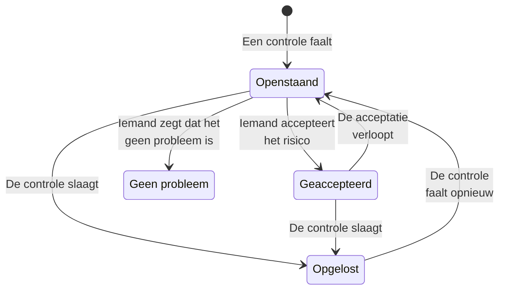

# Controles en problemen van Gegevensbeveiliging

Gegevensbeveiliging voert 34 controles uit op elke opslag, in negen groepen. Een controle leest wat er bekend is over één opslag - hoe die is geconfigureerd, wat erin is gevonden, wie erbij kan, waar die staat - en slaagt, faalt of kan het niet bepalen. Een controle die faalt, opent één probleem op die opslag, en het probleem sluit vanzelf zodra de controle slaagt. Deze pagina somt elke controle op, legt uit hoe de ernst en de risicoscore van een probleem worden bepaald, en wat er tijdens zijn levensloop met een probleem gebeurt. Beveiligingsgebeurtenissen, Network Flows en de beveiligingsadreskluis zijn van OneUptime zelf, bewaard voor je beveiliging: opgegeven, nooit gescand of gecontroleerd (zie [Opslag die OneUptime voor je beveiliging bewaart](/docs/data-security/compliance#opslag-die-oneuptime-voor-je-beveiliging-bewaart)).

:::cards
- [Hoe een controle beslist](#hoe-een-controle-beslist): Slagen, falen of niet te bepalen, en hoe erg een falen is.
- [Elke controle](#elke-controle): Alle 34, met wat elke controle nagaat en hoe je het oplost.
- [Risicoscore](#risicoscore): Hoe problemen binnen een ernst worden geordend.
- [Wat er met een probleem gebeurt](#wat-er-met-een-probleem-gebeurt): Openstaand, opgelost, geaccepteerd, geen probleem, hoe elk is opgelost, en oplossingen die tot in productie worden gevolgd.
- [De analyse van OneUptime AI](#de-analyse-van-oneuptime-ai): Of een probleem echt is, wat het in gevaar brengt, wat de oplossing zou breken en de kortste weg naar opgelost.
- [Hier oplossen](#hier-oplossen): Sluit een blootstelling, of zet een ontbrekende bescherming aan, met één klik.
- [Problemen met één oorzaak](#problemen-met-één-oorzaak): De problemen die één fout veroorzaakte, gegroepeerd, en hun oorzaak één keer opgelost.
:::

## Hoe een controle beslist

Elke controle leest feiten over een opslag en antwoordt op een van vier manieren:

| Antwoord | Wat het betekent | Wat er met het probleem gebeurt |
| --- | --- | --- |
| Slaagt | De controle vindt niets mis. | Een openstaand of geaccepteerd probleem wordt opgelost. |
| Faalt | De controle vindt het probleem, en zegt in één zin wat ze zag: het bewijs van het probleem. | Er opent een probleem, of het openstaande probleem wordt bijgewerkt. |
| Niet te bepalen | Een feit kon niet worden gelezen: een machtiging die de rol niet heeft, een aanroep die mislukte. | Er verandert niets: een openstaand probleem blijft open, omdat niemand mag concluderen dat een probleem is opgelost als OneUptime niet kon kijken. |
| Niet van toepassing | De soort van de opslag heeft zo'n instelling niet. | Een openstaand probleem wordt opgelost. |

### Ernst volgt de gegevens

Hetzelfde probleem weegt zwaarder bij gevoeligere gegevens. Elke controle geeft een ernst voor elk gevoeligheidsniveau, en een probleem krijgt die van zijn opslag: een openbare bucket met kaartnummers is Kritiek, een openbare bucket met websiteafbeeldingen maar Laag. Een streepje betekent helemaal geen probleem. De gevoeligheid van een opslag komt uit zijn bevindingen (zie [Gevoelige gegevenstypen](/docs/data-security/data-types#gevoeligheid)), dus inhoudsvoorbeelden maken de ernst juist.

Een paar controles bepalen de ernst in plaats daarvan op basis van wat ze zagen. **Er zijn geheimen in opgeslagen** is Hoog op elke opslag, en Kritiek op een opslag die openbaar is of gedeeld wordt met andere accounts.

## Elke controle

De ernst staat vermeld voor gegevens met Beperkt, Vertrouwelijk, Intern en Openbaar, in die volgorde. De pagina van elk probleem toont de volledige oplossing voor zijn eigen opslag - de stappen in de console, de CLI-opdracht en, waar het past, de Terraform - met de naam en de regio van de opslag ingevuld.

### Blootstelling

| Controle | Draait op | Wat het controleert | Ernst | Hoe op te lossen |
| --- | --- | --- | --- | --- |
| Iedereen op het internet kan het lezen (`public-read`) | Objectopslag, datawarehouse, zoekdienst | Het beleid, de ACL of de IAM-bindingen van de opslag laten iedereen de gegevens lezen zonder aanmelding. | Kritiek / Kritiek / Hoog / Laag | Verwijder elke toekenning aan anonieme principals of aan alle geverifieerde principals. Bestanden die openbaar moeten zijn, horen in een opslag die als **Bewust openbaar** is gemarkeerd en verder niets bevat. |
| Iedereen op het internet kan het wijzigen (`public-write`) | Objectopslag, datawarehouse, zoekdienst | Het beleid, de ACL of de IAM-bindingen van de opslag laten iedereen de gegevens schrijven of verwijderen. | Kritiek / Kritiek / Kritiek / Hoog | Verwijder elke schrijf- of verwijdertoekenning aan anonieme principals of aan alle geverifieerde principals. |
| Openbare toegang is niet geblokkeerd (`public-access-not-blocked`) | AWS S3 Bucket | S3 Block Public Access staat niet volledig aan voor de bucket of zijn account, dus één beleidswijziging kan hem openbaar maken. | Hoog / Gemiddeld / Laag / — | Zet alle vier de instellingen van Block Public Access aan voor de bucket. |
| De database accepteert verbindingen vanaf het internet (`internet-reachable`) | Database, datawarehouse, zoekdienst, cache | De database heeft een openbaar endpoint of openbare netwerktoegang aan staan. | Hoog / Hoog / Gemiddeld / Laag | Zet het openbare endpoint uit, en bereik de database via een privénetwerk of een bastion. |
| Zijn firewall laat elk adres binnen (`open-to-all-addresses`) | Database, datawarehouse, zoekdienst, cache | Een firewallregel of geautoriseerd netwerk staat 0.0.0.0/0 of het hele adresbereik toe. | Kritiek / Kritiek / Hoog / Gemiddeld | Vervang de regel die alles toestaat door de adressen of netwerken die toegang nodig hebben. |
| Een snapshot ervan kan door iedereen worden hersteld (`snapshot-public`) | Database, snapshot | Een databasesnapshot wordt openbaar gedeeld, dus elk cloudaccount kan een volledige kopie herstellen. | Kritiek / Kritiek / Kritiek / Hoog | Maak de snapshot privé. |
| Een snapshot ervan wordt gedeeld met andere accounts (`snapshot-shared-externally`) | Database, snapshot | Een databasesnapshot wordt gedeeld met accounts buiten je gekoppelde accounts. | Hoog / Hoog / Gemiddeld / Laag | Stop het delen van de snapshot met de accounts die hem niet zouden moeten hebben. |
| Accounts buiten je organisatie kunnen erbij (`shared-with-external-accounts`) | Elke opslag behalve telemetrie | Het beleid van de opslag geeft toegang aan accounts, tenants of projecten die niet aan OneUptime zijn gekoppeld. | Hoog / Hoog / Gemiddeld / Laag | Bekijk elke externe principal, en verwijder de principals die geen toegang nodig hebben. |

### Versleuteling

| Controle | Draait op | Wat het controleert | Ernst | Hoe op te lossen |
| --- | --- | --- | --- | --- |
| De gegevens zijn niet versleuteld in rust (`not-encrypted-at-rest`) | Elke opslag behalve telemetrie | Opslagversleuteling staat uit. | Hoog / Gemiddeld / Laag / — | Zet versleuteling in rust aan. Een RDS-instance kan niet ter plekke worden versleuteld: herstel een versleutelde kopie van de snapshot. |
| Beperkte gegevens staan niet onder je eigen sleutel (`no-customer-managed-key`) | Elke opslag behalve telemetrie | De opslag bevat Beperkte gegevens, maar is versleuteld met de standaardsleutel van de provider, niet met een door de klant beheerde sleutel. | Gemiddeld / — / — / — | Versleutel de opslag met een sleutel die je beheert in je sleuteldienst. |
| Onversleutelde verbindingen zijn toegestaan (`encryption-in-transit-not-enforced`) | Elke opslag behalve telemetrie | De opslag accepteert verbindingen die geen TLS gebruiken. | Hoog / Gemiddeld / Laag / — | Vereis TLS voor elke verbinding. Weiger op S3 elk verzoek waarbij `aws:SecureTransport` false is. |
| Het accepteert TLS ouder dan 1.2 (`weak-tls`) | Elke opslag behalve telemetrie | De minimale TLS-versie is 1.0 of 1.1. | Gemiddeld / Gemiddeld / Laag / — | Stel de minimale TLS-versie in op 1.2 of hoger. |

### Herstel

| Controle | Draait op | Wat het controleert | Ernst | Hoe op te lossen |
| --- | --- | --- | --- | --- |
| Het heeft geen back-ups, of bewaart ze korter dan 7 dagen (`no-backups`) | Database, datawarehouse | Automatische back-ups staan uit, of worden korter dan 7 dagen bewaard. | Hoog / Gemiddeld / Laag / — | Zet automatische back-ups aan, en bewaar ze minstens 7 dagen. |
| Herstel naar een tijdstip staat uit (`no-point-in-time-recovery`) | AWS DynamoDB Table, Azure Cosmos DB Account | De tabel of database kan niet worden hersteld naar een moment vóór een vergissing. | Gemiddeld / Laag / — / — | Zet herstel naar een tijdstip aan. |
| Het kan in één stap worden verwijderd (`deletion-protection-off`) | Database, datawarehouse | Verwijderingsbeveiliging staat uit. | Gemiddeld / Laag / — / — | Zet verwijderingsbeveiliging aan. |
| Verwijderde of overschreven bestanden kunnen niet worden hersteld (`deleted-data-not-recoverable`) | Objectopslag | Versiebeheer en voorlopig verwijderen staan allebei uit. | Gemiddeld / Laag / — / — | Zet versiebeheer of voorlopig verwijderen aan. |

### Zichtbaarheid

| Controle | Draait op | Wat het controleert | Ernst | Hoe op te lossen |
| --- | --- | --- | --- | --- |
| Niemand zou weten wie het las (`access-not-logged`) | Elke opslag behalve telemetrie | Leesacties op de opslag worden niet gelogd: geen toegangslogs, geen auditlogs voor gegevenstoegang. | Hoog / Gemiddeld / Laag / — | Zet toegangs- of auditlogging aan voor leesacties: S3-servertoegangslogs of CloudTrail-gegevensgebeurtenissen, diagnostische logs StorageRead van Azure, auditlogs Data Access van Cloud Storage. |

### Toegang

| Controle | Draait op | Wat het controleert | Ernst | Hoe op te lossen |
| --- | --- | --- | --- | --- |
| Iedereen met de accountsleutel kan alles lezen (`shared-key-access`) | Azure Storage Account | Het opslagaccount staat toegang met gedeelde sleutels toe, wat Microsoft Entra ID omzeilt en geen auditspoor per persoon achterlaat. | Gemiddeld / Laag / — / — | Zet applicaties over op Microsoft Entra ID, en zet daarna toegang met de opslagaccountsleutel uit. |
| Objecten kunnen hun eigen toegangsregels hebben (`object-acls-enabled`) | AWS S3 Bucket, Google Cloud Storage Bucket | Object-ACL's staan aan, dus één object kan openbaar worden gemaakt terwijl de bucket privé lijkt. | Laag / Laag / — / — | Zet op S3 Object Ownership op Bucket owner enforced. Zet op Cloud Storage uniforme toegang op bucketniveau aan. |
| Meer dan 25 identiteiten kunnen Beperkte gegevens lezen (`many-readers`) | Elke opslag behalve telemetrie | Meer identiteiten dan de meeste teams kunnen beoordelen, hebben leestoegang tot de opslag. | Gemiddeld / — / — / — | Open de pagina **Wie erbij kan** van de opslag, en verwijder de toegang die ongebruikt is of ruimer dan nodig. |
| Identiteiten die 90 dagen niet zijn gebruikt, kunnen er nog bij (`unused-access`) | Elke opslag behalve telemetrie | Rollen en gebruikers die 90 dagen niet zijn gebruikt, hebben nog toegang tot de gevoelige gegevens van de opslag. | Gemiddeld / Laag / — / — | Open de pagina **Wie erbij kan** van de opslag, waar ze als **90 dagen niet gebruikt** zijn gemarkeerd, en verwijder de toegang die elk niet meer nodig heeft. |

### Gegevenshygiëne

| Controle | Draait op | Wat het controleert | Ernst | Hoe op te lossen |
| --- | --- | --- | --- | --- |
| Er zijn geheimen in opgeslagen (`secrets-stored`) | Elke opslag behalve telemetrie | Er zijn wachtwoorden, API-sleutels, tokens of privésleutels gevonden in de gegevens van de opslag. | Hoog / Hoog / Hoog / Hoog | Roteer elk gevonden geheim alsof het is uitgelekt. Verplaats geheimen naar een secretmanager en verwijder ze uit de opslag. |
| Beveiligingscodes van kaarten worden opgeslagen (`card-security-codes-stored`) | Elke opslag behalve telemetrie | Er zijn CVV- of CVC-codes gevonden. PCI DSS verbiedt ze te bewaren nadat een betaling is geautoriseerd, versleuteld of niet. | Kritiek / Kritiek / Kritiek / Kritiek | Stop de code die ze schrijft, verwijder de opgeslagen codes, en controleer dat er geen in back-ups achterblijven. |
| Kaartnummers worden leesbaar opgeslagen (`card-numbers-readable`) | Elke opslag behalve telemetrie | Er zijn volledige kaartnummers in leesbare vorm gevonden. PCI DSS eist dat ze onleesbaar zijn, waar ze ook worden opgeslagen. | Hoog / Hoog / Hoog / Hoog | Tokeniseer kaartnummers bij je betaalprovider, of versleutel ze op veldniveau, en verwijder de leesbare kopieën. |
| Wachtwoorden worden als platte tekst opgeslagen (`plaintext-passwords`) | Elke opslag behalve telemetrie | Een wachtwoordveld bevat waarden die geen wachtwoordhashes zijn (bcrypt, argon2, scrypt of PBKDF2). | Kritiek / Kritiek / Kritiek / Kritiek | Hash wachtwoorden met bcrypt, scrypt of argon2, migreer de opgeslagen wachtwoorden, en laat elk account zijn wachtwoord opnieuw instellen. |
| Productiegegevens zijn gekopieerd naar een niet-productieopslag (`production-data-in-non-production`) | Elke opslag behalve telemetrie | Waarden die in een productieopslag zijn gevonden, zijn ook hier gevonden, in een ontwikkel-, test- of stagingopslag. | Hoog / Gemiddeld / — / — | Vervang de kopie door gemaskeerde of synthetische gegevens, en verwijder de echte gegevens uit de niet-productieopslag. |
| Gevoelige gegevens die 90 dagen niemand heeft gebruikt (`stale-sensitive-data`) | Elke opslag behalve telemetrie | De opslag bevat gevoelige gegevens en is 90 dagen niet gelezen of beschreven. | Gemiddeld / Laag / — / — | Bevestig dat de gegevens niet meer nodig zijn, en archiveer ze daarna met een bewaardatum, of verwijder ze. |
| Een nieuwe kolom bevat persoonsgegevens (`new-personal-data-column`) | Elke opslag behalve telemetrie | Een kolom die in de laatste 14 dagen is toegevoegd, heeft een naam die zegt dat ze persoonsgegevens bevat. | Hoog / Hoog / Gemiddeld / Gemiddeld | Bevestig dat de kolom deze gegevens hoort te bevatten, en leg vast waarom. Als dat niet zo is, verwijder de kolom of stop met ernaar schrijven. |
| Niemand is eigenaar van deze gevoelige opslag (`no-owner`) | Elke opslag | De opslag bevat gevoelige gegevens en heeft geen eigenaar. | Gemiddeld / Laag / — / — | Voeg een eigenaar toe op de pagina **Eigenaren** van de opslag, of een eigenaarsregel die bij zijn tags past. |

### Telemetrie

| Controle | Draait op | Wat het controleert | Ernst | Hoe op te lossen |
| --- | --- | --- | --- | --- |
| Gevoelige gegevens bereiken je telemetrie (`sensitive-data-in-telemetry`) | Telemetrie | Logs, traces, metrieken, uitzonderingen, herhalingen of AI-gesprekken bevatten gevoelige gegevens die geen regel bij de inname maskeert. | Hoog / Gemiddeld / Laag / — | Druk op **Opschonen** bij elke bevinding om de gegevens bij de inname te maskeren, en herstel daarna de code die ze schrijft. |
| Geheimen bereiken je telemetrie (`secrets-in-telemetry`) | Telemetrie | Wachtwoorden, API-sleutels of tokens staan in logs, traces, metrieken, uitzonderingen of AI-gesprekken. | Kritiek / Kritiek / Kritiek / Kritiek | Roteer eerst het geheim, druk daarna op **Opschonen** en herstel de code die het schrijft. |

### Residentie

| Controle | Draait op | Wat het controleert | Ernst | Hoe op te lossen |
| --- | --- | --- | --- | --- |
| Gegevens worden opgeslagen buiten de regio's waar ze mogen staan (`residency-violation`) | Elke opslag behalve telemetrie | De regio van de opslag, of een regio waarnaar de gegevens worden gerepliceerd, overtreedt een residentieregel. | Hoog / Hoog / Gemiddeld / — | Verplaats de gegevens naar een toegestane regio, of stop met kopiëren naar de andere. Is de overdracht rechtmatig, accepteer dan het probleem en leg vast waarom. |

### AI

| Controle | Draait op | Wat het controleert | Ernst | Hoe op te lossen |
| --- | --- | --- | --- | --- |
| Gevoelige gegevens worden naar een AI-provider gestuurd (`sensitive-data-to-ai`) | AI-gesprekken | AI-gesprekken die in OneUptime zijn vastgelegd, brengen gevoelige gegevens naar een modelprovider. | Kritiek / Hoog / Laag / — | Verwijder gevoelige waarden voordat prompts worden verstuurd, of stuur deze aanroepen naar een model dat je zelf host. |
| Beperkte gegevens staan in een opslag die voor AI wordt gebruikt (`sensitive-data-in-ai-store`) | Elke opslag behalve telemetrie | Een opslag die is getagd als trainings- of retrievalgegevens voor AI, bevat Beperkte gegevens. | Hoog / Gemiddeld / — / — | Verwijder of maskeer de Beperkte gegevens voordat ze worden gebruikt om een model te trainen of te gronden. |

## Risicoscore

De ernst zegt hoe erg een probleem is. De risicoscore, van 0 tot 100, ordent de problemen van één ernst, op basis van wat hetzelfde probleem erger maakt:

```text
risk = severity + 10 × exposure + 6 × volume + 5 × activity + 4 × production, at most 100
```

| Factor | Punten |
| --- | --- |
| Ernst | 75 voor Kritiek, 50 voor Hoog, 25 voor Gemiddeld, 0 voor Laag |
| Blootstelling | 10 voor Openbaar, 8 voor Andere accounts, 6 voor Bereikbaar via internet, 3 voor Onbekend, 0 voor Privé |
| Volume | Tot 6, naar het geschatte aantal gevoelige records van de opslag op een logaritmische schaal: 1 voor 10 records, 3 voor 1.000, 5 voor een miljoen, 6 voor tien miljoen of meer |
| Activiteit | 5 als Security Operations de afgelopen week detecties op de opslag zag |
| Productie | 4 voor een opslag in productie |

De extra's tellen samen hoogstens 25 punten op, dus een probleem scoort nooit lager dan een probleem met een lagere ernst. Een openbare productiebucket met een miljoen records met Beperkte gegevens scoort 75 + 10 + 5 + 4 = 94 voor een kritiek probleem. Elk probleem vermeldt de factoren die aan zijn score hebben bijgedragen, met hun punten, en de opslag toont de score van zijn ergste openstaande probleem.

De omgeving van een opslag - Productie, Staging, Development, Test of Onbekend - komt uit zijn tags (`env`, `environment`, `stage`, `tier` en dergelijke) of, zonder zo'n tag, uit de woorden in zijn naam, zoals `prod`, `staging`, `dev` of `qa`. Stel haar in op de opslag als geen van beide het zegt.

## Wat er met een probleem gebeurt



OneUptime opent, werkt bij en lost problemen op terwijl de controles draaien. Wat een mens met een probleem doet, is beslissen wat er daarna gebeurt:

| Status | Hoe het daar komt | Wat er volgt |
| --- | --- | --- |
| **Openstaand** | De controle faalt nu op de opslag. | Het telt mee in het Overzicht, in de samenvatting van de opslag en in compliance, tot de controle slaagt. |
| **Opgelost** | De controle slaagde bij een latere run, is niet meer van toepassing of is uitgezet, of de opslag is gearchiveerd. Een mens kan ook **Als opgelost markeren** kiezen: de opslag wordt dan meteen opnieuw gecontroleerd. | Het zegt hoe het is opgelost (zie hieronder). Het opent opnieuw als de controle weer faalt, en het probleem telt hoe vaak het is heropend. |
| **Geaccepteerd** | Een mens koos **Risico accepteren**, met een **Reden** en een datum in **Geaccepteerd tot**, hoogstens een jaar vooruit. | Het blijft gesloten tot die datum, en opent daarna opnieuw als de controle nog steeds faalt. Accepteer het dan opnieuw als de reden nog geldt. |
| **Geen probleem** | Een mens koos **Geen probleem** en zei waarom bij **Reden**: de bevinding was onjuist. | Het blijft gesloten, ook zolang de controle faalt, en houdt de reden. **Heropenen** zet het terug op Open. |

Beveiligingsleden, Beveiligingsbeheerders, Projectbeheerders en Projecteigenaren kunnen de status van een probleem wijzigen, en het met **Toewijzen** bij een persoon of een team neerleggen. Elke wijziging wordt in de **Tijdlijn** van het probleem geschreven: wanneer het opende, elke wijziging van de ernst, elke statuswijziging en wie die deed, de gevraagde hercontroles, en wat de integraties deden.

Een probleem dat opnieuw opent, behoudt zijn geschiedenis. Geaccepteerde risico's worden elke dag opnieuw bekeken, zodat een acceptatie op tijd verloopt, ook als er niets is gescand.

### Hoe het is opgelost

Een opgelost probleem zegt hoe, boven aan zijn pagina en in de lijst met problemen, waarin u daarop kunt filteren onder **Oplossing**:

| Oplossing | Wat het betekent |
| --- | --- |
| **Hersteld in de code** | De pull request van een codefix is uitgeleverd, en de nieuwe versie van de service schrijft de gegevens niet meer. Het probleem zegt welke en wanneer: 'Opgelost in pull request #482, gedeployed in versie 2.4.1, geverifieerd'. |
| **Hersteld in de infrastructuurcode** | Een pull request op de Terraform, CloudFormation of Bicep die de opslag declareert, is gemerged, en de opslag slaagde voor zijn controle zodra de wijziging was toegepast. |
| **Hersteld vanaf hier** | Een responsactie ([Hier oplossen](#hier-oplossen)) heeft de opslag gewijzigd, en de controle slaagde daarna. |
| **Ingedamd bij inname** | Elke bevinding van een telemetrieprobleem wordt door een opschoonregel verborgen voordat ze wordt opgeslagen. Dit is geen oplossing: de code schrijft de gegevens nog steeds, naar stdout en naar elke andere plek waar de service zijn telemetrie naartoe stuurt. Het probleem zegt dat in oranje, met wat de regel de afgelopen week heeft gewijzigd, en biedt **Code herstellen** aan. |
| **Controle geslaagd** | De controle slaagt, zonder dat OneUptime iets heeft gewijzigd. |
| **Opgelost door een persoon** | Iemand koos **Als opgelost markeren**. De opslag wordt meteen opnieuw gecontroleerd, en het probleem opent opnieuw als de controle nog steeds faalt. |
| **Niet meer gecontroleerd** | De controle is uitgezet, of is niet meer van toepassing op de opslag. |
| **Opslag gearchiveerd** | De opslag is uit zijn bron verdwenen. |

Het Overzicht telt de problemen die bij de bron zijn opgelost apart van de lekken die alleen bij inname zijn ingedamd, en **In uw telemetrie** houdt een ingedamde bevinding in beeld, gemarkeerd als **Opgeschoond**, totdat de code stopt met het schrijven ervan.

### Oplossingen gevolgd tot in productie

Een pull request die OneUptime AI voor een probleem opende (**Oplossen met AI**, of één pull request voor een [groep problemen](#problemen-met-één-oorzaak)), heeft nog niets opgelost op het moment dat hij wordt gemerged. OneUptime volgt hem totdat productie het bewijst:

- **Een lek in code.** OneUptime wacht op een vastgelegde deploy van de service die de merge bevat, en houdt daarna de nieuwe versie in de gaten. Waar een opschoonregel de gegevens verbergt, mag de regel in die versie geen enkele waarde wijzigen; waar geen regel dat doet, mag geen record van die versie de gegevens bevatten op de plekken waar ze zijn gevonden. De nieuwe versie moet ook een dag draaien en minstens evenveel logs of spans sturen als de oude deed in het uur waarin het lek het laatst werd gezien. Dan is het probleem **Hersteld in de code**. Eén gewijzigde waarde, of één record dat de gegevens nog bevat, betekent dat de fix het lek niet heeft gestopt, en over een versie die in een week te weinig stuurt, valt niets te zeggen. Deploys worden gekoppeld via hun commit: leg ze vast met `oneuptime deploy`, of stuur `vcs.ref.head.revision` mee (zie [Deploys en wijzigingen](/docs/telemetry/change-events)).
- **De configuratie van een opslag.** Als de pull request wordt gemerged, worden zijn opslagen meteen opnieuw gelezen. Elk probleem waarvan de controle daarna slaagt, is **Hersteld in de infrastructuurcode**. Slaagt een opslag een dag na de merge bij het opnieuw lezen nog steeds niet voor zijn controle, dan is de fix **gemerged, niet toegepast**: de eigenaren van de opslag en de persoon die om de pull request vroeg, krijgen één keer een e-mail, en de tijdlijnen van het probleem en de opslag vermelden het. Meestal ontbreekt er een apply.
- **De opschoonregel blijft.** Na een geverifieerde codefix blijft de opschoonregel die het lek indamde staan, zodat een regressie wordt verborgen zodra die binnenkomt. Het probleem zegt dat de regel sinds de fix niets heeft gewijzigd, en biedt **Regel verwijderen** aan.
- **Een regressie.** Een geverifieerde fix wordt daarna gevolgd: als een behouden regel weer waarden wijzigt, of de scan de gegevens weer vindt, opent het probleem opnieuw en zegt het welke versie ze terugbracht. Het blijft open totdat het opnieuw is opgelost, ook zolang een regel de gegevens verbergt.

Elke stap staat op de **Tijdlijn** van het probleem en op die van de opslag, en AI-resultaten telt de geverifieerde oplossingen per soort (zie [Hoe goed OneUptime AI het doet](/docs/ai/ai-sre#hoe-goed-oneuptime-ai-het-doet)).

## De analyse van OneUptime AI

Zolang **Aan nieuwe problemen werken** aan staat onder **Gegevensbeveiliging → AI**, analyseert OneUptime AI elk nieuw of heropend probleem met ernst Kritiek of Hoog zelf, voordat iemand het opent; uw AI-regels voor gegevensbeveiliging kunnen andere problemen kiezen. Elk probleem kan vanaf zijn pagina worden geanalyseerd met **Probleem analyseren**. De analyse opent het **Overzicht** van het probleem, onder **OneUptime AI-analyse**, en antwoordt op basis van wat gegevensbeveiliging weet:

- of het echt is: **Echt**, **Waarschijnlijk bewust**, **Waarschijnlijk een onjuiste vondst** of **Niet te zeggen**, en waarom;
- wat het in gevaar brengt: de gegevens en ongeveer hoeveel records, wie ze kan bereiken, kopieën ervan in andere opslag en de beveiligingszaken erover;
- wat de oplossing zou breken: de diensten die de opslag gebruiken, de identiteiten die hun toegang in de afgelopen 90 dagen gebruikten en de toekenningen die de oplossing verwijdert en die iets nog gebruikt;
- de kortste weg naar opgelost: wat het nu indamt, de code die de opslag declareert en wie het moet doen.

Elke regel noemt de feiten waarop hij berust, eronder opgesomd door een knop zoals **De 3 feiten tonen waarop het berust**. Een regel die op geen enkel feit berust, valt weg, een oordeel waarvan de reden op geen enkel feit berust, is **Niet te zeggen**, en opslag met beperkte gegevens is nooit **Waarschijnlijk bewust** op het woord van OneUptime AI. Een regel die berust op iets wat u niet mag lezen, zoals wie de opslag kan bereiken, wordt voor u verborgen, en zegt dat.

OneUptime AI verandert het probleem nooit: de status en de ernst blijven bij de controle en bij u. Bij **Waarschijnlijk bewust** biedt het **Risico accepteren** met de reden al geschreven, en **Bewust openbaar** voor openbare opslag; bij **Waarschijnlijk een onjuiste vondst** **Geen probleem** met de reden al geschreven. Er verandert niets tot u kiest.

De analyse wordt bij het probleem bewaard, met een vermelding in de **Tijdlijn** telkens als ze wordt geschreven, in de taal die de meeste leden van uw project kozen (**Opnieuw analyseren** schrijft haar in de uwe). Ze wordt alleen opnieuw geschreven als veranderd is waarop ze berust, dus het probleem openen vraagt OneUptime AI niets; **Opnieuw analyseren** vraagt het toch. **Problemen** filtert en toont problemen op **Oordeel van OneUptime AI**. Wat ze verstuurt, en nooit verstuurt, staat in [OneUptime AI in gegevensbeveiliging](/docs/data-security/ai). Met AI uit is er geen analyse.

## Hier oplossen

Een openstaand probleem dat één wijziging aan de instellingen van een opslag oplost - een openbare bucket, een gedeelde snapshot, een bucket waarvan verwijderde bestanden niet terug te halen zijn - kan vanaf zijn pagina worden opgelost. Boven de stappen in de console biedt **Hier oplossen** de wijziging aan die het oplost:

| Het probleem | De opslag | De knop | Wat het wijzigt |
| --- | --- | --- | --- |
| `public-read`, `public-write` of `public-access-not-blocked` | Een S3-bucket, een Azure-opslagaccount of een Cloud Storage-bucket | **Openbare toegang blokkeren** | Zet de vier instellingen van Block Public Access van de bucket aan, zet de anonieme blobtoegang van het opslagaccount uit, of dwingt de preventie van openbare toegang van de bucket af |
| `snapshot-public` of `snapshot-shared-externally` | Een RDS-snapshot, een RDS-database, of een Aurora- of DocumentDB-cluster | **Delen intrekken** | Stopt het delen van de snapshot, of van elke gedeelde handmatige snapshot van de database, met iedereen en met accounts buiten de accounts die je hebt gekoppeld |
| `deleted-data-not-recoverable` | Een S3-bucket of een Cloud Storage-bucket | **Versiebeheer inschakelen** | Bewaart de vorige versie van elk object dat wordt overschreven of verwijderd, tot een levenscyclusregel haar verwijdert |
| `deleted-data-not-recoverable` | Een Azure-opslagaccount | **Voorlopig verwijderen inschakelen** | Bewaart verwijderde blobs en containers 14 dagen, zodat ze kunnen worden hersteld |
| `object-acls-enabled` | Een S3-bucket | **Object-ACL's uitschakelen** | Zet Object Ownership op Bucket owner enforced, zodat alleen het beleid van de bucket bepaalt wie hem leest |
| `object-acls-enabled` | Een Cloud Storage-bucket | **Uniforme toegang inschakelen** | Zet uniforme toegang op bucketniveau aan, zodat alleen het IAM-beleid van de bucket bepaalt wie hem leest |
| `encryption-in-transit-not-enforced` of `weak-tls` | Een Azure-opslagaccount | **Veilige overdracht vereisen** | Zet veilige overdracht aan en stelt de minimale TLS-versie in op 1.2, zodat het account alleen nog HTTPS met TLS 1.2 of later aanneemt |
| `no-point-in-time-recovery` | Een DynamoDB-tabel | **Herstel naar een tijdstip inschakelen** | Laat de tabel herstellen naar elke seconde van de laatste 35 dagen |

Het vraagt eerst om bevestiging, en zegt wat er verandert, wat ophoudt te werken en wat het kost. Het wijzigt de instellingen van de opslag, nooit de gegevens, en wijzigt niets wat al is zoals het hoort. Een opslag die als **Bewust openbaar** is gemarkeerd, wordt nooit geblokkeerd.

Het handelt via de cloudkoppeling van de opslag, dus de koppeling moet **Gegevensbeveiligingsrespons** aan hebben staan en de installatieopdracht moet opnieuw zijn uitgevoerd (zie [Gegevensbeveiliging instellen](/docs/data-security/setup#gegevensbeveiliging-een-blootstelling-laten-sluiten)). Tot dan zegt het paneel wat je moet aanzetten. De opslag wordt direct daarna opnieuw gecontroleerd, en het probleem lost zichzelf op zodra de controle slaagt. De **Tijdlijn** van het probleem en de **Tijdlijn** van de opslag zeggen wat er is gedaan, en wie het deed.

## Problemen met één oorzaak

Eén Terraform-module die toegangslogboeken uitzet, maakt veertig buckets met veertig problemen. Gegevensbeveiliging brengt de problemen die één fout veroorzaakte samen, zodat hun oorzaak één keer wordt opgelost.

**Groeperen op oorzaak** onder **Problemen** toont elke groep boven de lijst: '40 problemen, één oorzaak: de module static-site', wat de controle ervan vindt, hoeveel er zijn opgelost en hoeveel er over zijn. De gegevensopslag ervan klapt eronder uit, elk met een link naar het probleem, en de filters van de lijst beperken ze zoals ze de rijen beperken. De problemen zonder groep staan onder de groepen. De groepering staat aan zodra een groep vijf problemen bevat, en uw browser onthoudt uw keuze.

Feiten vormen een groep, nooit OneUptime AI. Problemen van één controle, op gegevensopslag van één cloud, vormen een groep wanneer hun opslag een van deze feiten deelt, de sterkste eerst:

| Feit | Waar het wordt gelezen |
| --- | --- |
| De code die ze declareert | Een bestand in een gekoppelde repository dat is genoemd naar de module of stack die hun tags noemen |
| Hun stack | De eigen tag van de CloudFormation-stack, of een tag die een stack noemt |
| Een tag | Een tag die de module, de stack of het onderdeel noemt dat ze maakte, zoals `module` of `component` |
| Wie ze aanmaakte | De identiteit die ze volgens het wijzigingslogboek van de cloud aanmaakte, voor opslag waarvan de tags niets noemen dat ze maakte |
| Een naampatroon | Een deel van hun namen dat weinig andere opslag heeft, zoals `static-site-*` |

Een groep bevat minstens twee problemen, een probleem zit in hoogstens één groep, en een probleem blijft in zijn groep zolang zijn opslag het feit van de groep deelt. Zolang **Aan nieuwe problemen werken** aan staat onder **Gegevensbeveiliging → AI**, geeft OneUptime AI elke groep een naam uit haar feiten, zoals 'de module static-site zet toegangslogboeken uit', en een naam die iets zegt wat de feiten niet zeggen, wordt niet bewaard. Anders krijgt een groep de naam van haar feit.

**Oorzaak oplossen** bij een groep zegt wat het wijzigt, wat het weglaat en waarom, voordat er iets verandert:

- **Eén pull request**, voor de gegevensopslag die als code is gedeclareerd: OneUptime AI wijzigt de module of het bestand dat ze declareert, in de repository die u bevestigt, in plaats van elke opslag apart. De pull request noemt elke opslag en elk probleem dat hij oplost, en verschijnt onder **Code** en op de **Tijdlijn** van elk probleem. Hij vraagt wat **Oplossen met AI** vraagt: toestemming om gegevensbeveiligingsproblemen te wijzigen, en een repository waarin OneUptime AI mag werken.
- **Eén goedkeuring**, voor de gegevensopslag die in de console is gemaakt: de wijziging die [Hier oplossen](#hier-oplossen) maakt, op elk ervan via de cloudkoppeling. Ze vraagt toestemming om gegevensopslag te bewerken.
- **Weggelaten**: opslag die als **Bewust openbaar** is gemarkeerd, wordt nooit geblokkeerd. Opslag waarvan de analyse zegt dat het herstel toegang wegneemt die iets nog gebruikt, wacht tot u **Toch oplossen** aanvinkt. Opslag die geen cloudkoppeling door gegevensbeveiliging laat wijzigen, blijft aan de console ervan over, met de reden.

Heeft een groep beide soorten opslag, dan doet één klik beide delen, en elk deel kan worden weggelaten. Elk probleem lost zichzelf op zodra de controle ervan slaagt, en de groep zegt hoeveel er over zijn tot er geen meer is. Een groep waarvan alle problemen zijn opgelost, blijft zeven dagen in de lijst.

OneUptime AI stelt het herstel van elke groep voor zoals uw AI-regels voor gegevensbeveiliging zeggen: zonder regels wacht de pull request op u onder **Gegevensbeveiliging → AI**, en een regel waarvan **Herstel** **Zonder te vragen** is, opent hem zelf. Een wijziging via de cloudkoppelingen wacht altijd op u. Bij een gegevensbeveiligingszaak vraagt de stap **Fix the code with AI** van een playbook om de pull request van de groep van de zaak. Een probleem in een groep zegt dat onder **OneUptime AI-analyse**, met **Oorzaak oplossen**.

Alleen wie gegevensbeveiligingsproblemen in het hele project leest, ziet groepen: een groep noemt opslag die een leestoegang die tot labels is beperkt niet mag bereiken.

## Waar de gegevens van een telemetrieprobleem zijn gevonden

Een telemetrieprobleem - **Gevoelige gegevens komen in uw telemetrie terecht** of **Geheimen komen in uw telemetrie terecht** - noemt in zijn bewijs elk soort gegevens dat geen opschoonregel maskeert, bijvoorbeeld "2 kinds of sensitive data are not scrubbed: IP address, Ireland PPS number." De pagina toont onder **Waar het is gevonden** waar elk ervan zit:

- **Wat en waar.** Elk gegevenstype met zijn gevoeligheid, en de plek in de telemetrie waar het zit: een attribuut zoals `attributes.user.pps`, de tekst van een logboekregel, het bericht van een uitzondering, een prompt. Daaronder hoeveel van de bemonsterde waarden overeenkwamen, wanneer een scan het voor het laatst zag, en de gemaskeerde voorbeelden. De service, of de RUM-applicatie, linkt naar de logboeken, traces, metrieken, uitzonderingen of sessieherhalingen ervan.
- **De records waarin de gegevens zijn gezien.** **De records tonen waarin ze zijn gezien** toont precies de records waarin de laatste scan de gegevens vond - elke scan bewaart er tot 10 bij de bevinding - of, voor een bevinding van voordat scans ze bewaarden, de records die zijn geschreven in het uur dat die scan las. Elk toont zijn regel - een logboekregel, het attribuut van een span, het bericht van een uitzondering, een prompt - ingekort rond de gegevens, die gemarkeerd zijn, met elke gevoelige waarde erin gemaskeerd zoals de voorbeelden van een bevinding, en zegt wat het record is (een logboekregel en de ernst ervan, een span en zijn naam, een uitzondering en het type ervan, een AI-aanroep, een sessie, een datapunt van een metriek en de metriek ervan), wanneer het is geschreven en welke service het stuurde. Elk opent waar OneUptime het al toont: **Trace openen** richt de traceweergave op de span, **Openen in Logboeken** opent precies die regel in de logboekverkenner, boven de regels van zijn span in de minuten eromheen, **Uitzondering openen** toont de groep van de uitzondering, **Sessieherhaling openen** speelt de sessie af, en **Openen in Metrieken** opent de metriekverkenner op de metriek van het punt, gegroepeerd op het attribuut waaronder de gegevens staan. De eerste drie records worden getoond, de rest is één klik verder, en de eerste bevinding toont haar records zodra de pagina opent. Zodra de bewaring van de telemetrie ze niet meer bewaart, zegt de bevinding dat en toont ze in plaats daarvan haar gemaskeerde voorbeelden.
- **Opschonen.** Naast elke bevinding die nog niet gemaskeerd is, maakt **Opschonen** de regel die haar bij inname maskeert (zie [Opschonen](/docs/data-security/telemetry#opschonen)). Waar geen regel dat kan, zoals bij de naam van een metriek of de eigen gegevens van een sessie, zegt het in plaats daarvan waarom. Bij de naam van een metriek kan **Deze metriek verwerpen** het opslaan van die metrieken stoppen tot de code is gerepareerd (zie [Deze metriek verwerpen](/docs/data-security/telemetry#deze-metriek-verwerpen)). Een bevinding die al is opgeschoond, blijft in de lijst staan, gemarkeerd als **Opgeschoond** (**Verworpen** bij de naam van een metriek), zodat u ziet wat er nog over is. Het probleem lost zichzelf op zodra elke bevinding erachter is opgeschoond en de opslag opnieuw is gecontroleerd.

**Gegevensbeveiliging > In uw telemetrie** somt de bevindingen in de telemetrie van alle services op, eerst die welke geen regel maskeert. **Records tonen** in elke rij opent dezelfde records naast de lijst, met **Opschonen** eronder, voor wie gemaskeerde voorbeelden mag lezen.

De lijst bevat de bevindingen die de controle telt: die minstens gemiddeld zeker zijn en waarbij een waarde overeenkwam of die een persoon heeft bevestigd, gezien in de afgelopen 30 dagen en niet gemarkeerd als niet gevoelig. Een waarde wordt hier nooit volledig getoond: open het record om haar te zien, waarvoor dezelfde toestemming nodig is als om die telemetrie ergens anders te lezen. De records worden dus getoond aan wie gemaskeerde voorbeelden mag lezen - Beveiligingsleden en hoger - en de logboeken, traces, metrieken, uitzonderingen of sessies van die service mag lezen; Beveiligingskijkers zien wat er is gevonden en waar, zonder voorbeelden of records. Een waarde die alleen een testwaarde is, een waarde die het project toestaat, of een die een opschoonregel bij inname al heeft gemaskeerd, is geen overeenkomst.

## Controle-instellingen

**Gegevensbeveiliging → Instellingen → Controles** somt elke controle per groep op, met waar ze naar zoekt en de ernst die een falen krijgt voor elke gevoeligheid. Elke controle kan voor het project worden afgesteld, en elke wijziging wordt meteen opgeslagen:

- **De schakelaar** zet de controle uit, als die niet past bij hoe je werkt. De openstaande en geaccepteerde problemen ervan worden opgelost, en zeggen dat de controle niet meer draait.
- **De ernst** is standaard **Op gevoeligheid**, of één ernst die elk falen van de controle krijgt, wat de opslag ook bevat.

Om een controle op één opslag stil te zetten, accepteer je het risico op het probleem van die opslag, of markeer je het probleem als geen probleem. Is de bevinding onjuist, in plaats van een probleem dat er niet toe doet, markeer dan liever de bevinding als niet gevoelig (zie [Gevoelige gegevenstypen](/docs/data-security/data-types#niet-gevoelig-en-nooit-gevoelig)).

**Nu controleren** op een opslag leest zijn configuratie opnieuw en voert zijn controles uit. **Nu scannen** bemonstert zijn inhoud, en zijn controles draaien als de scan klaar is.

## Volgende stappen

:::cards
- [Integraties van Gegevensbeveiliging](/docs/data-security/integrations): Beveiligingszaken, waarschuwingen en e-mails aan eigenaren als er een probleem opent.
- [Gegevensstromen, toegang en residentie](/docs/data-security/flows-access-residency): De toegang, kopieën en regio's die verschillende controles lezen.
- [Compliance van Gegevensbeveiliging](/docs/data-security/compliance): De eisen van kaders waarvoor elke controle bewijs levert.
:::
