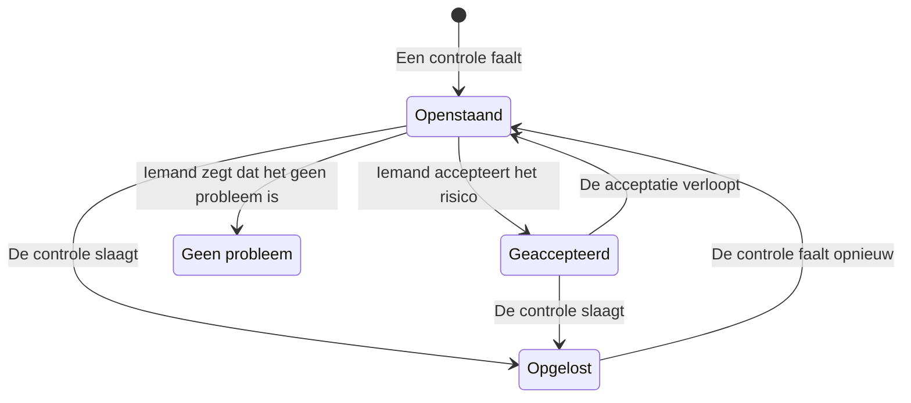

# Controles en problemen van Gegevensbeveiliging

Gegevensbeveiliging voert 32 controles uit op elke opslag, in negen groepen. Een controle leest wat er bekend is over één opslag - hoe die is geconfigureerd, wat erin is gevonden, wie erbij kan, waar die staat - en slaagt, faalt of kan het niet bepalen. Een controle die faalt, opent één probleem op die opslag, en het probleem sluit vanzelf zodra de controle slaagt. Deze pagina somt elke controle op, legt uit hoe de ernst en de risicoscore van een probleem worden bepaald, en wat er tijdens zijn levensloop met een probleem gebeurt.

:::cards
- [Hoe een controle beslist](#hoe-een-controle-beslist): Slagen, falen of niet te bepalen, en hoe erg een falen is.
- [Elke controle](#elke-controle): Alle 32, met wat elke controle nagaat en hoe je het oplost.
- [Risicoscore](#risicoscore): Hoe problemen binnen een ernst worden geordend.
- [Wat er met een probleem gebeurt](#wat-er-met-een-probleem-gebeurt): Openstaand, opgelost, geaccepteerd, geen probleem.
- [Hier oplossen](#hier-oplossen): Blokkeer een openbare bucket, of stop het delen van een snapshot, met één klik.
:::

## Hoe een controle beslist

Elke controle leest feiten over een opslag en antwoordt op een van vier manieren:

| Antwoord | Wat het betekent | Wat er met het probleem gebeurt |
| --- | --- | --- |
| Slaagt | De controle vindt niets mis. | Een openstaand of geaccepteerd probleem wordt opgelost. |
| Faalt | De controle vindt het probleem, en zegt in één zin wat ze zag: het bewijs van het probleem. | Er opent een probleem, of het openstaande probleem wordt bijgewerkt. |
| Niet te bepalen | Een feit kon niet worden gelezen: een machtiging die de rol niet heeft, een aanroep die mislukte. | Er verandert niets: een openstaand probleem blijft open, omdat niemand mag concluderen dat een probleem is opgelost als OneUptime niet kon kijken. |
| Niet van toepassing | De soort van de opslag heeft zo'n instelling niet. | Een openstaand probleem wordt opgelost. |

### Ernst volgt de gegevens

Hetzelfde probleem weegt zwaarder bij gevoeligere gegevens. Elke controle geeft een ernst voor elk gevoeligheidsniveau, en een probleem krijgt die van zijn opslag: een openbare bucket met kaartnummers is Kritiek, een openbare bucket met websiteafbeeldingen maar Laag. Een streepje betekent helemaal geen probleem. De gevoeligheid van een opslag komt uit zijn bevindingen (zie [Gevoelige gegevenstypen](/docs/data-security/data-types#gevoeligheid)), dus inhoudsvoorbeelden maken de ernst juist.

Een paar controles bepalen de ernst in plaats daarvan op basis van wat ze zagen. **Er zijn geheimen in opgeslagen** is Hoog op elke opslag, en Kritiek op een opslag die openbaar is of gedeeld wordt met andere accounts.

## Elke controle

De ernst staat vermeld voor gegevens met Beperkt, Vertrouwelijk, Intern en Openbaar, in die volgorde. De pagina van elk probleem toont de volledige oplossing voor zijn eigen opslag - de stappen in de console, de CLI-opdracht en, waar het past, de Terraform - met de naam en de regio van de opslag ingevuld.

### Blootstelling

| Controle | Draait op | Wat het controleert | Ernst | Hoe op te lossen |
| --- | --- | --- | --- | --- |
| Iedereen op het internet kan het lezen (`public-read`) | Objectopslag, datawarehouse, zoekdienst | Het beleid, de ACL of de IAM-bindingen van de opslag laten iedereen de gegevens lezen zonder aanmelding. | Kritiek / Kritiek / Hoog / Laag | Verwijder elke toekenning aan anonieme principals of aan alle geverifieerde principals. Bestanden die openbaar moeten zijn, horen in een opslag die als **Bewust openbaar** is gemarkeerd en verder niets bevat. |
| Iedereen op het internet kan het wijzigen (`public-write`) | Objectopslag, datawarehouse, zoekdienst | Het beleid, de ACL of de IAM-bindingen van de opslag laten iedereen de gegevens schrijven of verwijderen. | Kritiek / Kritiek / Kritiek / Hoog | Verwijder elke schrijf- of verwijdertoekenning aan anonieme principals of aan alle geverifieerde principals. |
| Openbare toegang is niet geblokkeerd (`public-access-not-blocked`) | AWS S3 Bucket | S3 Block Public Access staat niet volledig aan voor de bucket of zijn account, dus één beleidswijziging kan hem openbaar maken. | Hoog / Gemiddeld / Laag / — | Zet alle vier de instellingen van Block Public Access aan voor de bucket. |
| De database accepteert verbindingen vanaf het internet (`internet-reachable`) | Database, datawarehouse, zoekdienst, cache | De database heeft een openbaar endpoint of openbare netwerktoegang aan staan. | Hoog / Hoog / Gemiddeld / Laag | Zet het openbare endpoint uit, en bereik de database via een privénetwerk of een bastion. |
| Zijn firewall laat elk adres binnen (`open-to-all-addresses`) | Database, datawarehouse, zoekdienst, cache | Een firewallregel of geautoriseerd netwerk staat 0.0.0.0/0 of het hele adresbereik toe. | Kritiek / Kritiek / Hoog / Gemiddeld | Vervang de regel die alles toestaat door de adressen of netwerken die toegang nodig hebben. |
| Een snapshot ervan kan door iedereen worden hersteld (`snapshot-public`) | Database, snapshot | Een databasesnapshot wordt openbaar gedeeld, dus elk cloudaccount kan een volledige kopie herstellen. | Kritiek / Kritiek / Kritiek / Hoog | Maak de snapshot privé. |
| Een snapshot ervan wordt gedeeld met andere accounts (`snapshot-shared-externally`) | Database, snapshot | Een databasesnapshot wordt gedeeld met accounts buiten je gekoppelde accounts. | Hoog / Hoog / Gemiddeld / Laag | Stop het delen van de snapshot met de accounts die hem niet zouden moeten hebben. |
| Accounts buiten je organisatie kunnen erbij (`shared-with-external-accounts`) | Elke opslag behalve telemetrie | Het beleid van de opslag geeft toegang aan accounts, tenants of projecten die niet aan OneUptime zijn gekoppeld. | Hoog / Hoog / Gemiddeld / Laag | Bekijk elke externe principal, en verwijder de principals die geen toegang nodig hebben. |

### Versleuteling

| Controle | Draait op | Wat het controleert | Ernst | Hoe op te lossen |
| --- | --- | --- | --- | --- |
| De gegevens zijn niet versleuteld in rust (`not-encrypted-at-rest`) | Elke opslag behalve telemetrie | Opslagversleuteling staat uit. | Hoog / Gemiddeld / Laag / — | Zet versleuteling in rust aan. Een RDS-instance kan niet ter plekke worden versleuteld: herstel een versleutelde kopie van de snapshot. |
| Beperkte gegevens staan niet onder je eigen sleutel (`no-customer-managed-key`) | Elke opslag behalve telemetrie | De opslag bevat Beperkte gegevens, maar is versleuteld met de standaardsleutel van de provider, niet met een door de klant beheerde sleutel. | Gemiddeld / — / — / — | Versleutel de opslag met een sleutel die je beheert in je sleuteldienst. |
| Onversleutelde verbindingen zijn toegestaan (`encryption-in-transit-not-enforced`) | Elke opslag behalve telemetrie | De opslag accepteert verbindingen die geen TLS gebruiken. | Hoog / Gemiddeld / Laag / — | Vereis TLS voor elke verbinding. Weiger op S3 elk verzoek waarbij `aws:SecureTransport` false is. |
| Het accepteert TLS ouder dan 1.2 (`weak-tls`) | Elke opslag behalve telemetrie | De minimale TLS-versie is 1.0 of 1.1. | Gemiddeld / Gemiddeld / Laag / — | Stel de minimale TLS-versie in op 1.2 of hoger. |

### Herstel

| Controle | Draait op | Wat het controleert | Ernst | Hoe op te lossen |
| --- | --- | --- | --- | --- |
| Het heeft geen back-ups, of bewaart ze korter dan 7 dagen (`no-backups`) | Database, datawarehouse | Automatische back-ups staan uit, of worden korter dan 7 dagen bewaard. | Hoog / Gemiddeld / Laag / — | Zet automatische back-ups aan, en bewaar ze minstens 7 dagen. |
| Herstel naar een tijdstip staat uit (`no-point-in-time-recovery`) | AWS DynamoDB Table, Azure Cosmos DB Account | De tabel of database kan niet worden hersteld naar een moment vóór een vergissing. | Gemiddeld / Laag / — / — | Zet herstel naar een tijdstip aan. |
| Het kan in één stap worden verwijderd (`deletion-protection-off`) | Database, datawarehouse | Verwijderingsbeveiliging staat uit. | Gemiddeld / Laag / — / — | Zet verwijderingsbeveiliging aan. |
| Verwijderde of overschreven bestanden kunnen niet worden hersteld (`deleted-data-not-recoverable`) | Objectopslag | Versiebeheer en voorlopig verwijderen staan allebei uit. | Gemiddeld / Laag / — / — | Zet versiebeheer of voorlopig verwijderen aan. |

### Zichtbaarheid

| Controle | Draait op | Wat het controleert | Ernst | Hoe op te lossen |
| --- | --- | --- | --- | --- |
| Niemand zou weten wie het las (`access-not-logged`) | Elke opslag behalve telemetrie | Leesacties op de opslag worden niet gelogd: geen toegangslogs, geen auditlogs voor gegevenstoegang. | Hoog / Gemiddeld / Laag / — | Zet toegangs- of auditlogging aan voor leesacties: S3-servertoegangslogs of CloudTrail-gegevensgebeurtenissen, diagnostische logs StorageRead van Azure, auditlogs Data Access van Cloud Storage. |

### Toegang

| Controle | Draait op | Wat het controleert | Ernst | Hoe op te lossen |
| --- | --- | --- | --- | --- |
| Iedereen met de accountsleutel kan alles lezen (`shared-key-access`) | Azure Storage Account | Het opslagaccount staat toegang met gedeelde sleutels toe, wat Microsoft Entra ID omzeilt en geen auditspoor per persoon achterlaat. | Gemiddeld / Laag / — / — | Zet applicaties over op Microsoft Entra ID, en zet daarna toegang met de opslagaccountsleutel uit. |
| Objecten kunnen hun eigen toegangsregels hebben (`object-acls-enabled`) | AWS S3 Bucket, Google Cloud Storage Bucket | Object-ACL's staan aan, dus één object kan openbaar worden gemaakt terwijl de bucket privé lijkt. | Laag / Laag / — / — | Zet op S3 Object Ownership op Bucket owner enforced. Zet op Cloud Storage uniforme toegang op bucketniveau aan. |
| Meer dan 25 identiteiten kunnen Beperkte gegevens lezen (`many-readers`) | Elke opslag behalve telemetrie | Meer identiteiten dan de meeste teams kunnen beoordelen, hebben leestoegang tot de opslag. | Gemiddeld / — / — / — | Open de pagina **Wie erbij kan** van de opslag, en verwijder de toegang die ongebruikt is of ruimer dan nodig. |

### Gegevenshygiëne

| Controle | Draait op | Wat het controleert | Ernst | Hoe op te lossen |
| --- | --- | --- | --- | --- |
| Er zijn geheimen in opgeslagen (`secrets-stored`) | Elke opslag behalve telemetrie | Er zijn wachtwoorden, API-sleutels, tokens of privésleutels gevonden in de gegevens van de opslag. | Hoog / Hoog / Hoog / Hoog | Roteer elk gevonden geheim alsof het is uitgelekt. Verplaats geheimen naar een secretmanager en verwijder ze uit de opslag. |
| Beveiligingscodes van kaarten worden opgeslagen (`card-security-codes-stored`) | Elke opslag behalve telemetrie | Er zijn CVV- of CVC-codes gevonden. PCI DSS verbiedt ze te bewaren nadat een betaling is geautoriseerd, versleuteld of niet. | Kritiek / Kritiek / Kritiek / Kritiek | Stop de code die ze schrijft, verwijder de opgeslagen codes, en controleer dat er geen in back-ups achterblijven. |
| Kaartnummers worden leesbaar opgeslagen (`card-numbers-readable`) | Elke opslag behalve telemetrie | Er zijn volledige kaartnummers in leesbare vorm gevonden. PCI DSS eist dat ze onleesbaar zijn, waar ze ook worden opgeslagen. | Hoog / Hoog / Hoog / Hoog | Tokeniseer kaartnummers bij je betaalprovider, of versleutel ze op veldniveau, en verwijder de leesbare kopieën. |
| Wachtwoorden worden als platte tekst opgeslagen (`plaintext-passwords`) | Elke opslag behalve telemetrie | Een wachtwoordveld bevat waarden die geen wachtwoordhashes zijn (bcrypt, argon2, scrypt of PBKDF2). | Kritiek / Kritiek / Kritiek / Kritiek | Hash wachtwoorden met bcrypt, scrypt of argon2, migreer de opgeslagen wachtwoorden, en laat elk account zijn wachtwoord opnieuw instellen. |
| Productiegegevens zijn gekopieerd naar een niet-productieopslag (`production-data-in-non-production`) | Elke opslag behalve telemetrie | Waarden die in een productieopslag zijn gevonden, zijn ook hier gevonden, in een ontwikkel-, test- of stagingopslag. | Hoog / Gemiddeld / — / — | Vervang de kopie door gemaskeerde of synthetische gegevens, en verwijder de echte gegevens uit de niet-productieopslag. |
| Gevoelige gegevens die 90 dagen niemand heeft gebruikt (`stale-sensitive-data`) | Elke opslag behalve telemetrie | De opslag bevat gevoelige gegevens en is 90 dagen niet gelezen of beschreven. | Gemiddeld / Laag / — / — | Bevestig dat de gegevens niet meer nodig zijn, en archiveer ze daarna met een bewaardatum, of verwijder ze. |
| Niemand is eigenaar van deze gevoelige opslag (`no-owner`) | Elke opslag | De opslag bevat gevoelige gegevens en heeft geen eigenaar. | Gemiddeld / Laag / — / — | Voeg een eigenaar toe op de pagina **Eigenaren** van de opslag, of een eigenaarsregel die bij zijn tags past. |

### Telemetrie

| Controle | Draait op | Wat het controleert | Ernst | Hoe op te lossen |
| --- | --- | --- | --- | --- |
| Gevoelige gegevens bereiken je telemetrie (`sensitive-data-in-telemetry`) | Telemetrie | Logs, traces, uitzonderingen, herhalingen of AI-gesprekken bevatten gevoelige gegevens die geen opschoonregel maskeert. | Hoog / Gemiddeld / Laag / — | Druk op **Opschonen** bij elke bevinding om de gegevens bij de inname te maskeren, en herstel daarna de code die ze schrijft. |
| Geheimen bereiken je telemetrie (`secrets-in-telemetry`) | Telemetrie | Wachtwoorden, API-sleutels of tokens staan in logs, traces, uitzonderingen of AI-gesprekken. | Kritiek / Kritiek / Kritiek / Kritiek | Roteer eerst het geheim, druk daarna op **Opschonen** en herstel de code die het schrijft. |

### Residentie

| Controle | Draait op | Wat het controleert | Ernst | Hoe op te lossen |
| --- | --- | --- | --- | --- |
| Gegevens worden opgeslagen buiten de regio's waar ze mogen staan (`residency-violation`) | Elke opslag behalve telemetrie | De regio van de opslag, of een regio waarnaar de gegevens worden gerepliceerd, overtreedt een residentieregel. | Hoog / Hoog / Gemiddeld / — | Verplaats de gegevens naar een toegestane regio, of stop met kopiëren naar de andere. Is de overdracht rechtmatig, accepteer dan het probleem en leg vast waarom. |

### AI

| Controle | Draait op | Wat het controleert | Ernst | Hoe op te lossen |
| --- | --- | --- | --- | --- |
| Gevoelige gegevens worden naar een AI-provider gestuurd (`sensitive-data-to-ai`) | AI-gesprekken | AI-gesprekken die in OneUptime zijn vastgelegd, brengen gevoelige gegevens naar een modelprovider. | Kritiek / Hoog / Laag / — | Verwijder gevoelige waarden voordat prompts worden verstuurd, of stuur deze aanroepen naar een model dat je zelf host. |
| Beperkte gegevens staan in een opslag die voor AI wordt gebruikt (`sensitive-data-in-ai-store`) | Elke opslag behalve telemetrie | Een opslag die is getagd als trainings- of retrievalgegevens voor AI, bevat Beperkte gegevens. | Hoog / Gemiddeld / — / — | Verwijder of maskeer de Beperkte gegevens voordat ze worden gebruikt om een model te trainen of te gronden. |

## Risicoscore

De ernst zegt hoe erg een probleem is. De risicoscore, van 0 tot 100, ordent de problemen van één ernst, op basis van wat hetzelfde probleem erger maakt:

```text
risk = severity + 10 × exposure + 6 × volume + 5 × activity + 4 × production, at most 100
```

| Factor | Punten |
| --- | --- |
| Ernst | 75 voor Kritiek, 50 voor Hoog, 25 voor Gemiddeld, 0 voor Laag |
| Blootstelling | 10 voor Openbaar, 8 voor Andere accounts, 6 voor Bereikbaar via internet, 3 voor Onbekend, 0 voor Privé |
| Volume | Tot 6, naar het geschatte aantal gevoelige records van de opslag op een logaritmische schaal: 1 voor 10 records, 3 voor 1.000, 5 voor een miljoen, 6 voor tien miljoen of meer |
| Activiteit | 5 als Security Operations de afgelopen week detecties op de opslag zag |
| Productie | 4 voor een opslag in productie |

De extra's tellen samen hoogstens 25 punten op, dus een probleem scoort nooit lager dan een probleem met een lagere ernst. Een openbare productiebucket met een miljoen records met Beperkte gegevens scoort 75 + 10 + 5 + 4 = 94 voor een kritiek probleem. Elk probleem vermeldt de factoren die aan zijn score hebben bijgedragen, met hun punten, en de opslag toont de score van zijn ergste openstaande probleem.

De omgeving van een opslag - Productie, Staging, Development, Test of Onbekend - komt uit zijn tags (`env`, `environment`, `stage`, `tier` en dergelijke) of, zonder zo'n tag, uit de woorden in zijn naam, zoals `prod`, `staging`, `dev` of `qa`. Stel haar in op de opslag als geen van beide het zegt.

## Wat er met een probleem gebeurt



OneUptime opent, werkt bij en lost problemen op terwijl de controles draaien. Wat een mens met een probleem doet, is beslissen wat er daarna gebeurt:

| Status | Hoe het daar komt | Wat er volgt |
| --- | --- | --- |
| **Openstaand** | De controle faalt nu op de opslag. | Het telt mee in het Overzicht, in de samenvatting van de opslag en in compliance, tot de controle slaagt. |
| **Opgelost** | De controle slaagde bij een latere run, is niet meer van toepassing, of is uitgezet. Een mens kan ook **Als opgelost markeren** kiezen: de opslag wordt dan meteen opnieuw gecontroleerd. | Het opent opnieuw als de controle weer faalt, en het probleem telt hoe vaak het is heropend. |
| **Geaccepteerd** | Een mens koos **Risico accepteren**, met een **Reden** en een datum in **Geaccepteerd tot**, hoogstens een jaar vooruit. | Het blijft gesloten tot die datum, en opent daarna opnieuw als de controle nog steeds faalt. Accepteer het dan opnieuw als de reden nog geldt. |
| **Geen probleem** | Een mens koos **Geen probleem**: de bevinding was onjuist. | Het blijft gesloten, ook terwijl de controle faalt. **Heropenen** zet het terug op Openstaand. |

Security Members, Security Admins, Project Admins en Project Owners kunnen de status van een probleem wijzigen, en het met **Toewijzen** bij een persoon of een team neerleggen. Elke wijziging wordt in de **Tijdlijn** van het probleem geschreven: wanneer het opende, elke wijziging van de ernst, elke statuswijziging en wie die deed, de gevraagde hercontroles, en wat de integraties deden.

Een probleem dat opnieuw opent, behoudt zijn geschiedenis. Geaccepteerde risico's worden elke dag opnieuw bekeken, zodat een acceptatie op tijd verloopt, ook als er niets is gescand.

## Hier oplossen

Een openstaand probleem over een openbare bucket of een gedeelde snapshot kan vanaf zijn pagina worden opgelost. Boven de stappen in de console biedt **Hier oplossen** de wijziging aan die het oplost:

| Het probleem | De opslag | De knop | Wat het wijzigt |
| --- | --- | --- | --- |
| `public-read`, `public-write` of `public-access-not-blocked` | Een S3-bucket, een Azure-opslagaccount of een Cloud Storage-bucket | **Openbare toegang blokkeren** | Zet de vier instellingen van Block Public Access van de bucket aan, zet de anonieme blobtoegang van het opslagaccount uit, of dwingt de preventie van openbare toegang van de bucket af |
| `snapshot-public` of `snapshot-shared-externally` | Een RDS-snapshot, een RDS-database, of een Aurora- of DocumentDB-cluster | **Delen intrekken** | Stopt het delen van de snapshot, of van elke gedeelde handmatige snapshot van de database, met iedereen en met accounts buiten de accounts die je hebt gekoppeld |

Het vraagt eerst om bevestiging, en zegt wat er verandert en wat ophoudt te werken. Het wijzigt hoe de opslag wordt gedeeld, nooit de gegevens, en wijzigt niets wat al gesloten is. Een opslag die als **Bewust openbaar** is gemarkeerd, wordt nooit geblokkeerd.

Het handelt via de cloudkoppeling van de opslag, dus de koppeling moet **Gegevensbeveiligingsrespons** aan hebben staan en de installatieopdracht moet opnieuw zijn uitgevoerd (zie [Gegevensbeveiliging instellen](/docs/data-security/setup#gegevensbeveiliging-een-blootstelling-laten-sluiten)). Tot dan zegt het paneel wat je moet aanzetten. De opslag wordt direct daarna opnieuw gecontroleerd, en het probleem lost zichzelf op zodra de controle slaagt. De **Tijdlijn** van het probleem en de **Tijdlijn** van de opslag zeggen wat er is gedaan, en wie het deed.

## Controle-instellingen

**Gegevensbeveiliging → Instellingen → Controles** somt elke controle per groep op, met waar ze naar zoekt en de ernst die een falen krijgt voor elke gevoeligheid. Elke controle kan voor het project worden afgesteld, en elke wijziging wordt meteen opgeslagen:

- **De schakelaar** zet de controle uit, als die niet past bij hoe je werkt. De openstaande en geaccepteerde problemen ervan worden opgelost, en zeggen dat de controle niet meer draait.
- **De ernst** is standaard **Op gevoeligheid**, of één ernst die elk falen van de controle krijgt, wat de opslag ook bevat.

Om een controle op één opslag stil te zetten, accepteer je het risico op het probleem van die opslag, of markeer je het probleem als geen probleem. Is de bevinding onjuist, in plaats van een probleem dat er niet toe doet, markeer dan liever de bevinding als niet gevoelig (zie [Gevoelige gegevenstypen](/docs/data-security/data-types#niet-gevoelig-en-nooit-gevoelig)).

**Nu controleren** op een opslag leest zijn configuratie opnieuw en voert zijn controles uit. **Nu scannen** bemonstert zijn inhoud, en zijn controles draaien als de scan klaar is.

## Volgende stappen

:::cards
- [Integraties van Gegevensbeveiliging](/docs/data-security/integrations): Beveiligingszaken, waarschuwingen en e-mails aan eigenaren als er een probleem opent.
- [Gegevensstromen, toegang en residentie](/docs/data-security/flows-access-residency): De toegang, kopieën en regio's die verschillende controles lezen.
- [Compliance van Gegevensbeveiliging](/docs/data-security/compliance): De eisen van kaders waarvoor elke controle bewijs levert.
:::
