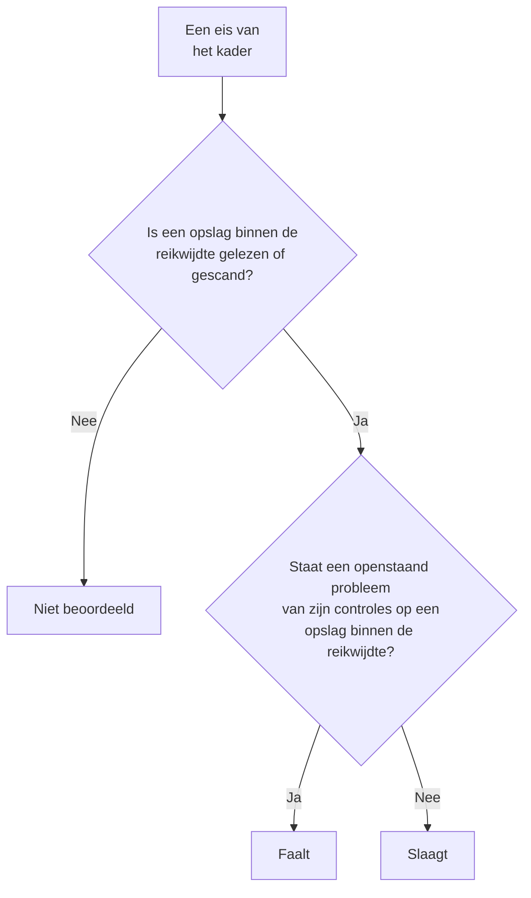

# Compliance van Gegevensbeveiliging

Gegevensbeveiliging scoort negen kaders op basis van wat de scans vonden. Elk kader dekt de opslagen waarover zijn regels gaan - de AVG de opslagen met persoonsgegevens, PCI DSS de opslagen waarin kaartgegevens zijn gevonden, SOC 2 elke opslag - en of aan elk van zijn eisen wordt voldaan, volgt uit de controles die er bewijs voor leveren. **Gegevensbeveiliging → Compliance** toont de score van elk kader, hoeveel opslagen het dekt, en elke eis met het aantal openstaande problemen waardoor ze faalt. Een score is bewijs voor een audit, geen certificaat: hij zegt wat OneUptime kan zien van de opslagen die het leest.

:::cards
- [De kaders](#de-kaders): De negen, en welke opslagen elk ervan dekt.
- [Hoe een kader wordt gescoord](#hoe-een-kader-wordt-gescoord): Eisen die slagen, falen of niet zijn beoordeeld.
- [Eisen en hun controles](#eisen-en-hun-controles): Elke eis, en de controles die er bewijs voor leveren.
- [Verwerkingsregister](#verwerkingsregister): Artikel 30 van de AVG, opgesteld uit je opslagen.
:::

## De kaders

| Kader | Volledige naam | Opslagen binnen de reikwijdte |
| --- | --- | --- |
| AVG | Algemene verordening gegevensbescherming van de EU | Opslagen die persoonsgegevens bevatten. |
| CCPA | California Consumer Privacy Act, zoals gewijzigd door de CPRA | Opslagen die persoonlijke informatie bevatten. |
| HIPAA | HIPAA Security Rule | Opslagen die gezondheidsgegevens bevatten. |
| PCI DSS | PCI DSS v4.0 | Opslagen waarin kaartnummers zijn gevonden. |
| SOC 2 | SOC 2 Trust Services Criteria | Elke gegevensopslag. |
| ISO 27001 | ISO/IEC 27001:2022 | Elke gegevensopslag. |
| NIST CSF | NIST Cybersecurity Framework 2.0 | Elke gegevensopslag. |
| LGPD | De Braziliaanse algemene wet gegevensbescherming | Opslagen die persoonsgegevens van personen in Brazilië bevatten. |
| DPDP | De Indiase Digital Personal Data Protection Act van 2023 | Opslagen die persoonsgegevens van personen in India bevatten. |

## Welke opslagen een kader dekt

Of een opslag binnen de reikwijdte valt, volgt uit de gegevens die erin zijn gevonden, dus dat verandert naarmate de scans meer vinden:

- **SOC 2, ISO 27001 en NIST CSF** zijn beveiligingskaders: ze dekken elke opslag, wat die ook bevat.
- **AVG, CCPA, HIPAA en PCI DSS** dekken de opslagen die een gegevenstype bevatten dat ze beschermen. Persoonsgegevens brengen de AVG en CCPA mee, gezondheidsgegevens ook HIPAA, en kaartnummers, beveiligingscodes van kaarten en vervaldatums van kaarten PCI DSS. Een opslag met alleen geheimen of bedrijfsdocumenten valt onder geen ervan.
- **LGPD en DPDP** zijn eigen wetten van landen: ze dekken de opslagen met persoonsgegevens van personen in Brazilië of in India, afgeleid uit gegevenstypen die bij dat land horen, zoals een Braziliaans CPF of een Indiaas Aadhaar-nummer.

[Gevoelige gegevenstypen](/docs/data-security/data-types#ingebouwde-gegevenstypen) somt elk gegevenstype op, met zijn land.

## Hoe een kader wordt gescoord

- **Een eis slaagt** als geen openstaand probleem van de controles die eraan zijn gekoppeld op een opslag binnen de reikwijdte van het kader staat, en **faalt** als dat wel zo is.
- **Ze wordt niet beoordeeld** zolang van geen enkele opslag binnen de reikwijdte de configuratie is uitgelezen of de inhoud is gescand.
- **Aan twee eisen voldoet Gegevensbeveiliging zelf**: artikel 30 van de AVG, het register van verwerkingsactiviteiten, en ISO 27001 A.5.12, classificatie van informatie. Ze slagen zodra elke opslag binnen de reikwijdte is gelezen of gescand, en falen zolang dat voor een opslag niet zo is.
- **De score** is het aandeel van de beoordeelde eisen van een kader dat slaagt, als geheel percentage. Een kader waarvan niets is beoordeeld, heeft geen score.

Alleen openstaande problemen tellen mee. Een probleem waarvan het risico is geaccepteerd, of dat geen probleem is, laat zijn eisen niet falen, dus een geaccepteerd risico is een beslissing die je audit op het probleem kan zien: wie het accepteerde, waarom, en tot wanneer.

## Eisen en hun controles

### AVG

| Eis | Wat ze vraagt | Controles |
| --- | --- | --- |
| Art. 5(1)(c) | Minimale gegevensverwerking | `production-data-in-non-production`, `stale-sensitive-data`, `sensitive-data-in-telemetry`, `sensitive-data-to-ai`, `sensitive-data-in-ai-store` |
| Art. 5(1)(e) | Opslagbeperking | `stale-sensitive-data` |
| Art. 25 | Gegevensbescherming door ontwerp en door standaardinstellingen | `production-data-in-non-production`, `stale-sensitive-data`, `sensitive-data-in-telemetry`, `sensitive-data-to-ai`, `sensitive-data-in-ai-store` |
| Art. 28 | Verwerkers | `sensitive-data-to-ai` |
| Art. 30 | Register van verwerkingsactiviteiten | Voldaan door Gegevensbeveiliging zelf |
| Art. 32 | Beveiliging van de verwerking | `public-read`, `public-write`, `public-access-not-blocked`, `internet-reachable`, `open-to-all-addresses`, `snapshot-public`, `snapshot-shared-externally`, `shared-with-external-accounts`, `not-encrypted-at-rest`, `no-customer-managed-key`, `encryption-in-transit-not-enforced`, `weak-tls`, `no-backups`, `no-point-in-time-recovery`, `deletion-protection-off`, `deleted-data-not-recoverable`, `access-not-logged`, `shared-key-access`, `object-acls-enabled`, `many-readers`, `secrets-stored`, `plaintext-passwords`, `secrets-in-telemetry` |
| Art. 44-49 | Doorgiften aan derde landen | `residency-violation` |

### CCPA

| Eis | Wat ze vraagt | Controles |
| --- | --- | --- |
| 1798.100(c) | Verzameling beperkt tot wat nodig is | `production-data-in-non-production`, `stale-sensitive-data`, `sensitive-data-in-telemetry`, `sensitive-data-to-ai`, `sensitive-data-in-ai-store` |
| 1798.150 | Redelijke beveiligingsprocedures | `public-read`, `public-write`, `public-access-not-blocked`, `internet-reachable`, `open-to-all-addresses`, `snapshot-public`, `snapshot-shared-externally`, `shared-with-external-accounts`, `shared-key-access`, `object-acls-enabled`, `many-readers` |

### HIPAA

| Eis | Wat ze vraagt | Controles |
| --- | --- | --- |
| 164.308(a)(7) | Calamiteitenplan | `no-backups`, `no-point-in-time-recovery`, `deletion-protection-off`, `deleted-data-not-recoverable` |
| 164.312(a)(1) | Toegangsbeheer | `public-read`, `public-write`, `public-access-not-blocked`, `internet-reachable`, `open-to-all-addresses`, `snapshot-public`, `snapshot-shared-externally`, `shared-with-external-accounts`, `shared-key-access`, `object-acls-enabled`, `many-readers` |
| 164.312(a)(2)(iv) | Versleuteling en ontsleuteling | `not-encrypted-at-rest`, `no-customer-managed-key` |
| 164.312(b) | Auditcontroles | `access-not-logged` |
| 164.312(e)(1) | Beveiliging van overdracht | `encryption-in-transit-not-enforced`, `weak-tls` |

### PCI DSS

| Eis | Wat ze vraagt | Controles |
| --- | --- | --- |
| 3.3.1 | Gevoelige authenticatiegegevens worden na autorisatie niet bewaard | `card-security-codes-stored` |
| 3.4.1 | Kaartnummers worden gemaskeerd wanneer ze worden weergegeven | `card-numbers-readable`, `sensitive-data-in-telemetry` |
| 3.5.1 | Kaartnummers zijn onleesbaar waar ze ook worden opgeslagen | `not-encrypted-at-rest`, `no-customer-managed-key`, `card-numbers-readable` |
| 4.2.1 | Sterke cryptografie beschermt kaartgegevens tijdens overdracht | `encryption-in-transit-not-enforced`, `weak-tls` |
| 7.2 | Toegang wordt naar behoefte bepaald en toegekend | `public-read`, `public-write`, `public-access-not-blocked`, `internet-reachable`, `open-to-all-addresses`, `snapshot-public`, `snapshot-shared-externally`, `shared-with-external-accounts`, `shared-key-access`, `object-acls-enabled`, `many-readers` |
| 8.3.2 | Authenticatiefactoren zijn onleesbaar wanneer ze worden opgeslagen | `plaintext-passwords` |
| 10.2 | Auditlogs leggen toegang tot kaartgegevens vast | `access-not-logged` |

### SOC 2

| Eis | Wat ze vraagt | Controles |
| --- | --- | --- |
| A1.2 | Back-up en herstel | `no-backups`, `no-point-in-time-recovery`, `deletion-protection-off`, `deleted-data-not-recoverable` |
| CC6.1 | Logische toegangsbeveiliging | `public-read`, `public-write`, `public-access-not-blocked`, `internet-reachable`, `open-to-all-addresses`, `snapshot-public`, `snapshot-shared-externally`, `shared-with-external-accounts`, `not-encrypted-at-rest`, `no-customer-managed-key`, `shared-key-access`, `object-acls-enabled`, `many-readers`, `secrets-stored`, `plaintext-passwords`, `secrets-in-telemetry` |
| CC6.7 | Overdracht van informatie | `encryption-in-transit-not-enforced`, `weak-tls` |
| CC7.2 | Bewaking van systeemcomponenten | `access-not-logged` |

### ISO 27001

| Eis | Wat ze vraagt | Controles |
| --- | --- | --- |
| A.5.9 | Inventaris van informatie en andere gerelateerde bedrijfsmiddelen | `no-owner` |
| A.5.12 | Classificatie van informatie | Voldaan door Gegevensbeveiliging zelf |
| A.5.15 | Toegangsbeveiliging | `public-read`, `public-write`, `public-access-not-blocked`, `internet-reachable`, `open-to-all-addresses`, `snapshot-public`, `snapshot-shared-externally`, `shared-with-external-accounts`, `shared-key-access`, `object-acls-enabled`, `many-readers` |
| A.5.34 | Privacy en bescherming van persoonsgegevens | `production-data-in-non-production`, `stale-sensitive-data`, `sensitive-data-in-telemetry`, `sensitive-data-to-ai`, `sensitive-data-in-ai-store` |
| A.8.11 | Maskeren van gegevens | `production-data-in-non-production`, `stale-sensitive-data`, `sensitive-data-in-telemetry`, `sensitive-data-to-ai`, `sensitive-data-in-ai-store` |
| A.8.12 | Voorkomen van datalekken | `secrets-stored`, `secrets-in-telemetry` |
| A.8.13 | Back-up van informatie | `no-backups`, `no-point-in-time-recovery`, `deletion-protection-off`, `deleted-data-not-recoverable` |
| A.8.15 | Logging | `access-not-logged` |
| A.8.24 | Gebruik van cryptografie | `not-encrypted-at-rest`, `no-customer-managed-key`, `encryption-in-transit-not-enforced`, `weak-tls`, `plaintext-passwords` |

### NIST CSF

| Eis | Wat ze vraagt | Controles |
| --- | --- | --- |
| ID.AM-07 | Inventarissen van gegevens en metagegevens worden bijgehouden | `no-owner` |
| PR.AA-05 | Toegangsrechten worden beheerd | `public-read`, `public-write`, `public-access-not-blocked`, `internet-reachable`, `open-to-all-addresses`, `snapshot-public`, `snapshot-shared-externally`, `shared-with-external-accounts`, `shared-key-access`, `object-acls-enabled`, `many-readers` |
| PR.DS-01 | Gegevens in rust zijn beschermd | `not-encrypted-at-rest`, `no-customer-managed-key`, `secrets-stored`, `secrets-in-telemetry` |
| PR.DS-02 | Gegevens tijdens overdracht zijn beschermd | `encryption-in-transit-not-enforced`, `weak-tls` |
| PR.DS-11 | Back-ups van gegevens worden bewaard en getest | `no-backups`, `no-point-in-time-recovery`, `deletion-protection-off`, `deleted-data-not-recoverable` |
| DE.CM-09 | Gegevens en het gebruik ervan worden bewaakt | `access-not-logged` |

### LGPD

| Eis | Wat ze vraagt | Controles |
| --- | --- | --- |
| Art. 6 | Noodzakelijkheid en doelbinding | `production-data-in-non-production`, `stale-sensitive-data`, `sensitive-data-in-telemetry`, `sensitive-data-to-ai`, `sensitive-data-in-ai-store` |
| Art. 33 | Internationale doorgifte van gegevens | `residency-violation` |
| Art. 46 | Beveiligingsmaatregelen | `public-read`, `public-write`, `public-access-not-blocked`, `internet-reachable`, `open-to-all-addresses`, `snapshot-public`, `snapshot-shared-externally`, `shared-with-external-accounts`, `not-encrypted-at-rest`, `no-customer-managed-key`, `shared-key-access`, `object-acls-enabled`, `many-readers` |

### DPDP

| Eis | Wat ze vraagt | Controles |
| --- | --- | --- |
| Sec. 8(5) | Redelijke beveiligingswaarborgen | `public-read`, `public-write`, `public-access-not-blocked`, `internet-reachable`, `open-to-all-addresses`, `snapshot-public`, `snapshot-shared-externally`, `shared-with-external-accounts`, `not-encrypted-at-rest`, `no-customer-managed-key`, `shared-key-access`, `object-acls-enabled`, `many-readers` |
| Sec. 8(7) | Wissing zodra het doel is bereikt | `production-data-in-non-production`, `stale-sensitive-data`, `sensitive-data-in-telemetry`, `sensitive-data-to-ai`, `sensitive-data-in-ai-store` |
| Sec. 16 | Doorgifte buiten India | `residency-violation` |

## Verwerkingsregister

Artikel 30 van de AVG vraagt je een register van je verwerkingsactiviteiten bij te houden. Gegevensbeveiliging schrijft het deel ervan dat gaat over waar persoonsgegevens worden bewaard: één rij voor elke opslag die persoonsgegevens bevat.

| Kolom | Waar ze vandaan komt |
| --- | --- |
| Opslag, soort, provider en regio | Discovery |
| Omgeving | De tags of de naam van de opslag, of wat je instelt |
| Gevoeligheid, categorieën en gegevenstypen | Wat de scans vonden, of de gevoeligheid die je instelt |
| Eigenaren | De eigenaren van de opslag, personen en de leden van zijn teams |
| Doel | Wat je in het **Doel** van de opslag schrijft: waarom hij persoonsgegevens bevat |
| Bewaartermijn | Wat je in de **Bewaartermijn** van de opslag schrijft: hoe lang gegevens erin worden bewaard |
| Kaders | De kaders waaronder de opslag door zijn gegevenstypen valt |

Vul **Doel** en **Bewaartermijn** in bij de **Instellingen** van elke opslag: dat zijn de twee dingen die geen scan kan weten. Het register en de scores worden ook geleverd door de API van Gegevensbeveiliging, op `/data-security/record-of-processing` en `/data-security/compliance`, voor iedereen die gegevensopslagen mag lezen (zie [Integraties van Gegevensbeveiliging](/docs/data-security/integrations#api-terraform-en-mcp)).

## Volgende stappen

:::cards
- [Controles en problemen van Gegevensbeveiliging](/docs/data-security/checks-and-issues): De controles achter elke eis, en hoe je ze oplost.
- [Gegevensstromen, toegang en residentie](/docs/data-security/flows-access-residency): Residentieregels, voor doorgiften onder de AVG, LGPD en DPDP.
- [Gevoelige gegevenstypen](/docs/data-security/data-types): De gegevenstypen die een opslag binnen de reikwijdte van een kader brengen.
:::
