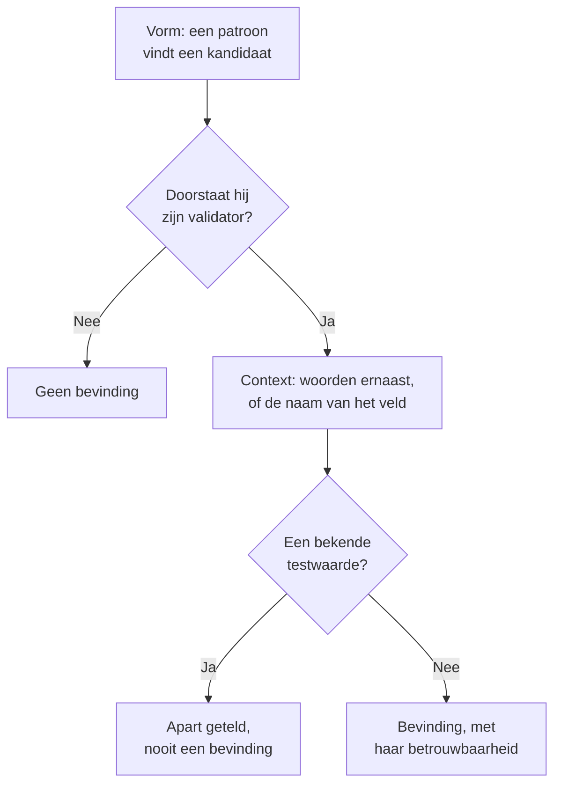

# Gevoelige gegevenstypen

Gegevensbeveiliging kent 143 soorten gevoelige gegevens: kaartnummers, bankrekeningen, nationale identiteitsnummers van 43 landen, gezondheidsidentificatoren, API-sleutels en tokens, en de bijzondere categorieën van persoonsgegevens. Elk type heeft een categorie, een gevoeligheid en, als het bij één land hoort, dat land. Deze pagina zegt hoe een waarde wordt gevonden en somt elk gegevenstype op, zodat je kunt zien waarom iets werd gevonden en kunt beslissen wat je ermee doet.

:::cards
- [Hoe een waarde wordt gevonden](#hoe-een-waarde-wordt-gevonden): Vorm, validator, context, testwaarden, betrouwbaarheid.
- [Velden en kolommen](#velden-en-kolommen): Hoe een hele kolom of een heel attribuut wordt beoordeeld.
- [Elk gegevenstype](#ingebouwde-gegevenstypen): Alle 143, per categorie.
- [Je eigen gegevenstypen](#je-eigen-gegevenstypen): Personeelsnummers, polisnummers en het vak Testen.
:::

## Hoe een waarde wordt gevonden

Alles wat wordt gescand - een logregel, een CSV-cel, een databaserij, de eerste bytes van een object - doorloopt dezelfde stappen:

1. **Vorm.** Elk gegevenstype heeft patronen die kandidaten vinden: zestien cijfers, `AKIA` en zestien letters, een woord, een `@` en een domein. Een patroon matcht nooit binnen een langer token, dus een kaartnummer wordt niet gevonden binnen een langere reeks cijfers.
2. **Validator.** Een kandidaat moet voldoen aan de eigen regels van zijn type: een controlesom (Luhn voor kaarten, mod 97 voor IBAN's, Verhoeff voor Aadhaar-nummers, het controlecijfer van de meeste nationale identiteitsnummers), een echte datum, een bekend voorvoegsel, genoeg willekeur voor een geheim. Een kandidaat die faalt, is helemaal geen bevinding. Plaatshouders zoals `000000000` en `123456789` falen voor elk numeriek type.
3. **Context.** Woorden bij een kandidaat - standaard tot 64 tekens ervoor en 32 erna - die zeggen wat hij is, verhogen zijn betrouwbaarheid één niveau, en dat doet ook een veld waarvan de naam op het type wijst. Woorden die zeggen dat het iets anders is, zoals een order- of trackingnummer, verlagen die één niveau. Een nummer zonder controlesom en met een gangbare vorm, zoals een paspoortnummer of een bankrekening, telt alleen naast woorden die het noemen.
4. **Bekende testwaarden.** Gepubliceerde testkaartnummers (zoals `4242 4242 4242 4242` van Stripe), voorbeeld-IBAN's, adressen op `example.com` en andere gereserveerde domeinen, IP-adressen voor documentatie, de voorbeeld-ID's die overheidsdocumentatie afdrukt, sleutels voor de testmodus zoals `sk_test_` en plaatshoudersleutels worden apart geteld. Ze leveren nooit een bevinding op, dus een opslag vol ermee leest als een testomgeving, niet als een datalek.
5. **Betrouwbaarheid.** Wat overblijft, is een bevinding, zo zeker als het bewijs toelaat.

| Betrouwbaarheid | Wat het betekent |
| --- | --- |
| **Hoog** | De waarde doorstond haar validator, en woorden eromheen of het veld waarin ze staat zeggen wat ze is - of, voor een veld, de meeste waarden zijn van dat type. |
| **Gemiddeld** | De waarde doorstond haar validator zonder dat iets eromheen het bevestigt, of de naam van het veld zegt wat het bevat en sommige waarden stemmen daarmee overeen. |
| **Laag** | De vorm komt overeen, maar niets bevestigt het. |

Alleen bevindingen met Hoog en Gemiddeld tellen mee: ze maken een opslag gevoelig en kunnen een probleem openen. Bevindingen met Laag staan ingeklapt op de opslag, zodat een mens ze kan beoordelen.

Als twee gegevenstypen dezelfde tekens claimen, wint de zekerste bevinding: eerst de hoogste betrouwbaarheid, dan de detector waarvan de eigen regels meer bewijzen, dan de langste match.

Een lange waarde wordt gelezen in vensters van 64 KB die 4 KB overlappen, zodat een waarde in haar geheel wordt gevonden waar ze ook staat, en van één waarde wordt hoogstens 4 MB gelezen.

## Velden en kolommen

Een kolom, een JSON-veld of een logattribuut wordt als geheel beoordeeld. De naam ervan wijst op een gegevenstype, en de bemonsterde waarden bewijzen er een. Het aandeel van de waarden dat het type bevat, bepaalt hoe zeker de bevinding is:

| Waarden die het type bevatten | Betrouwbaarheid |
| --- | --- |
| 60% of meer | Hoog |
| 25% of meer | Hoog als de naam van het veld op het type wijst, anders Gemiddeld |
| Minder | Gemiddeld als de naam van het veld op het type wijst, anders Laag: een paar e-mailadressen in een kolom met iets anders |

Een veld waarvan de waarden gemiddeld meer dan 80 tekens lang zijn, is vrije tekst - notities, berichten, beschrijvingen - en hoeft niet één type te bevatten. De bevindingen ervan houden de betrouwbaarheid die elke match op zichzelf verdiende, en zeggen dat ze in vrije tekst zijn gevonden. Van een veld worden tot 1.000 waarden geclassificeerd, en van elke waarde tot 16 KB.

De naam van een veld wordt in woorden gesplitst - `customerEmail`, `customer_email` en `customer-email` zijn allemaal "customer email" - en een naamhint van een type matcht als de woorden ervan in die volgorde naast elkaar staan: "date of birth" matcht `customer_date_of_birth`, niet `birth_city`. Alleen het laatste deel van een pad met punten is de eigen naam van het veld, samen met het deel ervoor als het laatste een algemeen woord is zoals `number`, `id` of `value`: `customer.address.city` is geen straatadres, en `card.number` is nog steeds een kaartnummer.

Sommige gegevenstypen zijn niet aan hun waarden te herkennen: geen patroon onderscheidt de naam van een persoon van een straat, of een religie van elk ander woord. Die worden alleen gevonden op de naam van het veld, als het veld waarden heeft: Persoonsnaam, Gebruikersnaam, Geslacht, Nationaliteit, Gezondheidsinformatie, Raciale of etnische afkomst, Religieuze overtuiging, Seksuele geaardheid, Politieke opvatting, Vakbondslidmaatschap, Biometrische gegevens, Genetische gegevens en Strafblad. Een naam, een gebruikersnaam, een geslacht of een nationaliteit is dan Hoog als 60% of meer van de waarden er een lijkt, en anders Gemiddeld.

Een veld waarvan de naam zegt dat het een wachtwoord bevat - `password`, `passwordHash`, `pwd`, niet `password_changed_at` - hoort een hash te bevatten: bcrypt, argon2, scrypt, PBKDF2 of een ander schema dat een opslag waarschijnlijk gebruikt. Lege waarden, plaatshouders zoals `********` en versleutelde waarden worden apart gehouden. Zijn er van de rest meer geen hash dan wel, dan bevat het veld de wachtwoorden zelf, wat geen patroon kan zien, en faalt de opslag voor [Wachtwoorden worden als platte tekst opgeslagen](/docs/data-security/checks-and-issues#gegevenshygiëne).

## Gevoeligheid

| Gevoeligheid | Wat het betekent |
| --- | --- |
| **Beperkt** | Er volgt schade als het uitlekt: geheimen, kaartnummers, medische dossiers, overheids-ID's. |
| **Vertrouwelijk** | Persoonsgegevens, en documenten die als vertrouwelijk zijn gemarkeerd. |
| **Intern** | De eigen gegevens van het bedrijf, niet bedoeld voor buitenstaanders. |
| **Openbaar** | Er is niets gevoeligs gevonden. |

Een opslag is zo gevoelig als het gevoeligste gegevenstype dat erin is gevonden met minstens de betrouwbaarheid Gemiddeld. Testwaarden en bevindingen die als niet gevoelig zijn gemarkeerd, tellen niet mee, en een opslag waarin niets is gevonden, is Openbaar. Om een opslag als gevoeliger of minder gevoelig te behandelen dan zijn bevindingen zeggen, stel je zijn gevoeligheid zelf in bij de **Instellingen** van de opslag: de controles gebruiken die dan.

## Categorieën

| Categorie | Wat het omvat | Persoonsgegevens |
| --- | --- | --- |
| Geheimen en inloggegevens | Wachtwoorden, API-sleutels, tokens en privésleutels die toegang geven tot andere systemen. | Nee |
| Financieel | Kaartnummers, bankrekeningen, IBAN's en cryptowallets. | Ja |
| Gezondheid | Patiëntdossiernummers, gezondheidsidentificatoren, diagnoses en voorschriften. | Ja |
| Overheids-ID | Nummers voor nationale identiteit, belasting, paspoort en sociale zekerheid. | Ja |
| Bijzondere categorie | Wat artikel 9 van de AVG het sterkst beschermt: etniciteit, religie, seksuele geaardheid, politiek, vakbondslidmaatschap, biometrische en genetische gegevens. | Ja |
| Contact en identiteit | Wie iemand is en hoe je die bereikt: e-mail, telefoon, adres, geboortedatum, IP-adres. | Ja |
| Vertrouwelijke bedrijfsgegevens | Documenten gemarkeerd als vertrouwelijk, alleen intern of juridisch beschermd. | Nee |

Persoonsgegevens zijn gegevens over een persoon, zoals de AVG, CCPA, LGPD en DPDP die bedoelen. Een opslag die alleen geheimen en bedrijfsdocumenten bevat, valt buiten de reikwijdte van een privacykader, nooit buiten die van een beveiligingskader (zie [Compliance van Gegevensbeveiliging](/docs/data-security/compliance)).

## Ingebouwde gegevenstypen

Een gegevenstype dat bij één land hoort, noemt dat land, als ISO 3166-1-code: residentieregels en de landgebonden kaders lezen die (zie [Residentie](/docs/data-security/flows-access-residency#residentieregels)). De ID is de naam waarmee de API en bevindingen het type aanduiden.

### Contact en identiteit

| Gegevenstype | ID | Wat het is | Gevoeligheid | Land |
| --- | --- | --- | --- | --- |
| E-mailadres | `email-address` | Het e-mailadres van een persoon. | Vertrouwelijk | — |
| Telefoonnummer | `phone-number` | Een telefoonnummer in internationaal of nationaal formaat. | Vertrouwelijk | — |
| Persoonsnaam | `person-name` | De voornaam, achternaam of volledige naam van een persoon, gevonden op de naam van het veld. | Vertrouwelijk | — |
| Straatadres | `postal-address` | Een straatadres: een nummer, een straatnaam en een straattype. | Vertrouwelijk | — |
| Postcode | `postal-code` | Een postcode. Op zichzelf beperkt die al waar iemand woont. | Intern | — |
| Geboortedatum | `date-of-birth` | Een datum naast woorden die zeggen dat het iemands geboortedatum is. | Vertrouwelijk | — |
| IP-adres | `ip-address` | Een openbaar IPv4- of IPv6-adres, dat de AVG als persoonsgegeven behandelt. | Vertrouwelijk | — |
| MAC-adres | `mac-address` | Het hardwareadres van een netwerkkaart, dat een apparaat identificeert. | Vertrouwelijk | — |
| Advertentie-ID | `advertising-id` | Een mobiele advertentie-ID (IDFA, GAID, AAID) die één apparaat volgt. | Vertrouwelijk | — |
| Precieze locatie | `geolocation` | Een breedte- en lengtegraad die precies genoeg zijn om een gebouw te vinden. | Vertrouwelijk | — |
| Gebruikersnaam | `username` | De aanmeld- of accountnaam van een persoon, gevonden op de naam van het veld. | Vertrouwelijk | — |
| Geslacht | `gender` | Het gender of geslacht van een persoon, gevonden op de naam van het veld. | Vertrouwelijk | — |
| Nationaliteit | `nationality` | De nationaliteit of het staatsburgerschap van een persoon, gevonden op de naam van het veld. | Vertrouwelijk | — |
| Voertuigidentificatienummer | `vehicle-identification-number` | Een VIN van 17 tekens met een geldig controlecijfer. | Vertrouwelijk | — |

### Overheids-ID

| Gegevenstype | ID | Wat het is | Gevoeligheid | Land |
| --- | --- | --- | --- | --- |
| Social Security-nummer (VS) | `us-ssn` | Een Amerikaans Social Security-nummer. | Beperkt | US |
| Belastingnummer ITIN (VS) | `us-itin` | Een Amerikaans Individual Taxpayer Identification Number. | Beperkt | US |
| Werkgeversnummer EIN (VS) | `us-ein` | Een Amerikaans Employer Identification Number, naast woorden die dat zeggen. | Vertrouwelijk | US |
| Paspoortnummer (VS) | `us-passport` | Een Amerikaans paspoortnummer, naast woorden die dat zeggen. | Beperkt | US |
| Rijbewijsnummer (VS) | `us-drivers-license` | Een Amerikaans rijbewijsnummer, naast woorden die dat zeggen. | Beperkt | US |
| National Insurance-nummer (VK) | `uk-nino` | Een Brits National Insurance-nummer. | Beperkt | GB |
| Paspoortnummer (VK) | `uk-passport` | Een Brits paspoortnummer, naast woorden die dat zeggen. | Beperkt | GB |
| Rijbewijsnummer (VK) | `uk-driving-licence` | Een Brits rijbewijsnummer van 16 tekens. | Beperkt | GB |
| Social Insurance Number (Canada) | `ca-sin` | Een Canadees Social Insurance Number met een geldig controlecijfer. | Beperkt | CA |
| CURP (Mexico) | `mx-curp` | Een Mexicaanse Clave Única de Registro de Población. | Beperkt | MX |
| RFC (Mexico) | `mx-rfc` | Een Mexicaans belastingnummer, de Registro Federal de Contribuyentes. | Beperkt | MX |
| CPF (Brazilië) | `br-cpf` | Een Braziliaans Cadastro de Pessoas Físicas-nummer. | Beperkt | BR |
| CNPJ (Brazilië) | `br-cnpj` | Een Braziliaans registratienummer voor bedrijven (CNPJ). | Vertrouwelijk | BR |
| CUIT / CUIL (Argentinië) | `ar-cuit` | Een Argentijnse identificatiecode voor belasting of arbeid. | Beperkt | AR |
| RUT (Chili) | `cl-rut` | Een Chileense Rol Único Tributario met een geldig controlecijfer. | Beperkt | CL |
| DNI (Spanje) | `es-dni` | Een Spaans nummer van het nationale identiteitsdocument met zijn controleletter. | Beperkt | ES |
| NIE (Spanje) | `es-nie` | Een Spaans identiteitsnummer voor buitenlanders met zijn controleletter. | Beperkt | ES |
| NIF (Portugal) | `pt-nif` | Een Portugees fiscaal identificatienummer. | Beperkt | PT |
| Socialezekerheidsnummer NIR (Frankrijk) | `fr-nir` | Een Frans INSEE-nummer met zijn sleutel van twee cijfers. | Beperkt | FR |
| Belastingnummer (Duitsland) | `de-tax-id` | Een Duitse Steuerliche Identifikationsnummer. | Beperkt | DE |
| Codice fiscale (Italië) | `it-codice-fiscale` | Een Italiaanse fiscale code met een geldig controleteken. | Beperkt | IT |
| BSN (Nederland) | `nl-bsn` | Een Nederlands burgerservicenummer dat voldoet aan de elfproef. | Beperkt | NL |
| Rijksregisternummer (België) | `be-national-number` | Een Belgisch rijksregisternummer. | Beperkt | BE |
| PESEL (Polen) | `pl-pesel` | Een Pools nationaal identificatienummer. | Beperkt | PL |
| Persoonlijk identiteitsnummer (Zweden) | `se-personnummer` | Een Zweeds personnummer met een geldig controlecijfer. | Beperkt | SE |
| Nationaal identiteitsnummer (Noorwegen) | `no-fodselsnummer` | Een Noors fødselsnummer met beide controlecijfers. | Beperkt | NO |
| CPR-nummer (Denemarken) | `dk-cpr` | Een Deens nummer uit het burgerregister, naast woorden die dat zeggen. | Beperkt | DK |
| Persoonlijke identiteitscode (Finland) | `fi-hetu` | Een Fins henkilötunnus met zijn controleteken. | Beperkt | FI |
| PPS-nummer (Ierland) | `ie-ppsn` | Een Iers Personal Public Service Number. | Beperkt | IE |
| AHV-nummer (Zwitserland) | `ch-ahv` | Een Zwitsers socialezekerheidsnummer (AHV / AVS). | Beperkt | CH |
| CNP (Roemenië) | `ro-cnp` | Een Roemeense persoonlijke numerieke code. | Beperkt | RO |
| EGN (Bulgarije) | `bg-egn` | Een Bulgaars uniform burgernummer. | Beperkt | BG |
| OIB (Kroatië) | `hr-oib` | Een Kroatisch persoonlijk identificatienummer. | Beperkt | HR |
| AMKA (Griekenland) | `gr-amka` | Een Grieks socialezekerheidsnummer. | Beperkt | GR |
| Identiteitsnummer (Turkije) | `tr-tckn` | Een Turks T.C. Kimlik-nummer. | Beperkt | TR |
| Identiteitsnummer (Israël) | `il-teudat-zehut` | Een Israëlisch Teudat Zehut-nummer. | Beperkt | IL |
| ID-nummer (Zuid-Afrika) | `za-id` | Een Zuid-Afrikaans identiteitsnummer met een geldige datum en een geldig controlecijfer. | Beperkt | ZA |
| Emirates ID (VAE) | `ae-emirates-id` | Een identiteitskaartnummer van de Verenigde Arabische Emiraten. | Beperkt | AE |
| Nationaal ID (Saoedi-Arabië) | `sa-national-id` | Een Saoedisch nationaal ID- of iqama-nummer. | Beperkt | SA |
| Aadhaar-nummer (India) | `in-aadhaar` | Een Aadhaar-nummer van 12 cijfers dat voldoet aan de Verhoeff-controle. | Beperkt | IN |
| PAN (India) | `in-pan` | Een Indiaas Permanent Account Number. | Beperkt | IN |
| Identiteitsnummer voor ingezetenen (China) | `cn-resident-id` | Een Chinees identiteitskaartnummer voor ingezetenen van 18 tekens. | Beperkt | CN |
| My Number (Japan) | `jp-my-number` | Een Japans individueel nummer met een geldig controlecijfer. | Beperkt | JP |
| Registratienummer voor ingezetenen (Zuid-Korea) | `kr-rrn` | Een Koreaans registratienummer voor ingezetenen. | Beperkt | KR |
| NRIC / FIN (Singapore) | `sg-nric` | Een identiteitskaartnummer of buitenlands identificatienummer van Singapore. | Beperkt | SG |
| Identiteitskaartnummer (Hongkong) | `hk-hkid` | Een identiteitskaartnummer van Hongkong met zijn controlecijfer. | Beperkt | HK |
| Nationaal ID (Taiwan) | `tw-national-id` | Een Taiwanees nationaal identificatienummer. | Beperkt | TW |
| Nationaal ID (Thailand) | `th-national-id` | Een Thais identificatienummer voor burgers. | Beperkt | TH |
| MyKad-nummer (Maleisië) | `my-mykad` | Een Maleisisch identiteitskaartnummer. | Beperkt | MY |
| NIK (Indonesië) | `id-nik` | Een Indonesisch identiteitsnummer uit de bevolkingsregistratie. | Beperkt | ID |
| Tax file number (Australië) | `au-tfn` | Een Australisch tax file number met een geldige controle. | Beperkt | AU |
| IRD-nummer (Nieuw-Zeeland) | `nz-ird` | Een Nieuw-Zeelands Inland Revenue-nummer met een geldig controlecijfer. | Beperkt | NZ |
| SNILS (Rusland) | `ru-snils` | Een Russisch verzekeringsrekeningnummer met zijn controlegetal. | Beperkt | RU |
| INN (Rusland) | `ru-inn` | Een Russisch fiscaal identificatienummer. | Beperkt | RU |
| Paspoortnummer | `passport-number` | Een paspoortnummer uit elk land, naast woorden die dat zeggen. | Beperkt | — |

### Financieel

| Gegevenstype | ID | Wat het is | Gevoeligheid | Land |
| --- | --- | --- | --- | --- |
| Kaartnummer | `credit-card-number` | Een betaalkaartnummer dat voldoet aan de Luhn-controle en bij een kaartmerk hoort. | Beperkt | — |
| Beveiligingscode van kaart | `card-verification-code` | Een CVV of CVC, die PCI DSS verbiedt te bewaren nadat een betaling is geautoriseerd. | Beperkt | — |
| Vervaldatum van kaart | `card-expiration-date` | De vervaldatum van een kaart, naast woorden die dat zeggen. | Vertrouwelijk | — |
| IBAN | `iban` | Een internationaal bankrekeningnummer dat voldoet aan de mod-97-controle. | Beperkt | — |
| Bankrekeningnummer | `bank-account-number` | Een bankrekeningnummer, naast woorden die dat zeggen. | Beperkt | — |
| SWIFT- / BIC-code | `swift-bic` | De SWIFT- of BIC-code van een bank, naast woorden die dat zeggen. | Intern | — |
| Bankroutingnummer (VS) | `us-bank-routing-number` | Een ABA-routingnummer met een geldige controlesom, naast woorden die dat zeggen. | Intern | US |
| Sort code (VK) | `uk-sort-code` | Een Britse sort code van een bank, naast woorden die dat zeggen. | Intern | GB |
| IFSC (India) | `in-ifsc` | Een Indiase Financial System Code die een bankfiliaal aanduidt. | Intern | IN |
| BSB (Australië) | `au-bsb` | Een Australisch bank-state-branch-nummer, naast woorden die dat zeggen. | Intern | AU |
| Bitcoinadres | `bitcoin-address` | Een bitcoinadres met een geldige controlesom. | Vertrouwelijk | — |
| Ethereum-adres | `ethereum-address` | Een Ethereum-adres, naast woorden die dat zeggen. | Vertrouwelijk | — |

### Gezondheid

| Gegevenstype | ID | Wat het is | Gevoeligheid | Land |
| --- | --- | --- | --- | --- |
| NHS-nummer (VK) | `uk-nhs-number` | Een Brits National Health Service-nummer met een geldig controlecijfer. | Beperkt | GB |
| Medicare Beneficiary ID (VS) | `us-medicare-mbi` | Een Amerikaanse Medicare Beneficiary Identifier. | Beperkt | US |
| Medicare-nummer (Australië) | `au-medicare-number` | Een Australisch Medicare-kaartnummer met een geldig controlecijfer. | Beperkt | AU |
| Zorgverzekeringsnummer (Duitsland) | `de-health-insurance-number` | Een Duitse Krankenversichertennummer met een geldig controlecijfer. | Beperkt | DE |
| Patiëntdossiernummer | `medical-record-number` | Het dossiernummer van een patiënt, naast woorden die dat zeggen. | Beperkt | — |
| Lidnummer van zorgverzekering | `health-plan-id` | Een lid- of polisnummer van een zorgverzekering, naast woorden die dat zeggen. | Beperkt | — |
| Diagnosecode (ICD-10) | `diagnosis-code` | Een ICD-10-diagnosecode, naast woorden die dat zeggen. | Beperkt | — |
| Geneesmiddelcode (NDC) | `drug-code` | Een Amerikaanse National Drug Code, naast woorden die dat zeggen. | Vertrouwelijk | — |
| DEA-nummer (VS) | `us-dea-number` | Het Drug Enforcement Administration-nummer van een voorschrijver, met een geldig controlecijfer. | Vertrouwelijk | US |
| Zorgverlener-ID NPI (VS) | `us-npi` | Een National Provider Identifier. Die duidt een zorgverlener aan, geen patiënt. | Intern | US |
| Gezondheidsinformatie | `health-information` | Diagnoses, aandoeningen, medicijnen en andere gezondheidsgegevens, gevonden op de naam van het veld. | Beperkt | — |

### Geheimen en inloggegevens

| Gegevenstype | ID | Wat het is | Gevoeligheid | Land |
| --- | --- | --- | --- | --- |
| AWS-toegangssleutel-ID | `aws-access-key-id` | De openbare helft van een AWS-toegangssleutel. Met het geheim erbij ondertekent die AWS-verzoeken. | Beperkt | — |
| Geheime AWS-toegangssleutel | `aws-secret-access-key` | De geheime helft van een AWS-toegangssleutel, naast woorden die dat zeggen. | Beperkt | — |
| Google-API-sleutel | `google-api-key` | Een API-sleutel van Google Cloud of Maps. | Beperkt | — |
| Sleutel van Google-serviceaccount | `google-service-account-key` | Een sleutelbestand van een Google Cloud-serviceaccount met zijn privésleutel. | Beperkt | — |
| Google OAuth-clientgeheim | `google-oauth-client-secret` | Een OAuth-clientgeheim van Google. | Beperkt | — |
| Sleutel van Azure-opslagaccount | `azure-storage-account-key` | Een sleutel van een Azure-opslagaccount, of een verbindingsreeks die er een bevat. | Beperkt | — |
| Azure SAS-token | `azure-sas-token` | Een Azure shared access signature, die toegang geeft zonder aanmelding. | Beperkt | — |
| Azure-clientgeheim | `azure-client-secret` | Een clientgeheim van een Microsoft Entra ID-toepassing. | Beperkt | — |
| GitHub-token | `github-token` | Een persoonlijk toegangstoken, OAuth-token, app-token of fine-grained token van GitHub. | Beperkt | — |
| GitLab-token | `gitlab-token` | Een persoonlijk toegangstoken van GitLab. | Beperkt | — |
| Slack-token | `slack-token` | Een bot-, gebruikers- of app-token van Slack. | Beperkt | — |
| Slack-webhook-URL | `slack-webhook-url` | Een inkomende webhook van Slack, waarmee iedereen in een kanaal kan posten. | Beperkt | — |
| Geheime Stripe-sleutel | `stripe-secret-key` | Een geheime of beperkte live-sleutel van Stripe, die geld kan verplaatsen. | Beperkt | — |
| Twilio-API-sleutel | `twilio-api-key` | Een SID van een Twilio-API-sleutel met geheim. | Beperkt | — |
| SendGrid-API-sleutel | `sendgrid-api-key` | Een API-sleutel van SendGrid. | Beperkt | — |
| Mailgun-API-sleutel | `mailgun-api-key` | Een API-sleutel van Mailgun. | Beperkt | — |
| Mailchimp-API-sleutel | `mailchimp-api-key` | Een API-sleutel van Mailchimp. | Beperkt | — |
| OpenAI-API-sleutel | `openai-api-key` | Een API-sleutel van OpenAI, die het tegoed van het account uitgeeft. | Beperkt | — |
| Anthropic-API-sleutel | `anthropic-api-key` | Een API-sleutel van Anthropic. | Beperkt | — |
| Hugging Face-token | `huggingface-token` | Een token van Hugging Face. | Beperkt | — |
| npm-token | `npm-token` | Een toegangstoken van npm, waarmee pakketten kunnen worden gepubliceerd. | Beperkt | — |
| PyPI-token | `pypi-token` | Een uploadtoken van PyPI. | Beperkt | — |
| Docker Hub-token | `docker-hub-token` | Een persoonlijk toegangstoken van Docker Hub. | Beperkt | — |
| Shopify-token | `shopify-token` | Een toegangs- of app-token van Shopify. | Beperkt | — |
| Square-token | `square-token` | Een toegangstoken of geheim van Square. | Beperkt | — |
| Braintree-toegangstoken | `braintree-access-token` | Een productietoegangstoken van Braintree. | Beperkt | — |
| DigitalOcean-token | `digitalocean-token` | Een persoonlijk toegangstoken van DigitalOcean. | Beperkt | — |
| New Relic-API-sleutel | `new-relic-api-key` | Een gebruikers-API-sleutel van New Relic. | Beperkt | — |
| Datadog-API-sleutel | `datadog-api-key` | Een API- of applicatiesleutel van Datadog, naast woorden die dat zeggen. | Beperkt | — |
| HashiCorp Vault-token | `vault-token` | Een servicetoken van HashiCorp Vault. | Beperkt | — |
| Terraform Cloud-token | `terraform-cloud-token` | Een API-token van Terraform Cloud of Enterprise. | Beperkt | — |
| Atlassian-API-token | `atlassian-api-token` | Een API-token van Atlassian. | Beperkt | — |
| Linear-API-sleutel | `linear-api-key` | Een API-sleutel van Linear. | Beperkt | — |
| JSON web token | `json-web-token` | Een ondertekende JWT, vaak een sessie- of toegangstoken. | Beperkt | — |
| Privésleutel | `private-key` | Een PEM-, OpenSSH- of PGP-blok met een privésleutel. | Beperkt | — |
| Wachtwoord in een URL | `password-in-url` | Een URL met een gebruikersnaam en een wachtwoord, zoals een verbindingsreeks voor een database. | Beperkt | — |
| Wachtwoord in een verbindingsreeks | `connection-string-password` | Een waarde Password= of Pwd= in een verbindingsreeks. | Beperkt | — |
| Authorization-header | `authorization-header` | Een Basic- of Bearer-referentie, gekopieerd uit een HTTP-header Authorization. | Beperkt | — |
| Wachtwoord of geheim | `generic-secret` | Een waarde die is toegewezen aan een wachtwoord, geheim, API-sleutel of token, en die willekeurig genoeg lijkt om echt te zijn. | Beperkt | — |
| Bitcoin-privésleutel | `bitcoin-private-key` | Een bitcoin-privésleutel in wallet import format, met een geldige controlesom. | Beperkt | — |

### Bijzondere categorie

| Gegevenstype | ID | Wat het is | Gevoeligheid | Land |
| --- | --- | --- | --- | --- |
| Raciale of etnische afkomst | `racial-or-ethnic-origin` | Ras of etniciteit, gevonden op de naam van het veld. | Beperkt | — |
| Religieuze overtuiging | `religious-belief` | Religie of levensovertuiging, gevonden op de naam van het veld. | Beperkt | — |
| Seksuele geaardheid | `sexual-orientation` | Seksuele geaardheid, gevonden op de naam van het veld. | Beperkt | — |
| Politieke opvatting | `political-opinion` | Politieke opvattingen of partijlidmaatschap, gevonden op de naam van het veld. | Beperkt | — |
| Vakbondslidmaatschap | `trade-union-membership` | Vakbondslidmaatschap, gevonden op de naam van het veld. | Beperkt | — |
| Biometrische gegevens | `biometric-data` | Vingerafdrukken, gezichtssjablonen, stemafdrukken en andere biometrie, gevonden op de naam van het veld. | Beperkt | — |
| Genetische gegevens | `genetic-data` | DNA- en genoomgegevens, gevonden op de naam van het veld. | Beperkt | — |
| Strafblad | `criminal-record` | Strafrechtelijke veroordelingen en strafbare feiten (artikel 10 van de AVG), gevonden op de naam van het veld. | Beperkt | — |

### Vertrouwelijke bedrijfsgegevens

| Gegevenstype | ID | Wat het is | Gevoeligheid | Land |
| --- | --- | --- | --- | --- |
| Juridisch beschermd document | `privileged-document` | Een document gemarkeerd als vallend onder het verschoningsrecht van advocaat en cliënt, of als juridisch beschermd. | Beperkt | — |
| Document gemarkeerd als vertrouwelijk | `confidential-document` | Een document gemarkeerd als vertrouwelijk, strikt vertrouwelijk of bedrijfsgeheim. | Vertrouwelijk | — |
| Document gemarkeerd als intern | `internal-document` | Een document gemarkeerd als alleen voor intern gebruik of niet voor verspreiding. | Intern | — |

## Je eigen gegevenstypen

Voeg een gegevenstype toe voor wat alleen je bedrijf heeft: een personeelsnummer, een polisnummer, een projectcode. Ga naar **Gegevensbeveiliging → Instellingen → Gegevenstypen** en voeg het toe onder **Uw gegevenstypen**. Het wordt vanaf de volgende scan precies zo gescand als de ingebouwde typen, in buckets, databases en telemetrie.

:::steps
### Zeg wat het is

Geef het een **Naam**, zoals Personeelsnummer, een **Categorie** en een **Gevoeligheid**: hoe gevoelig een opslag is die het bevat. Een **Beschrijving** zegt wat het is, voor wie een bevinding ervan leest.

### Zeg hoe het wordt gevonden

Vul een **Patroon** in: een reguliere expressie in JavaScript voor één waarde, zoals `EMP-\d{6}`. Voeg de **Veldnamen** toe die het bevatten, zoals `employee id`, en de **Trefwoorden** die, bij een waarde, bevestigen dat ze van dit type is. Laat het patroon leeg om het type alleen op veldnamen te vinden.

### Test het

Plak voorbeeldtekst in **Testen** om te zien wat je gegevenstype erin vindt. Het voert de eigen code van de scanner uit op de tekst, in je browser: de tekst wordt nooit naar OneUptime gestuurd, en alleen de eerste 64 KB ervan wordt getest.
:::

Onder **Meer velden** laat **Hoofdletters negeren** het patroon overeenkomen ongeacht hoofdletters, telt **Vereist een trefwoord** een waarde alleen als er een trefwoord bij staat of de naam van het veld zegt dat ze van dit type is, en laat **Controlesom** een waarde een controle doorstaan: **Geen**, **Luhn** (het controlecijfer van kaartnummers), **Mod97** (de controlecijfers van een IBAN) of **Verhoeff** (het controlecijfer van een Aadhaar-nummer).

Een patroon wordt gecontroleerd als je het opslaat: het moet compileren, mag geen lege tekst matchen en moet draaien in een tijd die in verhouding staat tot de tekst. Het wordt uitgevoerd door een matcher die nooit backtrackt, dus geen enkel patroon kan een scan ophouden, hoe het ook is geschreven. Een type heeft hoogstens 50 trefwoorden en 50 veldnamen.

Een waarde van je type is op zichzelf Gemiddeld en met een trefwoord erbij Hoog als ze een controlesom doorstaat, en op zichzelf Laag en met een trefwoord Gemiddeld als er geen controlesom is. In een kolom beslist het aandeel van de waarden dat overeenkomt, zoals bij elk type.

## Niet gevoelig, en nooit gevoelig

Een scan kan iets vinden dat niet is wat het lijkt: een kolom met ordernummers die voldoen aan de Luhn-controle, je eigen supportadres in elke logregel. Laat het OneUptime weten, en het stopt met tellen:

- **Markeer de bevinding als niet gevoelig.** Kies op de pagina **Inhoud** van de opslag **Markeren als niet gevoelig** op de bevinding en zeg waarom. Ze telt niet meer mee voor de gevoeligheid of de controles van de opslag, en de opslag wordt meteen opnieuw gecontroleerd. De bevinding blijft op de opslag staan, gemarkeerd, met je reden, zodat de volgende persoon ziet wat er is besloten.
- **Voeg de waarde toe aan Nooit gevoelig**, in de instellingen van Gegevensbeveiliging, voor een waarde die nergens ooit een bevinding is, zoals `support@yourcompany.com`. Waarden worden vergeleken nadat de scanner ze heeft genormaliseerd, ongeacht hoofdletters.
- **Zet een ingebouwd gegevenstype uit.** Onder **Ingebouwde gegevenstypen**, op **Gegevensbeveiliging → Instellingen → Gegevenstypen**, heeft elk gegevenstype een schakelaar, die wordt opgeslagen zodra je hem omzet. Geen enkele scan van het project zoekt naar een type dat uit staat.

## Volgende stappen

:::cards
- [Controles en problemen van Gegevensbeveiliging](/docs/data-security/checks-and-issues): Wat de gevoeligheid van een opslag verandert aan zijn problemen.
- [Gevoelige gegevens in telemetrie](/docs/data-security/telemetry): De gegevenstypen die in je logs, traces en prompts worden gevonden.
- [Compliance van Gegevensbeveiliging](/docs/data-security/compliance): De kaders die elk gegevenstype binnen de reikwijdte brengt.
:::
