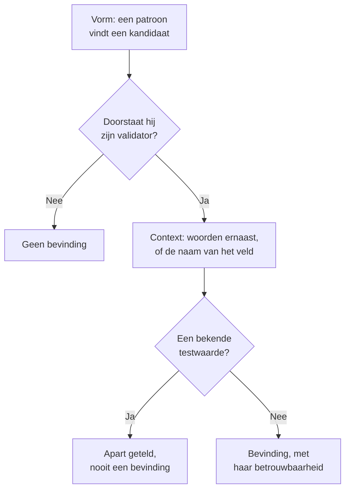

# Gevoelige gegevenstypen

Gegevensbeveiliging kent 143 soorten gevoelige gegevens: kaartnummers, bankrekeningen, nationale identiteitsnummers van 43 landen, gezondheidsidentificatoren, API-sleutels en tokens, en de bijzondere categorieën van persoonsgegevens. Elk type heeft een categorie, een gevoeligheid en, als het bij één land hoort, dat land. Deze pagina zegt hoe een waarde wordt gevonden en somt elk gegevenstype op, zodat je kunt zien waarom iets werd gevonden en kunt beslissen wat je ermee doet.

:::cards
- [Hoe een waarde wordt gevonden](#hoe-een-waarde-wordt-gevonden): Vorm, validator, context, testwaarden, betrouwbaarheid.
- [Velden en kolommen](#velden-en-kolommen): Hoe een hele kolom of een heel attribuut wordt beoordeeld.
- [Namen en straatadressen in vrije tekst](#namen-en-straatadressen-in-vrije-tekst): Het kleine model in de scanner en zijn scores.
- [Elk gegevenstype](#ingebouwde-gegevenstypen): Alle 143, per categorie.
- [Je eigen gegevenstypen](#je-eigen-gegevenstypen): Personeelsnummers, polisnummers en het vak Testen.
- [Gegevenstypen die OneUptime AI vindt](#gegevenstypen-die-oneuptime-ai-vindt): Uw eigen gegevenstypen, gevonden in de velden die geen detector kon plaatsen.
- [De oordelen van OneUptime AI](#de-oordelen-van-oneuptime-ai): Een oordeel over elke bevinding die op je wacht, met de beslissingen van je team als precedent.
:::

## Hoe een waarde wordt gevonden



Alles wat wordt gescand - een logregel, een CSV-cel, een databaserij, de eerste bytes van een object - doorloopt dezelfde stappen:

1. **Vorm.** Elk gegevenstype heeft patronen die kandidaten vinden: zestien cijfers, `AKIA` en zestien letters, een woord, een `@` en een domein. Een patroon matcht nooit binnen een langer token, dus een kaartnummer wordt niet gevonden binnen een langere reeks cijfers.
2. **Validator.** Een kandidaat moet voldoen aan de eigen regels van zijn type: een controlesom (Luhn voor kaarten, mod 97 voor IBAN's, Verhoeff voor Aadhaar-nummers, het controlecijfer van de meeste nationale identiteitsnummers), een echte datum, een bekend voorvoegsel, genoeg willekeur voor een geheim. Een kandidaat die faalt, is helemaal geen bevinding. Plaatshouders zoals `000000000` en `123456789` falen voor elk numeriek type.
3. **Context.** Woorden bij een kandidaat - standaard tot 64 tekens ervoor en 32 erna - die zeggen wat hij is, verhogen zijn betrouwbaarheid één niveau, en dat doet ook een veld waarvan de naam op het type wijst. Woorden die zeggen dat het iets anders is, zoals een order- of trackingnummer, verlagen die één niveau. Een nummer zonder controlesom en met een gangbare vorm, zoals een paspoortnummer of een bankrekening, telt alleen naast woorden die het noemen.
4. **Bekende testwaarden.** Gepubliceerde testkaartnummers (zoals `4242 4242 4242 4242` van Stripe), voorbeeld-IBAN's, adressen op `example.com` en andere gereserveerde domeinen, IP-adressen voor documentatie, de voorbeeld-ID's die overheidsdocumentatie afdrukt, sleutels voor de testmodus zoals `sk_test_` en plaatshoudersleutels worden apart geteld. Ze leveren nooit een bevinding op, dus een opslag vol ermee leest als een testomgeving, niet als een datalek.
5. **Betrouwbaarheid.** Wat overblijft, is een bevinding, zo zeker als het bewijs toelaat.

| Betrouwbaarheid | Wat het betekent |
| --- | --- |
| **Hoog** | De waarde doorstond haar validator, en woorden eromheen of het veld waarin ze staat zeggen wat ze is - of, voor een veld, de meeste waarden zijn van dat type. |
| **Gemiddeld** | De waarde doorstond haar validator zonder dat iets eromheen het bevestigt, of de naam van het veld zegt wat het bevat en sommige waarden stemmen daarmee overeen. |
| **Laag** | De vorm komt overeen, maar niets bevestigt het. |

Alleen bevindingen met Hoog en Gemiddeld tellen mee: ze maken een opslag gevoelig en kunnen een probleem openen. Bevindingen met Laag staan ingeklapt op de opslag, zodat een mens ze kan beoordelen: **Bevestigen** op een juiste bevinding maakt haar Hoog, en ze blijft Hoog bij latere scans.

Als twee gegevenstypen dezelfde tekens claimen, wint de zekerste bevinding: eerst de hoogste betrouwbaarheid, dan de detector waarvan de eigen regels meer bewijzen, dan de langste match.

Een waarde wordt ook gelezen zoals mensen haar schrijven. De procent-escapes van een URL worden gelezen, zodat een IP-adres of een e-mailadres in een querystring, zoals `jane%40example.com`, wordt gevonden. De cijfers van een kaartnummer worden in elk schrift gelezen, zoals cijfers op volle breedte (`４１１１ １１１１ １１１１ １１１１`) of Arabisch-Indische cijfers, eerst elk schrift apart en dan samen. Een e-mailadres wordt in elk schrift gevonden, zoals `张伟@example.com` of `почта@пример.рф`, en een IPv6-adres direct na de dubbele punt van een sleutel, zoals `ip:2001:db8::1`. Elke bevinding is de waarde zoals ze geschreven is, zodat een opschoonregel haar daar verbergt.

Een lange waarde wordt gelezen in vensters van 64 KB die 4 KB overlappen, zodat een waarde in haar geheel wordt gevonden waar ze ook staat, en van één waarde wordt hoogstens 4 MB gelezen.

## Velden en kolommen

Een kolom, een JSON-veld of een logattribuut wordt als geheel beoordeeld. De naam ervan wijst op een gegevenstype, en de bemonsterde waarden bewijzen er een. Het aandeel van de waarden dat het type bevat, bepaalt hoe zeker de bevinding is:

| Waarden die het type bevatten | Betrouwbaarheid |
| --- | --- |
| 60% of meer | Hoog |
| 25% of meer | Hoog als de naam van het veld op het type wijst, anders Gemiddeld |
| Minder | Gemiddeld als de naam van het veld op het type wijst, anders Laag: een paar e-mailadressen in een kolom met iets anders |

Een veld waarvan de waarden gemiddeld meer dan 80 tekens lang zijn, is vrije tekst - notities, berichten, beschrijvingen - en hoeft niet één type te bevatten. De bevindingen ervan houden de betrouwbaarheid die elke match op zichzelf verdiende, en zeggen dat ze in vrije tekst zijn gevonden. Van een veld worden tot 1.000 waarden geclassificeerd, en van elke waarde tot 16 KB.

De naam van een veld wordt in woorden gesplitst - `customerEmail`, `customer_email` en `customer-email` zijn allemaal "customer email" - en een naamhint van een type matcht als de woorden ervan in die volgorde naast elkaar staan: "date of birth" matcht `customer_date_of_birth`, niet `birth_city`. Alleen het laatste deel van een pad met punten is de eigen naam van het veld, samen met het deel ervoor als het laatste een algemeen woord is zoals `number`, `id` of `value`: `customer.address.city` is geen straatadres, en `card.number` is nog steeds een kaartnummer.

Sommige gegevenstypen zijn niet aan hun waarden te herkennen: geen patroon onderscheidt de naam van een persoon van een straat, of een religie van elk ander woord. Die worden alleen gevonden op de naam van het veld, als het veld waarden heeft: Persoonsnaam, Gebruikersnaam, Geslacht, Nationaliteit, Gezondheidsinformatie, Raciale of etnische afkomst, Religieuze overtuiging, Seksuele geaardheid, Politieke opvatting, Vakbondslidmaatschap, Biometrische gegevens, Genetische gegevens en Strafblad. Een naam, een gebruikersnaam, een geslacht of een nationaliteit is dan Hoog als 60% of meer van de waarden er een lijkt, en anders Gemiddeld. In vrije tekst worden de namen en straatadressen van personen ook gevonden door een klein model: zie [Namen en straatadressen in vrije tekst](#namen-en-straatadressen-in-vrije-tekst).

Een veld waarvan de naam zegt dat het een wachtwoord bevat - `password`, `passwordHash`, `pwd`, niet `password_changed_at` - hoort een hash te bevatten: bcrypt, argon2, scrypt, PBKDF2 of een ander schema dat een opslag waarschijnlijk gebruikt. Lege waarden, plaatshouders zoals `********` en versleutelde waarden worden apart gehouden. Zijn er van de rest meer geen hash dan wel, dan bevat het veld de wachtwoorden zelf, wat geen patroon kan zien, en faalt de opslag voor [Wachtwoorden worden als platte tekst opgeslagen](/docs/data-security/checks-and-issues#gegevenshygiëne).

### Velden die geen detector kon plaatsen

Een kolom of veld waarvan de naam naar geen enkel gegevenstype wijst en waarvan de waarden bij geen enkele detector passen, is niet als veilig bekend: het kan je eigen klantnummer zijn, of een kolom met een naam in een andere taal. Met **AI inschakelen** aan voor het project bewaart een inhoudsscan zulke velden, hoogstens 200 per scan, en wordt OneUptime AI gevraagd welk van de gegevenstypen van het project elk veld bevat, hoogstens 40 velden van een opslag tegelijk. Het krijgt de naam van het veld, de namen van de velden ernaast en de vormen van zijn waarden - elke letter geschreven als `a` of `A` en elk cijfer als `9`, dus `AB-1234` wordt `AA-9999` - nooit een waarde. Naar vrije tekst, velden met minder dan 5 waarden, kleine gehele getallen en velden die als ID, tijdstip of status zijn benoemd, wordt niet gevraagd.

Een telemetriescan bewaart op dezelfde manier de attributen die geen detector plaatste, uit de logs, spans, metrics en de rest van de telemetrie van een service, hoogstens 50 per service per scan. Hij bewaart nooit de eigen attributen van OneUptime, niet de attributen die de conventies van OpenTelemetry op elk record schrijven om te zeggen waar het vandaan komt, zoals de service, de host of de pod, en geen vrije tekst, zoals de body van een log.

Elk type dat OneUptime AI noemt, is een bevinding met Laag, gemarkeerd als **Voorgesteld door OneUptime AI** met de reden, geschreven in de taal van je project en getoond over de hele rij van de bevinding. Zoals elke bevinding met Laag telt ze nergens voor mee tot een mens **Bevestigen** kiest op de pagina **Inhoud** van de opslag; **Markeren als niet gevoelig** wijst haar af. Naar een veld dat een antwoord kreeg, wordt 30 dagen niet opnieuw gevraagd, en naar een veld dat een mens beoordeelde nooit meer.

## Namen en straatadressen in vrije tekst

Geen patroon onderscheidt de naam van een persoon van elk ander woord. Daarom wordt vrije tekst - een supportnotitie, een logregel, een uitzonderingsbericht, een prompt - ook gelezen door een klein taalmodel dat de namen en straatadressen van personen vindt. Het model draait in de scanner, op de workers van OneUptime en op je sondes: de tekst verlaat de scanner nooit, er wordt niets gedownload terwijl het draait, en er wordt geen prompt geschreven. Het is niet OneUptime AI, en de schakelaars van OneUptime AI zetten het niet aan of uit: dat doet **Namen en straatadressen vinden**.

- **Wat het leest.** Een veld waarvan de waarden gemiddeld meer dan 80 tekens lang zijn; een veld waarvan de naam zegt dat iemand er vrije tekst in schreef, hoe kort de waarden ook zijn, zoals `delivery_note`, `comentario`, `Lieferhinweis` of `opmerking` (zie [Korte waarden](#korte-waarden)); en in telemetrie elke logbody, elk uitzonderingsbericht, elke stacktrace en elk AI-gesprek, hoe kort ook. Het leest tot 100 verschillende waarden van een veld, in totaal 32 KB tekst, en tot 16 KB van één waarde.
- **Wat het vindt.** De gegevenstypen **Naam van persoon** (`person-name`) en **Straatadres** (`postal-address`). Een straatadres is een plaatsaanduiding die het model naast een huisnummer leest, zoals `14 Calle Mayor`, met de postcode en de stad die erop volgen. Een stad of een land op zichzelf is geen straatadres.
- **Hoe zeker het is.** Een naam of adres dat het model vindt, is op zichzelf Gemiddeld. Het is Hoog als de naam van het veld zegt dat het veld namen of adressen bevat, of als woorden ernaast dat zeggen, zoals "customer", "Kunde" of "dirección". Het is Laag als het model er niet zeker van is, met een score onder 0,6. Elke bevinding houdt de betrouwbaarheid die ze op zichzelf verdiende, dus één naam tussen duizend logregels is nog steeds Gemiddeld.
- **Testwaarden.** Plaatshouders zoals `Jane Doe`, `John Smith`, `Max Mustermann` en `123 Main Street` worden apart geteld, zoals de testwaarden van elk type.
- **Wat het bewaart.** De voorbeelden ervan worden gemaskeerd zoals bij een naam die op de veldnaam is gevonden: het eerste teken en vier sterretjes, `M****`. Er worden nooit vingerafdrukken van gemaakt. Op de pagina **Inhoud** van de opslag staat bij zo'n bevinding **Gevonden in vrije tekst door het model van de scanner**.
- **Zijn records en zijn regels.** Een bevinding die het deed, somt de records op waarin ze werd gevonden, met elke tekstregel ingekort rond de naam of het adres en elke naam en elk adres erin gemaskeerd, en Opschonen bewijst een regel op die records, zoals bij elke bevinding: ze worden opnieuw gelezen met het model, met telkens tot 20 seconden van zijn tijd. Een record waarvoor het geen tijd had, staat niet in de lijst, en de lijst zegt voor hoeveel waarden het geen tijd had. Waar het model niet kan draaien, zegt de lijst dat, en wordt er geen regel voor de bevinding bewezen.

| Model | Licentie | Grootte | Revisie | Gemeten talen |
| --- | --- | --- | --- | --- |
| [openmasq/ner-multilingual](https://huggingface.co/openmasq/ner-multilingual): meertalig BERT-model met zes lagen, int8-ONNX | Apache 2.0 | 98 MB | `8cf7273` | Engels, Spaans, Duits, Frans, Italiaans, Portugees, Nederlands |

### Hoe goed het ze vindt

Het is gemeten met de eigen code van de scanner, op een testset die ervoor is geschreven: 392 verzonnen zinnen in zeven talen - logregels, supportnotities, e-mails, prompts - waarvan er 168 geen naam en geen adres bevatten. Een bevinding is juist als ze een naam of adres van haar type overlapt. De lat werd gelegd voordat er ook maar één model was gemeten: een precisie van minstens 0,90 voor elk type over alle talen en 0,85 in elke taal, een recall van minstens 0,70, en hoogstens 20 valse bevindingen per 1.000 waarden die geen van beide bevatten. Van de vier gemeten modellen haalden er twee die lat, en het kleinere werd gekozen. Een test legt deze scores vast: een wijziging aan het model of aan de scanner die er een verlaagt, laat de test falen.

| Taal | Namen: precisie | Namen: recall | Adressen: precisie | Adressen: recall |
| --- | --- | --- | --- | --- |
| Engels | 0,96 | 0,96 | 1,00 | 1,00 |
| Spaans | 0,96 | 0,96 | 1,00 | 1,00 |
| Duits | 1,00 | 0,93 | 1,00 | 1,00 |
| Frans | 0,96 | 0,96 | 1,00 | 1,00 |
| Italiaans | 0,96 | 0,96 | 1,00 | 1,00 |
| Portugees | 0,93 | 0,89 | 1,00 | 1,00 |
| Nederlands | 0,96 | 0,89 | 1,00 | 1,00 |
| Alle zeven | 0,96 | 0,94 | 1,00 | 1,00 |

Op de 168 zinnen van de testset die geen van beide bevatten, maakt het 18 valse bevindingen per 1.000. Op een deel van een openbare benchmark, [gretelai/synthetic_pii_finance_multilingual](https://huggingface.co/datasets/gretelai/synthetic_pii_finance_multilingual) (Apache 2.0): 15 financiële documenten in elk van zeven talen, met labels die door een machine zijn gemaakt en niet volledig zijn, dus lees dit naast de tabel hierboven en niet op zichzelf:

| Taal | Namen: precisie | Namen: recall | Adressen: precisie | Adressen: recall |
| --- | --- | --- | --- | --- |
| Engels | 0,91 | 0,90 | 0,83 | 1,00 |
| Spaans | 0,89 | 0,37 | 0,58 | 0,70 |
| Duits | 0,93 | 0,58 | 0,75 | 0,70 |
| Frans | 0,84 | 0,50 | 0,42 | 0,83 |
| Italiaans | 0,73 | 0,61 | 0,79 | 0,69 |
| Nederlands | 0,91 | 0,49 | 1,00 | 0,89 |
| Zweeds | 1,00 | 0,61 | 1,00 | 0,93 |
| Alle zeven | 0,89 | 0,54 | 0,77 | 0,82 |

De vier gemeten modellen, op de geschreven testset, na elkaar op dezelfde machine, elk getimed op één kern met de native code van onnxruntime. OneUptime draait het gekozen model met de WebAssembly-versie van onnxruntime, die in elk image draait, ongeveer vijf tot acht keer trager:

| Model | Licentie | Grootte | Namen: precisie / recall | Adressen: precisie / recall | Valse bevindingen per 1.000 | Tijd per 1.000 waarden van 75 / 1.181 tekens |
| --- | --- | --- | --- | --- | --- | --- |
| openmasq/ner-multilingual (gekozen) | Apache 2.0 | 98 MB | 0,963 / 0,939 | 1,000 / 1,000 | 18 | 5,9 s / 82 s |
| Wismut/nym-pii-multilingual-small | MIT | 121 MB | 0,995 / 0,974 | 0,985 / 1,000 | 12 | 7,4 s / 103 s |
| jkomyno/minilmv2-l6-h384-ner-en-it-q8 | MIT | 34 MB | 0,704 / 0,929 | 0,839 / 1,000 | 369 | 3,7 s / 68 s |
| balticml/mmbert-small-pii-redaction | Apache 2.0 | 38 MB | 0,712 / 0,995 | 0,762 / 0,992 | 589 | 7,8 s / 159 s |

### Korte waarden

Een kort veld wordt alleen gelezen als de naam ervan zegt dat iemand er vrije tekst in schreef. De regel werd gemeten voordat hij werd gekozen, op 49 kolommen van een database in de zeven talen, in totaal 588 waarden: productnamen, titels, labels, functietitels en winkelnamen, waarin de naam van een merk, een personage of een straat geen bevinding is, en korte bezorgnotities, supportcommentaren en opmerkingen van klanten met daarin 91 namen en 28 straatadressen. De eerste overwogen regel, elk veld van vier of meer woorden lezen, las 108 waarden van de catalogus en maakte er 53 valse namen van, zoals `Ralph Lauren` in de naam van een poloshirt en `Tom Sawyer` in de titel van een boek:

| Regel | Gelezen cataloguswaarden | Namen: precisie | Namen: recall | Adressen: precisie | Valse bevindingen per 1.000 |
| --- | --- | --- | --- | --- | --- |
| Velden van vier of meer woorden (niet gekozen) | 108 | 0,62 | 0,99 | 1,00 | 222 |
| Velden waarvan de naam op vrije tekst wijst (gekozen) | 0 | 0,98 | 0,99 | 1,00 | 14 |

De gekozen regel, per taal. Een test legt deze scores vast, en ook de lat waarmee het model werd gekozen:

| Taal | Namen: precisie | Namen: recall | Adressen: precisie | Adressen: recall |
| --- | --- | --- | --- | --- |
| Engels | 1,00 | 1,00 | 1,00 | 1,00 |
| Spaans | 1,00 | 1,00 | 1,00 | 1,00 |
| Duits | 1,00 | 1,00 | 1,00 | 1,00 |
| Frans | 1,00 | 1,00 | 1,00 | 1,00 |
| Italiaans | 1,00 | 1,00 | 1,00 | 1,00 |
| Portugees | 0,86 | 0,92 | 1,00 | 1,00 |
| Nederlands | 1,00 | 1,00 | 1,00 | 1,00 |
| Alle zeven | 0,98 | 0,99 | 1,00 | 1,00 |

De naam van het veld zelf telt: `orders.delivery_note` wordt gelezen, `notes.author` niet, en evenmin een naam die eindigt op een id, een aantal, een type, een status of een tijd, zoals `message_id`. Een beschrijving wordt niet om haar naam gelezen: die van een product is catalogustekst.

### Waar het draait, en wat het kost

- **In elk image.** Het app-image, dat de workers draait, en het sonde-image bevatten het model, het vocabulaire ervan en de runtime, de air-gapped en Iron Bank-images inbegrepen: ongeveer 114 MB op schijf. Ze worden opgehaald wanneer het image wordt gebouwd, vanaf een vastgezette revisie, en gecontroleerd aan de hand van hun SHA-256. Terwijl een scan draait, wordt er niets gedownload.
- **Geheugen.** Het model wordt geladen zodra een scan het voor het eerst nodig heeft, één keer per proces: ongeveer 550 MB, dat na 10 minuten zonder scan weer wordt vrijgegeven.
- **Tijd.** Op één kern tussen 30 seconden en een minuut per 1.000 waarden ter lengte van een logregel, en ongeveer 9 minuten per 1.000 waarden van 1.200 tekens. Een inhoudsscan van een opslag geeft het model tot 2 minuten. De telemetriescan van elk uur geeft het in totaal tot 1 minuut, met 6 seconden per opslag, en neemt elk uur een andere reeks opslagen.
- **Om de beurt.** Het model van elke inhoudsscan begint waar dat van de vorige stopte: bij de eerste tabel of container waarvan het de vrije tekst niet las, en met de objecten van een bucket waarvoor het geen tijd had, die vóór alle andere opnieuw worden gelezen. Wat het begon en niet kon afmaken, wordt niet opnieuw als eerste genomen, zodat niets scan na scan de tijd van het model opeist en elke tabel en elk object aan de beurt komt, hoeveel vrije tekst de opslag ook bevat.
- **Als de tijd op is**, rondt de scan af met wat het model heeft gelezen, en de waarschuwingen van de scan zeggen hoeveel van de waarden in vrije tekst het heeft gelezen, nooit wat erin stond. Een worker of sonde zonder model scant zoals voorheen en zegt waarom:

```text
Names and street addresses were looked for in 120 of 500 free-text values: this store's 6 seconds of model time ran out.
Names and street addresses in free text were not looked for: the model's model_quantized.onnx is not installed on this probe.
```

De details van een scan tonen deze, en elke andere waarschuwing van een inhouds- of telemetriescan, in de taal van de lezer.

**Namen en straatadressen vinden** staat aan voor elk project: inhoudsscans van buckets, databases en BigQuery-datasets lezen vrije tekst met het model, op workers en op sondes. De instelling eronder, **Namen en straatadressen in telemetrie vinden**, staat uit: elke logbody, elke uitzondering en elk gesprek van een druk project met 200 services één keer lezen kost ongeveer 48 minuten van één kern, en in zijn minuut per uur leest de scan daar ongeveer 4% van. Zet die aan om de scan er elk uur een deel van te laten lezen. Beide staan op **Gegevensbeveiliging → Instellingen → Scaninstellingen**, onder **Wat Gegevensbeveiliging leest**. **Testen** draait in je browser, zonder het model: wat het model zou vinden, wordt daar niet getoond. Het model zou ongeveer 113 MB aan de download toevoegen, gecomprimeerd 67 MB, en ongeveer 440 MB aan het geheugen van het tabblad, dus het draait alleen in de scanner.

## Gevoeligheid

| Gevoeligheid | Wat het betekent |
| --- | --- |
| **Beperkt** | Er volgt schade als het uitlekt: geheimen, kaartnummers, medische dossiers, overheids-ID's. |
| **Vertrouwelijk** | Persoonsgegevens, en documenten die als vertrouwelijk zijn gemarkeerd. |
| **Intern** | De eigen gegevens van het bedrijf, niet bedoeld voor buitenstaanders. |
| **Openbaar** | Er is niets gevoeligs gevonden. |

Een opslag is zo gevoelig als het gevoeligste gegevenstype dat erin is gevonden met minstens de betrouwbaarheid Gemiddeld. Testwaarden en bevindingen die als niet gevoelig zijn gemarkeerd, tellen niet mee, en een opslag waarin niets is gevonden, is Openbaar. Om een opslag als gevoeliger of minder gevoelig te behandelen dan zijn bevindingen zeggen, stel je zijn gevoeligheid zelf in bij de **Instellingen** van de opslag: de controles gebruiken die dan.

## Categorieën

| Categorie | Wat het omvat | Persoonsgegevens |
| --- | --- | --- |
| Geheimen en inloggegevens | Wachtwoorden, API-sleutels, tokens en privésleutels die toegang geven tot andere systemen. | Nee |
| Financieel | Kaartnummers, bankrekeningen, IBAN's en cryptowallets. | Ja |
| Gezondheid | Patiëntdossiernummers, gezondheidsidentificatoren, diagnoses en voorschriften. | Ja |
| Overheids-ID | Nummers voor nationale identiteit, belasting, paspoort en sociale zekerheid. | Ja |
| Bijzondere categorie | Wat artikel 9 van de AVG het sterkst beschermt: etniciteit, religie, seksuele geaardheid, politiek, vakbondslidmaatschap, biometrische en genetische gegevens. | Ja |
| Contact en identiteit | Wie iemand is en hoe je die bereikt: e-mail, telefoon, adres, geboortedatum, IP-adres. | Ja |
| Vertrouwelijke bedrijfsgegevens | Documenten gemarkeerd als vertrouwelijk, alleen intern of juridisch beschermd. | Nee |

Persoonsgegevens zijn gegevens over een persoon, zoals de AVG, CCPA, LGPD en DPDP die bedoelen. Een opslag die alleen geheimen en bedrijfsdocumenten bevat, valt buiten de reikwijdte van een privacykader, nooit buiten die van een beveiligingskader (zie [Compliance van Gegevensbeveiliging](/docs/data-security/compliance)).

## Ingebouwde gegevenstypen

Een gegevenstype dat bij één land hoort, noemt dat land, als ISO 3166-1-code: residentieregels en de landgebonden kaders lezen die (zie [Residentie](/docs/data-security/flows-access-residency#residentieregels)). De ID is de naam waarmee de API en bevindingen het type aanduiden.

### Contact en identiteit

| Gegevenstype | ID | Wat het is | Gevoeligheid | Land |
| --- | --- | --- | --- | --- |
| E-mailadres | `email-address` | Het e-mailadres van een persoon. | Vertrouwelijk | — |
| Telefoonnummer | `phone-number` | Een telefoonnummer in internationaal of nationaal formaat. | Vertrouwelijk | — |
| Persoonsnaam | `person-name` | De voornaam, achternaam of volledige naam van een persoon, gevonden op basis van de veldnaam of door het model van de scanner in vrije tekst. | Vertrouwelijk | — |
| Straatadres | `postal-address` | Een straatadres: een nummer, een straatnaam en een straattype. | Vertrouwelijk | — |
| Postcode | `postal-code` | Een postcode. Op zichzelf beperkt die al waar iemand woont. | Intern | — |
| Geboortedatum | `date-of-birth` | Een datum naast woorden die zeggen dat het iemands geboortedatum is. | Vertrouwelijk | — |
| IP-adres | `ip-address` | Een openbaar IPv4- of IPv6-adres, dat de AVG als persoonsgegeven behandelt. | Vertrouwelijk | — |
| MAC-adres | `mac-address` | Het hardwareadres van een netwerkkaart, dat een apparaat identificeert. | Vertrouwelijk | — |
| Advertentie-ID | `advertising-id` | Een mobiele advertentie-ID (IDFA, GAID, AAID) die één apparaat volgt. | Vertrouwelijk | — |
| Precieze locatie | `geolocation` | Een breedte- en lengtegraad die precies genoeg zijn om een gebouw te vinden. | Vertrouwelijk | — |
| Gebruikersnaam | `username` | De aanmeld- of accountnaam van een persoon, gevonden op de naam van het veld. | Vertrouwelijk | — |
| Geslacht | `gender` | Het gender of geslacht van een persoon, gevonden op de naam van het veld. | Vertrouwelijk | — |
| Nationaliteit | `nationality` | De nationaliteit of het staatsburgerschap van een persoon, gevonden op de naam van het veld. | Vertrouwelijk | — |
| Voertuigidentificatienummer | `vehicle-identification-number` | Een VIN van 17 tekens met een geldig controlecijfer. | Vertrouwelijk | — |

### Overheids-ID

| Gegevenstype | ID | Wat het is | Gevoeligheid | Land |
| --- | --- | --- | --- | --- |
| Social Security-nummer (VS) | `us-ssn` | Een Amerikaans Social Security-nummer. | Beperkt | US |
| Belastingnummer ITIN (VS) | `us-itin` | Een Amerikaans Individual Taxpayer Identification Number. | Beperkt | US |
| Werkgeversnummer EIN (VS) | `us-ein` | Een Amerikaans Employer Identification Number, naast woorden die dat zeggen. | Vertrouwelijk | US |
| Paspoortnummer (VS) | `us-passport` | Een Amerikaans paspoortnummer, naast woorden die dat zeggen. | Beperkt | US |
| Rijbewijsnummer (VS) | `us-drivers-license` | Een Amerikaans rijbewijsnummer, naast woorden die dat zeggen. | Beperkt | US |
| National Insurance-nummer (VK) | `uk-nino` | Een Brits National Insurance-nummer. | Beperkt | GB |
| Paspoortnummer (VK) | `uk-passport` | Een Brits paspoortnummer, naast woorden die dat zeggen. | Beperkt | GB |
| Rijbewijsnummer (VK) | `uk-driving-licence` | Een Brits rijbewijsnummer van 16 tekens. | Beperkt | GB |
| Social Insurance Number (Canada) | `ca-sin` | Een Canadees Social Insurance Number met een geldig controlecijfer. | Beperkt | CA |
| CURP (Mexico) | `mx-curp` | Een Mexicaanse Clave Única de Registro de Población. | Beperkt | MX |
| RFC (Mexico) | `mx-rfc` | Een Mexicaans belastingnummer, de Registro Federal de Contribuyentes. | Beperkt | MX |
| CPF (Brazilië) | `br-cpf` | Een Braziliaans Cadastro de Pessoas Físicas-nummer. | Beperkt | BR |
| CNPJ (Brazilië) | `br-cnpj` | Een Braziliaans registratienummer voor bedrijven (CNPJ). | Vertrouwelijk | BR |
| CUIT / CUIL (Argentinië) | `ar-cuit` | Een Argentijnse identificatiecode voor belasting of arbeid. | Beperkt | AR |
| RUT (Chili) | `cl-rut` | Een Chileense Rol Único Tributario met een geldig controlecijfer. | Beperkt | CL |
| DNI (Spanje) | `es-dni` | Een Spaans nummer van het nationale identiteitsdocument met zijn controleletter. | Beperkt | ES |
| NIE (Spanje) | `es-nie` | Een Spaans identiteitsnummer voor buitenlanders met zijn controleletter. | Beperkt | ES |
| NIF (Portugal) | `pt-nif` | Een Portugees fiscaal identificatienummer. | Beperkt | PT |
| Socialezekerheidsnummer NIR (Frankrijk) | `fr-nir` | Een Frans INSEE-nummer met zijn sleutel van twee cijfers. | Beperkt | FR |
| Belastingnummer (Duitsland) | `de-tax-id` | Een Duitse Steuerliche Identifikationsnummer. | Beperkt | DE |
| Codice fiscale (Italië) | `it-codice-fiscale` | Een Italiaanse fiscale code met een geldig controleteken. | Beperkt | IT |
| BSN (Nederland) | `nl-bsn` | Een Nederlands burgerservicenummer dat voldoet aan de elfproef. | Beperkt | NL |
| Rijksregisternummer (België) | `be-national-number` | Een Belgisch rijksregisternummer. | Beperkt | BE |
| PESEL (Polen) | `pl-pesel` | Een Pools nationaal identificatienummer. | Beperkt | PL |
| Persoonlijk identiteitsnummer (Zweden) | `se-personnummer` | Een Zweeds personnummer met een geldig controlecijfer. | Beperkt | SE |
| Nationaal identiteitsnummer (Noorwegen) | `no-fodselsnummer` | Een Noors fødselsnummer met beide controlecijfers. | Beperkt | NO |
| CPR-nummer (Denemarken) | `dk-cpr` | Een Deens nummer uit het burgerregister, naast woorden die dat zeggen. | Beperkt | DK |
| Persoonlijke identiteitscode (Finland) | `fi-hetu` | Een Fins henkilötunnus met zijn controleteken. | Beperkt | FI |
| PPS-nummer (Ierland) | `ie-ppsn` | Een Iers Personal Public Service Number. | Beperkt | IE |
| AHV-nummer (Zwitserland) | `ch-ahv` | Een Zwitsers socialezekerheidsnummer (AHV / AVS). | Beperkt | CH |
| CNP (Roemenië) | `ro-cnp` | Een Roemeense persoonlijke numerieke code. | Beperkt | RO |
| EGN (Bulgarije) | `bg-egn` | Een Bulgaars uniform burgernummer. | Beperkt | BG |
| OIB (Kroatië) | `hr-oib` | Een Kroatisch persoonlijk identificatienummer. | Beperkt | HR |
| AMKA (Griekenland) | `gr-amka` | Een Grieks socialezekerheidsnummer. | Beperkt | GR |
| Identiteitsnummer (Turkije) | `tr-tckn` | Een Turks T.C. Kimlik-nummer. | Beperkt | TR |
| Identiteitsnummer (Israël) | `il-teudat-zehut` | Een Israëlisch Teudat Zehut-nummer. | Beperkt | IL |
| ID-nummer (Zuid-Afrika) | `za-id` | Een Zuid-Afrikaans identiteitsnummer met een geldige datum en een geldig controlecijfer. | Beperkt | ZA |
| Emirates ID (VAE) | `ae-emirates-id` | Een identiteitskaartnummer van de Verenigde Arabische Emiraten. | Beperkt | AE |
| Nationaal ID (Saoedi-Arabië) | `sa-national-id` | Een Saoedisch nationaal ID- of iqama-nummer. | Beperkt | SA |
| Aadhaar-nummer (India) | `in-aadhaar` | Een Aadhaar-nummer van 12 cijfers dat voldoet aan de Verhoeff-controle. | Beperkt | IN |
| PAN (India) | `in-pan` | Een Indiaas Permanent Account Number. | Beperkt | IN |
| Identiteitsnummer voor ingezetenen (China) | `cn-resident-id` | Een Chinees identiteitskaartnummer voor ingezetenen van 18 tekens. | Beperkt | CN |
| My Number (Japan) | `jp-my-number` | Een Japans individueel nummer met een geldig controlecijfer. | Beperkt | JP |
| Registratienummer voor ingezetenen (Zuid-Korea) | `kr-rrn` | Een Koreaans registratienummer voor ingezetenen. | Beperkt | KR |
| NRIC / FIN (Singapore) | `sg-nric` | Een identiteitskaartnummer of buitenlands identificatienummer van Singapore. | Beperkt | SG |
| Identiteitskaartnummer (Hongkong) | `hk-hkid` | Een identiteitskaartnummer van Hongkong met zijn controlecijfer. | Beperkt | HK |
| Nationaal ID (Taiwan) | `tw-national-id` | Een Taiwanees nationaal identificatienummer. | Beperkt | TW |
| Nationaal ID (Thailand) | `th-national-id` | Een Thais identificatienummer voor burgers. | Beperkt | TH |
| MyKad-nummer (Maleisië) | `my-mykad` | Een Maleisisch identiteitskaartnummer. | Beperkt | MY |
| NIK (Indonesië) | `id-nik` | Een Indonesisch identiteitsnummer uit de bevolkingsregistratie. | Beperkt | ID |
| Tax file number (Australië) | `au-tfn` | Een Australisch tax file number met een geldige controle. | Beperkt | AU |
| IRD-nummer (Nieuw-Zeeland) | `nz-ird` | Een Nieuw-Zeelands Inland Revenue-nummer met een geldig controlecijfer. | Beperkt | NZ |
| SNILS (Rusland) | `ru-snils` | Een Russisch verzekeringsrekeningnummer met zijn controlegetal. | Beperkt | RU |
| INN (Rusland) | `ru-inn` | Een Russisch fiscaal identificatienummer. | Beperkt | RU |
| Paspoortnummer | `passport-number` | Een paspoortnummer uit elk land, naast woorden die dat zeggen. | Beperkt | — |

### Financieel

| Gegevenstype | ID | Wat het is | Gevoeligheid | Land |
| --- | --- | --- | --- | --- |
| Kaartnummer | `credit-card-number` | Een betaalkaartnummer dat voldoet aan de Luhn-controle en bij een kaartmerk hoort. | Beperkt | — |
| Beveiligingscode van kaart | `card-verification-code` | Een CVV of CVC, die PCI DSS verbiedt te bewaren nadat een betaling is geautoriseerd. | Beperkt | — |
| Vervaldatum van kaart | `card-expiration-date` | De vervaldatum van een kaart, naast woorden die dat zeggen. | Vertrouwelijk | — |
| IBAN | `iban` | Een internationaal bankrekeningnummer dat voldoet aan de mod-97-controle. | Beperkt | — |
| Bankrekeningnummer | `bank-account-number` | Een bankrekeningnummer, naast woorden die dat zeggen. | Beperkt | — |
| SWIFT- / BIC-code | `swift-bic` | De SWIFT- of BIC-code van een bank, naast woorden die dat zeggen. | Intern | — |
| Bankroutingnummer (VS) | `us-bank-routing-number` | Een ABA-routingnummer met een geldige controlesom, naast woorden die dat zeggen. | Intern | US |
| Sort code (VK) | `uk-sort-code` | Een Britse sort code van een bank, naast woorden die dat zeggen. | Intern | GB |
| IFSC (India) | `in-ifsc` | Een Indiase Financial System Code die een bankfiliaal aanduidt. | Intern | IN |
| BSB (Australië) | `au-bsb` | Een Australisch bank-state-branch-nummer, naast woorden die dat zeggen. | Intern | AU |
| Bitcoinadres | `bitcoin-address` | Een bitcoinadres met een geldige controlesom. | Vertrouwelijk | — |
| Ethereum-adres | `ethereum-address` | Een Ethereum-adres, naast woorden die dat zeggen. | Vertrouwelijk | — |

### Gezondheid

| Gegevenstype | ID | Wat het is | Gevoeligheid | Land |
| --- | --- | --- | --- | --- |
| NHS-nummer (VK) | `uk-nhs-number` | Een Brits National Health Service-nummer met een geldig controlecijfer. | Beperkt | GB |
| Medicare Beneficiary ID (VS) | `us-medicare-mbi` | Een Amerikaanse Medicare Beneficiary Identifier. | Beperkt | US |
| Medicare-nummer (Australië) | `au-medicare-number` | Een Australisch Medicare-kaartnummer met een geldig controlecijfer. | Beperkt | AU |
| Zorgverzekeringsnummer (Duitsland) | `de-health-insurance-number` | Een Duitse Krankenversichertennummer met een geldig controlecijfer. | Beperkt | DE |
| Patiëntdossiernummer | `medical-record-number` | Het dossiernummer van een patiënt, naast woorden die dat zeggen. | Beperkt | — |
| Lidnummer van zorgverzekering | `health-plan-id` | Een lid- of polisnummer van een zorgverzekering, naast woorden die dat zeggen. | Beperkt | — |
| Diagnosecode (ICD-10) | `diagnosis-code` | Een ICD-10-diagnosecode, naast woorden die dat zeggen. | Beperkt | — |
| Geneesmiddelcode (NDC) | `drug-code` | Een Amerikaanse National Drug Code, naast woorden die dat zeggen. | Vertrouwelijk | — |
| DEA-nummer (VS) | `us-dea-number` | Het Drug Enforcement Administration-nummer van een voorschrijver, met een geldig controlecijfer. | Vertrouwelijk | US |
| Zorgverlener-ID NPI (VS) | `us-npi` | Een National Provider Identifier. Die duidt een zorgverlener aan, geen patiënt. | Intern | US |
| Gezondheidsinformatie | `health-information` | Diagnoses, aandoeningen, medicijnen en andere gezondheidsgegevens, gevonden op de naam van het veld. | Beperkt | — |

### Geheimen en inloggegevens

| Gegevenstype | ID | Wat het is | Gevoeligheid | Land |
| --- | --- | --- | --- | --- |
| AWS-toegangssleutel-ID | `aws-access-key-id` | De openbare helft van een AWS-toegangssleutel. Met het geheim erbij ondertekent die AWS-verzoeken. | Beperkt | — |
| Geheime AWS-toegangssleutel | `aws-secret-access-key` | De geheime helft van een AWS-toegangssleutel, naast woorden die dat zeggen. | Beperkt | — |
| Google-API-sleutel | `google-api-key` | Een API-sleutel van Google Cloud of Maps. | Beperkt | — |
| Sleutel van Google-serviceaccount | `google-service-account-key` | Een sleutelbestand van een Google Cloud-serviceaccount met zijn privésleutel. | Beperkt | — |
| Google OAuth-clientgeheim | `google-oauth-client-secret` | Een OAuth-clientgeheim van Google. | Beperkt | — |
| Sleutel van Azure-opslagaccount | `azure-storage-account-key` | Een sleutel van een Azure-opslagaccount, of een verbindingsreeks die er een bevat. | Beperkt | — |
| Azure SAS-token | `azure-sas-token` | Een Azure shared access signature, die toegang geeft zonder aanmelding. | Beperkt | — |
| Azure-clientgeheim | `azure-client-secret` | Een clientgeheim van een Microsoft Entra ID-toepassing. | Beperkt | — |
| GitHub-token | `github-token` | Een persoonlijk toegangstoken, OAuth-token, app-token of fine-grained token van GitHub. | Beperkt | — |
| GitLab-token | `gitlab-token` | Een persoonlijk toegangstoken van GitLab. | Beperkt | — |
| Slack-token | `slack-token` | Een bot-, gebruikers- of app-token van Slack. | Beperkt | — |
| Slack-webhook-URL | `slack-webhook-url` | Een inkomende webhook van Slack, waarmee iedereen in een kanaal kan posten. | Beperkt | — |
| Geheime Stripe-sleutel | `stripe-secret-key` | Een geheime of beperkte live-sleutel van Stripe, die geld kan verplaatsen. | Beperkt | — |
| Twilio-API-sleutel | `twilio-api-key` | Een SID van een Twilio-API-sleutel met geheim. | Beperkt | — |
| SendGrid-API-sleutel | `sendgrid-api-key` | Een API-sleutel van SendGrid. | Beperkt | — |
| Mailgun-API-sleutel | `mailgun-api-key` | Een API-sleutel van Mailgun. | Beperkt | — |
| Mailchimp-API-sleutel | `mailchimp-api-key` | Een API-sleutel van Mailchimp. | Beperkt | — |
| OpenAI-API-sleutel | `openai-api-key` | Een API-sleutel van OpenAI, die het tegoed van het account uitgeeft. | Beperkt | — |
| Anthropic-API-sleutel | `anthropic-api-key` | Een API-sleutel van Anthropic. | Beperkt | — |
| Hugging Face-token | `huggingface-token` | Een token van Hugging Face. | Beperkt | — |
| npm-token | `npm-token` | Een toegangstoken van npm, waarmee pakketten kunnen worden gepubliceerd. | Beperkt | — |
| PyPI-token | `pypi-token` | Een uploadtoken van PyPI. | Beperkt | — |
| Docker Hub-token | `docker-hub-token` | Een persoonlijk toegangstoken van Docker Hub. | Beperkt | — |
| Shopify-token | `shopify-token` | Een toegangs- of app-token van Shopify. | Beperkt | — |
| Square-token | `square-token` | Een toegangstoken of geheim van Square. | Beperkt | — |
| Braintree-toegangstoken | `braintree-access-token` | Een productietoegangstoken van Braintree. | Beperkt | — |
| DigitalOcean-token | `digitalocean-token` | Een persoonlijk toegangstoken van DigitalOcean. | Beperkt | — |
| New Relic-API-sleutel | `new-relic-api-key` | Een gebruikers-API-sleutel van New Relic. | Beperkt | — |
| Datadog-API-sleutel | `datadog-api-key` | Een API- of applicatiesleutel van Datadog, naast woorden die dat zeggen. | Beperkt | — |
| HashiCorp Vault-token | `vault-token` | Een servicetoken van HashiCorp Vault. | Beperkt | — |
| Terraform Cloud-token | `terraform-cloud-token` | Een API-token van Terraform Cloud of Enterprise. | Beperkt | — |
| Atlassian-API-token | `atlassian-api-token` | Een API-token van Atlassian. | Beperkt | — |
| Linear-API-sleutel | `linear-api-key` | Een API-sleutel van Linear. | Beperkt | — |
| JSON web token | `json-web-token` | Een ondertekende JWT, vaak een sessie- of toegangstoken. | Beperkt | — |
| Privésleutel | `private-key` | Een PEM-, OpenSSH- of PGP-blok met een privésleutel. | Beperkt | — |
| Wachtwoord in een URL | `password-in-url` | Een URL met een gebruikersnaam en een wachtwoord, zoals een verbindingsreeks voor een database. | Beperkt | — |
| Wachtwoord in een verbindingsreeks | `connection-string-password` | Een waarde Password= of Pwd= in een verbindingsreeks. | Beperkt | — |
| Authorization-header | `authorization-header` | Een Basic- of Bearer-referentie, gekopieerd uit een HTTP-header Authorization. | Beperkt | — |
| Wachtwoord of geheim | `generic-secret` | Een waarde die is toegewezen aan een wachtwoord, geheim, API-sleutel of token, en die willekeurig genoeg lijkt om echt te zijn. | Beperkt | — |
| Bitcoin-privésleutel | `bitcoin-private-key` | Een bitcoin-privésleutel in wallet import format, met een geldige controlesom. | Beperkt | — |

### Bijzondere categorie

| Gegevenstype | ID | Wat het is | Gevoeligheid | Land |
| --- | --- | --- | --- | --- |
| Raciale of etnische afkomst | `racial-or-ethnic-origin` | Ras of etniciteit, gevonden op de naam van het veld. | Beperkt | — |
| Religieuze overtuiging | `religious-belief` | Religie of levensovertuiging, gevonden op de naam van het veld. | Beperkt | — |
| Seksuele geaardheid | `sexual-orientation` | Seksuele geaardheid, gevonden op de naam van het veld. | Beperkt | — |
| Politieke opvatting | `political-opinion` | Politieke opvattingen of partijlidmaatschap, gevonden op de naam van het veld. | Beperkt | — |
| Vakbondslidmaatschap | `trade-union-membership` | Vakbondslidmaatschap, gevonden op de naam van het veld. | Beperkt | — |
| Biometrische gegevens | `biometric-data` | Vingerafdrukken, gezichtssjablonen, stemafdrukken en andere biometrie, gevonden op de naam van het veld. | Beperkt | — |
| Genetische gegevens | `genetic-data` | DNA- en genoomgegevens, gevonden op de naam van het veld. | Beperkt | — |
| Strafblad | `criminal-record` | Strafrechtelijke veroordelingen en strafbare feiten (artikel 10 van de AVG), gevonden op de naam van het veld. | Beperkt | — |

### Vertrouwelijke bedrijfsgegevens

| Gegevenstype | ID | Wat het is | Gevoeligheid | Land |
| --- | --- | --- | --- | --- |
| Juridisch beschermd document | `privileged-document` | Een document gemarkeerd als vallend onder het verschoningsrecht van advocaat en cliënt, of als juridisch beschermd. | Beperkt | — |
| Document gemarkeerd als vertrouwelijk | `confidential-document` | Een document gemarkeerd als vertrouwelijk, strikt vertrouwelijk of bedrijfsgeheim. | Vertrouwelijk | — |
| Document gemarkeerd als intern | `internal-document` | Een document gemarkeerd als alleen voor intern gebruik of niet voor verspreiding. | Intern | — |

## Je eigen gegevenstypen

Voeg een gegevenstype toe voor wat alleen je bedrijf heeft: een personeelsnummer, een polisnummer, een projectcode. Ga naar **Gegevensbeveiliging → Instellingen → Gegevenstypen** en voeg het toe onder **Uw gegevenstypen**. Het wordt vanaf de volgende scan precies zo gescand als de ingebouwde typen, in buckets, databases en telemetrie.

:::steps
### Zeg wat het is

Geef het een **Naam**, zoals Personeelsnummer, een **Categorie** en een **Gevoeligheid**: hoe gevoelig een opslag is die het bevat. Een **Beschrijving** zegt wat het is, voor wie een bevinding ervan leest.

### Zeg hoe het wordt gevonden

Vul een **Patroon** in: een reguliere expressie in JavaScript voor één waarde, zoals `EMP-\d{6}`. Voeg de **Veldnamen** toe die het bevatten, zoals `employee id`, en de **Trefwoorden** die, bij een waarde, bevestigen dat ze van dit type is. Laat het patroon leeg om het type alleen op veldnamen te vinden.

### Test het

Plak voorbeeldtekst in **Testen** om te zien wat je gegevenstype erin vindt. Het voert de eigen code van de scanner uit op de tekst, in je browser: de tekst wordt nooit naar OneUptime gestuurd, en alleen de eerste 64 KB ervan wordt getest.
:::

Onder **Meer velden** laat **Hoofdletters negeren** het patroon overeenkomen ongeacht hoofdletters, telt **Vereist een trefwoord** een waarde alleen als er een trefwoord bij staat of de naam van het veld zegt dat ze van dit type is, en laat **Controlesom** een waarde een controle doorstaan: **Geen**, **Luhn** (het controlecijfer van kaartnummers), **Mod97** (de controlecijfers van een IBAN) of **Verhoeff** (het controlecijfer van een Aadhaar-nummer).

Een patroon wordt gecontroleerd als je het opslaat: het moet compileren, mag geen lege tekst matchen en moet draaien in een tijd die in verhouding staat tot de tekst. Het wordt uitgevoerd door een matcher die nooit backtrackt, dus geen enkel patroon kan een scan ophouden, hoe het ook is geschreven. Een type heeft hoogstens 50 trefwoorden en 50 veldnamen.

Een waarde van je type is op zichzelf Gemiddeld en met een trefwoord erbij Hoog als ze een controlesom doorstaat, en op zichzelf Laag en met een trefwoord Gemiddeld als er geen controlesom is. In een kolom beslist het aandeel van de waarden dat overeenkomt, zoals bij elk type.

### Beschrijven

Bovenaan het formulier van een nieuw gegevenstype vult **Beschrijven** het formulier voor u in. Schrijf hoe de gegevens eruitzien, bijvoorbeeld "onze personeelsnummers zien eruit als EMP-123456, soms zonder streepje", voeg desgewenst een paar voorbeelden toe, één per regel, en kies **Formulier invullen**. OneUptime AI krijgt uw zin en de vormen van uw voorbeelden, nooit de voorbeelden zelf: die blijven in uw browser, waar **Testen** laat zien hoeveel ervan het patroon vindt. Lees wat het invulde, wijzig wat u wilt en sla op: er wordt niets opgeslagen tot u dat doet, en het patroon wordt gecontroleerd als een patroon dat u zelf schreef. Beschrijven heeft **AI inschakelen** voor het project nodig.

## Gegevenstypen die OneUptime AI vindt

De velden die geen detector kon plaatsen, bevatten vaak een eigen gegevenstype van uw bedrijf, op veel plekken bewaard onder namen die hetzelfde zeggen: de polisnummers van een verzekeraar in kolommen met de namen `policy_no`, `policyNumber` en `police_nr`, in al zijn databases. Met **AI inschakelen** aan voor het project vindt OneUptime AI zo'n gegevenstype in de velden die uw scans bewaarden, en vraagt het u er pas naar wanneer uw eigen scans het hebben bewezen.

:::steps
### Het vindt een groep velden

Drie of meer velden in twee of meer opslagen vormen een groep wanneer de meeste van hun waarden één vorm hebben, met of zonder de scheidingstekens tussen de delen, en hun namen een woord delen dat zegt wat ze bevatten. Een vorm zonder cijfer, een datum, een tijd of een decimaal getal vormt nooit een groep, en een woord als `id`, `no` of `number` zegt op zichzelf niets.

### Het stelt een gegevenstype op

OneUptime AI stelt voor elke nieuwe groep een gegevenstype op, hoogstens 3 tegelijk, uit de namen van de velden en de vormen van hun waarden, nooit uit een waarde. Het concept moet voldoen aan wat een opgeslagen type moet halen en de vormen vinden waaruit het is opgesteld. Een concept dat dat niet doet, wordt nog één keer gevraagd, met de reden.

### Uw volgende scans bewijzen het

Het concept draait in de volgende scan van elke opslag van zijn groep, hoogstens 48 uur of één scaninterval lang, wat het langst is. Het maakt geen bevinding: elke scan telt hoeveel waarden het zou vinden, in de velden van de groep en in elk ander veld van dezelfde opslagen. Het wordt aangeboden wanneer het minstens 80% van de waarden van zijn velden vindt en hoogstens 1% van de andere waarden. Een veld elders waarin het bijna elke waarde vindt, bevat dezelfde gegevens onder een andere naam: het wordt genoemd, niet tegen het concept geteld.
:::

Elk concept wordt tegelijk ook beperkt geteld: buiten de velden van zijn groep vindt een beperkt concept een waarde alleen naast een van zijn trefwoorden of onder een veldnaam die het noemt. Een concept dat elders te veel vindt, wordt beperkt aangeboden als dat genoeg is. Een concept dat op geen van beide manieren genoeg is, vervalt, en zijn groep wordt 30 dagen lang niet opnieuw opgesteld.

Elk gegevenstype dat het aanbiedt, wacht onder **Te beoordelen gegevenstypen**, bovenaan **Gegevensbeveiliging → Instellingen → Gegevenstypen** en op **Gegevensbeveiliging → AI**, met wat uw scans telden, bijvoorbeeld "Komt overeen met 98% van de waarden in deze 11 velden, en met 0,1% van de waarden elders in dezelfde opslagen." **Gegevenstype toevoegen** opent het formulier van een gegevenstype, ingevuld met dit type, om te wijzigen en te testen; opslaan voegt het type toe, dat scans vanaf hun volgende run vinden. **Geen gegevenstype** wijst het af: het wordt nooit meer aangeboden voor die velden. Toevoegen vereist een rol die gegevenstypen mag maken.

## Niet gevoelig, en nooit gevoelig

Een scan kan iets vinden dat niet is wat het lijkt: een kolom met ordernummers die voldoen aan de Luhn-controle, je eigen supportadres in elke logregel. Laat het OneUptime weten, en het stopt met tellen:

- **Markeer de bevinding als niet gevoelig.** Kies op de pagina **Inhoud** van de opslag **Markeren als niet gevoelig** op de bevinding en zeg waarom. Ze telt niet meer mee voor de gevoeligheid of de controles van de opslag, en de opslag wordt meteen opnieuw gecontroleerd. De bevinding blijft op de opslag staan, gemarkeerd, met je reden, zodat de volgende persoon ziet wat er is besloten.
- **Voeg de waarde toe aan Nooit gevoelig**, in de instellingen van Gegevensbeveiliging, voor een waarde die nergens ooit een bevinding is, zoals `support@yourcompany.com`. Waarden worden vergeleken nadat de scanner ze heeft genormaliseerd, ongeacht hoofdletters.
- **Zet een ingebouwd gegevenstype uit.** Onder **Ingebouwde gegevenstypen**, op **Gegevensbeveiliging → Instellingen → Gegevenstypen**, heeft elk gegevenstype een schakelaar, die wordt opgeslagen zodra je hem omzet. Geen enkele scan van het project zoekt naar een type dat uit staat.

## De oordelen van OneUptime AI

Met **AI inschakelen** aan voor het project en **Aan nieuwe problemen werken** aan onder **Gegevensbeveiliging → AI** geeft OneUptime AI na elke scan van een opslag zijn oordeel over elke bevinding daarin die op een mens wacht. Een bevinding wacht als de scan er niet zeker van was - een bevinding met Laag, of een van de suggesties van OneUptime AI - of als een bevinding met Gemiddeld of Hoog tekenen van een onjuiste match vertoont:

- het grootste deel van de matches bestond uit bekende testwaarden;
- de naam van het veld wijst op een ander gegevenstype, en niet op dit type;
- een ID-veld, zoals `order_number`, `invoice_no` of `ref_id`, bevat een type dat met het Luhn-algoritme wordt gecontroleerd, waaraan een op de tien willekeurige cijferreeksen voldoet, en de naam ervan wijst niet op dat type.

Het oordeel is **Bevestigen**, **Niet gevoelig** of **Niet te zeggen**, met een reden in de taal van je project. Het wordt over de hele rij van de bevinding getoond, op de pagina **Inhoud** van de opslag en op **In uw telemetrie**, met de beslissingen van je team waarop het berust, zoals "Uw team heeft `order_number` in 4 opslagen als niet gevoelig gemarkeerd". **Beslissingen tonen** somt ze een voor een op: de opslag, het veld en de reden die je team gaf.

### De beslissingen van je team als precedent

OneUptime AI krijgt de eerdere beslissingen van je team over bevindingen van hetzelfde gegevenstype, hoogstens tien. Eerst komen die in een veld met dezelfde naam, in welke opslag ook: `order_number`, `orderNumber` en `public.orders.order_number` zijn allemaal "order number". Daarbij komt dezelfde plek eerst, dan de nieuwste beslissing. Daarna komen velden waarvan de namen, of de redenen die ervoor zijn gegeven, hetzelfde zeggen, zoals `order_ref` met de reden "Shopify order numbers". Het krijgt te horen waar elke bevinding stond, wat er is besloten en welke reden is gegeven, zonder de waarden die in een reden staan. Het krijgt nooit een waarde, een gemaskeerd voorbeeld of een record.

Een bevinding in vrije tekst, zoals een logtekst of een bericht, heeft geen veldnaam om op te matchen. Haar precedent is dezelfde plek in een andere opslag, zoals de logtekst van een andere service.

### Wat OneUptime AI zelf beslist

- **Het markeert een bevinding nooit als niet gevoelig**, onder welke regel ook. Dat doet een mens, met een eigen reden. Waar het oordeel **Niet gevoelig** is, begint **Markeren als niet gevoelig** met de reden die OneUptime AI heeft opgesteld, en die je kunt wijzigen.
- **Het bevestigt een bevinding alleen zelf waar een AI-regel dat zegt**: een AI-regel van Gegevensbeveiliging waarin **Beoordelen** op **Automatisch** staat, voor de opslag en het gegevenstype. Daarnaast moet je team zelf al een vergelijkbare bevinding hebben bevestigd, of moet het veld naar het type zijn genoemd. De bevestiging staat op de **Tijdlijn** van de opslag en onder **Gedaan door AI** op **Gegevensbeveiliging → AI**, en **Ongedaan maken** neemt haar terug.

Anders wacht het oordeel op de rij van de bevinding. Heeft het project AI-regels, dan krijgt een bevinding alleen een oordeel als een regel voor haar opslag en gegevenstype **Beoordelen** aan heeft staan; een regel die beperkt is tot bepaalde controles of ernstniveaus gaat over problemen, en beoordeelt geen enkele bevinding. OneUptime AI beoordeelt na een scan hoogstens 40 bevindingen van een opslag, eerst die het nog nooit beoordeelde, en de rest na de volgende scan. Na een latere scan wordt een bevinding alleen opnieuw beoordeeld als veranderd is waarop haar oordeel berust, zoals door een nieuwe beslissing over een vergelijkbare bevinding.

## Vergelijkbare bevindingen

Nadat je een bevinding hebt bevestigd of als niet gevoelig hebt gemarkeerd, toont **Toepassen op vergelijkbare bevindingen** de vergelijkbare bevindingen waarover nog niemand heeft beslist: hetzelfde gegevenstype, in een veld met dezelfde naam, in deze opslag en in elke andere opslag die je mag lezen. Elke bevinding is geselecteerd. Deselecteer de bevindingen die je apart wilt beoordelen, en de rest krijgt dezelfde beslissing, met je reden, als je eigen wijziging; een bevinding die je niet mag wijzigen, blijft zoals ze was. **Niet nu** laat ze allemaal zoals ze zijn. Een bevinding in vrije tekst heeft nooit vergelijkbare bevindingen: wat de ene tekst bevat, zegt niets over een andere.

## Wat je beslissingen over de scans zeggen

Als je team bevindingen als niet gevoelig markeert, stelt OneUptime AI wijzigingen aan de scans voor onder **Wacht op u** op **Gegevensbeveiliging → AI**:

- **Een ingebouwd gegevenstype uitzetten** als elke bevinding ervan als niet gevoelig is gemarkeerd: minstens 3 bevindingen, in minstens 2 opslagen. Een bevinding die OneUptime AI alleen voorstelde, telt niet mee.
- **Een plek uit de scans van een opslag weglaten** als elke bevinding daar als niet gevoelig is gemarkeerd, minstens 2. Dit wordt voorgesteld voor een databasekolom of een telemetrieattribuut, die een scan afzonderlijk kan weglaten.

Elk voorstel wacht altijd tot een mens het goedkeurt: een scan die niet meer zoekt, mist de echte gegevens die later komen. **Nooit gevoelig** wordt nooit voorgesteld, omdat het waarden bevat, en OneUptime AI ziet er nooit een.

## Volgende stappen

:::cards
- [Controles en problemen van Gegevensbeveiliging](/docs/data-security/checks-and-issues): Wat de gevoeligheid van een opslag verandert aan zijn problemen.
- [Gevoelige gegevens in telemetrie](/docs/data-security/telemetry): De gegevenstypen die in je logs, traces en prompts worden gevonden.
- [Compliance van Gegevensbeveiliging](/docs/data-security/compliance): De kaders die elk gegevenstype binnen de reikwijdte brengt.
:::
