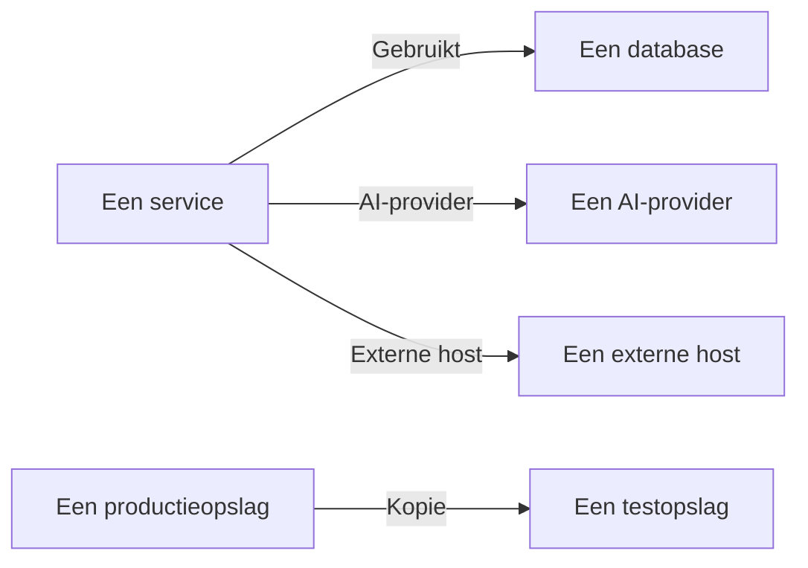

# Gegevensstromen, toegang en residentie

Weten wat een opslag bevat, is de helft. Gegevensbeveiliging zoekt ook uit waar die gegevens heen gaan - welke services de opslag gebruiken, welke AI-providers en externe hosts de gegevens bereiken, en waarheen ze zijn gekopieerd - wie bij elke opslag kan, en of de gegevens staan in de regio's waar ze mogen staan. Dat komt allemaal uit bewijs dat OneUptime al heeft: je traces, de eigen toegangsinstellingen van je cloud, en vingerafdrukken van wat de scans vonden.

:::cards
- [Gegevensstromen](#gegevensstromen): Services, AI-providers, externe hosts en kopieën.
- [Wie bij een opslag kan](#wie-bij-een-opslag-kan): Elke toekenning die je cloud meldt, en hoe blootgesteld de opslag is.
- [Residentieregels](#residentieregels): De regio's waar elke soort gegevens mag staan.
:::

## Gegevensstromen

| Stroom | Wat het betekent | Waar het vandaan komt |
| --- | --- | --- |
| **Gebruikt** | Een service praat met een opslag. | De servicekaart, die OneUptime elke tien minuten afleidt uit de client-spans van je services. Elke database erop wordt aan zijn opslag gekoppeld op naam, adres of endpoint, dus een database die geen andere bron vermeldt, wordt een eigen opslag. |
| **AI-provider** | Een service stuurt gegevens naar een AI-provider. | De AI-aanroepen in de traces van de service van de afgelopen 7 dagen, die de provider noemen die ze bereiken. |
| **Externe host** | Een service roept een host buiten je systemen aan. | De externe services van de servicekaart, op het adres waarop ze worden aangeroepen. |
| **Kopie** | Een opslag bevat waarden van een andere. | Vingerafdrukken van de waarden die elke scan vond: twee opslagen delen gegevens als hun vingerafdrukken van één gegevenstype voor de helft of meer overlappen. |

Een stroom draagt de gegevenstypen die zijn bron bevat, en hun gevoeligheid. Een stroom is bevestigd als een scan heeft bewezen dat de gegevens er zijn, niet alleen dat er een pad naartoe is: een kopie is dat altijd, en een stroom naar een AI-provider is dat als de AI-gesprekken van de service Vertrouwelijke of Beperkte gegevens bevatten. Een stroom die 30 dagen niet opnieuw is gezien, vervalt.

Twee controles lezen de stromen. [Productiegegevens zijn gekopieerd naar een niet-productieopslag](/docs/data-security/checks-and-issues#gegevenshygiëne) faalt op de bestemming van een kopie. Een kopie loopt vanaf de productieopslag als maar een van de twee in productie is, en anders vanaf de opslag die OneUptime het eerst vond. [Gevoelige gegevens worden naar een AI-provider gestuurd](/docs/data-security/checks-and-issues#ai) faalt op de AI-gesprekken van een service als die gevoelige gegevens bevatten, en noemt de providers die ze bereikten.

### Hoe vingerafdrukken privé blijven

Een kopie wordt gevonden zonder de waarden van een van beide opslagen. Voor elk gegevenstype dat een scan met de betrouwbaarheid Hoog vindt, maakt hij van de gelezen waarden een schets als MinHash: 128 vakken, elk het kleinste resultaat van één hashfunctie over de waarden, waarvan alleen de laagste 16 bits worden bewaard. Twee schetsen komen op ongeveer zoveel vakken overeen als hun twee verzamelingen waarden overlappen, dus het vergelijken van schetsen schat hoeveel van de ene opslag in de andere zit.

- **De waarden worden gehasht met een eigen sleutel van het project** (HMAC-SHA256), zodat niemand zonder de sleutel een bekende waarde tegen een schets kan testen, en de schetsen van twee projecten nooit kunnen worden vergeleken.
- **Van elk minimum verlaten maar 16 bits de scan.** Geen waarde, en geen hash ervan, kan uit een schets worden teruggelezen.
- **Een schets gaat over een gegevenstype, niet over een veld.** Een opslag heeft er een voor elk gegevenstype dat er met de betrouwbaarheid Hoog in is gevonden, en verder niets.

## Wie bij een opslag kan

Het uitlezen van de configuratie maakt van de eigen toegangsinstellingen van elke cloud - bucketbeleid en ACL's, roltoewijzingen in Azure, IAM-bindingen in Google Cloud, gedeelde snapshots - één lijst van wie bij de opslag kan, op de pagina **Wie erbij kan** ervan:

| Kolom | Wat ze zegt |
| --- | --- |
| **Principal** | Wie of wat toegang heeft, zoals de cloud het noemt: `*`, een account-ID, een ARN, een e-mailadres, een serviceaccount. |
| **Type principal** | Public, Account, Rol, Gebruiker, Groep, Service Principal, Serviceaccount of Service. |
| **Toegangsniveau** | Lezen, Schrijven of Beheerder. |
| **Verleend via** | Wat de toegang verleent: een bucketbeleid, een ACL, een roltoewijzing, een IAM-binding of een gedeelde snapshot. |
| **Extern** | De principal staat buiten de accounts, abonnementen en projecten die aan OneUptime zijn gekoppeld. |
| **Openbaar** | De principal is iedereen op het internet. |

De lijst wordt bij elke uitlezing van de configuratie opnieuw gelezen, en een toekenning die de cloud niet meer meldt, wordt verwijderd. [Meer dan 25 identiteiten kunnen Beperkte gegevens lezen](/docs/data-security/checks-and-issues#toegang) telt de lezers erop. De services die een opslag gebruiken, zijn de stromen **Gebruikt** van die opslag.

Op basis van wat het leest, krijgt elke opslag een blootstelling:

| Blootstelling | Wat het betekent |
| --- | --- |
| **Openbaar** | Iedereen op het internet kan de opslag lezen. |
| **Andere accounts** | Accounts buiten je gekoppelde accounts kunnen erbij. |
| **Bereikbaar via internet** | Het netwerkendpoint ervan accepteert verbindingen vanaf het internet. |
| **Privé** | Alleen je eigen accounts en netwerken kunnen erbij. |
| **Onbekend** | OneUptime kon niet genoeg van de configuratie lezen om het te bepalen. |

Openbaar gaat vóór gedeeld, en gedeeld gaat vóór bereikbaar: een openbare bucket die ook met een ander account wordt gedeeld, is Public. Blootstelling telt mee in de [risicoscore](/docs/data-security/checks-and-issues#risicoscore) van een probleem.

## Residentieregels

Een residentieregel zegt waar een soort gegevens mag staan. Voeg er een toe onder **Gegevensbeveiliging → Instellingen → Residentieregels**:

| Veld | Wat het doet |
| --- | --- |
| **Naam** | Wat de regel is, zoals EU-persoonsgegevens blijven in de EU. |
| **Toegestane regio's** | De regio's waarin die gegevens mogen worden opgeslagen en gekopieerd, geschreven zoals je cloud ze noemt. Een regel zonder regio's controleert niets. |
| **Gegevenscategorieën** | De categorieën gegevens die de regel dekt. Leeg dekt elke soort persoonsgegevens. |
| **Gegevens over personen in** | Alleen gegevens over personen in deze landen, als ISO 3166-1-codes zoals `DE` of `IN`. Leeg dekt gegevens over personen waar ook ter wereld. |
| **Beschrijving** | Waarvoor de regel dient, zoals de gegevens van onze EU-klanten worden alleen in de EU opgeslagen. |
| **Ingeschakeld** | Of opslagen tegen de regel worden gecontroleerd. |

Een opslag overtreedt een regel als hij gegevens bevat die de regel dekt, en zijn eigen regio, of een regio waarnaar zijn gegevens worden gekopieerd, met geen van de toegestane regio's overeenkomt. Kopieën zijn de regio's waarnaar de gegevens van een opslag worden gerepliceerd: S3-replicatie, de geo-redundante kopie van een opslagaccount, de replica's van een database. De opslag faalt dan voor [Gegevens worden opgeslagen buiten de regio's waar ze mogen staan](/docs/data-security/checks-and-issues#residentie), met de regio en de regel die hij overtrad.

### Regio's en jokertekens

Een `*` in een toegestane regio staat voor willekeurige tekens, hoofdletters en kleine letters zijn gelijk, en het patroon moet met de hele regio overeenkomen:

| Toegestane regio | Komt overeen met | Komt niet overeen met |
| --- | --- | --- |
| `eu-*` (AWS) | `eu-west-1`, `eu-central-1` | `us-east-1`, `us-eu-1` |
| `europe-*` (Google Cloud) | `europe-west1`, `europe-north1` | `us-central1` |
| `westeurope` (Azure) | `westeurope` | `northeurope` |

Vermeld één patroon voor elke cloud die je gebruikt: `eu-*`, `europe-*`, `westeurope` en `northeurope` samen houden gegevens op alle drie in Europa.

### Van wie de gegevens in een opslag zijn

OneUptime leest uit de gegevens zelf van wie de gegevens in een opslag zijn. Een gegevenstype dat bij één land hoort, zegt dat de betrokken personen in dat land zijn: een Duits fiscaal identificatienummer zegt `DE`, een Indiaas Aadhaar-nummer `IN`, een Brits NHS-nummer `GB`. De opslag vermeldt die landen als de landen van zijn betrokkenen, en een regel die tot personen in bepaalde landen is beperkt, dekt alleen de opslagen die hun gegevens bevatten. [Gevoelige gegevenstypen](/docs/data-security/data-types#ingebouwde-gegevenstypen) noemt het land van elk gegevenstype dat er een heeft.

## Volgende stappen

:::cards
- [Controles en problemen van Gegevensbeveiliging](/docs/data-security/checks-and-issues): Elke controle die deze stromen, toekenningen en regels voeden.
- [Compliance van Gegevensbeveiliging](/docs/data-security/compliance): Hoe residentie en toegang meetellen voor de AVG, LGPD en DPDP.
- [Topologie](/docs/telemetry/topology): De servicekaart waar de stromen vandaan komen.
:::
