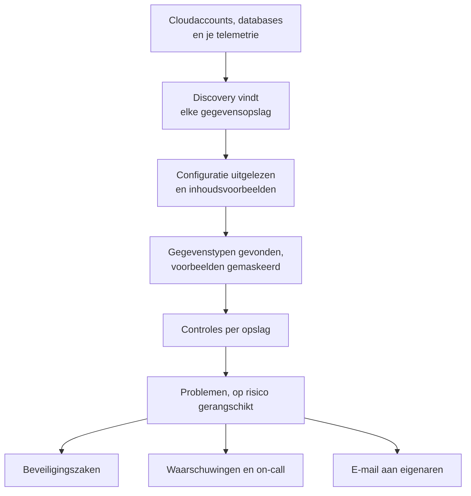

# Gegevensbeveiliging

Gegevensbeveiliging vindt de gevoelige gegevens die je bedrijf bewaart - in cloudbuckets, databases en datawarehouses, en in de telemetrie die je naar OneUptime stuurt - en vertelt je wat er mis is met hoe ze worden bewaard. Het vindt de opslagen zelf, leest hoe elke opslag is ingericht, neemt een steekproef van wat erin staat, en opent voor alles wat mis is een probleem, gerangschikt op risico.

Het beantwoordt vier vragen:

:::cards
- [Waar staan onze gevoelige gegevens?](/docs/data-security/data-types): 143 gegevenstypen, van kaartnummers en nationale identiteitsnummers tot API-sleutels, gevonden in buckets, tabellen en telemetrie.
- [Is het blootgesteld?](/docs/data-security/checks-and-issues): 32 controles van elke opslag: openbare toegang, versleuteling, back-ups, logging, geheimen en kopieën.
- [Wie kan erbij, en waar gaat het heen?](/docs/data-security/flows-access-residency): Wie elke opslag kan lezen, welke services hem gebruiken, en welke AI-providers en hosts zijn gegevens bereiken.
- [Voldoet het aan onze regels?](/docs/data-security/compliance): Residentieregels, en negen kaders gescoord op wat de scans vonden.
:::

## Hoe het werkt

1. **Discovery** vindt de opslagen die OneUptime al kent: je cloudinventaris, de databases die het product Database bewaakt, de databases waarmee je services praten op de servicekaart, en de telemetrie van elke service. Je voegt een opslag alleen met de hand toe als geen enkele bron hem vermeldt.
2. **Het uitlezen van de configuratie** vraagt elke cloud hoe elke opslag is ingericht: wie erbij kan, en hoe hij is versleuteld, geback-upt en gelogd. Het leest instellingen, nooit gegevens.
3. **Inhoudsvoorbeelden** lezen een klein deel van wat een opslag bevat, waar je dat toestaat: een paar objecten van elke soort in een bucket, enkele rijen van elke tabel, de nieuwste records van de telemetrie van elke service.
4. **Classificatie** vindt gevoelige waarden in de voorbeelden, en bewaart tellingen en gemaskeerde voorbeelden, nooit een waarde.
5. **Controles** bepalen wat er mis is met elke opslag, en hoe erg dat is voor de gegevens die hij bevat. Elke controle die faalt, opent een probleem, dat vanzelf sluit zodra de controle slaagt.

## Wat het anders maakt

- **Je telemetrie is een gegevensopslag.** De logs, traces, uitzonderingen, sessieherhalingen en AI-gesprekken van elke service worden elk uur gecontroleerd zoals een bucket. Een e-mailadres in een logregel is een bevinding, en **Opschonen** maskeert het vanaf dan al bij de inname. Zie [Gevoelige gegevens in telemetrie](/docs/data-security/telemetry).
- **Stromen komen uit echt verkeer.** De servicekaart zegt welke service welke database gebruikt, AI-aanroepen noemen de provider die ze bereiken, en kopieën van productiegegevens worden gevonden door vingerafdrukken te vergelijken. Zie [Gegevensstromen, toegang en residentie](/docs/data-security/flows-access-residency).
- **Bewijs wordt altijd gemaskeerd.** Een bevinding bewaart tellingen en hoogstens drie gemaskeerde voorbeelden, zoals `j***@e******.com`, gemaskeerd in de scanner voordat er iets uit vertrekt. Zet je voorbeelden uit, dan bewaart ze alleen tellingen.
- **De scanner is open source.** Het patroon, de controlesom, de contextwoorden en de testwaarden van elk gegevenstype staan in de broncode van OneUptime, zodat je precies kunt lezen wat een bevinding oplevert. Dezelfde code draait op de workers van OneUptime, op een sonde en in het vak **Testen**.
- **Het werkt samen met de rest van OneUptime.** Een kritiek probleem opent een beveiligingszaak op de opslag, zodat [Security Operations](/docs/telemetry/security-cases) het afhandelt zoals elke andere dreiging. Het kan een waarschuwing aanmaken die de dienstdoende oproept, en het mailt de eigenaren van de opslag. Zie [Integraties van Gegevensbeveiliging](/docs/data-security/integrations).
- **OneUptime AI helpt het op te lossen.** **Uitleggen met AI** vertelt de eigenaar van een opslag wat er mis is en hoe dat in de eigen cloud op te lossen is, en **Oplossen met AI** opent een pull request in je infrastructuurcode.

## Voordat je begint

- **Een rol die het kan instellen.** Project Owners, Project Admins en Security Admins wijzigen de instellingen van Gegevensbeveiliging. Security Members handelen problemen af en scannen opslagen, en Security Viewers lezen wat het vond. Andere rollen zien er niets van, tenzij hun team de machtigingen ervoor krijgt: welke buckets kaartnummers bevatten, is precies wat een aanvaller wil weten. Zie [Rollen](/docs/permissions/reference#rollen).
- **Een cloudaccount om te lezen, of een database.** Gegevensbeveiliging leest een cloudaccount via een [cloudkoppeling](/docs/telemetry/cloud-accounts), en een database die je zelf beheert via een alleen-lezen verbindingsreeks. Telemetrie heeft niets nodig: die wordt elk uur gescand.

## Snel aan de slag

:::steps
### Koppel een cloudaccount

Ga naar **Cloud → Koppelen** en kies je cloud. Is het account al gekoppeld, kies dan in plaats daarvan **Bewerken** op de koppeling. [Een cloudaccount koppelen](/docs/telemetry/cloud-accounts) loopt elke cloud stap voor stap door.

### Kies het niveau van gegevensbeveiliging

Zet onder **Meer velden** het veld **Gegevensbeveiliging** op **Alleen configuratie** om te controleren hoe elke opslag is ingericht, of op **Configuratie en inhoudsvoorbeelden** om ook de gevoelige gegevens erin te vinden. De opdracht die het formulier toont, verandert met je keuze: voer die uit in de shell van je cloud, zoals het formulier zegt. [Gegevensbeveiliging instellen](/docs/data-security/setup) somt precies op wat elk niveau toestaat, en [Een cloudaccount koppelen](/docs/telemetry/cloud-accounts#gegevensbeveiliging) toont de opdracht van elk niveau.

### Bekijk de problemen

Open **Gegevensbeveiliging**. Opslagen verschijnen onder **Gegevensopslagen** zodra Discovery ze vindt, elke 15 minuten, en de configuratie van een koppeling wordt binnen het uur gelezen. Problemen openen onder **Problemen** zodra een uitlezing of een scan klaar is, elk met zijn risicoscore, en het **Overzicht** toont de vijf riskantste. Elk probleem zegt wat er mis is, waarom het ertoe doet en hoe je het oplost, met de opdrachten voor je cloud.
:::

## Wat telt als gegevensopslag

| Waar | Opslagen | Inhoudsvoorbeelden |
| --- | --- | --- |
| AWS | AWS S3 Bucket, AWS RDS Instance, AWS Aurora Cluster, AWS RDS Snapshot, AWS DynamoDB Table, AWS Redshift Cluster, AWS DocumentDB Cluster, AWS OpenSearch Domain, AWS ElastiCache Cluster, AWS EFS File System | AWS S3 Bucket |
| Azure | Azure Storage Account, Azure SQL Database, Azure Cosmos DB Account, Azure PostgreSQL Server, Azure MySQL Server | Azure Storage Account |
| Google Cloud | Google Cloud Storage Bucket, Google Cloud SQL Instance, Google BigQuery Dataset, Google Firestore Database, Google Spanner Instance, Google Bigtable Instance | Google Cloud Storage Bucket, Google BigQuery Dataset |
| Databases die je zelf beheert | PostgreSQL, MySQL, MongoDB, SQL Server, Oracle, Redis, Elasticsearch | PostgreSQL, MySQL |
| OneUptime | Logs, traces, uitzonderingen, sessieherhalingen, AI-gesprekken | Logs, traces, uitzonderingen, sessieherhalingen, AI-gesprekken |

Elke opslag krijgt de controles die bij zijn soort horen. Een opslag waarvan de inhoud niet kan worden bemonsterd, wordt toch gecontroleerd: een openbare bucket of een onversleutelde database is een probleem, wat er ook in staat.

Een opslag wordt met zijn geschiedenis gearchiveerd zodra zijn bron hem niet meer vermeldt: **Gearchiveerde opslagen**, aan het eind van het menu van Gegevensbeveiliging, bewaart hem. Hij komt vanzelf terug als zijn bron hem weer vermeldt.

De **Tijdlijn** van een opslag zegt wat ermee gebeurde, en wie het deed: wanneer hij werd gevonden of toegevoegd, elke wijziging aan zijn instellingen en eigenaren, wanneer hij werd gearchiveerd of terugkwam, en elke blootstelling die vanuit een probleem of een playbook werd gesloten.

## Hoe vaak het draait

| Wat | Wanneer |
| --- | --- |
| Nieuwe opslagen vinden | Elke 15 minuten |
| De configuratie van een cloudkoppeling lezen | Eenmaal per dag, en binnen het uur nadat CloudTrail een wijziging registreert aan de toegang, de versleuteling, de back-ups of het delen van een AWS-opslag |
| De inhoud van een opslag bemonsteren | Elke 24 uur, of zo vaak als **Scannen elke (uur)** aangeeft |
| De telemetrie van elke service bemonsteren | Elk uur, over het laatste uur |
| Elke opslag opnieuw controleren | Na elke uitlezing en scan, nadat je iets wijzigt waarvan een controle afhangt, en eenmaal per dag |

**Nu scannen** op een opslag bemonstert meteen zijn inhoud, en **Nu controleren** leest zijn configuratie opnieuw.

## Volgende stappen

:::cards
- [Gegevensbeveiliging instellen](/docs/data-security/setup): De drie niveaus, de machtigingen die elk niveau geeft, en het scannen van je eigen databases.
- [Gevoelige gegevenstypen](/docs/data-security/data-types): Hoe een waarde wordt gevonden, en elk gegevenstype dat Gegevensbeveiliging kent.
- [Controles en problemen van Gegevensbeveiliging](/docs/data-security/checks-and-issues): Elke controle, de risicoscore en wat er met een probleem gebeurt.
- [Integraties van Gegevensbeveiliging](/docs/data-security/integrations): Beveiligingszaken, waarschuwingen, eigenaren, workflows en OneUptime AI.
:::
