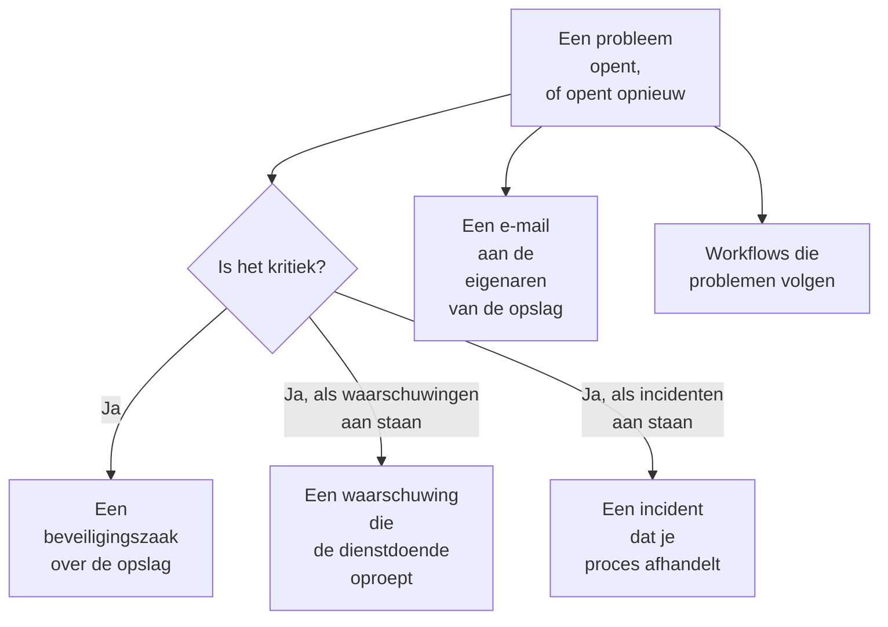

# Integraties van Gegevensbeveiliging

Gegevensbeveiliging heeft geen eigen oproepsysteem of beveiligingswachtrij. Het geeft wat het vindt door aan de delen van OneUptime die dat al hebben: een kritiek probleem wordt een beveiligingszaak, het kan de dienstdoende oproepen of een incident melden, en elk nieuw probleem wordt gemaild aan de eigenaren van de opslag. Workflows, OneUptime AI, de API, Terraform en de MCP-server bereiken alles wat het bewaart.

:::cards
- [Security Operations](#security-operations): Een beveiligingszaak voor elke opslag met een kritiek probleem.
- [Waarschuwingen en on-call](#waarschuwingen-en-on-call): De dienstdoende oproepen wanneer er een kritiek probleem opent.
- [Incidenten](#incidenten): Een incident melden voor een inbreuk die je incidentproces moet afhandelen.
- [Eigenaren](#eigenaren): Wie eigenaar is van elke opslag, met de hand of door regels ingesteld, en de e-mail die ze krijgen.
- [OneUptime AI](#oneuptime-ai): Een probleem laten uitleggen, een pull request openen die het oplost, of AI vragen gebruiken om vragen over je gegevens te stellen.
- [Een blootstelling sluiten](#een-blootstelling-sluiten): Openbare toegang blokkeren of het delen stoppen, vanuit een probleem of een playbook.
:::

## Hoe het werkt

Elk hiervan draait wanneer een evaluatie een probleem opent, of opnieuw opent. Elk gebeurt naar beste vermogen: het probleem is al open en staat al op zijn tijdlijn, dus een integratie die mislukt, wordt gelogd en overgeslagen, en nooit opnieuw geprobeerd tot een tweede zaak of een tweede oproep. Wat elk ervan deed, wordt in de **Tijdlijn** van het probleem geschreven, en de pagina van het probleem linkt naar de zaak, de waarschuwing en het incident die erdoor zijn gestart.

| Instelling | Standaard | Wat het doet |
| --- | --- | --- |
| **Beveiligingszaken openen** | Aan | Een kritiek probleem opent een beveiligingszaak, gegroepeerd per opslag. |
| **Waarschuwingen aanmaken** | Uit | Een kritiek probleem maakt een waarschuwing aan, die de dienstdoende oproept. |
| **Ernst van waarschuwing** | Leeg | De ernst van die waarschuwingen. Leeg is de zwaarste ernst van het project. |
| **Incidenten melden** | Uit | Een kritiek probleem meldt een incident, dat je incidentproces afhandelt. |
| **Ernst van incident** | Leeg | De ernst van die incidenten. Leeg is de zwaarste ernst van het project. |
| **Eigenaren op de hoogte stellen** | Aan | Elk nieuw probleem wordt gemaild aan de eigenaren van zijn opslag. |

## Security Operations

Elke opslag is een eigen entiteit in Security Operations, van het type **Gegevensopslag**. Met **Beveiligingszaken openen** aan wordt een kritiek probleem als detectie over de opslag naar Security Operations gestuurd:

- de bron is **Gegevensbeveiliging**, en de regel is naar de controle genoemd, zoals `Data Security: public-read`;
- ze is kritiek, dus de zaak die ze opent, krijgt de prioriteit Kritiek van het project;
- ze wordt gegroepeerd op de opslag: een tweede kritiek probleem op dezelfde opslag wordt toegevoegd aan de open zaak erover in plaats van een nieuwe te openen.

Vanaf daar wordt de zaak afgehandeld zoals elke andere: toegewezen, van notities voorzien, gesloten, en beantwoord door de playbooks van het project. De detecties van de opslag tellen mee voor zijn risico onder [Entiteitrisico](/docs/telemetry/security-entity-risk), net als die van elke entiteit. Zie [Beveiligingszaken en playbooks](/docs/telemetry/security-cases).

## Waarschuwingen en on-call

Met **Waarschuwingen aanmaken** aan maakt een kritiek probleem een waarschuwing aan, genoemd naar "Data Security:" en de titel en de opslag van het probleem. De waarschuwing roept de dienstdoende op via haar eigen regels, net als elke andere waarschuwing (zie [Waarschuwingen](/docs/alerts/index) en [Bereikbaarheid](/docs/on-call/index)). Een probleem heeft hoogstens één open waarschuwing tegelijk, hoe vaak het ook wordt geëvalueerd. **Ernst van waarschuwing** bepaalt de ernst van de waarschuwing; leeg gelaten is het de zwaarste ernst van het project.

Een waarschuwing eindigt samen met haar probleem: zodra het probleem niet meer openstaat - de controle slaagt, of een persoon markeert het als opgelost, accepteert het risico of zegt dat het geen probleem is - wordt de waarschuwing opgelost, en de **Tijdlijn** van het probleem vermeldt dat. Een probleem dat opnieuw opent, maakt een nieuwe waarschuwing aan.

Waarschuwingen staan standaard uit, omdat de meeste teams een bevinding van gegevensbeveiliging eerst in een beveiligingszaak willen zien. Zet ze aan als een openbare bucket met kaartnummers iemand wakker moet maken.

## Incidenten

Met **Incidenten melden** aan meldt een kritiek probleem een incident, genoemd zoals zijn waarschuwing, voor een inbreuk die je incidentproces moet afhandelen: on-call, werkruimtekanalen, statuspagina's en een postmortem (zie [Incidenten](/docs/incidents/index)). Een probleem heeft hoogstens één open incident tegelijk. **Ernst van incident** bepaalt de ernst van het incident; leeg gelaten is het de zwaarste ernst van het project.

Gegevensbeveiliging lost een incident nooit op, ook niet zodra zijn probleem is opgelost: een incident kan een statuspagina en een postmortem hebben, dus wie het afhandelt, sluit het. Een beveiligingszaak is de andere weg naar een incident: **Incident melden** op de zaak opent een incident dat eraan is gekoppeld (zie [Een incident melden](/docs/telemetry/security-cases#een-incident-melden)).

## Eigenaren

De eigenaren van een opslag zijn personen en teams, op de pagina **Eigenaren** van de opslag. Voor hen is een probleem bedoeld: zij krijgen de e-mail, en **Niemand is eigenaar van deze gevoelige opslag** faalt op een gevoelige opslag die er geen heeft.

Met **Eigenaren op de hoogte stellen** aan stuurt elke evaluatie die problemen op een opslag opent, zijn eigenaren één e-mail - de personen die eigenaar zijn, en de leden van de teams die eigenaar zijn, tot 50 - met als titel hoeveel nieuwe problemen de opslag heeft, zoals "Data Security: 2 new issues on orders-db". De e-mail somt de ernst en de titel van elk nieuw probleem en de gevoeligheid van de opslag op, en linkt naar de opslag. Hij bevat nooit een voorbeeld.

### Eigenaarsregels en labelregels

Regels stellen eigenaren en labels voor je in, terwijl opslagen worden gevonden:

| Regel | Waar | Wat het doet |
| --- | --- | --- |
| **Eigenaarsregels** | **Gegevensbeveiliging → Regels → Eigenaarsregels** | Voegt gebruikers en teams als eigenaar toe aan elke opslag die overeenkomt |
| **Labelregels** | **Gegevensbeveiliging → Regels → Labelregels** | Voegt labels toe aan elke opslag die overeenkomt |

Een regel komt overeen met een opslag op zijn labels, op een patroon van zijn naam of zijn beschrijving, of op **Cloudtagpatroon**: een patroon dat wordt vergeleken met elke cloudtag van de opslag, geschreven als `key=value`. `^team=payments$` komt overeen met elke opslag met de tag `team=payments`, en `^env=` met elke opslag met een tag `env`. Een nieuwe opslag krijgt de regels van het project zodra hij wordt gevonden, en **Eigenaren op de hoogte stellen** van een eigenaarsregel bepaalt of de eigenaren die hij toevoegt een melding krijgen. [Label- en eigenaarsregels](/docs/configuration/label-and-owner-rules) zegt hoe elke regel overeenkomt en wanneer regels worden uitgevoerd.

## Workflows

**Gegevensopslag** en **Gegevensbeveiligingsprobleem** zijn workflowtriggers, elk met **Bij aanmaken**, **Bij bijwerken**, **Bij aanmaken of bijwerken** en **Bij verwijderen**. Kies ze in het paneel **Trigger toevoegen**, onder **OneUptime-resources**.

- **Gegevensbeveiligingsprobleem → Bij aanmaken** draait wanneer een probleem voor het eerst opent. Lees de ernst ervan in een blok **Als / Anders**, en plaats kritieke problemen in een kanaal of open een ticket in je tracker.
- **Gegevensbeveiligingsprobleem → Bij bijwerken**, met **Te volgen velden** ingesteld op de status, draait wanneer een probleem wordt opgelost, geaccepteerd of opnieuw opent.
- **Gegevensopslag → Bij aanmaken** draait wanneer Discovery een opslag vindt, bijvoorbeeld om een team over elke nieuwe bucket te informeren.

Zie [Workflowtriggers](/docs/workflows/triggers) voor de velden die elke trigger doorgeeft.

## OneUptime AI

Twee acties op een probleem vragen OneUptime AI om hulp. Beide sturen OneUptime AI de titel en de ernst van het probleem, de naam, soort, regio en cloud-ID van de opslag, de gevoeligheid en gegevenstypen ervan, het bewijs, waarom de controle ertoe doet en de oplossing voor de cloud van de opslag - nooit de voorbeelden van een bevinding. Beide vallen onder de schakelaars en limieten van OneUptime AI van het project.

- **Uitleggen met AI** schrijft voor de eigenaar van de opslag op wat er mis is, wat er kan gebeuren en de precieze stappen om het in de eigen cloud op te lossen. De uitleg wordt bewaard in de **Tijdlijn** van het probleem. Iedereen die Gegevensbeveiliging kan lezen, kan erom vragen.
- **Oplossen met AI** vraagt OneUptime AI het probleem op te lossen in je infrastructuurcode - Terraform, CloudFormation, Bicep en dergelijke - met de kleinste wijziging waardoor de controle slaagt, en een pull request te openen. Daarvoor moet de repository met de infrastructuurcode van de opslag gekoppeld zijn onder **Code**: kies die onder **Repository** als het project er meerdere heeft. De pull request verschijnt onder **Code** (zie [Code](/docs/ai/ai-agent)). Security Members en hoger kunnen erom vragen.

### AI vragen

**AI vragen** leest ook Gegevensbeveiliging. Vraag op elke pagina van Gegevensbeveiliging welke opslagen kaartnummers bevatten, wat je eerst moet oplossen, of bij welke opslagen een rol zou kunnen als die uitlekte; op de pagina van een opslag of van een probleem leest het eerst dat record. Het antwoordt met drie leestools, uitgevoerd met je eigen machtigingen:

| Tool | Wat het leest |
| --- | --- |
| `query_data_stores` | De opslagen, de riskantste eerst, op gevoeligheid, gegevenstype, blootstelling, provider of naam - of één opslag met wat waar is gevonden, wie erbij kan en de openstaande problemen ervan |
| `query_data_security_issues` | De problemen, de riskantste eerst, op status, ernst, opslag of controle - of één probleem met zijn bewijs en de oplossing voor zijn cloud |
| `query_data_store_access` | Wie bij een opslag kan, of elke opslag waar één principal bij kan |

Ze lezen gegevenstypen, locaties en tellingen, nooit de voorbeelden van een bevinding, gemaskeerd of niet. AI vragen wijzigt niets in Gegevensbeveiliging.

## Een blootstelling sluiten

Twee wijzigingen sluiten de blootstelling van een cloudopslag, elk via de cloudkoppeling van de opslag met **Gegevensbeveiligingsrespons** aangezet (zie [Gegevensbeveiliging instellen](/docs/data-security/setup#gegevensbeveiliging-een-blootstelling-laten-sluiten)):

- **Openbare toegang blokkeren**, op een S3-bucket, een Azure-opslagaccount of een Cloud Storage-bucket.
- **Delen intrekken**, op een RDS-snapshot, of op de gedeelde handmatige snapshots van een RDS-database, een Aurora-cluster of een DocumentDB-cluster.

Een persoon voert er een uit vanuit een openstaand probleem dat ermee wordt opgelost, met **Hier oplossen** (zie [Controles en problemen van Gegevensbeveiliging](/docs/data-security/checks-and-issues#hier-oplossen)). Een playbook van Security Operations voert ze uit als stappen van de categorie **Indammen**, **Openbare toegang tot gegevensopslagen blokkeren** en **Delen van gegevensopslag intrekken**: op elke gegevensopslag waar de zaak over gaat, hoogstens 10, elk een stap die begint met **Goedkeuring nodig** aan. Een opslag die als **Bewust openbaar** is gemarkeerd, wordt nooit geblokkeerd. Hoe dan ook zegt de feed van de opslag wat er is gedaan, en wordt de opslag meteen opnieuw gecontroleerd, zodat het probleem oplost zodra de wijziging is doorgevoerd.

## API, Terraform en MCP

Alles wat Gegevensbeveiliging bewaart, is een record van de OneUptime-API, gelezen met dezelfde machtigingen als in het dashboard (zie de [API-referentie](/docs/api-reference/api-reference)):

| Records | API-pad |
| --- | --- |
| Gegevensopslagen, hun tijdlijnen, hun bevindingen en wie erbij kan | `/data-store`, `/data-store-feed`, `/data-store-finding`, `/data-store-access` |
| Problemen, hun tijdlijnen en gegevensstromen | `/data-security-issue`, `/data-security-issue-feed`, `/data-security-flow` |
| Scans | `/data-security-scan` |
| Aangepaste gegevenstypen, controle-instellingen en residentieregels | `/data-security-custom-data-type`, `/data-security-check-setting`, `/data-security-residency-rule` |
| De instellingen van het project | `/data-security-setting` |
| Eigenaren, eigenaarsregels en labelregels | `/data-store-owner-user`, `/data-store-owner-team`, `/data-store-owner-rule`, `/data-store-label-rule` |

Een paar antwoorden worden op verzoek berekend in plaats van opgeslagen. Elk ervan is een `POST`:

| Pad | Wat het doet |
| --- | --- |
| `/data-security/overview` | De cijfers van het Overzicht: opslagen per gevoeligheid en categorie, openstaande problemen per ernst, de riskantste problemen en de laatste 30 dagen ervan |
| `/data-security/compliance` | De score en de eisen van elk kader |
| `/data-security/record-of-processing` | Het verwerkingsregister van de AVG, een rij voor elke opslag die persoonsgegevens bevat |
| `/data-store/<id>/scan-now` | **Nu scannen**: bemonstert nu de inhoud van de opslag |
| `/data-store/<id>/check-now` | **Nu controleren**: leest de configuratie van de opslag opnieuw en voert de controles ervan uit |
| `/data-store-finding/<id>/scrub` | **Opschonen** op een telemetriebevinding |
| `/data-security-issue/<id>/explain` | **Uitleggen met AI** op een probleem |
| `/data-security-issue/<id>/fix-with-ai` | **Oplossen met AI** op een probleem |
| `/data-store/<id>/response-actions` | Welke responsacties de opslag nu kan uitvoeren, en waarom niet |
| `/data-store/<id>/respond` | **Openbare toegang blokkeren** of **Delen intrekken** op de opslag, met het probleem van waaruit het werd uitgevoerd |

De [Terraform-provider](/docs/terraform/index) heeft een resource voor elk soort record dat je aanmaakt - gegevensopslagen die je zelf toevoegt, aangepaste gegevenstypen, controle-instellingen, residentieregels, eigenaars- en labelregels - genoemd naar het record, zoals `oneuptime_residency_rule`.

De [MCP-server](/docs/ai/mcp-server) heeft tools om aan te maken, op te halen, op te sommen, bij te werken, te verwijderen en te tellen voor deze records: Data Store, Data Store Finding, Data Store Access Entry, Data Flow, Data Security Issue, Data Security Scan, Custom Data Type, Check Setting, Residency Rule en Data Security Setting. Een AI-assistent kan dan met jouw machtigingen vragen welke opslagen kaartnummers bevatten, of wat er openstaat op een bucket.

## Volgende stappen

:::cards
- [Beveiligingszaken en playbooks (SOAR)](/docs/telemetry/security-cases): De zaken afhandelen die Gegevensbeveiliging opent.
- [Label- en eigenaarsregels](/docs/configuration/label-and-owner-rules): Hoe regels overeenkomen, en wanneer ze worden uitgevoerd.
- [Workflowtriggers](/docs/workflows/triggers): Een workflow uitvoeren wanneer een probleem opent of een opslag wordt gevonden.
- [Controles en problemen van Gegevensbeveiliging](/docs/data-security/checks-and-issues): Wat elk probleem betekent, en hoe je het oplost.
:::
