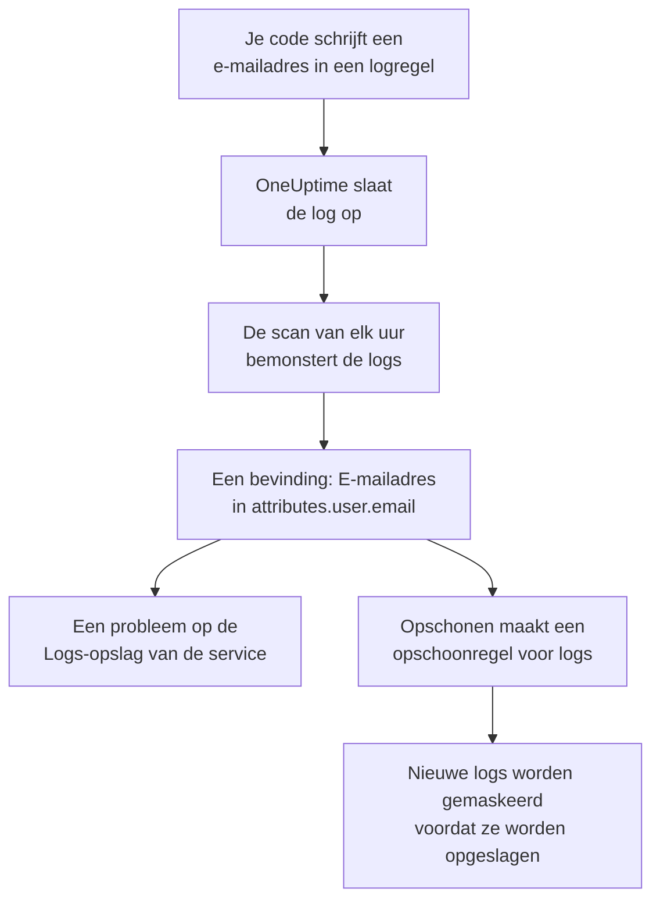

# Gevoelige gegevens in telemetrie

Telemetrie bevat wat je code ook schrijft: een e-mailadres in een logregel, een kaartnummer in een span-attribuut, een token in een stacktrace, de vraag van een klant in een prompt. Gegevensbeveiliging behandelt de logs, traces, uitzonderingen en AI-gesprekken van elke service, en de sessies van elke RUM-applicatie, als eigen gegevensopslagen. Het neemt er elk uur een steekproef van, vindt er gevoelige gegevens in zoals in een bucket, en **Opschonen** maakt van een bevinding een opschoonregel die die gegevens vanaf dan bij de inname maskeert.

Er is niets in te stellen: de telemetrie van elke service wordt elk uur gescand, tenzij **Telemetrie scannen** uit staat in de instellingen van het project.

:::cards
- [Wat wordt gelezen](#wat-wordt-gelezen): De attributen, bodies, berichten en prompts van elk signaal.
- [Hoe een scan bemonstert](#hoe-een-scan-bemonstert): De nieuwste records van elke service, elk uur.
- [Opschonen](#opschonen): Maskeer een bevinding bij de inname, met één klik.
- [Wat telt als opgeschoond](#wat-telt-als-opgeschoond): Wanneer een opschoonregel een bevinding al dekt.
:::

## Hoe het werkt

Een bevinding die een opschoonregel dekt, wordt als opgeschoond gemarkeerd: wat er van die gegevens over is, zijn oude gegevens die wachten tot hun bewaartermijn afloopt, geen lek dat nog doorstroomt. De twee telemetriecontroles tellen alleen wat geen regel dekt, dus hun probleem lost op zodra elke bevinding is opgeschoond (zie [Telemetriecontroles](/docs/data-security/checks-and-issues#telemetrie)).

## Wat wordt gelezen

| Opslag | Wat wordt gelezen | Waar een bevinding naar wijst |
| --- | --- | --- |
| Logs | Elk attribuut, en de body | `attributes.<key>`, `body` |
| Traces | Elk span-attribuut, en de attributen van elk span-event | `attributes.<key>`, `events.<event>.<key>` |
| Uitzonderingen | Het bericht, de stacktrace en de attributen | `message`, `stackTrace`, `attributes.<key>` |
| AI-gesprekken | De prompts en antwoorden van elke AI-aanroep, onder de sleutels waarin de GenAI-conventies ze zetten, en elk ander attribuut | De sleutel waarin ze staan, zoals `gen_ai.input.messages` of `gen_ai.prompt[].content` |
| Sessieherhalingen | De attributen van de spans en logs van een RUM-applicatie, de attributen van haar sessies, de kenmerken die `identify()` aan haar gebruikers gaf en de gebruikersverwijzing die haar werd meegegeven | `spans.attributes.<key>`, `logs.attributes.<key>`, `sessions.attributes.<key>`, `sessions.identifiedUserTraits.<key>`, `sessions.identifiedUserLabel` |

Genummerde sleutels worden samengevoegd tot één locatie: `gen_ai.prompt.3.content` is `gen_ai.prompt[].content`, dus de twintig berichten van een chat zijn één bevinding, niet twintig. Attributen die OneUptime zelf toevoegt, die met `oneuptime.` beginnen, worden niet gelezen.

### Waarom de opname van een herhaling nooit wordt gelezen

De opname van een sessieherhaling bevat de tekst van de pagina's die mensen zagen. Om haar te bekijken is een eigen machtiging nodig, en een bevinding die eruit is gelezen, zou gemaskeerde paginatekst tonen aan iedereen die Gegevensbeveiliging kan lezen. Daarom wordt een herhaling alleen op haar attributen gelezen: de spans, logs en sessiegegevens naast de opname. De recorder maskeert in de browser al wat hij opneemt, en opschoonregels voor logs draaien ook over opnames (zie [Sessieherhaling](/docs/telemetry/session-replay)).

### AI-gesprekken

De prompt van een AI-aanroep bevat de hele chat vóór het nieuwste bericht van de persoon, dus van elke waarde van een AI-aanroep worden tot 16.384 tekens gelezen. Bevatten AI-gesprekken gevoelige gegevens, dan volgen er nog twee dingen: de AI-provider waar de aanroepen heen gingen, is een stroom van die gegevens, en [Gevoelige gegevens worden naar een AI-provider gestuurd](/docs/data-security/checks-and-issues#ai) faalt op de opslag.

De gesprekken van een [AI-tool van het bedrijf](/docs/telemetry/ai-company-tools) worden overgeslagen. Alleen Project Owners en Project Admins mogen ze lezen, en een bevinding komt terecht waar iedereen die Gegevensbeveiliging leest haar kan lezen, dus de spans van die services worden nooit gelezen, en hun AI-gesprekken worden als niet gelezen gemeld.

## Hoe een scan bemonstert

Elk uur worden van elk signaal de nieuwste records van het laatste uur gelezen, en veld voor veld geclassificeerd zoals die van elke andere opslag (zie [Velden en kolommen](/docs/data-security/data-types#velden-en-kolommen)):

| Limiet | Waarde |
| --- | --- |
| Records van elke service en elk signaal | **Steekproefgrootte telemetrie**, standaard 500, nooit meer dan 1.000 |
| Services of RUM-applicaties die per signaal worden gelezen | De 200 drukste |
| Records in één leesbeurt | 5.000, verdeeld over de services; 500 voor AI-aanroepen |
| Tekens van een logbody, een uitzonderingsbericht of een stacktrace | 8.192 |
| Tekens van een attribuutwaarde | 4.096 |
| Tekens van een waarde van een AI-aanroep | 16.384 |
| Attributen van één record | 128; 64 voor een AI-aanroep |
| Events van één span, en attributen van één event | 16 en 32 |
| Locaties van één opslag | 500 |

Elke waarde wordt al in de database ingekort, zodat er geen lange waarde uit vertrekt, en elke leesbeurt stopt na 30 seconden. Een leesbeurt die mislukt, is een waarschuwing op de opslagen waarvoor ze bedoeld was; de scan gaat verder met de volgende.

Om iets over te slaan, voeg je het toe aan de **Scanuitsluitingen** van de opslag: een locatie die volledig wordt genoemd (`attributes.http.url`), alles onder een locatie (`attributes.http`), of een attribuutsleutel die kaal wordt genoemd (`http.url`).

## Opschonen

**Opschonen** op een bevinding maakt de opschoonregel die dat gegevenstype op die locatie vanaf dan verbergt, of wijst naar de ingeschakelde regel die dat al doet:

:::steps
### Open de bevinding

Open de telemetrieopslag - bijvoorbeeld de **Logboeken** van een service - en de bevinding.

### Druk op Opschonen

Klik op **Opschonen**. OneUptime maakt voor logs, en de logs van een RUM-applicatie, een opschoonregel voor logs, en voor spans, uitzonderingen en AI-aanroepen een opschoonregel voor traces, op het deel van het record waarin de bevinding staat.

### Herstel ook de code

De regel maskeert nieuwe gegevens voordat ze worden opgeslagen. Gegevens die al zijn opgeslagen, blijven staan tot hun bewaartermijn afloopt, dus herstel de code die ze schrijft: de bevinding noemt de service en het attribuut.
:::

De regel wordt genoemd naar wat hij verbergt, zoals "Data Security: Email address in attributes.user.email", en staat bij je andere opschoonregels (zie [Dropfilters en opschoonregels](/docs/telemetry/drop-filters-and-scrub-rules#gevoelige-gegevens-opschonen)). Het is een van deze:

| Bevinding | Regel die Opschonen maakt |
| --- | --- |
| E-mailadres, kaartnummer, Amerikaans socialezekerheidsnummer, telefoonnummer of IP-adres | Het ingebouwde patroon van dat type. Kaartnummers, socialezekerheidsnummers en telefoonnummers worden gemaskeerd, de rest wordt weggelakt. |
| Een waarde onder een sleutel die gevoelig lijkt, zoals `password` of `token` | Een regel **Sensitive Attribute Keys**, die de hele waarde van elk zulk attribuut weglakt |
| Elk ander gegevenstype dat een patroon kan vinden | Een regel **Aangepaste reguliere expressie**, gemaakt van de eigen patronen van het gegevenstype, die elke waarde van die vorm weglakt |

Sommige bevindingen kan geen regel opschonen, en **Opschonen** zegt waarom:

- Een gegevenstype dat alleen op veldnamen wordt gevonden, zoals de naam van een persoon: geen patroon kan het vinden. Hernoem het attribuut naar een sleutel die een regel voor gevoelige sleutels verbergt, of stop met het versturen ervan.
- Een gegevenstype dat alleen door de woorden eromheen van andere waarden te onderscheiden is, zoals een routingnummer: een regel zou veel meer verbergen dan dat gegevenstype.
- Een documentmarkering: het woord verbergen verbergt het document niet.
- Een van je eigen gegevenstypen: voeg zelf een aangepaste opschoonregel met zijn patroon toe.
- De eigen gegevens van een sessie (`sessions.*`): de inname van sessieherhalingen voert geen opschoonregels uit.

**Opschonen** maakt de regel namens jou, met je eigen machtigingen: Project Owners en Project Admins kunnen erop drukken, en ook een team dat opschoonregels voor logs mag maken, en opschoonregels voor traces voor spans, uitzonderingen en AI-aanroepen.

## Wat telt als opgeschoond

Een bevinding wordt alleen als opgeschoond gemarkeerd wanneer de inname er een ingeschakelde regel over zou laten lopen en de regel haar gegevenstype zou vinden:

- **De juiste records.** Regels voor logs dekken logs en de logs van een RUM-applicatie. Regels voor traces dekken spans, uitzonderingen en AI-aanroepen: een uitzondering is een kopie van het exception-event van haar span, dus de regels die events opschonen, schonen haar ook op.
- **Het juiste deel.** De **Te wissen velden** van de regel bevatten het deel van het record waarin de bevinding staat, of de regel laat ze op hun standaardwaarde.
- **Een patroon dat het type vindt.** Een ingebouwd **Patroontype** vindt zijn eigen gegevenstype: **E-mailadres** vindt e-mailadressen, **Creditcardnummer** kaartnummers, **SSN (burgerservicenummer)** Amerikaanse socialezekerheidsnummers, **Telefoonnummer** telefoonnummers en **IP-adres** IP-adressen. **Sensitive Attribute Keys** dekt elke waarde onder een sleutel die gevoelig lijkt, wat de waarde ook is.
- **Je eigen aangepaste patronen tellen nooit.** Een **Aangepaste reguliere expressie** dekt een bevinding alleen als ze precies het patroon is dat **Opschonen** voor haar type maakt. Een bevinding bewaart alleen gemaskeerde voorbeelden, waarop geen patroon kan worden uitgeprobeerd, dus OneUptime kan niet bewijzen dat je patroon de gegevens verbergt, en een bevinding die ten onrechte opgeschoond heet, is een lek waar niemand naar kijkt.

Een regel die uit staat, of die niets opschoont, telt nooit. De dekking wordt na elke scan opnieuw bepaald, dus een regel die je met de hand toevoegt of verwijdert, verandert binnen het uur wat als opgeschoond is gemarkeerd.

## Volgende stappen

:::cards
- [Dropfilters en opschoonregels](/docs/telemetry/drop-filters-and-scrub-rules): Elke optie van een opschoonregel, en de regels die je zelf schrijft.
- [Controles en problemen van Gegevensbeveiliging](/docs/data-security/checks-and-issues): De twee telemetriecontroles en de AI-controles.
- [Gegevensstromen, toegang en residentie](/docs/data-security/flows-access-residency): De AI-providers en hosts waarnaar je services gegevens sturen.
:::
