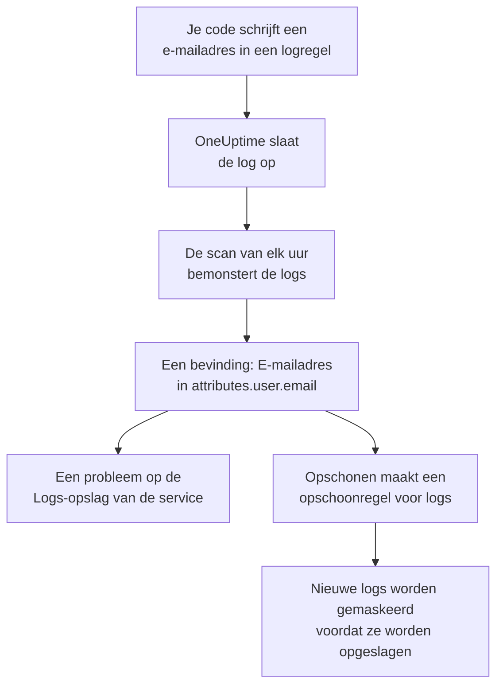

# Gevoelige gegevens in telemetrie

Telemetrie bevat wat je code ook schrijft: een e-mailadres in een logregel, een kaartnummer in een span-attribuut, een token in een stacktrace, de vraag van een klant in een prompt, het IP-adres van een gebruiker in het label van een metriek. Gegevensbeveiliging behandelt de logs, traces, metrieken, uitzonderingen en AI-gesprekken van elke service, en de sessies van elke RUM-applicatie, als eigen gegevensopslagen. Het neemt er elk uur een steekproef van, vindt er gevoelige gegevens in zoals in een bucket, en **Opschonen** maakt van een bevinding een regel die die gegevens vanaf dan bij de inname verbergt, in de service waarin ze zijn gevonden.

Er is niets in te stellen: de telemetrie van elke service wordt elk uur gescand, tenzij **Telemetrie scannen** uit staat in de instellingen van het project. Wil je de logs, traces of een ander signaal van één service overslaan, zet dan **Inhoud scannen** uit in de **Instellingen** van die opslag: vanaf de volgende scan wordt er niets van gelezen.

:::cards
- [Wat wordt gelezen](#wat-wordt-gelezen): De attributen, bodies, berichten en prompts van elk signaal.
- [Hoe een scan bemonstert](#hoe-een-scan-bemonstert): De nieuwste records van elke service, elk uur.
- [Opschonen](#opschonen): Verberg een bevinding bij de inname, in de service waarin ze is gevonden.
- [Zelf ingedamd](#zelf-ingedamd): Een geheim verborgen zonder dat iemand ergens op drukt, waar bewezen is dat dat veilig is.
- [Deze metriek verwerpen](#deze-metriek-verwerpen): Sla de metrieken waarvan de naam gevoelige gegevens bevat niet meer op.
- [Wat telt als opgeschoond](#wat-telt-als-opgeschoond): Wanneer een opschoonregel een bevinding al dekt.
:::

## Hoe het werkt

Een bevinding die een opschoonregel dekt, wordt als opgeschoond gemarkeerd: wat OneUptime van die gegevens opslaat, zijn oude gegevens die wachten tot hun bewaartermijn afloopt. De code schrijft ze echter nog steeds, dus de twee telemetriecontroles tellen de bevinding als ingedamd, niet als opgelost: hun probleem lost op als **Ingedamd bij inname** zodra elke bevinding is opgeschoond, en als **Hersteld in de code** pas zodra de nieuwe versie van een codefix stopt met het schrijven van de gegevens (zie [Wat er met een probleem gebeurt](/docs/data-security/checks-and-issues#wat-er-met-een-probleem-gebeurt)).

## Wat wordt gelezen

| Opslag | Wat wordt gelezen | Waar een bevinding naar wijst |
| --- | --- | --- |
| Logs | Elk attribuut, en de body | `attributes.<key>`, `body` |
| Traces | Elk span-attribuut, en de attributen van elk span-event | `attributes.<key>`, `events.<event>.<key>` |
| Uitzonderingen | Het bericht, de stacktrace en de attributen | `message`, `stackTrace`, `attributes.<key>` |
| AI-gesprekken | De prompts en antwoorden van elke AI-aanroep, onder de sleutels waarin de GenAI-conventies ze zetten, en elk ander attribuut | De sleutel waarin ze staan, zoals `gen_ai.input.messages` of `gen_ai.prompt[].content` |
| Sessieherhalingen | De attributen van de spans en logs van een RUM-applicatie, de attributen van haar sessies, de kenmerken die `identify()` aan haar gebruikers gaf en de gebruikersverwijzing die haar werd meegegeven | `spans.attributes.<key>`, `logs.attributes.<key>`, `sessions.attributes.<key>`, `sessions.identifiedUserTraits.<key>`, `sessions.identifiedUserLabel` |
| Metrieken | Elk attribuut van een datapunt, ook die van zijn resource, en de namen van de metrieken | `attributes.<key>`, `attributes.resource.<key>`, `name` |

Genummerde sleutels worden samengevoegd tot één locatie: `gen_ai.prompt.3.content` is `gen_ai.prompt[].content`, dus de twintig berichten van een chat zijn één bevinding, niet twintig. Attributen die OneUptime zelf toevoegt, die met `oneuptime.` beginnen, worden niet gelezen.

### Metrieken

De attributen van een metriek zijn de labels van haar reeksen. Ze zijn op elk datapunt van een reeks gelijk, dus een metriek die duizend punten per minuut schrijft, bevat misschien maar drie waarden, en een label dat het e-mailadres van een gebruiker lekt, voegt een reeks toe, geen punt. Daarom wordt een metriek per reeks bemonsterd, niet per punt:

- **Een punt van elke reeks.** Elke metriek wordt gelezen in de nieuwste minuut die ze in het laatste uur schreef: één datapunt van elk van maximaal 100 reeksen van die minuut, hoe vaak de metriek ook wordt verstuurd, zodat een drukke reeks nooit een rustige verdringt. Een waarde wordt één keer geclassificeerd, hoeveel reeksen haar ook herhalen, dus een bevinding telt de verschillende waarden op haar plek.
- **Nieuwe metrieken eerst, dan de rest om de beurt.** Welke metrieken een service schreef, en wanneer elke metriek de afgelopen dag voor het eerst schreef, komt uit het overzicht per minuut dat de metriektabel bijhoudt, nooit uit de punten zelf. Elke scan leest de drukste metrieken van een service, die de meeste kans hebben op veel reeksen. Dan komen de metrieken die de service de afgelopen 2 uur is gaan schrijven, omdat een nieuw lek meestal uit nieuwe code komt, en daarna de volgende van haar andere metrieken, in een vaste volgorde, vanaf waar de vorige scan stopte. Nieuwe metrieken nemen hoogstens de helft van die beurten, zodat de andere altijd de hunne houden.
- **Elke metriek binnen een vaste tijd.** Een scan geeft elke service 10 van zijn leesbeurten, minder als het project meer dan 10 services heeft. De leesbeurten die een service niet gebruikt, omdat ze minder metrieken heeft, gaan een voor een naar de services waarvan nog metrieken op hun beurt wachten, zodat er geen verloren gaat en geen service minder dan haar deel krijgt. De 5 drukste metrieken van een service nemen 5 van haar leesbeurten, en de rest leest om de beurt haar andere metrieken: bij een service met M metrieken die r leesbeurten om de beurt krijgt, wordt elke metriek minstens eens per M ÷ r uur gelezen, naar boven afgerond. Dat is 60 uur voor een service met 300 metrieken die alleen haar eigen 5 krijgt, en 11 uur als twee andere services met 300 metrieken haar project delen, omdat elk er dan 28 of 29 krijgt. Zolang ze elk uur nieuwe metrieken begint, is het hoogstens twee keer zo lang.
- **Het eigen bereik van elke metriek.** De metrieken worden samen gelezen, elke metriek via haar eigen bereik van de primaire sleutel van de tabel. Een metriek waarvan de nieuwste minuut meer dan 16.384 punten bevat, zoals een metriek met het e-mailadres van elke gebruiker als label, wordt apart gelezen, en de leesbeurt stopt bij haar eerste punten, zodat ze niet meer kost dan elke andere metriek.

Een bevinding noemt het attribuut, zoals `attributes.user.email`, of `name` voor gegevens in de naam van een metriek. Haar records zijn de datapunten waarin ze is gevonden: elk toont zijn metriek en de waarde van het attribuut, gemaskeerd, en opent in **Metrieken** op die metriek, gegroepeerd op dat attribuut. Bevat de naam van een metriek gevoelige gegevens, dan wordt ook de naam gemaskeerd, en opent het record in plaats daarvan de metrieken van de service.

### Waarom de opname van een herhaling nooit wordt gelezen

De opname van een sessieherhaling bevat de tekst van de pagina's die mensen zagen. Om haar te bekijken is een eigen machtiging nodig, en een bevinding die eruit is gelezen, zou gemaskeerde paginatekst tonen aan iedereen die Gegevensbeveiliging kan lezen. Daarom wordt een herhaling alleen op haar attributen gelezen: de spans, logs en sessiegegevens naast de opname. De recorder maskeert in de browser al wat hij opneemt, en opschoonregels voor logs draaien ook over opnames (zie [Sessieherhaling](/docs/telemetry/session-replay)).

### AI-gesprekken

De prompt van een AI-aanroep bevat de hele chat vóór het nieuwste bericht van de persoon, dus van elke waarde van een AI-aanroep worden tot 16.384 tekens gelezen. Bevatten AI-gesprekken gevoelige gegevens, dan volgen er nog twee dingen: de AI-provider waar de aanroepen heen gingen, is een stroom van die gegevens, en [Gevoelige gegevens worden naar een AI-provider gestuurd](/docs/data-security/checks-and-issues#ai) faalt op de opslag.

De gesprekken van een [AI-tool van het bedrijf](/docs/telemetry/ai-company-tools) worden overgeslagen. Alleen Projecteigenaren en Projectbeheerders mogen ze lezen, en een bevinding komt terecht waar iedereen die Gegevensbeveiliging leest haar kan lezen, dus de spans van die services worden nooit gelezen, en hun AI-gesprekken worden als niet gelezen gemeld.

## Hoe een scan bemonstert

Elk uur worden van elk signaal de nieuwste records van het laatste uur gelezen, en veld voor veld geclassificeerd zoals die van elke andere opslag (zie [Velden en kolommen](/docs/data-security/data-types#velden-en-kolommen)):

| Limiet | Waarde |
| --- | --- |
| Records van elke service en elk signaal | **Steekproefgrootte telemetrie**, standaard 500, nooit meer dan 1.000 |
| Services of RUM-applicaties die per signaal worden gelezen | De 200 drukste |
| Records in één leesbeurt | 5.000, verdeeld over de services; 500 voor AI-aanroepen |
| Tekens van een logbody, een uitzonderingsbericht of een stacktrace | 8.192 |
| Tekens van een attribuutwaarde | 4.096 |
| Tekens van een waarde van een AI-aanroep | 16.384 |
| Attributen van één record | 128; 64 voor een AI-aanroep |
| Events van één span, en attributen van één event | 16 en 32 |
| Locaties van één opslag | 500 |
| Metrieken die in één scan worden gelezen | 100, verdeeld over de services, minstens één van elke service; 10 van elke service, de helft de drukste en de helft om de beurt de nieuwe en de andere, en de leesbeurten die een service niet gebruikt gaan om de beurt naar de andere |
| Een nieuwe metriek | Een metriek waarvan het eerste punt van de afgelopen 24 uur in de afgelopen 2 uur binnenkwam |
| Reeksen van één metriek | Eén datapunt van elke reeks, uit de nieuwste minuut, hoogstens 100 |

Elke waarde wordt al in de database ingekort, zodat er geen lange waarde uit vertrekt, en elke leesbeurt stopt na 30 seconden. Een leesbeurt die mislukt, is een waarschuwing op de opslagen waarvoor ze bedoeld was; de scan gaat verder met de volgende.

Om iets over te slaan, voeg je het toe aan de **Scanuitsluitingen** van de opslag: een locatie die volledig wordt genoemd (`attributes.http.url`), alles onder een locatie (`attributes.http`), of een attribuutsleutel die kaal wordt genoemd (`http.url`).

## Opschonen

**Opschonen** op een bevinding maakt de regel die dat gegevenstype op die locatie vanaf dan verbergt, of wijst naar de ingeschakelde regel die dat al doet:

:::steps
### Open de bevinding

Open het probleem - **Waar het is gevonden** toont elke bevinding erachter - of **Gegevensbeveiliging > In uw telemetrie**, waar **Records tonen** de records waarin een bevinding is gevonden naast de lijst opent.

### Druk op Opschonen

Klik op **Opschonen**. Een dialoogvenster zegt wat de regel zou doen voordat er iets wordt gemaakt: wiens records ze verandert, wat ze doet met wat ze vindt en wat de waarden leest die ze zou verbergen. Klik daarin op **Opschonen** om de regel te maken. OneUptime maakt voor logs, en de logs van een RUM-applicatie, een opschoonregel voor logs, voor spans, uitzonderingen en AI-aanroepen een opschoonregel voor traces, op het deel van het record waarin de bevinding staat, en voor het attribuut van een metriek een pipelineregel voor metrieken.

### Herstel ook de code

De regel verbergt nieuwe gegevens voordat ze worden opgeslagen. Gegevens die al zijn opgeslagen, blijven staan tot hun bewaartermijn afloopt, dus herstel de code die ze schrijft: de bevinding noemt de service en het attribuut.
:::

De regel wordt genoemd naar wat hij verbergt, zoals "Data Security: Email address in log attributes of checkout", of "Data Security: Password or secret in db.password of checkout" voor een regel die zijn attribuut noemt, en staat bij je andere opschoonregels (zie [Dropfilters en opschoonregels](/docs/telemetry/drop-filters-and-scrub-rules#gevoelige-gegevens-opschonen)). Het is de smalste regel die de gegevens van de bevinding verbergt, de eerste van deze die past:

| Bevinding | Regel die Opschonen maakt |
| --- | --- |
| E-mailadres, kaartnummer, Amerikaans socialezekerheidsnummer, telefoonnummer of IP-adres | Het ingebouwde patroon van dat type, gemaskeerd. Een IP-adres wordt weggelakt, of gehasht waar [Beveiligingsgebeurtenissen](/docs/telemetry/security-events) die records leest, zodat het nog kan zeggen welk adres je moet blokkeren. |
| Elk ander gegevenstype dat een patroon zelf vindt, zoals een GitHub-token | Een regel **Aangepaste reguliere expressie**, gemaakt van de eigen patronen van het gegevenstype. Een geheim wordt weggelakt. |
| Een van je eigen gegevenstypen, met een patroon | Dat patroon, alleen in het attribuut waarin het is gevonden |
| Een gegevenstype dat door de woorden eromheen te onderscheiden is, zoals een routingnummer | Zijn vorm, alleen in het attribuut waarin het is gevonden |
| Een gegevenstype dat op de naam van het veld wordt gevonden, zoals de naam van een persoon onder `customer_name`, of een waarde onder een sleutel die een geheim noemt | Een regel **Benoemde attributen**, die de hele waarde van dat attribuut verbergt |
| Een waarde onder een sleutel die gevoelig lijkt, waar niets smallers haar verbergt | Een regel **Gevoelige attribuutsleutels**, die de hele waarde van elk zulk attribuut weglakt |
| Elk gegevenstype in het attribuut van een metriek | Een pipelineregel **Kenmerk weglakken** voor de metrieken van de service, die de waarden van het attribuut met de vorm van het gegevenstype vervangt door `[REDACTED]`, of elke waarde van het attribuut wanneer geen patroon het gegevenstype vindt |

### Bewezen op de records waarin het werd gezien

Voordat het dialoogvenster zegt wat de regel zou doen, voert OneUptime elke regel die het zou kunnen maken uit op de records waarin de bevinding werd gezien, en op de nieuwste records van haar service met een waarde op die plek, met precies de code die de inname uitvoert, en vraagt de scanner wat er overblijft. De eerste regel die de gegevens verbergt in elke waarde die ze bevatte, en hooguit 5 op de 100 van de andere waarden daar wijzigt, is de regel. Het dialoogvenster zegt op hoeveel records hij is uitgevoerd, hoeveel waarden de gegevens bevatten en hoeveel andere hij wijzigde. Een patroon dat meer zou wijzigen, wordt nooit aangeboden: de regel die het attribuut noemt wel, met wat hij nog meer wijzigt.

Het bewijs wordt bij de regel bewaard, en de lijst met opschoonregels toont **Bewezen** in zijn rij totdat de regel wordt gewijzigd. Waar geen record meer over is om een regel op uit te voeren, zoals die van een exception of een sessieweergave, of records voorbij hun bewaartermijn, wordt de regel gemaakt zoals gepland, en zegt het dialoogvenster dat.

Een regel voor logs of traces geldt voor de service waarin de bevinding is gevonden: ze schoont de logs of spans van die service op, en die van andere services blijven zoals ze zijn, zodat niets verandert wat die van hen leest. De kolom **Bereik** van de lijst met opschoonregels zegt voor welke service een regel geldt. Een bevinding in de sessie-opnames van een RUM-toepassing maakt een regel voor elke service en app van het project, omdat regels voor logs ook opnames opschonen, en het dialoogvenster zegt dat. Bestaat de service niet meer, dan zegt **Opschonen** dat en maakt het geen regel.

Het dialoogvenster noemt, elk als link, de monitors, dashboards met hun widgets, opgeslagen weergaven, opnameregels en SLO's die de waarden lezen die de regel zou verbergen, en wat er met ze gebeurt: een filter op een verborgen waarde komt niet meer overeen, en een groepering erop toont de echte waarden niet meer. Het zegt ook wat [Beveiligingsgebeurtenissen](/docs/telemetry/security-events) zouden verliezen als ze die records lezen: met verborgen IP-adressen kunnen de gebeurtenissen het te blokkeren adres niet noemen. Wat je niet kunt zien, wordt geteld, nooit genoemd. Het dialoogvenster houdt de regel nooit tegen: het zegt het, en jij beslist. De formulieren van de opschoonregels tonen hetzelfde voordat een regel wordt opgeslagen of ingeschakeld.

Sommige bevindingen kan geen regel opschonen, en **Opschonen** zegt waarom. Het attribuut van een metriek kan altijd worden opgeschoond, omdat de regel ervoor elke waarde van het attribuut kan verbergen:

- Een gegevenstype dat alleen op veldnamen wordt gevonden in de tekst van een log, zoals de naam van een persoon: geen regel kan het onderscheiden van de rest van het bericht. Verstuur het als attribuut, dat een regel **Benoemde attributen** verbergt, of stop met het versturen ervan.
- Elke geprobeerde regel verborg veel meer dan de gegevens: elke regel werd uitgevoerd op de records waarin ze werden gezien, en wijzigde te veel andere dingen. Stop met het versturen ervan in de code die ze schrijft.
- Een documentmarkering: het woord verbergen verbergt het document niet.
- De eigen gegevens van een sessie (`sessions.*`): de inname van sessieherhalingen voert geen opschoonregels uit.
- De naam van een metriek (`name`): de code die de metriek maakt, stelt hem in, en een pipelineregel kan een metriek alleen als geheel hernoemen. Hernoem de metriek, en stuur wat in de naam varieert in plaats daarvan als attribuut. Tot dan kan **Deze metriek verwerpen** het opslaan van die metrieken stoppen.

**Opschonen** maakt de regel namens jou, met je eigen machtigingen: Projecteigenaren en Projectbeheerders kunnen erop drukken, en ook een team dat opschoonregels voor logs mag maken, opschoonregels voor traces voor spans, uitzonderingen en AI-aanroepen, en pipelineregels voor metrieken.

## Zelf ingedamd

Terwijl OneUptime AI aan problemen van Gegevensbeveiliging werkt (zie [OneUptime AI in Gegevensbeveiliging](/docs/data-security/ai)), wordt een telemetrieprobleem ingedamd zonder dat iemand ergens op drukt, waar bewezen is dat dat veilig is. Voor elke plek die het probleem telt, plant OneUptime AI de regel die **Opschonen** zou maken, op dezelfde manier bewezen, en maakt die alleen zelf aan als dit allemaal klopt:

- **De gegevens zijn een geheim**, zoals een wachtwoord, een token of een sleutel.
- **De regel is bewezen** op de records waarin de gegevens werden gezien: hij verborg de gegevens in elke waarde die ze bevatte.
- **Hij wijzigt daar verder niets**: geen van de andere waarden op zijn plek.
- **Niets leest wat hij verbergt**: geen monitor, dashboard, opgeslagen weergave, recordingregel of SLO, en niets wat Beveiligingsgebeurtenissen nodig heeft.
- **Hij geldt voor de service** waarin de gegevens werden gezien.

Al het andere wordt in plaats daarvan voorgesteld, op **Gegevensbeveiliging → AI** en op de pagina van het probleem, met hoe de regel is bewezen en wat leest wat hij zou verbergen: persoonsgegevens, een regel die iets leest, een die andere waarden wijzigt, een zonder record om op uit te voeren, een voor elke service, de pipelineregel van een metriek, en elke plek waarvan iemand een eerdere regel ongedaan maakte of negeerde. Een AI-regel van Gegevensbeveiliging die **Indammen** op **Automatisch** zet voor een probleem, laat ook bewezen persoonsgegevens zelf verbergen. Geen regel laat een wijziging waarvan niet bewezen is dat ze veilig is, zelf uitvoeren.

Waar geen van de regels van **Opschonen** de gegevens kan verbergen, zoals bij een van je eigen gegevenstypen zonder patroon, schrijft OneUptime AI er een: een patroon voor de gegevens, of het attribuut om helemaal te verbergen. Het krijgt het gegevenstype, waar het staat, de namen van de attributen ernaast en de vormen van de waarden, zoals `AA-9999` voor `AB-1234`, nooit een waarde, en wat het schrijft, wordt net als elke andere regel op de records bewezen voordat het wordt voorgesteld of aangemaakt.

Een wijziging die OneUptime AI zelf maakte:

- **Staat op de tijdlijn van het probleem**, met de regels die het maakte, hoe elke regel is bewezen, en **Ongedaan maken**, dat ze verwijdert. **Gegevensbeveiliging → AI** heeft hetzelfde **Ongedaan maken**. Een plek waarvan je de regel ongedaan maakt, wordt nooit meer zelf ingedamd: OneUptime AI stelt haar in plaats daarvan voor.
- **Wordt gemaild** naar de eigenaren van de opslag en de eigenaren van de service.
- **Zegt dat een geheim moet worden geroteerd.** Een geheim verbergen houdt alleen nieuwe kopieën tegen: het geheim werkt nog, en de records die vóór de regel zijn opgeslagen, houden het tot hun bewaartermijn afloopt. De tijdlijn en de e-mail zeggen waar het werd gezien.

Nieuwe bevindingen in een service waarvan het probleem al openstaat, worden op dezelfde manier ingedamd zodra de scan van elk uur ze vindt.

## Deze metriek verwerpen

Geen regel haalt de gegevens uit de naam van een metriek, dus tot de code die de metriek een naam geeft is gerepareerd, blijven de gegevens binnenkomen. **Deze metriek verwerpen** op een bevinding in de naam van een metriek stopt het opslaan van de metrieken waarvan de naam ze bevat, ten koste van hun gegevens, en gebeurt dus alleen als je erom vraagt:

- **De metrieken van één service.** Het maakt een pipelineregel voor metrieken van het type **Verwijderen** voor de service van de bevinding: elk nieuw datapunt van een metriek waarvan de naam dat gegevenstype bevat, wordt verworpen voordat het wordt opgeslagen. Het filter is het patroon dat **Opschonen** voor het type gebruikt, dus een type dat geen patroon kan vinden, zoals de naam van een persoon, kan niet worden verworpen, en het dialoogvenster zegt waarom.
- **Gezegd voordat het gebeurt.** Het dialoogvenster zegt dat die datapunten voorgoed verloren gaan, hoeveel van de metrieken van de service die de afgelopen dag zijn geschreven zo'n naam hebben, wat ze leest en dus geen nieuwe gegevens meer krijgt, dat wat al is opgeslagen blijft tot de bewaartermijn afloopt, en hoe je het ongedaan maakt. Er wordt niets verworpen voordat je aanvinkt dat je het begrijpt.
- **Wat ze leest, en wat ermee gebeurt.** Het dialoogvenster noemt, elk als link, elke monitor, elk dashboard met de widgets erop die die metrieken lezen, elke metriek-SLO van de service en elke opnameregel voor metrieken die ze leest. Monitoren kunnen niet meer waarschuwen op hun waarden, widgets tonen geen nieuwe gegevens, SLO's tellen er geen nieuwe gebeurtenissen meer uit, en de uitvoermetrieken van opnameregels bevatten ze niet meer. Onder elke opnameregel noemt het ook wat de uitvoermetriek van de regel leest, en wat op zijn beurt die van hen leest, tot drie uitvoermetrieken verder in de keten. De link van een widget opent zijn dashboard bij die widget. Wat je niet kunt zien, wordt geteld, maar nooit bij naam genoemd.
- **Namens jou, en vastgelegd.** De regel wordt gemaakt met je eigen machtiging om pipelineregels voor metrieken te maken: Projecteigenaren en Projectbeheerders kunnen hem maken, en ook een team dat pipelineregels voor metrieken mag maken. De auditlogboeken leggen vast wie hem heeft gemaakt.
- **Ongedaan te maken door de regel te verwijderen.** De regel krijgt de naam van wat hij verwerpt, zoals "Data Security: drop metrics named with Email address", en staat bij je andere pipelineregels voor metrieken onder **Metrieken → Instellingen → Pipelineregels**. Verwijder hem of zet hem uit, en die metrieken worden vanaf dan weer opgeslagen. Wat in de tussentijd is verworpen, komt niet terug.

De bevinding wordt dan gemarkeerd als **Verworpen** en telt als opgeschoond: van die gegevens wordt niets meer opgeslagen.

## Wat telt als opgeschoond

Een bevinding wordt alleen als opgeschoond gemarkeerd wanneer de inname er een ingeschakelde regel over zou laten lopen en de regel haar gegevenstype zou vinden:

- **De juiste records.** Regels voor logs dekken logs en de logs van een RUM-applicatie. Regels voor traces dekken spans, uitzonderingen en AI-aanroepen: een uitzondering is een kopie van het exception-event van haar span, dus de regels die events opschonen, schonen haar ook op.
- **Het juiste deel.** De **Te wissen velden** van de regel bevatten het deel van het record waarin de bevinding staat, of de regel laat ze op hun standaardwaarde.
- **De juiste service.** Een regel voor logs of traces voor één service dekt alleen de bevindingen van die service. Een regel zonder service dekt die van elke service.
- **Een patroon dat het type vindt.** Een ingebouwd **Patroontype** vindt zijn eigen gegevenstype: **E-mailadres** vindt e-mailadressen, **Creditcardnummer** kaartnummers, **SSN (burgerservicenummer)** Amerikaanse socialezekerheidsnummers, **Telefoonnummer** telefoonnummers en **IP-adres** IP-adressen. **Gevoelige attribuutsleutels** dekt elke waarde onder een sleutel die gevoelig lijkt, wat de waarde ook is.
- **Een regel die op de records van de bevinding is bewezen.** Een regel die OneUptime maakte en bewees op de records waarin een bevinding werd gezien, dekt die bevinding, wat zijn patroon ook is, zolang het de regel is die werd bewezen: wijzig zijn patroon, zijn attributen, zijn actie, zijn velden of zijn service, en hij dekt haar niet meer.
- **Een regel Benoemde attributen** dekt een bevinding in een attribuut dat hij noemt, of in een attribuut dat eronder genest is.
- **Je eigen aangepaste patronen tellen verder nooit.** Een **Aangepaste reguliere expressie** die je zelf schreef, dekt een bevinding alleen als ze precies het patroon is dat **Opschonen** voor haar type maakt. Een bevinding bewaart alleen gemaskeerde voorbeelden, waarop geen patroon kan worden uitgeprobeerd, dus OneUptime kan niet bewijzen dat je patroon de gegevens verbergt, en een bevinding die ten onrechte opgeschoond heet, is een lek waar niemand naar kijkt.
- **Het attribuut van een metriek.** Een pipelineregel voor metrieken van het type **Kenmerk weglakken** of **Kenmerk verwijderen** op de sleutel van dat attribuut, voor de service van de bevinding of voor het hele project, dekt haar als de regel geen filter heeft, of precies het filter dat **Opschonen** maakt. Een filter dat je zelf schreef, telt nooit, om dezelfde reden.
- **De naam van een metriek.** Een pipelineregel voor metrieken van het type **Verwijderen** voor de service van de bevinding of voor het hele project dekt haar als de regel precies het filter heeft dat **Deze metriek verwerpen** maakt, of helemaal geen filter, waarmee hij geen enkele metriek van de service opslaat. Zo'n regel zonder filter dekt elke bevinding in die metrieken.

Een regel die uit staat, of die niets opschoont, telt nooit. De dekking wordt na elke scan opnieuw bepaald, dus een regel die je met de hand toevoegt of verwijdert, verandert binnen het uur wat als opgeschoond is gemarkeerd.

## Volgende stappen

:::cards
- [Dropfilters en opschoonregels](/docs/telemetry/drop-filters-and-scrub-rules): Elke optie van een opschoonregel, en de regels die je zelf schrijft.
- [Controles en problemen van Gegevensbeveiliging](/docs/data-security/checks-and-issues): De twee telemetriecontroles en de AI-controles.
- [Gegevensstromen, toegang en residentie](/docs/data-security/flows-access-residency): De AI-providers en hosts waarnaar je services gegevens sturen.
:::
