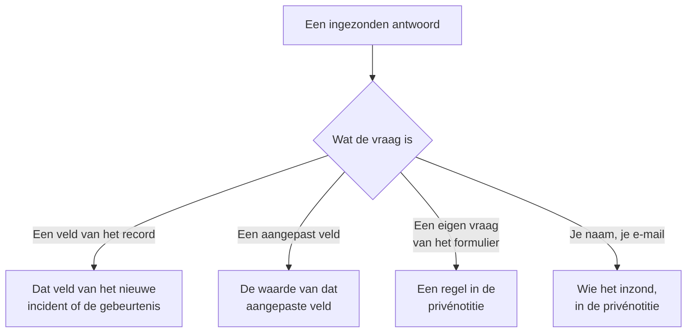

# Een formulier bouwen

Op de pagina **Bouwen** van een formulier bepaal je wat het vraagt en hoe de pagina eruitziet. De vragen staan links, in de volgorde waarin de openbare pagina ze toont; **Vraag toevoegen**, rechts, toont alles wat je kunt toevoegen. Boven de vragen, ingeklapt, staat de [huisstijl](#huisstijl) van het formulier: het logo en het favicon. Benoemde sets antwoorden waarmee mensen het formulier kunnen beginnen — die elk ook een vraag verplicht, optioneel of verborgen kunnen maken voor hun eigen geval — staan op de pagina **Sjablonen**: zie [Sjablonen](#sjablonen).

:::cards
- [De bouwer](#de-bouwer): Vragen toevoegen, bewerken, verplaatsen en opslaan.
- [Wat je kunt toevoegen](#wat-je-kunt-toevoegen): Je eigen vragen, de velden van het record, aangepaste velden en de inzender.
- [Verborgen vragen](#verborgen-vragen): Beantwoord door een sjabloon, nooit door wie inzendt.
- [Sjablonen](#sjablonen): Eén formulier, en één link, voor elk geval dat je team vaak meldt.
:::

## Waar elk antwoord naartoe gaat

Elk antwoord wordt ook bij de inzending bewaard, op de pagina **Inzendingen** van het formulier. Een veld dat het formulier niet vraagt, of dat leeg blijft, wordt ingevuld vanuit de [instellingen Bij verzenden](/docs/forms/on-submit) van het formulier.

## De bouwer

:::steps
### Een vraag toevoegen

Kies wat je wilt toevoegen in **Vraag toevoegen**. De nieuwe vraag wordt na de geselecteerde vraag ingevoegd, of aan het eind, en wordt geselecteerd.

### Bewerken waar hij staat

Selecteer een kaart om hem te bewerken: de vraag, de helptekst, het antwoordtype en de opties, of hij verplicht of verborgen is, en de knoppen om hem te dupliceren of te verwijderen. **Klaar** sluit hem.

### Op zijn plek zetten

Sleep een kaart aan zijn greep om hem te verplaatsen, of gebruik **Omhoog** en **Omlaag** op de geselecteerde kaart — op een telefoon, of met het toetsenbord.

### Het formulier opslaan

**Wijzigingen opslaan** slaat alle wijzigingen in één keer op. Tot je opslaat, zegt de bouwer **Niet-opgeslagen wijzigingen** en biedt **Wijzigingen verwerpen** aan, en vraagt de browser het na voordat je de pagina verlaat.
:::

- **De kop van het formulier** toont de naam en beschrijving zoals de openbare pagina dat zal doen. **Naam en beschrijving bewerken** wijzigt ze.
- **De vragen** zijn kaarten. Elke kaart toont de vraag zoals mensen hem zullen zien, met een badge die zegt waaraan hij is gekoppeld — **Incident · Ernst**, **Aangepast veld · Region**, **Inzender · E-mail**, of het antwoordtype bij een eigen vraag van het formulier. Een rood sterretje markeert een verplichte vraag, en een badge **Verborgen** een [verborgen](#verborgen-vragen) vraag.
- **Limieten.** Een formulier kan tot 50 vragen hebben. Mensen die een formulier mogen lezen maar niet bewerken, zien de bouwer alleen-lezen.

## Huisstijl

**Huisstijl**, ingeklapt boven de vragen, is hoe de pagina van het formulier eruitziet: je logo bovenaan de pagina, boven de naam van het formulier, en je favicon in het browsertabblad zolang het formulier openstaat. Tot je je eigen exemplaren uploadt, toont het formulier het logo en het favicon van OneUptime.

Ingeklapt toont de sectie **Logo** en **Favicon** — als ingesteld weergegeven zodra het formulier zijn eigen heeft — en zegt welke van OneUptime nog gelden. Klap haar open om beide te zien zoals de pagina ze toont: het logo zoals het bovenaan de pagina staat, en het favicon in een browsertabblad naast de naam van het formulier, die de titel van het tabblad is.

**Huisstijl bewerken** wijzigt ze in één dialoogvenster:

| Veld | Wat het is |
| --- | --- |
| **Logo** | Getoond bovenaan de pagina van het formulier, boven de naam, in plaats van het logo van OneUptime. Een PNG-, JPEG-, GIF-, WebP- of SVG-afbeelding van maximaal 512 KB. Verwijder het om terug te gaan naar het logo van OneUptime. |
| **Logo Alt Text** | Wat het logo zegt, voorgelezen door schermlezers: meestal de naam van je organisatie. Gevraagd zodra er een logo is. Laat het leeg en schermlezers slaan het logo over — de naam van het formulier volgt er toch op. Het logo verwijderen maakt dit ook leeg. |
| **Favicon** | Het pictogram in het browsertabblad zolang het formulier openstaat, in plaats van het favicon van OneUptime. Een PNG-, JPEG-, GIF-, WebP-, SVG- of ICO-afbeelding van maximaal 128 KB; een vierkante PNG, SVG of ICO werkt het best. Verwijder het om terug te gaan naar het favicon van OneUptime. |

Het logo houdt de hoogte van het OneUptime-logo dat het vervangt, en een breed logo wordt aan de breedte van de pagina aangepast. Elke afbeelding wordt gecontroleerd als ze wordt opgeslagen — vanuit het dashboard, de API, Terraform of een workflow: ze moet in het eigen project van het formulier zijn geüpload, van een van de typen hierboven zijn en niet groter dan haar limiet. Een logo dat geen van die afbeeldingen is, wordt geweigerd met "The logo must be a PNG, JPEG, GIF, WebP or SVG image.", een te groot logo met "The logo must be 512 KB or smaller.", en een logo waarvan de upload weg is — of dat in een ander project is geüpload — met "The logo's file could not be found. Upload the logo again." Een favicon wordt op dezelfde manier geweigerd, met "The favicon must be a PNG, JPEG, GIF, WebP, SVG or ICO image.", "The favicon must be 128 KB or smaller." en "The favicon's file could not be found. Upload the favicon again."

**Voorbeeld** toont het logo zoals de pagina dat doet. Mensen die een formulier mogen lezen maar niet bewerken, zien de huisstijl zonder **Huisstijl bewerken**. Het logo en het favicon bereiken de pagina van het formulier alleen binnen het formulier zelf — zie [Delen & beveiliging](/docs/forms/sharing-and-security#wat-een-formulier-beschermt).

## Wat je kunt toevoegen

**Vraag toevoegen** toont vier groepen: **Vragen** van het formulier zelf, **Incidentvelden** of **Velden van gepland onderhoud** van wat het formulier aanmaakt, **Aangepaste velden** en **Inzender**.

### Eigen vragen van het formulier

| Antwoordtype | Wat de inzender geeft |
| --- | --- |
| **Kort antwoord** | Eén regel tekst. |
| **Alinea** | Meerdere regels tekst. |
| **Opgemaakte tekst** | Tekst met opmaak en links. |
| **Nummer** | Een getal. |
| **Vervolgkeuzelijst** | Eén keuze uit een lijst. |
| **Meervoudige keuze** | Een willekeurig aantal keuzes uit een lijst. |
| **Selectievakje** | Een vakje om aan te vinken, zoals een bevestiging. |
| **Datum** | Een dag. |
| **Datum en tijd** | Een dag en een tijd. |

Een keuzelijst of meervoudige selectie toont de **Opties** die je haar geeft, elk met een optionele kleur (de knop naast een optie opent een set benoemde kleuren, met **Aangepaste kleur** voor een exacte code), tussen één en 100 ervan. Een vraag wisselen tussen **Vervolgkeuzelijst** en **Meervoudige keuze** behoudt de opties; een vraag die zo'n type wordt, begint met twee opties die je kunt hernoemen, en een die het niet meer is, verliest ze. **Dupliceren** kopieert een eigen vraag van het formulier direct eronder.

De antwoorden op deze vragen worden bij de inzending bewaard en in de privénotitie getoond van wat het formulier aanmaakt — ze vullen geen veld in. Voeg om een veld in te vullen het veld zelf toe, uit de volgende twee groepen.

### Velden van wat het formulier aanmaakt

De velden van een incident, of van een geplande onderhoudsgebeurtenis, die een inzender kan beantwoorden. Het antwoord wordt de waarde van het veld.

| Incidentveld | Beantwoord met |
| --- | --- |
| **Titel** | Eén regel, tot 500 tekens. |
| **Beschrijving** | Opgemaakte tekst, tot 20.000 tekens. |
| **Ernst** | Een van je incidenternstniveaus. |
| **Monitoren** | Elk van de monitoren die je aanbiedt — de getroffen monitoren van het incident. |
| **Labels** | Elk van de labels die je aanbiedt. |
| **Begin van de impact** | Een datum en tijd: wanneer het probleem begon, zoals de inzender het zich herinnert. |

| Veld van gepland onderhoud | Beantwoord met |
| --- | --- |
| **Titel** | Eén regel, tot 100 tekens. |
| **Beschrijving** | Opgemaakte tekst, tot 20.000 tekens. |
| **Begint op** | Een datum en tijd. Altijd gevraagd en altijd verplicht. |
| **Eindigt op** | Een datum en tijd na **Begint op**. Altijd gevraagd en verplicht. |
| **Monitoren** | Elk van de monitoren die je aanbiedt. |
| **Statuspagina's** | Elk van de statuspagina's die je aanbiedt. |
| **Labels** | Elk van de labels die je aanbiedt. |

Elk veld kan één keer worden gevraagd; de lijst markeert de velden die al op het formulier staan met **Toegevoegd**. Een veld dat het formulier niet vraagt — of dat leeg blijft — wordt ingevuld vanuit de [instellingen Bij verzenden](/docs/forms/on-submit) van het formulier.

**Aangeboden keuzes.** Een openbare pagina mag niet je hele project aan vreemden tonen, dus een veld dat wordt beantwoord door records te kiezen, biedt alleen de records aan die jij kiest. **Monitoren**, **Labels** en **Statuspagina's** tonen precies de keuzes die je aanbiedt, en worden pas gevraagd als je er minstens één aanbiedt. **Ernst** biedt alle incidenternstniveaus aan tenzij je het beperkt, omdat ernstniveaus niet geheim zijn. Antwoorden buiten de aangeboden keuzes worden geweigerd.

### Aangepaste velden

Je aangepaste velden voor incidenten — of voor gepland onderhoud, bij een onderhoudsformulier — elk een vraag waarvan het antwoord de waarde van het veld wordt. De vraag neemt het type en de opties over van het aangepaste veld, en begint met de naam ervan als vraag en de beschrijving als helptekst, die je kunt wijzigen.

Een formulier vraagt alleen de aangepaste velden die je eraan toevoegt, wat **Tonen bij aanmaken** ook zegt: elk veld dat een formulier vraagt, toont zijn naam, beschrijving en opties aan iedereen met de link. Als een aangepast veld wordt verwijderd, blijft zijn vraag op het formulier staan maar wordt hij niet meer gevraagd, en de kaart zegt dat — verwijder de vraag. Een veld dat opnieuw met dezelfde naam wordt aangemaakt, is een nieuw veld: voeg het opnieuw toe.

Een aangepast veld dat zijn waarde overneemt van een aangepast monitorveld, zegt dat op zijn kaart: als het incident of de gebeurtenis monitoren heeft die het eens zijn over een waarde ervoor, vervangt die waarde het antwoord van de inzender.

### Inzender

**Uw naam** en **Uw e-mailadres** vragen wie er inzendt. Ze worden bij de inzending bewaard en in de privénotitie genoemd, zodat je team contact kan opnemen, en worden nooit op het incident of de gebeurtenis zelf getoond. OneUptime mailt de inzender nooit. Laat ze weg, of maak ze optioneel, om anonieme inzendingen te accepteren.

Het e-mailadres moet één gewoon adres zijn, zoals `ada@example.com` — geen naam met het adres tussen punthaken, en geen lijst met adressen. Naam en e-mailadres zijn elk maximaal 100 tekens.

## De vragen van een nieuw formulier

Een nieuw formulier begint met de vragen die het bijna altijd zou moeten stellen, zodat het werkt zodra het is aangemaakt: de **Titel**, verplicht; de **Beschrijving**; bij een onderhoudsformulier **Begint op** en **Eindigt op**; en **Uw naam** en **Uw e-mailadres**, verplicht. Hun tekst staat in de taal van je dashboard. Wijzig, verberg of verwijder ze naar wens — behalve het begin en het einde van een onderhoudsgebeurtenis, zonder welke geen gebeurtenis kan worden gepland. Als je eigen vragen alles zeggen, verberg dan de **Beschrijving** in plaats van een vak te laten staan waarin niemand zou moeten typen: zie [Verborgen vragen](#verborgen-vragen).

## Verplichte vragen

**Verplicht** betekent dat het formulier niet zonder antwoord kan worden verzonden. Een antwoord van alleen spaties, tabs of regeleinden telt als geen antwoord, en een verplichte **Selectievakje** moet zijn aangevinkt. De server controleert elke verplichte vraag opnieuw als het formulier wordt verzonden, dus ook een verzoek zonder de pagina moet eraan voldoen.

Een vraag die niet verplicht is, mag leeg blijven: het veld ervan wordt dan ingevuld vanuit de instellingen Bij verzenden, alsof het formulier hem niet had gevraagd.

## Verborgen vragen

Zet **Verborgen** aan op een kaart en de vraag wordt niet meer op het formulier getoond. Niemand krijgt hem, dus hij is nooit verplicht, en een inzending kan hem niet beantwoorden — het verzoek wordt er niet eens voor gelezen. Alleen het [sjabloon](#sjablonen) waarmee een inzending begint, beantwoordt hem, en hij blijft onbeantwoord als de inzender met geen enkel sjabloon begint, of met een sjabloon dat hem leeg laat. Een sjabloon kan een verborgen vraag ook toch vragen, voor zijn eigen geval: zie [Hoe een sjabloon elke vraag stelt](#hoe-een-sjabloon-elke-vraag-stelt).

Verberg een vraag als het antwoord aan je team is om te bepalen, niet aan de inzender:

- **De beschrijving van het incident**, als de vragen die je toevoegde alles zeggen. Verborgen nodigt ze niemand meer uit daar te typen; geef elk sjabloon de standaardtekst die je voor zijn geval verstuurt, of laat incidenten zonder beginnen.
- **Een aangepast veld dat je workflows of regels lezen**, zoals een meldingstype, ingesteld door elk sjabloon.
- **Een eigen vraag van het formulier** waarvan alleen je team het antwoord in de privénotitie nodig heeft.

Een verborgen vraag behoudt zijn plek, zijn label en zijn instellingen, zodat je hem op elk moment weer kunt tonen. Een veld zonder welk het doel van het formulier niet kan worden aangemaakt — **Begint op** en **Eindigt op** van een onderhoudsgebeurtenis — kan niet worden verborgen. Het antwoord op een verborgen vraag wordt precies zo gecontroleerd en opgeslagen als een getypt antwoord, en bij de inzending bewaard.

## Sjablonen

De pagina **Sjablonen** van een formulier bevat benoemde sets antwoorden waarmee mensen het formulier kunnen beginnen — één voor elk geval dat je team vaak meldt, zoals **Storing in applicatie**, **Gepland onderhoud** of **Service hersteld** — zodat één formulier, en één link, ze allemaal bedient.

:::steps
### Een sjabloon toevoegen

Klik op **Sjabloon toevoegen**. De editor heeft twee delen. **Vragen** toont elke vraag van het formulier met hoe dit sjabloon hem stelt — zie [Hoe een sjabloon elke vraag stelt](#hoe-een-sjabloon-elke-vraag-stelt). **Antwoorden** toont ze opnieuw, verborgen vragen inbegrepen en geen enkele verplicht: vul in wat het sjabloon moet beantwoorden, en laat de rest aan wie inzendt. Een antwoord op een vraag die het sjabloon niet stelt, zegt dat eronder — het wordt gebruikt zoals het is.

### De standaard kiezen

**Standaard** maakt het tot het sjabloon waarmee het formulier opent. Er kan maar één sjabloon de standaard zijn, en een formulier waarvan het enige sjabloon de standaard is, is gewoon een vooraf ingevuld formulier.

### De link ervan delen

**Link kopiëren** kopieert de eigen link van het sjabloon, die het formulier opent met het sjabloon ingevuld. Zie [Delen & beveiliging](/docs/forms/sharing-and-security#een-link-voor-elk-sjabloon).
:::

Elk sjabloon toont wat het invult en de vragen die het op zijn eigen manier stelt, zoals **Datum van gepland onderhoud · Verborgen**, en heeft **Bewerken**, **Dupliceren** — een kopie direct erna, met een naam als **Storing in applicatie 2** —, **Omhoog** en **Omlaag**, voor de volgorde waarin het formulier ze toont, en **Verwijderen**.

Op de openbare pagina toont een formulier met sjablonen ze boven zijn vragen, onder **Beginnen vanuit een sjabloon**. Er een kiezen vult het formulier in en stelt de vragen zoals dat sjabloon ze stelt; de inzender kan elk antwoord nog wijzigen voor het verzenden, en een ander kiezen begint het formulier opnieuw vanaf dat sjabloon. De pagina opent met het sjabloon dat de link noemt, anders met de standaard, anders met geen. **Voorbeeld** toont de sjablonen ook en opent op de standaard.

> [!IMPORTANT]
> Iedereen die de link opent, ziet de naam van elk sjabloon en zijn antwoorden op de vragen die het stelt — zo vult de pagina zichzelf in. De antwoorden van een sjabloon op vragen die het niet stelt, verlaten de server nooit, dus houd alles wat intern is in een verborgen vraag.

Elk antwoord van elk sjabloon wordt tegen zijn vraag gecontroleerd als de sjablonen worden opgeslagen — een optie die de vraag aanbiedt, een record dat het formulier aanbiedt, tekst die past —, en zo ook elke vraag die een sjabloon op zijn eigen manier stelt, en opslaan wordt geweigerd met een bericht dat het sjabloon en het probleem noemt, of het nu van het dashboard, de API of Terraform komt. De naam van een sjabloon is maximaal 100 tekens en uniek binnen het formulier, en een formulier heeft maximaal 50 sjablonen. Als je later de vragen wijzigt, wordt het antwoord van een sjabloon op een vraag die je verwijderde, of die er niet meer bij past, gewoon niet gebruikt, en de volgende keer dat dat sjabloon wordt opgeslagen, valt het weg. Het opslaan van de andere sjablonen wordt daarom nooit geweigerd: wat een sjabloon al bevatte, wordt niet opnieuw gecontroleerd.

### Hoe een sjabloon elke vraag stelt

Verschillende gevallen hebben verschillende vragen nodig: een storing heeft de getroffen applicatie nodig en geen onderhoudsvenster, gepland onderhoud heeft het venster nodig. Laat in plaats van een formulier per geval te bouwen elk sjabloon de vragen van het formulier op zijn eigen manier stellen. In de **Vragen** van een sjabloon heeft elke vraag een van deze instellingen:

| Instelling | Als iemand met het sjabloon begint |
| --- | --- |
| **Formulierstandaard** | De vraag wordt gesteld zoals het formulier hem stelt — verplicht, optioneel of verborgen, zoals zijn kaart in de bouwer zegt. De kiezer zegt welke, zoals **Formulierstandaard (Verborgen)**, en volgt de kaart als je die wijzigt. |
| **Verplicht** | De vraag wordt gesteld, en het formulier kan niet zonder antwoord worden verzonden. |
| **Optioneel** | De vraag wordt gesteld, en mag leeg blijven. |
| **Verborgen** | De vraag wordt niet gesteld. Het eigen antwoord van het sjabloon, als het er een heeft, is het antwoord, zoals bij een vraag die het formulier verbergt. |

Eén incidentformulier kan zo beide gevallen bedienen:

| Vraag | Storing in applicatie | Gepland onderhoud |
| --- | --- | --- |
| Naam van de applicatie | Verplicht | Verplicht |
| Getroffen voorzieningen | Verplicht | Optioneel |
| Datum van gepland onderhoud | Verborgen | Verplicht |

Elke vraag begint op **Formulierstandaard**, en zo ook elke vraag die je later aan het formulier toevoegt, in elk sjabloon. **Begint op** en **Eindigt op** van een onderhoudsgebeurtenis worden altijd gevraagd en zijn altijd verplicht: geen sjabloon kan ze wijzigen. Een sjabloon kan alle andere vragen verbergen en ze zelf beantwoorden: de link ervan is dan een formulier met één knop, **Verzenden** — handig voor een geval als **Service hersteld**.

De pagina volgt het sjabloon dat de inzender kiest: een ander kiezen tekent het formulier opnieuw met de vragen van dat sjabloon, en **Voorbeeld** doet hetzelfde. De server houdt elke inzending aan de vragen die het genoemde sjabloon stelt, wat haar ook verstuurde: een vraag die het sjabloon verplicht maakt, moet worden beantwoord, en een die het verbergt, wordt niet uit het verzoek gelezen — het eigen antwoord van het sjabloon wordt gebruikt. Een inzending die geen sjabloon noemt, of een sinds verwijderd sjabloon, wordt aan de eigen instellingen van het formulier gehouden. Een vraag die het formulier verbergt, wordt alleen aan de openbare pagina getoond als een sjabloon hem stelt.

## Als de bouwer een vraag markeert

Een kaart waar iets mis mee is, zegt wat, in amber:

| De kaart zegt | Wat er mis is |
| --- | --- |
| **Dit aangepaste veld is verwijderd, dus de vraag wordt niet gesteld. Verwijder de vraag.** | De openbare pagina laat de vraag weg. |
| **Kies minstens één keuze om aan te bieden, anders wordt de vraag niet gesteld.** | Een veld dat wordt beantwoord door records te kiezen, biedt er geen aan: kies de monitoren, labels of statuspagina's die het aanbiedt. |
| **Voeg minstens één optie toe.** | Een keuzelijst of meervoudige selectie heeft niets om uit te kiezen. |
| **Schrijf de vraag.** | De vraag heeft geen tekst. |

Het formulier kan niet worden opgeslagen zolang een vraag een van de laatste drie heeft: **Wijzigingen opslaan** zegt welke vraag en wat er mis is, en het voorbeeld laat zo'n vraag weg. Opslaan controleert de vragen ook als geheel, en wordt geweigerd met een bericht dat het probleem noemt als bijvoorbeeld twee vragen naar hetzelfde veld vragen, of een onderhoudsformulier niet vraagt wanneer het onderhoud begint en eindigt — of de vragen nu uit de bouwer, de API, Terraform of een workflow komen.

## Voorbeeld

**Voorbeeld** opent het formulier precies zoals mensen het via de link zien — hetzelfde logo, dezelfde vragen, invoervelden, opties en controles, de lijst met sjablonen, en alleen de vragen die het gekozen sjabloon stelt — en laat je het invullen. Niets wat je daar invoert, wordt verzonden: **Verzenden** controleert alleen je antwoorden, en **Opnieuw invullen** begint opnieuw. Het voorbeeld toont de vragen zoals ze in de bouwer staan, opgeslagen of niet, en zegt wanneer het een gemarkeerde vraag weglaat.

## Wat de inzender ziet

De openbare pagina toont het logo van het formulier — het logo van OneUptime tot je het jouwe uploadt —, dan de naam en beschrijving van het formulier, de sjablonen als het die heeft, de vragen die het stelt — zoals het gekozen sjabloon ze stelt, of de vragen die het niet verbergt als er geen sjabloon is gekozen — en **Verzenden**, en het browsertabblad toont de naam van het formulier en het favicon. De pagina is in de taal van de inzender als OneUptime die heeft — de taal die hij het laatst in OneUptime op die browser koos, of anders de taal waar zijn browser om vraagt — en anders in het Engels. Je vragen, opties en helpteksten worden getoond zoals je ze schreef.

Na het verzenden zegt de pagina "Bedankt — je antwoord is verzonden." en geeft het nummer van wat er is aangemaakt — "Je referentienummer is INC-42." —, gevolgd door het bedankbericht van het formulier, als je er een schreef op de pagina **Delen**. **Nog een antwoord versturen** opent een leeg formulier. De inzender krijgt geen e-mail en heeft geen weg terug naar het incident of de gebeurtenis.

## Groottelimieten

| Antwoord | Limiet |
| --- | --- |
| De **Titel** van een incident | 500 tekens, spaties aan beide uiteinden niet meegeteld. |
| De **Titel** van een onderhoudsgebeurtenis | 100 tekens. |
| **Beschrijving** | 20.000 tekens. |
| Elk ander tekstantwoord | 10.000 tekens. |
| Een antwoord met meervoudige selectie | 100 keuzes. |
| **Uw naam**, **Uw e-mailadres** | Elk 100 tekens. |

Een inzending die een limiet overschrijdt, een verplicht antwoord weglaat of een antwoord geeft dat niet bij de vraag past, wordt geweigerd met een bericht dat zegt welke, en er wordt niets aangemaakt. Antwoorden op vragen die het formulier niet stelt, worden genegeerd.

## Volgende stappen

:::cards
- [Wat een inzending aanmaakt](/docs/forms/on-submit): Hoe de antwoorden en de instellingen Bij verzenden een incident of een onderhoudsgebeurtenis worden.
- [Delen & beveiliging](/docs/forms/sharing-and-security): De link delen, een link voor elk sjabloon, en wat ze beschermt.
- [Incidentinstellingen en automatisering](/docs/incidents/settings): Aangepaste velden en sjablonen voor incidenten.
:::
