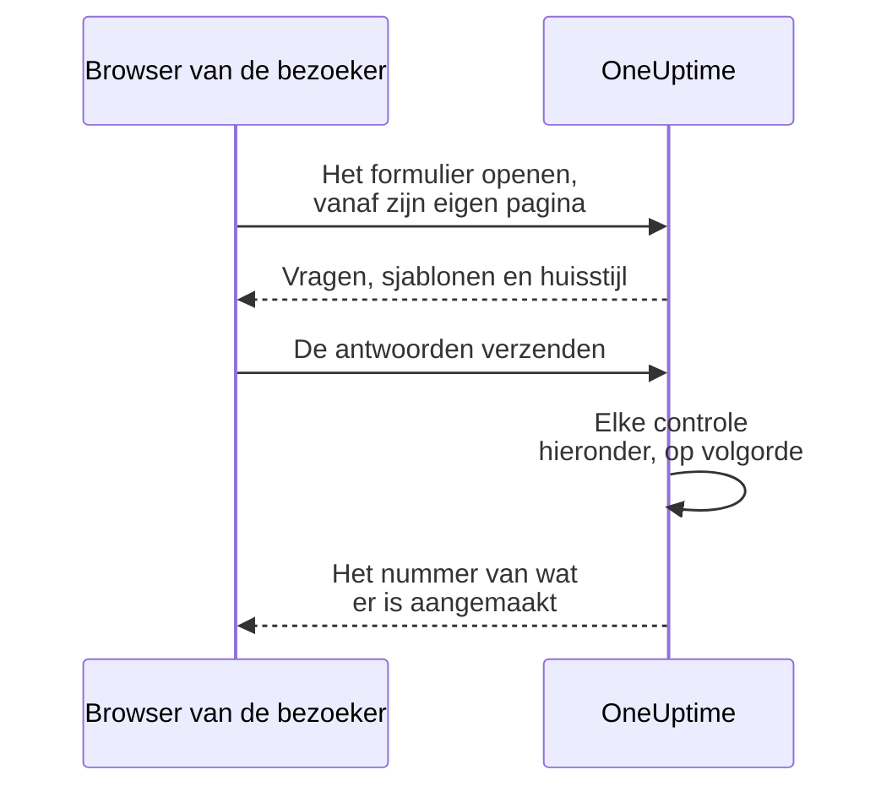

# Delen & beveiliging

Een formulier staat open voor iedereen met de link, en elke inzending kan je bereikbaarheidsdienst oproepen of een onderhoudsvenster in je agenda zetten. Deze pagina behandelt de pagina **Delen** van het formulier — de link, het formulier uitzetten, het bericht na het verzenden en de IP-toelatingslijst — en elke andere controle die een verzoek onderweg doorloopt. Ook staat hier hoe je het formulier op je eigen domein aanbiedt.

:::cards
- [De link delen](#de-link-delen): Kopieer hem, open hem, en stel hem opnieuw in als hij te ver is verspreid.
- [Een link voor elk sjabloon](#een-link-voor-elk-sjabloon): Eén bladwijzer per geval, één formulier achter allemaal.
- [Aangepaste domeinen](#aangepaste-domeinen): Bied het formulier aan op je eigen domein, met een gratis certificaat.
- [Wat een formulier beschermt](#wat-een-formulier-beschermt): Elke controle die een verzoek doorloopt, op volgorde.
- [Problemen oplossen](#problemen-oplossen): Wat elk bericht op de pagina van het formulier betekent, en wat je moet doen.
:::

## De pagina Delen

| Kaart | Wat erop staat |
| --- | --- |
| **Status** | **Accepteert inzendingen** — of de link van het formulier werkt. |
| **Deellink** | Elk adres waarop het formulier antwoordt, elk met **Link kopiëren**, en **Link opnieuw instellen**. |
| **Na verzenden** | Het **Bedankbericht** dat mensen zien zodra ze verzenden, onder het nummer van wat het formulier aanmaakte. |
| **Meer instellingen** | De **IP-toelatingslijst**, ingeklapt tot u die opent. |

## De link delen

De kaart **Deellink** toont elk adres waarop het formulier antwoordt: eerst de [aangepaste domeinen](#aangepaste-domeinen) ervan, dan de link op OneUptime, zoals `https://oneuptime.com/accounts/form/<share-key>`:

- Elk adres opent het formulier in een nieuw tabblad, zoals mensen het zien, en **Link kopiëren** ernaast kopieert het.
- Een aangepast domein dat nog niet werkt, is gemarkeerd met **Nog niet live**, met de reden. Zonder aangepast domein biedt een regel onder de link **Aangepast domein toevoegen** aan.
- **Link opnieuw instellen** geeft het formulier een nieuwe link, nadat je bevestigt. De oude link werkt meteen niet meer en toont het bericht dat het formulier niet beschikbaar is, dus iedereen met wie je hem deelde, heeft de nieuwe nodig. Gebruik het als een link verder is verspreid dan zou moeten. De aangepaste domeinen van het formulier bevatten geen sleutel, en blijven werken.

Iedereen met de link kan het formulier openen en verzenden, zonder OneUptime-account en zonder aan te melden. Aangemeld zijn verandert niets: OneUptime weet alleen wie inzond aan de naam en het e-mailadres die in het formulier zijn getypt. Behandel de link dus als een telefoonnummer van je bereikbaarheidsdienst. Deel hem waar de mensen die hem moeten gebruiken hem vinden — een intranetpagina, een supportrunbook, een vastgezet chatbericht — en niet op een openbare website, tenzij je inzendingen van iedereen wilt.

De link bevat een eigen willekeurige sleutel, niet de ID van het formulier. Op een zelf gehoste installatie wordt hij geserveerd vanaf je eigen OneUptime-host, en werkt hij alleen op het adres dat `HTTP_PROTOCOL` en `HOST` instellen: geopend via een andere naam van de server, of via het IP-adres, worden de verzoeken van het formulier geweigerd als afkomstig van een andere website.

Links naar de oude incidentformulieren, `/accounts/incident-form/<share-key>`, openen hetzelfde formulier op het nieuwe adres.

### Een link voor elk sjabloon

Elk van de [sjablonen](/docs/forms/building#sjablonen) van het formulier heeft een eigen link: de link van het formulier met `?template=` en de ID van het sjabloon, zoals `https://oneuptime.com/accounts/form/<share-key>?template=<template-id>`. **Link kopiëren** op de pagina **Sjablonen** van het formulier kopieert hem. Hij opent het formulier met dat sjabloon ingevuld, zodat een team één bladwijzer per geval kan bewaren terwijl jij één formulier beheert. Als de inzender een ander sjabloon kiest, volgt het adres in zijn browser mee, dus de link die hij kopieert, is het formulier zoals hij het ziet. Op een [aangepast domein](#aangepaste-domeinen) is de link van een sjabloon het domein met dezelfde `?template=`, zoals `https://report.acme.com/?template=<template-id>`, en **Link opnieuw instellen** laat die werken.

De link van een sjabloon is de link van het formulier: hij werkt zolang het formulier op **Accepteert inzendingen** staat, en **Link opnieuw instellen** trekt hem samen met de rest in. Een link die een sjabloon noemt dat je hebt verwijderd, opent het formulier alsof hij er geen noemde — met het standaardsjabloon, als dat er is.

### Een formulier uitzetten

Zet **Accepteert inzendingen** uit om geen inzendingen meer aan te nemen zonder het formulier te verwijderen. De link toont dan "Dit formulier is niet beschikbaar. Het is mogelijk uitgeschakeld, of de link is verouderd.", en de kaart **Deellink** herinnert je eraan dat het formulier uitstaat. Zet het weer aan en dezelfde link werkt opnieuw. De aangepaste domeinen van het formulier tonen hetzelfde bericht zolang het uitstaat.

### Het bedankbericht

Na een inzending zegt de pagina "Bedankt — je antwoord is verzonden." en geeft het nummer van wat er is aangemaakt, en daarna je **Bedankbericht**, in Markdown. Gebruik het om te zeggen wat er nu gebeurt, en waar je terechtkunt als iets dringend is. Zonder bericht toont de pagina alleen het standaardbericht.

Een afbeelding in de beschrijving of het bedankbericht van het formulier wordt getoond aan iedereen die de link opent zolang het formulier op **Accepteert inzendingen** staat. Zet het formulier uit, of haal de afbeelding weg, en de afbeelding is weer privé, tenzij iets anders dat iedereen ziet haar nog bevat.

## Aangepaste domeinen

Standaard wordt een formulier aangeboden op zijn link, op het eigen adres van OneUptime. Om het op een eigen domein aan te bieden, zoals `report.acme.com`, open je de pagina **Aangepaste domeinen** van het formulier, direct na **Delen** in het zijmenu. Die werkt zoals de [aangepaste domeinen van een statuspagina](/docs/status-pages/branding-and-domains#aangepaste-domeinen).

Het formulier op je eigen domein zetten kost drie stappen, en alleen de eerste twee zijn voor jou:

1. **Het domein toevoegen**: een subdomein en een van je geverifieerde domeinen.
2. **Het CNAME-record ervan toevoegen** bij je DNS-provider. Het dialoogvenster **DNS-instelling** opent met het record zodra je het domein toevoegt.
3. **Het gratis SSL-certificaat wordt automatisch uitgegeven** zodra het record is gevonden. Er is geen knop om op te drukken.

Zodra het domein live is, toont de kaart **Deellink** het boven de link van het formulier. Beide openen hetzelfde formulier.

### Een domein toevoegen

Klik op **Formulierdomein aanmaken**. Het dialoogvenster is één pagina:

- **Subdomein**: alleen het label, met de voorbeeldtekst `report (leave blank for root)`. Vul alleen `report` in, niet de hele hostnaam. Laat het leeg of vul `@` in om het hoofddomein te gebruiken.
- **Domein**: een van de domeinen die zijn geverifieerd onder **Projectinstellingen** > **Geavanceerd** > **Domeinen**, waar je met een TXT-record bewijst dat een domein van jou is. De link **Domein toevoegen** naast het veld opent die pagina in een nieuw tabblad.
- **Meer velden**: ingeklapt. Open het alleen om een eigen certificaat te gebruiken: zet **Aangepast certificaat uploaden** aan en plak het **Certificaat** en de **Privésleutel van certificaat** ervan.

Klik nogmaals op **Formulierdomein aanmaken** om het toe te voegen. Het dialoogvenster sluit en de **DNS-instelling** van het nieuwe domein opent. De naam van een domein en zijn formulier liggen vast zodra het is toegevoegd, dus **Bewerken** wijzigt alleen het certificaat: om een van beide te wijzigen, voeg je het nieuwe domein toe en verwijder je het oude.

Een domein toont één statuspagina, één dashboard of één formulier, dus een naam die een van die al heeft, in welk project ook, wordt geweigerd: "report.acme.com is already in use: a domain can show only one status page, dashboard or form. Choose another subdomain, or remove report.acme.com where it is used first."

### DNS-instelling en Nu controleren

Het dialoogvenster **DNS-instelling** toont het record dat je bij je DNS-provider toevoegt, elk veld met een kopieerknop: **Type** `CNAME`, **Naam** het volledige domein dat je hebt toegevoegd, en **Waarde** het CNAME-record van je installatie. Voor een hoofddomein staan veel DNS-providers geen CNAME-record toe: gebruik dan het ALIAS-, ANAME- of CNAME-flattening-record van je provider, met dezelfde waarde.

OneUptime controleert elk niet-geverifieerd domein elke 15 minuten, en als het het record vindt, bestelt het in dezelfde controle het gratis Let's Encrypt-certificaat van het domein. Klik op **Nu controleren** om meteen te controleren. Zolang een domein niet live is, heeft de rij een actie **DNS-instelling** die hetzelfde dialoogvenster opent, waar **Nu controleren** ook een mislukt of verlopen certificaat opnieuw bestelt, hooguit één keer per domein per 15 minuten. Vernieuwen gaat automatisch, ruim voordat het certificaat verloopt.

De kolom **Status** zegt hoe ver elk domein is op weg naar HTTPS, in dezelfde acht toestanden als de domeinen van een statuspagina: zie [De kolom Status van het domein lezen](/docs/status-pages/branding-and-domains#de-kolom-status-van-het-domein-lezen). Als een bestelling is mislukt, staat de reden op de regel eronder: meestal een CAA-record op je domein dat `letsencrypt.org` niet toestaat of, op een zelf gehoste installatie, een server die Let's Encrypt niet bereikt op poort 80.

Zodra er voor een domein een gratis certificaat is besteld, toont de rij **Reissue SSL**, dat bij Let's Encrypt een gloednieuw certificaat aanvraagt vóór de automatische vernieuwing, één keer per 24 uur per domein. Het formulier blijft intussen online met het huidige certificaat. Een certificaat dat je hebt geüpload, vernieuw je zelf: bewerk het domein en plak het nieuwe.

### Wat het domein toont

Een domein toont zijn formulier op de hoofdmap, zoals `https://report.acme.com`, en verder niets van OneUptime: geen aanmeldpagina en geen ander formulier. Elk ander adres op het domein opent het formulier op de hoofdmap, met behoud van de query, dus ook de link van een sjabloon werkt daar. De pagina is die van het formulier: zijn logo of geen, nooit dat van OneUptime, zijn naam als titel van het tabblad, in het lichte thema en zonder de analyses van OneUptime. De captcha, bestanden en het bedankbericht werken daar zoals via de link, en elke controle uit [Wat een formulier beschermt](#wat-een-formulier-beschermt) geldt, met het domein als eigen pagina van het formulier.

- **Link opnieuw instellen** wijzigt alleen de link van het formulier op OneUptime: zijn domeinen bevatten geen sleutel, dus die blijven werken.
- **Accepteert inzendingen** uitzetten sluit het formulier ook op zijn domeinen, met het bericht dat het niet beschikbaar is.
- Het formulier verwijderen verwijdert zijn domeinen, en **Formulier dupliceren** kopieert er geen. Een verwijderd domein toont het formulier meteen niet meer.

### Op een zelf gehoste installatie

Formulieren gebruiken het CNAME-record van de statuspagina's: `STATUS_PAGE_CNAME_RECORD` in `config.env`, of `statusPage.cnameRecord` in de Helm-chart. Om formulierdomeinen een eigen doel te geven, stel je `FORM_CNAME_RECORD` in: in `config.env` voor Docker Compose, of met de chartbrede `extraEnv` in de Helm-chart. Zonder een van beide zegt de pagina **Aangepaste domeinen** dat aangepaste domeinen niet zijn ingeschakeld in plaats van een record te tonen, en verifieert OneUptime geen formulierdomeinen en bestelt het er geen certificaten voor.

De server moet antwoorden op poort 80, waar Let's Encrypt elk domein controleert. Een installatie zonder Let's Encrypt-accountsleutel, `LETS_ENCRYPT_ACCOUNT_KEY` (`letsEncrypt.accountKey` in de Helm-chart), bestelt geen certificaten: het domein van een formulier is live zodra het record is geverifieerd, aangeboden met de HTTPS van je eigen proxy of een certificaat dat je uploadt. Met captcha aan moet een sitesleutel die de hostnamen opsomt waarop hij werkt, ook de domeinen van het formulier opsommen.

### Wie domeinen kan beheren

Eigenaars en beheerders van het project, en iedereen met **Edit Form**, kunnen de domeinen van een formulier toevoegen, controleren, hun certificaten opnieuw laten uitgeven en ze verwijderen. Dat kunnen ook de rechten voor alleen de domeinen van een formulier, zoals **Edit Form Domain**: het [Formulieren – overzicht](/docs/forms/index#machtigingen) somt ze op. Iedereen die een formulier kan lezen, ziet zijn domeinen, hun **Status** en het record in **DNS-instelling**; voor hen zijn **Nu controleren** en **Reissue SSL** vergrendeld en zeggen ze welk recht nodig is. Een API-sleutel werkt net zo op `/form-domain`: `verify-cname`, `order-ssl` en `reissue-ssl` hebben **Edit Form Domain** of **Edit Form** nodig.

## Wat een formulier beschermt

Elk verzoek doorloopt deze controles, in deze volgorde:

1. Het verzoek moet van de eigen pagina van het formulier komen, niet van een andere website — zie [Verzoeken van andere websites](#verzoeken-van-andere-websites).
2. Het moet binnen de snelheidslimieten blijven.
3. Het formulier moet bestaan, op **Accepteert inzendingen** staan en horen bij een project met een abonnement dat formulieren omvat.
4. Het moet van een adres op de **IP-toelatingslijst** komen, als het formulier er een heeft.
5. Een inzending moet de captcha doorstaan, als de instantie captcha heeft aanstaan.
6. Elk antwoord moet binnen de groottelimieten blijven en bij zijn vraag passen — zie [Een formulier bouwen](/docs/forms/building#groottelimieten).
7. Wat de antwoorden en de instellingen opleveren, moet kunnen worden aangemaakt: een incident heeft een ernstniveau nodig, een gebeurtenis een einde na het begin.
8. Een inzending moet binnen het uurtegoed van het formulier passen — zie [Snelheidslimieten](#snelheidslimieten).
9. De bestanden moeten binnen het uurtegoed voor bestanden van het formulier passen, vlak voordat ze worden opgeslagen.

Het logo en het favicon van een formulier horen bij het formulier: ze worden meegestuurd in het antwoord dat het opent, in base64, pas nadat het de eerste vier controles heeft doorstaan, en nooit vanaf een eigen adres. Niemand kan ze zonder het formulier ophalen, en geen enkel bestand kan via een formulier op zijn ID worden opgehaald; de bestanden zelf blijven privé. Een formulier toont alleen afbeeldingen die in zijn eigen project zijn geüpload: een bestand uit een ander project wordt geweigerd als het formulier wordt opgeslagen, en wordt nooit naar de pagina ervan gestuurd.

### IP-toelatingslijst

Om een formulier tot je eigen netwerken te beperken:

:::steps
1. Open de pagina **Delen** van het formulier.
2. Open **Meer instellingen** en klik op **IP-toelatingslijst bewerken**.
3. Vul één netwerk per regel in en sla op. De kaart toont ze dan onder **IP-toelatingslijst**.
:::

Elke regel is een van deze:

| Invoer | Voorbeeld | Opmerking |
| --- | --- | --- |
| Een IPv4-adres | `203.0.113.7` | |
| Een IPv6-adres | `2001:db8::7` | Past hoe het ook is geschreven, in hoofdletters of met de nullen uitgeschreven. |
| Een IPv4-bereik, in CIDR-notatie | `10.0.0.0/8` | IPv6-bereiken worden niet ondersteund — zet elk IPv6-adres op een eigen regel. |

Een IPv4-adres moet als IPv4-adres worden geschreven: op de IPv6-manier geschreven, zoals `::ffff:203.0.113.7`, wordt het geweigerd. De lijst wordt gecontroleerd telkens als hij wordt opgeslagen — vanuit het dashboard, de API, Terraform of een workflow —, en een regel die nooit kan passen, wordt geweigerd met een bericht dat hem noemt. Laat de lijst leeg om elk netwerk toe te staan. Zodra hij een invoer heeft, wordt een verzoek waarvan het adres niet kan worden vastgesteld, geweigerd.

Op OneUptime Cloud vereist het instellen van de IP-toelatingslijst het **Scale**-abonnement — zowel als een formulier er via de API mee wordt aangemaakt als wanneer het wordt bewerkt —, net als de IP-toelatingslijst van een [openbaar dashboard](/docs/dashboards/sharing). Hem leegmaken werkt met elk abonnement. Zelf gehost hoort het wijzigen bij de Enterprise Edition: in de Community Edition blijft een al ingestelde lijst gelden en kan die alleen worden verwijderd.

### Verzoeken van andere websites

Een browser vertelt een server welke pagina een verzoek verstuurde. Als de pagina van een andere website de browser van een bezoeker een formulier laat openen of verzenden, wordt het verzoek geweigerd met "This form can only be used from its own page." — voordat een snelheidslimiet het meetelt, en wat de link ook is, dus het antwoord zegt niets over welke formulieren bestaan.

Een verzoek wordt geweigerd als de header `Sec-Fetch-Site` aanwezig is en iets anders zegt dan `same-origin` of `none`, of als de header `Origin` aanwezig is en niet je OneUptime-adres is — `HTTP_PROTOCOL` en `HOST`, met de poort als `HOST` er een heeft. Een inzending moet ook als JSON worden verstuurd (`application/json`); een inzending die als formuliervelden van een webpagina, of als platte tekst, wordt verstuurd, wordt geweigerd met "The request must be a JSON object holding the form's answers in "data".". Een formulier lezen vereist ook de header die de pagina van het formulier aan elk verzoek toevoegt, `X-OneUptime-Form: 1`: een pagina kan een browser geen header laten toevoegen zonder script, en het script van een andere website dat er een toevoegt, verraadt zichzelf met zijn `Origin`.

### Snelheidslimieten

Een formulier openen en verzenden worden per netwerkadres beperkt, en verzenden ook per formulier:

- **Een formulier openen** — per formulier vanaf één adres, en per adres over alle formulieren, met ruimte voor een heel kantoor dat de link tegelijk opent. Boven een van beide toont de pagina "Te veel verzoeken. Probeer het later opnieuw." Als de snelheidsbegrenzer niet bereikbaar is, openen formulieren nog steeds.
- **Verzenden, per adres** — per formulier vanaf één adres, en per adres over alle formulieren. Boven een van beide ziet de inzender "Te veel meldingen vanaf je netwerk. Wacht een paar minuten en probeer het opnieuw." Iedereen achter één adres — een kantoornetwerk, een VPN-gateway — deelt deze limieten, en elke inzending telt, ook een die daarna wordt geweigerd om een verkeerd antwoord.
- **Verzenden, per formulier** — hoeveel records één formulier in een uur mag aanmaken, vanaf alle adressen samen, zodat zelfs inzendingen vanaf veel adressen tegelijk je maar een beperkt aantal keren per uur kunnen oproepen. Alleen een inzending die elke andere controle doorstond, telt, vlak voordat haar record wordt aangemaakt. Daarboven ziet iedereen "Dit formulier ontvangt op dit moment te veel inzendingen. Probeer het later opnieuw." tot het venster voorbij is. **Link opnieuw instellen** start de nieuwe link met een vers tegoed.
- **Bestanden, per formulier** — hoeveel megabyte aan bestanden één formulier in een uur mag aannemen, vanaf alle adressen samen. Alleen de bestanden van een inzending die elke andere controle heeft doorstaan tellen, vlak voordat ze worden opgeslagen. Daarboven wordt een inzending met bestanden geweigerd met "Dit formulier ontvangt op dit moment te veel bestanden. Probeer het later opnieuw." tot het venster voorbij is; een inzending zonder bestanden komt nog steeds door.

Elke limiet antwoordt `429` met een header `Retry-After`, in seconden, en de pagina vertelt de inzender wanneer hij het opnieuw kan proberen. De vensters zijn vast, niet glijdend. Elke limiet per adres telt ook de adressen van één IPv6-/64 samen, met tien keer zijn getal. Als de snelheidsbegrenzer niet bereikbaar is, worden inzendingen geweigerd in plaats van ongeteld doorgelaten: de API antwoordt `503`, en de inzender ziet "Inzendingen kunnen op dit moment niet worden geaccepteerd. Probeer het over een paar minuten opnieuw."

Op een zelf gehoste installatie wijzigen deze omgevingsvariabelen van de OneUptime-app de limieten:

| Variabele | Standaard | Wat ze instelt |
| --- | --- | --- |
| `FORM_RATE_LIMIT_WINDOW_SECONDS` | `60` | Het venster voor het openen van formulieren, in seconden. |
| `FORM_RATE_LIMIT_PER_FORM_AND_IP_PER_WINDOW` | `120` | Hoe vaak één adres één formulier per venster mag openen. |
| `FORM_RATE_LIMIT_PER_IP_PER_WINDOW` | `600` | Hoe vaak één adres formulieren per venster mag openen, over alle formulieren. |
| `FORM_SUBMIT_RATE_LIMIT_WINDOW_SECONDS` | `900` | Het venster voor de inzendlimieten per adres, in seconden. |
| `FORM_SUBMIT_RATE_LIMIT_PER_FORM_AND_IP_PER_WINDOW` | `10` | Inzendingen naar één formulier vanaf één adres per venster. |
| `FORM_SUBMIT_RATE_LIMIT_PER_IP_PER_WINDOW` | `30` | Inzendingen vanaf één adres per venster, over alle formulieren. |
| `FORM_SUBMIT_RATE_LIMIT_PER_FORM_WINDOW_SECONDS` | `3600` | Het venster voor de limiet per formulier, in seconden. |
| `FORM_SUBMIT_RATE_LIMIT_PER_FORM_PER_WINDOW` | `60` | Records die één formulier per venster mag aanmaken, vanaf alle adressen samen. |
| `FORM_SUBMIT_FILE_RATE_LIMIT_WINDOW_SECONDS` | `3600` | Het venster voor de bestandslimiet per formulier, in seconden. |
| `FORM_SUBMIT_FILE_RATE_LIMIT_MEGABYTES_PER_FORM_PER_WINDOW` | `200` | Megabytes aan bestanden die één formulier per venster mag aannemen, vanaf alle adressen samen. |

Elke variabele leest ook haar oude naam, met `INCIDENT_FORM_` ervoor in plaats van `FORM_` — zoals `INCIDENT_FORM_SUBMIT_RATE_LIMIT_PER_FORM_PER_WINDOW` —, zodat een installatie die incidentformulieren had afgesteld haar limieten houdt; de nieuwe naam wint als beide zijn ingesteld. Noch `config.env` noch de waarden van de Helm-chart geven ze door: voeg ze zelf toe aan de omgeving van de container `app` — met `app.extraEnv`, of de chartbrede `extraEnv`, in de Helm-chart, of in een `docker-compose.override.yml` voor Docker Compose. `TRUSTED_PROXY_HOPS` bepaalt welk adres de limieten per adres tellen.

### Captcha

Als je OneUptime-instantie hCaptcha aan heeft staan, toont het formulier een captcha, en een inzending die hem niet heeft doorstaan, wordt geweigerd. Er is geen instelling per formulier. Een zelf gehoste installatie zet captcha aan met `CAPTCHA_ENABLED`, `CAPTCHA_SITE_KEY` en `CAPTCHA_SECRET_KEY` — dezelfde instellingen die het registreren beschermen. Zonder captcha dragen de snelheidslimieten en de IP-toelatingslijst de last.

## Problemen oplossen

:::details De link zegt dat het formulier niet beschikbaar is
"Dit formulier is niet beschikbaar. Het is mogelijk uitgeschakeld, of de link is verouderd." De pagina geeft hetzelfde antwoord wat de reden ook is, zodat ze een vreemde nooit vertelt of een formulier bestaat:

- **Accepteert inzendingen** staat uit op de pagina **Delen**.
- De link is vervangen met **Link opnieuw instellen**. Deel de nieuwe.
- Het formulier is verwijderd.
- Op OneUptime Cloud zit het project onder het **Growth**-abonnement, of is het abonnement niet betaald.
- De link is afgekapt bij het kopiëren.
:::

:::details Het domein van het formulier toont het formulier niet
Open de pagina **Aangepaste domeinen** van het formulier en lees de kolom **Status** van het domein: zolang het record niet is geverifieerd en het certificaat er niet is, toont een browser een certificaatwaarschuwing, of helemaal niets. Een domein dat niet meer op de pagina staat, omdat het of zijn formulier is verwijderd, toont een pagina die niet is gevonden, en een domein waarvan het bovenliggende domein niet meer is geverifieerd, toont het bericht dat het formulier niet beschikbaar is. Controleer op een zelf gehoste installatie dat het record naar je OneUptime-server wijst en dat de server antwoordt op de poorten 80 en 443.
:::

:::details Het formulier kan alleen vanaf een toegestaan netwerk worden geopend
"Dit formulier kan alleen worden geopend vanaf een toegestaan netwerk." Het adres van de inzender staat niet op de **IP-toelatingslijst** van het formulier: voeg zijn netwerk toe, of maak de lijst leeg. Controleer op een zelf gehoste installatie achter een proxy of load balancer `TRUSTED_PROXY_HOPS` — als die te laag is, ziet OneUptime het adres van je proxy in plaats van dat van de inzender. De pagina zegt hetzelfde als het formulier op een ander adres is geopend dan dat van je eigen OneUptime: open de link precies zoals de kaart **Deellink** hem toont.
:::

:::details Te veel inzendingen
"Te veel meldingen vanaf je netwerk. Wacht een paar minuten en probeer het opnieuw." Iedereen achter één adres deelt de limieten per adres, wat telt bij een grote storing, als veel mensen tegelijk melden. De pagina zegt wanneer je het opnieuw kunt proberen. "Dit formulier ontvangt op dit moment te veel inzendingen. Probeer het later opnieuw." is in plaats daarvan het tegoed per formulier: het gaat niet over het netwerk van de inzender, en meldingen worden weer aangenomen als het venster voorbij is. Als de inzendingen niet echt zijn omdat de link verder is verspreid dan zou moeten, stopt **Link opnieuw instellen** de oude link meteen.
:::

:::details Inzendingen kunnen nu niet worden aangenomen
"Inzendingen kunnen op dit moment niet worden geaccepteerd. Probeer het over een paar minuten opnieuw." De snelheidsbegrenzer was niet bereikbaar, dus inzendingen worden geweigerd in plaats van ongeteld doorgelaten. Het formulier openen werkt nog. Controleer op een zelf gehoste installatie of Valkey, de cache waarin de snelheidsbegrenzer telt, draait en bereikbaar is vanaf de OneUptime-app.
:::

:::details Dit formulier kan geen incident aanmaken omdat het geen ernstniveau heeft
Het formulier vraagt niet naar een ernstniveau, de instellingen noemen er geen — of het genoemde is verwijderd — en het incidentsjabloon stelt er ook geen in. Kies een ernstniveau op de pagina **Bij verzenden** van het formulier. Zie [Geen ernstniveau, geen incident](/docs/forms/on-submit#hoe-een-inzending-een-incident-wordt).
:::

:::details Een inzending wordt geweigerd
Het bericht zegt wat er mis is: een verplicht antwoord ontbreekt of bestaat alleen uit spaties, een antwoord is te lang of past niet bij zijn vraag, het e-mailadres is niet één gewoon adres, of een onderhoudsvenster eindigt voordat het begint. "Captcha-verificatie mislukt. Probeer het opnieuw." betekent dat de captcha niet is doorstaan, of is verlopen: los hem opnieuw op. Controleer op een zelf gehoste installatie waar elke inzending op de captcha stukloopt, of `CAPTCHA_SITE_KEY` en `CAPTCHA_SECRET_KEY` allebei zijn ingesteld.
:::

:::details Een vraag staat niet op het formulier
De bouwer markeert vragen die hij van het openbare formulier weglaat — een aangepast veld dat is verwijderd, bijvoorbeeld —, en **Voorbeeld** zegt wanneer het er een weglaat. Zie [Als de bouwer een vraag markeert](/docs/forms/building#als-de-bouwer-een-vraag-markeert). Een vraag met een badge **Verborgen** wordt met opzet weggelaten: alleen sjablonen beantwoorden hem. Zie [Verborgen vragen](/docs/forms/building#verborgen-vragen). Een vraag kan ook voor het ene sjabloon op het formulier staan en voor het andere niet: elk sjabloon kan een vraag verbergen, of een vraag stellen die het formulier verbergt. Open **Bewerken** van het sjabloon en controleer de **Vragen** ervan. Zie [Hoe een sjabloon elke vraag stelt](/docs/forms/building#hoe-een-sjabloon-elke-vraag-stelt).
:::

:::details Een sjabloon vult een vraag niet in
Het antwoord van een sjabloon wordt alleen gebruikt zolang het nog bij zijn vraag past: een optie die de vraag nog aanbiedt, een record dat het formulier nog aanbiedt, tekst die niet te lang is. Bewerk het sjabloon, beantwoord de vraag opnieuw en sla het op. Zie [Sjablonen](/docs/forms/building#sjablonen).
:::

:::details Het incident of de gebeurtenis staat niet op de statuspagina
Dat is zo bedoeld: incidenten uit een formulier worden verborgen gemeld, en onderhoudsgebeurtenissen blijven verborgen tenzij de instellingen bij **Publicatie** van het formulier anders zeggen. Zie [Wat een inzending aanmaakt](/docs/forms/on-submit).
:::

:::details Niemand werd opgeroepen
Het incident van een formulier voert het bereikbaarheidsbeleid uit dat de instellingen en het sjabloon noemen, en wat je bereikbaarheidsregels toevoegen, zoals bij elk ander incident. Zonder een van die wordt niemand opgeroepen. Voeg een bereikbaarheidsbeleid toe op de pagina **Bij verzenden** van het formulier, of schrijf een bereikbaarheidsregel die bij zijn incidenten past — op een label dat het formulier altijd toevoegt, bijvoorbeeld.
:::

## Volgende stappen

:::cards
- [Formulieren – overzicht](/docs/forms/index): Waar formulieren voor zijn, rechten en de API.
- [Een formulier bouwen](/docs/forms/building): De vragen, verborgen vragen en sjablonen.
- [Wat een inzending aanmaakt](/docs/forms/on-submit): Het incident of de gebeurtenis die elke inzending aanmaakt.
:::
