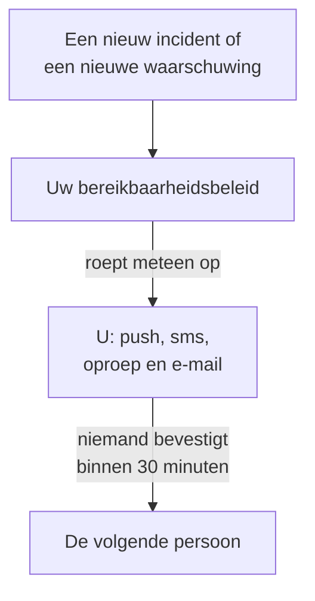

# Opgeroepen worden via telefoon, sms of push

Aan het einde van deze handleiding wordt u bij elk nieuw incident en elke nieuwe waarschuwing in uw project op uw telefoon opgeroepen, via pushmelding, sms of telefoonoproep. Bevestigt niemand binnen 30 minuten, dan wordt de volgende persoon opgeroepen, en een testoproep die u hebt bevestigd laat zien dat het werkt. De handleiding volgt de begeleide installatie **De juiste persoon oproepen als er iets kapotgaat** en duurt ongeveer 10 minuten.

## Wat u nodig hebt

- Een project waarvan u eigenaar bent: sms en oproepen aanzetten kan alleen de eigenaar, een bereikbaarheidsbeleid aanmaken de eigenaar of een beheerder.
- Uw mobiele telefoon.
- De teamleden die u wilt laten oproepen, als leden van het project: [Mensen uitnodigen](/docs/permissions/inviting-people) laat zien hoe.

:::tabs
@tab OneUptime Cloud
Pushmeldingen zijn gratis in elk abonnement. Sms-berichten en oproepen worden betaald uit het saldo van het project, dat begint bij 0.00 USD, en een telefoonnummer toevoegen verstuurt een sms, dus het saldo moet eerst boven 1.00 USD liggen. Tegoed toevoegen belast de kaart van het project. Het Free-abonnement omvat één persoon en één escalatieregel: alleen u wordt opgeroepen, en de oproep herhaalt zich in plaats van iemand anders te bereiken.
@tab Zelf gehost
Uw server moet e-mail, sms-berichten en oproepen kunnen versturen. De hoofdbeheerder ervan stelt ze in op `/admin/setup`, elk met een test, zoals de [Handleiding zelf hosten](/docs/installation/self-hosting-guide) laat zien. Pushmeldingen bereiken de app via de push-relay van OneUptime, zonder dat u iets hoeft in te stellen.
:::

## Stappen

:::steps
### De begeleide installatie openen

Ga in uw project naar **Start** en klik in de checklist **Welkom bij OneUptime 👋** op **Stel een bereikbaarheidsbeleid in**. Bij een nieuw project stelt de startpagina vooraf de vraag **Wat wil je eerst doen?**: vink **De juiste persoon oproepen als er iets kapotgaat** aan en klik op **Doorgaan**. Ontbreekt de stap of is hij al klaar, druk dan op `Ctrl+K` (`Cmd+K` op een Mac), typ `get paged` en kies **De juiste persoon oproepen als er iets kapotgaat**.

### De app op uw telefoon installeren

Installeer OneUptime On-Call uit de App Store of Google Play en meld u aan: de app registreert uw telefoon voor pushmeldingen. Terug in de begeleide installatie klikt u op **Opnieuw controleren**: **Mobiele app of browser** onder **Hoe moeten we je bereiken?** toont nu uw telefoon.

### Sms en oproepen aanzetten

In nieuwe projecten staan sms en telefoonoproepen uit. Bent u eigenaar van het project, klik dan op **Sms en oproepen aanzetten**; ieder ander ziet wie dat kan. Is het saldo bij OneUptime Cloud 1.00 USD of minder, klik dan op **Tegoed toevoegen**, voer onder **Bedrag (USD)** 20 tot 1.000 USD in en klik op **Bijvullen**.

### Uw telefoonnummer toevoegen

Typ uw mobiele nummer met landcode bij **Je telefoonnummer**, bijvoorbeeld `+15551234567`, en klik op **Stuur me een code per sms**. Voer de code uit de sms in en klik op **Verifiëren**: hetzelfde nummer wordt bij oproepen ook gebeld. Klik op **Doorgaan**. Wilt u alleen via de app en per e-mail worden opgeroepen, laat het nummer dan weg en klik meteen op **Doorgaan**.

### Kiezen wie er nog meer wordt opgeroepen

Onder **Wie is er nog meer bereikbaar?** staat u al bij **Eerst opgeroepen**. Klik op **Teamleden toevoegen** om naast u nog anderen op te roepen, en klik daarna op **Opslaan en doorgaan**. Heeft het project nog geen bereikbaarheidsbeleid, dan wordt zo het beleid `Default on-call policy` aangemaakt, dat al deze mensen oproept bij elk nieuw incident en elke nieuwe waarschuwing. Heeft het er al een, kies het dan onder **Bereikbaarheidsbeleid** en voeg in plaats daarvan mensen toe onder **Toevoegen aan de eerste escalatieregel**. Is iemand nog niet bereikbaar, dan blijft de stap open op **Bereikt een oproep hen?**: klik voor die persoon op **Herinnering voor instellingen sturen** en daarna op **Doorgaan**.

### Bepalen wat er gebeurt als niemand antwoordt

Laat onder **Wat als niemand antwoordt?** de optie **Iemand anders oproepen** geselecteerd, kies onder **Daarna opgeroepen** wie dat is, en houd **Minuten wachten** op `30` of wijzig de waarde. Klik op **Opslaan en doorgaan**. Op het Free-abonnement biedt de stap in plaats daarvan **Dezelfde mensen opnieuw oproepen** aan, met **Aantal keer opnieuw oproepen** op `2`.

### Een testoproep sturen

Klik onder **Een testoproep sturen** op **Dit beleid testen**. Kies een **Ernst** en klik op **Testoproep sturen**. De eerste escalatieregel van het beleid wordt opgeroepen zoals een echt incident dat zou doen, en in elk bericht staat TEST. Er wordt geen incident aangemaakt, en geen statuspagina of abonnee krijgt bericht.

### De testoproep bevestigen

Open de link in de sms of de e-mail en bevestig de oproep daar, of druk tijdens het telefoongesprek op 1. De app laat zien dat de oproep is aangekomen, maar kan een test niet bevestigen. Klik daarna in het dialoogvenster op **Klaar** en op **Doorgaan**.
:::

## Controleren of het gelukt is

- De teststap laat zien wie de oproep heeft bevestigd, hoe en hoe snel.
- De begeleide installatie eindigt op **Oproepen zijn ingericht**, gelezen uit de opgeslagen gegevens: **Wie wordt opgeroepen**, **Als niemand antwoordt** en **Getest**. Een probleem met het beleid zelf, zoals iemand die het niet kan bereiken, staat onder **Vraagt aandacht**.
- Op **Start** markeert de checklist **Stel een bereikbaarheidsbeleid in** als klaar. Was het de laatste stap, dan is de checklist verdwenen.

Roept het beleid nog iemand anders op, dan kunt u de escalatie ook zien gebeuren: klik in de samenvatting op **Het bereikbaarheidsbeleid openen** en daarna op **Dit beleid testen**. Zet **Elk escalatieniveau doorlopen** aan, verstuur de test en bevestig de eerste oproep niet: de volgende persoon wordt tot 2 minuten later opgeroepen.

## Wat er mis kan gaan

:::details Er is geen knop "Stuur me een code per sms"
Sms staat uit of kan niet worden verstuurd, en de stap zegt waarom. Alleen een projecteigenaar, of iemand die de facturering beheert, ziet **Sms en oproepen aanzetten**. Bij OneUptime Cloud verbergt een saldo van 1.00 USD of minder het veld. Op een zelf gehoste server die geen sms kan versturen, ziet de hoofdbeheerder **Sms en oproepen inrichten**; dat opent het Admin Dashboard om Twilio toe te voegen, zoals [Twilio-integratie](/docs/self-hosted/twilio-integration) laat zien.
:::

:::details "Tegoed toevoegen" meldt dat er geen betaalmethode is gevonden
Tegoed toevoegen belast de kaart van het project. Voeg er een toe onder **Projectinstellingen → Facturering en facturen → Facturering** met **Betaalmethode toevoegen**, en voeg daarna opnieuw tegoed toe. Tot die tijd wordt u nog steeds via de app en per e-mail opgeroepen.
:::

:::details Zelf gehost: het nummer wordt geweigerd omdat er geen Twilio-account is ingesteld
Alleen de hoofdbeheerder wordt vooraf gewaarschuwd dat de server geen sms kan versturen. Vraag de hoofdbeheerder om sms en oproepen in te stellen op `/admin/setup`. Klik intussen op **Doorgaan**: u wordt nog steeds via de app en per e-mail opgeroepen.
:::

:::details De code of de testoproep komt nooit aan
Controleer eerst de landcode van het nummer. Sluit na een testoproep het dialoogvenster met **Klaar** en klik op **Ik heb het niet ontvangen**: daar staat wat u moet controleren, en **Mijn meldingsmethoden openen** toont elke manier waarop u bereikbaar bent. Stuur op een zelf gehoste server een test-sms vanaf `/admin/setup`, en voer `npm run doctor` uit op de server.
:::

## Volgende stappen

:::cards
- [Bereikbaarheidsschema's](/docs/on-call/schedules): Om beurten dienst hebben, zodat elke oproep naar degene gaat die dienst heeft. Bij OneUptime Cloud vanaf het Growth-abonnement.
- [Escalatieregels](/docs/on-call/escalation-rules): Niveaus, teams en schema's aan het beleid toevoegen.
- [Hoe ik bereikbaar ben](/docs/notifications/on-call-rules): Kiezen welke methode u als eerste bereikt, en wanneer.
- [Een statuspagina publiceren](/docs/guides/status-page): Uw klanten op uw eigen domein laten zien wat er gebeurt.
:::
