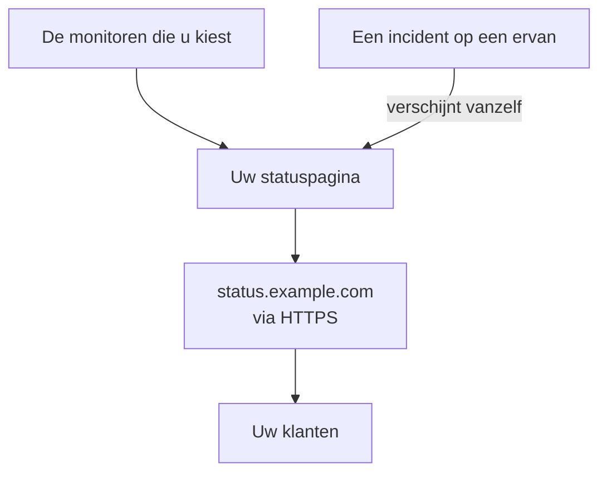

# Een statuspagina publiceren

Aan het einde van deze handleiding openen uw klanten een statuspagina op uw eigen adres, zoals `status.example.com`, via HTTPS. De pagina toont de monitoren die u kiest, met hun status en uptime, en een incident op een ervan verschijnt er vanzelf. De handleiding volgt de begeleide installatie **Publiceer een statuspagina** en voegt daarna uw domein toe op de pagina **Aangepaste domeinen** van de statuspagina: ongeveer 15 minuten, plus de tijd die uw DNS-provider nodig heeft.

## Wat u nodig hebt

- Minstens één monitor: een statuspagina toont monitoren. Is er nog geen, dan biedt de begeleide installatie eerst **Een monitor instellen** aan.
- De rol van projecteigenaar of beheerder: voor de pagina hebt u de machtiging nodig om statuspagina's aan te maken, en voor uw domein de machtiging om domeinen van het project toe te voegen en te verifiëren.
- Een domein dat u beheert, en toegang tot de DNS-records ervan bij uw DNS-provider.

:::tabs
@tab OneUptime Cloud
Een aangepast domein en het gratis SSL-certificaat ervan zitten in elk abonnement. Het Free-abonnement omvat één statuspagina per project: hebt u er al een, open dan de **Aangepaste domeinen** ervan en begin bij de stap die uw domein toevoegt. Een nieuwe statuspagina is openbaar; om haar privé te maken hebt u het Growth-abonnement nodig.
@tab Zelf gehost
Uw server heeft een eigen hostnaam nodig met een A-record dat ernaar wijst, zoals `oneuptime.example.com`, en die antwoordt op de poorten 80 en 443. Stel die in als `STATUS_PAGE_CNAME_RECORD` in `config.env` (`statusPage.cnameRecord` in de Helm-chart), in plaats van de voorbeeldwaarde die er staat. Gratis certificaten hebben ook `LETS_ENCRYPT_ACCOUNT_KEY` (`letsEncrypt.accountKey`) nodig: een privésleutel, gemaakt met openssl en gecodeerd in base64. Herstart OneUptime nadat u ze hebt gewijzigd. **Aangepast domein toevoegen** controleert eerst de server en somt op wat er nog ontbreekt.
:::

## Stappen

:::steps
### De begeleide installatie openen

Ga in uw project naar **Start** en klik in de checklist **Welkom bij OneUptime 👋** op **Publiceer een statuspagina**. Bij een nieuw project stelt de startpagina vooraf de vraag **Wat wil je eerst doen?**: vink **Mijn klanten informeren met een statuspagina** aan en klik op **Doorgaan**. Ontbreekt de stap of is hij al klaar, druk dan op `Ctrl+K` (`Cmd+K` op een Mac), typ `status page` en kies **Publiceer een statuspagina**.

### De pagina een naam geven en kiezen wat ze toont

Behoud onder **Geef de pagina een naam en kies wat ze toont** de voorgestelde **Naam van de statuspagina** of typ een eigen naam. Vink onder **Wat ze toont** de monitoren aan die uw klanten moeten zien, of klik op **Alles selecteren**. Klik op **De statuspagina aanmaken**. Vanaf dit moment is de pagina openbaar via haar link, en toont ze alleen de monitoren die u hebt aangevinkt.

### Bekijken wat uw klanten zien

Open onder **Dit zien uw klanten** het adres onder **Openbare link**: uw monitoren staan er met hun status. Terug in de begeleide installatie klikt u op **Ziet er goed uit**.

### Aangepaste domeinen openen

De begeleide installatie eindigt met een samenvatting. Klik onder **Pas de pagina aan (optioneel)** op **Uw eigen domein**. De pagina **Aangepaste domeinen** van de statuspagina opent.

### Uw domein toevoegen

Klik op **Aangepast domein toevoegen**. Typ bij **Domein** het adres dat uw klanten gaan openen, zoals `status.example.com`, en klik op **Doorgaan**. **DNS-instelling** opent met de records die u moet toevoegen.

### De DNS-records toevoegen

Voeg bij uw DNS-provider elk record toe dat **DNS-instelling** toont, met **Type**, **Naam** en **Waarde**: een CNAME-record dat het adres naar OneUptime laat wijzen en, de eerste keer dat het project dit domein gebruikt, een TXT-record dat laat zien dat het domein van het project is. Zet uw provider het domein zelf achter elke naam, typ dan alleen het deel ervoor, zoals `status`, en `@` voor het domein zelf.

### De records controleren

Laat **DNS-instelling** open en klik op **Nu controleren**. Onder elk record staat wat er is opgezocht en wat er terugkwam. Het TXT-record komt eerst: zolang het niet is gevonden, wordt het domein niet toegevoegd, dus klik opnieuw op **Nu controleren** tot het zover is. Zodra het CNAME-record is gevonden, zegt het dialoogvenster **Uw CNAME-record is geverifieerd.**, en wordt er een gratis SSL-certificaat uitgegeven, meestal binnen 15 minuten.
:::

## Controleren of het gelukt is

- Open uw adres, zoals `https://status.example.com`: uw statuspagina opent zonder certificaatwaarschuwing.
- Op **Aangepaste domeinen** zegt de **Status** van het domein **Certificaat uitgegeven, wordt automatisch verlengd.** Ook als de pagina al opent, kan er nog even **Gratis certificaat wordt uitgegeven, meestal binnen 15 minuten.** staan.
- Op **Start** markeert de checklist **Publiceer een statuspagina** als klaar: de stap is klaar zodra een statuspagina een monitor toont. Was het de laatste stap, dan is de checklist verdwenen.

Meer is niet nodig: OneUptime verlengt het certificaat zelf. Zodra het domein in de lijst staat, controleert OneUptime het CNAME-record ervan elke 15 minuten en verifieert het domein wanneer het record live is, ook als u **DNS-instelling** sluit.

## Wat er mis kan gaan

:::details Het domein staat niet in de lijst na het sluiten van DNS-instelling
**DNS-instelling** werd gesloten voordat het TXT-record was gevonden, dus het domein is nooit toegevoegd. Klik op **Aangepast domein toevoegen**, typ hetzelfde adres, klik op **Doorgaan** en daarna op **Nu controleren** tot het dialoogvenster beide records vindt.
:::

:::details Het domein blijft op "Wachten op DNS" staan
Open **DNS-instelling** vanuit de rij van het domein en klik op **Nu controleren**: daar staat wat er is gevonden. Controleer of de naam van het record het hele adres is, zoals `status.example.com`, en of de waarde ervan de waarde is die **DNS-instelling** toont. Antwoordt de naam met een adres, dan heeft hij een A-record, of leidt uw DNS-provider hem via een proxy: vervang het A-record, of zet de naam op DNS only. Gebruik voor een hoofddomein, zoals `example.com`, het ALIAS-, ANAME- of afgevlakte CNAME-record van uw provider.
:::

:::details De Status zegt dat er geen gratis certificaat kon worden uitgegeven
Een CAA-record op uw domein dat `letsencrypt.org` weglaat, blokkeert het certificaat. Op een zelf gehoste server moet Let's Encrypt de server op poort 80 kunnen bereiken. Los de oorzaak op: OneUptime blijft het zelf proberen, en **Nu controleren** in **DNS-instelling** bestelt opnieuw, hoogstens één keer per 15 minuten per domein.
:::

:::details Zelf gehost: de server is niet klaar voor aangepaste domeinen
**Aangepast domein toevoegen** zegt **Deze server is nog niet klaar voor aangepaste domeinen**, met een regel voor elk ontbrekend punt en wat u moet wijzigen: de instellingen onder [Wat u nodig hebt](#wat-u-nodig-hebt). Zonder `LETS_ENCRYPT_ACCOUNT_KEY` zegt een geverifieerd domein **Geverifieerd. Gebruikt de HTTPS van uw eigen proxy.**: lever de HTTPS ervan via uw eigen proxy. [Statuspagina – branding en domeinen](/docs/status-pages/branding-and-domains#voordat-u-begint) heeft de details.
:::

## Volgende stappen

:::cards
- [Statuspagina – branding en domeinen](/docs/status-pages/branding-and-domains): Uw logo, kleuren, koptekstlinks en footer.
- [Abonnees en aankondigingen](/docs/status-pages/subscribers): Klanten laten abonneren, en aankondigingen plaatsen.
- [Gepland onderhoud](/docs/scheduled-maintenance/index): Klanten over gepland werk informeren voordat het begint.
- [Opgeroepen worden via telefoon, sms of push](/docs/guides/paging): Opgeroepen worden als een van die monitoren uitvalt.
:::
