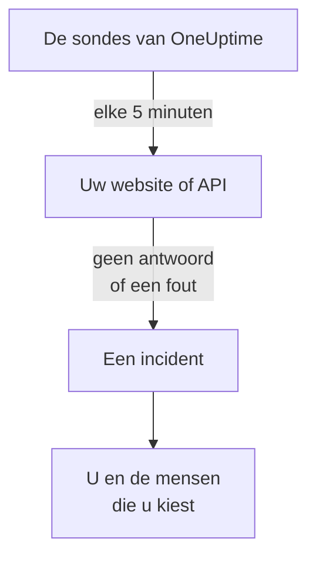

# Weten wanneer uw website of API uitvalt

Aan het einde van deze handleiding controleert OneUptime uw website of API elke 5 minuten. Antwoordt die niet meer of met een fout, dan opent OneUptime een incident en laat u dat weten, en een testoproep die u hebt bevestigd laat zien dat het bericht u bereikt. De handleiding volgt de begeleide installatie **Weten wanneer mijn website of API plat ligt** en duurt ongeveer 5 minuten.

## Wat u nodig hebt

- Een OneUptime-project waarin u monitoren mag maken: een eigenaar, beheerder of lid mag dat. Om een account en een project aan te maken, volgt u het eerste deel van de [Snelstart](/docs/introduction/quickstart#een-project-aanmaken).
- Het adres dat gecontroleerd moet worden, zoals `https://example.com`. Kies voor een API een endpoint dat antwoordt op een gewone `GET` zonder sleutel, zoals een health-check: een antwoord als `401` telt als uitgevallen.

:::tabs
@tab OneUptime Cloud
Sondes in meerdere regio's controleren het adres, dus het moet bereikbaar zijn vanaf het internet. Het Free-abonnement omvat 10 actieve monitoren.
@tab Zelf gehost
Het adres wordt gecontroleerd door de eigen sonde van uw server, dus het moet van daaruit bereikbaar zijn. Om per e-mail bericht te krijgen, moet de server e-mail kunnen versturen: de hoofdbeheerder ervan stelt dat in op `/admin/setup`, zoals de [Handleiding zelf hosten](/docs/installation/self-hosting-guide) laat zien. De hoofdbeheerder wordt geen eigenaar van wat hij aanmaakt, en voegt zichzelf daarom toe op de pagina **Eigenaren** van de monitor om per e-mail bericht te krijgen.
:::

## Stappen

:::steps
### De begeleide installatie openen

Bij een nieuw project stelt de pagina **Start** eerst de vraag **Wat wil je eerst doen?**: vink **Weten wanneer mijn website of API plat ligt** aan en klik op **Doorgaan**. Klik daarna in de checklist **Welkom bij OneUptime 👋** op **Maak je eerste monitor**. Toont de checklist die stap niet, druk dan op `Ctrl+K` (`Cmd+K` op een Mac), typ `website down` en kies **Weten wanneer mijn website of API plat ligt**.

### Het adres invoeren

Typ onder **Wat moeten we controleren?** het adres bij **Adres van de website of API**. Vink voor een API-endpoint **Dit is een API-endpoint** aan. Klik op **Beginnen met controleren**: de sondes controleren het adres meteen, en een zin vertelt wat ze hebben gevonden. Klik op **Doorgaan**.

### Kiezen wie er wordt ingelicht

Wat u onder **Wie moet er op de hoogte worden gesteld?** ziet, hangt af van het project:

- Is er nog geen bereikbaarheidsbeleid of bereikbaarheidsregel, dan staat u al bij **Wie wordt opgeroepen**. Klik op **Teamleden toevoegen** om mensen toe te voegen die al in het project zitten, en klik daarna op **Opslaan en doorgaan**. Zo wordt het beleid `Default on-call policy` aangemaakt, dat al deze mensen oproept bij elk nieuw incident en elke nieuwe waarschuwing in het project.
- Is er al een bereikbaarheidsbeleid of -regel, dan bepalen de eigen regels van het project wie er wordt opgeroepen: klik op **Doorgaan**.
- Bent u lid, dan mag u geen oproepen instellen, en ziet u dat u als eigenaar van de monitor per e-mail bericht krijgt: klik op **Doorgaan**.

### Uzelf een test sturen

Klik onder **Stuur een test** op **Stuur mij een testoproep**. Kies een **Ernst** en klik op **Testoproep sturen**. De test bereikt u zoals een echte oproep dat zou doen, en in elk bericht staat TEST. Er wordt geen incident aangemaakt.

### De testoproep bevestigen

Open de link in de e-mail en bevestig de oproep daar. Een geverifieerd telefoonnummer werkt ook, zodra sms en oproepen voor het project aanstaan: open de link in de sms, of druk tijdens het telefoongesprek op 1. Klik daarna in het dialoogvenster op **Klaar** en op **Doorgaan**.
:::

## Controleren of het gelukt is

- De begeleide installatie eindigt op de samenvatting, gelezen uit de opgeslagen gegevens: **Gecontroleerd**, **Bij een storing**, **Wie wordt ingelicht** en **Getest**.
- Klik op **Monitor openen** en daarna op de kaart **Als dit uitvalt** van de monitor op **Keten tonen**: u ziet de keten van de monitor tot de mensen die hij bereikt, en als niets de keten zou tegenhouden, staat er **Niets houdt de keten tegen.**
- Op **Start** markeert de checklist **Maak je eerste monitor** als klaar zodra de eerste controle binnenkomt. Was het de laatste stap, dan is de checklist verdwenen.

Wilt u later nog een adres instellen, open de begeleide installatie dan opnieuw en klik op **Een ander adres controleren**.

## Wat er mis kan gaan

:::details De eerste controle komt nooit terug
Zegt een zin dat geen enkele locatie het adres controleert, dan heeft de monitor geen sonde; blijft hij zeggen dat er wordt gecontroleerd, dan is de sonde ervan niet verbonden. Open **Monitoren → Instellingen → Sondes** om de status van elke sonde te zien. Op een zelf gehoste server controleert de hoofdbeheerder de sonde van de server op `/admin/setup`. Open daarna de monitor, voeg er een verbonden sonde aan toe en open de begeleide installatie opnieuw.
:::

:::details De site werkt, maar volgens de monitor is hij uitgevallen
De monitor telt geen antwoord, of een antwoord buiten 200 tot en met 399, als uitgevallen. Een firewall die de sondes blokkeert, ziet er voor de monitor uit als geen antwoord: sta bij OneUptime Cloud de adressen op [IP-adressen](/docs/configuration/ip-addresses) toe; sta op een zelf gehoste server de machine toe waarop de sonde draait. Hoe u de regel wijzigt, staat in [Website-monitor](/docs/monitor/website-monitor) of [API-monitor](/docs/monitor/api-monitor).
:::

:::details De testoproep kan niet worden bevestigd
Er is niets aangekomen om de oproep mee te bevestigen. Op een zelf gehoste server betekent dat meestal dat de server nog geen e-mail kan versturen: de stap zegt dat, en de hoofdbeheerder ervan ziet **E-mail instellen**. Stel e-mail in en klik daarna op **Nog een test versturen**, of klik op **De test overslaan** en kom later terug. Sluit na een test het dialoogvenster met **Klaar** en klik op **Ik heb het niet ontvangen**: daar staat wat u moet controleren.
:::

## Volgende stappen

:::cards
- [Opgeroepen worden via telefoon, sms of push](/docs/guides/paging): Op uw telefoon opgeroepen worden, en de volgende persoon oproepen als niemand antwoordt.
- [Een statuspagina publiceren](/docs/guides/status-page): De monitor aan uw klanten laten zien, op uw eigen domein.
- [Criteria en statussen](/docs/monitor/criteria-and-statuses): Precies bepalen wanneer een monitor als uitgevallen telt.
:::
