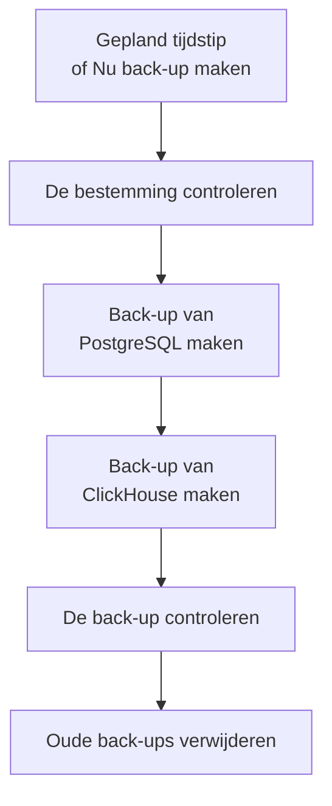

# Back-ups

Maak volgens een schema back-ups van een zelfgehoste OneUptime in opslag die van u is, en zet ze terug vanuit het Admin Dashboard. Een back-up bevat PostgreSQL, met uw projecten, monitors, incidenten, statuspagina's en gebruikers, en ClickHouse, met uw logs, traces en metrics. Back-ups worden zoveel dagen bewaard als u kiest, oudere worden voor u verwijderd, en elke back-up kan ter plekke worden teruggezet. Back-ups horen bij de Enterprise Edition.

:::cards
- [Back-ups instellen](#back-ups-instellen): Kies een bestemming, test die en stel een schema in.
- [Bestemmingen](#bestemmingen): Wat elke aanbevolen bestemming vraagt.
- [Een back-up terugzetten](#een-back-up-terugzetten): Wat er wordt vervangen, en hoe de huidige gegevens veilig blijven.
- [Naar een nieuwe server verhuizen](#naar-een-nieuwe-server-verhuizen): De back-ups van de ene installatie op een andere terugzetten.
:::

## Hoe een back-up werkt



- **Consistent.** PostgreSQL wordt in één transactie gedumpt, dus de dump is de database zoals die op één moment was, terwijl OneUptime blijft draaien. ClickHouse maakt van elke tabel een back-up zoals die was toen het de parts van de tabel las.
- **Rechtstreeks naar de bestemming.** De uitvoer van `pg_dump` wordt tijdens het schrijven naar de opslag gestreamd, en ClickHouse schrijft zijn eigen back-up naar de opslag. Er wordt niets naar de schijf van de server geschreven, hoe groot de gegevens ook zijn.
- **Gecontroleerd.** Voordat de back-up telt, leest `pg_restore` de dump terug van de bestemming, en wordt daar het record gevonden dat ClickHouse van zijn back-up bijhoudt. De SHA-256 van de dump wordt bij de back-up bewaard, en bij het terugzetten wordt die gecontroleerd voordat er iets wordt vervangen. Een back-up die mislukt of wordt geannuleerd, verwijdert wat hij heeft geschreven, zodat de bestemming alleen volledige back-ups bevat.
- **Versleuteld.** Back-ups gaan via HTTPS naar de opslag, tenzij u een `http://`-endpoint invult. Amazon S3, Google Cloud Storage, Azure Blob Storage en Cloudflare R2 versleutelen alles wat ze opslaan; zet bij andere opslag de versleuteling in rust van de bucket aan. De inloggegevens van de bestemming worden versleuteld opgeslagen en nooit meer getoond.
- **Eén tegelijk.** Op de hele installatie draait steeds één back-up of herstelbewerking. De andere wachten op hun beurt.

Elke back-up is een eigen map in de map van de bestemming (`oneuptime/backups/`, tenzij u een andere kiest), genoemd naar het tijdstip waarop hij begon, in UTC:

```text
oneuptime/backups/20261024T020000Z-3f2a9c1b/manifest.json
oneuptime/backups/20261024T020000Z-3f2a9c1b/postgres.dump
oneuptime/backups/20261024T020000Z-3f2a9c1b/clickhouse/
```

`manifest.json` wordt als laatste geschreven: het zegt wat de back-up bevat en welke versie van OneUptime hem heeft gemaakt.

## Voordat u begint

- **De Enterprise Edition**, met een licentie die back-ups omvat. Tijdens de proefperiode en de respijtperiode draaien back-ups. Zonder licentie wordt er geen nieuwe back-up gemaakt, en terugzetten en verwijderen van back-ups blijft werken. Zie [Enterprise Edition](/docs/self-hosted/enterprise).
- **Een hoofdbeheerder.** Back-ups worden ingesteld in het Admin Dashboard.
- **Een bucket of container alleen voor back-ups**, en inloggegevens die erin mogen lezen, schrijven, weergeven en verwijderen.
- **Een bestemming die ook ClickHouse bereikt.** ClickHouse schrijft zijn back-up zelf naar de opslag, dus zijn netwerk moet de opslag bereiken, net als dat van OneUptime.
- **Om PostgreSQL terug te zetten, een databasegebruiker die databases mag maken.** Terugzetten schrijft in een nieuwe database naast de actieve. De PostgreSQL die met OneUptime wordt geleverd, maakt verbinding als superuser, die dat mag.

## Back-ups instellen

:::steps
### De pagina Back-ups openen

Ga in het Admin Dashboard naar **Instellingen → Back-ups** en klik op **Back-ups instellen**.

### Kiezen waar back-ups naartoe gaan

Kies een van de aanbevolen bestemmingen. Wat elke bestemming vraagt, staat bij [Bestemmingen](#bestemmingen).

### De verbinding invullen

Vul in wat de bestemming vraagt. Een map, een regio en de instellingen die de meesten laten zoals ze zijn, wachten onder **Meer velden**, en **Installatiegids** opent de sectie van de bestemming op deze pagina.

### De bestemming testen

Klik op **De bestemming testen**. OneUptime schrijft, leest, toont en verwijdert een klein testbestand, controleert of `pg_dump` een back-up van uw PostgreSQL kan maken, en vraagt ClickHouse een testback-up van de definities van zijn tabellen te schrijven. Er wordt niets opgeslagen, en een controle die mislukt, zegt wat u moet wijzigen.

### Kiezen wanneer back-ups draaien

Kies **Hoe vaak** en de tijd bij **Om (UTC)**, en voor wekelijkse back-ups de **Dag van de week**. **Back-ups bewaren (dagen)** staat op 30, tenzij u het wijzigt. Zet **Ook een back-up van ClickHouse maken** uit om alleen van PostgreSQL een back-up te maken.

### Beginnen met back-ups

Klik op **Beginnen met back-ups**. De eerste back-up draait op het volgende geplande tijdstip, en **Nu back-up maken** start er meteen een.
:::

De pagina laat daarna zien hoe het met de back-ups gaat: wanneer de laatste draaide, hoe groot die was en hoe lang die duurde, en wanneer de volgende draait. Een back-up die bezig is, toont de stap waarin hij zit, en **Stappen bekijken** toont elke stap terwijl die loopt.

## Bestemmingen

| Bestemming | Opslag | Meldt zich aan met |
| --- | --- | --- |
| [Amazon S3](#amazon-s3) | Amazon S3 | Een toegangssleutel |
| [Cloudflare R2](#cloudflare-r2) | S3-compatibele opslag | Een R2-API-token |
| [Backblaze B2](#backblaze-b2) | S3-compatibele opslag | Een applicatiesleutel |
| [Wasabi](#wasabi) | S3-compatibele opslag | Een toegangssleutel |
| [MinIO](#minio) | S3-compatibele opslag | Een toegangssleutel |
| [Google Cloud Storage](#google-cloud-storage) | Google Cloud Storage | Een HMAC-sleutel |
| [Azure Blob Storage](#azure-blob-storage) | Azure Blob Storage | Een SAS-token of een toegangssleutel |
| [Andere S3-compatibele opslag](#andere-s3-compatibele-opslag) | S3-compatibele opslag | Een toegangssleutel |

Een sleutel voor Amazon S3 of andere S3-compatibele opslag heeft `s3:PutObject`, `s3:GetObject`, `s3:ListBucket`, `s3:DeleteObject` en `s3:AbortMultipartUpload` op de map nodig, en verder niets:

```json
{
  "Version": "2012-10-17",
  "Statement": [
    {
      "Effect": "Allow",
      "Action": "s3:ListBucket",
      "Resource": "arn:aws:s3:::my-backups"
    },
    {
      "Effect": "Allow",
      "Action": [
        "s3:PutObject",
        "s3:GetObject",
        "s3:DeleteObject",
        "s3:AbortMultipartUpload"
      ],
      "Resource": "arn:aws:s3:::my-backups/oneuptime/backups/*"
    }
  ]
}
```

### Amazon S3

| Veld | Wat u invult |
| --- | --- |
| **Bucket** | De bucket waarnaar back-ups worden geschreven. Gebruik hem alleen voor back-ups. |
| **Regio** | De regio van de bucket. Die staat in het begin op `us-east-1`. |
| **Toegangssleutel-ID** | Een toegangssleutel met de rechten hierboven. |
| **Geheime toegangssleutel** | Het geheim van de sleutel. |
| **Map** | Onder **Meer velden**. Blijft het leeg, dan gaan back-ups naar `oneuptime/backups/`. |

Amazon S3 versleutelt elk bestand dat het opslaat, en OneUptime vraagt dat (SSE-S3) voor elk bestand dat het schrijft.

### Cloudflare R2

Vul bij **Endpoint** het S3 API-adres van uw account in, `https://<account-id>.r2.cloudflarestorage.com`, uit de instellingen van de bucket in R2. Vul daarna de **Bucket** in, en de **Toegangssleutel-ID** en **Geheime toegangssleutel** van een R2-API-token dat er objecten in mag lezen en schrijven. Back-ups teruglezen uit R2 kost niets.

### Backblaze B2

Vul bij **Endpoint** het S3-endpoint van de bucket in, dat op de Buckets-pagina in Backblaze staat, zoals `https://s3.us-west-004.backblazeb2.com`. Vul daarna de **Bucket** in, en de sleutel-ID en de sleutel van een applicatiesleutel als **Toegangssleutel-ID** en **Geheime toegangssleutel**. De regio wordt uit het endpoint afgeleid.

### Wasabi

Vul bij **Endpoint** de service-URL van de regio van de bucket in, zoals `https://s3.us-east-1.wasabisys.com`, en daarna de **Bucket** en een toegangssleutel. De regio wordt uit het endpoint afgeleid.

### MinIO

Vul bij **Endpoint** het S3 API-adres van uw MinIO-server in, zoals `https://minio.example.com:9000`, en daarna de **Bucket** en een toegangssleutel waarvan het beleid erin mag lezen, schrijven, weergeven en verwijderen. OneUptime en ClickHouse moeten het adres allebei bereiken.

### Google Cloud Storage

Vul de **Bucket** in, en de **HMAC-toegangssleutel** en het **HMAC-geheim** van een serviceaccount met de rol Storage Object Admin op de bucket. Maak de sleutel aan in de instellingen van Cloud Storage, op het tabblad Interoperabiliteit. OneUptime en ClickHouse bereiken de bucket via de S3-compatibele API van Cloud Storage.

### Azure Blob Storage

Vul het **Opslagaccount** en de **Container** in, en kies bij **Aanmelden met** hoe er wordt aangemeld: een **SAS-token** met de rechten Lezen, Toevoegen, Maken, Schrijven, Verwijderen en Weergeven op de container, of een **Toegangssleutel** van het opslagaccount. Een SAS-token kan tot de container worden beperkt en is daarom de veiligere keuze. **Cloud** en **Map** wachten onder **Meer velden**.

### Andere S3-compatibele opslag

Voor Ceph, DigitalOcean Spaces, Hetzner Object Storage en elke opslag met een S3 API vult u het S3-adres in bij **Endpoint**, en daarna de **Bucket** en een toegangssleutel. **Regio**, onder **Meer velden**, is alleen nodig als de opslag erom vraagt. Blijft het leeg, dan wordt de regio uit het endpoint afgeleid, of is die `us-east-1`.

## Schema en bewaartermijn

| Instelling | Wat het doet |
| --- | --- |
| **Hoe vaak** | **Elk uur**, **Elke 6 uur**, **Elke 12 uur**, **Elke dag** of **Elke week**. Elke dag past bij de meeste installaties. |
| **Om (UTC)** | Het uur waarop back-ups beginnen, in UTC, met uw eigen tijd ernaast. Elke 6 of 12 uur telt vanaf dat uur: bij `02:00` draaien back-ups elke 6 uur om 02:00, 08:00, 14:00 en 20:00. Back-ups elk uur draaien op het hele uur. |
| **Dag van de week** | De dag waarop wekelijkse back-ups draaien. |
| **Back-ups bewaren (dagen)** | Van 1 tot 3650 dagen. 30, tenzij u het wijzigt. |
| **Ook een back-up van ClickHouse maken** | Aan, tenzij u het uitzet. Van PostgreSQL wordt altijd een back-up gemaakt. |

Na elke back-up worden de back-ups die meer dan **Back-ups bewaren (dagen)** geleden begonnen, verwijderd, op de bestemming en uit de lijst, behalve de nieuwste geslaagde back-up, die wordt bewaard hoe oud die ook is. Back-ups uitzetten, of een licentie die verloopt, laat u dus nooit zonder back-up om terug te zetten.

**Geplande back-ups uitschakelen**, in het menu van de statuskaart, stopt het schema. **Nu back-up maken** werkt nog steeds, en er wordt geen back-up verwijderd. **Inschakelen** start het schema weer.

## Een back-up terugzetten

:::warning Wat terugzetten vervangt
Terugzetten vervangt de huidige gegevens door die van de back-up. Alles wat sinds de back-up is gewijzigd, gaat verloren, tenzij u eerst een back-up van de huidige gegevens maakt.
:::

:::steps
### De back-up kiezen

Klik in de tabel **Back-ups** op **Terugzetten** bij de back-up waarnaar u terug wilt. OneUptime controleert de back-up eerst: of de bestanden op de bestemming staan en ongewijzigd zijn, welke versie van OneUptime hem heeft gemaakt, en of deze server hem kan terugzetten.

### Kiezen wat wordt teruggezet

Vink **PostgreSQL: projecten, monitors, incidenten, gebruikers**, **ClickHouse: logboeken, traces en metrics** of beide aan. Het dialoogvenster toont hoeveel projecten, gebruikers en monitors de back-up bevat, en hoeveel er nu zijn.

### De huidige gegevens veilig houden

**Eerst een back-up van de huidige gegevens maken** is aangevinkt: het terugzetten begint met een back-up van de gegevens die het vervangt, zodat u ernaar terug kunt. Vink het alleen uit als u een andere kopie hebt, want zonder die kopie kan het terugzetten niet ongedaan worden gemaakt.

### Bevestigen

Typ `restore` en klik op **Terugzetten**.
:::

Terugzetten gebeurt stap voor stap, en de pagina toont elke stap:

| Stap | Wat er gebeurt |
| --- | --- |
| **De back-up controleren** | De bestanden van de back-up zijn er, en deze installatie kan hem terugzetten. |
| **Back-up van de huidige gegevens maken** | Een back-up van de huidige gegevens, tenzij u het hebt uitgevinkt. |
| **PostgreSQL terugzetten** | De back-up wordt teruggezet in een nieuwe database naast de actieve, en gecontroleerd. |
| **ClickHouse terugzetten** | De actieve telemetrie wordt opzijgezet, en die van de back-up wordt op haar plaats teruggezet. |
| **Overschakelen naar de teruggezette gegevens** | De teruggezette database neemt in een moment de naam van de actieve over. |
| **De teruggezette gegevens bijwerken** | De databasemigraties van deze versie draaien op de teruggezette gegevens. |
| **Opruimen** | Wat opzij was gezet, wordt verwijderd. |

OneUptime blijft tot de omschakeling draaien op de huidige gegevens, en niets wat het gebruikt verandert daarvoor. Terugzetten dat mislukt of wordt geannuleerd vóór de omschakeling, laat alles zoals het was, en terugzetten dat tijdens de omschakeling mislukt, zet terug wat het opzij had gezet. Telemetrie die binnenkomt terwijl ClickHouse wordt teruggezet, wordt niet opgeslagen. Nadat PostgreSQL is teruggezet, wordt u mogelijk afgemeld: meld u aan met een account dat in de back-up staat.

:::details Het terugzetten meldt dat de back-up met een andere ENCRYPTION_SECRET is gemaakt
De inloggegevens die OneUptime opslaat, zoals de sleutel van een bestemming, zijn versleuteld met `ENCRYPTION_SECRET`. Stel vóór het terugzetten de `ENCRYPTION_SECRET` in waarmee de back-up is gemaakt, anders kunnen die inloggegevens daarna niet worden gelezen.
:::

## Naar een nieuwe server verhuizen

:::steps
### OneUptime op de nieuwe server installeren

Installeer de Enterprise Edition, in de versie die de back-ups heeft gemaakt of een nieuwere.

### Dezelfde bestemming instellen

Stel in **Instellingen → Back-ups** de bestemming in waarin uw back-ups staan. De pagina vindt de back-ups die er al staan en toont ze, klaar om terug te zetten. **Back-ups zoeken**, in het menu van de statuskaart, zoekt opnieuw.

### De nieuwste back-up terugzetten

Zet hem terug zoals hierboven. Een back-up die een oudere versie van OneUptime heeft gemaakt, wordt naar deze versie gebracht. Een back-up die een nieuwere versie heeft gemaakt, kan worden teruggezet zodra u hebt bijgewerkt.
:::

## Als een back-up mislukt

De statuskaart toont **De laatste back-up is mislukt**, met de fout, en **Stappen bekijken** toont de stap waarop hij stopte en waarom. Elke hoofdbeheerder krijgt ook een e-mail, hoogstens eens per 12 uur zolang back-ups blijven mislukken. Terugzetten dat mislukt, wordt altijd gemaild.

## Problemen oplossen

:::details ClickHouse bereikt de bestemming niet
ClickHouse maakt zelf verbinding met de opslag. Laat zijn netwerk het adres van de bestemming bereiken, net als dat van OneUptime, en test de bestemming daarna opnieuw.
:::

:::details pg_dump ontbreekt of is te oud
De Enterprise-image bevat `pg_dump` en `pg_restore` 16, 17 en 18, die back-ups maken van PostgreSQL 18 en elke eerdere versie. Installeer op een andere image de PostgreSQL-clienttools, of stel `BACKUP_POSTGRES_BIN_DIR` in op de map waarin ze staan. `pg_dump` moet minstens zo nieuw zijn als uw PostgreSQL-server.
:::

:::details Terugzetten van PostgreSQL vereist één wijziging
Terugzetten maakt een database, wat de databasegebruiker van OneUptime moet mogen. Voer dit als superuser uit op PostgreSQL, met uw `DATABASE_USERNAME` in plaats van `oneuptime`, en zet daarna opnieuw terug:

```sql
ALTER USER oneuptime CREATEDB;
```
:::

:::details Een back-up staat op een vorige bestemming
Nadat u de bestemming hebt gewijzigd, blijven de back-ups die op de oude zijn gemaakt in de lijst staan, gemarkeerd als **Op een vorige bestemming**. Stel die bestemming opnieuw in om er een terug te zetten, of verwijder hem uit de lijst: de bestanden blijven waar ze zijn.
:::

## Volgende stappen

:::cards
- [Enterprise Edition](/docs/self-hosted/enterprise): Licenties, en wat de Enterprise Edition toevoegt.
- [Upgraden](/docs/installation/upgrading): Maak een back-up vóór elke upgrade.
- [Docker Compose](/docs/installation/docker-compose): OneUptime op één server draaien.
:::
