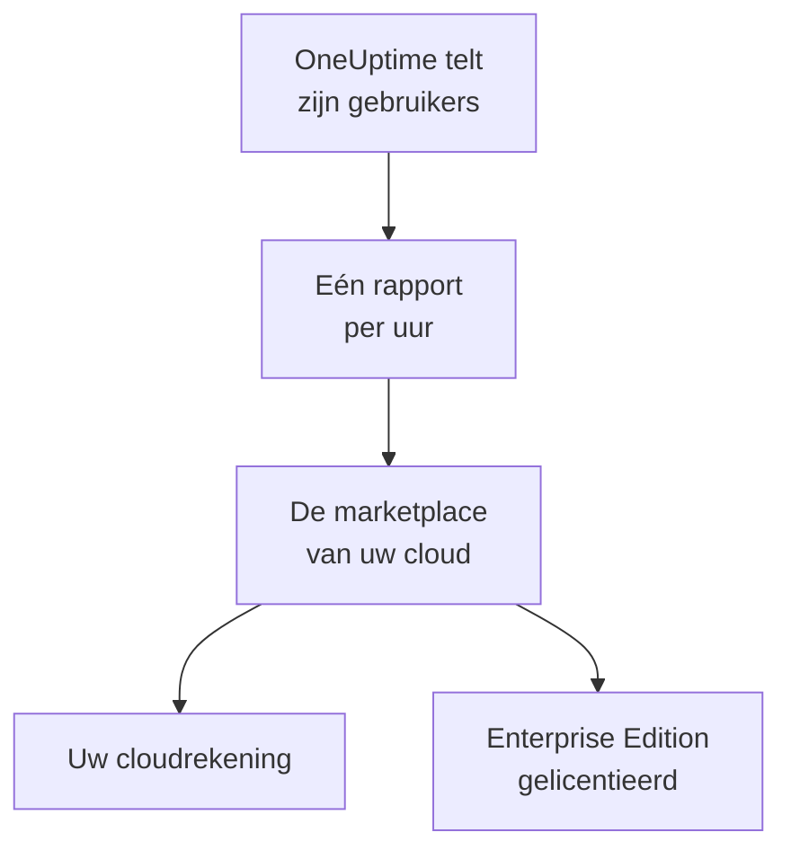

# Cloudmarktplaatsen

Draai OneUptime Enterprise, gekocht via AWS Marketplace, Microsoft Marketplace of Google Cloud Marketplace, in uw eigen Kubernetes-cluster. De marketplace rekent elke gebruiker van uw installatie per uur af via uw cloudrekening, en uw abonnement levert de licentie voor de Enterprise Edition: er is geen licentiesleutel die u hoeft te activeren.

:::cards
- [OneUptime installeren](#oneuptime-installeren): Op Amazon EKS, Azure Kubernetes Service of Google Kubernetes Engine.
- [Hoe de facturering werkt](#hoe-de-facturering-werkt): USD 0.10 per gebruiker per uur, elk uur gerapporteerd.
- [Upgraden](#upgraden): Hoe een nieuwe release uw cluster bereikt.
- [Problemen oplossen](#problemen-oplossen): Als het editielabel een waarschuwing over de marketplace toont.
:::

## Hoe het werkt

OneUptime telt zijn gebruikers elke 15 minuten en stuurt de marketplace waar u het hebt gekocht één rapport per uur, met het hoogste aantal gebruikers dat het in dat uur zag. De marketplace zet dat uur op uw cloudrekening. Elk rapport dat de marketplace accepteert, laat OneUptime ook weten dat uw abonnement actief is, en daardoor blijft de Enterprise Edition gelicentieerd.



| | AWS | Microsoft | Google Cloud |
| --- | --- | --- | --- |
| Vermelding | Nog niet openbaar: [neem contact op](https://oneuptime.com/enterprise/demo) | [OneUptime Enterprise](https://marketplace.microsoft.com/en-us/product/oneupitme.oneuptime-enterprise) | Nog niet openbaar: [neem contact op](https://oneuptime.com/enterprise/demo) |
| Draait op | Amazon EKS | Azure Kubernetes Service (AKS) | Google Kubernetes Engine (GKE) |
| U installeert het met | Helm, vanuit het register van de vermelding | De Azure-portal | De Google Cloud-console |
| OneUptime rapporteert met | De IAM-rol van zijn Kubernetes-serviceaccount | De beheerde identiteit die Azure de installatie geeft | Het rapportagegeheim dat Google Cloud Marketplace voor de implementatie aanmaakt |
| Nieuwe releases | U upgradet met Helm | Minor releases worden voor u geïnstalleerd | U upgradet met de hand |

## Voordat u begint

- **Een Kubernetes-cluster** in de cloud van de marketplace, met minstens 3 nodes van elk 4 vCPU's en 16 GiB geheugen, een standaard-StorageClass en ondersteuning voor services van het type `LoadBalancer`. OneUptime draait zijn eigen PostgreSQL, ClickHouse en Valkey in het cluster; dimensioneer die met [Sizing en capaciteitsplanning](/docs/installation/sizing).
- **Een domeinnaam** voor OneUptime, zoals `oneuptime.example.com`, die u naar de load balancer van het cluster kunt laten wijzen.
- **Uitgaand HTTPS** van het cluster naar de marketplace, zodat OneUptime zijn gebruikersaantal kan rapporteren: `metering.marketplace.<region>.amazonaws.com` en `sts.<region>.amazonaws.com` op AWS, `marketplaceapi.microsoft.com` op Azure, `servicecontrol.googleapis.com` en `oauth2.googleapis.com` op Google Cloud.

## OneUptime installeren

### AWS Marketplace

Op AWS rapporteert OneUptime zijn gebruikersaantal met een IAM-rol die EKS aan zijn Kubernetes-serviceaccount geeft (IAM-rollen voor serviceaccounts). AWS Marketplace accepteert gebruik vanuit EKS alleen als het op deze manier is ondertekend.

:::steps
1. Neem op AWS Marketplace een abonnement op OneUptime Enterprise, kies daarna **Continue to Configuration**, selecteer de versie en kies **Continue to Launch**.
2. Geef het cluster een IAM OIDC-provider als het er nog geen heeft, en maak met de commando's hieronder het serviceaccount `oneuptime` aan met een IAM-rol die het beleid `AWSMarketplaceMeteringFullAccess` heeft. Voer ze uit in plaats van het commando `eksctl` in stap 1 van de **General launch instructions** op de lanceerpagina: dat commando koppelt een rol die u eerst zelf zou moeten aanmaken.
3. Meld Helm aan bij het register van de vermelding en installeer de chart met de commando's in stap 2 van de **General launch instructions**. Zet in het commando `helm install` de waarde `serviceAccount.name` op `oneuptime`, `host` op uw domeinnaam en `httpProtocol` op `https` als er een certificaat vóór OneUptime staat.
4. Ga verder bij [OneUptime openen](#oneuptime-openen).
:::

```bash
eksctl utils associate-iam-oidc-provider --cluster <cluster> --approve
eksctl create iamserviceaccount --name oneuptime --namespace oneuptime --cluster <cluster> \
  --attach-policy-arn arn:aws:iam::aws:policy/AWSMarketplaceMeteringFullAccess \
  --approve --override-existing-serviceaccounts
```

Bewaar de waarden van stap 3 in een bestand en geef het mee aan elke `helm upgrade`:

```yaml title="values.yaml"
host: oneuptime.example.com
httpProtocol: https
serviceAccount:
  name: oneuptime
```

### Microsoft Marketplace

Op Azure is OneUptime een Kubernetes-toepassing: AKS installeert het als clusterextensie en geeft het de beheerde identiteit waarmee het zijn gebruikersaantal rapporteert.

:::steps
1. Open OneUptime Enterprise op Microsoft Marketplace in de Azure-portal, of open uw AKS-cluster en selecteer **Extensions + applications** > **Add**; kies daarna het plan en selecteer **Create**.
2. Kies het abonnement en de resourcegroep, en of u op een bestaand AKS-cluster installeert of een nieuw cluster aanmaakt.
3. Voer bij de stap **OneUptime** een naam voor de installatie in, plus uw domeinnaam en het bijbehorende protocol.
4. Selecteer **Review + create** en daarna **Create**. De installatie duurt enkele minuten en is klaar wanneer **Extensions + applications** de inrichtingsstatus ervan als **Succeeded** toont.
5. Ga verder bij [OneUptime openen](#oneuptime-openen).
:::

Aangepaste meters werken op AKS-clusters, niet op Kubernetes met Azure Arc, dus OneUptime Enterprise van Microsoft Marketplace is alleen op AKS te installeren.

### Google Cloud Marketplace

Op Google Cloud draait Marketplace een deployer die OneUptime installeert in de namespace die u kiest, samen met een rapportagegeheim waarmee OneUptime zijn gebruikersaantal rapporteert.

:::steps
1. Open OneUptime Enterprise op Google Cloud Marketplace in de Google Cloud-console en selecteer **Configure**.
2. Kies het GKE-cluster en de namespace, en voer een naam voor de installatie in, plus uw domeinnaam en het bijbehorende protocol.
3. Selecteer **Deploy**. De implementatie duurt enkele minuten en is klaar wanneer de toepassing onder **Kubernetes Engine** > **Applications** als gereed wordt getoond.
4. Ga verder bij [OneUptime openen](#oneuptime-openen).
:::

## OneUptime openen

OneUptime begint met het migreren van zijn database, wat bij een nieuwe installatie enkele minuten duurt. Laat daarna uw domeinnaam naar de load balancer ervan wijzen:

```bash
kubectl get service --namespace <namespace>
```

De service waarvan de naam eindigt op `-nginx` heeft een `EXTERNAL-IP`: maak voor uw domeinnaam een DNS-record aan dat daarnaar wijst. Open de domeinnaam en registreer u. Het eerste account van een nieuwe installatie wordt de hoofdbeheerder ervan, die het Admin-dashboard op `/admin` kan openen.

Binnen het uur toont het editielabel de Enterprise Edition, gelicentieerd via uw marketplace. Hoofdbeheerders zien het editielabel in de kop van het Admin-dashboard en in de voettekst van het Dashboard.

## Hoe de facturering werkt

| Wat | Hoe het werkt |
| --- | --- |
| Prijs | USD 0.10 per gebruiker per uur, ongeveer USD 73 per gebruiker per maand. |
| Wie telt mee | Iedereen met een OneUptime-account op de installatie. Abonnees van statuspagina's en de mensen die zich aanmelden bij een privé-statuspagina tellen niet mee. |
| Wanneer | OneUptime telt zijn gebruikers elke 15 minuten en stuurt één rapport per uur, met het hoogste aantal gebruikers dat het in dat uur zag. Een uur waarin OneUptime niet draaide, wordt niet gefactureerd. |
| Waar | Op uw rekening van AWS, Azure of Google Cloud, via de marketplace. |
| Niet inbegrepen | Het cluster zelf: uw cloud factureert de nodes, schijven en load balancers ervan zoals gewoonlijk. |

Elke installatie wordt afzonderlijk gefactureerd, dus een staging-installatie ook. Vraag voor jaarprijzen, volumekortingen of een prijs voor niet-productie-installaties bij [sales@oneuptime.com](mailto:sales@oneuptime.com) een privéaanbieding aan, die u op de marketplace accepteert.

Als een rapport niet kan worden verstuurd, door een netwerkprobleem of een storing bij de marketplace, verstuurt OneUptime het bij de volgende ronde opnieuw. Elk rapport bevat een sleutel voor zijn uur, dus een uur wordt nooit twee keer gefactureerd.

## Hoe licenties werken

Uw marketplace-abonnement is uw licentie. Elk rapport dat de marketplace accepteert, geeft voor de komende 72 uur een licentie op elke enterprisefunctie, voor elke gebruiker. Een licentiesleutel van OneUptime werkt ook op dezelfde installatie: de installatie draait op de betere van de twee.

| Wat er gebeurt | Wat het editielabel toont |
| --- | --- |
| De marketplace accepteert de rapporten van elk uur | De Enterprise Edition, gelicentieerd via uw marketplace. |
| Er is al 72 uur geen rapport geaccepteerd | **Enterprise Edition (Marketplace Reports Failing)**: elke enterprisefunctie blijft werken tijdens een respijtperiode van 30 dagen. |
| De marketplace meldt dat de installatie geen abonnement heeft, of de respijtperiode eindigt | **Enterprise Edition (Marketplace Subscription Ended)**: de enterprisefuncties stoppen, net als wanneer een [licentie verloopt](/docs/self-hosted/enterprise#als-een-licentie-verloopt-of-ontbreekt). |

De marketplace weigert een opgezegd of opgeschort abonnement, of een andere installatie dan die u hebt gekocht. Monitoring, alerts, incidenten, piketdienst en statuspagina's blijven in alle gevallen werken, en er wordt niets verwijderd. Neem opnieuw een abonnement, en het volgende geaccepteerde rapport geeft de Enterprise Edition weer een licentie, zonder herstart.

## Upgraden

| Marketplace | Hoe een nieuwe release uw cluster bereikt |
| --- | --- |
| AWS Marketplace | Elke release is een nieuwe versie van de vermelding. Voer `helm upgrade` uit met de chart uit het register van de vermelding, de nieuwe versie en uw waardenbestand. |
| Microsoft Marketplace | AKS installeert nieuwe minor- en patchreleases voor u. Een nieuwe hoofdversie wacht tot u die accepteert. U kunt automatische upgrades uitzetten op de pagina van de installatie in **Extensions + applications**. |
| Google Cloud Marketplace | Google Cloud Marketplace houdt een implementatie op de versie die het heeft geïnstalleerd, en werkt die nooit bij. Neem contact op met [support](https://oneuptime.com/support) voordat u een implementatie naar een nieuwe versie overzet. |

OneUptime migreert zijn database wanneer de nieuwe release start. Lees de [upgradenotities](/docs/installation/upgrading) voordat u overstapt op een nieuwe hoofdversie.

Upgrade via de marketplace. Een marketplace-installatie vergelijkt zich niet met de OneUptime-releases op GitHub: de versies die uw marketplace aanbiedt, zijn de versies om naar te upgraden.

## Instellingen en schalen

Uw rekening verandert niet met de schaal: OneUptime wordt per gebruiker gefactureerd. Meer replica's of grotere nodes veranderen alleen wat uw cloud voor het cluster factureert.

| Marketplace | Waar uw instellingen staan |
| --- | --- |
| AWS Marketplace | Uw waardenbestand. Elke instelling van de [Helm-chart](https://artifacthub.io/packages/helm/oneuptime/oneuptime) werkt, behalve de meegeleverde operators. |
| Microsoft Marketplace | De configuratie-instellingen van de installatie, op de pagina ervan in **Extensions + applications** of met `az k8s-extension update --configuration-settings`. Elke instelling is een chartwaarde, zoals `autoscaling.enabled=true`. |
| Google Cloud Marketplace | De velden van het implementatieformulier. Wijzig al het andere met `kubectl`, op de eigen resources van de implementatie. |

- **Schaal OneUptime** met de replica- en autoscaling-instellingen van de chart (`deployment.replicaCount`, `autoscaling.enabled` en de eigen overschrijvingen van elke service), en de nodes met de autoscaler van uw cluster.
- **Laat de marketplace-instellingen staan zoals de vermelding ze instelt**: `enterpriseMarketplace` en, op AWS, `serviceAccount`. Zonder die instellingen kan OneUptime niet rapporteren, en is de Enterprise Edition niet gelicentieerd.
- **De operators KEDA, CloudNativePG en Altinity ClickHouse zijn niet inbegrepen**, omdat een marketplace alleen de images op zijn eigen vermelding levert. Laat OneUptime voor gegevensopslagen met hoge beschikbaarheid naar beheerde services wijzen met `externalPostgres`, `externalRedis` en `externalClickhouse`.

De facturering hangt niet af van het aantal replica's dat draait: er rapporteert steeds maar één ronde tegelijk, en elk uur heeft één rapport.

## Problemen oplossen

:::details Het editielabel toont Enterprise Edition (Marketplace Reports Failing)
OneUptime kan niet aan de marketplace rapporteren. Elke regel die het daarover logt, begint met `OneUptime Enterprise marketplace billing`; een regel die zegt dat het gebruik "cannot be reported", noemt wat er ontbreekt. De gebruikelijke oorzaken:

- **AWS:** het serviceaccount `oneuptime` heeft geen IAM-rol, of de rol heeft het beleid `AWSMarketplaceMeteringFullAccess` niet (`AWSMarketplaceMeteringRegisterUsage` is niet genoeg). Koppel het beleid aan de rol, of maak de rol aan met het commando `eksctl` onder [AWS Marketplace](#aws-marketplace) en herstart daarna de pods van OneUptime met `kubectl rollout restart deployment --namespace oneuptime`.
- **Azure:** de installatie is niet de toepassing van Microsoft Marketplace, bijvoorbeeld omdat ze met Helm is geïnstalleerd, dus ze heeft geen identiteit of plan om mee te rapporteren. Installeer haar vanuit de Azure-portal.
- **Google Cloud:** het rapportagegeheim van de implementatie is verwijderd of vervangen.
- **Elke marketplace:** een firewall of proxy blokkeert het uitgaande HTTPS dat onder [Voordat u begint](#voordat-u-begint) staat.

Het gebruik wordt bewaard terwijl u het probleem oplost, en gefactureerd zodra OneUptime weer kan rapporteren. Gebruik dat ouder is dan 30 dagen, wordt niet gefactureerd.
:::

:::details Het editielabel toont Enterprise Edition (Marketplace Subscription Ended)
De marketplace heeft de installatie geweigerd: het abonnement is opgezegd of opgeschort, of de installatie is niet de installatie die op de marketplace is gekocht. Controleer het abonnement op de marketplace en neem opnieuw een abonnement; het volgende geaccepteerde rapport geeft de Enterprise Edition weer een licentie. Hetzelfde label verschijnt wanneer de rapporten de hele respijtperiode bleven mislukken.
:::

:::details De pods blijven na de installatie op Pending staan
De databases van OneUptime hebben persistente volumes nodig. Geef het cluster een standaard-StorageClass: installeer op Amazon EKS de add-on voor de Amazon EBS CSI-driver.
:::

## Volgende stappen

:::cards
- [Enterprise Edition](/docs/self-hosted/enterprise): Wat de Enterprise Edition toevoegt, en wat stopt als een licentie verloopt.
- [Upgraden](/docs/installation/upgrading): De upgradenotities van elke release.
- [Sizing en capaciteitsplanning](/docs/installation/sizing): Dimensioneer de gegevensopslagen voor uw telemetrie.
- [Architectuur](/docs/self-hosted/architecture): Wat er in uw cluster draait.
- [Kubernetes-agent](/docs/telemetry/kubernetes-agent#installeren-als-amazon-eks-add-on): Ook gratis op AWS Marketplace, als Amazon EKS-add-on, voor clusters die gegevens naar OneUptime sturen.
:::
