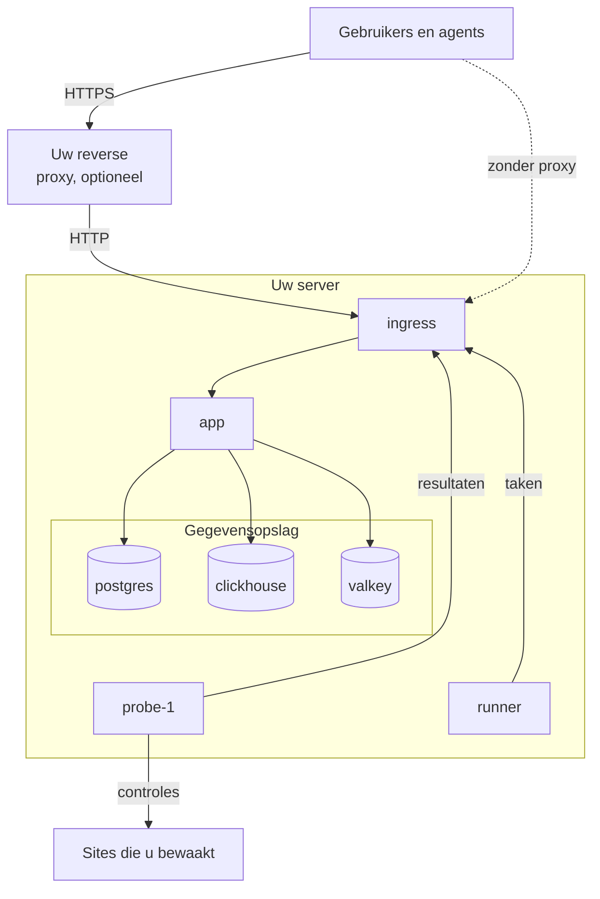

# Docker Compose

Draai een volledige, gratis OneUptime-instantie op één Linux-server met Docker Compose. Deze pagina brengt u van een nieuwe server naar een draaiende instantie en behandelt daarna HTTPS, het beveiligen voor productie, back-ups, updates en verwijderen. Wilt u in plaats daarvan aan de code van OneUptime zelf werken, zie dan [Lokale ontwikkeling](/docs/installation/local-development).

:::cards
- [OneUptime installeren](#oneuptime-installeren): Van een nieuwe server naar uw eerste account in vijf stappen.
- [HTTPS instellen](#https-instellen): Laat OneUptime een certificaat halen, of zet uw eigen proxy ervoor.
- [Checklist voor productie](#checklist-voor-productie): Wat geregeld moet zijn voordat er echt verkeer binnenkomt.
- [OneUptime bijwerken](#oneuptime-bijwerken): Overstappen op de nieuwste release.
:::

## Hoe het werkt

Docker Compose draait elk onderdeel van OneUptime als container op uw server. Al het verkeer komt binnen via de container `ingress`, die het naar de `app` doorstuurt. De app bewaart zijn gegevens in PostgreSQL, ClickHouse en Valkey. Een meegeleverde probe voert de controles van uw monitors uit en meldt de resultaten terug via de ingress.



| Service | Image | Wat hij doet |
| --- | --- | --- |
| `ingress` | `oneuptime/nginx` | Ontvangt al het verkeer op poort 80 en 443 en stuurt het door naar de app. Levert HTTPS als OneUptime het certificaat beheert. |
| `app` | `oneuptime/app` | Het dashboard, de API, statuspagina's, de opname van telemetrie en de achtergrondworkers. |
| `probe-1` | `oneuptime/probe` | Een globale probe die de controles van uw monitors uitvoert. Hij gebruikt het netwerk van de host. |
| `runner` | `oneuptime/runner` | De Runner van de instantie, die AI-codecorrecties uitvoert. Hij gebruikt het netwerk van de host. |
| `postgres` | `postgres:15` | Configuratie en status: monitors, incidenten, gebruikers. Opgeslagen in het volume `postgres`. |
| `clickhouse` | `clickhouse/clickhouse-server:26.7` | Telemetrie: logs, metrics, traces en exceptions. Opgeslagen in het volume `clickhouse`. |
| `valkey` | `valkey/valkey:9.1-alpine` | Cache en wachtrijen. Hij bewaart niets op schijf. |

> [!NOTE]
> De service `valkey` draait [Valkey](https://valkey.io), de BSD-gelicentieerde fork van Redis 7.2, geconfigureerd via de instellingen `VALKEY_*` in `config.env`. Elke server die het Redis-protocol spreekt, werkt — wijs `VALKEY_HOST` naar een beheerde Redis als u dat liever hebt. Tot 13.0.0 heetten deze instellingen `REDIS_*`; de oude namen worden nog steeds gelezen, de container luistert nog steeds naar de hostnaam `redis`, en `npm run update` herschrijft ze niet, dus een oudere `config.env` hoeft niet te worden aangepast.

Gebruik voor productie op grote schaal, of als u hoge beschikbaarheid nodig hebt, in plaats daarvan de [Helm-chart](https://artifacthub.io/packages/helm/oneuptime/oneuptime) op Kubernetes: Docker Compose draait van elke service één exemplaar op één server.

## Vereisten

Kies de grootte van de server op basis van wat u erop gaat draaien. Telemetrie (logs, metrics, traces) bepaalt het geheugen en de schijf; zie [Sizing en capaciteitsplanning](/docs/installation/sizing) zodra u uw volumes kent.

| | Aanbevolen | Minimum voor een homelab |
| --- | --- | --- |
| **Geheugen** | 16 GB | 8 GB |
| **CPU** | 8 cores | 4 cores |
| **Schijf** | 400 GB | 20 GB |
| **Systeem** | Ubuntu 22.04, of een ander Linux op basis van Debian, Ubuntu of RHEL | Hetzelfde |
| **Architectuur** | x86-64 (`amd64`) of ARM (`arm64`) | Hetzelfde |

Het minimum voor een homelab is geschikt voor persoonlijk en experimenteel gebruik — sommigen draaien OneUptime op een Raspberry Pi.

U hebt ook nodig:

- **Docker** met de plugin **Docker Compose v2** (het commando `docker compose`).
- **Git**, om OneUptime op te halen.
- **Node.js en npm**, die de scripts `npm start` en `npm run update` uitvoeren die om Docker Compose heen zijn gebouwd.
- **Poorten 80 en 443** vrij op de server. De tabel hieronder toont elke poort die OneUptime op de host gebruikt.

| Hostpoort | Gebruikt door | Instelling | Waarvoor |
| --- | --- | --- | --- |
| 80 | `ingress` | `ONEUPTIME_HTTP_PORT` | Het dashboard, de API, de opname van telemetrie en de validatie door Let's Encrypt. |
| 443 | `ingress` | `STATUS_PAGE_HTTPS_PORT` | HTTPS voor uw instantie als OneUptime het certificaat beheert, en voor statuspagina's en dashboards op eigen domeinen. |
| 5400 | `postgres` | Ingesteld in `docker-compose.yml` | Laat `npm run backup` en `restore.sh` PostgreSQL bereiken vanaf de server zelf. Hij is alleen op `127.0.0.1` gepubliceerd. |
| 3874 | `probe-1` | `GLOBAL_PROBE_1_PORT` | De eigen server van de probe. Niets buiten de server heeft hem nodig. |
| 3876 | `runner` | `ONEUPTIME_RUNNER_PORT` | De eigen server van de Runner. Niets buiten de server heeft hem nodig. |

Er is ook een [video-uitleg](https://youtu.be/j1SWmMW2oL4) van de installatie.

## OneUptime installeren

Op een nieuwe Ubuntu-, Debian- of op RHEL gebaseerde server kan één commando de stappen hieronder voor u uitvoeren. Het installeert Docker, Git en Node.js waar ze ontbreken, kloont de release-branch naar een map `oneuptime`, vraagt naar het adres dat mensen gaan gebruiken en voert `npm start` uit:

```bash
curl -fsSL https://oneuptime.com/install.sh | bash
```

:::steps
### Kloon de release-branch

De branch `release` bevat de bestanden van de nieuwste release.

```bash
git clone --depth 1 --single-branch --branch release https://github.com/OneUptime/oneuptime.git
cd oneuptime
```

### Maak config.env aan

Alle instellingen van OneUptime staan in `config.env`. Begin met het voorbeeld:

```bash
cp config.example.env config.env
```

### Stel de hostnaam in

Open `config.env` en stel `HOST` in op de domeinnaam of het IP-adres waarmee mensen OneUptime bereiken, zonder `http://`. Houd `localhost` alleen aan om OneUptime op uw eigen computer uit te proberen.

```ini title="config.env"
HOST=oneuptime.example.com
```

### Start OneUptime

:::tabs
@tab npm
```bash
npm start
```
@tab Docker CLI
```bash
(export $(grep -v '^#' config.env | xargs) && docker compose up --remove-orphans -d)
```
Vervang vóór de eerste start zelf de tijdelijke geheimen, zoals [Genereer willekeurige geheimen](#genereer-willekeurige-geheimen) laat zien: alleen `npm start` doet dat voor u.
:::

`npm start` controleert eerst de server: Docker, het geheugen, de schijfruimte, de poorten die OneUptime gebruikt en `HOST`. Het stopt bij alles wat OneUptime zou verhinderen te werken, en zegt wat u moet wijzigen. Daarna geeft het elk tijdelijk geheim in `config.env` een eigen willekeurige waarde, start OneUptime en wacht tot elk onderdeel antwoordt. De eerste start duurt enkele minuten, terwijl Docker de images downloadt en OneUptime zijn databases aanmaakt. Het eindigt met **OneUptime is up!** en het adres om te openen.

### Maak het eerste account aan

Open `http://` gevolgd door uw `HOST` (bijvoorbeeld `http://localhost`) en registreer u. Het eerste account van een nieuwe instantie wordt de hoofdbeheerder ervan, die het Admin Dashboard op `/admin` kan openen.

Iedereen die de pagina kan bereiken, kan zich na u registreren. Om dat te voorkomen, opent u het Admin Dashboard, gaat u naar **Instellingen > Authenticatie** en schakelt u **Registratie toestaan** uit. Mensen die u voor een project uitnodigt, kunnen nog steeds hun account aanmaken.
:::

### Genereer willekeurige geheimen

`config.example.env` levert elk geheim als tijdelijke waarde die openbaar op GitHub staat. `npm start` geeft elk ervan een eigen willekeurige waarde voordat het iets start, en noemt de instellingen die het heeft ingevuld:

| Instelling | Wat ze beschermt |
| --- | --- |
| `ONEUPTIME_SECRET` | Aanroepen tussen de eigen services van OneUptime. |
| `ENCRYPTION_SECRET` | De geheimen die OneUptime opslaat, zoals integratietokens en SMTP-wachtwoorden, en de aanmeldtokens die het uitgeeft. |
| `DATABASE_PASSWORD`, `CLICKHOUSE_PASSWORD`, `VALKEY_PASSWORD` | De drie gegevensopslagen. |
| `REGISTER_PROBE_KEY` | Het registreren van probes bij uw instantie. |
| `GLOBAL_PROBE_1_KEY`, `GLOBAL_PROBE_2_KEY` | De globale probes die Docker Compose kan draaien (`probe-1` draait standaard). |
| `ONEUPTIME_RUNNER_KEY` | De meegeleverde Runner. |
| `GLOBAL_RUNNER_KEY` | De meegeleverde globale Runner, die de JavaScript-stappen van alle projecten uitvoert. |

> [!IMPORTANT]
> Houd de geheimen aan zodra OneUptime is gestart. PostgreSQL neemt zijn wachtwoord alleen over bij het aanmaken van zijn database, en `ENCRYPTION_SECRET` later wijzigen maakt elke waarde die met de oude is versleuteld onleesbaar. Daarom stelt `npm start` `DATABASE_PASSWORD` en `ENCRYPTION_SECRET` alleen in bij een nieuwe installatie, voordat PostgreSQL zijn database aanmaakt.

Met de Docker CLI vervangt u de tijdelijke waarden zelf vóór de eerste start:

```bash
while grep -q "please-change-this-to-random-value" config.env; do
  sed -i "0,/please-change-this-to-random-value/{s/please-change-this-to-random-value/$(openssl rand -hex 32)/}" config.env
done
grep -c "please-change-this" config.env
```

Het laatste commando geeft `0`: er is geen tijdelijke waarde meer over. De lus gebruikt GNU `sed`, dat elke Linux-server heeft.

## HTTPS instellen

OneUptime levert gewoon HTTP totdat u een van twee manieren kiest om HTTPS toe te voegen:

| | OneUptime een certificaat laten halen | Uw eigen reverse proxy gebruiken |
| --- | --- | --- |
| **TLS eindigt bij** | De `ingress` van OneUptime, met een gratis Let's Encrypt-certificaat dat hij zelf vernieuwt | Uw proxy: Caddy, Nginx of een load balancer |
| **U hebt nodig** | Een openbare domeinnaam die naar de server wijst, en poorten 80 en 443 bereikbaar vanaf internet | Een proxy en een certificaat voor uw domein |
| **Instellingen** | `PROVISION_SSL=true`, `HTTP_PROTOCOL=https` | `PROVISION_SSL=false`, `HTTP_PROTOCOL=https`, `TRUSTED_PROXY_HOPS=2` |
| **Statuspagina's op eigen domeinen** | Werken zonder extra instellingen | Uw proxy moet die domeinen ook bedienen |

Als u statuspagina's of dashboards op eigen domeinen zet, is OneUptime TLS laten afhandelen de eenvoudigste opzet: de ingress bestelt de certificaten van die domeinen zelf en levert ze uit.

Met `HTTP_PROTOCOL=https` bouwt OneUptime HTTPS-links, houdt het aanmeldcookies op HTTPS en vraagt het browsers om uw `HOST` alleen via HTTPS te bereiken. Een browser houdt zich daar een jaar aan, op elke poort van die naam. Moet `HOST` ooit weer via gewoon HTTP antwoorden, zet dan een tijd van tevoren `HSTS_MAX_AGE_SECONDS=0` in `config.env`: browsers vergeten de regel bij hun volgende bezoek.

### OneUptime een certificaat laten halen

:::steps
#### Wijs uw domein naar de server

Maak voor uw domein een DNS-record `A` (of `AAAA` voor IPv6) aan, met het openbare IP-adres van de server als waarde. Met een `AAAA`-record zet u ook IPv6 aan voor OneUptime: zie [Adressen van bezoekers](#adressen-van-bezoekers).

#### Schakel het aanvragen van certificaten in

Stel deze waarden in `config.env` in:

```ini title="config.env"
HOST=oneuptime.example.com
PROVISION_SSL=true
HTTP_PROTOCOL=https
```

`HOST` moet een domeinnaam zijn: OneUptime kan geen certificaat krijgen voor een IP-adres of voor `localhost`.

#### Herstart met de nieuwe instellingen

```bash
npm start
```

#### Open uw instantie via HTTPS

Open `https://oneuptime.example.com`. OneUptime bestelt het certificaat bij het starten, controleert het daarna elk uur en vernieuwt het als er minder dan 30 dagen over zijn. Totdat het eerste certificaat binnen is, meestal binnen enkele minuten, levert de ingress een tijdelijk zelfondertekend certificaat en waarschuwt uw browser u.
:::

### Uw eigen reverse proxy gebruiken

Deze stappen draaien de proxy op dezelfde server als OneUptime. Draait uw proxy op een andere machine, sla dan de eerste stap over, wijs de proxy naar poort 80 van deze server en laat met de firewall van uw cloudprovider alleen de proxy poort 80 en 443 bereiken: een bezoeker die OneUptime buiten de proxy om bereikt, kan het adres kiezen waarop OneUptime hem telt.

:::steps
#### Haal de ingress van poort 80 en 443 af

De proxy heeft poort 80 en 443 nodig, dus verplaats de ingress naar andere poorten, alleen gepubliceerd op het loopbackadres `127.0.0.1` van deze server, zodat bezoekers OneUptime alleen via uw proxy bereiken:

```ini title="config.env"
ONEUPTIME_HTTP_PORT=127.0.0.1:8080
STATUS_PAGE_HTTPS_PORT=127.0.0.1:8443
```

De probe en de Runner gebruiken het netwerk van de host en bereiken OneUptime via `http://localhost`. `npm start` verplaatst ze naar de nieuwe poort van de ingress, `http://localhost:8080`, en meldt dat.

#### Vertel OneUptime dat het achter een proxy staat

```ini title="config.env"
HOST=oneuptime.example.com
HTTP_PROTOCOL=https
PROVISION_SSL=false
TRUSTED_PROXY_HOPS=2
```

`HTTP_PROTOCOL=https` laat de links die OneUptime bouwt HTTPS gebruiken. `TRUSTED_PROXY_HOPS=2` telt uw proxy en de ingress van OneUptime, zodat OneUptime voor IP-allowlists en rate limits het echte adres van de bezoeker leest. Tel er een bij voor elke volgende proxy die iets toevoegt aan `X-Forwarded-For`, zoals een CDN of een load balancer.

#### Herstart OneUptime op de nieuwe poorten

```bash
npm start
```

`npm start` controleert OneUptime op de nieuwe poort, `localhost:8080`, en eindigt met **OneUptime is up!**

#### Configureer de proxy

:::tabs
@tab Caddy
```text title="Caddyfile"
oneuptime.example.com {
	reverse_proxy localhost:8080
}
```
Caddy haalt en vernieuwt het certificaat zelf, stuurt HTTP door naar HTTPS en laat WebSocket-verbindingen door. Laad Caddy opnieuw nadat u het bestand hebt gewijzigd, bijvoorbeeld met `sudo systemctl reload caddy`.
@tab Nginx
```nginx title="/etc/nginx/conf.d/oneuptime.conf"
map $http_upgrade $oneuptime_connection_upgrade {
    default upgrade;
    ""      close;
}

server {
    listen 80;
    server_name oneuptime.example.com;
    return 301 https://$host$request_uri;
}

server {
    listen 443 ssl;
    server_name oneuptime.example.com;

    ssl_certificate     /etc/letsencrypt/live/oneuptime.example.com/fullchain.pem;
    ssl_certificate_key /etc/letsencrypt/live/oneuptime.example.com/privkey.pem;

    # The limits OneUptime's own ingress uses.
    client_max_body_size 50M;
    proxy_read_timeout 300s;
    proxy_send_timeout 300s;

    proxy_http_version 1.1;
    proxy_set_header Host $host;
    proxy_set_header X-Forwarded-For $proxy_add_x_forwarded_for;
    proxy_set_header X-Forwarded-Proto $scheme;
    proxy_set_header Upgrade $http_upgrade;
    proxy_set_header Connection $oneuptime_connection_upgrade;

    location / {
        proxy_pass http://127.0.0.1:8080;
    }

    # MCP clients keep a stream open.
    location /mcp {
        proxy_pass http://127.0.0.1:8080;
        proxy_buffering off;
        proxy_read_timeout 86400s;
        proxy_send_timeout 86400s;
    }
}
```
De certificaatpaden zijn de plekken waar Certbot een Let's Encrypt-certificaat neerzet; gebruik de paden van uw eigen certificaat als het ergens anders vandaan komt. Controleer het bestand en laad Nginx opnieuw met `sudo nginx -t && sudo systemctl reload nginx`.
:::

Beide sturen `X-Forwarded-Proto` mee, dat OneUptime vertelt dat een bezoeker via HTTPS kwam. Elke andere proxy moet het ook sturen, anders blijven de aanmeldcookies van statuspagina's en dashboards op uw eigen domeinen niet op HTTPS.

#### Open uw instantie via de proxy

Open `https://oneuptime.example.com`. U zou de aanmeldpagina van OneUptime moeten zien, geleverd met het certificaat van uw proxy.
:::

> [!NOTE]
> Stuur telemetrie achter uw eigen proxy via OTLP/HTTP (`/otlp`). OTLP via gRPC bereikt OneUptime alleen als zijn eigen ingress TLS afhandelt (`PROVISION_SSL=true`).

## Adressen van bezoekers

OneUptime telt elke bezoeker op het adres waarvandaan hij verbinding maakt: de aanmeldlimieten, de andere limieten per adres en de IP-allowlists van statuspagina's en dashboards lezen het allemaal. Twee opstellingen hebben een instelling nodig om dat adres het eigen adres van de bezoeker te laten zijn:

| Opstelling | Instelling |
| --- | --- |
| Mensen bereiken OneUptime via IPv6, bijvoorbeeld via een `AAAA`-record | IPv6 op het netwerk van OneUptime, in `docker-compose.override.yml` |
| Uw eigen reverse proxy staat voor OneUptime | `TRUSTED_PROXY_HOPS=2`, met de ingress gepubliceerd op `127.0.0.1` (zie [Uw eigen reverse proxy gebruiken](#uw-eigen-reverse-proxy-gebruiken)) |

Zonder IPv6 op het netwerk van OneUptime geeft Docker elke bezoeker die via IPv6 komt vanaf een eigen adres door aan OneUptime, en OneUptime telt hen allemaal als één bezoeker: de mislukte aanmeldingen van één persoon kunnen de anderen buitensluiten. IPv6 aanzetten vraagt Docker Engine 27 of nieuwer (`docker version` toont de uwe).

:::steps
### Zet IPv6 aan

Maak `docker-compose.override.yml` aan naast `docker-compose.yml`, of voeg dit toe aan het bestand dat u al hebt; `npm start` en `npm run update` lezen het:

```yaml title="docker-compose.override.yml"
networks:
  oneuptime:
    enable_ipv6: true
```

### Herstart OneUptime

```bash
npm stop
npm start
```

OneUptime stopt en start opnieuw, met IPv6 op zijn netwerk. Uw gegevens blijven bewaard. Docker kan geen netwerk verwijderen waaraan nog een eigen container gekoppeld is, zoals een reverse proxy: ontkoppel die eerst van het netwerk van OneUptime en koppel hem daarna weer. Stopt `npm start` met `has active endpoints`, ontkoppel hem dan en voer `npm stop` en `npm start` opnieuw uit.

### Controleer het netwerk

```bash
docker network ls --quiet --filter name=_oneuptime | xargs docker network inspect | grep EnableIPv6
```

Het toont `"EnableIPv6": true,`.
:::

Als meerdere mensen zich aanmelden vanaf één privénetwerkadres, meldt de pagina **OneUptime-gezondheid** van het Admin Dashboard dat, met de instelling die het verandert.

## Checklist voor productie

Docker Compose draait van elke service één exemplaar op één server, wat past bij kleine teams en homelabs. Loop deze lijst door voordat u erop gaat vertrouwen.

| Onderdeel | Wat te doen |
| --- | --- |
| **Geheimen** | Geen enkele waarde in `config.env` is nog een tijdelijke waarde `please-change-this-to-random-value`. Zie [Genereer willekeurige geheimen](#genereer-willekeurige-geheimen), en [Wijzig het databasewachtwoord](#wijzig-het-databasewachtwoord) voor een installatie die startte met de tijdelijke waarde in `DATABASE_PASSWORD`. |
| **HTTPS** | Mensen bereiken OneUptime via HTTPS en `HTTP_PROTOCOL=https` is ingesteld. Zie [HTTPS instellen](#https-instellen). |
| **Registraties** | Zodra uw team accounts heeft, schakelt u **Registratie toestaan** uit onder **Instellingen > Authenticatie** in het Admin Dashboard. |
| **Firewall** | Alleen poort 80 en 443 (en SSH) staan open naar internet. OneUptime publiceert poort 5400 van PostgreSQL alleen op `127.0.0.1`. Sluit elke andere poort die u publiceert af met de firewall van uw cloudprovider: `ufw`-regels gelden niet voor poorten die Docker publiceert. |
| **Adressen van bezoekers** | De pagina **OneUptime-gezondheid** van het Admin Dashboard meldt niet dat meerdere mensen zich aanmelden vanaf één adres. Zie [Adressen van bezoekers](#adressen-van-bezoekers). |
| **Back-ups** | PostgreSQL wordt elke dag geback-upt en de kopieën verlaten de server. Zie [Back-up en herstel](#back-up-en-herstel). |
| **E-mail** | Er is een mailserver ingesteld onder **Instellingen > Meldingen > E-mails** in het Admin Dashboard, zodat OneUptime uitnodigingen en meldingen kan versturen. Zie [SMTP](/docs/emails/smtp). |
| **Schijf** | De vrije ruimte wordt bewaakt. ClickHouse groeit met de telemetrie die u bewaart (zie [Sizing en capaciteitsplanning](/docs/installation/sizing)); het log van elke container is begrensd op 1000 MB. |
| **Updates** | OneUptime wordt minstens één keer per week bijgewerkt. Releases verschijnen vaak. Zie [OneUptime bijwerken](#oneuptime-bijwerken). |
| **Hoge beschikbaarheid** | Als u die nodig hebt, stap dan over op de [Helm-chart](https://artifacthub.io/packages/helm/oneuptime/oneuptime) op Kubernetes. |

### Wijzig het databasewachtwoord

PostgreSQL houdt het wachtwoord waarmee het is aangemaakt, dus als u alleen `DATABASE_PASSWORD` in `config.env` wijzigt, sluit u OneUptime buiten zijn database. Om een installatie die startte met de tijdelijke waarde een eigen wachtwoord te geven, wijzigt u het tegelijk in PostgreSQL en in `config.env` en start u OneUptime daarna opnieuw:

```bash
NEW_PASSWORD=$(openssl rand -hex 32) &&
  (export $(grep -v '^#' config.env | xargs) && docker compose exec -T postgres psql -U "$DATABASE_USERNAME" -d "$DATABASE_NAME" -c "ALTER USER \"$DATABASE_USERNAME\" PASSWORD '$NEW_PASSWORD'") &&
  sed -i "s/^DATABASE_PASSWORD=.*/DATABASE_PASSWORD=$NEW_PASSWORD/" config.env
npm start
```

Hebt u `DATABASE_BACKUP_PASSWORD` en `DATABASE_RESTORE_PASSWORD` ingesteld, geef ze dan ook de nieuwe waarde.

## Back-up en herstel

PostgreSQL bevat alles wat u configureert: monitors, incidenten, statuspagina's, gebruikers. `npm run backup` dumpt het naar een bestand in de map `Backups`. De Enterprise Edition kan PostgreSQL en ClickHouse ook volgens een schema back-uppen naar uw eigen opslag, vanuit het Admin Dashboard: zie [Back-ups](/docs/installation/backups).

:::steps
### Geef het back-upscript het databasewachtwoord

Stel in `config.env` `DATABASE_BACKUP_PASSWORD` in op de waarde van `DATABASE_PASSWORD`. Het script leest `config.env` als platte tekst, dus de meegeleverde `${DATABASE_PASSWORD}` wordt nooit ingevuld.

### Voer de back-up uit

```bash
npm run backup
```

Het vraagt om uw sudo-wachtwoord en schrijft `Backups/db-<day of the month>.backup`, zodat dagelijkse back-ups die van een maand eerder vervangen. Voer het minstens één keer per dag uit.

### Kopieer de back-ups van de server af

Een back-up op dezelfde schijf als de database overleeft het verlies van die schijf niet.
:::

Alleen de server zelf bereikt PostgreSQL: het antwoordt op poort 5400 van `127.0.0.1`. Om er vanaf een andere machine een back-up van te maken, opent u vanaf die machine een SSH-tunnel en maakt u daarna verbinding met de eigen poort 5400 van die machine:

```bash
ssh -N -L 5400:127.0.0.1:5400 you@oneuptime.example.com
```

:::details PostgreSQL publiceren op een adres in een privénetwerk
Moet een tool in uw privénetwerk PostgreSQL zonder tunnel bereiken, publiceer het dan ook op het adres van de server in dat netwerk, op een eigen poort. Maak `docker-compose.override.yml` aan naast `docker-compose.yml`; `npm start` en `npm run update` lezen het:

```yaml title="docker-compose.override.yml"
services:
  postgres:
    ports:
      - "10.0.0.5:5401:5432"
```

Zet het eigen privéadres van de server in plaats van `10.0.0.5`, nooit een openbaar adres, en geef PostgreSQL eerst een eigen wachtwoord (zie [Wijzig het databasewachtwoord](#wijzig-het-databasewachtwoord)). Voer daarna `npm start` uit, en PostgreSQL antwoordt ook op poort 5401 van dat adres.
:::

ClickHouse bewaart uw telemetrie in het Docker-volume `oneuptime_clickhouse`, en geen enkel script maakt daar een back-up van. Moet u die telemetrie bewaren, maak dan een back-up van het volume met een ClickHouse-tool zoals [clickhouse-backup](https://github.com/Altinity/clickhouse-backup), of kopieer het terwijl OneUptime is gestopt.

Om PostgreSQL te herstellen, stelt u de waarden `DATABASE_RESTORE_*` in `config.env` in: `DATABASE_RESTORE_PASSWORD` op de waarde van `DATABASE_PASSWORD`, net als voor back-ups, en `DATABASE_RESTORE_FILENAME` op de te herstellen back-up, zoals `db-31.backup`. Voer daarna `bash restore.sh` uit. De database waarin het herstelt, moet al bestaan; bij een draaiende installatie is dat zo.

> [!CAUTION]
> `restore.sh` verwijdert elk object uit de back-up uit de doeldatabase voordat het opnieuw wordt aangemaakt. Het vraagt dit voordat het begint; controleer de databasenaam die het toont.

## OneUptime bijwerken

Maak eerst een back-up en voer daarna uit:

```bash
git checkout release
git pull
npm run update
```

`npm run update` voegt nieuwe instellingen uit `config.example.env` toe aan uw `config.env` (uw eigen waarden blijven staan), haalt de nieuwe images op en herstart OneUptime. Net als `npm start` eindigt het met **OneUptime is up!**

Overstappen op een nieuwe hoofdversie (van 13 naar 14, bijvoorbeeld) kan meer vergen: lees [OneUptime upgraden](/docs/installation/upgrading) voordat u begint.

`APP_TAG=release` in `config.env` haalt altijd de nieuwste release van de Community Edition op. Om op één versie te blijven, stelt u `APP_TAG` in op het nummer ervan, zoals `14.0.22`. Voor de Enterprise Edition zijn de tags `enterprise-release` en `enterprise-14.0.22`.

## OneUptime verwijderen

Stop OneUptime en verwijder de containers en het netwerk:

```bash
npm run down
```

Uw gegevens blijven in de volumes `oneuptime_postgres` en `oneuptime_clickhouse`, en de map `oneuptime` houdt `config.env` en uw back-ups. Om ook de gegevens te verwijderen:

```bash
(export $(grep -v '^#' config.env | xargs) && docker compose down --volumes --remove-orphans)
```

Verwijder daarna de map `oneuptime`.

> [!CAUTION]
> `--volumes` verwijdert elke monitor, elk incident, elke gebruiker en alle telemetrie definitief. Maak eerst een back-up als u er nog iets van nodig zou kunnen hebben.

## Probleemoplossing

:::details npm start stopt voordat het OneUptime start
`npm start` controleert eerst de server en stopt bij alles wat OneUptime zou verhinderen te werken: Docker of de Compose-plugin ontbreekt, Docker draait niet of is voor uw gebruiker niet bereikbaar, een ander programma houdt een poort bezet, of `HOST` is een adres dat geen browser kan openen. Elke regel met ✗ zegt wat u moet wijzigen. Wijzig het en voer daarna `npm start` opnieuw uit. Vergist een controle zich in uw server, start dan zonder de controles:

```bash
ONEUPTIME_SKIP_PREFLIGHT=true npm start
```
:::

:::details Docker meldt "permission denied" als u npm start uitvoert
Uw gebruiker kan de Docker-daemon niet bereiken. Voeg hem toe aan de groep `docker`, meld u daarna af en weer aan:

```bash
sudo usermod -aG docker $USER
```
:::

:::details De ingress kan niet starten omdat poort 80 of 443 in gebruik is
Een ander programma op de server, vaak een webserver, houdt de poort bezet. `npm start` controleert de poorten voordat het iets start, en noemt de container die er een bezet houdt als Docker hem draait. Stop dat programma, of verplaats de ingress naar andere poorten en zet het programma vóór OneUptime, zoals beschreven in [Uw eigen reverse proxy gebruiken](#uw-eigen-reverse-proxy-gebruiken).
:::

:::details npm start eindigt met "Maximum retries reached"
De controle waarmee `npm start` eindigt, gaf op voordat OneUptime antwoordde. De eerste start kan langer duren dan de controle wacht, terwijl images worden gedownload en de databases worden aangemaakt. Kijk wat er draait en lees de logs:

```bash
npm run ps
npm run logs
```

Zodra elke container draait, voert u de controle opnieuw uit met `npm run status-check`. Die controleert de ingress op de poort die `ONEUPTIME_HTTP_PORT` instelt.
:::

:::details De browser toont "OneUptime is niet ingesteld voor dit adres"
U hebt OneUptime geopend op een ander adres dan zijn `HOST`, zoals het IP-adres van de server terwijl `HOST` nog `localhost` is. De pagina toont de `HOST`-regel voor het adres dat u opende, met een knop die hem kopieert: zet die regel in `config.env` en voer daarna `npm start` uit. Hebt u het adres in `HOST` geopend en zegt de pagina dat uw proxy het niet heeft doorgegeven, stel de proxy dan zo in dat hij de hostnaam doorgeeft die de browser vroeg: Caddy doet dat standaard, Nginx met `proxy_set_header Host $host;` en Apache met `ProxyPreserveHost On`.
:::

:::details Sommige pagina's laden, maar live-updates of uploads mislukken
Open OneUptime op het adres in `HOST`. De ingress stuurt verzoeken door op basis van de hostnaam: alleen `HOST` en `localhost` bereiken de hele applicatie, en elke andere naam, zoals het IP-adres van de server, wordt behandeld als domein van een statuspagina. Stel `HOST` in op de naam die mensen gebruiken en voer daarna `npm start` uit.
:::

:::details Registreren of aanmelden mislukt met "Page not found"
De registratiepagina laadt, maar registreren mislukt met `Page not found - /identity/signup` en aanmelden met `Page not found - /identity/login`. Het verzoek bereikte OneUptime onder een andere hostnaam dan `HOST`, dus de ingress stuurde het door als het eigen domein van een statuspagina, waar de registratie en aanmelding van OneUptime zelf niet worden aangeboden. Controleer beide:

- `HOST` is het adres dat mensen openen, met de poort als ze er een gebruiken, zoals `oneuptime.example.com:8080`. Voer `npm start` uit nadat u het hebt gewijzigd.
- Een proxy voor OneUptime geeft de hostnaam door die de browser vroeg. Caddy doet dat standaard, Nginx met `proxy_set_header Host $host;` zoals in [Uw eigen reverse proxy gebruiken](#uw-eigen-reverse-proxy-gebruiken), en Apache met `ProxyPreserveHost On`.
:::

:::details De browser waarschuwt voor het certificaat nadat u PROVISION_SSL hebt ingesteld
Totdat Let's Encrypt het certificaat uitgeeft, levert de ingress een tijdelijk zelfondertekend certificaat. Blijft de waarschuwing langer dan een paar minuten staan, controleer dan of:

- `HOST` een domeinnaam is, geen IP-adres en niet `localhost`.
- Het DNS-record van het domein naar deze server wijst.
- Poort 80 vanaf internet bereikbaar is, zodat Let's Encrypt het domein kan valideren.

Als een bestelling mislukt, logt de app een fout die begint met `CoreSSL:EnsurePrimaryHostCertificate`, gevolgd door de reden:

```bash
(export $(grep -v '^#' config.env | xargs) && docker compose logs app) | grep -A 5 CoreSSL
```
:::

:::details De meegeleverde probe toont Verbinding verbroken nadat u de poort van de ingress hebt verplaatst
Het Admin Dashboard toont de probe onder **Instellingen > Bewaking > Globale probes**. Hij bereikt OneUptime op `GLOBAL_PROBE_1_ONEUPTIME_URL`, standaard `http://localhost` (poort 80). `npm start` verplaatst die en `ONEUPTIME_RUNNER_ONEUPTIME_URL` naar de poort van de ingress zolang ze naar `localhost` wijzen. Hebt u ze op een ander adres ingesteld, of OneUptime met de Docker CLI gestart, stel ze dan allebei in op de nieuwe poort van de ingress, bijvoorbeeld `http://localhost:8080`, en herstart OneUptime.
:::

## Volgende stappen

:::cards
- [OneUptime upgraden](/docs/installation/upgrading): Wat elke hoofdversie van u vraagt.
- [Sizing en capaciteitsplanning](/docs/installation/sizing): Plan geheugen en schijf voor uw telemetrie.
- [Zelf gehoste architectuur](/docs/self-hosted/architecture): Hoe de onderdelen samenwerken.
- [Enterprise Edition](/docs/self-hosted/enterprise): Wat de Enterprise-image toevoegt, en de licentie ervan.
:::
