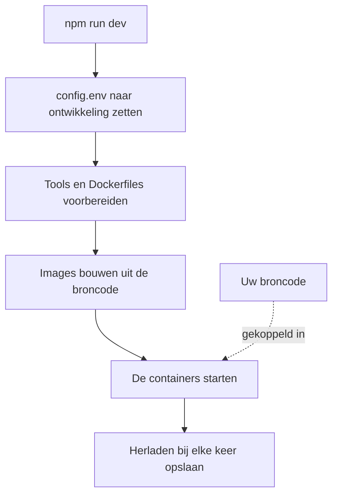

# Lokale ontwikkeling

Draai OneUptime vanuit de broncode op uw eigen computer om eraan te werken. De ontwikkelstack bouwt elke dienst uit uw checkout, koppelt uw broncode in de containers en herlaadt ze zodra u een bestand opslaat.

Wilt u in plaats daarvan een uitgebrachte versie draaien, gebruik dan [Docker Compose](/docs/installation/docker-compose).

## Zo werkt de ontwikkelstack

`npm run dev` bereidt uw checkout voor en start daarna de stack die in `Scripts/Dev/docker-compose.dev.yml` is gedefinieerd:



| Fase | Wat er gebeurt |
| --- | --- |
| Naar ontwikkeling | Zet `ENVIRONMENT=development` in `config.env`. |
| Voorbereiden | Vraagt om uw sudo-wachtwoord, installeert ontbrekende tools (Git, curl, Node.js, Docker, gomplate, ts-node), voert `git pull` uit op uw huidige branch, voegt nieuwe instellingen uit `config.example.env` toe aan `config.env` en maakt van elke `Dockerfile.tpl` een `Dockerfile`. |
| Bouwen | Bouwt voor elke dienst een image uit de broncode. De eerste build duurt even. |
| Draaien | Start de containers met uw broncode erin gekoppeld. |
| Herladen | De App herstart zijn API wanneer een serverbestand verandert en bouwt de dashboards opnieuw terwijl u ze bewerkt. |

Als de map `ee/` van de repository aanwezig is, laadt de App daaruit de Enterprise Edition. Zet `ONEUPTIME_EDITION=community` in `config.env` om in plaats daarvan de Community Edition te draaien.

## Voordat u begint

| U hebt nodig | Opmerkingen |
| --- | --- |
| **Docker** | Docker Desktop op macOS en Windows, of Docker Engine met de Docker Compose v2-plugin op Linux. |
| **Node.js 26 of nieuwer, en npm** | De versie die de `package.json` van de repository vraagt, en die de CI gebruikt. |
| **Git** | Om de repository te klonen. |
| **Sudo-toegang** | `npm run dev` vraagt om uw wachtwoord voordat het iets installeert. |
| **Vrije poorten 80 en 443** | De stack serveert OneUptime op `http://localhost` (poort 80), en HTTPS op poort 443. |

## De ontwikkelstack starten

:::steps
### De repository klonen

```bash
git clone https://github.com/OneUptime/oneuptime.git
cd oneuptime
```

### config.env aanmaken

```bash
cp config.example.env config.env
```

De voorbeeldwaarden werken zoals ze zijn voor ontwikkeling. U kunt ze wijzigen, maar het hoeft niet.

### De stack starten

```bash
npm run dev
```

Het vraagt om uw sudo-wachtwoord, bouwt dan de images en start de containers op de achtergrond. Volg het opstarten van de App met `docker logs -f oneuptime-app-1`.

### OneUptime openen

Open `http://localhost` en registreer u. Het eerste account wordt de master-admin, die het Admin Dashboard op `http://localhost/admin` kan openen.
:::

## Aan de code werken

Bewerk de bestanden onder `packages/` en sla op: de containers pikken de wijziging op.

Controleer uw wijziging op uw computer, buiten de containers, voordat u een pull request opent. Installeer daarvoor eenmalig de afhankelijkheden: voer `npm install` uit in de hoofdmap van de repository, voor ESLint en de migratietools, en daarna `npm run install-modules`, dat de `node_modules` van elk pakket verwijdert en opnieuw installeert en even duurt.

:::steps
### Compileren wat u hebt gewijzigd

Voer de compiler uit in elk pakket dat u hebt gewijzigd, bijvoorbeeld de App:

```bash
cd packages/App
npm run compile
```

### Alleen uw bestanden linten

Geef vanuit de hoofdmap van de repository de bestanden door die u hebt gewijzigd:

```bash
npx eslint --fix packages/App/path/to/File.ts
```

Vermijd `npm run lint` en `npm run fix-lint`: die linten de hele repository.

### De tests draaien die uw wijziging dekken

Draai vanuit het pakket de testbestanden die ertoe doen in plaats van de hele suite:

```bash
cd packages/App
npx jest Tests/path/to/YourChange.test.ts
```
:::

### Databasemigraties

| Database | Zo voegt u een migratie toe |
| --- | --- |
| PostgreSQL | Wijzig het model en voer daarna `npm run generate-postgres-migration` uit in plaats van de migratie met de hand te schrijven. Registreer het nieuwe bestand in `packages/Common/Server/Infrastructure/Postgres/SchemaMigrations/Index.ts`: het draait pas als het daar staat. `npm run check-postgres-schema-drift` toont elke opdracht die nog ontbreekt. |
| ClickHouse | Schrijf de migratie met de hand in `packages/App/FeatureSet/Workers/DataMigrations`, naar het voorbeeld van de bestaande. |

## Referentie

### Opdrachten

Voer deze uit vanuit de hoofdmap van de repository.

| Taak | Opdracht |
| --- | --- |
| De stack starten, of wijzigingen in `config.env` toepassen | `npm run dev` |
| De images opnieuw bouwen, na een wijziging in de afhankelijkheden | `npm run build`, daarna `npm run dev` |
| De images vanaf nul opnieuw bouwen | `npm run force-build-dev`, daarna `npm run dev` |
| De draaiende containers tonen | `docker ps` |
| De logs van één dienst volgen | `docker logs -f oneuptime-app-1` |
| De stack stoppen en de containers verwijderen | `npm run down` |

`npm run down` bewaart uw gegevens: de volumes van PostgreSQL en ClickHouse blijven bestaan.

### Poorten

De ontwikkelstack publiceert de gegevensopslag, zodat u er met uw eigen tools verbinding mee kunt maken. De wachtwoorden staan in `config.env`.

| Dienst | Adres | Aanmelden met |
| --- | --- | --- |
| OneUptime | `http://localhost` | Het account dat u hebt aangemaakt |
| PostgreSQL | `localhost:5400` | Gebruiker `postgres`, database `oneuptimedb`, wachtwoord `DATABASE_PASSWORD` |
| ClickHouse | `localhost:8189` (HTTP), `localhost:9034` (native) | Gebruiker `default`, database `oneuptime`, wachtwoord `CLICKHOUSE_PASSWORD` |
| Valkey | `localhost:6310` | Wachtwoord `VALKEY_PASSWORD` |

## Problemen oplossen

:::details npm run dev stopt bij git pull
`npm run dev` voert vóór het bouwen `git pull` uit op uw huidige branch. Git weigert op een branch zonder upstream, of als de pull uw niet-gecommitte wijzigingen zou overschrijven. Stel de upstream van de branch in (bijvoorbeeld door hem te pushen met `git push -u origin <branch>`) of commit uw werk, en voer daarna `npm run dev` opnieuw uit.
:::

:::details npm run dev stopt tijdens het installeren van een tool
Installeer die tool zelf, bijvoorbeeld gomplate of ts-node, en voer `npm run dev` opnieuw uit: het slaat elke tool over die al geïnstalleerd is.
:::

:::details Een dienst faalt nadat u de afhankelijkheden hebt gewijzigd
De images bevatten nog de oude afhankelijkheden. Bouw ze opnieuw met `npm run build` en start de stack daarna opnieuw met `npm run dev`. Is dat niet genoeg, bouw dan vanaf nul met `npm run force-build-dev`.
:::

:::details Poort 80 of 443 is al in gebruik
Een ander programma op uw computer, vaak een lokale webserver, gebruikt de poort. Stop het en voer daarna `npm run dev` opnieuw uit.
:::

## Volgende stappen

:::cards
- [Architectuur van een zelf gehoste installatie](/docs/self-hosted/architecture): Hoe de diensten die u net hebt gestart samenwerken.
- [Docker Compose](/docs/installation/docker-compose): Een uitgebrachte versie op een server draaien.
- [API-referentie](/docs/api-reference/api-reference): De API van uw lokale instantie aanroepen.
:::
