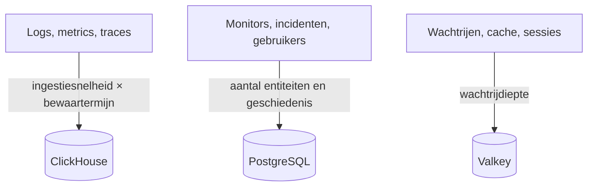

# Sizing en capaciteitsplanning

Plan de CPU, het geheugen en de schijf voor een zelf gehoste OneUptime op Kubernetes met de [Helm-chart](https://artifacthub.io/packages/helm/oneuptime/oneuptime). Dimensioneer de drie gegevensopslagen – **ClickHouse**, **PostgreSQL** en **Valkey** – en de applicatie apart, begin bij een van de niveaus hieronder en stel bij zodra u echte cijfers hebt.

> [!IMPORTANT]
> De standaardwaarden van de chart zijn geen productiedimensionering. De diensten die hij standaard draait, stellen **geen CPU- of geheugenrequests of -limieten** in, en PostgreSQL en ClickHouse krijgen kleine volumes van **25 Gi**, zodat de chart op elk cluster te installeren is. Stel voor alles wat verder gaat dan een proef zelf resources en opslag in, met de cijfers op deze pagina.

Gebruikt u in plaats daarvan de Docker Compose-installatie op één server? Die is eenvoudiger te dimensioneren: zie de [vereisten](/docs/installation/docker-compose#requirements) (aanbevolen: 16 GB geheugen, 8 cores en 400 GB schijf).

:::cards
- [Wat elke gegevensopslag laat groeien](#what-drives-each-datastore): Drie opslagen die met drie verschillende dingen groeien.
- [Startniveaus](#starting-tiers): Kleine, middelgrote en grote vertrekpunten.
- [Hoge beschikbaarheid](#high-availability): Replica's en failover voor elke gegevensopslag.
- [Bewaartermijn](#retention-and-how-it-affects-storage): De instelling die uw schijf vermenigvuldigt.
:::

## Uw installatie dimensioneren

:::steps
1. Zoek uit hoeveel telemetrie u verstuurt: de GB aan logs, metrics en traces per dag. Meet het op een kleine installatie als dat kan.
2. Bepaal hoeveel dagen u het bewaart. De bewaartermijn vermenigvuldigt de schijf van ClickHouse (zie [Bewaartermijn](#retention-and-how-it-affects-storage)).
3. Bereken de schijf van ClickHouse met de [opslagformule](#storage-formula), en die van PostgreSQL en Valkey uit hun eigen secties.
4. Kies het [startniveau](#starting-tiers) dat het dichtst bij uw cijfers ligt, en stel de CPU, het geheugen en de opslag daarvan in uw Helm-values in.
5. Zet [hoge beschikbaarheid](#high-availability) aan voor de gegevensopslagen die het nodig hebben, volg daarna het echte gebruik en stel bij.
:::

## Wat elke gegevensopslag laat groeien

OneUptime heeft in productie drie gegevensopslagen nodig. Elk groeit met iets anders, dus dimensioneer ze los van elkaar.



| Gegevensopslag | Wat erin staat | Wat de omvang bepaalt |
| --- | --- | --- |
| **ClickHouse** | Alle telemetrie – logs, metrics, traces, exceptions, profielen | Telemetrie: **ingestiesnelheid × bewaartermijn**. Dit is ~95% van uw opslag en de grootste kostenpost. |
| **PostgreSQL** | Configuratie en status – monitors, incidenten, alerts, gebruikers, teams, projecten, workflows, statuspagina's, dashboards | **Aantal entiteiten en geschiedenis**, niet het telemetrievolume. Groeit langzaam. |
| **Valkey** | Cache, werkwachtrijen en sessies | **Wachtrijdiepte en actieve sessies**. Geheugengebonden en bescheiden. Geen bron van waarheid. |

OneUptime heeft nooit objectopslag (S3, MinIO) nodig om te draaien, en het verplaatst oudere telemetrie niet naar objectopslag. U hebt alleen objectopslag nodig als u voor back-ups naar objectopslag kiest: de Barman Cloud-plugin voor CloudNativePG, of [clickhouse-backup](https://github.com/Altinity/clickhouse-backup) voor ClickHouse. De eigen CloudNativePG-back-up van de chart (`postgresOperator.cnpg.backup`) maakt volumesnapshots en heeft geen objectopslag nodig. CloudNativePG verwijdert oude snapshots nooit: ruim ze zelf op, anders blijven ze groeien.

## ClickHouse – de belangrijkste factor

Bijna al uw opslag en een groot deel van uw geheugen gaan naar ClickHouse, omdat elke logregel, elk metricpunt, elke trace-span en elke exception daar staat.

### Opslagformule

```text
ClickHouse disk ≈ (daily raw telemetry GB ÷ compression) × retention days × replicas × 1.3 (headroom)
```

De compressie hangt af van het signaal:

| Signaal | Gebruikelijke compressie | Wat haar verandert |
| --- | --- | --- |
| Logs | Ongeveer 5:1 | Logs comprimeren goed. |
| Metrics | Ongeveer 2:1 | Een hoge **kardinaliteit** van labels laat schijf en geheugen sneller groeien dan het ruwe volume. Houd de kardinaliteit van labels laag. |
| Traces | Daartussenin | De span-attributen die u verstuurt. |

### Rekenvoorbeeld

Een vloot van **10 clusters**, elk met zo'n 10 nodes en 100 pods die op INFO-niveau loggen, produceert ruwweg **50–150 GB ruwe logs per cluster in 30 dagen** (ongeveer 1,7–5 GB per dag per cluster). Over de hele vloot, met metrics en traces erbij en na compressie, reserveert u ruwweg **5–15 GB gecomprimeerde telemetrie per dag**.

| Bewaartermijn | Eén replica | 2 replica's + 30% reserve |
| --- | --- | --- |
| 30 dagen | ~150–450 GB | **~0,4–1,2 TB** |
| 90 dagen | ~0,45–1,35 TB | **~1,2–3,5 TB** |

De opslag groeit **lineair met de bewaartermijn**: een venster van 90 dagen kost ongeveer drie keer zoveel als een van 30.

### Geheugen en schijftype

- **Gebruik NVMe of SSD.** Telemetrie is schrijfintensief, met pieken van aggregatielezingen; ClickHouse heeft het zwaar op draaiende schijven.
- **Geef ClickHouse ruim geheugen.** Aggregatiequery's vragen veel geheugen. Dimensioneer het geheugen als vuistregel op 25–50% van uw *hete* (recent opgevraagde) gecomprimeerde gegevens, met een praktische ondergrens van 16 GB voor elke echte productievloot.
- **Houd de kardinaliteit van metrics in de hand.** Dat is de grootste afzonderlijke hefboom op het geheugen en de schijf van ClickHouse. Dwing labelconventies met lage kardinaliteit af waar u metrics verzamelt, en volg het aantal actieve series.

## PostgreSQL – configuratie en status

PostgreSQL slaat uw configuratie en operationele status op, geen telemetrie, dus het groeit langzaam en blijft klein naast ClickHouse. Zelfs grote installaties blijven meestal in de tientallen GB. Het standaardvolume van **25 Gi** volstaat voor kleine installaties; reken op 50–100 GB voor grotere, met ruimte voor de geschiedenis van incidenten en alerts.

Met veel replica's van app, workers en probes kunnen de databaseverbindingen opraken vóór de opslag. Elke pod opent standaard tot 50 verbindingen, en de meegeleverde PostgreSQL staat er 500 toe. Precies daarvoor bevat de chart een optionele connection pooler **PgBouncer** (`pgbouncer.enabled`): zet die aan voor installaties met veel replica's.

## Valkey – cache, wachtrijen en sessies

De cachelaag draait [Valkey](https://valkey.io), de BSD-gelicentieerde fork van Redis 7.2, als cache, werkwachtrij en sessieopslag. Elke server met het Redis-protocol kan het vervangen, en de dimensionering hieronder geldt in beide gevallen. Het is **geheugengebonden**, en persistentie staat **standaard uit**: het is geen bron van waarheid en kan opnieuw worden opgebouwd. Dimensioneer het op wachtrijdiepte en gelijktijdige sessies; 2–8 GB geheugen volstaat voor de meeste installaties. Het evictiebeleid is `noeviction`, dus houd het geheugen in de gaten als wachtrijen onder aanhoudende belasting vollopen.

## Rekenkracht van de applicatie

Dimensioneer naast de gegevensopslagen ook de stateless workloads. Elk draait **zonder resourcerequests of -limieten** totdat u die instelt, en met één replica, behalve de telemetry writer, die er twee heeft.

| Workload | Values-sleutel | Groeit met |
| --- | --- | --- |
| App: dashboard, API en ingestie | `app` | Gebruikers, API-aanroepen en binnenkomende telemetrie |
| Workers, wanneer los van de app | `worker` | Telemetrie en de verwerking van achtergrondjobs |
| Probes | `probes` | Het aantal actieve monitors |
| Ingress-gateway | `nginx` | Het aantal verzoeken |
| Telemetry writer, wanneer aangezet | `telemetryWriter` | Niet met de belasting: hij bundelt elke telemetrie-insert in ClickHouse, dus hij wordt gedimensioneerd op wat ClickHouse aankan |

De chart levert **KEDA** mee, zodat de app, workers, probes en de Runner kunnen schalen op hun wachtrijachterstand. Zet `keda.enabled` aan samen met de eigen `keda.enabled` van elke dienst (bijvoorbeeld `app.keda.enabled`). Op een cluster zonder KEDA heeft de eerste installatie een extra ronde nodig: zie de [KEDA-handleiding](https://github.com/OneUptime/oneuptime/blob/master/HelmChart/Docs/Keda.md) van de chart. Diensten die KEDA niet beheert, kunnen in plaats daarvan een autoscaler op CPU of geheugen gebruiken (`autoscaling`).

## Startniveaus

Kies het niveau dat het dichtst bij uw omgeving ligt als vertrekpunt, volg daarna het echte gebruik (`kubectl top pods`, de schijfgroei van ClickHouse en PostgreSQL) en stel bij.

- **Klein / PoC** – 1–3 clusters, ≤30 nodes, ≤5 GB/dag ruwe telemetrie, 30 dagen bewaartermijn.
- **Middelgroot / Productievloot** – ~10 clusters, ~100 nodes, 10–30 GB/dag ruwe telemetrie, 30–90 dagen bewaartermijn.
- **Groot / Meerdere vloten** – 50+ clusters, 500+ nodes, 100+ GB/dag ruwe telemetrie, 90 dagen bewaartermijn.

| | Klein / PoC | Middelgroot / Productievloot | Groot / Meerdere vloten |
| --- | --- | --- | --- |
| **ClickHouse** | 4 vCPU / 16 GB / 200 GB NVMe | 8 vCPU / 32 GB / 1–3 TB NVMe | 16+ vCPU / 64–128 GB / 5–15 TB NVMe, **met shards** |
| **PostgreSQL** | 2 vCPU / 4 GB / 50 GB SSD | 4 vCPU / 8 GB / 100 GB SSD | 8 vCPU / 16–32 GB / 250 GB SSD (+ PgBouncer) |
| **Valkey** | 1 vCPU / 2 GB | 2 vCPU / 4 GB | 4 vCPU / 8–16 GB |
| **Aangenomen bewaartermijn** | 30 dagen | 30–90 dagen | 90 dagen |

Deze niveaus dimensioneren de backend van OneUptime. De agent die u op elk bewaakt cluster installeert, staat op de pagina [Kubernetes-agent](/docs/telemetry/kubernetes-agent), die ook laat zien hoe u de hoeveelheid verzonden gegevens verkleint.

## Hoge beschikbaarheid

De ingebouwde gegevensopslagen van de chart draaien standaard als **enkele instanties**. Voor hoge beschikbaarheid in productie:

| Gegevensopslag | Voor hoge beschikbaarheid |
| --- | --- |
| **PostgreSQL** | Zet de meegeleverde [CloudNativePG](https://cloudnative-pg.io)-operator (`postgresOperator.cnpg.enabled`) aan met **3 instanties** (`postgresOperator.cnpg.instances`): een primaire en twee hot standbys, met automatische failover. |
| **ClickHouse** | Zet de meegeleverde [Altinity](https://github.com/Altinity/clickhouse-operator)-operator (`clickhouseOperator.altinity.enabled`) aan met **2 of meer replica's per shard** (`clickhouseOperator.altinity.cluster.replicasCount`). De meegeleverde ClickHouse Keeper draait op **3 nodes** voor het quorum. Voeg shards toe (`shardsCount`) zodra de schijf of het geheugen van één node de grens is. |
| **Valkey** | De chart repliceert het niet. Laat OneUptime naar een externe beheerde Redis of Valkey met automatische failover wijzen (`externalValkey`). OneUptime verbindt met één host en poort, dus gebruik het primaire endpoint van de dienst, geen endpoint in clustermodus. |

> [!WARNING]
> Als u een van beide operators aanzet voor een bestaande installatie, start er een nieuwe, lege database: geen van beide kopieert de gegevens van de database met één instantie die hij vervangt. Migreer uw gegevens zoals de handleidingen van de chart beschrijven – voor [PostgreSQL](https://github.com/OneUptime/oneuptime/blob/master/HelmChart/Docs/MigratePostgresStandaloneToOperator.md) en voor [ClickHouse](https://github.com/OneUptime/oneuptime/blob/master/HelmChart/Docs/MigrateClickhouseStandaloneToOperator.md).

## De bewaartermijn en het effect op opslag

De bewaartermijn van telemetrie is een **ClickHouse-TTL in dagen**. Elke editie heeft de standaardwaarde van het project, onder **Projectinstellingen > Telemetrie & APM > Gegevensbewaring** (**Standaardbewaring (dagen)**); als er niets is ingesteld, is dat 15 dagen. De [Enterprise Edition](/docs/self-hosted/enterprise) voegt overschrijvingen toe: per signaal (logs, traces, metrics, profielen), per logernst en tracestatus, en per dienst of resource.

Logs en metrics worden per dag verwijderd, om de eerste middernacht (servertijd van ClickHouse) nadat hun bewaartermijn afloopt; zo hoeft ClickHouse niet elke dag ervan om de paar uur te herschrijven terwijl die verloopt. Vlak voor middernacht staat er nog tot een dag meer dan het bewaarvenster op schijf: dimensioneer logs en metrics voor **bewaardagen + 1**.

Omdat de bewaartermijn de opslag van ClickHouse vermenigvuldigt, bepaalt u die voordat u de schijf dimensioneert. OneUptime archiveert oude telemetrie **niet** en verplaatst die ook niet naar objectopslag. Voor een compliance-bewaartermijn van meerdere jaren verlengt u het bewaarvenster en dimensioneert u de opslag van ClickHouse daarop, of exporteert u naar een extern archief naar keuze.

## Meet voordat u zich vastlegt

Het telemetrievolume varieert enorm met de uitgebreidheid van applicatielogs, het aantal namespaces, het scrape-interval en of er ergens DEBUG-logging aanstaat. Zie de niveaus hierboven als vertrekpunten: **verzamel minstens vier weken gegevens uit uw omgeving**, meet de werkelijke GB per dag voor elk signaal, en dimensioneer daarna bewaartermijn en opslag op basis van echte gegevens.

## Volgende stappen

:::cards
- [Docker Compose](/docs/installation/docker-compose): Vereisten voor een installatie op één server.
- [Architectuur van een zelf gehoste installatie](/docs/self-hosted/architecture): Hoe de componenten samenwerken.
- [Kubernetes-agent](/docs/telemetry/kubernetes-agent): De collector die de telemetrie van een cluster verstuurt.
- [Enterprise Edition](/docs/self-hosted/enterprise): Overschrijvingen van de bewaartermijn en de andere Enterprise-functies.
:::
