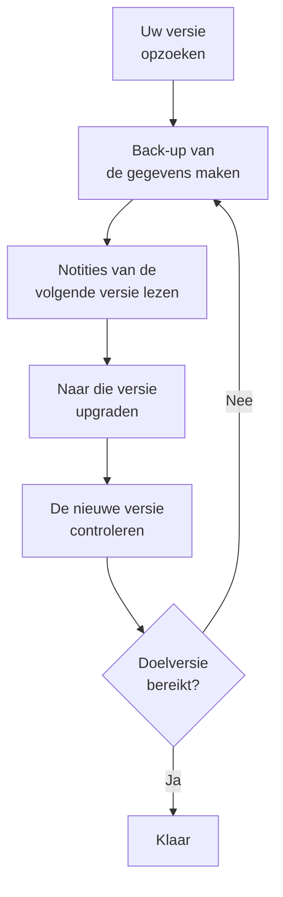

# Upgraden

Upgrade een zelf gehoste OneUptime-installatie – met Docker Compose, of met Kubernetes en Helm – naar een nieuwere versie. Volg de procedure hieronder en lees de notities van elke hoofdversie tussen de versie die u draait en de versie waar u naartoe gaat.

:::cards
- [Hoe u upgradet](#hoe-u-upgradet): De procedure, voor Docker Compose en Kubernetes.
- [De notities per versie](#de-notities-voor-uw-versie-vinden): Wat elke hoofdversie van u vraagt, in één oogopslag.
- [Images van de Community Edition en de Enterprise Edition](#images-van-de-community-edition-en-de-enterprise-edition): Welke image u vanaf 14 draait.
- [Upgraden van OneUptime 13 → 14](#upgraden-van-oneuptime-13-14): De nieuwste hoofdversie.
:::

## Hoe u upgradet

Drie regels maken een upgrade veilig:

- **Upgrade één hoofdversie tegelijk** (bijvoorbeeld 6 → 7 → 8). Sla geen enkele hoofdversie over.
- **Sla minor- en patchreleases gerust over** (bijvoorbeeld 8.1 → 8.4), zolang u hun release notes volgt.
- **Maak vóór elke upgrade een back-up**, en controleer dat u die kunt terugzetten.



:::steps
### Zoek uw huidige versie op

Open als hoofdbeheerder het editielabel in de kop van het Admin-dashboard: **This installation** toont de versie die u draait. De instantie meldt die ook op `/version`:

```bash
curl http://localhost/version
```

Vervang `http://localhost` door het adres van uw instantie. Het antwoord is JSON, zoals `{"version":"14.0.22","commit":"..."}`.

### Maak een back-up van uw gegevens

Maak een back-up van PostgreSQL, en van ClickHouse als u de telemetrie daarin nodig hebt. Zie voor Docker Compose [Back-up en herstel](/docs/installation/docker-compose#back-up-en-herstel). Gebruik op Kubernetes uw volumesnapshots of de CloudNativePG-back-ups van de chart.

### Lees de notities van de volgende hoofdversie

U vindt ze in de [tabel hieronder](#de-notities-voor-uw-versie-vinden). Doe wat ze vragen voordat u upgradet: sommige stappen, zoals het hernoemen van Helm-waarden, moeten eerst gebeuren.

### Voer de upgrade uit

:::tabs
@tab Docker Compose
```bash
git checkout release
git pull
npm run update
```
`npm run update` voegt nieuwe instellingen toe aan uw `config.env` zonder de uwe te wijzigen, haalt de nieuwe images op en start OneUptime opnieuw.
@tab Kubernetes
```bash
helm repo update
helm upgrade my-oneuptime oneuptime/oneuptime -f values.yaml
```
Gebruik uw eigen releasenaam en waardenbestand. De chart voert de databasemigraties uit in een eigen Job voordat de nieuwe pods verkeer afhandelen.
:::

### Controleer de nieuwe versie

Met Docker Compose eindigt `npm run update` met **OneUptime is up!** Wacht op Kubernetes tot elke pod `Running` en gereed is:

```bash
kubectl get pods -n <namespace>
```

Controleer daarna opnieuw uw versie, zoals in de eerste stap. Hebt u uw doelversie nog niet bereikt, ga dan terug naar [Maak een back-up van uw gegevens](#maak-een-back-up-van-uw-gegevens) en ga naar de volgende hoofdversie.
:::

### De notities voor uw versie vinden

| Upgrade | Wat u moet doen |
| --- | --- |
| [13 → 14](#upgraden-van-oneuptime-13-14) | Een editie kiezen. Docker Compose-installaties die `IS_ENTERPRISE_EDITION=true` instellen, stappen over op `APP_TAG=enterprise-release`. Een licentie activeren op de Enterprise Edition. IPv6-monitors voor Ping, Port en SSL opnieuw opslaan. |
| [12 → 13](#upgraden-van-oneuptime-12-13) | Meestal niets: Redis wordt Valkey, en de oude namen van instellingen blijven werken. Draait u Docker Compose met de hand? Voeg `--remove-orphans` toe. Gebruikt u een eigen cache? Lees [Als u uw eigen cache draait](#als-u-uw-eigen-cache-draait). |
| [11 → 12](#upgraden-van-oneuptime-11-12) | Runbook Agents opnieuw uitrollen als Runners. Met Docker Compose `ONEUPTIME_RUNNER_KEY` instellen. Met Helm `aiAgent:` hernoemen naar `runner:`. Runner-rechten die API-sleutels rechtstreeks hadden opnieuw toekennen. |
| [10 → 11](#upgraden-van-oneuptime-10-11) | SCIM en de compliance-instellingen van teams vereisen de Enterprise Edition. Hernoem de oude ClickHouse-tabellen vóór de upgrade om uw telemetriegeschiedenis te behouden. |
| [9 → 10](#upgraden-van-oneuptime-9-10) | Niets. |
| [8 → 9](#upgraden-van-oneuptime-8-9) | Met Helm de overrides van `oneuptimeIngress` uit uw waarden verwijderen. |
| [7 → 8](#upgraden-van-oneuptime-7-8) | Met Helm overstappen op de nieuwe waardenstructuur voor Postgres, Redis en ClickHouse. Eerst een back-up maken. |

## Images van de Community Edition en de Enterprise Edition

OneUptime levert de applicatie nu als twee images. De **Community Edition** is open source onder de Apache 2.0-licentie en bevat SAML- en OIDC-single sign-on, globale SSO en "Require SSO for login". De **Enterprise Edition** voegt de enterprisemodules uit de map `ee/` van de repository toe: SCIM, team-compliance, auditlogboeken en de enterprise Health-dashboards van het Admin-dashboard. Vóór deze wijziging draaiden beide edities dezelfde code, en `IS_ENTERPRISE_EDITION` bepaalde welke functies aan stonden. Nu bepaalt de image het, en de Community-image bevat de map `ee/` niet.

De pagina [Enterprise Edition](/docs/self-hosted/enterprise) bevat de volledige functievergelijking, de licentiedetails en wat er gebeurt als u van editie wisselt.

### Wat u vóór de upgrade moet doen

- **Community Edition zonder SCIM:** niets. Upgrade zoals gewoonlijk.
- **Helm met `image.type: enterprise-edition`:** niets. De chart haalt al de `enterprise-`-images op, die nu de enterprisemodules bevatten.
- **Docker Compose met `IS_ENTERPRISE_EDITION=true`:** stap bij de upgrade over op de Enterprise-image door `APP_TAG=enterprise-release` (of `enterprise-<version>`) in te stellen in `config.env`. `APP_TAG=release` is de Community-image, en `IS_ENTERPRISE_EDITION=true` zet niets meer aan. `npm run update` voert deze wijziging voor u uit zolang `IS_ENTERPRISE_EDITION=true` (`release` wordt `enterprise-release`, een vastgezette `13.0.7` wordt `enterprise-13.0.7`) en drukt af wat er is gewijzigd. De applicatie **weigert nu te starten** als `IS_ENTERPRISE_EDITION=true` is ingesteld op de Community-image, in plaats van SCIM-provisioning en auditlogging stilletjes te stoppen. De foutmelding zegt wat u moet instellen: `APP_TAG=enterprise-<version>` om de Enterprise Edition te houden, of `IS_ENTERPRISE_EDITION=false` om de Community Edition te draaien.
- **Community-image met al ingestelde SCIM:** SCIM-provisioning stopt met deze upgrade, inclusief deprovisioning. Stap over op de Enterprise-image om het te behouden. Lees anders vóór de upgrade [Overstappen van Enterprise naar Community](/docs/self-hosted/enterprise#switching-from-enterprise-to-community). Daar staat wat er stopt en wie u eerst moet verwijderen. Stel ook `IS_ENTERPRISE_EDITION=false` in om de Community Edition te draaien. Single sign-on wordt niet geraakt: de Community-image biedt het ook.

Uw configuratie wordt nooit verwijderd, en wisselen van editie vraagt in geen enkele richting een migratie.

### Licenties na de upgrade

De Enterprise Edition controleert nu haar licentie:

- **Een installatie met een licentiesleutel** blijft werken. Ze controleert de licentie bij OneUptime bij het opstarten en eens per dag. Als de licentie verloopt, blijft alles werken gedurende een respijtperiode van 30 dagen, waarna hetzelfde gebeurt als bij een installatie zonder licentie.
- **Een installatie zonder licentie**, bijvoorbeeld een die de Enterprise Edition alleen met `IS_ENTERPRISE_EDITION=true` draaide, krijgt een proefperiode van 14 dagen vanaf de eerste start van deze versie. **Gebruikt u SCIM of auditlogging, activeer dan een licentie voordat de proefperiode afloopt.** Na de proefperiode stopt SCIM-provisioning en registreert de auditlogging niets meer. De enterpriseconfiguratie wordt bovendien alleen-lezen en de enterprise Health-dashboards worden vergrendeld. Single sign-on wordt niet geraakt. Alles werkt weer, zonder herstart, zodra u een licentie activeert. De proefperiode is bedoeld voor evaluatie: productiegebruik van de Enterprise Edition vereist een OneUptime Enterprise-abonnement. Zie [Als een licentie verloopt of ontbreekt](/docs/self-hosted/enterprise#when-a-license-expires-or-is-missing).
- **Afgeschermde installaties zonder netwerk** kunnen activeren met een ondertekend licentietoken in plaats van een sleutel. Zie [Offline activeren](/docs/self-hosted/enterprise#offline-activation-air-gapped-installs).

### Klanten van OneUptime Cloud

Voor u verandert er niets. OneUptime Cloud draait de Enterprise Edition, en uw abonnement bepaalt nog steeds welke functies u krijgt: SSO, OIDC, SCIM en team-compliance vanaf het Scale-abonnement, en auditlogboeken in het Enterprise-abonnement. Projecten op het Scale-abonnement zien nu de instellingen voor SSO, OIDC, SCIM en team-compliance die eerder een uitnodiging om te upgraden toonden.

### Wijzigingen in de API en de endpoints

- `GET /api/global-config/license` geeft de licentiesleutel, het licentietoken, de lijst met instanties, de instantie-ID en de versiegegevens alleen aan hoofdbeheerders. Andere aanroepers krijgen de editie en de licentiestatus.
- Zelf gehoste installaties bieden de licentieserver-endpoints onder `/api/enterprise-license/` niet meer aan. Alleen oneuptime.com gebruikt ze.
- De SCIM-endpoints houden op de Enterprise Edition exact hun paden, dus de configuratie van de identiteitsprovider verandert niet. Op de Community Edition geven ze `404` terug. Op de Enterprise Edition weigeren ze verzoeken zolang de licentie verlopen is (na de proefperiode of de respijtperiode), en ze antwoorden weer zodra er een licentie is geactiveerd.
- De SSO- en OIDC-endpoints (de SAML-aanmeld- en ACS-URL's, de OIDC-redirect-URI's en de endpoints van de globale SSO) houden exact hun paden en worden door beide edities aangeboden, in elke licentiestatus.

## Upgraden van OneUptime 13 → 14

OneUptime 14 splitst de applicatie in twee edities, en de image die u ophaalt bepaalt welke u draait. De **Community Edition** (Apache-2.0, de tags `release` en `<version>`) bevat SAML SSO, OpenID Connect, globale SSO en "Require SSO for login". Ze bevat de map `ee/` van de repository niet, dus SCIM-provisioning, de compliance-instellingen van teams, auditlogboeken, de **Health**-dashboards van het Admin-dashboard en de **Query Console** van het Admin-dashboard zitten helemaal niet in die image. De **Enterprise Edition** (de tags `enterprise-release` en `enterprise-<version>`) bevat ze wel, en controleert tijdens het draaien een Enterprise-licentie, iets wat OneUptime 13 nooit deed. Single sign-on hangt niet van die licentie af.

[Images van de Community Edition en de Enterprise Edition](#images-van-de-community-edition-en-de-enterprise-edition), hierboven, is de referentie voor deze wijziging: wat elke editie bevat, wat u per soort uitrol instelt en wat de licentie doet. Deze sectie is de upgrade zelf. Upgrade vanaf 13 – staat u nog op 12, doe dan eerst 12 → 13.

Er wordt niets verwijderd, in geen van beide edities. Single sign-on werkt in beide hetzelfde: uw SSO- en OIDC-configuratie en uw instellingen voor "Require SSO for login" blijven zoals ze zijn. Uw SCIM-configuratie en de tot nu toe geregistreerde auditlogboeken blijven in de database. De Community Edition biedt ze alleen niet aan, en wisselen van editie vraagt in geen enkele richting een migratie.

### Wat u moet doen

1. **Bepaal welke editie deze installatie draait.** Gebruikt u SCIM-provisioning, de compliance-instellingen van teams of auditlogboeken, of wilt u de **Health**-dashboards van het Admin-dashboard, dan is dat de Enterprise Edition. Anders valt er niets te kiezen: de Community Edition is wat u al hebt, en die bevat SAML SSO en OpenID Connect.
2. **Stel met Helm de editie in uw waardenbestand in:** `image.type: enterprise-edition` (de standaard is `community-edition`). Laat `image.tag` met rust – de chart zet zelf het voorvoegsel `enterprise-` ervoor, dus `image.tag: release` haalt `oneuptime/app:enterprise-release` op. Deze waarde is niet nieuw. Draait u al `enterprise-edition`, dan hoeft er niets te veranderen: de tag die u al ophaalt, bevat nu `ee/`.
3. **Stel met Docker Compose `APP_TAG=enterprise-release` in** (of `enterprise-<version>` om een versie vast te zetten) in `config.env`. `APP_TAG=release` is de Community-image. Dit is het enige dat een installatie op 13 tegenhoudt: op 13 was een Enterprise-installatie met Compose `APP_TAG=release` plus `IS_ENTERPRISE_EDITION=true`, en die combinatie **weigert nu te starten** in plaats van als Community Edition op te komen met SCIM-provisioning en auditlogging stilletjes gestopt. `npm run update` herschrijft `APP_TAG` voor u zolang `IS_ENTERPRISE_EDITION=true` (`release` wordt `enterprise-release`, een vastgezette `13.0.8` wordt `enterprise-13.0.8`) en drukt af wat er is gewijzigd. Haalt u de images in plaats daarvan met de hand op, stel dan eerst zelf `APP_TAG` in.
4. **Activeer op de Enterprise Edition een licentie.** Een installatie zonder licentie krijgt een proefperiode van 14 dagen, geteld vanaf haar eerste start van de Enterprise Edition – bij een upgrade is dat de dag waarop u upgradet, niet de dag waarop u OneUptime voor het eerst installeerde. Een hoofdbeheerder activeert die via het editielabel in de kop van het Admin-dashboard; afgeschermde installaties zonder netwerk activeren met een ondertekend token. Zie [Licenties](/docs/self-hosted/enterprise#licensing).
5. **Gaat deze installatie de Community Edition draaien terwijl uw identiteitsprovider gebruikers via SCIM deprovisiont, controleer dan vóór de upgrade wie toegang heeft.** SCIM-deprovisioning stopt, dus mensen die u in uw identiteitsprovider verwijdert, houden hun OneUptime-accounts en, tenzij "Require SSO for login" op hen van toepassing is, kan iedereen die nog bij de mailbox van zo'n account kan via "Wachtwoord vergeten" een wachtwoord instellen en aanmelden. Verwijder die gebruikers eerst: [Overstappen van Enterprise naar Community](/docs/self-hosted/enterprise#switching-from-enterprise-to-community).
6. **Monitort u IPv6-adressen met Ping-, Port- of SSL-monitors, sla die monitors dan na de upgrade opnieuw op.** Doelen die vóór 14 zijn opgeslagen, kunnen afgekapt zijn opgeslagen – zie [IPv6-monitors voor Ping, Port en SSL](#ipv6-monitors-voor-ping-port-en-ssl).

### Edities: wat er veranderde en wat niet

| | Tot en met 13 | Vanaf 14 |
| --- | --- | --- |
| Enterprisecode | in elke image; `IS_ENTERPRISE_EDITION=true` zette hem aan | in `ee/`, en alleen in de `enterprise-`-images |
| Keuze in Helm | `image.type` | `image.type` – ongewijzigd, maar de images verschillen nu |
| Keuze in Compose | `IS_ENTERPRISE_EDITION=true` | `APP_TAG=enterprise-release` |
| Enterprise-licentie | nooit gecontroleerd tijdens het draaien | gecontroleerd bij het opstarten en eens per dag |
| SSO- en OIDC-endpoints | dezelfde paden in beide edities | dezelfde paden in beide edities, ongeacht de licentiestatus |
| SCIM-endpoints | dezelfde paden in beide edities | dezelfde paden op Enterprise; `404` op Community |
| Uw enterpriseconfiguratie | opgeslagen, toegepast | in beide gevallen opgeslagen, toegepast op Enterprise |

Er draait één migratie: een kolom `enterpriseEditionFirstSeenAt` die leeg mag zijn op de tabel `GlobalConfig`, die één rij heeft, dus ze is direct klaar. Er is geen ClickHouse-migratie, er wordt niets verwijderd en wisselen van editie vraagt in geen enkele richting een migratie.

### Het verloop van de licentie op de Enterprise Edition

- **Een installatie zonder licentie** draait een proefperiode van 14 dagen, geteld vanaf de eerste start van de Enterprise Edition. Tijdens de proefperiode werkt elke enterprisefunctie, en het editielabel waarschuwt voordat ze afloopt. De proefperiode is bedoeld voor evaluatie: productiegebruik van de Enterprise Edition vereist een abonnement onder de OneUptime Enterprise License.
- **Een licentie die verloopt** krijgt een respijtperiode van 30 dagen vanaf de vervaldatum, waarin elke enterprisefunctie werkt en het editielabel waarschuwt.
- **Na de proefperiode, of na die respijtperiode**, en tot er een licentie is geactiveerd: SCIM-verzoeken van uw identiteitsprovider worden geweigerd en de auditlogging registreert niets meer. De enterpriseconfiguratie wordt alleen-lezen – u kunt haar nog bekijken en verwijderen, en een SCIM-bearer-token opnieuw instellen, wat een incident nodig heeft – en de Health-dashboards en de Query Console van het Admin-dashboard worden vergrendeld.
- **Er wordt niets verwijderd, en de kernmonitoring wordt nooit geraakt.** Monitors, waarschuwingen, incidenten, bereikbaarheidsdiensten, statuspagina's en telemetrie vallen buiten de licentie, net als het aanmelden: aanmelden met SSO en OIDC, "Require SSO for login" en aanmelden met een wachtwoord voor elke gebruiker, hoofdbeheerders inbegrepen, werken in elke licentiestatus hetzelfde. Een licentie activeren herstelt SCIM-provisioning en auditlogging met de configuratie die u al hebt, zonder herstart.
- **Een licentiesleutel die u al hebt, wordt geaccepteerd**, als licentie "unverified": de vervaldatum en het aantal plaatsen komen uit wat de licentieserver al aan deze installatie heeft gemeld, en ze krijgt dezelfde respijtperiode van 30 dagen na die vervaldatum. Licenties die vanaf nu worden uitgegeven, zijn ondertekend en worden door de applicatie zelf geverifieerd. Voor deze upgrade hebt u geen nieuwe sleutel nodig.
- **Een sleutel waarvan deze installatie de vervaldatum nooit heeft vastgelegd** blijft tijdens de proefperiode werken in plaats van te stoppen. De licentieserver schrijft de sleutel en de vervaldatum apart weg, dus een installatie kan een sleutel hebben waarvan haar de vervaldatum nooit is gemeld. Zo'n installatie wordt precies behandeld als een installatie zonder licentie: elke enterprisefunctie werkt tijdens de proefperiode van 14 dagen, geteld vanaf de eerste start van de Enterprise Edition, en na de proefperiode stoppen dezelfde dingen als hierboven. Het aantal plaatsen wordt niet afgedwongen zolang de licentie in deze staat is, omdat het licentierecord van de installatie al onvolledig is. Een hoofdbeheerder die de licentie via het editielabel opnieuw activeert, of de dagelijkse licentiesynchronisatie die de vervaldatum van oneuptime.com ophaalt, herstelt haar zonder herstart.

De volledige tabel met statussen staat in [Als een licentie verloopt of ontbreekt](/docs/self-hosted/enterprise#when-a-license-expires-or-is-missing).

### Docker Compose: de image-tag kiezen

```bash
git checkout release # Please make sure you're on release branch.
git pull
npm run update
```

- **`npm run update` verplaatst `APP_TAG` zolang `IS_ENTERPRISE_EDITION=true`**, naar de Enterprise-image van dezelfde versie, en drukt af wat er is gewijzigd. Het behoudt uw opmerkingen en aanhalingstekens, laat een `APP_TAG` die al een `enterprise-`-tag is met rust en wijzigt niets bij een tweede run.
- **Met de hand images ophalen slaat dat over**, en de applicatie stopt dan bij het opstarten met een foutmelding die precies zegt wat u moet instellen: `APP_TAG=enterprise-<version>` om de Enterprise Edition te houden, of `IS_ENTERPRISE_EDITION=false` om de Community Edition te draaien.
- **Om bewust over te stappen op de Community Edition**, stelt u `APP_TAG=release` en `IS_ENTERPRISE_EDITION=false` in. Lees eerst punt 5 hierboven als uw identiteitsprovider gebruikers via SCIM deprovisiont.
- Verder hoeft er voor deze release niets in `config.env` te veranderen.

### Helm: het image-type kiezen

```bash
helm repo update
helm upgrade my-oneuptime oneuptime/oneuptime -f values.yaml
```

- **Een installatie die al op `image.type: enterprise-edition` staat, hoeft geen waarde te wijzigen.** De chart zet het voorvoegsel al lang voor de tag; nieuw is dat de `enterprise-`-images `ee/` bevatten. Vanaf deze release geldt de licentie ervoor, volgens het verloop hierboven.
- **`image.tag: release` is de standaard**, dus een chart die op de zwevende tag is blijven staan, gaat bij zijn volgende upgrade naar 14 zonder enige wijziging van waarden. Heeft die installatie SCIM ingesteld op `community-edition`, stel dan in dezelfde upgrade `image.type: enterprise-edition` in.
- **`IS_ENTERPRISE_EDITION` wordt nog steeds door de chart uitgegeven**, afgeleid van `image.type` zodat de twee het nooit oneens kunnen zijn. Het bestuurt niets. Het via `extraEnv` op `true` forceren op een Community-image laat de applicatie alleen weigeren te starten. Stel `ONEUPTIME_EDITION` nooit via de chart in.
- **De probes van de chart respecteren weer `probes.<key>.allowPrivateNetworkMonitors`** ([#3879](https://github.com/OneUptime/oneuptime/issues/3879)). Er verandert niets tenzij u het instelt – de standaard blijft `false` – en het geldt voor de monitors van alle projecten op de instantie, omdat de probes van de chart globale probes zijn. Loopback, link-local en `169.254.169.254` blijven geblokkeerd, wat u ook instelt.

### Andere wijzigingen in 14

Deze wijzigingen veranderen hoe OneUptime zich na de upgrade gedraagt, en voor de meeste hoeft u niets te doen. Lees ze als u aangepaste rollen of API-sleutels gebruikt die uit losse rechten bestaan, eigen statussen voor incidenten, waarschuwingen of onderhoud, Terraform of de API, SSO, of de apps voor Slack en Microsoft Teams.

:::details Lees de andere wijzigingen in 14
- **OTLP-ingest bevestigt een batch pas nadat de wachtrij hem heeft geaccepteerd.** 13 antwoordde eerst `200` en zette daarna in de wachtrij, dus een batch die de wachtrij weigerde, ging stilletjes verloren. 14 antwoordt in plaats daarvan `503` met `Telemetry queue unavailable. Please retry.`, en het gRPC-endpoint geeft `UNAVAILABLE` terug; beide zijn opnieuw te proberen, en exporters proberen het opnieuw. Dit geldt voor logboeken, metrics, traces en profielen. U hoeft niets te doen, maar nieuwe pogingen van exporters en tegendruk van de wachtrij zijn nu zichtbaar waar eerder gegevens verdwenen – goed om te weten als u de ingestcapaciteit dimensioneert.
- **De Health-dashboards en de Query Console van het Admin-dashboard vereisen de Enterprise Edition**, samen met de gezondheidswaarschuwingen voor PostgreSQL en Valkey. Op 13 kwamen ze al met alleen `IS_ENTERPRISE_EDITION=true`, dus dit is een zichtbaar verlies voor een Community-installatie die ze gebruikte. De capaciteitsmonitoring van ClickHouse en het opschonen ervan, de migratiestatus, globale probes en de supportbundel zitten in beide edities.
- **HTTPS-monitors die een IP-adres bereiken via de proxy van een probe werken weer.** De probe stuurde het IP-adres als TLS-servernaam, wat geen geldige servernaam is en wat Node onvoorwaardelijk weigert, dus een monitor op `https://<private IP>` vanaf een globale probe met `PROBE_ALLOW_PRIVATE_NETWORK_MONITORS` mislukte bij de handshake. De probe laat de servernaam nu weg voor een IP-doel en controleert het certificaat tegen het IP-adres zelf. Doelen op hostnaam veranderen niet.
- **De `oneuptime`-CLI meldt zijn echte versie** met `--version` in plaats van een placeholder.
- **Een nieuwe waarschuwing of episode begint in de status die het aanmaken ervan noemt.** De API, Terraform (`current_alert_state_id`, `current_incident_state_id`) en workflows kunnen de status noemen waarin een waarschuwing, een waarschuwingsepisode of een incidentepisode begint, zoals het veld **Initiële status** van het dashboard doet. Voorheen werd die status vervangen door de aanmaakstatus van het project; een Terraform-configuratie die hem instelde, kreeg een andere waarde dan gepland. Een aanmaak die geen status noemt, begint nog steeds in de aanmaakstatus, en een status van een ander project wordt geweigerd. Zie [De status waarin een nieuw record begint](/docs/api-reference/api-reference).
- **Een record dat al bevestigd of opgelost wordt aangemaakt, roept niemand op.** Een incident, waarschuwing of episode die in een latere status wordt aangemaakt – via **Initiële status**, de beginstatus van een sjabloon, de API, Terraform of een workflow – voert zijn bereikbaarheidsdienstbeleid niet meer uit; de feed meldt dat in plaats daarvan. Een record dat opgelost wordt aangemaakt, wordt ook niet meer in een episode gegroepeerd, hersteld, door OneUptime AI onderzocht of voorzien van een Slack- of Microsoft Teams-kanaal, en een incident dat opgelost wordt aangemaakt, laat de status en de monitoring van zijn monitors met rust en start geen SLA. Een record dat bevestigd wordt aangemaakt, start zijn SLA als al beantwoord. Records die in de aanmaakstatus worden aangemaakt, zoals elk record dat een monitor opent, veranderen niet. Zie [Al bevestigd of opgelost gemeld](/docs/incidents/declaring-incidents#al-bevestigd-of-opgelost-gemeld).
- **Een status na uw opgeloste status telt overal als opgelost.** Een incident, waarschuwing of episode in een status die u na de opgeloste status hebt geplaatst – een status **Closed** onder **Opgelost**, bijvoorbeeld – telde op sommige plaatsen als opgelost en op andere als open. Ze volgen nu allemaal één regel: de opgeloste status van het project, en elke status erna, is opgelost. Records in zo'n status verdwijnen uit de lijsten **Actieve incidenten** en **Actieve waarschuwingen** en hun tellers in het zijmenu, uit de incident- en waarschuwingslijsten van dashboards, uit actieve episodes en uit de lijsten met open records van de mobiele app; samenvattingen in Slack en Microsoft Teams tellen ze als opgelost, en de tijdlijnen van statuspagina's tonen zo'n rij als opgelost. Een monitor of een SLO-burn-rate-regel waarvan het incident of de waarschuwing in zo'n status staat, opent er bij de volgende keer dat hij afgaat een nieuwe, waar hij de oude eerder nog voor open hield. Een incident rechtstreeks naar zo'n status verplaatsen lost het op zoals **Opgelost** doet, en het voorbij **Opgelost** verplaatsen heropent geen episode meer en start geen nieuwe SLA voor het incident. Projecten waarvan alle eigen statussen boven de opgeloste status staan, merken geen verschil. Zie [De lijst met actieve incidenten](/docs/incidents/states-and-severities#de-lijst-actieve-incidenten).
- **Een status na uw bevestigde status telt overal als bevestigd.** Een incident, waarschuwing of episode in een status die u tussen uw bevestigde en opgeloste status hebt geplaatst – een status **Investigating** onder **Bevestigd**, bijvoorbeeld – stopte al de oproepen van de bereikbaarheidsdienst, maar de mobiele app en Microsoft Teams boden er nog **Acknowledge** voor aan, en een waarschuwing of episode in die status bevestigen (vanuit Teams, Slack of een pagina van de bereikbaarheidsdienst) zette haar terug naar **Bevestigd**. Ze volgen nu allemaal één regel: de bevestigde status van het project, elke status erna en een opgeloste status tellen als bevestigd. **Acknowledge** wordt nergens meer aangeboden voor zo'n record, en het bevestigen ervan wordt geweigerd ("... is already acknowledged.") in plaats van het terug te zetten; een hulpverlener die zijn eigen oproep ervoor bevestigt, rondt die oproep gewoon af. Een record rechtstreeks naar zo'n status verplaatsen markeert de SLA van het incident nu als beantwoord – waar die eerder onbeantwoord bleef tot het incident was opgelost, wat de reactiedoelstelling kon schenden – en telt als de bevestiging ervan in de bevestigingstijd van het overzicht, de metric **Time to Acknowledge**, de metingen en de MTTA van samenvattingen in Slack en Microsoft Teams. Een record dat is opgelost zonder ooit te zijn bevestigd, telt nu als bevestigd op het moment dat het werd opgelost, zoals het overzicht al liet zien. De lijstfilters **Bevestigd** tonen ook records in die statussen, en het attribuut `isAcknowledgedState` van de metric **Time in State** is `true` voor ze. Projecten waarvan alle eigen statussen boven de bevestigde status staan, merken geen verschil. Zie [Wat bevestigen doet](/docs/incidents/states-and-severities#wat-bevestigen-doet).
- **Episodes doorlopen hun statussen volgens de regel die incidenten en waarschuwingen volgen.** Een incident- of waarschuwingsepisode kon hoger in haar statuslijst worden teruggezet – een opgeloste episode terug naar **Bevestigd**, bijvoorbeeld – vanuit de statustijdlijn van het dashboard, Slack, Microsoft Teams, de API of Terraform, en de verplaatsing ging door naar haar incidenten of waarschuwingen. Nu wordt een verplaatsing naar een status die in de volgorde vóór de huidige status van de episode komt, geweigerd met de foutmelding die een incident krijgt ("Episode cannot transition to Acknowledged state from Resolved state because Acknowledged is before Resolved in the order of incident states."), en verandert er niets. De optie **Recent opgeloste episodes heropenen** van een groeperingsregel heropent een episode nog steeds, als eigen verplaatsing van OneUptime. Om een per ongeluk ingestelde status te herstellen, verwijdert u de rij ervan uit de statustijdlijn van de episode, net als bij een incident; de episode keert terug naar de status van haar laatste overgebleven rij, en de rij verwijderen die haar oploste, wist haar oplostijd. Een episode verplaatst elk van haar incidenten of waarschuwingen alleen waar hun eigen status naartoe zou gaan: een die al in die status staat, of verder, blijft waar hij is.
- **Een schrijfactie op de huidige status van een record volgt dezelfde regel.** De huidige status van een incident, waarschuwing, episode of geplande onderhoudsgebeurtenis bijwerken via de API of Terraform (`currentIncidentStateId`, `currentAlertStateId`, `currentScheduledMaintenanceStateId`) wordt geweigerd voordat er iets wordt opgeslagen wanneer het record daarmee hoger in zijn lijst wordt teruggezet, met dezelfde foutmelding. Eerder bereikte de schrijfactie het record en weigerde de statustijdlijn haar daarna, waardoor het record in een status bleef die zijn tijdlijn nooit had bevat. Het schrijven van de status van een incidentepisode legt die nu vast in de statustijdlijn van de episode en verplaatst haar incidenten, zoals het schrijven van de status van een waarschuwingsepisode al deed. Een Terraform-plan dat een eerdere status instelt, mislukt bij de apply; stel statussen in hun volgorde in, of wijzig de status met een rij in de statustijdlijn.
- **Change State in Slack en Microsoft Teams biedt alleen de statussen aan waar een record hierna naartoe mag.** Een record in de laatste status die het kan bereiken, krijgt het antwoord "There is no later state to move this incident to." in plaats van een formulier waarin elke keuze zou worden geweigerd. Het menu **Change state to** in de kop van het dashboard volgt dezelfde regel.
- **De foutmelding voor een geplande onderhoudsgebeurtenis die hoger in haar lijst wordt teruggezet, leest nu als de andere:** "Scheduled Maintenance cannot transition to Scheduled state from Ongoing state because Scheduled is before Ongoing in the order of scheduled maintenance states." (eerder stond er `ScheduledMaintenance` en `scheduledMaintenance states`). Een script dat de oude tekst vergeleek, heeft de nieuwe nodig. Zie [De volgorde is een echte beperking](/docs/incidents/states-and-severities#de-volgorde-is-een-echte-beperking-geen-weergavevoorkeur).
- **Een incident oplossen geeft alleen de monitors terug die het vasthoudt.** OneUptime legt nu vast of een incident de status van zijn monitors vasthoudt. Een incident dat al eens is opgelost en daarna heropend, zet zijn monitors niet meer terug op operationeel als het opnieuw wordt opgelost, dus een status die ze intussen hebben gekregen – van hun probes, van onderhoud of met de hand ingesteld – blijft staan; zijn monitors wijzigen, of de status waarin het ze zet, terwijl het open is, laat het ze opnieuw vasthouden. Incidenten van vóór de upgrade geven hun monitors bij de volgende keer oplossen terug, zoals ze altijd deden. Zie [Wat oplossen doet](/docs/incidents/states-and-severities#wat-oplossen-doet).
- **De episode van een incident of waarschuwing wordt alleen via de leden van de episode ingesteld.** `incidentEpisodeId` en `alertEpisodeId` (en de relaties `incidentEpisode` en `alertEpisode`) zijn alleen-lezen. De API, Terraform (`incident_episode_id`, `alert_episode_id`), MCP-tools en workflows konden ze schrijven zonder het record aan de episode toe te voegen: het overzicht van de episode toonde dan een incident of waarschuwing die haar pagina **Leden** niet had, en een record dat met een episode werd aangemaakt, werd nooit gegroepeerd. Een aanmaak of update die er een meestuurt, wordt nu geweigerd, met een melding die naar de leden van de episode verwijst: voeg het record toe met `POST /api/incident-episode-member` (of `/api/alert-episode-member`) en verwijder dat lid om het eruit te halen, en de verwijzing naar de episode volgt. Lezen verandert niet. Een Terraform-configuratie die `incident_episode_id` of `alert_episode_id` instelt, moet die weghalen zodra u de provider bijwerkt, die ze nu alleen leest; de resources `oneuptime_incident_episode_member` en `oneuptime_alert_episode_member` beheren het lidmaatschap. Zie [De episode waarin een incident of waarschuwing zit](/docs/api-reference/api-reference).
- **Nieuwe escalatieregels voor inkomende oproepen gaan 20 seconden over, niet 30.** Veel telefoons sturen een onbeantwoorde oproep binnen 30 seconden naar de voicemail, en een voicemail die opneemt, beëindigt de oproep daar in plaats van hem door te geven aan de volgende regel. Het veld **Overgaan gedurende (in seconden)** van het dashboard, de API (`escalateAfterSeconds`) en de Terraform-provider (`escalate_after_seconds`) starten een nieuwe regel nu op 20. Bestaande regels houden hun beltijd: de upgrade wijzigt alleen de standaardwaarde van de kolom. Een Terraform-configuratie die `escalate_after_seconds` weglaat, plant `30 -> 20` voor de regels die ze beheert zodra u de provider bijwerkt; stel `escalate_after_seconds = 30` in om 30 te houden. Zie [Beleid voor inkomende oproepen](/docs/on-call/incoming-call-policy).
- **Samenvattingen in Slack en Microsoft Teams houden hun tijdstip als de klok verzet wordt.** Een samenvatting heeft nu een tijdzone, en haar planning wordt op die klok gelezen. Tot nu toe werd ze in UTC gelezen, dus een samenvatting die in Berlijn op 09:00 stond, kwam daar om 08:00 aan zodra de wintertijd terugkwam. De upgrade geeft elke bestaande samenvatting de tijdzone van het profiel van haar maker, de klok die het dashboard haar toonde, of UTC als ze geen maker heeft met een tijdzone (een API-sleutel maakte haar), wat ze tot nu toe las. Geen volgende verzending verschuift tijdens de upgrade; vanaf haar volgende verzending keert een samenvatting die een uur was verschoven terug naar het tijdstip van haar eerste samenvatting, en een maandelijkse samenvatting op de 29e tot de 31e glijdt niet meer weg naar de 28e. De API en Terraform (`timezone`) accepteren de naam van een IANA-tijdzone; een samenvatting die zonder wordt aangemaakt, krijgt de tijdzone van het profiel van haar maker, of UTC als een API-sleutel haar aanmaakt, en een naam die geen tijdzone is, wordt geweigerd. Zie [Samenvattingen](/docs/workspace-connections/slack#samenvattingen).
- **Het feeditem "bijgewerkt" van een incident of waarschuwing legt alleen vast wat er veranderde.** De kaart **Incidentdetails** opslaan na alleen de titel te hebben gewijzigd, of een API-client, een workflow of een script dat een incident of waarschuwing ongewijzigd terugschreef, voegde een item toe dat de titel, de beschrijving, de hoofdoorzaak, de herstelnotities en de labels herhaalde die het droeg – ook gepost in de Slack- en Microsoft Teams-kanalen van het incident of de waarschuwing –, en elke schrijfactie met de labels of de schakelaar **Herinneringen sturen** startte het herinneringsinterval opnieuw, ook als er niets veranderde, dus een incident dat vaak werd bewerkt, bleef zijn herinneringen uitstellen. Nu wordt elke regel geschreven voor een waarde die veranderde, en niets voor een opslag die niets veranderde; de herinneringsregel wordt opnieuw toegepast, en het interval begint opnieuw, alleen als de ernst of de labels veranderen of als **Herinneringen sturen** wordt omgezet. Tekst die hetzelfde leest, telt als hetzelfde (afgezien van regeleinden en spaties eromheen), en labels als dezelfde verzameling in elke volgorde. Waarschuwingen leggen nu ook een gewijzigde hoofdoorzaak op hun pagina vast, die ze eerder kwijtraakten tenzij de titel meeveranderde, en een geleegde beschrijving, hoofdoorzaak of herstelnotities. Alle labels verwijderen wordt vastgelegd als "All labels removed.". Zie [Wat de feed vastlegt](/docs/incidents/notes-owners-and-feed#wat-de-feed-vastlegt).
- **Ook het feeditem "bijgewerkt" van een geplande onderhoudsgebeurtenis of een monitor legt alleen vast wat er veranderde.** De kaart **Maintenance Details** of **Getroffen resources** van een gebeurtenis opslaan, of de details van een monitor, zonder iets te wijzigen, of een API-client, een workflow, Terraform of een script dat een gebeurtenis of monitor ongewijzigd terugschreef, voegde een item toe dat de titel (de naam van een monitor), het venster, de beschrijving, de herinneringen, de statuspagina's, de getroffen resources en de labels herhaalde die het droeg – ook gepost in de Slack- en Microsoft Teams-kanalen ervan –, en elke schrijfactie met de labels van een gebeurtenis of haar schakelaar **Herinneringen sturen** startte haar herinneringsinterval opnieuw. Nu wordt elke regel geschreven voor een waarde die veranderde, en niets voor een opslag die niets veranderde; de herinneringsregel van een gebeurtenis wordt alleen opnieuw toegepast als haar labels veranderen of als **Herinneringen sturen** wordt omgezet. Een tijd telt als hetzelfde als hij hetzelfde moment aangeeft, hoe hij ook geschreven is, en herinneringen, statuspagina's, getroffen resources en labels als dezelfde verzameling in elke volgorde. Het legen van de beschrijving, herinneringen, statuspagina's of labels van een gebeurtenis, of de beschrijving of labels van een monitor, wordt nu vastgelegd, en de naam, de beschrijving en de labelnamen van een monitor verschijnen zoals ze getypt zijn in plaats van als Markdown te worden gelezen. Een gebeurtenis die van **Gepland** rechtstreeks naar een eigen status tussen **Lopend** en **Beëindigd** wordt verplaatst, begint nu zoals **Lopend** doet: haar monitors gaan naar haar **Monitorstatus wijzigen naar**, waar ze tot nu toe bleven zoals ze waren. Zie [Geplande onderhoudsgebeurtenissen](/docs/status-pages/subscribers).
- **Een onderhoudsgebeurtenis in een eigen status vóór Lopend begint op haar tijd, en wordt als komend getoond.** Een geplande onderhoudsgebeurtenis die van **Gepland** naar een eigen status boven **Lopend** werd verplaatst – een stap "Confirmed", bijvoorbeeld – werd nooit gestart op haar **Begint op**: haar monitors gingen niet in onderhoud en haar eigenaren en abonnees werden niet gewaarschuwd, tot iemand haar met de hand verplaatste. Ze verdween ook uit de komende gebeurtenissen van haar statuspagina's en hun RSS- en Atom-feeds, uit het geplande onderhoud van de Microsoft Teams-app, en de herinneringen voor haar abonnees vóór de gebeurtenis werden weggegooid. Nu begint ze op haar tijd zoals een gebeurtenis die in **Gepland** is gelaten, en wordt ze tot dan getoond en herinnerd als een komende. Een gebeurtenis in zo'n status waarvan het begin al voorbij is, wordt binnen een minuut na de upgrade gestart – en een minuut later beëindigd als haar **Eindigt op** ook voorbij is –, met een melding aan haar eigenaren en abonnees zoals bij elk begin en einde; zet dus vóór de upgrade elke achtergebleven gebeurtenis van dat soort verder, of verwijder haar. Een eigen status vóór **Gepland** – een concept of een goedkeuringsstap – blijft aan een mens overgelaten, zoals voorheen. Vier kleinere wijzigingen komen mee. Elke statuswijziging van een gebeurtenis berekent meteen de status van de netwerksites die ze dekt, ook als ze teruggaat omdat de vermelding van haar huidige status uit haar **Statustijdlijn** is verwijderd, waar een terugstap tot nu toe op de scan van vijf minuten wachtte. Een gebeurtenis is voltooid in **Voltooid** en in elke eigen status erna – "Archived": de herinneringen van haar eigenaren worden er na een wijziging van de herinneringsregel niet meer voor ingepland, Microsoft Teams behandelt haar als gesloten als het reacties zoekt om in notities om te zetten, en haar feed en de tijdlijn van de statuspagina markeren haar als afgerond. De kaart **Metingen** van de gebeurtenis behandelt een gebeurtenis in een eigen status na **Beëindigd** als afgelopen, zoals haar kop doet, en "het binnengaan van de beëindigde status" en "het binnengaan van de voltooide status" zijn de overgangen naar een status waarin de gebeurtenis afgelopen of voltooid is, dus een gebeurtenis die rechtstreeks vanuit **Lopend** wordt voltooid, legt daar haar einde vast. En een status die meer dan een van de vier standaardmarkeringen draagt, leest nu hetzelfde in de kop van de gebeurtenis en op de server. Projecten zonder eigen statussen zien alleen de wijzigingen aan netwerksites en metingen. Zie [Geplande onderhoudsgebeurtenissen](/docs/status-pages/subscribers).
- **Een onderhoudsgebeurtenis in een eigen status na Lopend telt overal als lopend.** Een geplande onderhoudsgebeurtenis die van **Lopend** naar een eigen status boven **Beëindigd** werd verplaatst – een stap "Verifying", bijvoorbeeld – hield haar monitors in onderhoud, maar niets anders zag haar als lopend: het overzicht van haar statuspagina's liet haar helemaal weg, de netwerksites en telemetriereeksen die ze dekt, werden niet meer gedempt, SLO-burn-rate-waarschuwingen op haar monitors gingen af, de lijsten **Lopend** onder **Geplande onderhoud** en **Start**, hun menubadges en de tegel **Lopend onderhoud** lieten haar weg, de Microsoft Teams-app toonde haar niet, en niets beëindigde haar op haar **Eindigt op**: ze bleef in die status, met haar monitors in onderhoud, tot iemand haar verplaatste. Ze volgen nu allemaal één regel: een gebeurtenis is lopend in de lopende status en in elke eigen status tussen **Lopend** en **Beëindigd**. Zo'n gebeurtenis wordt op haar **Eindigt op** beëindigd zoals een lopende, met een melding aan haar abonnees als **Wanneer de gebeurtenis eindigt** aan staat, dus een gebeurtenis die na haar einde in "Verifying" is blijven staan, wordt binnen een minuut na de upgrade beëindigd. Een eigen status na **Beëindigd** – "Reviewing" – is afgelopen: een gebeurtenis daarheen verplaatsen vanuit **Lopend** of vanuit "Verifying" beëindigt haar nu zoals **Beëindigd** doet, waar haar monitors tot nu toe voorgoed in onderhoud bleven, en de kop van de gebeurtenis biedt er geen **Markeren als Beëindigd** meer voor aan. Een status vóór **Lopend** wacht nog steeds op het begin. Een gebeurtenis met de hand naar een eigen status verplaatsen die haar start of beëindigt, activeert **Statuspagina-abonnees op de hoogte stellen** zoals **Markeren als Lopend** of **Markeren als Beëindigd** zouden doen. De pagina met geplande gebeurtenissen van de statuspagina en haar RSS- en Atom-feeds tonen ook een lopende gebeurtenis die vóór het geschiedenisvenster van de pagina begon. Projecten waarvan alle eigen statussen vóór **Lopend** staan, merken geen verschil. Drie kleinere correcties komen mee: het **Begint op** van een gebeurtenis verplaatsen, verplaatst haar eerste herinnering mee als haar herinneringsregel op het begin wacht; haar laatste getroffen resource naast monitors weghalen, wordt in haar feed vastgelegd als "No other affected resources."; en een **Begint op** of **Eindigt op** die zonder tijdzone is geschreven, wordt als UTC vergeleken, zoals hij wordt opgeslagen, dus een server die niet in UTC draait, legt geen verplaatsing meer vast die er niet was. Zie [Geplande onderhoudsgebeurtenissen](/docs/status-pages/subscribers).
- **Een geheim ongewijzigd opnieuw opslaan verandert niets.** Een monitorgeheim, een workflowvariabele, een runbookgeheim of -inloggegeven, de API-sleutel van een LLM-provider, een OIDC-clientgeheim en de andere waarden die OneUptime versleuteld opslaat, worden bij elke opslag opnieuw versleuteld, dus een opslag die er een ongewijzigd terugstuurde, leek een wijziging: hij draaide de **On Update**-workflows van het record, stuurde het record naar open dashboards en voegde een item toe aan het auditlogboek. Een waarde die ongewijzigd wordt teruggeschreven, telt nu als ongewijzigd; een nieuwe waarde doet nog steeds alle drie, en blijft versleuteld opgeslagen.
- **Op OneUptime Cloud stoppen API-sleutels onder hun abonnement, en verwijdert SCIM alleen nog mensen.** De API-sleutels van een project vereisen **Growth** en zijn SCIM-verbindingen – die van het project en van zijn statuspagina's – vereisen **Scale**. Tot nu toe bleven ze werken nadat een proefperiode afliep of het project naar een lager abonnement ging. Nu wordt elk verzoek met een van de API-sleutels van het project – de REST API, Terraform, de CLI, MCP-clients die met een API-sleutel zijn verbonden – geweigerd met `402` en een melding die het abonnement noemt, en elk SCIM-verzoek dat mensen of groepen zou toevoegen of wijzigen, wordt geweigerd met `402` in het SCIM-foutformaat. SCIM blijft op elk abonnement mensen deactiveren, verwijderen en eruit halen, dus wie vertrekt, verliest nog steeds zijn toegang. Er wordt niets verwijderd: ze werken weer volledig, zoals ze zijn, zodra het project terug is op het abonnement, binnen een minuut. De eigenaren van het project krijgen een e-mail als een abonnementswijziging ze stopt, en de eigenaren van projecten die al onder deze abonnementen zaten, krijgen na deze upgrade één e-mail met wat er gestopt is en hoe ze het weer aanzetten. **Projectinstellingen** > **Facturering** noemt hoeveel er door een lager abonnement worden gestopt of beperkt. Mensen die zich aanmelden, MCP-clients die via aanmelden zijn verbonden, ingestsleutels voor telemetrie, probesleutels en agentsleutels worden niet geraakt, en zelf gehoste installaties (zonder abonnementen) merken geen verschil. Zie [API-sleutels en SCIM onder hun abonnement](/docs/api-reference/api-reference).
- **Een schakelaar die als tekst wordt geschreven, is de schakelaar die wordt opgeslagen, en een opslag die niets verandert, start niets.** De API, Terraform en workflows kunnen een aan/uit-veld als tekst of als getal sturen: `"true"`, `"yes"`, `"on"`, `"1"` of `1` voor aan, `"false"`, `"no"`, `"off"`, `"0"` of `0` voor uit. De database sloeg ze altijd op als aan of uit, maar OneUptime zelf las de tekst: een geplande onderhoudsgebeurtenis die met `"isVisibleOnStatusPage": "true"` werd gestuurd, verscheen op haar statuspagina met haar afbeeldingen privé gelaten, zodat ze daar niet laadden, en een monitor die met `"isArchived": "false"` werd gestuurd, bleef niet gearchiveerd maar werd gemarkeerd met wie hem had gearchiveerd, en wanneer. Nu is elk van die waarden het aan of uit dat de database opslaat, overal waar OneUptime het leest. Een waarde die de database niet kan opslaan, zoals `"maybe"`, `""` of `2`, wordt geweigerd met `400` en een melding die het veld noemt (`isEnabled must be true or false.`) in plaats van met een serverfout; dat geldt ook voor `""` bij de waarschuwings- en incidentopties van een SLO-burn-rate-regel, wat eerder als hun standaardwaarde werd gelezen. Een record terugschrijven met de waarden die het al heeft – een uitgeschakelde schakelaar als uit gestuurd, een telling van 0 als 0, dezelfde labels in een andere volgorde – start zijn **On Update**-workflows niet meer, stuurt geen realtime-update en voegt geen item aan het auditlogboek toe, en een item voor een echte wijziging noemt alleen de gewijzigde velden. De **Listen on** van een workflow hoort nu alleen de velden die een update wijzigt, en hoort elke wijziging ervan: een workflow die op een schakelaar luistert, draait ook als die schakelaar wordt uitgezet, wat hem eerder ontging. Zie [Schakelaars](/docs/api-reference/api-reference).
- **Runners zijn van Projectinstellingen naar Runbooks verhuisd.** Runners staan nu onder **Runbooks → Runbook-agenten** (`…/runbooks/runners`) en Runner-inloggegevens onder **Runbooks → Runbook-agenten → Inloggegevens** (`…/runbooks/runner-credentials`), naast de runbooks waarvan ze de stappen uitvoeren. De oude URL's `…/settings/runners` en `…/settings/runner-credentials` sturen door, dus bladwijzers blijven werken. Verder verandert er niets: Runners houden hun ID's, sleutels, mogelijkheden en rechten, en voeren nog steeds AI-codecorrecties en AI-herstelopdrachten uit. Een Runner-image ouder dan deze release schrijft nog "Project Settings > Runners" in zijn logberichten; lees dat als Runbooks → Runbook-agenten.
- **Realtime-updates eindigen met de aanmelding die ze opende, en vragen wat elk verzoek vraagt.** De realtime-updates van een open pagina – de tellers in de kop, live logboeken, de AI-chat – stoppen nu als haar aanmelding eindigt: bij afmelden, een wachtwoordwijziging, een blokkade of als het toegangstoken van 15 minuten verloopt. Een minuut voordat het token verloopt, vernieuwt de pagina haar aanmelding en maakt ze zelf opnieuw verbinding, dus haar realtime-updates gaan door; een aanmelding die niet kan worden vernieuwd, stuurt de persoon naar de aanmeldpagina, zoals voorheen. Een project dat SSO vereist, of een instantie die het vereist, geeft realtime-updates alleen aan pagina's die met SSO zijn aangemeld, en stuurt een pagina zonder SSO-aanmelding naar aanmelden met SSO, zoals haar verzoeken al deden – ook pagina's die al open waren toen de eis werd ingeschakeld. Een wijziging van iemands rechten, een blokkade of het verlies van de rol van hoofdbeheerder bereikt meteen zijn open pagina's, op elke applicatieserver in plaats van alleen op de server die de wijziging maakte: elke applicatieserver houdt één extra verbinding met Valkey open, geabonneerd op het kanaal `oneuptime:realtime:access-changes`. Als dat kanaal onbereikbaar is, haalt een server binnen 30 seconden de rechten in, binnen een minuut een blokkade en binnen de 15 minuten van het toegangstoken een sessie of een net vereiste SSO-aanmelding. Zie [Gebruikers, teams en rechten](/docs/permissions/index).
- **De SSO-provider van een project uitschakelen, of verwijderen, beëindigt de aanmeldingen die hij gaf.** Waar SSO vereist is, moeten mensen die zich hebben aangemeld met een SAML- of OIDC-provider die wordt uitgeschakeld of verwijderd, zich bij hun volgende verzoek opnieuw met SSO aanmelden, krijgen hun open pagina's geen realtime-updates meer, en moeten de MCP-clients die ze met die aanmelding hebben verbonden opnieuw worden verbonden. De provider weer inschakelen brengt die aanmeldingen niet terug, en een provider die bij de upgrade al uitgeschakeld is, telt als uitgeschakeld op het moment van de upgrade. Een nieuw certificaat of clientgeheim houdt iedereen aangemeld. Zolang een project SSO vereist, kunnen zijn laatste provider, en de provider die het vereist, niet worden uitgeschakeld of verwijderd tot "Require SSO for Login" is uitgeschakeld; als de hele server SSO vereist, kan de laatste provider van een project niet worden uitgeschakeld of verwijderd tot er een andere aan staat. Zie [SSO](/docs/identity/sso#een-provider-uitzetten-of-verwijderen).
- **Globale SSO-providers en die van statuspagina's beëindigen hun aanmeldingen op dezelfde manier, en "Require SSO for Login" inschakelen vereist een provider.** Een globale SAML- of OIDC-provider uitschakelen, of verwijderen, beëindigt de aanmeldingen die hij gaf, zoals de provider van een project doet, en hem weer inschakelen brengt ze niet terug; een globale provider die bij de upgrade al uitgeschakeld is, telt als uitgeschakeld op het moment van de upgrade. Een wijziging van een globale provider of zijn gekoppelde projecten die een project dat SSO vereist – zelf of omdat de hele server het vereist – zonder provider om mee aan te melden zou laten, wordt geweigerd, met de projecten erbij. "Require SSO for Login" inschakelen, voor een project of voor de hele server, wordt geweigerd zolang geen enkele provider mensen daar zou aanmelden; de melding zegt wat u eerst moet instellen. De SSO- of OIDC-provider van een statuspagina uitschakelen, of verwijderen, meldt de privégebruikers af die hij aanmeldde, en een statuspagina die SSO vereist, houdt geen sessies meer open die met een wachtwoord zijn gestart. Privégebruikers die alleen ooit via SSO zijn aangemeld, melden zich na de upgrade nog één keer aan. Zie [Globale SSO](/docs/identity/global-sso#een-provider-uitzetten-of-verwijderen) en [Statuspagina's](/docs/status-pages/index).
- **Een project aanmaken volgt ook de SSO-regels, en wijzigingen die mensen laten aanmelden, bereiken meteen elke applicatieserver.** Zolang de hele server SSO vereist om aan te melden, vereist een project aanmaken een ingeschakelde globale SSO-provider die mensen bij elk project aanmeldt, omdat een nieuw project nog geen eigen provider heeft; zonder zo'n provider wordt het aanmaken van een project geweigerd, en vraagt de melding een serverbeheerder er een in te schakelen. Hoofdbeheerders kunnen nog steeds projecten aanmaken. Een project dat wordt aangemaakt met "Require SSO for Login" al ingeschakeld, vereist hetzelfde. Een provider of de koppeling van een globale provider inschakelen, de beperking van een globale provider tot zijn gekoppelde projecten opheffen en "Require SSO for Login" uitschakelen, voor een project of voor de hele server, bereiken nu meteen elke applicatieserver, zoals wijzigingen die aanmeldingen beëindigen al deden, in plaats van wanneer het gecachete antwoord van een andere server een minuut later verloopt. Alleen als twee wijzigingen van dezelfde instelling op precies hetzelfde moment worden opgeslagen, kan een applicatieserver er nog tot een minuut over doen om bij te trekken. Zie [SSO](/docs/identity/sso#sso-verplichten-voor-uw-project) en [Globale SSO](/docs/identity/global-sso#sso-afdwingen).
- **"Require SSO for Login" opnieuw ingeschakeld opslaan wordt gecontroleerd zoals het inschakelen ervan.** Een opslag die "Require SSO for Login" ingeschakeld meestuurt – voor een project of voor de hele server – of die de vereiste provider van een project noemt, wordt nu ook gecontroleerd als de instelling die waarde al heeft, zoals de API, Terraform en andere tools die bij elke opslag elke instelling meesturen, doen. Zolang geen enkele provider mensen daar zou aanmelden, of de vereiste provider van een project uitgeschakeld is, wordt zo'n opslag geweigerd met de melding die het inschakelen geeft, wat er verder ook verandert: schakel eerst een provider in, of schakel de instelling uit. Haar uitschakelen en de vereiste provider leegmaken, worden nooit geweigerd. Zie [SSO](/docs/identity/sso#sso-verplichten-voor-uw-project).
- **Een record dat u niet mag lezen, kan niet meer worden gewijzigd of verwijderd, en een wijziging per ID die niets bereikt, zegt dat.** Een wijziging of verwijdering – vanuit het dashboard, de API, Terraform, MCP-tools of een workflow – bereikt nu alleen de records die de aanroeper mag lezen, en een record dat via een ander wordt gelezen alleen via een record dat de aanroeper mag lezen. De rollen die OneUptime levert, werken zoals voorheen: elke rol die een soort record mag wijzigen of verwijderen, mag het lezen, waarschuwingsrollen zien nog steeds aan welke incidenten hun waarschuwingen gekoppeld zijn, telemetrierollen lezen nog steeds de regels van metric-pipelines en source maps, en iedereen leest nog steeds het logboek van de meldingen die naar hem zijn gestuurd. Wat verandert, betreft aangepaste rollen en API-sleutels die uit losse rechten bestaan:
  - Een recht om een soort record te wijzigen of te verwijderen, vereist er een om het te lezen: `EditProjectIncident` zonder een recht om incidenten te lezen, wijzigt geen enkel incident. Een rol waarvan de leesrechten beperkt zijn tot bepaalde labels of eigenaren, wijzigt en verwijdert alleen die records, hoe ruim zijn wijzig- of verwijderrechten ook zijn, en een blokkade op lezen neemt ook het wijzigen en verwijderen weg.
  - Een record dat via een ander wordt gelezen – de notities van een incident of waarschuwing, de aankondigingen en domeinen van een statuspagina, de escalatieregels van een bereikbaarheidsdienstbeleid en dergelijke – vereist een recht om dat andere record te lezen: `ReadIncidentInternalNote` zonder een recht om incidenten te lezen, bereikt nu geen enkele notitie, waar het eerder de notities van elk incident bereikte. Een blokkade met labels op het lezen van incidenten laat de notities weg van de incidenten die ze dragen.
  - Een record wijzigen of verwijderen via zijn ID (`PUT` of `DELETE /api/<resource>/<id>`, en de routes `update-item` en `delete-item`) antwoordt `404` als het record niet bestaat of de aanroeper het niet mag lezen, en `422` als de aanroeper het mag lezen maar niet mag wijzigen. Een verwijdering antwoordde eerder `200` zonder iets te verwijderen, en een update in beide gevallen `422`. Terraform leest een `404` tijdens een destroy als al verwijderd.

  Geef een aangepaste rol of een API-sleutel het leesrecht naast elk wijzig- of verwijderrecht, en het leesrecht van het bovenliggende record naast dat van een notitie of een aankondiging. Een API-sleutel met Project Admin leest nu ook de SSO- en OIDC-providers van het project die hij al kon wijzigen. Zie [Een record wijzigen of verwijderen dat u niet mag lezen](/docs/api-reference/api-reference) en [Gebruikers, teams en rechten](/docs/permissions/index).
- **Een record dat via een ander wordt gelezen, wordt alleen aangemaakt onder een record dat zijn maker mag lezen.** De notities, statustijdlijn en feed van een incident, waarschuwing, episode of geplande onderhoudsgebeurtenis, de aankondigingen, domeinen, groepen en eigenaren van een statuspagina, de escalatieregels van een bereikbaarheidsdienstbeleid en de andere records die via een ander worden gelezen, worden – vanuit het dashboard, de API, Terraform of MCP-tools – alleen aangemaakt onder een record dat de aanroeper mag lezen, volgens de regel die zijn leesrecht volgt: de labels of eigenaren die het leesrecht van de aanroeper bereikt, min wat een blokkade met labels op zijn leesrecht wegneemt. Een record dat de aanroeper niet mag lezen, wordt geweigerd alsof het niet bestaat, met de `400` die het veld en de ID noemt, en er wordt niets geschreven. Een privé-incident, -waarschuwing of -episode accepteert ze alleen van zijn eigenaren, rechtstreeks of via een team, en van de eigenaren en beheerders van het project. Een aankondiging wordt alleen aangemaakt op statuspagina's die de aanroeper mag lezen, elk daarvan, en een aanroeper wiens recht om statuspagina's te lezen er maar een paar bereikt, noemt er minstens één. De rollen die OneUptime levert, werken zoals voorheen, net als een aangepaste rol of API-sleutel die de records waaronder hij aanmaakt in het hele project leest. Wat verandert, betreft rollen die uit losse rechten bestaan: `CreateIncidentInternalNote` zonder een recht om incidenten te lezen, maakt nu geen notitie meer aan, waar het er eerder een aan elk incident kon toevoegen, en met `ReadProjectIncident` beperkt tot bepaalde labels of tot het bereik **Eigendom** voegt het alleen notities aan die incidenten toe. De statustijdlijn van een monitor volgt dezelfde regel: een incident dat iemand meldt of wijzigt, verandert de status van de monitors die die persoon mag lezen en laat de andere zoals ze zijn. Geef een aangepaste rol of een API-sleutel naast elk van deze aanmaakrechten het leesrecht van het record waaronder hij aanmaakt. Zie [Records die een verzoek noemt](/docs/api-reference/api-reference) en [Gebruikers, teams en rechten](/docs/permissions/index).
- **Een record dat onder een ander wordt verplaatst of meer records in een lijst krijgt, krijgt alleen records die de bewerker mag lezen, en een tot labels of tot het bereik Eigendom beperkte toestemming om aan te maken geldt ook voor het record dat ze aanmaakt.** Een wijziging die een record verplaatst dat via een ander wordt gelezen – een aankondiging die op meer statuspagina's wordt gezet, een regel die naar een andere service wordt verplaatst – volgt de regel die een aanmaak volgt: elk record dat ze als bovenliggend record toevoegt, moet een record zijn dat de aanroeper mag lezen, anders wordt de wijziging geweigerd met de `400` die het veld en de ID noemt, en wordt er niets geschreven. De records die een aanmaak of wijziging opsomt – de monitors van een incident, de services van een waarschuwing, de statuspagina's van een geplande onderhoudsgebeurtenis – houden zich aan het recht van de aanroeper om dat soort record te lezen als hij er een heeft, en in elk geval aan een blokkade met labels op zijn leesrecht. Wat een wijziging laat staan waar het staat, als bovenliggend record of in een lijst, wordt niet opnieuw gecontroleerd. Een toestemming om aan te maken die tot labels beperkt is, maakt alleen records aan die een van haar labels dragen – voor een record zonder eigen labels: records onder een record dat er een draagt –, tenzij een andere toestemming om dat soort record aan te maken het hele project bereikt, en een blokkade met labels op een toestemming om aan te maken weigert een record dat een van haar labels draagt; beide worden geweigerd met een `422` die de labels noemt. Een toestemming om aan te maken met het bereik **Eigendom** maakt een monitor, een statuspagina of een ander record met eigen eigenaren alleen aan voor een persoon, die er de eigenaar van wordt, en een notitie alleen op een incident dat die persoon of een van zijn teams bezit. Rollen en API-sleutels waarvan de rechten het hele project bereiken, werken zoals voorheen; geef een rol die tot labels beperkt is een van die labels op elk record dat hij aanmaakt. De eigenaren die worden gekozen bij het aanmaken van een monitor, incident, waarschuwing, geplande onderhoudsgebeurtenis, statuspagina of sjabloon, en de eerste escalatieregel die wordt gekozen bij het aanmaken van een bereikbaarheidsdienstbeleid, worden voor hun maker toegevoegd, ook als diens leesrecht het nieuwe record niet bereikt. Een keuze die zijn recht om haar toe te voegen niet bereikt – beperkt tot labels die het nieuwe record niet draagt, bijvoorbeeld – laat de aanmaak weigeren, en er wordt niets opgeslagen. Zie [Records die een verzoek noemt](/docs/api-reference/api-reference) en [Gebruikers, teams en rechten](/docs/permissions/index).
- **Het ene record dat een schrijfactie noemt, en een wijziging van de labels van een record, houden zich ook aan de rechten van de aanroeper.** Het ene record dat een aanmaak of wijziging in een eigen veld noemt – de monitor van een waarschuwing, de monitor die een resource van een statuspagina toont, de service van een kostenbudget, het incident waaraan een runbookuitvoering is gekoppeld – volgt de regel die de records volgen die een schrijfactie opsomt, onder elk van zijn beide namen: een record buiten het recht van de aanroeper om dat soort record te lezen, of met een label dat een blokkade op het lezen ervan wegneemt, wordt geweigerd met de `400` die het veld en de ID noemt, en er wordt niets geschreven. Een wijziging controleert het alleen als ze een ander record noemt. De globale probes en AI-agenten van OneUptime blijven voor elk project open. De records die een service voor zijn aanroeper invult – de monitors, statuspagina's en bereikbaarheidsdienstbeleiden die een incidentsjabloon toevoegt aan een incident dat ermee wordt gemeld – worden op dezelfde manier gecontroleerd, voordat er iets wordt opgeslagen en voordat het incident zijn nummer krijgt. Een wijziging van de labels die een record draagt, houdt het binnen het recht van de aanroeper om het te wijzigen: is dat recht beperkt tot labels, dan houdt het record er een van, en een blokkade met labels op het wijzigen ervan weigert het een van haar labels te geven; beide worden geweigerd met een `422` die de labels noemt. Een maker wiens recht om aan te maken alleen bereikt wat hij bezit, wordt direct na de opslag eigenaar, voordat er iets anders met het record gebeurt, en als dat mislukt, wordt het record weer verwijderd en wordt de aanmaak geweigerd met een `500`. De eigenaren van monitors, incidenten, waarschuwingen, geplande onderhoudsgebeurtenissen en hun sjablonen worden nu gelezen via het record dat ze bezitten, zoals die van een statuspagina en een service. Rollen en API-sleutels waarvan de rechten het hele project bereiken, werken zoals voorheen; geef een aangepaste rol of API-sleutel die tot labels beperkt is het leesrecht op de records die hij noemt. Zie [Records die een verzoek noemt](/docs/api-reference/api-reference) en [Gebruikers, teams en rechten](/docs/permissions/index).
- **Wat een abonnement, de Run Now van een regel, een lijst met LLM-providers en de goedkeuring van een AI-opdrachtenplan bereiken, blijft binnen wat ze mogen.**
  - Een abonnement op een statuspagina noemt alleen resources van zijn eigen statuspagina. Een aanmelding of wijziging op de statuspagina noemt alleen de resources die de pagina toont, dus niet een resource waarvan de monitor is gearchiveerd, en een aanmaak of wijziging door het team, een API-sleutel of een workflow noemt alleen resources van de pagina van de abonnee; elke andere resource wordt geweigerd met de `400` die het veld en de ID noemt, zoals een resource die niet bestaat. Een wijziging vraagt alleen naar de resources die ze toevoegt, dus een abonnement houdt wat het al noemt. Een abonnement dat vóór deze wijziging is opgeslagen en een resource van een andere pagina noemt, blijft zoals het is: het hoort alleen over gebeurtenissen via de resources van zijn eigen pagina, zoals altijd.
  - **Run Now** op de regels voor sitetoewijzing, apparaatlabels en automatische import van een netwerk vereist rechten die het hele project bereiken, zoals de **Run Now** van elke andere regel: de regel bewerken, en `EditNetworkDevice` – of, voor een regel voor automatische import, `CreateNetworkDevice`, en `CreateProjectMonitor` als de regel een monitorsjabloon heeft. Een recht dat beperkt is tot labels of tot eigen resources, wordt geweigerd met een `422`, en dat geldt ook voor de blokkade met labels van een team op de resources die een run wijzigt, bij de **Run Now** van elke regel: de run zou ook de resources met die labels wijzigen. Geef een rol of API-sleutel die regels uitvoert deze rechten met als bereik alle resources in het project.
  - LLM-providers worden alleen gelezen door de leden van het project die de instellingen ervan mogen lezen (`ProjectOwner`, `ProjectAdmin`, `ProjectMember`, `Viewer`, `SettingsAdmin`, `SettingsMember`, `SettingsViewer` en `ReadProjectLlm`); een verzoek zonder aanmelding krijgt een `401`. De lijst met globale LLM-providers op **Projectinstellingen → AI → LLM-providers** toont hun naam, beschrijving en prijs aan iedereen die is aangemeld.
  - Een AI-opdrachtenplan met een SSH-opdracht goedkeuren, vereist het recht om runbook-inloggegevens te lezen (`ReadRunbookCredential`, of `ProjectOwner` of `ProjectAdmin`), zoals het noemen van een inloggegeven in een runbookstap; zonder dat recht wordt de goedkeuring geweigerd met een `422` en draait er niets. Een regel voor automatisch herstel opslaan die OneUptime AI zijn opdrachten laat uitvoeren zonder te vragen – OneUptime AI die opdrachten samenstelt, **Herstellen zonder te vragen** en een lijst met toegestane opdrachten – vereist hetzelfde recht als de opslag dat aanzet (inclusief het inschakelen van zo'n regel) of patronen of Runners aan de lijst met toegestane opdrachten toevoegt. Regels die al zo werken, blijven werken, en ze beperken of dat uitzetten vraagt niets extra. **Voert AI-herstelopdrachten uit** inschakelen voor een Runner die SSH-inloggegevens bevat, vereist hetzelfde recht; een Runner die ze al uitvoert, blijft dat doen. `ProjectMember` en de runbookrollen keuren zulke plannen goed zodra `ReadRunbookCredential` aan hun team is toegevoegd.
  Zie [Abonnees resources en gebeurtenistypen laten kiezen](/docs/status-pages/subscribers), [Regels uitvoeren op bestaande resources](/docs/configuration/run-rules-now#voordat-u-begint) en [Gebruikers, teams en rechten](/docs/permissions/index).
- **Wie eigenaar is van een resource, en een instelling met inloggegevens, worden alleen genoemd door iemand die ze mag lezen.** De eigenaren van elke resource – bereikbaarheidsdienstbeleiden en -roosters, monitorgroepen, dashboards, beleiden voor inkomende oproepen, workflows, runbooks, probes, hosts en clusters, SLO's en de rest – worden nu opgesomd, gelezen, toegevoegd en verwijderd via de resource die ze bezitten, zoals die van een monitor, een statuspagina en een service: een rol of API-sleutel die tot labels beperkt is, bereikt de eigenaren van de resources met zijn labels, een blokkade met labels op het lezen van de resource laat de eigenaren ervan weg, en een recht op alleen eigenaren bereikt er geen. De eigenaren van beleiden voor inkomende oproepen volgen nu de eigen rollen van het beleid (`SettingsAdmin`, `SettingsMember`, `SettingsViewer`) in plaats van die van de bereikbaarheidsdienst. Een aanmaak of wijziging die een SMTP-server, een provider voor oproepen en sms, een runbook-inloggegeven, SNMP-inloggegevens, een videobelverbinding of een API-sleutel noemt – de SMTP-server of de provider voor oproepen en sms van een statuspagina, de provider van een beleid voor inkomende oproepen, het inloggegeven dat een Kubernetes-cluster aan OneUptime AI geeft, de SNMP-inloggegevens van een netwerkapparaat of site, de verbinding van een videogesprek, de sleutel van een API-sleutelrecht, het inloggegeven van de SSH- en Kubernetes-stappen van een runbook – vereist een recht om dat soort instelling te lezen, en wordt anders geweigerd met de `400` die het veld en de ID noemt; een wijziging die de instelling houdt die een record al noemt, wordt niet gecontroleerd. Een rol die statuspagina's bewerkt maar de SMTP-servers of providers voor oproepen en sms van het project niet mag lezen, zoals `StatusPageAdmin`, kiest er geen meer voor een statuspagina; een runbookauteur heeft `ReadRunbookCredential` nodig om een inloggegeven in een stap te noemen. Nummers zoeken om te kopen, en de nummers opsommen die een provider voor oproepen en sms bezit, vereisen hetzelfde leesrecht op de provider die ze noemen. Waar een project is gekocht – zijn reseller, zijn resellerabonnement en zijn licentie – wordt alleen door OneUptime ingesteld: een aanmaak van een project die `resellerId`, `resellerPlanId`, `resellerLicenseId` of hun relaties meestuurt, wordt geweigerd met een `400` die het veld noemt, zoals een wijziging ervan al werd. Zie [Records die een verzoek noemt](/docs/api-reference/api-reference) en [Gebruikers, teams en rechten](/docs/permissions/index).
- **Elke toekenning en elk bereik beperken wat ze bereiken, en een lezing per ID van een record dat u niet mag lezen, antwoordt `404`.** Dezelfde regel geldt nu op de plaatsen waar hij nog niet gold:
  - Eén record lezen via zijn ID (`POST /api/<resource>/<id>/get-item`) antwoordt `404` als het record niet bestaat, in een ander project staat of een record is dat de aanroeper niet mag lezen – hetzelfde antwoord voor elk geval, zoals een wijziging of verwijdering per ID al geeft. Eerder antwoordde het `200` met een lege body. Het dashboard toont zo'n record als niet gevonden, zoals voorheen. De MCP-tools antwoorden met een niet-gevonden-fout die naar de lijsttool verwijst, en de CLI stopt met code `3`. De Terraform-provider haalt een resource die hij niet meer kan lezen bij het verversen uit zijn state, en het volgende plan maakt haar opnieuw aan: geef de API-sleutel die Terraform gebruikt de rechten, en de labels, om elke resource te lezen die het beheert (zie [Problemen oplossen](/docs/terraform/troubleshooting#a-resource-leaves-the-state-and-the-next-apply-creates-it-again)).
  - Een recht **All Operational Resources** dat tot labels beperkt is (`ReadAllOperationalResources`, `EditAllOperationalResources`, `DeleteAllOperationalResources`) bereikte elke monitor, elk incident, elke statuspagina en elke andere operationele resource van het project, welke labels die ook hadden. Nu bereikt het de resources met een van zijn labels, zoals het eigen recht van elke resource dat tot dezelfde labels beperkt is, en een blokkade met labels erop haalt de resources met die labels weg uit wat het toekent. Een team of API-sleutel die elke resource nodig heeft, heeft het recht met het bereik **Alle**.
  - Als een rol incidenten alleen met het bereik **Eigendom** mag lezen, zijn de records die via een incident worden gelezen – de notities, de statustijdlijn, de feed en dergelijke – die van de incidenten die zijn mensen of hun teams bezitten, voor lezen, wijzigen en verwijderen gelijk, welk bereik het recht op die records zelf ook heeft. Hetzelfde geldt voor waarschuwingen, episodes, gepland onderhoud, monitors, bereikbaarheidsdienstbeleiden, statuspagina's en elk ander record waarlangs andere worden gelezen: de notities van een episode, of de aankondigingen van een statuspagina, bereikten eerder die van elke episode of statuspagina.
  - Telemetrie verwijderen – logboeken, traces, metrics, uitzonderingen, profielen en sessieopnamen – blijft binnen de resources waarvan de aanroeper de telemetrie zowel mag lezen als verwijderen, min die welke een blokkade met labels wegneemt, en gebeurt in één project tegelijk: een verzoek over alle projecten van de aanroeper wordt geweigerd. Een verwijdering van één rij via haar ID die niets bereikt, antwoordt `404`, of `422` als de aanroeper de rij mag lezen maar niet verwijderen.
  - De SAML- en OIDC-aanmeldproviders van een statuspagina worden gelezen door `ProjectOwner`, `ProjectAdmin`, `ProjectMember`, `Viewer` en de rechten **Read Status Page SSO** en **Read Status Page OIDC**, en niet meer door elk lid dat de statuspagina mag lezen. De aanmeldpagina van de statuspagina zelf wordt niet geraakt.

  Zie [Eén record lezen via zijn ID](/docs/api-reference/api-reference) en [Gebruikers, teams en rechten](/docs/permissions/index).
- **Runbook Member voert runbooks uit en bouwt er geen.** `RunbookMember` kon runbooks, Runners en hun eigenaren aanmaken en verwijderen, maar niet bewerken. Nu opent het runbooks en hun uitvoeringen en voert ze uit – start een uitvoering, voltooit of slaat de stappen ervan over, annuleert haar – en maakt, wijzigt of verwijdert er geen: geef `RunbookAdmin` aan de mensen die runbooks bouwen. Een rol voert ook alleen de runbooks uit die zijn labels en zijn bereik van eigen resources bereiken, gelezen met de eigen toekenning van die rol: eerder kon een `RunbookMember` die tot bepaalde labels beperkt was elk runbook in het project uitvoeren, vanaf de pagina van het runbook, via de API ervan of door een herstelsuggestie goed te keuren. **Run Now** is vergrendeld, met de reden in de tooltip, voor wie geen runbooks mag uitvoeren. `WorkflowMember` voegt geen eigenaren van een workflow meer toe en verwijdert ze niet meer. Zie [Rechten](/docs/runbooks/configuration#machtigingen).
- **De factureringsrollen doen wat ze zeggen.** `BillingViewer` leest de factureringspagina's en -records van het project – het abonnement en de inschrijving, facturen, gebruik, saldi, AI-tegoeden, betaalmethoden en de contactgegevens voor facturering – en wijzigt niets. `BillingMember` downloadt ook facturen en wijzigt de contactgegevens voor facturering, en `BillingAdmin` doet wat `BillingMember` doet en zet sms, telefoongesprekken, WhatsApp en Telegram aan of uit. Eerder kon een team of API-sleutel met alleen `BillingViewer` of `BillingMember` er niets van lezen, en de factureringspagina faalde voor iedereen behalve de eigenaren. **Manage Billing** leest en betaalt nu ook facturen. Het abonnement, de betaalmethoden of de saldi wijzigen, en facturen betalen, vereist nog steeds `ProjectOwner` of **Manage Billing**: die knoppen zijn voor alle anderen vergrendeld en zeggen wie het mag.
- **De e-mails aan eigenaren volgen teamblokkades.** De e-mails die de eigenaren van een project krijgen – abonnementswijzigingen, de afsluiting door het abonnement, AI-limieten en -tegoeden, lage saldi – gaan naar de leden die `ProjectOwner` hebben, en niet meer naar iemand die een team daarvoor blokkeert. Een openstaande uitnodiging is geen lidmaatschap.
- **De beschrijving van elke rol zegt wat de rol doet.** De beschrijvingen in de rolkiezer zijn vergeleken met de rechten van elke rol. Die welke meer beloofden dan de rol doet – de API-sleutels, teams, labels, SSO en domeinen van `SettingsAdmin`, de pipelines en ingestsleutels van `TelemetryAdmin`, de probes en geheimen van `MonitorAdmin`, de SSO van `StatusPageAdmin` – zeggen nu wat hij doet, en die welke te weinig zeiden, zoals "can view most resources" van `ProjectMember`, zeggen wat hij wijzigt. Geen andere rol is iets kwijtgeraakt wat hij kon: alleen `RunbookMember` en `WorkflowMember` hierboven. **Create Team** wordt niet meer aangeboden aan `ProjectMember`, `SettingsAdmin` en `SettingsMember`: de naam van een team vereist `ProjectAdmin` of **Create Team**, dus ze konden er nooit een aanmaken.
- **Een verbinding met Slack, Microsoft Teams of GitHub die niet afrondt, zegt waarom, op de pagina waar ze begon.** Een verbinding die mislukte tijdens het afronden – een tokenuitwisseling die Slack weigerde, een lees- of schrijfactie die mislukte – kon de browser laten wachten zonder enig antwoord; een geweigerde Slack- of GitHub-verbinding eindigde op een kale foutpagina, en die van Microsoft Teams en GitHub konden tonen wat Microsoft of GitHub had geantwoord. Nu gaat de browser altijd terug naar de pagina waar de verbinding begon – Slack of Microsoft Teams in Projectinstellingen of in uw eigen gebruikersinstellingen, GitHub bij Coderepository's – die in uw taal zegt dat de verbinding niet is gelukt en waarom, met de verbindingsknop er direct bij. Wat de provider antwoordde, staat alleen in het serverlogboek. Een link die niet meer bruikbaar is, gaat naar `/dashboard/connect-return`, dat de pagina van de provider opent in het project dat u open hebt. Niets te configureren: de redirect-URL's van de Slack-app, de app-registratie van Microsoft en de GitHub App blijven hetzelfde. Zie [Slack](/docs/self-hosted/slack-integration#probleemoplossing), [Microsoft Teams](/docs/self-hosted/microsoft-teams-integration#het-verbinden-is-niet-afgerond) en [GitHub](/docs/self-hosted/github-integration#probleemoplossing).
- **Een serverbeheerder is binnen een project aan geen enkel abonnement gebonden.** Waar facturering aan staat, werd een verzoek dat een serverbeheerder in een project deed via de eigen routes van de API – een testmelding, het starten van een GitHub-verbinding – aan het abonnement van het project gebonden, terwijl records aanmaken dat nooit werd. Er geldt nu overal één regel: een serverbeheerder die in een project handelt, is aan geen abonnement gebonden, en ieder ander aan dat van het project. Installaties met facturering uit, de standaard bij zelf hosten, merken geen verschil.
- **Een status wijzigen vereist het recht van de statustijdlijn, en niets meer.** Een incident, waarschuwing, episode of geplande onderhoudsgebeurtenis wijzigt van status, en een monitor van status, via een nieuwe rij in de statustijdlijn ervan, en het record neemt daarna de nieuwe status aan. Die tweede schrijfactie werd met uw eigen rechten gedaan, dus een aangepaste rol met **Create Incident State Timeline** maar zonder **Edit Incident** – of een team met een blokkade op **Edit Incident** – zag zijn wijziging op de tijdlijn vastgelegd en op het incident geweigerd, dat zijn oude status hield. OneUptime schrijft de status van het record nu zelf zodra de tijdlijnrij is toegestaan, dus die rollen wijzigen statussen. Gebruikte u een blokkade op bewerken om een team geen statussen te laten wijzigen, blokkeer dan in plaats daarvan het aanmaakrecht van de statustijdlijn. Een notitie die met een wijziging wordt geplaatst, vereist nog steeds het eigen recht van de notitie. Een statuswijziging die na het starten mislukte, houdt ook de volgende wijziging van hetzelfde record niet meer op: de volgende gaat meteen door, waar ze eerder ongeveer tien seconden wachtte en dan doorging zonder de vergrendeling die voorkomt dat twee wijzigingen elkaar kruisen. Zie [Een status wijzigen](/docs/permissions/index#een-status-wijzigen).
- **Waarschuwingen bevestigen terwijl u een incident meldt, vereist wat het bevestigen ervan overal anders vereist.** Een incident melden vanuit waarschuwingen met het vakje om ze te bevestigen aangevinkt – `acknowledgeAlertsToLink` in de API – vereiste **Edit Alert** naast **Create Alert State Timeline** voor elke waarschuwing die het bevestigde, meer dan dezelfde waarschuwingen een voor een op hun eigen pagina's bevestigen. Nu vereist het alleen **Create Alert State Timeline**, beperkt door uw labels, eigenaren en de privacy van elke waarschuwing zoals op de pagina van de waarschuwing, dus een aangepaste rol met dat recht maar zonder **Edit Alert** – of een team met een blokkade op **Edit Alert** – bevestigt de waarschuwingen terwijl het meldt. Een blokkade op **Create Alert State Timeline** houdt een team er nog steeds van af, en de ingebouwde rollen merken geen verschil. Het vakje van het dashboard vraagt hetzelfde, en Terraform meldt geen incidenten vanuit waarschuwingen, dus daar verandert niets. Zie [De waarschuwingen bevestigen terwijl u meldt](/docs/incidents/linked-alerts#de-waarschuwingen-bevestigen-terwijl-je-meldt).
- **De telefoonnummers van een beleid voor inkomende oproepen volgen de rollen van het beleid.** Nummers opzoeken – `POST /api/notification/phone-number/search` en `/list-owned` – vereist het recht om beleiden voor inkomende oproepen te lezen en om configuraties voor oproepen en sms te lezen, dus **Viewer** en de **Settings**-rollen kunnen nu nummers opzoeken, en een aangepaste rol met alleen **Read Incoming Call Policy**, die werd binnengelaten en daarna te horen kreeg dat de configuratie niet was gevonden, wordt geweigerd met "Looking up phone numbers needs permission to read incoming call policies and call and SMS settings." Een nummer kopen, koppelen en vrijgeven – `/purchase`, `/assign-existing` en `/release` – vereist het recht om beleiden voor inkomende oproepen te bewerken, dat **Settings Admin** en **Settings Member** hier nu hebben, zoals op het beleid zelf. De blokkade zonder labels van een team op een van beide rechten neemt het weg, waar die eerder werd genegeerd. De knoppen **Add Phone Number** en **Vrijgeven** van het dashboard blijven op het scherm, vergrendeld, voor iedereen die de API zou weigeren. Een nummer kopen wordt nog steeds afgerekend op uw eigen Twilio-account en vereist geen factureringsrecht. Terraform beheert geen telefoonnummers, dus daar verandert niets. Zie [Wie telefoonnummers mag toevoegen en vrijgeven](/docs/on-call/incoming-call-policy#wie-telefoonnummers-kan-toevoegen-en-vrijgeven).
- **Formulieren in Slack en Microsoft Teams handelen als het OneUptime-lid dat ze gebruikt.** `/incident` en `/maintenance` van Slack, de kaarten `create incident` en `create maintenance` van Microsoft Teams en de kiezers **Execute On-Call Policy** toonden elke ernst, elke monitor, elke monitorstatus, elk bereikbaarheidsdienstbeleid en elk label van het project, en `/incident` van Slack stond open voor iedereen in de workspace, verbonden of niet. Nu wordt iemand van wie het chataccount niet met OneUptime is verbonden, gevraagd het te verbinden, hoort iemand die geen incident mag melden, geen gebeurtenis mag aanmaken of geen beleid mag uitvoeren dat voordat er een formulier opent, bevat elke lijst alleen wat dat lid mag lezen, en wordt het verzenden gedaan met de eigen rechten van het lid: een record dat het niet mag lezen, of een van een ander project, wordt geweigerd als een record dat het project niet heeft, en er wordt niets aangemaakt. De weergaven van monitors en bereikbaarheidsdienstbeleid in Teams lezen ook als het lid, en een beleid escaleren vanaf een kaart vereist het recht om er een uit te voeren. Geen enkele projectinstelling brengt het melden vanuit Slack zonder verbonden account terug. De REST API en Terraform veranderen niet. Zie [Slack](/docs/workspace-connections/slack#incidenten-en-onderhoud-aanmaken-vanuit-slack) en [Microsoft Teams](/docs/workspace-connections/microsoft-teams#incidenten-en-onderhoud-aanmaken-vanuit-microsoft-teams).
- **Knoppen in Slack en Microsoft Teams handelen als het OneUptime-lid dat erop drukt.** **Acknowledge**, **Resolve**, **Change State**, **Mark as Ongoing**, **Mark as Complete**, **Add Note** en **Execute On-Call Policy** op incidenten, waarschuwingen, episodes en geplande onderhoudsgebeurtenissen, en notities die vanuit een bericht met een reactie worden opgeslagen, maken nu de wijziging die het dashboard voor dezelfde actie maakt, met de eigen rechten van het lid, en schrijven die aan hem toe. Een lid dat die wijziging in OneUptime niet mag maken, een record buiten zijn labels of van een ander project, en een wijziging die het abonnement van het project niet omvat, worden geweigerd, en er verandert niets. **Acknowledge** en **Resolve** van Microsoft Teams vereisten het recht om het incident of de waarschuwing te bewerken; net als het statuspaneel van het dashboard vereisen ze nu het recht om de status ervan te wijzigen (**Create Incident State Timeline**, **Create Alert State Timeline**), dus controleer aangepaste rollen die een van de twee hebben en de andere niet. **Change State** toont alleen de statussen die het lid mag lezen. **Escalate** van Teams voert zijn beleid uit voor het incident, de waarschuwing of de episode waar de kaart over gaat, en een kaart die over geen van drieën gaat, krijgt in plaats daarvan een antwoord. Een gearchiveerd bereikbaarheidsdienstbeleid uitvoeren, ook via **Bereikbaarheidsdienstbeleid uitvoeren** van een record of via de API, roept niemand op, en het uitvoeringslogboek zegt waarom, zoals een incident melden met zo'n beleid al deed. Zie [Slack](/docs/workspace-connections/slack#handelen-op-incidenten-waarschuwingen-en-gebeurtenissen-vanuit-slack) en [Microsoft Teams](/docs/workspace-connections/microsoft-teams#handelen-op-incidenten-waarschuwingen-en-gebeurtenissen-vanuit-microsoft-teams).
- **De acties van Ask AI worden gedaan als de persoon die het vroeg.** Een incident of waarschuwing bevestigen of oplossen, een bereikbaarheidsdienstbeleid oproepen, een runbook uitvoeren, de ernst van een incident wijzigen, een AI-onderzoek starten en code naar een repository schrijven vanuit Ask AI maken nu de wijziging die het dashboard voor dezelfde actie maakt, met de eigen rechten, labels en eigenaren van de persoon die het vraagt, en schrijven die aan hem toe. Bevestigen en oplossen vereisten het recht om het incident of de waarschuwing te bewerken; net als het statuspaneel van het dashboard vereisen ze nu het recht om de status ervan te wijzigen (**Create Incident State Timeline**, **Create Alert State Timeline**). Oproepen vereiste het recht om incidenten te bewerken en vereist nu het recht om bereikbaarheidsdienstbeleiden uit te voeren (**Create On-Call Duty Policy Execution Log**), en een runbook uitvoeren vereiste het recht om runbooks te bewerken en vereist nu het recht om runbookuitvoeringen te starten (**Create Runbook Execution**), dus controleer aangepaste rollen die het oude recht hebben en het nieuwe niet. Een geweigerde actie verandert niets, en Ask AI zegt waarom. De antwoorden van de AI in Slack en Microsoft Teams, en autonome AI-onderzoeken, nemen geen van deze acties. Zie [Ask AI](/docs/ai/ask-ai#actions-are-made-as-you).
- **Een SSH-inloggegeven bereikt een Runner die de opdrachten van OneUptime AI uitvoert alleen via iemand die runbook-inloggegevens mag lezen.** Een SSH-runbook-inloggegeven aanmaken met een Runner waarop **Voert AI-herstelopdrachten uit** aan staat, of zo'n Runner aan een inloggegeven toevoegen, vereist nu het recht om runbook-inloggegevens te lezen (`ReadRunbookCredential`, of `ProjectOwner` of `ProjectAdmin`), zoals die schakelaar aanzetten voor een Runner met SSH-inloggegevens al vereist; zonder dat recht wordt de opslag geweigerd met een `422` die de Runner noemt. Inloggegevens houden de Runners die ze vóór de upgrade toegewezen kregen, en Runners verwijderen, een inloggegeven opslaan met de Runners die het heeft en Kubernetes-inloggegevens vragen niets extra. Zo'n inloggegeven aanmaken en de schakelaar aanzetten door iemand zonder dat recht worden binnen een project één voor één opgeslagen: zo'n opslag die te lang op een andere wacht, of die Valkey niet bereikt, wordt geweigerd met een `400` die vraagt het zo dadelijk opnieuw te proberen. Een Runner opslaan zonder zijn schakelaar te wijzigen – zijn beschrijving bewerken, bijvoorbeeld – wacht nooit en heeft geen Valkey nodig, wie hem ook opslaat. De stappen van een workflow handelen als een Project Admin, maar krijgen nooit het leesrecht op runbook-inloggegevens geleend, of op een andere instelling met inloggegevens: een stap die de opdrachten van OneUptime AI een runbook-inloggegeven zou laten gebruiken, of die een SMTP-server, een provider voor oproepen en sms, SNMP-inloggegevens, een videobelverbinding, een API-sleutel of een runbook-inloggegeven noemt, wordt geweigerd, en het uitvoeringslogboek zegt dat iemand die ze mag lezen de wijziging moet maken. Upgraden van 14.0.26 tot en met 14.0.31: die releases vroegen in plaats daarvan naar de persoon die de stappen van een workflow het laatst opsloeg, vastgelegd in een alleen-lezen kolom `lastSavedByUserId` op workflows. Die kolom wordt bij het opstarten verwijderd, de API en Terraform geven haar niet meer terug, en een stap wordt geweigerd, wie de workflow ook opsloeg. Zie [Runners die de opdrachten van OneUptime AI uitvoeren](/docs/runbooks/credentials#runners-die-de-opdrachten-van-oneuptime-ai-uitvoeren) en [Wat workflowstappen mogen](/docs/workflows/configuration#wat-workflowstappen-mogen).
- **De Extra parameters van een LLM-provider worden gelezen zoals zijn API-sleutel, en zijn Basis-URL wordt alleen gewijzigd door wie ze mag lezen.** De **Extra parameters** van een provider worden met elk verzoek naar de provider gestuurd en kunnen een token of een header bevatten, dus ze worden nu alleen gelezen door de eigenaren en beheerders van het project (`ProjectOwner`, `ProjectAdmin`), zoals de **API-sleutel** al. Andere leden, en API-sleutels met hun rollen, krijgen een `422` als ze om `additionalParams` vragen; ze kunnen in plaats daarvan het nieuwe alleen-lezen veld `hasAdditionalParams` lezen, dat zegt of er parameters zijn opgeslagen en bij elke lezing daaruit wordt afgeleid. Leden die een provider mogen bewerken, kunnen zijn API-sleutel en zijn parameters nog steeds vervangen. De API-sleutel en de parameters worden naar de **Basis-URL** van de provider gestuurd, dus `baseUrl` wijzigen vereist nu ook `ProjectOwner` of `ProjectAdmin`; iedereen anders krijgt een `422` die noemt wie hem mag wijzigen. De Terraform-provider en de MCP-server laten weg wat een API-sleutel niet mag lezen, dus een Terraform-API-sleutel die `additional_params` of `base_url` beheert, heeft `ProjectOwner` of `ProjectAdmin` nodig. Iedereen die een provider leest, leest zijn **Basis-URL**, dus houd sleutels en tokens erbuiten. Zie [Wie een provider kan zien](/docs/ai/llm-provider#een-llm-provider-instellen).
- **Probes en AI-agenten worden alleen gelezen door leden van hun project.** De probes of AI-agenten van een project lezen vereist een rol die ze mag lezen, zoals **Viewer**, **Settings Viewer**, **Read Probe** of **Read AI Agent** (en de monitorrollen, voor probes), en een verzoek zonder aangemelde gebruiker of API-sleutel krijgt als antwoord een `401`. Wie monitors, de probes van een monitor, netwerkapparaten, hun detectiescans of netwerksites mag lezen, aanmaken of bewerken, leest wat een probekiezer van de probes van het project toont – naam, beschrijving, pictogram, status en of nieuwe monitors ermee beginnen – maar niet de sleutel, versie, labels of het pakketopnamerapport van een probe. De sleutel van een probe blijft bij de eigenaren en beheerders van het project. De lijsten met globale probes en globale AI-agenten antwoorden alleen aangemelde gebruikers.
- **Een update of verwijdering noemt haar project.** Een update of verwijdering van de records van een project door een aangemelde gebruiker die geen project noemt (geen `tenantid`-header), of die over al zijn projecten vraagt (de header `is-multi-tenant-query`), wordt geweigerd met een `400` die zegt de project-ID mee te geven. Zo'n verzoek mislukte eerder met een `500`. API-sleutels handelen in hun eigen project, en het Dashboard en de mobiele app sturen bij een wijziging altijd het project mee, dus geen van beide wordt geraakt. Zie [Wijzigingen gebeuren in één project tegelijk](/docs/api-reference/api-reference).
- **Een databasestatement waarop de applicatie niet meer wacht, wordt geannuleerd.** Als een statement langer loopt dan `DATABASE_QUERY_TIMEOUT_MS` (standaard 35 seconden), annuleert de applicatie het nu in de database en sluit ze de verbinding waarop het liep, in plaats van het alleen op te geven. Achter PgBouncer bleef zo'n statement doorlopen, en een aanmaak waar het deel van was, kon worden vastgelegd door het volgende verzoek dat die verbinding gebruikte, nadat het eerste al te horen had gekregen dat het mislukt was. Een verzoek waarvan het statement zo lang loopt, wacht nu tot 5 seconden extra, zodat de database de annulering kan bevestigen, en mislukt dan zoals voorheen. De PgBouncer van de chart weigert nu een statement dat 30 seconden in zijn wachtrij op een vrije serververbinding heeft gewacht (`pgbouncer.queryWaitTimeoutSeconds`; de eigen standaard van PgBouncer is 120 seconden), zodat het nooit start nadat de applicatie het heeft opgegeven. Draait u uw eigen PgBouncer of een beheerd endpoint met pooling, stel dan zijn `query_wait_timeout` lager in dan `DATABASE_QUERY_TIMEOUT_MS`, en houd `statement_timeout` ingesteld op de databaserol van de applicatie: die beëindigt nog steeds een statement waarvan de annulering de database niet bereikt. Een wijziging van de SSO-aanmeldinstellingen, of van de Runners en inloggegevens die OneUptime AI mag gebruiken, waarvan de schrijfactie werd geannuleerd, geeft haar vergrendeling nu meteen terug in plaats van andere zulke wijzigingen tot een minuut op te houden.
- Zie [Wijzigingen in de API en de endpoints](#wijzigingen-in-de-api-en-de-endpoints) hierboven voor de endpoints die zijn verplaatst of strenger zijn geworden, waaronder `GET /api/global-config/license` en de licentieserver-endpoints die zelf gehoste installaties niet meer aanbieden.
:::

### Workflowstappen handelen als een Project Admin

De stappen Find, Create, Update en Delete van een workflow, en zijn triggers On Create, On Update en On Delete, handelden tot nu toe als OneUptime zelf: er gold voor hen geen controle op rechten, kolommen of abonnement. Nu handelen ze als een **Project Admin** van het project van de workflow, op het abonnement van het project. Zie [Wat workflowstappen mogen](/docs/workflows/configuration#wat-workflowstappen-mogen).

Wat er verandert voor een bestaande workflow:

- Een stap die een team of API-sleutel een recht gaf dat een Project Admin niet heeft – **Project Owner**, facturering of het verwijderen van het project, of een recht buiten die van een Project Admin – wordt geweigerd, net als een stap die iemand toevoegt aan een team met meer rechten dan een Project Admin, zoals het team van de eigenaren.
- Een stap die een feeditem bewerkte of verwijderde, een meldingenlogboek schreef, een waarde instelde die OneUptime voor zichzelf bijhoudt (een geverifieerde CNAME, de beveiligingsschakelaars van een team, de primaire incidentrol, meldings- en herinneringsvelden, wie nu dienst heeft, de resultaten van een SLO, het wachtwoordhersteltoken van een privégebruiker…) of een record naar een ander bovenliggend record verplaatste, wordt geweigerd. De lijst staat op die pagina.
- Een stap **Create One Incident** die vanuit een sjabloon meldde door `createdIncidentTemplateId` mee te sturen, wordt geweigerd. Kies in plaats daarvan het sjabloon in de instelling **Incident Template** van de stap, en haal `createdIncidentTemplateId` uit zijn **JSON Object**. De stap meldt het incident dan vanuit het sjabloon zoals het dashboard doet – alles wat de stap instelt, wint, ook een status –, voegt de eigenaren van het sjabloon toe en legt het sjabloon vast. Het uitvoeringslogboek van een stap die de kolom nog meestuurt, verwijst naar de instelling. Zie [Een incident melden vanuit een sjabloon](/docs/workflows/components#een-incident-melden-vanuit-een-sjabloon).
- Een stap die selecteert wie een probe of AI-agent heeft aangemaakt, wordt geweigerd.
- Een stap die een SMTP-server, een provider voor oproepen en sms, SNMP-inloggegevens, een videobelverbinding, een API-sleutel of een runbook-inloggegeven noemt, wordt geweigerd – een stap die de SMTP-server van een statuspagina instelt, bijvoorbeeld, of een API-sleutel een recht geeft. Een stap krijgt nooit het leesrecht op instellingen met inloggegevens geleend: iemand die ze mag lezen, moet die wijziging maken. Een stap die de instelling houdt die een record al noemt, of haar leegmaakt, wordt niet geweigerd.
- Op OneUptime Cloud wordt een stap die iets aanmaakt of wijzigt wat het abonnement van het project niet omvat, geweigerd met het abonnement dat nodig is, zoals het dashboard.
- Een Update-stap schrijft het project niet meer: een record blijft in zijn project, zoals voorheen.

Een geweigerde stap neemt zijn uitgang **Error** zonder de geweigerde wijziging te maken, en zijn uitvoeringslogboek noemt de stap en de reden (een stap Create Many stopt bij het geweigerde record en houdt de records die hij daarvoor aanmaakte). Bekijk na de upgrade de **Uitvoeringen** van uw workflows op geweigerde stappen.

Wat niet verandert: de API, Terraform en de MCP-server hielden hun aanroepers al aan deze controles, en doen dat nog steeds, dus voor hen verandert er niets. Workflowstappen die met andere systemen praten (API, e-mail, chat, Custom Code, AI) worden niet geraakt. Wie een workflow mag bewerken of uitvoeren, verandert niet.

Het auditlogboek legt nu de wijzigingen vast die de stappen van een workflow maken en noemt de workflow, met de naam die hij op dat moment had. Eerder waren het systeemgebeurtenissen, die alleen werden vastgelegd als **Systeemgebeurtenissen opslaan** aan stond. De twee nieuwe kolommen van het auditlogboek, `workflowId` en `workflowName`, worden bij het opstarten toegevoegd; items die vóór de upgrade zijn geschreven, lezen zoals voorheen.

Acties in Slack en Microsoft Teams zijn ook aan het abonnement van het project gebonden: een bereikbaarheidsdienstbeleid oproepen vanuit de chat op een abonnement zonder bereikbaarheidsdienst wordt geweigerd met het abonnement dat nodig is, zoals in het dashboard.

### IPv6-monitors voor Ping, Port en SSL

Een Ping- of Port-doel dat met witruimte eromheen werd geplakt – wat u krijgt als u een adres uit een looking glass of een routerconfiguratie kopieert – werd afgekapt opgeslagen: `2001:518:2800:9::2 ` werd de host `2001` met poort `518`. Beide helften zijn geldig, dus er mislukte niets en er werd geen fout getoond; de monitor bewaakte gewoon een host die niemand had getypt. IPv4-adressen werden nooit geraakt, omdat er geen dubbele punt is om op te splitsen. 14 repareert het parsen, samen met IPv6-Ping-monitors op macOS- en FreeBSD-probes die meteen en blijvend mislukten (en als echte storingen werden gemeld) en IPv6-SSL-monitors die mislukten met `ENOTFOUND`.

Er is geen migratie voor al opgeslagen doelen, dus **open na de upgrade elke IPv6-monitor voor Ping, Port en SSL opnieuw en sla hem opnieuw op**, en controleer het doel dat hij toont. Reken erop dat monitors die op macOS- of FreeBSD-probes blijvend mislukten, de waarheid gaan melden, wat incidenten kan oplossen of nieuwe kan openen.

### Chart van de Kubernetes-agent: de Kubernetes-AI-agent

De chart `kubernetes-agent` draait nu standaard de **Kubernetes-AI-agent**: één kleine, alleen-lezen pod (`component=ai-agent`, image `oneuptime/kubernetes-ai-agent`) waarmee OneUptime AI `kubectl` kan uitvoeren terwijl het een incident of waarschuwing op dat cluster onderzoekt. Hij vervangt de Runner in het cluster die `aiAccess.enabled=true` installeerde. Hij heeft niets te maken met de AI Agent die in OneUptime 12 werd uitgefaseerd ([Als u de zelfstandige AI Agent draaide](#als-u-de-zelfstandige-ai-agent-draaide)).

- **Upgrade de OneUptime-server vóór de chart.** De AI-agent heeft een API nodig die oudere servers niet hebben. Bij zo'n server logt hij "This OneUptime server does not have the Kubernetes AI agent API" en probeert hij het elke 5 minuten opnieuw – en de chart-upgrade heeft de oude Runner in het cluster dan al verwijderd. Installeer, tot u de server kunt upgraden, de chartversie die erbij past (`--version <your OneUptime version>`).
- **Spiegel de image, of zet de agent uit, als uw upgrades wachten.** De chart-upgrade voegt een pod toe die `docker.io/oneuptime/kubernetes-ai-agent` ophaalt. Halen uw nodes images op via een spiegel of een lijst met toegestane images en upgradet u met `--wait` of `--atomic`, met Terraform of met Flux, spiegel dan de image en stel `aiAgent.image.repository` in (en `aiAgent.imagePullSecrets` voor een privéregistry), of geef `--set aiAgent.enabled=false` mee. Anders wordt de pod nooit gereed, loopt de upgrade in een time-out, en draait `--atomic` de hele release terug.
- **Instellingen onder `aiAccess` worden overgenomen.** Schrijftoegang, de lijst met namespaces, de schakelaar voor node-bewerkingen en `aiAccess.extraEnv` blijven gelden tot u de bijbehorende waarde `aiAgent.*` instelt, die altijd wint. `aiAccess.enabled=false` zet de AI-agent niet uit – `--set aiAgent.enabled=false` wel – en `aiAccess.image` en `aiAccess.resources` worden niet overgenomen.
- **De AI-instellingen van clusters blijven behouden**, met twee wijzigingen door de serverupgrade: een cluster waarvan iemand de Runner had ontkoppeld of verwijderd (de Runner in het cluster of een andere) begint met kubectl-toegang uit, en **Automatisch** of **Goedkeuring overslaan** op een cluster waarvan het project **Enable AI Command Execution** nooit inschakelde, wordt **Om goedkeuring vragen**.
- **Gebruik `helm rollback` om de chart terug te zetten**, niet `helm upgrade --version <older version>`: het schema van een oudere chart weigert de `aiAgent`-waarden die in de release zijn opgeslagen. Binnen een week na de upgrade brengt de rollback de Runner in het cluster terug, en die maakt zelf weer verbinding zodra de AI-agent is gestopt. Daarna kan OneUptime de oude Runner hebben verwijderd, en wordt de teruggezette Runner niet gebruikt tot u hem opnieuw aan het cluster koppelt met de API of Terraform (de **AI Access Runner** van het cluster; een Project Owner, een Project Admin of **Edit Auto Remediation Rule** mag dat doen), of tot u de chart opnieuw upgradet.

```bash
helm repo update
helm upgrade kubernetes-agent oneuptime/kubernetes-agent \
  --namespace oneuptime-agent --reset-then-reuse-values \
  --set aiAgent.enabled=true
```

Gebruik uw eigen releasenaam en namespace als die afwijken. Het onderdeel [De agent upgraden](/docs/telemetry/kubernetes-agent) van de pagina over de Kubernetes-agent geeft de details, en [AI SRE – Clustertoegang](/docs/ai/ai-sre#cluster-access-let-oneuptime-ai-run-kubectl) legt uit wat de agent mag doen en hoe u hem laat herstellen wat hij vindt.

### Wat AI mag doen, stelt u in op de AI-agent

Onderzoek en herstel op een Kubernetes-cluster of een infrastructuurresource zijn nu eigen instellingen van de AI-agent – `aiAgent.investigation` en `aiAgent.fixes` van de chart, of `ONEUPTIME_AI_INVESTIGATION` en `ONEUPTIME_AI_FIXES` waar een AI-agent voor een resource draait. De agent meldt ze, OneUptime past ze toe, en de pagina van de AI-agent toont ze alleen-lezen: **Wijzigen** toont de opdracht voor elke optie in plaats van iets op te slaan.

- **Instellingen die u koos, blijven.** Een cluster of resource waarvan iemand de AI-instellingen op de pagina van zijn AI-agent koos, houdt die tot de configuratie van zijn agent ze noemt. Een agent of chart die ouder is dan deze release, meldt niets, en de pagina stelt ze in zoals voorheen.
- **Een configuratie die ze noemt, wint.** OneUptime weigert dan een wijziging die ergens anders wordt gemaakt – de pagina van de AI-agent, de API, Terraform – tot de configuratie ze niet meer noemt. De lijst met toegestane opdrachten blijft op de pagina.
- **Nog niets gekozen: de standaardwaarden van de agent.** Onderzoek aan, en herstel op **Om goedkeuring vragen** als de agent schrijftoegang heeft, anders **Uit**.
- Een cluster waarvan de AI-opdrachten via een Runner lopen die u hebt gekoppeld, houdt zijn instellingen op de pagina.

[AI SRE – Clustertoegang](/docs/ai/ai-sre#cluster-access-let-oneuptime-ai-run-kubectl) en [AI-agenten voor infrastructuur](/docs/ai/infrastructure-ai-agents#what-ai-may-do-set-by-the-agent) geven de opdrachten.

### AI inschakelen is de enige AI-schakelaar

**Projectinstellingen → AI Features** had drie schakelaars. **Enable Auto-Remediation** en **Enable AI Command Execution (for Runners)** zijn verdwenen: automatisch herstel en AI-opdrachten op Runners draaien zodra **AI inschakelen** aan staat. **AI inschakelen** uitzetten stopt ze samen met elke andere AI-functie, inclusief regels voor automatisch herstel die een runbook zonder AI starten. Een project waarin **AI inschakelen** al uit staat, stopt daarom na de upgrade met het uitvoeren van die regels; zet **AI inschakelen** aan om ze te houden.

De twee schakelaars hielden sommige herstelacties tegen. Zodat niets uw systemen begint te wijzigen zonder een mens als ze verdwijnen, laat de serverupgrade die herstelacties eerst om goedkeuring vragen:

- In een project dat **Enable Auto-Remediation** had uitgezet, worden regels op **Full Auto** **Suggest**, en clusters en resources op **Automatisch** of **Goedkeuring overslaan** worden **Om goedkeuring vragen**.
- In een project dat **Enable AI Command Execution** nooit inschakelde, worden regels op **Full Auto** die AI opdrachten laten samenstellen **Suggest**. Een Kubernetes-cluster dat AI bereikt via een Runner die u eraan hebt gekoppeld (met een Kubernetes-inloggegeven) gaat van **Automatisch** of **Goedkeuring overslaan** naar **Om goedkeuring vragen**. Clusters die via de Kubernetes-AI-agent worden bereikt, houden hun modus, net als resources: die hadden die schakelaar nooit nodig.

Er wordt niets uitgezet. Regels, clusters en resources die een van de schakelaars stil hield, gaan herstelacties voorstellen, en elke herstelactie wacht nog steeds op een mens. Om automatisch herstel buiten een project te houden, zet u **AI inschakelen** uit, of zet u **Nieuwe incidenten automatisch herstellen** en **Nieuwe waarschuwingen automatisch herstellen** uit (Incidenten of Waarschuwingen → AI → Instellingen; zie [Nieuwe incidenten en waarschuwingen herstellen heeft een eigen schakelaar](#nieuwe-incidenten-en-waarschuwingen-herstellen-heeft-een-eigen-schakelaar)). API-clients en Terraform-configuraties die `enableAutoRemediation` of `enableAiCommandExecution` instellen (`enable_auto_remediation` of `enable_ai_command_execution` in Terraform), moeten daarmee stoppen.

### Nieuwe projecten beginnen met elke AI-functie aan

Een project dat na de upgrade wordt aangemaakt, begint met elke AI-functie aan, niet alleen automatisch onderzoek van incidenten en waarschuwingen: conceptpostmortems (Incidenten → AI → Instellingen), en AI Insights met zijn pull requests met fixes en het automatisch archiveren van uitzonderingen voor verwachte weigeringen (AI → Inzichten → Instellingen). De pull requests die OneUptime AI voor incidenten en waarschuwingen opent, horen bij het herstellen, dat uit begint; zie [De pull-requestschakelaars horen bij het herstellen](#de-pull-requestschakelaars-horen-bij-het-herstellen).

Projecten die al bestaan, houden hun instellingen; de upgrade zet niets aan. Aan betekent ook niet dat het draait: elke functie heeft nog steeds een LLM-provider nodig (en AI-tegoeden op OneUptime Cloud), en de functies die pull requests openen, hebben een verbonden repository en een Runner met de mogelijkheid tot codecorrectie nodig. Zet er een uit op de bijbehorende instellingenpagina, of allemaal tegelijk met **AI inschakelen**.

Een project dat via de API wordt aangemaakt en een van deze velden op `false` zet, houdt het uit. De standaardwaarde van de Terraform-provider voor deze attributen is nog steeds `false`, dus een project dat met Terraform wordt aangemaakt, begint met ze uit, tenzij de configuratie ze op `true` zet.

### AI heeft standaard geen limieten

Elke limiet op het werk dat AI zelf doet, is nu optioneel, en een limiet die niemand heeft ingesteld, geldt niet. Waar een bestaand project een van deze instellingen leeg liet, kreeg het een standaardwaarde en krijgt het nu geen limiet:

| Instelling | Voorheen | Nu |
| --- | --- | --- |
| **Minimum Severity To Investigate** (waarschuwingen) | De twee hoogste ernstniveaus van het project | Elke ernst |
| **Re-investigation Cooldown (Minutes)** (incidenten en waarschuwingen) | 30 minuten | Geen wachttijd: elk incident en elke waarschuwing wordt onderzocht |
| **Max Concurrent Incident Investigations**, **Max Concurrent Alert Investigations** | 3, en een waarde die u instelde, werd beperkt tot 1–25 | Geen limiet: elk onderzoek start meteen |
| **Daily Incident AI Fix Task Limit**, **Daily Alert AI Fix Task Limit** | 25 per UTC-dag | Geen limiet |
| AI-werk buiten incidenten en waarschuwingen: triage van inzichten, en fixtaken voor uitzonderingen, inzichten en prestaties | 3 runs tegelijk, 25 fixtaken per UTC-dag | Geen limiet |
| **Max Open Fix Pull Requests** (de pagina **Instellingen** van een repository) | 5 | Geen plafond |

Waarden die een project al instelde, blijven precies behouden, en er wordt niets gemigreerd. Ze werken zoals voorheen, behalve dat een plafond voor gelijktijdigheid niet meer tot 25 beperkt is: het kan elk getal vanaf 1 zijn. Onderzoeken wachten alleen in een rij op een vrije plek in een baan met een plafond, en een wachtend onderzoek verloopt nog steeds na 30 minuten. 0 pauzeert nog steeds waar het dat deed: een dagelijkse limiet voor fixtaken van 0 pauzeert de fixtaken van die baan, en een **Max Open Fix Pull Requests** van 0 blokkeert AI-pull-requests met fixes op die repository. Een wachttijd blijft beperkt tot hooguit 1440 minuten (een dag).

Om de oude limieten te houden, stelt u ze zelf in: **Minimum Severity To Investigate**, de wachttijd, de plafonds voor gelijktijdigheid en de dagelijkse limieten voor fixtaken op **Incidenten → AI → Instellingen** en **Waarschuwingen → AI → Instellingen**, en **Max Open Fix Pull Requests** op de pagina **Instellingen** van elke repository. AI-werk buiten incidenten en waarschuwingen heeft geen instelling, dus het draait zonder deze limieten. Er verandert niets voor **Daily Incident AI Token Limit** en **Daily Alert AI Token Limit** (0 pauzeert die baan nog steeds) of voor de tijdslimiet van onderzoeken: die waren standaard al niet ingesteld, wat geen limiet betekent.

De AI-pagina's zijn ook veranderd in de zijmenu's van Incidenten en Waarschuwingen. Het onderdeel **AI** van elk menu, direct na **Episoden** en ingeklapt tot u het opent, bevat alles wat OneUptime AI voor dat soort signaal doet: **Inzichten** en **Logboeken**, die nieuw zijn, dan **Instellingen**, de pagina die **Onderzoek** heette, en **Regels voor automatisch herstel**, de pagina die **Herstel** heette. Hun adressen zijn verhuisd van `…/settings/ai` en `…/settings/auto-remediation-rules` naar `…/ai/settings` en `…/ai/auto-remediation-rules`. De oude adressen openen de nieuwe pagina's, dus bladwijzers blijven werken.

### De AI Logs krijgen een index voor de dagelijkse AI-limieten

De dagelijkse AI-limieten van een project (**Projectinstellingen → AI Features → Meer instellingen**) en de dagelijkse tokenlimieten voor incidenten en waarschuwingen tellen vóór elke AI-aanroep de AI Logs van die dag op. Tot nu toe las dat elke AI Log die het project ooit had geschreven, en een zelf gehoste installatie bewaart ze allemaal. De upgrade voegt een index toe op de AI Logs (`LlmLog`), op het project en het tijdstip van elke aanroep, zodat elke controle alleen die van die dag leest. De pagina met AI Logs toont de logs van een project ook sneller.

Niets te doen: de index wordt tijdens de upgrade online gebouwd (`CREATE INDEX CONCURRENTLY`), en AI-aanroepen blijven werken terwijl hij wordt gebouwd. Op een grote AI Logs-tabel duurt dat een paar minuten. Het bouwen wacht hooguit twee minuten achter één langlopende transactie, zoals een back-up, en duurt hooguit vijftien. Lukt het niet af te ronden, dan wordt de upgrade toch voltooid, blijven de limieten zonder de index werken, en zegt het logboek dat en hoe u hem bouwt. Voer dit op elk moment uit op de OneUptime-database, buiten een transactie:

```sql
CREATE INDEX CONCURRENTLY IF NOT EXISTS "IDX_LLM_LOG_PROJECT_CREATED_AT"
  ON "LlmLog" ("projectId", "createdAt");
```

Zegt het logboek dat er een onvoltooide (INVALID) kopie is achtergebleven, verwijder die dan eerst met `DROP INDEX CONCURRENTLY IF EXISTS "IDX_LLM_LOG_PROJECT_CREATED_AT";`. Dat gebeurt als er tijdens de upgrade een back-up loopt: de back-up houdt de tabel vast tot hij klaar is. Een index die u op deze manier vóór de upgrade bouwt, blijft zoals hij is.

Op Helm met `migrate.hook: true` wacht `helm upgrade` op de migraties, standaard 5 minuten. Is uw AI Logs-tabel erg groot, voer deze upgrade dan uit met `--timeout 20m`.

### Nieuwe incidenten en waarschuwingen herstellen heeft een eigen schakelaar

**Incidenten → AI → Instellingen** en **Waarschuwingen → AI → Instellingen** hebben elk een nieuwe schakelaar, **Nieuwe incidenten automatisch herstellen** en **Nieuwe waarschuwingen automatisch herstellen**. Zolang die uit staat, wordt er niets nieuws van dat soort hersteld: geen herstel van een Kubernetes-cluster of host, en geen regel voor automatisch herstel. Hij begint uit, ook voor nieuwe projecten, omdat hij OneUptime AI uw infrastructuur laat wijzigen. **AI inschakelen** zet nog steeds alle AI in één keer uit.

De upgrade laat elk project herstellen wat het eerder herstelde:

- De schakelaar staat aan voor incidenten (of waarschuwingen) in een project dat er een ingeschakelde regel voor automatisch herstel voor had, of herstel aan had voor een van zijn Kubernetes-clusters of hosts. Overal elders staat hij uit.
- Met ingestelde regels worden nu alleen de incidenten hersteld die bij een ervan passen. Tot nu toe herstelde OneUptime AI elk incident op de clusters en hosts waaraan het was gekoppeld, wat de regels ook zeiden, dus een project met ingeschakelde regels en herstel aan voor een cluster of host krijgt één regel extra, **Fix every incident with OneUptime AI** (of **Fix every alert with OneUptime AI**), die bij elk incident past en OneUptime AI het laat herstellen. Verwijder hem om alleen te herstellen wat uw andere regels vinden.
- Een regel voor automatisch herstel stelt nu drie vragen: welke incidenten (zijn voorwaarden), **Herstellen met** (**OneUptime AI** of **Runbooks**) en **Goedkeuring** (**Eerst om goedkeuring vragen** of **Herstellen zonder te vragen**). Een bestaande regel zonder AI-instelling is een regel met **Runbooks** en voert zijn runbooks uit zoals voorheen; een regel die AI opdrachten liet samenstellen of een runbook liet kiezen, blijft dat doen. Hun andere instellingen (de lijst met toegestane opdrachten, de opdracht-Runners, het verificatievenster en automatisch oplossen) blijven behouden, en worden via de API of Terraform ingesteld: het dashboard toont ze niet meer.
- De regels zijn verhuisd van een eigen pagina naar **Meer instellingen** op de pagina met AI-instellingen, naast de nieuwe **Onderzoeksregels**, die beperken welke incidenten (of waarschuwingen) worden onderzocht; zonder zulke regels wordt alles onderzocht. `…/ai/auto-remediation-rules` en `…/settings/auto-remediation-rules` openen de pagina met AI-instellingen.

API-clients en Terraform-configuraties kunnen herstel aanzetten met `enableAutomaticIncidentRemediation` en `enableAutomaticAlertRemediation` van het project (`enable_automatic_incident_remediation` en `enable_automatic_alert_remediation` in Terraform), en in `remediationAction` zeggen waarmee een regel herstelt (`OneUptimeAI` of `Runbooks`). Een regel die zonder wordt aangemaakt, met runbooks en zonder AI-instelling, is een regel met **Runbooks**, zoals hij eerder zou hebben gedraaid.

### De pull-requestschakelaars horen bij het herstellen

**Een pull request met een fix openen wanneer een onderzoek een codewijziging vindt** en **Een pull request openen die ontbrekende telemetrie toevoegt** (Incidenten of Waarschuwingen → AI → Instellingen) staan nu onder **Nieuwe incidenten automatisch herstellen** (of **Nieuwe waarschuwingen automatisch herstellen**). Ze worden alleen getoond zolang herstellen aan staat; herstellen aanzetten zet ze allebei aan, en het uitzetten zet ze allebei uit. Zolang herstellen aan staat, kan elk van de twee apart worden uitgezet.

Wat er na de upgrade verandert:

- Een pull request opent zichzelf alleen zolang herstellen aan staat naast zijn eigen schakelaar. Een project dat een pull-requestschakelaar aan had en herstellen uit, stopt met zelf die pull requests openen. Zet herstellen aan om ze terug te krijgen. Om OneUptime AI uw clusters of hosts niet te laten wijzigen, laat u **Oplossingen** uit op hun pagina's **AI-agent** (de standaard) en voegt u geen regel voor automatisch herstel toe.
- De upgrade wijzigt geen opgeslagen instelling. Een pull-requestschakelaar die aan stond onder herstellen dat uit stond, blijft aan en wacht; de instellingenpagina toont hem zodra herstellen aan gaat, en herstellen aanzetten zet hem hoe dan ook aan.
- Een nieuw project begint met de pull-requestschakelaars uit, net als herstellen. Onderzoeken, conceptpostmortems en AI Insights beginnen nog steeds aan.
- **Open Fix PR from this analysis** bij een onderzoek verandert niet: het heeft geen van beide schakelaars nodig.

API-clients en Terraform-configuraties houden hun velden (`enableAutomaticIncidentCodeFixes`, `enableIncidentInstrumentationFixTasks`, `enableAutomaticAlertCodeFixes`, `enableAlertInstrumentationFixTasks`, of `enable_automatic_incident_code_fixes` en de rest in Terraform). De server slaat op wat ze schrijven, en zet de pull-requestvelden niet aan of uit met `enableAutomaticIncidentRemediation` (of het veld voor waarschuwingen): stel alle drie in één verzoek in om herstellen met zijn pull requests aan te zetten.

### De editie en de licentie controleren

- Het **editielabel in de kop van het Admin-dashboard** noemt de editie die draait en, op de Enterprise Edition, ook de licentiestatus.
- **Compose:** `docker compose images` toont de tags die u draait – elke OneUptime-image heeft op de Enterprise Edition het voorvoegsel `enterprise-`.
- **Helm:** `kubectl get pods -n <namespace> -o jsonpath='{..image}'` drukt de images af die de pods draaien; dezelfde voorvoegselregel geldt.
- De SCIM-endpoints onderscheiden de twee gevallen: `404` betekent dat deze image geen `ee/` bevat (de Community Edition), terwijl `402` of `403` betekent dat de Enterprise Edition draait met een licentie die aandacht nodig heeft.

### Terug naar 13

- Beide edities en beide releases lezen dezelfde gegevens, en de enige schemawijziging is een kolom die leeg mag zijn en die 13 negeert, dus de images terugzetten vraagt geen werk aan de database.
- **Docker Compose:** zet `APP_TAG` terug op de tag van 13 die u draaide (`13.0.8`, of `enterprise-13.0.8`) en voer `npm run update` uit. Op 13 is het `IS_ENTERPRISE_EDITION=true` dat de enterprisefuncties aanzet, dus zet dat terug als u het had.
- **Helm:** `helm rollback my-oneuptime`, of zet `image.tag` vast op `13.0.8`.
- Uw enterpriseconfiguratie wordt door het draaien van 14 niet aangeraakt, dus een rollback vindt haar terug zoals ze was.

> [!TIP]
> Activeer op de Enterprise Edition de licentie op de dag dat u upgradet in plaats van aan het einde van de proefperiode. Activeren houdt SCIM-provisioning en auditlogging draaiende, en de proefperiode telt vanaf deze upgrade, niet vanaf uw oorspronkelijke installatiedatum.

## Upgraden van OneUptime 12 → 13

OneUptime 13 vervangt Redis door [Valkey](https://valkey.io) als meegeleverde cache- en wachtrij-engine. Redis 7.4 verliet de BSD-licentie en de meeste oorspronkelijke bijdragers van Redis stapten over naar Valkey, een fork van Redis 7.2 die hetzelfde protocol spreekt. Boven de socket is niets veranderd – en u kunt OneUptime nog steeds naar een echte Redis laten wijzen, of naar een beheerde Redis-compatibele dienst, als u dat liever hebt.

Alles wat u configureert, is nu ernaar vernoemd: de instellingen zijn `VALKEY_*`, de Helm-waarden zijn `valkey:` / `externalValkey:` en de Kubernetes-objecten zijn `<release>-valkey*`. **Elke oude naam werkt nog**, dus een ongewijzigde `config.env` of `values.yaml` upgradet en blijft draaien. Er is geen configuratie die u verplicht moet aanpassen, en geen gegevens om te migreren – de cache is geen bron van waarheid, en Postgres en ClickHouse worden niet aangeraakt.

Wat u moet doen, hangt af van hoe u hebt uitgerold:

- **Docker Compose:** upgrade zoals gewoonlijk, met één vlag die ertoe doet – zie [Upgrades met Docker Compose](#upgrades-met-docker-compose).
- **Helm:** geen wijziging van waarden, maar de cache-pod wordt opnieuw aangemaakt en komt leeg terug – zie [Upgrades met Helm](#upgrades-met-helm).
- **U laat OneUptime wijzen naar een cache die u zelf draait** (beheerde Redis, ElastiCache, Memorystore, uw eigen Valkey): lees [Als u uw eigen cache draait](#als-u-uw-eigen-cache-draait). Dit is de enige opzet die uw server ongemerkt niet meer kan bereiken.
- **U hebt dashboards, waarschuwingen, netwerkbeleiden of scripts die op de namen van Kubernetes-objecten zijn gebaseerd:** die namen veranderen – zie [Upgrades met Helm](#upgrades-met-helm).

### Wat er veranderde, en wat niet

| | Tot en met 12 | Vanaf 13 |
| --- | --- | --- |
| Engine | `redis:7.0.12` | `valkey/valkey:9.1-alpine` |
| Instellingen | `REDIS_*` | `VALKEY_*` – `REDIS_*` wordt nog gelezen |
| Compose-service | `redis` | `valkey` – reageert nog op de hostnaam `redis` |
| Helm-waarden | `redis:`, `externalRedis:` | `valkey:`, `externalValkey:` – oude sleutels worden nog toegepast |
| Kubernetes-objecten | `<release>-redis`, `<release>-redis-master` | `<release>-valkey`, `<release>-valkey-master` |
| Gegenereerd Secret | `redis-password` in `<release>-redis` | `valkey-password` in `<release>-valkey` |
| Secret van de externe cache | `<release>-external-redis` | `<release>-external-valkey` |

De tien hernoemde instellingen zijn `VALKEY_HOST`, `VALKEY_PORT`, `VALKEY_DB`, `VALKEY_USERNAME`, `VALKEY_PASSWORD`, `VALKEY_IP_FAMILY`, `VALKEY_TLS_CA`, `VALKEY_TLS_CERT`, `VALKEY_TLS_KEY` en `VALKEY_TLS_SENTINEL_MODE`. Staat een instelling er onder beide spellingen, dan geeft de applicatie de voorkeur aan de `VALKEY_*`-variant. De Helm-chart lost het conflict andersom op: een oude sleutel `redis:` wint van de nieuwe standaard, dus een waardenbestand dat u nooit hebt aangeraakt, gedraagt zich precies zoals voorheen.

**De cache herstart één keer**, bij beide soorten uitrol, omdat de container wordt vervangen. Hij bewaart niets op schijf (`appendonly no`, `save ""`), dus hij komt koud terug: gecachete waarden zijn weg, en BullMQ-jobs die wachtten, uitgesteld waren of in backoff stonden, gaan verloren. Herhalende jobs en cronjobs registreren zich bij het opnieuw verbinden zelf opnieuw. Upgrade op een rustig moment als telemetrie onderweg of nieuwe pogingen van workflows voor u belangrijk zijn.

### Upgrades met Docker Compose

De standaardupdate is alles wat u nodig hebt:

```bash
git checkout release # Please make sure you're on release branch.
git pull
npm run update
```

- **Gebruik `--remove-orphans` als u compose met de hand draait.** `npm run update` en `npm run start` geven het al mee, en het is wat de oude `redis`-container verwijdert. Laat u die container draaien, dan reageren twee containers op de hostnaam `redis` – verbindingen komen willekeurig op de oude terecht.
- **Uw `config.env` wordt niet herschreven.** `npm run update` voegt normaal elke instelling toe die het in `config.example.env` vindt en die in uw bestand ontbreekt, maar het herkent deze tien als hernoemingen en laat uw waarden – inclusief uw `REDIS_PASSWORD` – precies staan waar ze staan. Het drukt af welke het heeft behouden.
- Uw eigen sleutels hernoemen naar `VALKEY_*` is optioneel en kan later veilig gebeuren. Stel per instelling maar één spelling in.
- **Stelt u cachevariabelen in een `docker-compose.override.yml` in, hernoem ze dan naar `VALKEY_*`.** Het basisbestand stelt `VALKEY_HOST` nu in vanuit uw `REDIS_HOST`, en de applicatie leest `VALKEY_HOST` eerst, dus een override die alleen `REDIS_HOST` instelt, wint niet meer.

### Upgrades met Helm

```bash
helm repo update
helm upgrade my-oneuptime oneuptime/oneuptime -f values.yaml
```

- **Er is geen wijziging van waarden nodig.** `redis:` en `externalRedis:` werken nog – wat u eronder instelt, wordt bovenop de nieuwe standaarden `valkey:` / `externalValkey:` gelegd – en `helm upgrade` drukt een melding `DEPRECATED VALUES` af met de oude sleutels die het vond. Hernoem ze wanneer het u uitkomt.
- **Er wordt niets vernieuwd.** De chart leest het wachtwoord uit uw bestaande Secret `<release>-redis` en neemt het mee naar `<release>-valkey`, in plaats van een nieuw aan te maken.
- **Beide oude Secrets blijven behouden.** `<release>-redis` en, als u uw eigen cache meebrengt, `<release>-external-redis` hebben de annotatie `helm.sh/resource-policy: keep`, dus ze blijven achter met kopieën die nu ongebruikt zijn. Verwijder ze zodra de upgrade stabiel is – maar lees eerst [Terugdraaien](#terug-naar-12).
- **Objectnamen veranderen.** Werk alles bij wat op `<release>-redis` of `<release>-redis-master` is gebaseerd: Grafana-dashboards, waarschuwingsregels, NetworkPolicies, ServiceMonitors, back-upjobs.
- De Service wordt ook onder zijn oude naam `<release>-redis-master` gepubliceerd, zodat pods die nog niet opnieuw zijn uitgerold zelf opnieuw verbinden in plaats van tijdens de hele uitrol niets te resolven. Stel `valkey.legacyServiceAlias: false` in om hem weg te halen zodra elke workload opnieuw is uitgerold.
- **Had u `persistence.enabled: true`**, dan claimt de nieuwe StatefulSet een nieuw volume `data-<release>-valkey-0`. Het oude `data-<release>-redis-0` heeft nooit iets bevat, dus verwijder het om er niet langer voor te betalen.

### Als u uw eigen cache draait

OneUptime naar een cache laten wijzen die het niet zelf draait, wordt nog steeds volledig ondersteund, en de server aan de andere kant kan Valkey, Redis of een beheerde Redis-compatibele dienst zijn. Wat verandert, is de naam van het blok dat hem configureert.

- Hernoem `externalRedis:` naar `externalValkey:` in uw waardenbestand. Optioneel – de oude sleutel wordt nog toegepast – maar het is wat de chart nu documenteert.
- De chart rendert het Secret opnieuw onder de nieuwe naam, `<release>-external-valkey`. Het oude `<release>-external-redis` blijft behouden en wordt niet meer bijgewerkt, dus als uw eigen manifests ernaar verwijzen bij naam, laat ze dan naar het nieuwe verwijzen.
- **Overrides via `extraEnv` bereiken de cache niet meer – en dit mislukt ongemerkt.** Wijst u naar een beheerde cache met `extraEnv: [{name: REDIS_HOST, ...}]` in plaats van met het blok `externalValkey:`, dan wint uw vermelding nog steeds het slot `REDIS_HOST`, maar de applicatie leest nu eerst `VALKEY_HOST` – en de chart stelt die in op zijn eigen cache in het cluster. Uw override staat in de podspecificatie en wordt genegeerd. Hernoem die vermeldingen naar `VALKEY_*`, of verplaats de instellingen naar `externalValkey:`, wat de ondersteunde manier is. `helm upgrade` waarschuwt voor `extraEnv`-vermeldingen voor de hele chart; het ziet de lijsten `<service>.extraEnv` per service niet, dus controleer die zelf. Het equivalent in Compose is een override-bestand dat alleen `REDIS_HOST` instelt.

### De upgrade controleren

- **Admin-dashboard → OneUptime-gezondheid → Valkey** zou "Connected" moeten tonen, met een geheugenwaarde. Dit is dezelfde bereikbaarheidscontrole die de e-mails met gezondheidswaarschuwingen gebruiken.
- **Compose:** `docker compose ps` toont een service `valkey` en geen `redis`-container.
- **Helm:** `kubectl get pods,svc -n <namespace>` toont `<release>-valkey-0` als Running en de Service `<release>-valkey-master`. Voer `helm get notes my-oneuptime` uit om de afschaffingsmeldingen die de upgrade afdrukte nog eens te zien.
- Voor een diepere blik meldt `HelmChart/Public/diagnose.sh` het cachegeheugen, evictions en de connectiviteit, en begrijpt het zowel de oude als de nieuwe objectnamen.

### Terug naar 12

- **Helm:** `helm rollback` werkt, omdat de chart van 12 het Secret `<release>-redis` dat hij aanmaakte nog op zijn plaats vindt en het wachtwoord ervan hergebruikt. Daarom blijven de oude Secrets behouden – verwijder ze niet voordat u zeker weet dat u op 13 blijft.
- **Docker Compose:** houd de spelling `REDIS_*` in `config.env` tot u het zeker weet. OneUptime 12 leest alleen `REDIS_*`, dus terugdraaien met een `config.env` waarvan u de sleutels hebt hernoemd, laat de cache zonder ingesteld wachtwoord, en hij start dan volledig open op het compose-netwerk terwijl de applicatie zich niet kan authenticeren. Beide spellingen houden, met identieke waarden, werkt ook.
- Terugdraaien herstart de cache opnieuw, met dezelfde kosten van een koude start.

### Namen die bewust Redis zijn gebleven

Dit zijn geen vergissingen, en geen ervan vraagt actie:

- **De API houdt haar vorm.** `components.redis` en `summary.redis` in de gezondheidspayload van de instantie, de route `/api/admin/health/redis` en de engine-waarde `redis` in de Query Console van het beheer zijn protocolsleutels, geen weergegeven tekst. Alles wat u erop hebt gescript, blijft werken.
- **De woordenschat van het Redis-protocol:** `redis-cli`, het veld `redis_version` in `INFO`, en de opgeslagen sleutel van de geheugenbasislijn waarmee de gezondheidsmeldingen vergelijken. Die sleutel hernoemen zou de geschiedenis van elke instantie weggooien.
- **De standaard hostnaam is nog steeds `redis`**, voor handgeschreven manifests en kale `docker run`-opstellingen. Hij wordt alleen gebruikt als noch `VALKEY_HOST` noch `REDIS_HOST` is ingesteld, wat in onze eigen Compose of Helm nooit gebeurt.
- Interne klassenamen en kolomnamen in Postgres, die geen lezer ziet en waarvan het hernoemen een migratie zou kosten.

## Upgraden van OneUptime 11 → 12

OneUptime 12 voegt twee componenten samen tot één. De **Runbook Agent** (de container die u op uw eigen hosts installeerde om runbookstappen uit te voeren) en de **AI Agent** (de service die aan AI-codecorrecties werkte) zijn nu één component: de **OneUptime Runner**, geleverd als de Docker-image `oneuptime/runner`. De oude images `oneuptime/runbook-agent` en `oneuptime/ai-agent` worden niet meer gebouwd of gepubliceerd – bestaande tags blijven op te halen, maar krijgen nooit meer een update.

Een Runner is één geïnstalleerde container die meerdere **mogelijkheden** kan hebben, per Runner aan te zetten in het dashboard: **Voert Runbooks uit** (standaard aan), **Voert AI-codecorrecties uit** (standaard uit) en **Voert AI-herstelopdrachten uit** (standaard uit). Wijzigingen van mogelijkheden worden bij de volgende heartbeat van de Runner overgenomen – geen herstart nodig. Zie [Runners](/docs/runbooks/agents) voor hoe het component dagelijks werkt.

Wat u moet doen, hangt af van hoe u hebt uitgerold:

- **Iedereen:** lees [Wat er automatisch gebeurt](#wat-er-automatisch-gebeurt) en [Verplaatste dashboardpagina's](#verplaatste-dashboardpaginas).
- **U hebt Runbook Agents op uw hosts geïnstalleerd:** rol ze opnieuw uit op de nieuwe image – zie [Rol uw Runbook Agents opnieuw uit](#rol-uw-runbook-agents-opnieuw-uit).
- **Docker Compose:** hernoemde omgevingsvariabelen plus **één stap die voor de beveiliging telt** – zie [Uitrollen met Docker Compose](#uitrollen-met-docker-compose).
- **Helm:** een hernoeming in het waardenbestand die bij overslaan de validatie laat mislukken – zie [Uitrollen met Helm](#uitrollen-met-helm).
- **API-sleutels die rechtstreeks agentrechten kregen:** ken ze opnieuw toe – zie [Rechten: teams migreren, API-sleutels niet](#rechten-teams-migreren-api-sleutels-niet).

### Wat er automatisch gebeurt

Geen handwerk in de database. Bij de eerste start voert v12 een migratie uit die:

- De Postgres-tabellen en -kolommen hernoemt (`RunbookAgent` → `Runner`, `RunbookAgentJob` → `RunnerJob`, plus de bijbehorende tabellen voor eigenaren, labels en koppelingen). De ID's, sleutels en jobgeschiedenis van Runners worden niet aangeraakt – het is een hernoeming, geen nieuwe registratie.
- Elke toekenning van rechten **aan teams** migreert van de oude rechtnamen `…RunbookAgent…` naar de nieuwe namen `…Runner…`, zodat teamrollen blijven werken zonder opnieuw te worden toegewezen. (Rechtstreekse toekenningen aan API-sleutels zijn de uitzondering – zie hieronder.)

De API blijft ook compatibel:

- Verzoeken naar `/api/runbook-agent`, `/api/runbook-agent-job`, `/api/runbook-agent-owner-team` en `/api/runbook-agent-owner-user` worden aan de serverkant herschreven naar hun `/runner…`-tegenhangers, dus bestaande scripts blijven werken.
- Het ingestpad voor agents `/runbook-agent-ingest` wordt nog steeds naast het nieuwe `/runner-ingest` aangeboden, dus **Runbook Agent-containers die u nog niet opnieuw hebt uitgerold, blijven heartbeats sturen en Bash- en JavaScript-stappen uitvoeren** tegen een v12-server. Elk ervan logt op de server een afschaffingswaarschuwing die de agent noemt die opnieuw moet worden uitgerold.

### Rol uw Runbook Agents opnieuw uit

Uw bestaande agents blijven Bash- en JavaScript-stappen ongewijzigd uitvoeren, dus dit blokkeert de upgrade niet – maar doe het kort erna:

- **SSH- en Kubernetes-stappen (nieuw in v12) mislukken op oude agents.** De server houdt oude agents er niet van af ze te claimen: een agent die nog op de image `runbook-agent` staat, claimt een SSH- of Kubernetes-job en laat die mislukken met `Unsupported step type` – meestal midden in een incident, als het runbook draait. Rol de agent opnieuw uit **voordat** u SSH- of Kubernetes-stappen schrijft die erop gericht zijn.
- De oude image krijgt geen enkele update meer.

Opnieuw uitrollen betekent de installatieopdracht opnieuw uitvoeren met de nieuwe image en de nieuwe variabelenamen. De ID en de sleutel van de agent zijn **ongewijzigd** (dezelfde databaserij) – vervang de namen, houd de waarden:

```bash
docker rm -f oneuptime-runbook-agent

docker run --name oneuptime-runner --restart unless-stopped \
  -e ONEUPTIME_RUNNER_ID=<agent-id> \
  -e ONEUPTIME_RUNNER_KEY=<agent-key> \
  -e ONEUPTIME_URL=https://oneuptime.yourdomain.com \
  -d oneuptime/runner:release
```

(Of open de Runner in **Runbooks → Runbook-agenten** en gebruik **Installatie-instructies weergeven** voor een vooraf ingevulde opdracht.)

Hebt u de agent met omgevingsvariabelen afgesteld, hernoem ze dan – de oude namen worden door de nieuwe image **ongemerkt genegeerd**:

| Oud (Runbook Agent) | Nieuw (Runner) |
| --- | --- |
| `RUNBOOK_AGENT_ID` | `ONEUPTIME_RUNNER_ID` |
| `RUNBOOK_AGENT_KEY` | `ONEUPTIME_RUNNER_KEY` |
| `RUNBOOK_AGENT_POLL_INTERVAL_MS` | `ONEUPTIME_RUNNER_POLL_INTERVAL_MS` |
| `RUNBOOK_AGENT_HEARTBEAT_INTERVAL_MS` | `ONEUPTIME_RUNNER_HEARTBEAT_INTERVAL_MS` |
| `RUNBOOK_AGENT_JOB_HEARTBEAT_INTERVAL_MS` | `ONEUPTIME_RUNNER_JOB_HEARTBEAT_INTERVAL_MS` |
| `RUNBOOK_AGENT_CONCURRENCY` | `ONEUPTIME_RUNNER_CONCURRENCY` |

### Als u de zelfstandige AI Agent draaide

De pagina **Instellingen → AI → AI-agenten** is verdwenen en de image `oneuptime/ai-agent` wordt niet meer gebouwd. Hebt u zelf een AI Agent-container geïnstalleerd, vervang die dan door een Runner:

:::steps
1. Maak een Runner aan onder **Runbooks → Runbook-agenten** en installeer hem met de opdracht die **Installatie-instructies weergeven** geeft.
2. Zet er **Voert AI-codecorrecties uit** op aan. De wijziging wordt bij de volgende heartbeat opgepakt.
:::

Oude inloggegevens van de AI Agent starten de nieuwe image `oneuptime/runner` nog via een oude terugvaloptie (alleen codecorrecties, met een gelogde waarschuwing die zegt dat u een echte Runner moet aanmaken) – zie dat als een brug tijdens de migratie, niet als eindbestemming.

### Uitrollen met Docker Compose

De compose-service `ai-agent` heet nu `runner`. Upgradet u met de standaardflow `npm run update`, dan worden de nieuwe variabelen automatisch aan uw `config.env` toegevoegd en start de stack – maar lees de waarschuwing over de sleutel hieronder. De hernoemingen, als u `config.env` of overrides met de hand beheert:

| Oud | Nieuw |
| --- | --- |
| `AI_AGENT_KEY` | `ONEUPTIME_RUNNER_KEY` |
| `AI_AGENT_ONEUPTIME_URL` | `ONEUPTIME_RUNNER_ONEUPTIME_URL` |
| `AI_AGENT_PORT` | `ONEUPTIME_RUNNER_PORT` |
| `DISABLE_TELEMETRY_FOR_AI_AGENT` | `DISABLE_TELEMETRY_FOR_RUNNER` |
| `ENABLE_PROFILING_FOR_AI_AGENT` | `ENABLE_PROFILING_FOR_RUNNER` |

De oude regels `AI_AGENT_*` mogen in `config.env` blijven staan; niets leest ze nog.

**Belangrijk – stel `ONEUPTIME_RUNNER_KEY` in op een willekeurige waarde.** Het samenvoegen van de template voegt hem toe met de letterlijke placeholder `please-change-this-to-random-value`; uw oude waarde van `AI_AGENT_KEY` wordt **niet** overgenomen. Deze sleutel registreert de Runner voor de hele instantie en authenticeert het protocol voor AI-codecorrecties – inclusief het uitgeven van toegangstokens voor repository's –, dus de publiek bekende placeholder laten staan, is een beveiligingslek. Stel hem vóór het starten van v12 in op een lange willekeurige waarde (uw oude waarde van `AI_AGENT_KEY` hergebruiken is prima).

**Verwijder de verweesde container `ai-agent`.** `npm start` draait compose met `--remove-orphans` en ruimt hem op. Draait u `docker compose up -d` met de hand, voeg dan `--remove-orphans` toe (of verwijder de oude container met `docker rm -f`) – anders blijft de oude AI Agent draaien en codecorrectiewerk claimen naast de nieuwe Runner.

### Uitrollen met Helm

- Hernoem het blok `aiAgent:` in uw override-waarden naar `runner:`. Alle subsleutels (`enabled`, `replicaCount`, `resources`, `keda`, enzovoort) blijven gelijk. Dit is een harde breuk: het chartschema weigert onbekende sleutels, dus `helm upgrade` **faalt bij de validatie** zolang er een blok `aiAgent:` over is.
- Workloadnamen veranderen van `<release>-ai-agent` naar `<release>-runner` – werk alles bij wat op de oude namen is gebaseerd (dashboards, waarschuwingen, netwerkbeleiden).
- De sleutel van het release-secret verandert van `ai-agent-key` naar `runner-key`. Bij de upgrade wordt een nieuwe sleutel gegenereerd en registreert de Runner in het cluster zich automatisch opnieuw, dus er is niets te doen, tenzij iets externs naar de oude secretwaarde verwees.
- Bewust ongewijzigd: de KEDA-schaalmetric heet nog steeds `oneuptime_ai_agent_queue_size` – hernoem hem niet in eigen scalers.

### Rechten: teams migreren, API-sleutels niet

Twaalf rechten zijn hernoemd (`CreateRunbookAgent` → `CreateRunner`, `EditRunbookAgent` → `EditRunner`, `DeleteRunbookAgent` → `DeleteRunner`, `ReadRunbookAgent` → `ReadRunner`, en dezelfde vier werkwoorden voor `…RunbookAgentOwnerTeam` → `…RunnerOwnerTeam` en `…RunbookAgentOwnerUser` → `…RunnerOwnerUser`). Toekenningen via **teams** worden automatisch gemigreerd. Toekenningen die **rechtstreeks aan een API-sleutel** zijn gekoppeld, niet – een sleutel die een van deze twaalf rechten had, verliest die toegang na de upgrade. Ken de nieuwe `…Runner…`-rechten in het dashboard opnieuw aan die sleutels toe. De rechtenfamilies `RunbookSecret`, `RunbookCredential` en `RunbookExecution` hebben hun namen gehouden.

Daarnaast dicht v12 een gat: een runbookuitvoering starten vereist nu een geauthenticeerde aanroeper met `ProjectOwner`, `ProjectAdmin`, `ProjectMember`, `CreateRunbookExecution`, `RunbookAdmin` of `RunbookMember` – een uitvoering verder zetten of annuleren accepteert ook `EditRunbookExecution`. Starten zonder authenticatie werkt niet meer, en alleen-lezen rollen (bijvoorbeeld `RunbookViewer`) kunnen geen runs meer starten – API-automatisering die runbooks start, heeft `CreateRunbookExecution` nodig.

### Verplaatste dashboardpagina's

Er zijn geen doorverwijzingen vanaf de oude URL's – werk bladwijzers en links in interne wiki's bij:

| Pagina | Oude locatie | Nieuwe locatie |
| --- | --- | --- |
| Runners (was "Agents") | Runbooks → Instellingen → Agents (`…/runbooks/settings/agents`) | Instellingen → Runners (`…/settings/runners`) |
| Runner-inloggegevens | Runbooks → Instellingen → Inloggegevens (`…/runbooks/settings/credentials`) | Instellingen → Runner-inloggegevens (`…/settings/runner-credentials`) |
| AI-agenten | Instellingen → AI → AI-agenten (`…/settings/ai-agents`) | Verwijderd – Runners met de mogelijkheid **Voert AI-codecorrecties uit** vervangen hem |

Runbookgeheimen staan nog waar ze stonden, onder Runbooks → Instellingen → Geheimen.

Daar stonden de pagina's in 12 en 13. In 14 zijn de twee Runner-pagina's opnieuw verhuisd, naar **Runbooks → Runbook-agenten** (`…/runbooks/runners`) en **Runbooks → Runbook-agenten → Inloggegevens** (`…/runbooks/runner-credentials`); de URL's van 12 en 13 in de tabel sturen daarheen door. Zie [Andere wijzigingen in 14](#andere-wijzigingen-in-14).

### Nieuw in 12, niets per ongeluk aan te zetten

v12 voegt door AI samengestelde herstelopdrachten toe: de AI kan een opdrachtenplan voorstellen en het aan een Runner geven om uit te voeren. Alles daaraan staat standaard uit en blijft uit tot u twee keer instemt – de instelling **AI command execution** op projectniveau en de mogelijkheid **Voert AI-herstelopdrachten uit** per Runner moeten allebei aan staan, en alleen runbooks en regels die u daarvoor instelt, doen mee. De upgrade verandert hier niets.

> [!TIP]
> Maak, zoals bij elke upgrade van een hoofdversie, vóór de upgrade een back-up van Postgres (terug naar v11 betekent die back-up terugzetten), test eerst in staging en upgrade stap voor stap – 11 → 12, sla geen oudere hoofdversies over.

## Upgraden van OneUptime 10 → 11

OneUptime 11 heeft twee wijzigingen die vóór de upgrade uw aandacht nodig hebben:

1. **SCIM-provisioning en de compliance-instellingen van teams zijn naar de Enterprise Edition verhuisd** – gebruikt u ze op een zelf gehoste Community-build, lees dit dan eerst.
2. **De telemetrieopslag in ClickHouse is opnieuw opgebouwd** – van belang als u de telemetriegeschiedenis wilt meenemen.

Deze pagina legt beide uit – wat er verandert, wie iets moet doen en (voor de herbouw van de telemetrie) elke query die nodig is om de geschiedenis te migreren.

### SCIM en de compliance-instellingen van teams vereisen nu de Enterprise Edition

In v11 zijn de volgende functies voor toegangsbeheer naar de **OneUptime Enterprise Edition** verhuisd en maken ze geen deel meer uit van de gratis, open-source build (Community):

- **SCIM-gebruikersprovisioning** – project en statuspagina
- **Compliance-instellingen van teams**

SAML SSO, OpenID Connect (OIDC) en globale SSO (voor de hele instantie), zowel voor het aanmelden bij projecten als bij statuspagina's, horen bij de Community Edition – zie [Images van de Community Edition en de Enterprise Edition](#images-van-de-community-edition-en-de-enterprise-edition).

**Wat u na de upgrade ziet:** hebt u SCIM of de compliance-instellingen van teams ingesteld op een build van de Community Edition, dan tonen de instellingenpagina's een uitnodiging om te upgraden in plaats van het configuratieformulier, en kan de configuratie niet meer worden gewijzigd. Uw bestaande configuratie blijft **bewaard in de database** – er wordt niets verwijderd – en werkt weer zodra de instantie de Enterprise Edition draait.

**Beschikbaarheid:**

- **Self-hosted:** vereist de build **Enterprise Edition**.
- **OneUptime Cloud:** vereist het abonnement **Scale** (of hoger).

**Bent u afhankelijk van SCIM en host u zelf**, mail dan [support@oneuptime.com](mailto:support@oneuptime.com) voor een licentie voor de Enterprise Edition, vermeld dat u van v10 naar v11 bent geüpgraded, en we helpen u het weer aan de praat te krijgen. Zit uw team midden in de upgrade en blokkeert dit de provisioning, neem dan contact met ons op voordat u productie upgradet, zodat we het samen met u kunnen plannen.

### Wat er verandert in v11 (telemetrieopslag)

Telemetrie (logboeken, traces, metrics, uitzonderingen, profielen, monitorlogboeken, auditlogboeken) verhuist naar nieuwe ClickHouse-tabellen met partitionering op tijd, compressiecodecs per kolom en de nieuwe kolommen van het entiteitsmodel:

| Oude tabel | Nieuwe tabel |
| --- | --- |
| `LogItemV2` | `LogItemV3` |
| `MetricItemV2` | `MetricItemV3` |
| `SpanItemV2` | `SpanItemV3` |
| `ExceptionItemV2` | `ExceptionItemV3` |
| `ProfileItemV2` | `ProfileItemV3` |
| `ProfileSampleItemV2` | `ProfileSampleItemV3` |
| `MonitorLogV2` | `MonitorLogV3` |
| `AuditLogV1` | `AuditLogV2` |

Op elke telemetrietabel worden twee kolommen hernoemd: `serviceId` → `primaryEntityId` en `serviceType` → `primaryEntityType`. Dit is een harde hernoeming – **bevraagt u de analytics-API van OneUptime rechtstreeks met filters op `serviceId`/`serviceType`, werk ze dan bij naar de nieuwe namen.** Dashboards, monitors en waarschuwingen binnen OneUptime worden automatisch gemigreerd.

De overstap is **alleen vooruit**: de nieuwe tabellen beginnen leeg, alle telemetrie die na de upgrade binnenkomt, komt er meteen in terecht, en de geschiedenis vult zich na verloop van tijd vanzelf weer aan. De oude tabellen worden tijdens de upgrade **automatisch verwijderd** om hun schijfruimte terug te winnen – wilt u de mogelijkheid houden de geschiedenis mee te nemen, hernoem ze dan **vóór** de upgrade ([Hernoem vóór de upgrade de oude tabellen](#hernoem-vóór-de-upgrade-de-oude-tabellen)).

> [!IMPORTANT]
> **Al op 11.0.0 of 11.0.1?** Die releases hielden de oude tabellen (ze liepen leeg via TTL, en de kopie kon "op elk moment na de upgrade" worden gedraaid). Elke latere update **verwijdert ze bij het opstarten**. Wilt u de geschiedeniskopie nog en hebt u die nog niet gemaakt, hernoem dan de oude tabellen ([Hernoem vóór de upgrade de oude tabellen](#hernoem-vóór-de-upgrade-de-oude-tabellen)) voordat u de update toepast.

### Wie iets moet doen

- **Nieuwe installaties:** niets te doen.
- **Upgrades die geen telemetrie van vóór de upgrade in de interface nodig hebben:** niets te doen. Telemetriepagina's tonen gewoon gegevens vanaf het moment van de upgrade; de oude tabellen worden tijdens de upgrade verwijderd.
- **Upgrades die telemetrie van vóór de upgrade zichtbaar willen houden:** hernoem de oude tabellen **vóór** de upgrade ([Hernoem vóór de upgrade de oude tabellen](#hernoem-vóór-de-upgrade-de-oude-tabellen)), en draai daarna op elk moment de handmatige kopie.

Zoals altijd: upgrade hoofdversies stap voor stap (10 → 11, niets overslaan), en maak vóór de upgrade back-ups van Postgres en ClickHouse.

### Optioneel: de telemetriegeschiedenis meenemen

De eerste stap draait **vóór de upgrade**; elke stap daarna draait **nadat de upgrade volledig is opgestart** (de nieuwe tabellen en hun materialized views moeten bestaan). Maak rechtstreeks verbinding op uw ClickHouse-host – het native protocol heeft geen HTTP-time-outs, dus statements van meerdere uren zijn geen probleem:

```bash
clickhouse-client --database oneuptime
```

Goed om te weten voordat u begint:

- De kopie kan veilig draaien terwijl OneUptime live is. Nieuwe telemetrie wordt onafhankelijk in de nieuwe tabellen geschreven; gekopieerde geschiedenis vult zich daarachter aan.
- Reken op grote schaal op uren (honderden GB).
- Elk statement hieronder draagt een `insert_deduplication_token`, en de nieuwe tabellen hebben een deduplicatievenster – dus **een statement dat halverwege mislukte opnieuw draaien, is veilig** (al ingevoegde blokken worden overgeslagen, ook in de metric-rollups), mits u het redelijk snel opnieuw draait. Bij zware live-ingest verdringt het venster (de laatste 10.000 insertblokken per tabel) uiteindelijk oude tokens.
- Metrics kopiëren bouwt ook automatisch de vooraf geaggregeerde dashboard-rollups opnieuw op (elke gekopieerde rij voedt de materialized views van de rollups opnieuw) – daardoor is de metrickopie trager dan de andere; draai haar als laatste.

:::details De kopie, stap voor stap
:::steps
#### Hernoem vóór de upgrade de oude tabellen

De upgrade verwijdert de oude tabellen bij het opstarten, dus haal de tabellen waaruit u wilt kopiëren eerst buiten zijn bereik. Stop OneUptime (schaal de uitrol omlaag) zodat niets erin kan schrijven of ze opnieuw kan aanmaken, en hernoem ze dan – `RENAME TABLE` is een directe metadatabewerking, en met `IF EXISTS` slaat de batch tabellen over die uw installatie nooit had (uitrollen ouder dan halverwege 10.0.x missen mogelijk `AuditLogV1` of sommige `…V2`-tabellen helemaal – er is dan geen geschiedenis van dat soort om te kopiëren):

```sql
RENAME TABLE IF EXISTS LogItemV2 TO LogItemV2_backup;
RENAME TABLE IF EXISTS MetricItemV2 TO MetricItemV2_backup;
RENAME TABLE IF EXISTS SpanItemV2 TO SpanItemV2_backup;
RENAME TABLE IF EXISTS ExceptionItemV2 TO ExceptionItemV2_backup;
RENAME TABLE IF EXISTS ProfileItemV2 TO ProfileItemV2_backup;
RENAME TABLE IF EXISTS ProfileSampleItemV2 TO ProfileSampleItemV2_backup;
RENAME TABLE IF EXISTS MonitorLogV2 TO MonitorLogV2_backup;
RENAME TABLE IF EXISTS AuditLogV1 TO AuditLogV1_backup;
RENAME TABLE IF EXISTS MetricItemAggMV1mByHost TO MetricItemAggMV1mByHost_backup;
```

Upgrade daarna en laat OneUptime volledig opstarten voordat u verdergaat.

> [!WARNING]
> Draait u na het hernoemen terug naar v10 (v10 maakt bij het opstarten lege tabellen met de oude namen opnieuw aan), hernoem de `_backup`-tabellen dan terug naar hun oorspronkelijke namen voordat u v10 opnieuw start – anders komt telemetrie die tijdens de rollback binnenkomt in de opnieuw aangemaakte tabellen terecht en wordt die bij de uiteindelijke upgrade verwijderd.

#### Toon de bronpartities

Elke oude tabel heeft hooguit 16 partities. Voor elke brontabel:

```sql
SELECT DISTINCT _partition_id FROM LogItemV2_backup ORDER BY _partition_id;
```

#### Genereer het kopieerstatement

Kolomsets kunnen tussen installaties iets verschillen (oudere uitrollen missen mogelijk recent toegevoegde kolommen), dus genereer het statement vanuit uw live schema in plaats van een vast statement te kopiëren en plakken. Stel `src` en `dst` in de `WITH`-clausule in op een van de tabelparen uit de tabel hierboven (de bron draagt het achtervoegsel `_backup` uit de eerste stap), en voer uit:

```sql
WITH 'LogItemV2_backup' AS src, 'LogItemV3' AS dst
SELECT concat(
  'INSERT INTO ', dst, ' (`', arrayStringConcat(groupArray(name), '`, `'), '`)',
  ' SELECT ', arrayStringConcat(groupArray(selectExpr), ', '),
  ' FROM ', src,
  ' WHERE _partition_id = ''{PARTITION}''',
  ' ORDER BY ', (SELECT sorting_key FROM system.tables WHERE database = currentDatabase() AND name = dst), ', _id',
  ' SETTINGS max_execution_time = 0, max_partitions_per_insert_block = 0, insert_deduplication_token = ''v3copy:', dst, ':{PARTITION}'', deduplicate_blocks_in_dependent_materialized_views = 1'
) AS copy_sql
FROM (
  SELECT name,
    multiIf(name = 'primaryEntityId', 'serviceId', name = 'primaryEntityType', 'serviceType', name) AS srcName,
    if(srcName = name, concat('`', name, '`'), concat('`', srcName, '` AS `', name, '`')) AS selectExpr,
    position
  FROM system.columns
  WHERE database = currentDatabase() AND table = dst
    AND srcName IN (SELECT name FROM system.columns WHERE database = currentDatabase() AND table = src)
  ORDER BY position
);
```

Het gegenereerde statement kopieert alleen de kolommen die beide tabellen delen (nieuwe kolommen krijgen hun standaardwaarden), hernoemt `serviceId`/`serviceType` onderweg, sorteert rijen deterministisch zodat een nieuwe poging identieke, dedupliceerbare blokken oplevert, en heft de limieten op uitvoeringstijd en aantal partities op die een statement van deze omvang nodig heeft.

#### Draai het, één partitie tegelijk

Neem het gegenereerde statement en vervang `{PARTITION}` (het komt twee keer voor – in de `WHERE` en in het token) door elke partitie-ID die u hebt getoond. Draai de statements één voor één, en toon, genereer en draai daarna opnieuw voor elk tabelpaar.

> [!NOTE]
> Bestond een brontabel niet op uw installatie, dan heeft de eerste stap haar overgeslagen, en mislukt het tonen van haar partities met `UNKNOWN_TABLE` – sla het paar gewoon over; er is geen geschiedenis van dat soort om te kopiëren.

Mislukt een statement halverwege, draai dan snel **hetzelfde** statement opnieuw – al vastgelegde blokken worden gededupliceerd. Draait u het veel later opnieuw, vergelijk dan eerst de aantallen rijen ([Controleer de kopie](#controleer-de-kopie)).

#### Optioneel: kopieer de metric-rollups per host

Gekopieerde ruwe metricrijen bouwen de rollups op serviceniveau automatisch opnieuw op, maar niet de rollup **per host** (oude rijen hebben geen sleutel voor de hostentiteit). De oude rolluptabel die u in de eerste stap hernoemde, is de enige bron van deze geschiedenis; neem die mee door de nieuwe sleutel uit de hostnaam te berekenen:

```sql
INSERT INTO MetricItemAggMV1mByHostV2 (projectId, name, hostEntityKey, bucketTime, valueSumState, valueCountState, valueMinState, valueMaxState, retentionDate)
SELECT
  projectId,
  name,
  substring(lower(hex(SHA256(concat(projectId, '|host|host.name=', lower(trimBoth(hostIdentifier)))))), 1, 16) AS hostEntityKey,
  bucketTime,
  valueSumState,
  valueCountState,
  valueMinState,
  valueMaxState,
  retentionDate
FROM MetricItemAggMV1mByHost_backup
ORDER BY projectId, name, hostIdentifier, bucketTime, _id
SETTINGS max_execution_time = 0, insert_deduplication_token = 'v3copy:MetricItemAggMV1mByHostV2:all';
```

De `ORDER BY` doet ertoe: hij zorgt dat een nieuwe run identieke insertblokken oplevert, zodat het deduplicatietoken ze kan herkennen. Zonder hem kan een nieuwe poging ongemerkt worden overgeslagen of dubbel worden geteld. (Randgeval: hostnamen met `\`, `|` of `=` – geen geldige tekens voor een hostnaam volgens RFC-1123 – zouden een andere sleutel berekenen dan de applicatie; negeer dit tenzij u weet dat u zulke hosts hebt.)

#### Controleer de kopie

Vergelijk de totalen per tabelpaar (de nieuwe tabel bevat ook rijen van na de upgrade, dus ze moet groter dan of gelijk aan de oude zijn):

```sql
SELECT
  (SELECT count() FROM LogItemV2_backup) AS old_rows,
  (SELECT count() FROM LogItemV3) AS new_rows;
```

#### Verwijder de back-ups

De hernoemde tabellen houden hun bewaar-TTL, dus ze lopen vanzelf leeg en krimpen – maar verwijder ze zodra u tevreden bent met de kopie, om de schijfruimte meteen terug te winnen:

```sql
DROP TABLE IF EXISTS LogItemV2_backup SETTINGS max_table_size_to_drop = 0;
DROP TABLE IF EXISTS MetricItemV2_backup SETTINGS max_table_size_to_drop = 0;
DROP TABLE IF EXISTS SpanItemV2_backup SETTINGS max_table_size_to_drop = 0;
DROP TABLE IF EXISTS ExceptionItemV2_backup SETTINGS max_table_size_to_drop = 0;
DROP TABLE IF EXISTS ProfileItemV2_backup SETTINGS max_table_size_to_drop = 0;
DROP TABLE IF EXISTS ProfileSampleItemV2_backup SETTINGS max_table_size_to_drop = 0;
DROP TABLE IF EXISTS MonitorLogV2_backup SETTINGS max_table_size_to_drop = 0;
DROP TABLE IF EXISTS AuditLogV1_backup SETTINGS max_table_size_to_drop = 0;
DROP TABLE IF EXISTS MetricItemAggMV1mByHost_backup SETTINGS max_table_size_to_drop = 0;
```

(`max_table_size_to_drop = 0` heft de verwijderbeveiliging van 50 GB van de server op voor dat ene statement.)
:::
:::

> [!TIP]
> Test, zoals bij elke upgrade van een hoofdversie, eerst in een stagingomgeving en bevestig dat telemetrie in de nieuwe tabellen binnenkomt voordat u in productie op de kopie vertrouwt.

## Upgraden van OneUptime 9 → 10

Geen enkele wijziging vraagt handmatige actie: volg [Hoe u upgradet](#hoe-u-upgradet).

## Upgraden van OneUptime 8 → 9

De Helm-chart richt geen Kubernetes-Ingress-resource meer in. OneUptime levert een ingress-gatewaycontainer die TLS al afhandelt, de domeinen van statuspagina's beheert en het verkeer voor het platform routeert, dus een ingress-controller in het cluster is niet meer nodig.

- Verwijder vóór de upgrade alle overrides van `oneuptimeIngress` uit uw eigen `values.yaml`-bestanden. Die sleutels worden nu genegeerd en veroorzaken validatiefouten als ze blijven staan.
- Zorg dat `nginx.service.type` weergeeft hoe u de meegeleverde ingress-gateway wilt aanbieden (bijvoorbeeld `LoadBalancer`, `NodePort` of `ClusterIP` met een externe load balancer).
- Controleer of DNS-records voor statuspagina's of primaire hosts nog wijzen naar de Service of load balancer vóór de ingress-gateway van OneUptime.
- Bevestig na de upgrade dat TLS-certificaten via de ingebouwde gateway blijven vernieuwen en dat de domeinen van statuspagina's correct resolven.

## Upgraden van OneUptime 7 → 8

Draait u op Kubernetes, dan zijn er belangrijke incompatibele wijzigingen:

- We gebruiken de Bitnami-charts niet meer voor Postgres, Redis en ClickHouse vanwege de [licentiewijzigingen van Bitnami](https://github.com/bitnami/charts/issues/35164)
- Deze wijzigingen zijn niet achterwaarts compatibel. U moet de nieuwe structuur in de `values.yaml` van de Helm-chart volgen.
- Maak vóór de upgrade een back-up van uw gegevens (Postgres, ClickHouse en eventuele persistente volumes).

> [!TIP]
> Test de upgrade eerst in een stagingomgeving. Controleer dat uw workloads gezond zijn en dat de gegevens intact zijn voordat u productie upgradet.

## Volgende stappen

:::cards
- [Docker Compose](/docs/installation/docker-compose): Een instantie op één server installeren, back-uppen en bijwerken.
- [Enterprise Edition](/docs/self-hosted/enterprise): De edities, de licentie en wisselen tussen beide.
- [Sizing en capaciteitsplanning](/docs/installation/sizing): Plan de resources voordat uw installatie groeit.
- [Architectuur](/docs/self-hosted/architecture): Hoe de componenten in elkaar passen.
:::
