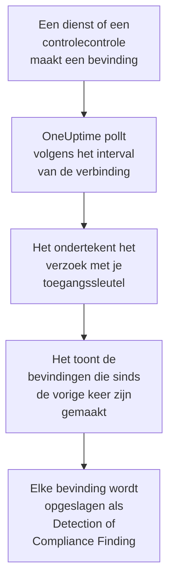

# AWS Security Hub

Importeer bevindingen van [AWS Security Hub](https://aws.amazon.com/security-hub/) in de beveiligingsgebeurtenissen van OneUptime: bevindingen van GuardDuty, Inspector, Macie en IAM Access Analyzer, de eigen controlecontroles van Security Hub en bevindingen van partnerproducten. Daar doorzoek je ze naast je logs, traces en metrics, correleer je ze met elke andere bron en roep je de dienstdoende op voor de bevindingen die ertoe doen. OneUptime leest ze met een toegangssleutel die je zelf maakt, die één alleen-lezenactie mag uitvoeren, en wijzigt niets in AWS. Er is geen agent, EventBridge-regel of S3-export om in te stellen.

:::cards
- [De verbinding instellen](#de-verbinding-instellen): Een IAM-beleid, een toegangssleutel en het formulier van de verbinding.
- [Wat er wordt geïmporteerd](#wat-er-wordt-geïmporteerd): Hoe elke bevinding een beveiligingsgebeurtenis wordt.
- [Hoe pollen werkt](#hoe-pollen-werkt): Het venster dat elke poll leest, en waarom het 30 minuten met het vorige overlapt.
- [Problemen oplossen](#problemen-oplossen): Wat elke fout betekent en wat je moet wijzigen.
:::

## Hoe het werkt



Elke minuut pollt OneUptime elke ingeschakelde verbinding waarvan het pollinterval is verstreken. Een poll roept `GetFindings` van Security Hub aan in je regio, ondertekend met [Signature Version 4](https://docs.aws.amazon.com/IAM/latest/UserGuide/reference_sigv-create-signed-request.html), voor de bevindingen die sinds de vorige poll zijn gemaakt. Hij slaat elke bevinding op als een [OCSF](https://schema.ocsf.io/)-gebeurtenis: een controlecontrole als Compliance Finding (klasse `2003`), en elke andere bevinding als Detection Finding (klasse `2004`). Detectieregels, monitoren en dashboards behandelen haar daarna als een beveiligingsgebeurtenis uit elke andere bron.

## Voordat je begint

- In OneUptime de rol Project Owner, Project Admin of Security Admin. Security Member en Security Viewer zien verbindingen en hun runhistorie, maar kunnen ze niet wijzigen.
- Een AWS-account met Security Hub ingeschakeld in de regio die je koppelt. Security Hub is regionaal: een verbinding leest de bevindingen die één account in één regio heeft.
- Om de bevindingen van elk account en elke regio via één verbinding te lezen: het gedelegeerde beheerdersaccount van Security Hub, in zijn thuisregio, met [regio-overschrijdende aggregatie](https://docs.aws.amazon.com/securityhub/latest/userguide/finding-aggregation.html) aan. **Security Hub → Settings → Regions** toont de thuisregio.
- Uitgaand HTTPS van de OneUptime-app en -workers naar `securityhub.<region>.amazonaws.com`, of `securityhub.<region>.amazonaws.com.cn` in China, en een juiste klok op hun hosts: AWS weigert een verzoek dat meer dan 5 minuten ernaast is ondertekend.

## De verbinding instellen

De verbinding ondertekent haar verzoeken met een IAM-toegangssleutel. De identiteit van de sleutel heeft één actie nodig, `securityhub:GetFindings`, en verder niets: de verbinding wijzigt nooit een bevinding.

:::steps
### Het lezen van bevindingen toestaan

Open in de [IAM-console](https://console.aws.amazon.com/iam/) **Policies → Create policy**, kies **JSON** en plak dit beleid. Geef het een naam, bijvoorbeeld `OneUptimeSecurityHubRead`:

```json
{
  "Version": "2012-10-17",
  "Statement": [
    {
      "Effect": "Allow",
      "Action": "securityhub:GetFindings",
      "Resource": "*"
    }
  ]
}
```

`GetFindings` kan niet tot een resource worden beperkt, dus `Resource` blijft `*`. Het beheerde beleid `AWSSecurityHubReadOnlyAccess` werkt ook, maar staat meer toe.

### Een toegangssleutel maken

1. Open **Users → Create user**, geef de gebruiker een naam, bijvoorbeeld `oneuptime-security-hub`, laat consoletoegang uit en koppel het beleid. Doe dit voor de bevindingen van andere accounts in het gedelegeerde beheerdersaccount.
2. Open de gebruiker, dan **Security credentials → Access keys → Create access key**, en kies **Third-party service**.
3. Kopieer de **Toegangssleutel-ID** en de **Geheime toegangssleutel**. AWS toont het geheim maar één keer.

### De verbinding toevoegen in OneUptime

Open **Producten → Security Events → Verbindingen** (`/dashboard/{projectId}/security-events/connections`), klik op **Verbinding toevoegen**, kies **AWS Security Hub** en klik op **Volgende**. Vul de instellingen uit de tabel hieronder in, klik op **Volgende** en plak het geheim in **Geheime toegangssleutel**.

### Testen voordat je opslaat

Klik op **Deze instellingen testen** onder **Testen voor het opslaan**. De test ondertekent een verzoek met de waarden in het formulier, en slaat niets op, dus een verkeerde sleutel of een ontbrekende machtiging komt aan het licht voordat de verbinding bestaat. Klik daarna op **Volgende**, geef de verbinding een **Naam** en maak haar aan.
:::

| Instelling | Wat je invult |
| --- | --- |
| **Regio** | De code van de regio, zoals `us-east-1`, `eu-central-1` of `us-gov-west-1`: voor de bevindingen van andere accounts de thuisregio van het beheerdersaccount. |
| **Toegangssleutel-ID** | De ID van de sleutel: 16 tot 128 letters of cijfers, meestal 20 die beginnen met `AKIA`, of `ASIA` voor tijdelijke referenties. |
| **Geheime toegangssleutel** | Het geheim van de sleutel. Het wordt versleuteld, nooit door de API teruggegeven en nooit opnieuw getoond. Vervang het met **Inloggegevens bijwerken** bij de verbinding. |
| **Session token** | Alleen voor tijdelijke referenties, die het nodig hebben: een sleutel `ASIA` wordt zonder geweigerd, en een sleutel `AKIA` wordt met een token geweigerd. |

Tijdelijke referenties van `aws sts assume-role` of `aws sts get-session-token` verlopen, voor een aangenomen rol na hooguit 12 uur, en het pollen stopt tot je nieuwe plakt met **Inloggegevens bijwerken**. Een langlevende sleutel met dit smalle beleid, geroteerd volgens je eigen schema, blijft zonder toezicht pollen. Om van tijdelijke referenties over te stappen op een langlevende sleutel, vul je de nieuwe sleutel in bij **Inloggegevens bijwerken** en zet je **Remove the stored Session token** aan.

De stap **Opvragen** heeft ook een optionele **Beschrijving**, het **Opvraaginterval (minuten)**, een geheel getal van `1` tot `1440` dat begint op `5`, en **Ingeschakeld**, dat aan begint.

## Wat er wordt geïmporteerd

Elke bevinding wordt één gebeurtenis, met leverancier `Amazon Web Services` en product `AWS Security Hub`. Een bevinding met een object `Compliance`, een controlecontrole tegen een standaard zoals AWS Foundational Security Best Practices of CIS, wordt een Compliance Finding (OCSF-klasse `2003`). Elke andere bevinding wordt een Detection Finding (OCSF-klasse `2004`).

| Veld van de bevinding | OneUptime-kolom |
| --- | --- |
| `Id`, een ARN voor bevindingen die AWS maakt | Gebeurtenis-UID, waarop ook duplicaten worden verwijderd |
| `CreatedAt`, anders `UpdatedAt`, anders `FirstObservedAt` | Tijd van de gebeurtenis |
| `Title` | Regelnaam |
| `GeneratorId`, zoals het GuardDuty-bevindingstype of de ID van de controle | Regel-ID |
| `Title`, anders `Description` | Bericht |
| `Severity.Label`, anders een band van `Severity.Normalized` | Ernst |
| `Workflow.Status`: `NEW`, `NOTIFIED`, `RESOLVED` of `SUPPRESSED`, anders het oudere `WorkflowState` | Status |
| `Types` onder `TTPs/`: `TTPs/Initial Access/...` wordt `TA0001` | MITRE ATT&CK-tactieken en -technieken |
| De IAM-gebruiker van een resource van het type toegangssleutel of gebruiker, `Network.SourceIpV4` of `SourceIpV6`, `Process.Name` of `Process.Path` | Gebruiker, IP en proces van de actor |
| `Process.Name` en `Process.Path` | Naam en pad van het proces. Een bevinding noemt geen opdrachtregel en geen bovenliggend proces. |
| De instance-ID van een resource `AwsEc2Instance`, `Network.DestinationIpV4` of `DestinationIpV6`, `Network.DestinationPort`, de eerste `Resources[].Id` | Host, IP, poort en resource van het doel |
| Die, elke `Resources[].Id`, `AwsAccountId`, de domeinen van het netwerk, malwarenamen en threat-intelligencewaarden | Observables |
| De hele bevinding, plat gemaakt tot sleutels met punten, zoals `Compliance.Status` en `Remediation.Recommendation.Url` | `attributes` |

Wanneer een bevinding geen `Severity.Label` heeft, beslist `Severity.Normalized`: `0` is Informational, `1` tot `39` Low, `40` tot `69` Medium, `70` tot `89` High, en `90` tot `100` Critical. Een bevinding die Security Hub later bijwerkt, met een nieuwe `Workflow.Status` of een controle die nu slaagt, houdt haar `Id`, dus ze wordt niet opnieuw geïmporteerd: de gebeurtenis houdt de bevinding zoals ze bij het importeren was.

## Hoe pollen werkt

Elke poll toont de bevindingen die in zijn venster zijn gemaakt, de oudste eerst, 100 per pagina, en volgt `NextToken` tot hij het hele venster heeft gelezen:

```text
POST https://securityhub.{region}.amazonaws.com/findings
    {"Filters": {"CreatedAt": [{"Start": "{window start}", "End": "{window end}"}]},
     "SortCriteria": [{"Field": "CreatedAt", "SortOrder": "asc"}],
     "MaxResults": 100}
```

- **De aanmaaktijd is de cursor.** Bevindingen worden getoond op `CreatedAt`, nooit op `FirstObservedAt`. GuardDuty maakt een bevinding zodra het genoeg activiteit heeft gezien, en een controlecontrole wanneer Security Hub de resource voor het eerst controleert, uren of dagen nadat de activiteit begon. Een cursor op observatietijd zou ze overslaan.
- **De eerste poll kijkt 24 uur terug**, zodat een nieuwe verbinding meteen haar recente bevindingen toont.
- **Elke volgende poll begint 30 minuten voor de opgeslagen cursor.** `CreatedAt` wordt gezet door de dienst die het probleem vond, en de bevinding bereikt Security Hub later: GuardDuty stuurt nieuwe bevindingen binnen vijf minuten, en een mislukte levering via EventBridge wordt tot 24 uur lang opnieuw geprobeerd. De overlap leest zulke bevindingen bij de volgende poll. Een bevinding die meer dan 30 minuten na haar `CreatedAt` aankomt, kan achter de cursor vallen: importeer haar tijdsbereik om haar terug te halen.
- **Een poll leest hooguit 24 uur voorbij de cursor.** Een verbinding waarvan de cursor achterliep, haalt de achterstand in met een reeks vensters van 24 uur, en haar **Gezondheid** toont **Catching up**.
- **Duplicaten worden verwijderd op de `Id` van de bevinding** binnen het project, zodat de overlap, een herhaald venster en een import een bevinding nooit twee keer opslaan.

### Wanneer een venster meer bevat dan één poll kan lezen

Een poll stuurt hooguit 20 verzoeken van 100 bevindingen: 2.000 bevindingen. Wanneer een venster er meer bevat, is de run **Gedeeltelijk**, met een waarschuwing zoals:

```text
Stopped after 20 findings requests (the per-run request limit) before the window was fully read. The last finding read was created at 2026-09-14T08:12:44.000Z.
```

Bevindingen worden de oudste eerst gelezen, dus OneUptime zet de cursor op de aanmaaktijd van de laatst gelezen bevinding, en de volgende poll begint daar, zonder de overlap van 30 minuten, met dezelfde vensterlengte. Een druk account haalt zo ongeveer 2.000 bevindingen per poll in, in plaats van steeds dezelfde opnieuw te lezen. De overlap komt terug zodra de cursor 30 minuten voorbij dat punt is.

Wanneer een run helemaal niet voorbij de opgeslagen cursor komt, bijvoorbeeld omdat de 30 minuten overlap alleen al meer dan 2.000 bevindingen bevatten, maakt OneUptime het venster in plaats daarvan korter:

1. **Verkleinen.** De volgende poll leest een venster dat half zo lang is, vanaf hetzelfde beginpunt, en blijft halveren tot een venster volledig wordt gelezen, tot één minuut. De waarschuwing van de run zegt het: `This window holds more records than one poll can read; the next poll reads a {n} minute window from the same starting point.`
2. **Weer groeien.** Nadat een venster volledig is gelezen, is het volgende weer twee keer zo lang, tot 24 uur.
3. **Voorbij één minuut gaan.** Als zelfs één minuut meer bevat dan een poll kan lezen, gaat het pollen eraan voorbij, zodat nieuwere bevindingen blijven binnenkomen, en de overlap van latere polls reikt er niet meer in terug. De run blijft **Gedeeltelijk**, en **Laatste fout** luidt `More records were created in the one minute from {cursor} to {end} than one poll can read. Polling moved past this minute so newer records keep arriving; use Import this time range in Diagnostics on this minute to recover what one run can read.` Importeer die minuut met **Import this time range** om terug te halen wat één run kan lezen.

Een run die volledig mislukt, met een fout van AWS, behoudt de cursor en de vensterlengte, en de volgende poll leest hetzelfde venster opnieuw. De enige uitzondering is een verzoek dat een time-out kreeg: de cursor blijft staan, maar het volgende venster is half zo lang, omdat een venster dat te zwaar is om op tijd te beantwoorden bij elke poging een time-out zou krijgen. Het **Opvraaginterval (minuten)** wijzigen verandert hier niets aan: het bepaalt hoe vaak een poll begint, niet waar zijn venster begint.

### Uitvoeren, bekijken en importeren op verzoek

Klik op **Diagnose** bij een verbinding om haar recente runs te zien en er met de hand mee te werken. Iedereen die de verbinding kan wijzigen, kan deze acties starten; iedereen die haar kan zien, kan de historie lezen.

- **Nu uitvoeren** start meteen een poll, met de gewone cursor, ook als de verbinding niet **Ingeschakeld** is.
- **Preview findings** leest een tijdsbereik van maximaal 7 dagen en importeert niets.
- **Import this time range** importeert een bereik van maximaal 7 dagen, nadat je bevestigt, zonder de cursor te verplaatsen. Al geïmporteerde bevindingen worden overgeslagen.
- **Copy diagnostics** bij een run kopieert het rapport ervan voor support. Het bevat nooit referenties.

## Verbinding testen

**Verbinding testen** op de rij van een verbinding, en **Deze instellingen testen** in het formulier, draaien in het API-proces, niet in een achtergrondworker, zodat een test ook antwoordt wanneer de workers het probleem zijn. Hij voert deze controles uit, in volgorde:

| Controle | Wat ze controleert |
| --- | --- |
| **Configuratie** | Elke instelling is aanwezig en goed gevormd. Er wordt niets benaderd als dit mislukt. |
| **Authenticate with AWS** | AWS accepteert een ondertekend verzoek `GetFindings` voor één bevinding die in de laatste 24 uur is gemaakt. AWS controleert de handtekening vóór het IAM-beleid, dus een weigering door het beleid doorstaat deze controle toch: de sleutel klopt. |
| **Read findings** | Security Hub beantwoordt dat verzoek: de identiteit mag `securityhub:GetFindings` aanroepen, en Security Hub is ingeschakeld in de regio. |
| **Findings available to import** | Hoeveel bevindingen er in de laatste 24 uur en de laatste 7 dagen zijn gemaakt, elk één pagina van 100, dus `100+` betekent meer. Geen in 7 dagen is een waarschuwing, geen fout. |
| **Background workers**, **Poll scheduler**, **Security event storage** | De kant van OneUptime zelf: een proces neemt de jobs van de Worker-wachtrij af, de poll-job draait elke minuut en de opslag van beveiligingsgebeurtenissen antwoordt. |
| **Scheduled polling** | Voor een opgeslagen verbinding: pollen staat aan, geen run zit vast in afwachting van een worker en polls draaien op tijd. |

Elk verzoek in een test heeft een deadline van 20 seconden. Een test importeert nooit iets en verplaatst nooit de cursor, en elke mislukte controle zegt wat je moet wijzigen.

## Problemen oplossen

De **Laatste fout** van de verbinding bewaart de volledige foutmelding, met referenties gemaskeerd, achter een voorvoegsel dat de mislukte stap noemt. Wanneer een verbinding een fout heeft, selecteer je **Fout bekijken** in haar kolom **Acties** om hem te lezen, en **Fout kopiëren** in het dialoogvenster om hem te kopiëren. Elke melding begint met `AWS Security Hub findings request`; lees wat erop volgt.

:::details Last Error zegt `failed (HTTP 401)` of `failed (HTTP 403)`
AWS weigerde het verzoek. De melding citeert de foutcode van AWS, of de eigen woorden van AWS als het geen code stuurde:

- `AccessDeniedException`, of `is not authorized to perform`: de sleutel klopt, maar zijn identiteit mag `securityhub:GetFindings` niet aanroepen. Koppel het beleid uit [De verbinding instellen](#de-verbinding-instellen). Een permissions boundary of een service control policy kan het ook weigeren.
- `InvalidAccessException`, of `is not subscribed to AWS Security Hub`: Security Hub is voor dit account niet ingeschakeld in deze **Regio**, of het account is daar niet de beheerder ervan.
- `InvalidSignatureException` of `SignatureDoesNotMatch`, of `The request signature we calculated does not match`: de **Geheime toegangssleutel** hoort niet bij de **Toegangssleutel-ID**. Maak een nieuwe toegangssleutel en sla hem op met **Inloggegevens bijwerken**.
- `UnrecognizedClientException` of `InvalidClientTokenId`, of `The security token included in the request is invalid`: AWS kent de **Toegangssleutel-ID** niet. Hij is verkeerd getypt, verwijderd, gedeactiveerd of uit een andere partitie, of het is een tijdelijke sleutel zonder zijn **Session token**.
- `ExpiredTokenException`, of `The security token included in the request is expired`: de tijdelijke referenties zijn verlopen. Geef nieuwe uit, of stap over op een langlevende sleutel.
- `RequestTimeTooSkewed` of `RequestExpired`, of `Signature expired`: de klok van de OneUptime-hosts loopt meer dan 5 minuten af. Herstel NTP op de app- en workerhosts.
- Helemaal geen code: AWS zei niet of de sleutel of het beleid het weigerde. Controleer eerst de sleutel, dan het beleid.
:::

:::details Last Error zegt `failed (HTTP ...)` met een andere status
- `HTTP 404`: geen enkel Security Hub-endpoint antwoordde in deze **Regio**. Vergelijk hem met het regiomenu van de AWS-console: `us-east-1`, niet `us-east1` of `N. Virginia`.
- `HTTP 429`: het account liep tegen de limiet van Security Hub aan, 3 verzoeken `GetFindings` per seconde in een regio. De volgende poll probeert het opnieuw. Blijft het gebeuren, zoek dan een ander hulpmiddel of een andere verbinding die hetzelfde account en dezelfde regio leest.
- `HTTP 5xx`: Security Hub had aan zijn kant een probleem. De volgende poll probeert het opnieuw.
- `HTTP 400`: Security Hub weigerde de query, die OneUptime opbouwt, niet je instellingen. Stuur de melding naar de support van OneUptime.
:::

:::details Last Error zegt `returned`, `timed out` of `Could not reach data source`
- `returned a non-JSON body` of `returned an unrecognized response shape`: iets anders dan Security Hub antwoordde, zoals de aanmeldpagina van een proxy of een gateway die antwoorden herschrijft. Dit wordt gemeld in plaats van als leeg venster opgevat, zodat de cursor nooit voorbij bevindingen gaat die niemand heeft gelezen.
- `timed out after 60 seconds with no response`, of `failed: Could not reach data source`: het verzoek kreeg geen antwoord. De endpoints van Security Hub zijn openbaar, dus controleer DNS, firewalls en proxy's tussen de OneUptime-app en -workers en `securityhub.<region>.amazonaws.com`.
:::

:::details Last Polled is Never en Last Error is leeg
Er is voor deze verbinding nog geen poll voltooid. Voer **Verbinding testen** uit: de controles **Background workers** en **Poll scheduler** noemen de oorzaak. Op een zelf gehoste installatie is de gebruikelijke oorzaak `DISABLE_QUEUE_WORKERS=true` op de app, zonder aparte worker-deployment die de jobs afneemt: zet het op `false`, of draai de worker-deployment (Helm: `worker.enabled: true`).
:::

:::details Een run is Partial
- `Stopped after 20 findings requests`: het venster bevatte meer dan de 2.000 bevindingen die één run leest. Er gaat niets verloren: de volgende poll begint na de laatst gelezen bevinding. Een verbinding die poll na poll **Gedeeltelijk** blijft, haalt een achterstand in, en haar **Laatst opgevraagd** en **Laatst geïmporteerde gebeurtenis** blijven vooruitgaan. Haalt ze die nooit in, dan maakt het account meer dan 2.000 bevindingen per pollinterval: maak het **Opvraaginterval (minuten)** korter.
- `More records were created in the one minute from ... than one poll can read`: het pollen ging voorbij die minuut. Importeer haar met **Import this time range** in **Diagnose**. Een import leest net zoveel als een poll.
:::

:::details De test slaagt, maar er wordt niets geïmporteerd
Lees **Findings available to import** in het testrapport. `0` in de laatste 7 dagen betekent dat Security Hub in dit account en deze regio geen enkele bevinding maakte: controleer of GuardDuty, Inspector of een beveiligingsstandaard daar aanstaat. Om de bevindingen van andere accounts en regio's te zien, koppel je het beheerdersaccount in zijn thuisregio.
:::

:::details Een bevinding uit de Security Hub-console is nooit aangekomen
Vergelijk haar `CreatedAt` met haar `ProcessedAt`, het moment waarop Security Hub haar ontving. Een bevinding die meer dan 30 minuten na haar `CreatedAt` aankwam, kan achter de cursor vallen: importeer haar `CreatedAt` met **Import this time range**.
:::

## Wat je krijgt

- **Zoeken.** Filter bevindingen op ernst, status, regel, account, resource of elke observable in de verkenner van beveiligingsgebeurtenissen, naast elke andere bron.
- **Correlatie.** De gebruikers, instances, IP's, resource-ARN's en account-ID's van elke bevinding worden geïndexeerd als observables, dus één zoekopdracht vindt alles wat ze noemt.
- **Detectieregels.** Sigma-regels die volgens een schema over je beveiligingsgebeurtenissen draaien, en waarschuwingen openen die de dienst oproepen.
- **Monitoren.** Monitoren voor beveiligingsgebeurtenissen tellen overeenkomende gebeurtenissen, bijvoorbeeld nieuwe kritieke GuardDuty-bevindingen of mislukte controles, en openen boven een drempel incidenten of waarschuwingen.

Beveiligingsgebeurtenissen worden gefactureerd zoals de rest van je telemetrie, per opgenomen GB. Zie [Prijzen](https://oneuptime.com/pricing).

## Volgende stappen

:::cards
- [Beveiligingsgebeurtenissen](/docs/telemetry/security-events): Zoeken, correleren en waarschuwen op wat je importeert.
- [Okta System Log](/docs/integrations/okta): Importeer ook de aanmeldingen van je identiteitsprovider.
- [Rollen](/docs/permissions/reference#rollen): Wat de Security-rollen kunnen zien en wijzigen.
- [Overzicht van integraties](/docs/integrations/index): De andere tools die je kunt koppelen.
:::
