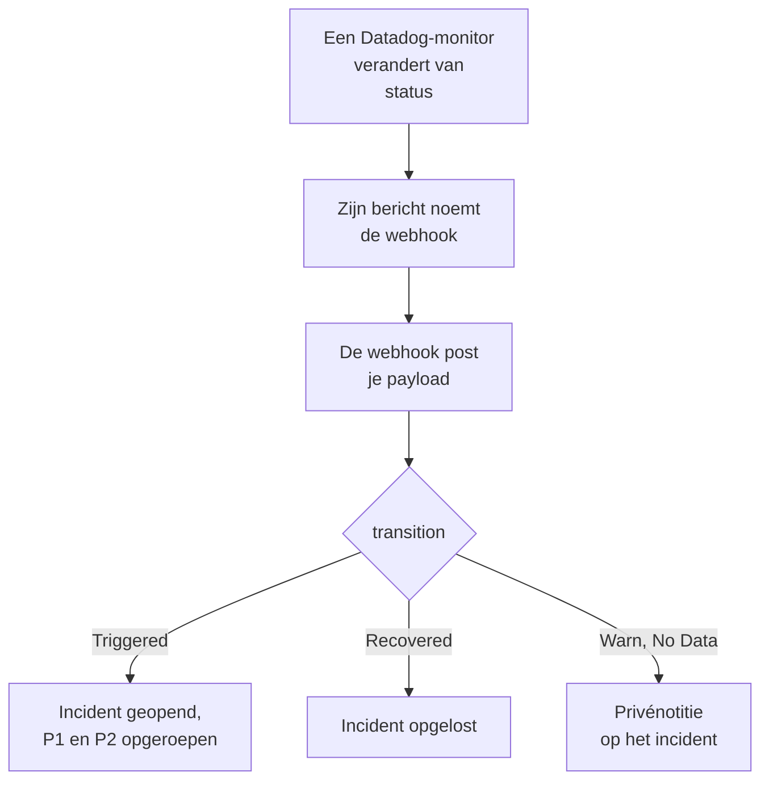

# Datadog

Stuur waarschuwingen van [Datadog](https://www.datadoghq.com)-monitors naar OneUptime, zodat elke waarschuwing een incident of een waarschuwing wordt, je bereikbaarheidsteam oproept wanneer het urgent is en wordt opgelost wanneer de Datadog-monitor herstelt. Datadog stuurt zijn waarschuwingen via zijn [Webhooks-integratie](https://docs.datadoghq.com/integrations/webhooks/), dus aan geen van beide kanten hoef je iets te installeren.

:::cards
- [Kiezen hoe OneUptime waarschuwingen ontvangt](#kiezen-hoe-oneuptime-waarschuwingen-ontvangt): Een workflowsjabloon of een Incoming Request-monitor.
- [Beginnen met het sjabloon](#beginnen-met-het-sjabloon): Kies wie je oproept, kopieer de URL en zie wat elke waarschuwing doet.
- [Waarschuwingen ontvangen met een monitor](#waarschuwingen-ontvangen-met-een-monitor): Eén incident per waarschuwing, opgelost bij herstel.
- [Datadog configureren](#datadog-configureren): Een webhook, en de monitors die hem melden.
- [Problemen oplossen](#problemen-oplossen): Wanneer waarschuwingen niet aankomen of incidenten open blijven.
:::

## Hoe het werkt



Een Datadog-monitor meldt de webhooks die zijn bericht noemt wanneer hij van status verandert: wanneer hij afgaat, waarschuwt, herstelt of geen gegevens heeft. De JSON-body van de webhook schrijf je zelf, uit de [templatevariabelen](https://docs.datadoghq.com/integrations/webhooks/#usage) van Datadog, dus deze gids geeft je er een die elke waarschuwing een naam geeft en zegt wat ermee is gebeurd.

## Voordat je begint

- Een Datadog-account waarin je integraties kunt configureren en monitors kunt bewerken.
- In OneUptime het recht om workflows te maken, of monitoren als je die weg kiest. In OneUptime Cloud hebben workflows het abonnement **Growth** of hoger nodig.

## Kiezen hoe OneUptime waarschuwingen ontvangt

Stel eerst OneUptime in: dat geeft je de URL waar Datadog naartoe stuurt.

| Weg | Gebruik hem als |
| --- | --- |
| Het workflowsjabloon (aanbevolen) | Je wilt elke waarschuwing als een incident of een waarschuwing met een ernst die volgt uit de prioriteit van de monitor, met de dienst opgeroepen voor P1 en P2, met waarschuwingsniveaus erop genoteerd, en opgelost bij herstel. Er valt niets te bouwen. |
| Een Incoming Request-monitor | Je wilt incidenten zonder workflow, op elk abonnement, en een monitor waarvan de status Datadog volgt. |

Beide krijgen dezelfde JSON van dezelfde webhook, dus je kunt met de ene beginnen en later overstappen door één URL in Datadog te wijzigen.

## Beginnen met het sjabloon

Het dialoogvenster **Een workflow maken** heeft twee Datadog-sjablonen, onder **Datadog** in de lijst met categorieën: **Declare an incident when a Datadog monitor triggers**, en **Create an alert when a Datadog monitor triggers** voor waarschuwingen. Beide doen hetzelfde, elk met een eigen soort record.

:::steps
1. Ga naar **Workflows** en klik op **Workflow maken**. Kies onder **Of begin met een sjabloon** de categorie **Datadog**, klik op **Declare an incident when a Datadog monitor triggers**, of op **Create an alert when a Datadog monitor triggers**, en klik op **Dit sjabloon gebruiken**.
2. Kies onder **Who to page for P1 and P2 monitors** het bereikbaarheidsbeleid dat moet worden opgeroepen, of niets om niemand op te roepen, en klik op **Workflow maken**. De workflow opent in de **Bouwer**, uitgeschakeld.
3. Klik op de trigger **Webhook**, daarna op **URL kopiëren**, en bewaar de URL voor Datadog.
4. Zet **Ingeschakeld** aan bovenaan de **Bouwer**. Een workflow die uit staat, antwoordt Datadog met `400`.
:::

Daarna [configureer je Datadog](#datadog-configureren) zodat het zijn waarschuwingen naar die URL stuurt. De stap `read-event-1` van de workflow opent met dezelfde instelling, voor als je er in de **Bouwer** op terugkomt.

### Wat de workflow doet

Na de trigger **Webhook** leest de stap **Check With JavaScript** `read-event-1` de `transition` die Datadog stuurt, en **Incident From Another Tool**, of **Alert From Another Tool** in het sjabloon voor waarschuwingen, doet wat die betekent, via de cyclussleutel van de waarschuwing. Datadog bewaart die sleutel vanaf het moment dat een waarschuwing afgaat tot ze herstelt, en de volgende keer dat ze afgaat is de sleutel nieuw, zodat elke keer een eigen incident krijgt. Het incident bewaart de sleutel in zijn aangepaste veld `datadogAlertCycleKey`.

| Overgang | Wat de workflow doet |
| --- | --- |
| `Triggered`, `Re-Triggered` | Meldt een incident met de titel `Datadog: <monitor>`, met de ernst waar de prioriteit van de monitor op uitkomt, buiten je statuspagina's gehouden. De beschrijving linkt naar de waarschuwing in Datadog en noemt de prioriteit, de host, de scope en het bericht van de monitor. Een melding voor een waarschuwing die al een incident heeft, opent geen tweede en roept niemand opnieuw op. |
| `Recovered` | Lost het incident van de waarschuwing op, tenzij het al is opgelost. Waarom staat op de tijdlijn ervan. |
| `Warn`, `Re-Warn`, `No Data`, `Re-No Data` | Voegt een privénotitie aan het incident van de waarschuwing toe, met wat de status van de monitor nu is. |
| `Renotify` | Niets: de waarschuwing is nog open. |

Een waarschuwingsniveau of een herstel voor een waarschuwing zonder incident verandert niets. Al het andere, zoals een verzoek van een ander hulpmiddel, blijft ongemoeid: `read-event-1` neemt **No**, en de **Stappen** van de uitvoering zeggen waarom. Er gaat niets terug naar Datadog: het lost zijn eigen waarschuwingen op wanneer het signaal herstelt, en daarmee wordt het incident opgelost.

### Prioriteiten en oproepen

Een nieuw incident roept het bereikbaarheidsbeleid op dat je hebt gekozen wanneer zijn monitor P1 of P2 is, of geen prioriteit heeft. P3, P4 en P5 openen een incident en roepen niemand op. In een nieuw project komen de prioriteiten uit op deze incident- en waarschuwingsernstniveaus:

| Datadog-prioriteit | Incident | Waarschuwing | Dienst |
| --- | --- | --- | --- |
| P1 | Critical Incident | High | Opgeroepen |
| P2 | Critical Incident | High | Opgeroepen |
| Geen prioriteit | Critical Incident | High | Opgeroepen |
| P3 | Major Incident | Low | Niet opgeroepen |
| P4 | Minor Incident | Low | Niet opgeroepen |
| P5 | Minor Incident | Low | Niet opgeroepen |

Met eigen ernstniveaus gaan P1, P2 en geen prioriteit naar je ernstigste, P3 naar het middelste en P4 en P5 naar je minst ernstige.

- Om een prioriteit op naam aan een van de jouwe toe te wijzen, bewerk je `SEVERITY_BY_NAME` in de stap `read-event-1`, zoals `{ P3: 'Minor Incident' }`.
- Om ook voor P3 op te roepen, zet je **Compare with** van de stap `if-page-1` **If / Else** op `3`.

## Waarschuwingen ontvangen met een monitor

Een [Incoming Request-monitor](/docs/monitor/incoming-request-monitor) geeft je een URL, en zijn criteria bepalen wat elke waarschuwing doet.

:::steps
### De monitor maken

Ga naar **Monitoren** en klik op **Monitor maken**. Kies **Incoming Request** onder **Monitortype**, noem hem `Datadog` en klik op **Volgende**.

### Een incident declareren voor elke waarschuwing

Open in de stap **Criteria** het eerste criterium, het criterium dat de monitor offline zet. Zet het filter op **Verzoeklichaam**, **Bevat**, `"transition":"Triggered"`. Dit criterium declareert al een incident wanneer het filter overeenkomt. Vul het incident in:

- **Incidenttitel**: `{{requestBody.title}}`.
- **Incidentbeschrijving**, onder **Beschrijving**: `{{requestBody.body}}`, en daarna `Datadog: {{requestBody.link}}` op een eigen regel.
- **Ernst**: de incidenternst die deze waarschuwingen moeten krijgen.
- **Bereikbaarheidsbeleid**, onder **Bereikbaarheid**: het beleid dat moet worden opgeroepen.
- **Incident automatisch oplossen**, onder **Meer velden**: laat het aan, zoals het begint. Zonder dit worden herstelmeldingen genegeerd en blijven incidenten open.

### Eén incident per waarschuwing openen

Open in hetzelfde criterium **Instellingen** en zet **Group incidents and alerts by a payload field** aan. Vul het in zoals hieronder, zodat elke waarschuwing een eigen incident krijgt en haar herstel het oplost:

| Veld | Waarde |
| --- | --- |
| **Open a separate incident for each…** | `requestBody.alert_key` |
| **Field that signals recovery** | `requestBody.transition` |
| **Value that means recovered** | `Recovered` |

### De monitor weer online brengen

Open het tweede criterium, het criterium dat de monitor online zet, en zet het filter op **Verzoeklichaam**, **Bevat**, `"transition":"Recovered"`.

### De URL kopiëren

Klik op **Monitor maken**. De pagina **Overzicht** van de monitor toont zijn **Heartbeat URL**. Kopieer die voor Datadog:

```text
https://oneuptime.com/heartbeat/<secret key>
```

Een zelf gehoste installatie heeft een eigen host in plaats van `oneuptime.com`.
:::

De payload hieronder zet `alert_key` op de ID van de Datadog-monitor en de tags van de groep die waarschuwde, zodat elke groep van een multi-alert-monitor een eigen incident krijgt en het herstel van die groep het oplost. Een monitor die opnieuw afgaat of opnieuw meldt terwijl zijn incident open is, opent geen tweede. Zie [Waarschuwingen uit een ander systeem ontvangen](/docs/monitor/incoming-request-monitor#waarschuwingen-uit-een-ander-systeem-ontvangen) voor wat elke instelling doet.

> [!NOTE]
> Een melding **Warn** of **No Data** opent met deze filters geen incident. Wil je ook bij waarschuwingsniveau worden opgeroepen, klik dan op **Criteria toevoegen**, geef het nieuwe criterium het filter **Verzoeklichaam**, **Bevat**, `"transition":"Warn"`, een incident met een eigen **Ernst** en dezelfde groeperingsinstellingen, en sleep het boven het eerste criterium. Criteria worden van boven af gecontroleerd, en het eerste dat overeenkomt beslist.

## Datadog configureren

:::steps
### De webhook toevoegen

Open in Datadog de [tegel van de Webhooks-integratie](https://app.datadoghq.com/integrations/webhooks) en installeer die als dat nog niet is gebeurd. Voeg een webhook met deze instellingen toe en sla hem op:

- **Name**: `oneuptime`. Monitors noemen de webhook bij deze naam, als `@webhook-oneuptime`.
- **URL**: de URL die je uit OneUptime hebt gekopieerd.
- **Payload**:

  ```json
  {
    "alert_key": "$ALERT_ID $ALERT_SCOPE",
    "alert_cycle_key": "$ALERT_CYCLE_KEY",
    "transition": "$ALERT_TRANSITION",
    "alert_priority": "$ALERT_PRIORITY",
    "title": "$EVENT_TITLE",
    "body": "$TEXT_ONLY_MSG",
    "host": "$HOSTNAME",
    "scope": "$ALERT_SCOPE",
    "priority": "$PRIORITY",
    "link": "$LINK"
  }
  ```

### De webhook noemen in je monitors

Voeg in elke Datadog-monitor die via OneUptime moet oproepen `@webhook-oneuptime` toe aan het meldingsbericht van de monitor, en sla de monitor op. Datadog stuurt dan de waarschuwingen en herstelmeldingen van die monitor naar OneUptime.
:::

| Variabele | Wat Datadog erin zet |
| --- | --- |
| `$ALERT_ID` | De ID van de Datadog-monitor die waarschuwde. |
| `$ALERT_SCOPE` | De tags van de groep die waarschuwde, zoals `host:web-1`. |
| `$ALERT_CYCLE_KEY` | Een ID die gelijk blijft vanaf het moment dat een waarschuwing afgaat tot ze herstelt. |
| `$ALERT_TRANSITION` | Wat er gebeurde: `Triggered`, `Re-Triggered`, `Warn`, `Recovered`, `No Data` of `Renotify`, onder andere. |
| `$ALERT_PRIORITY` | De prioriteit van de Datadog-monitor, `P1` tot `P5`, of niets voor een monitor zonder prioriteit. |
| `$EVENT_TITLE` | De titel van de gebeurtenis, zoals `[Triggered] High CPU`. |
| `$TEXT_ONLY_MSG` | Het bericht van de monitor, zonder Markdown. |
| `$LINK` | Een link naar de gebeurtenis in Datadog. |

Eén payload dient beide manieren: het sjabloon gaat uit van `alert_cycle_key` en `alert_priority`, en de monitor van `alert_key`. Behoud ze allemaal, en je kunt later overstappen door alleen de URL te wijzigen.

## Testen

Stuur een waarschuwing naar de URL die je hebt gekopieerd, zoals Datadog dat zou doen:

```bash
curl -X POST "<url>" \
  -H "Content-Type: application/json" \
  -d '{
    "alert_key": "1234 host:web-1",
    "alert_cycle_key": "7151157925468446720",
    "transition": "Triggered",
    "alert_priority": "P1",
    "title": "[Triggered] High CPU",
    "body": "CPU is above 90% on web-1.",
    "host": "web-1",
    "scope": "host:web-1",
    "priority": "normal",
    "link": "https://app.datadoghq.com/event/event?id=1"
  }'
```

Met het sjabloon opent een incident, met de titel `Datadog: High CPU`, en het bereikbaarheidsbeleid dat je hebt gekozen wordt opgeroepen. Met de monitor opent een incident, met de titel `[Triggered] High CPU`. Stuur hetzelfde verzoek met `transition` op `Recovered`, en het incident wordt opgelost.

Test daarna vanuit Datadog: open een monitor die de webhook noemt, klik op **Test Notifications** en stuur de melding **Alert**. Om te zien dat ze is aangekomen, open je **Logboeken → Uitvoeringen** van de workflow, of de tijdlijn van de OneUptime-monitor.

## Problemen oplossen

:::details Er komt niets aan in OneUptime
- Controleer dat het bericht van de Datadog-monitor `@webhook-oneuptime` noemt, gespeld zoals de webhook heet.
- De monitor antwoordt meteen `200`, voordat hij iets controleert, ook bij een verkeerde geheime sleutel. Kijk in de tijdlijn van de monitor of waarschuwingen aankomen.
- Een uitgeschakelde workflow antwoordt `400`. Zet **Ingeschakeld** aan bovenaan de **Bouwer** ervan.
:::

:::details De workflow draait, maar opent niets
Open de uitvoering in **Logboeken → Uitvoeringen**. De vermelding `read-event-1` in de **Stappen** ervan zegt waarom hij **No** nam.

- `Datadog named no alert cycle key`: voeg `"alert_cycle_key": "$ALERT_CYCLE_KEY"` toe aan de payload van de webhook in Datadog.
- `Datadog named no transition`: voeg `"transition": "$ALERT_TRANSITION"` toe aan de payload van de webhook in Datadog.
:::

:::details De dienst wordt niet opgeroepen
- Alleen P1- en P2-monitors en monitors zonder prioriteit roepen op. Zie [Prioriteiten en oproepen](#prioriteiten-en-oproepen).
- Een melding voor een waarschuwing die al een incident heeft, roept niemand opnieuw op.
- Als in het dialoogvenster **Een workflow maken** niemand is gekozen, heeft de workflow geen stap die oproept.
:::

:::details Incidenten gaan open maar worden nooit opgelost
- De Datadog-monitor moet de webhook ook van zijn herstel op de hoogte brengen. Een bericht dat de webhook alleen voor waarschuwingen noemt, binnen een voorwaarde, stuurt geen herstel.
- Open met het sjabloon de uitvoering van het herstel in **Logboeken → Uitvoeringen**: de laatste stap zegt waarom. De `alert_cycle_key` van het herstel moet die van de waarschuwing zijn, dus laat `$ALERT_CYCLE_KEY` in de payload zoals het is.
- Bij de monitor heeft het incident van het criterium **Incident automatisch oplossen** nodig, onder **Meer velden**.
- **Value that means recovered** moet precies `Recovered` zijn. De vergelijking is hoofdlettergevoelig.
- De `alert_key` van het herstel moet die van de waarschuwing zijn: laat `$ALERT_ID $ALERT_SCOPE` staan zoals in de payload.
:::

:::details Een veld toont de naam van een variabele, of niets
Datadog vult alleen de variabelen in die op de gebeurtenis van toepassing zijn. Stuur een testmelding en kijk wat er is aangekomen: in de tijdlijn van de monitor, of voor een workflow in **Logboeken → Uitvoeringen**.
:::

:::details Elke waarschuwing van een monitor valt samen in één incident
Bij de monitor heeft elke groep een eigen `alert_key` nodig. Controleer dat de payload hem zet uit zowel `$ALERT_ID` als `$ALERT_SCOPE`, en dat het groeperingspad `requestBody.alert_key` is.
:::

## Beveiliging

- **Behandel de URL als een wachtwoord.** Iedereen die hem heeft, kan incidenten openen. Lekt hij uit, stel hem dan opnieuw in: **URL opnieuw instellen** in de trigger **Webhook** van de workflow, of **Geheime sleutel voor inkomende aanvraag opnieuw instellen** op de pagina **Instellingen** van de monitor. Werk daarna de **URL** van de webhook in Datadog bij.
- **Links gaan naar Datadog.** Het sjabloon linkt een waarschuwing alleen op een Datadog-site, wat een verzoek ook zegt, en schrijft wat Datadog stuurde als tekst.
- **Zelf gehost?** Datadog stuurt webhooks vanaf het internet, dus je OneUptime moet van daaruit via HTTPS bereikbaar zijn.

## Volgende stappen

:::cards
- [Workflowsjablonen](/docs/workflows/authoring): Maak een workflow van een sjabloon en wijzig hem in de Bouwer.
- [Inkomende-verzoek-monitor](/docs/monitor/incoming-request-monitor): Elke instelling van de monitor die je waarschuwingen ontvangt.
- [New Relic](/docs/integrations/new-relic): Hetzelfde sjabloon, voor New Relic-issues.
- [Escalatieregels](/docs/on-call/escalation-rules): Bepaal wie een bereikbaarheidsbeleid oproept, en wanneer.
- [Overzicht van integraties](/docs/integrations/index): De andere tools die je kunt koppelen.
:::
