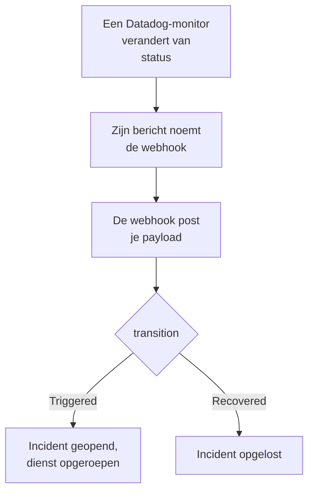

# Datadog

Stuur waarschuwingen van [Datadog](https://www.datadoghq.com)-monitors naar OneUptime, zodat elke waarschuwing een incident wordt dat je team met dienst oproept en wordt opgelost wanneer de Datadog-monitor herstelt. Datadog stuurt zijn waarschuwingen via zijn [Webhooks-integratie](https://docs.datadoghq.com/integrations/webhooks/), dus aan geen van beide kanten hoef je iets te installeren.

:::cards
- [Kiezen hoe OneUptime waarschuwingen ontvangt](#kiezen-hoe-oneuptime-waarschuwingen-ontvangt): Een Incoming Request-monitor of een eigen workflow.
- [Waarschuwingen ontvangen met een monitor](#waarschuwingen-ontvangen-met-een-monitor): Eén incident per waarschuwing, opgelost bij herstel.
- [Datadog configureren](#datadog-configureren): Een webhook, en de monitors die hem melden.
- [Problemen oplossen](#problemen-oplossen): Wanneer waarschuwingen niet aankomen of incidenten open blijven.
:::

## Hoe het werkt



Een Datadog-monitor meldt de webhooks die zijn bericht noemt wanneer hij van status verandert: wanneer hij afgaat, waarschuwt, herstelt of geen gegevens heeft. De JSON-body van de webhook schrijf je zelf, uit de [templatevariabelen](https://docs.datadoghq.com/integrations/webhooks/#usage) van Datadog, dus deze gids geeft je er een die elke waarschuwing een naam geeft en zegt wat ermee is gebeurd.

## Voordat je begint

- Een Datadog-account waarin je integraties kunt configureren en monitors kunt bewerken.
- In OneUptime het recht om monitoren aan te maken, of workflows als je die weg kiest.

## Kiezen hoe OneUptime waarschuwingen ontvangt

Stel eerst OneUptime in: dat geeft je de URL waar Datadog naartoe stuurt.

| Weg | Gebruik hem als |
| --- | --- |
| Een Incoming Request-monitor (aanbevolen) | Je wilt dat elke waarschuwing een incident is dat de dienst oproept en wordt opgelost wanneer de Datadog-monitor herstelt. Er valt niets te bouwen. |
| Een workflow met een Webhook-trigger | Je hebt eigen logica nodig: waarschuwingen filteren, ze omvormen of eerst andere systemen aanroepen. Een workflow declareert een incident voor elke waarschuwing die hij krijgt, en lost het niet op bij herstel. |

Beide krijgen dezelfde JSON van dezelfde webhook, dus je kunt met de ene beginnen en later overstappen door één URL in Datadog te wijzigen.

## Waarschuwingen ontvangen met een monitor

Een [Incoming Request-monitor](/docs/monitor/incoming-request-monitor) geeft je een URL, en zijn criteria bepalen wat elke waarschuwing doet.

:::steps
### De monitor maken

Ga naar **Monitoren** en klik op **Monitor maken**. Kies **Incoming Request** onder **Monitortype**, noem hem `Datadog` en klik op **Volgende**.

### Een incident declareren voor elke waarschuwing

Open in de stap **Criteria** het eerste criterium, het criterium dat de monitor offline zet. Zet het filter op **Verzoeklichaam**, **Bevat**, `"transition":"Triggered"`. Dit criterium declareert al een incident wanneer het filter overeenkomt. Vul het incident in:

- **Incidenttitel**: `{{requestBody.title}}`.
- **Incidentbeschrijving**, onder **Beschrijving**: `{{requestBody.body}}`, en daarna `Datadog: {{requestBody.link}}` op een eigen regel.
- **Ernst**: de incidenternst die deze waarschuwingen moeten krijgen.
- **Bereikbaarheidsbeleid**, onder **Bereikbaarheid**: het beleid dat moet worden opgeroepen.
- **Incident automatisch oplossen**, onder **Meer velden**: laat het aan, zoals het begint. Zonder dit worden herstelmeldingen genegeerd en blijven incidenten open.

### Eén incident per waarschuwing openen

Open in hetzelfde criterium **Instellingen** en zet **Group incidents and alerts by a payload field** aan. Vul het in zoals hieronder, zodat elke waarschuwing een eigen incident krijgt en haar herstel het oplost:

| Veld | Waarde |
| --- | --- |
| **Open a separate incident for each…** | `requestBody.alert_key` |
| **Field that signals recovery** | `requestBody.transition` |
| **Value that means recovered** | `Recovered` |

### De monitor weer online brengen

Open het tweede criterium, het criterium dat de monitor online zet, en zet het filter op **Verzoeklichaam**, **Bevat**, `"transition":"Recovered"`.

### De URL kopiëren

Klik op **Monitor maken**. De pagina **Overzicht** van de monitor toont zijn **Heartbeat URL**. Kopieer die voor Datadog:

```text
https://oneuptime.com/heartbeat/<secret key>
```

Een zelf gehoste installatie heeft een eigen host in plaats van `oneuptime.com`.
:::

De payload hieronder zet `alert_key` op de ID van de Datadog-monitor en de tags van de groep die waarschuwde, zodat elke groep van een multi-alert-monitor een eigen incident krijgt en het herstel van die groep het oplost. Een monitor die opnieuw afgaat of opnieuw meldt terwijl zijn incident open is, opent geen tweede. Zie [Waarschuwingen uit een ander systeem ontvangen](/docs/monitor/incoming-request-monitor#waarschuwingen-uit-een-ander-systeem-ontvangen) voor wat elke instelling doet.

> [!NOTE]
> Een melding **Warn** of **No Data** opent met deze filters geen incident. Wil je ook bij waarschuwingsniveau worden opgeroepen, klik dan op **Criteria toevoegen**, geef het nieuwe criterium het filter **Verzoeklichaam**, **Bevat**, `"transition":"Warn"`, een incident met een eigen **Ernst** en dezelfde groeperingsinstellingen, en sleep het boven het eerste criterium. Criteria worden van boven af gecontroleerd, en het eerste dat overeenkomt beslist.

## Datadog configureren

:::steps
### De webhook toevoegen

Open in Datadog de [tegel van de Webhooks-integratie](https://app.datadoghq.com/integrations/webhooks) en installeer die als dat nog niet is gebeurd. Voeg een webhook met deze instellingen toe en sla hem op:

- **Name**: `oneuptime`. Monitors noemen de webhook bij deze naam, als `@webhook-oneuptime`.
- **URL**: de URL die je uit OneUptime hebt gekopieerd.
- **Payload**:

  ```json
  {
    "alert_key": "$ALERT_ID $ALERT_SCOPE",
    "transition": "$ALERT_TRANSITION",
    "title": "$EVENT_TITLE",
    "body": "$TEXT_ONLY_MSG",
    "host": "$HOSTNAME",
    "priority": "$PRIORITY",
    "link": "$LINK"
  }
  ```

### De webhook noemen in je monitors

Voeg in elke Datadog-monitor die via OneUptime moet oproepen `@webhook-oneuptime` toe aan het meldingsbericht van de monitor, en sla de monitor op. Datadog stuurt dan de waarschuwingen en herstelmeldingen van die monitor naar OneUptime.
:::

| Variabele | Wat Datadog erin zet |
| --- | --- |
| `$ALERT_ID` | De ID van de Datadog-monitor die waarschuwde. |
| `$ALERT_SCOPE` | De tags van de groep die waarschuwde, zoals `host:web-1`. |
| `$ALERT_TRANSITION` | Wat er gebeurde: `Triggered`, `Re-Triggered`, `Warn`, `Recovered`, `No Data` of `Renotify`, onder andere. |
| `$EVENT_TITLE` | De titel van de gebeurtenis, zoals `[Triggered] High CPU`. |
| `$TEXT_ONLY_MSG` | Het bericht van de monitor, zonder Markdown. |
| `$LINK` | Een link naar de gebeurtenis in Datadog. |

## Testen

Stuur OneUptime een waarschuwing, zoals Datadog dat zou doen:

```bash
curl -X POST "https://oneuptime.com/heartbeat/<secret key>" \
  -H "Content-Type: application/json" \
  -d '{
    "alert_key": "1234 host:web-1",
    "transition": "Triggered",
    "title": "[Triggered] High CPU",
    "body": "CPU is above 90% on web-1.",
    "host": "web-1",
    "priority": "normal",
    "link": "https://app.datadoghq.com/event/event?id=1"
  }'
```

Er gaat een incident open met de titel `[Triggered] High CPU`. Stuur hetzelfde verzoek met `transition` op `Recovered`, en het incident wordt opgelost.

Test daarna vanuit Datadog: open een monitor die de webhook noemt, klik op **Test Notifications** en stuur zijn melding **Alert**. Kijk in de tijdlijn van de OneUptime-monitor of ze is aangekomen.

## Waarschuwingen ontvangen met een workflow

Gebruik een [workflow](/docs/workflows/index) wanneer je eigen stappen nodig hebt tussen Datadog en het incident.

:::steps
### De workflow maken

Ga naar **Workflows**, klik op **Workflow maken** en daarna op **Vanaf nul beginnen**. Noem hem `Datadog alerts` en klik op **Workflow maken**.

### De Webhook-trigger toevoegen

Klik op het gestippelde blok **Kies wat deze workflow start** en kies **Webhook**. Klik op de trigger, daarna op **URL kopiëren**, en gebruik die URL in de webhook in Datadog.

### Controleren dat de monitor is afgegaan

Klik op **Component toevoegen**, voeg een blok **If / Else** toe en verbind de punt **Out** van de trigger ermee. Zet **Value to check** op `{{local.components.webhook-1.returnValues.request-body.transition}}`, **Comparison** op **is equal to** en **Compare with** op `Triggered`.

### Het incident declareren

Voeg een blok **Create One Incident** toe en verbind de kant **Yes** van het blok **If / Else** ermee. Kies onder **Incident Template** een sjabloon dat de ernst en het bereikbaarheidsbeleid instelt dat moet worden opgeroepen (zie [Incidentsjablonen](/docs/incidents/settings#incidentsjablonen)). Stel onder **JSON Object** in wat van Datadog komt:

```json
{
  "title": "{{local.components.webhook-1.returnValues.request-body.title}}",
  "description": "{{local.components.webhook-1.returnValues.request-body.body}}\nDatadog: {{local.components.webhook-1.returnValues.request-body.link}}"
}
```

Zonder sjabloon moet **JSON Object** ook `incidentSeverityId` bevatten, de ID van een van de incidenternstniveaus van het project.

### De workflow inschakelen

Zet **Ingeschakeld** aan bovenaan de **Bouwer**. Een uitgeschakelde workflow antwoordt Datadog met `400`.
:::

Elke melding `Triggered` declareert een nieuw incident. Een herstel neemt de kant **No** van het blok **If / Else**, waar niets is verbonden, dus daar stopt de run. Gebruik de monitor voor één incident per waarschuwing dat bij herstel wordt opgelost.

## Problemen oplossen

:::details Er komt niets aan in OneUptime
- Controleer dat het bericht van de Datadog-monitor `@webhook-oneuptime` noemt, gespeld zoals de webhook heet.
- De monitor antwoordt meteen `200`, voordat hij iets controleert, ook bij een verkeerde geheime sleutel. Kijk in de tijdlijn van de monitor of waarschuwingen aankomen.
- Een uitgeschakelde workflow antwoordt `400`. Zet **Ingeschakeld** aan bovenaan de **Bouwer** ervan.
:::

:::details Incidenten gaan open maar worden nooit opgelost
- De Datadog-monitor moet de webhook ook van zijn herstel op de hoogte brengen. Een bericht dat de webhook alleen voor waarschuwingen noemt, binnen een voorwaarde, stuurt geen herstel.
- Het incident van het criterium heeft **Incident automatisch oplossen** nodig, onder **Meer velden**.
- **Value that means recovered** moet precies `Recovered` zijn. De vergelijking is hoofdlettergevoelig.
- De `alert_key` van het herstel moet die van de waarschuwing zijn: laat `$ALERT_ID $ALERT_SCOPE` staan zoals in de payload.
:::

:::details Een veld toont de naam van een variabele, of niets
Datadog vult alleen de variabelen in die op de gebeurtenis van toepassing zijn. Stuur een testmelding en kijk wat er is aangekomen: in de tijdlijn van de monitor, of voor een workflow in **Logboeken → Uitvoeringen**.
:::

:::details Elke waarschuwing van een monitor valt samen in één incident
Elke groep heeft een eigen `alert_key` nodig. Controleer dat de payload die uit zowel `$ALERT_ID` als `$ALERT_SCOPE` opbouwt, en dat het groeperingspad `requestBody.alert_key` is.
:::

## Beveiliging

- **Behandel de URL als een wachtwoord.** Iedereen die hem heeft, kan incidenten openen. Lekt hij uit, stel hem dan opnieuw in: **Geheime sleutel voor inkomende aanvraag opnieuw instellen** op de pagina **Instellingen** van de monitor, of **URL opnieuw instellen** in de **Webhook**-trigger van de workflow. Werk daarna de **URL** van de webhook in Datadog bij.
- **Zelf gehost?** Datadog stuurt webhooks vanaf het internet, dus je OneUptime moet van daaruit via HTTPS bereikbaar zijn.

## Volgende stappen

:::cards
- [Inkomende-verzoek-monitor](/docs/monitor/incoming-request-monitor): Elke instelling van de monitor die je waarschuwingen ontvangt.
- [Prometheus Alertmanager](/docs/integrations/prometheus-alertmanager): Dezelfde opzet, voor Alertmanager.
- [Escalatieregels](/docs/on-call/escalation-rules): Bepaal wie een bereikbaarheidsbeleid oproept, en wanneer.
- [Overzicht van integraties](/docs/integrations/index): De andere tools die je kunt koppelen.
:::
