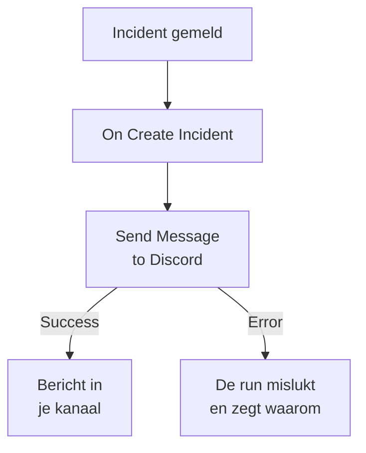

# Discord

Post een bericht in een [Discord](https://discord.com)-kanaal wanneer er een incident wordt geopend, zodat de mensen die dat kanaal volgen het meteen weten. De workflowstap **Send Message to Discord** van OneUptime post via de webhook van het kanaal, en een kant-en-klaar sjabloon bouwt de hele workflow voor je. Deze integratie is **uitgaand**: OneUptime post in het kanaal en leest niet wat daar wordt gezegd.

:::cards
- [Hoe het werkt](#hoe-het-werkt): Wat de workflow doet wanneer er een incident wordt geopend.
- [Instellen](#de-integratie-instellen): Een webhook in Discord, dan de workflow: vanuit het sjabloon of vanaf nul.
- [Tips](#tips): Opmaak, lange berichten en meer gebeurtenissen.
- [Problemen oplossen](#problemen-oplossen): Wat de fouten van de stap betekenen en wat je moet aanpassen.
:::

## Hoe het werkt



De stap post de **Message Text** naar de webhook van het kanaal. Hij neemt zijn uitgang **Success** wanneer Discord het bericht aanneemt, en zijn uitgang **Error**, met de reden van Discord, wanneer Discord het weigert. Is er niets op **Error** aangesloten, zoals in het sjabloon, dan mislukt een run die niet kon posten, en zijn **Stappen** zeggen waarom.

## Voordat je begint

- In Discord de machtiging **Manage Webhooks** op het kanaal.
- In OneUptime het recht om workflows en variabelen te maken. Op OneUptime Cloud hebben workflows het abonnement **Growth** of hoger nodig.

## De integratie instellen

:::steps
### Een webhook maken in Discord

1. Open in Discord de instellingen van het kanaal met **Edit Channel**, dan **Integrations → Webhooks**, en selecteer **New Webhook**.
2. Geef hem een naam, bijvoorbeeld `OneUptime`, en controleer of hij in het juiste kanaal post.
3. Selecteer **Copy Webhook URL**.

Iedereen die de URL heeft, kan in het kanaal posten, dus bewaar hem zo veilig als een wachtwoord.

### De workflow bouwen

Begin vanuit het sjabloon, dat de hele workflow voor je bouwt, of vanaf nul.

:::tabs
@tab Vanuit het sjabloon
1. Open **Workflows** en klik op **Workflow maken**.
2. Typ `Discord` in **Sjablonen zoeken…**, klik op **Tell Discord when an incident opens** en dan op **Dit sjabloon gebruiken**.
3. Houd de naam **Notify Discord on new incident** of wijzig hem, en klik op **Volgende**.
4. Plak de URL in **Discord Webhook URL** en klik op **Workflow maken**.

De workflow opent in de **Bouwer** met twee stappen: **On Create Incident** en **Send Message to Discord**, die het nummer, de titel, de ernst en de status van het incident post. De URL wordt opgeslagen als geheime variabele `discordWebhookUrl` van de workflow.
@tab Vanaf nul
1. Sla de URL op als geheime globale variabele: ga naar **Workflows → Globale variabelen**, klik op **Workflow Variabele aanmaken**, noem hem `DISCORD_WEBHOOK_URL` en klik op **Volgende**. Plak de URL in **Inhoud**, zet **Geheim** aan en klik op **Workflow Variabele aanmaken**.
2. Ga naar **Workflows**, klik op **Workflow maken**, kies **Vanaf nul beginnen**, geef de workflow een naam en klik op **Workflow maken**.
3. Klik in de **Bouwer** op **Kies wat deze workflow start** en kies **On Create Incident** onder **Populair**. Klik op de trigger: de **Fields to pass on** ervan beginnen met **Titel**, dus klik op **Veld toevoegen** en kies de andere velden die je bericht toont, zoals **Incident Number With Prefix**.
4. Klik op **Component toevoegen**, zoek naar `discord` en klik op **Send Message to Discord**. Verbind de uitgang **Success** van de trigger met deze stap.
5. Klik op de nieuwe stap. Klik in **Discord Incoming Webhook URL** op **{ }** en kies `DISCORD_WEBHOOK_URL` onder **Global variables**. Schrijf het bericht in **Message Text** en voeg de velden van het incident in met **{ }**.
:::

Een bericht vanaf nul leest de velden van het incident met verwijzingen zoals deze:

```text
🚨 **Incident {{local.components.incident-on-create-1.returnValues.model.incidentNumberWithPrefix}} declared**
**Title:** {{local.components.incident-on-create-1.returnValues.model.title}}
```

### Aanzetten en testen

Zet **Ingeschakeld** aan bovenaan de **Bouwer**. Vanaf nu wordt elk nieuw incident in het kanaal gepost.

Om te testen zonder een incident te openen, klik je op **Workflow uitvoeren** en kies je onder **Incident** een incident dat je al hebt: de meest recente staan in de lijst, en door het nummer of een deel van de titel te typen vind je een ander. Klik op **Workflow handmatig uitvoeren** en bevestig met **Uitvoeren**. Het paneel **Workflow-uitvoering** volgt de run, en het bericht verschijnt in het kanaal. Neemt de stap in plaats daarvan **Error**, dan mislukt de run, en de vermelding van de stap in **Stappen** zegt waarom: zie [Problemen oplossen](#problemen-oplossen).
:::

## Tips

- **Opmaken met de Markdown van Discord.** De tekst wordt verstuurd zoals hij is getypt, dus de Markdown van Discord werkt erin: sterretjes rond een woord maken het vet, en een URL verschijnt als link.
- **Let op de limiet van 2.000 tekens.** Discord neemt berichten tot 2.000 tekens aan. Een langer bericht wordt ingekort en eindigt op "… (truncated — see OneUptime for the full text)", in plaats van te worden geweigerd.
- **Meer posten dan nieuwe incidenten.** Bouw een andere workflow op **On Update Incident** voor statuswijzigingen, of op **On Create Alert** voor waarschuwingen, met dezelfde stap. Om alleen sommige incidenten te posten, zet je een blok **If / Else** voor de stap.
- **Alleen de eigen adressen van Discord.** De stap post naar een `https`-URL op `discord.com` of `discordapp.com`, en volgt geen doorverwijzingen, dus een URL die ergens anders heen wijst, stopt de run.

## Problemen oplossen

Wanneer de stap **Error** neemt, mislukt de run, en de vermelding van de stap in de **Stappen** van de run geeft de reden van Discord.

:::details Discord antwoordt "Unknown Webhook" of "Invalid Webhook Token"
De webhook is verwijderd, of de URL is verkeerd gekopieerd. Maak een nieuwe webhook en vervang de URL: in de workflow van het sjabloon de variabele `discordWebhookUrl`, in een eigen workflow de inhoud van `DISCORD_WEBHOOK_URL`.
:::

:::details Discord antwoordt "You are being rate limited"
Discord beperkt hoe vaak één webhook kan posten. Een piek van incidenten kan die grens raken: post minder berichten, bijvoorbeeld alleen voor sommige ernstniveaus.
:::

:::details De run stopt met "Discord Webhook URL must be an https URL on discord.com or discordapp.com"
**Discord Incoming Webhook URL** bevat iets anders dan een Discord-webhook, of de variabele die het leest is leeg. Plak de URL uit **Copy Webhook URL** opnieuw.
:::

## Volgende stappen

:::cards
- [Workflow-componenten](/docs/workflows/components#discord): Elke instelling van de stap en wat de uitgangen betekenen.
- [Telegram](/docs/integrations/telegram): Hetzelfde idee, in een Telegram-chat.
- [Workflow-uitvoeringen](/docs/workflows/runs-and-logs): Lees wat elke run van de workflow heeft gedaan.
- [Overzicht van integraties](/docs/integrations/index): Het uitgaande patroon en de andere tools die je kunt koppelen.
:::
