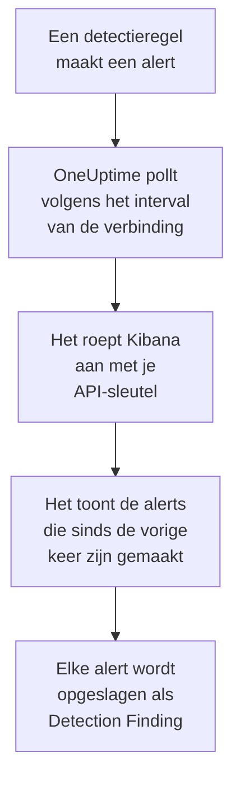

# Elastic Security

Importeer de detectie-alerts die je regels in [Elastic Security](https://www.elastic.co/security) geven in de beveiligingsgebeurtenissen van OneUptime. Daar doorzoek je ze naast je logs, traces en metrics, correleer je ze met elke andere bron en roep je de dienstdoende op voor de alerts die ertoe doen. OneUptime leest ze via de API van de detectie-engine van Kibana met een API-sleutel die je zelf maakt, en wijzigt niets in Elastic.

:::cards
- [De verbinding instellen](#de-verbinding-instellen): Een API-sleutel, de rechten ervan en het formulier van de verbinding.
- [Wat er wordt geïmporteerd](#wat-er-wordt-geïmporteerd): Hoe elke detectie-alert een beveiligingsgebeurtenis wordt.
- [Hoe pollen werkt](#hoe-pollen-werkt): Het venster dat elke poll leest, en wat een drukke space daarmee doet.
- [Problemen oplossen](#problemen-oplossen): Wat elke fout betekent en wat je moet wijzigen.
:::

## Hoe het werkt



Elke minuut pollt OneUptime elke ingeschakelde verbinding waarvan het pollinterval is verstreken. Een poll vraagt Kibana om de detectie-alerts die sinds de vorige poll in je space zijn gemaakt, 1.000 per keer, en slaat elke alert op als een [OCSF](https://schema.ocsf.io/) Detection Finding-gebeurtenis (klasse `2004`). Elk regeltype telt mee: aangepaste query, drempel, EQL, indicatormatch, machine learning en nieuwe termen. Detectieregels, monitoren en dashboards behandelen de alerts daarna als beveiligingsgebeurtenissen uit elke andere bron.

## Voordat je begint

- In OneUptime de rol Project Owner, Project Admin of Security Admin. Security Member en Security Viewer zien verbindingen en hun runhistorie, maar kunnen ze niet wijzigen.
- Elastic Security 8.x of hoger, op Elastic Cloud of je eigen Elastic-stack, met detectieregels die in een Kibana-space draaien.
- Kibana-toegang die de detectie-alerts in die space kan zien: de indexrechten `read` en `view_index_metadata` op `.alerts-security.alerts-<space-id>`, en een Kibana-featurerecht voor Security waarmee hij daar alerts kan lezen.
- Een Kibana die OneUptime via HTTPS kan bereiken. OneUptime Cloud maakt verbinding vanaf het internet, dus Kibana heeft een openbaar adres nodig, zoals Elastic Cloud-deployments hebben: privéadressen worden geweigerd. Een zelf gehoste OneUptime maakt verbinding vanuit zijn app- en workercontainers, en kan een Kibana op je privénetwerk bereiken, tenzij `DATA_SOURCE_BLOCK_PRIVATE_ADDRESSES` `true` is.

## De verbinding instellen

:::steps
### Een API-sleutel maken

1. Open in Kibana **Stack Management → API keys** en selecteer **Create API key**.
2. Geef hem een naam, bijvoorbeeld `oneuptime-security-events`. Een sleutel heeft de rechten van de gebruiker die hem maakt, tenzij je hem minder geeft: hij heeft alleen de rechten hierboven nodig.
3. Kies wanneer hij verloopt, of nooit. Een sleutel die verloopt, stopt de verbinding tot je hem vervangt.
4. Maak de sleutel en kopieer de waarde **Base64**, die Kibana maar één keer toont. Niet de ID van de sleutel, en niet het paar `id:api_key`.

### De ID van je space vinden

Alerts worden per space opgeslagen. Open de space waarin je regels draaien: de ID ervan is het deel van het Kibana-adres na `/s/`, bijvoorbeeld `security` in `https://kibana.example.com/s/security/app/security`. De standaardspace heeft geen deel `/s/` en heeft geen ID nodig.

### De verbinding toevoegen in OneUptime

Open **Producten → Security Events → Verbindingen** (`/dashboard/{projectId}/security-events/connections`), klik op **Verbinding toevoegen**, kies **Elastic Security** en klik op **Volgende**. Vul de instellingen uit de tabel hieronder in, klik op **Volgende** en plak de sleutel in **API-sleutel**.

### Testen voordat je opslaat

Klik op **Deze instellingen testen** onder **Testen voor het opslaan**. De test authenticeert en leest alerts met de waarden in het formulier, en slaat niets op, dus een verkeerde space of een ontbrekend recht komt aan het licht voordat de verbinding bestaat. Klik daarna op **Volgende**, geef de verbinding een **Naam** en maak haar aan.
:::

| Instelling | Wat je invult |
| --- | --- |
| **Kibana URL** | Het adres waarop Kibana wordt aangeboden, bijvoorbeeld `https://kibana.example.com` of `https://<deployment>.kb.<region>.cloud.es.io`. Zonder pad: geen `/app/security`, geen `/api` en geen deel `/s/<space>`. |
| **Kibana space** | De ID van de space, niet de naam: letters, cijfers, koppeltekens en onderstrepingstekens. Laat leeg voor de standaardspace. |
| **API-sleutel** | De waarde **Base64** van de sleutel, op zichzelf: OneUptime voegt het schema `ApiKey` zelf toe. Hij wordt versleuteld, nooit door de API teruggegeven en nooit opnieuw getoond. Vervang hem met **Inloggegevens bijwerken** bij de verbinding. |

De stap **Opvragen** heeft ook een optionele **Beschrijving**, het **Opvraaginterval (minuten)**, een geheel getal van `1` tot `1440` dat begint op `5`, en **Ingeschakeld**, dat aan begint.

## Wat er wordt geïmporteerd

Elke detectie-alert wordt een Detection Finding-gebeurtenis (OCSF-klasse `2004`), met leverancier `Elastic` en product `Elastic Security`:

| Veld van de alert | OneUptime-kolom |
| --- | --- |
| `_id`, de ID van de alert | Gebeurtenis-UID, waarop ook duplicaten worden verwijderd |
| `kibana.alert.original_time`, anders `kibana.alert.start`, anders `@timestamp` | Tijd van de gebeurtenis |
| `kibana.alert.rule.name` | Regelnaam |
| `kibana.alert.rule.uuid`, anders `kibana.alert.rule.rule_id` | Regel-ID |
| `kibana.alert.reason`, anders de regelnaam, anders `kibana.alert.rule.description` | Bericht |
| `kibana.alert.severity`, anders een band van `kibana.alert.risk_score` | Ernst |
| `kibana.alert.workflow_status`: `open`, `acknowledged` of `closed` | Status |
| `kibana.alert.rule.threat`, inclusief subtechnieken | MITRE ATT&CK-tactieken en -technieken |
| `user.name`, `host.name`, `source.ip` of `host.ip`, `process.name` of `process.executable` | Gebruiker, host, IP en proces van de actor |
| `process.name`, `process.executable` en `process.command_line`; `process.parent.name`, `process.parent.executable` en `process.parent.command_line` | Naam, pad en opdrachtregel van het proces; naam, pad en opdrachtregel van het bovenliggende proces |
| `user.target.name`, `destination.domain`, `destination.ip`, `destination.port`, `file.path` | Gebruiker, host, IP, poort en resource van het doel |
| Die, en `related.*`, `dns.question.name`, `url.domain` en bestandshashes | Observables |
| De hele alert, plat gemaakt tot sleutels met punten, met `_index` en `_id` | `attributes` |

De tijd van een alert is met opzet de tijd van de activiteit waarover hij gaat. Zijn `@timestamp`, wanneer de regel hem maakte, is wat het pollen leest, dus een alert die vandaag is gemaakt over de activiteit van gisteren, staat in de verkenner van beveiligingsgebeurtenissen onder gisteren. Wanneer een alert geen ernst heeft, beslist zijn risicoscore: vanaf `74` Critical, vanaf `48` High, vanaf `22` Medium, en daaronder Low.

## Hoe pollen werkt

Elke poll toont de alerts die in zijn venster zijn gemaakt, de oudste eerst, 1.000 per pagina. In een andere space dan de standaardspace begint het pad met `/s/{Kibana space}`:

```text
POST {Kibana URL}/api/detection_engine/signals/search
    {"query": {"range": {"@timestamp": {"gte": "{window start}", "lt": "{window end}"}}},
     "size": 1000, "sort": [{"@timestamp": "asc"}]}
```

- **De aanmaaktijd is de cursor.** Alerts worden getoond op hun eigen `@timestamp`, wanneer de run van de regel ze maakte, nooit op de tijd van de activiteit waarover ze gaan. Een regel die elk uur draait, maakt alerts over activiteit van hooguit een uur oud, en een cursor op activiteitstijd zou ze allemaal overslaan.
- **De eerste poll kijkt 24 uur terug**, zodat een nieuwe verbinding meteen haar recente waarschuwingen toont.
- **Elke volgende poll begint 1 minuut voor de opgeslagen cursor**, zodat een alert die op de grens van twee vensters is gemaakt nooit wordt gemist.
- **Een poll leest hooguit 24 uur voorbij de cursor.** Een verbinding waarvan de cursor achterliep, haalt de achterstand in met een reeks vensters van 24 uur, en haar **Gezondheid** toont **Catching up**.
- **Duplicaten worden verwijderd op de `_id` van de alert** binnen het project, zodat de overlap, een herhaald venster en een import een alert nooit twee keer opslaan.

De alertzoekopdracht van Kibana accepteert een grootte en een sortering, maar geen paginatoken. Dus pagineert OneUptime door het begin van het bereik naar de laatste alert van elke pagina te verschuiven, en laat het op `_id` de alerts weg die het op dat moment al heeft gelezen. Eén run van een regel stempelt vaak veel alerts met dezelfde tijd, en zo'n groep wordt pagina voor pagina gelezen, geen twee keer en geen overgeslagen.

### Wanneer een venster meer bevat dan één poll kan lezen

Een poll leest hooguit 10.000 alerts, in hooguit 20 verzoeken. Wanneer een venster er meer bevat, is de run **Gedeeltelijk**, met een waarschuwing zoals:

```text
Stopped after collecting 10000 alerts; the window holds more.
```

Alerts worden de oudste eerst gelezen, dus OneUptime zet de cursor op de aanmaaktijd van de laatst gelezen alert, en de volgende poll begint daar met dezelfde vensterlengte. Een drukke space haalt zo 10.000 alerts per poll in, in plaats van steeds dezelfde opnieuw te lezen. De alerts die op datzelfde moment zijn gemaakt, worden twee keer gelezen, en de duplicaatcontrole verwijdert de tweede kopie.

De weggelaten ID's gaan met elk verzoek mee, en Kibana beperkt de grootte van een verzoek. Wanneer meer alerts één moment delen dan één verzoek kan weglaten, ongeveer 7.800, stopt de run daar als **Gedeeltelijk**, met een waarschuwing die het moment noemt.

Wanneer een run helemaal niet voorbij de opgeslagen cursor komt, maakt OneUptime het venster in plaats daarvan korter:

1. **Verkleinen.** De volgende poll leest een venster dat half zo lang is, vanaf hetzelfde beginpunt, en blijft halveren tot een venster volledig wordt gelezen, tot één minuut. De waarschuwing van de run zegt het: `This window holds more records than one poll can read; the next poll reads a {n} minute window from the same starting point.`
2. **Weer groeien.** Nadat een venster volledig is gelezen, is het volgende weer twee keer zo lang, tot 24 uur.
3. **Voorbij één minuut gaan.** Als zelfs één minuut meer bevat dan een poll kan lezen, gaat het pollen eraan voorbij, zodat nieuwere waarschuwingen blijven binnenkomen. De run blijft **Gedeeltelijk**, en **Laatste fout** luidt `More records were created in the one minute from {cursor} to {end} than one poll can read. Polling moved past this minute so newer records keep arriving; use Import this time range in Diagnostics on this minute to recover what one run can read.` Importeer die minuut met **Import this time range** om terug te halen wat één run kan lezen.

Een run die volledig mislukt, met een fout van Kibana, behoudt de cursor en de vensterlengte, en de volgende poll leest hetzelfde venster opnieuw. De enige uitzondering is een verzoek dat een time-out kreeg: de cursor blijft staan, maar het volgende venster is half zo lang, omdat een venster dat te zwaar is om op tijd te beantwoorden bij elke poging een time-out zou krijgen. Het **Opvraaginterval (minuten)** wijzigen verandert hier niets aan: het bepaalt hoe vaak een poll begint, niet waar zijn venster begint.

### Uitvoeren, bekijken en importeren op verzoek

Klik op **Diagnose** bij een verbinding om haar recente runs te zien en er met de hand mee te werken. Iedereen die de verbinding kan wijzigen, kan deze acties starten; iedereen die haar kan zien, kan de historie lezen.

- **Nu uitvoeren** start meteen een poll, met de gewone cursor, ook als de verbinding niet **Ingeschakeld** is.
- **Preview alerts** leest een tijdsbereik van maximaal 7 dagen en importeert niets.
- **Import this time range** importeert een bereik van maximaal 7 dagen, nadat je bevestigt, zonder de cursor te verplaatsen. Al geïmporteerde waarschuwingen worden overgeslagen.
- **Copy diagnostics** bij een run kopieert het rapport ervan voor support. Het bevat nooit referenties.

## Verbinding testen

**Verbinding testen** op de rij van een verbinding, en **Deze instellingen testen** in het formulier, draaien in het API-proces, niet in een achtergrondworker, zodat een test ook antwoordt wanneer de workers het probleem zijn. Hij voert deze controles uit, in volgorde:

| Controle | Wat ze controleert |
| --- | --- |
| **Configuratie** | Elke instelling is aanwezig en goed gevormd. Er wordt niets benaderd als dit mislukt. |
| **Authenticate with Kibana** | `/api/status` van Kibana antwoordt volledig. Kibana antwoordt ook aanroepers die het niet heeft geauthenticeerd, met minder, dus een kort antwoord laat deze controle mislukken. |
| **Read detection alerts** | Eén alert die in de laatste 24 uur is gemaakt, kan worden gelezen. Dat bewijst de rechten en de space. |
| **Alerts available to import** | Hoeveel alerts er in de laatste 24 uur en de laatste 7 dagen zijn gemaakt, met `+` waar Elasticsearch er maar een deel van telde. Geen in 7 dagen is een waarschuwing, geen fout. |
| **Background workers**, **Poll scheduler**, **Security event storage** | De kant van OneUptime zelf: een proces neemt de jobs van de Worker-wachtrij af, de poll-job draait elke minuut en de opslag van beveiligingsgebeurtenissen antwoordt. |
| **Scheduled polling** | Voor een opgeslagen verbinding: pollen staat aan, geen run zit vast in afwachting van een worker en polls draaien op tijd. |

Elk verzoek in een test heeft een deadline van 20 seconden. Een test importeert nooit iets en verplaatst nooit de cursor, en elke mislukte controle zegt wat je moet wijzigen.

## Beveiligingsgebeurtenissen naar Elastic Security sturen

OneUptime kan wat het vindt ook naar Elasticsearch sturen, als Elastic Common Schema (ECS)-documenten in een datastream, zodat de waarschuwingen, tijdlijnen en detectieregels van Elastic Security de detecties van OneUptime naast die van jezelf zien. Een detectie is een document met `event.kind` `alert`, en elke andere gebeurtenis heeft `event.kind` `event`.

:::steps
### Een API-sleutel maken die mag schrijven

Open in Kibana **Stack Management → API keys**, klik op **Create API key**, geef de sleutel de rechten hieronder en kopieer de waarde **Encoded**.

### De bestemming toevoegen

Open **Producten → Security Events → Verbindingen**. Klik onder **Naar uw SIEM sturen** op **Bestemming toevoegen**, kies Elastic Security onder **SIEM** en klik op **Volgende**. Vul de **Elasticsearch-URL** in, het Elasticsearch-eindpunt van de deployment en niet dat van Kibana, en plak de sleutel in **API-sleutel**. **Datastream** is optioneel: leeg gelaten gaan documenten naar `logs-oneuptime.security-default`, die Elasticsearch bij de eerste schrijfactie maakt.

### Een testgebeurtenis verzenden en beginnen met verzenden

Klik op **Testgebeurtenis verzenden**: er komt één document aan in de datastream. Laat daarna onder **Wat te verzenden** de keuze **Alleen detecties** staan of kies **Alle beveiligingsgebeurtenissen**, en klik op **Beginnen met verzenden**.
:::

De rechten van de sleutel, voor de standaarddatastream:

```json title="oneuptime-writer-role.json"
{
  "oneuptime-writer": {
    "indices": [
      {
        "names": [
          "logs-oneuptime.security-*"
        ],
        "privileges": [
          "create_doc",
          "auto_configure"
        ]
      }
    ]
  }
}
```

- Documenten gaan in batches van maximaal 500, elk met de eigen id van zijn gebeurtenis, zodat een gebeurtenis die twee keer wordt verzonden één keer wordt opgeslagen.
- Een document dat Elasticsearch niet kan mappen, wordt weggelaten en genoemd in **Fout bekijken**, en een document dat het nu niet kan aannemen (`429`), wordt opnieuw verzonden.
- Waarschuwingen die OneUptime uit Elastic Security heeft geïmporteerd, worden nooit naar Elastic Security teruggestuurd.

## Problemen oplossen

De **Laatste fout** van de verbinding bewaart de volledige foutmelding, met referenties gemaskeerd, achter een voorvoegsel dat de mislukte stap noemt. Wanneer een verbinding een fout heeft, selecteer je **Fout bekijken** in haar kolom **Acties** om hem te lezen, en **Fout kopiëren** in het dialoogvenster om hem te kopiëren. Lees eerst het voorvoegsel.

:::details Last Error begint met `Elastic Security status request`
- `Elastic Security status request failed (HTTP ...)`: Kibana weigerde het statusverzoek.
  - `HTTP 401`: Kibana accepteerde de API-sleutel niet. Het is niet de waarde **Base64**, of hij is verlopen of ongeldig gemaakt. Maak een nieuwe sleutel en sla hem op met **Inloggegevens bijwerken**.
  - `HTTP 404`: de **Kibana URL** heeft een pad, of is geen Kibana.
  - `HTTP 503`: Kibana meldt zichzelf als niet beschikbaar, meestal omdat het Elasticsearch niet kan bereiken.
  - `HTTP 3xx`: Kibana stuurde het verzoek door, en doorverwijzingen worden geweigerd. Gebruik het adres waarop Kibana wordt aangeboden.
- `Elastic Security status request returned ...`: iets anders dan Kibana antwoordde, zoals een aanmeldpagina of een proxy.
- Als alleen de test mislukt, met de melding dat Kibana `answered without authenticating the request`, heeft de sleutel Kibana niet bereikt. Controleer of het de waarde **Base64** is, en of geen proxy voor Kibana de header `Authorization` weghaalt.
:::

:::details Last Error begint met `Elastic Security alerts search`
- `Elastic Security alerts search failed (HTTP ...)`: Kibana weigerde de alertzoekopdracht.
  - `HTTP 403`: de sleutel meldt zich aan, maar kan de alerts van de space niet lezen. Geef hem de rechten uit [Voordat je begint](#voordat-je-begint).
  - `HTTP 404`: geen enkele space heeft die ID in **Kibana space**, of Elastic Security is daarin niet ingeschakeld.
  - `HTTP 429` of `HTTP 5xx`: Kibana of Elasticsearch beperkt verzoeken of faalt. De volgende poll probeert het opnieuw.
- `Elastic Security alerts search returned ...`: Kibana antwoordde `200`, maar zonder leesbare pagina met alerts, bijvoorbeeld met een eigen fout. Het bericht citeert die. Dit wordt gemeld in plaats van als leeg venster opgevat, zodat de cursor nooit voorbij alerts gaat die niemand heeft gelezen.
:::

:::details Last Error eindigt op `did not complete`
`Elastic Security alerts search did not complete`, en hetzelfde voor het statusverzoek, betekent dat het verzoek geen antwoord kreeg: een time-out, een naam die niet wordt omgezet, een geweigerde verbinding, of een geweigerd privéadres. Controleer of de OneUptime-app en de workers Kibana kunnen bereiken, met het juiste schema en de juiste poort. Na een time-out leest de volgende poll een venster dat half zo lang is.
:::

:::details Last Polled is Never en Last Error is leeg
Er is voor deze verbinding nog geen poll voltooid. Voer **Verbinding testen** uit: de controles **Background workers** en **Poll scheduler** noemen de oorzaak. Op een zelf gehoste installatie is de gebruikelijke oorzaak `DISABLE_QUEUE_WORKERS=true` op de app, zonder aparte worker-deployment die de jobs afneemt: zet het op `false`, of draai de worker-deployment (Helm: `worker.enabled: true`).
:::

:::details Een run is Partial
- `Stopped after collecting 10000 alerts; the window holds more`: het venster bevatte meer dan de 10.000 alerts die één run leest. Er gaat niets verloren: de volgende poll begint na de laatst gelezen alert. Een verbinding die poll na poll **Gedeeltelijk** blijft, haalt een achterstand in, en haar **Laatst opgevraagd** en **Laatst geïmporteerde gebeurtenis** blijven vooruitgaan. Haalt ze die nooit in, dan maakt de space meer dan 10.000 alerts per pollinterval: maak het **Opvraaginterval (minuten)** korter.
- `More records were created in the one minute from ... than one poll can read`: het pollen ging voorbij die minuut. Importeer haar met **Import this time range** in **Diagnose**. Een import leest net zoveel als een poll.
:::

:::details De test slaagt, maar er wordt niets geïmporteerd
Lees **Alerts available to import** in het testrapport. `0` in de laatste 7 dagen betekent dat geen enkele regel een alert maakte in die space: controleer of daar regels zijn ingeschakeld, en of **Kibana space** de space is waarin ze draaien. Als er alerts bestaan, vergroot dan het tijdsbereik in de verkenner van beveiligingsgebeurtenissen: alerts staan onder de tijd van hun activiteit, die ruim voor hun aanmaak kan liggen.
:::

## Wat je krijgt

- **Zoeken.** Filter alerts op ernst, status, regel, MITRE ATT&CK-techniek, gebruiker, host of elke observable in de verkenner van beveiligingsgebeurtenissen, naast elke andere bron.
- **Correlatie.** De gebruikers, hosts, IP's, domeinen en hashes van elke alert worden geïndexeerd als observables, dus één zoekopdracht vindt alles wat ze noemt.
- **Detectieregels.** Sigma-regels die volgens een schema over je beveiligingsgebeurtenissen draaien, en waarschuwingen openen die de dienst oproepen.
- **Monitoren.** Monitoren voor beveiligingsgebeurtenissen tellen overeenkomende gebeurtenissen, bijvoorbeeld nieuwe kritieke alerts, en openen boven een drempel incidenten of waarschuwingen.

Beveiligingsgebeurtenissen worden gefactureerd zoals de rest van je telemetrie, per opgenomen GB. Zie [Prijzen](https://oneuptime.com/pricing).

## Volgende stappen

:::cards
- [Beveiligingsgebeurtenissen](/docs/telemetry/security-events): Zoeken, correleren en waarschuwen op wat je importeert.
- [Splunk Enterprise Security](/docs/integrations/splunk): Importeer ook de notable events van een Splunk-search head.
- [Rollen](/docs/permissions/reference#rollen): Wat de Security-rollen kunnen zien en wijzigen.
- [Overzicht van integraties](/docs/integrations/index): De andere tools die je kunt koppelen.
:::
