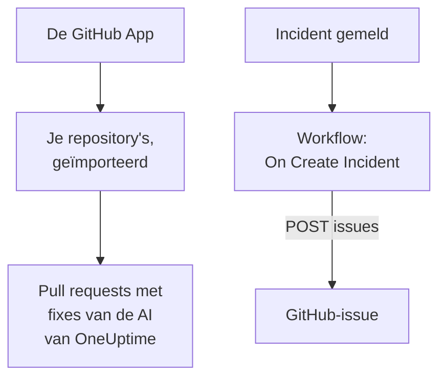

# GitHub

OneUptime werkt op twee manieren met [GitHub](https://github.com). Koppel je repository's via de GitHub App van OneUptime, en de AI van OneUptime opent pull requests die oplossen wat ze vindt, en antwoordt wanneer je haar noemt in een issue of een pull request. Of bouw een workflow die voor elk incident een GitHub-issue opent, zodat het vervolgwerk wordt bijgehouden in de repository waar de dienst bij hoort.

:::cards
- [Kiezen hoe je koppelt](#kiezen-hoe-je-koppelt): De GitHub App of een workflow, en wat elk ervan doet.
- [Je repository's koppelen](#je-repositorys-koppelen): De GitHub App, voor pull requests met fixes.
- [Voor elk incident een issue openen](#voor-elk-incident-een-github-issue-openen): Eén workflow, twee blokken.
- [Problemen oplossen](#problemen-oplossen): Wanneer GitHub een verzoek weigert.
:::

## Hoe het werkt



De twee staan los van elkaar, en je kunt er één of allebei gebruiken. De GitHub App werkt in de repository's waarop je haar installeert. De workflow heeft alleen een token nodig, en roept de [REST API](https://docs.github.com/en/rest/issues/issues#create-an-issue) van GitHub aan zoals elke andere API.

## Kiezen hoe je koppelt

| Manier | Wat ze doet | Wat ze nodig heeft |
| --- | --- | --- |
| De GitHub App | Importeert je repository's. De AI van OneUptime opent daarin pull requests die exceptions, trage traces en de oorzaken die haar onderzoeken vinden oplossen, en antwoordt op vermeldingen in issues en pull requests. | Een organisatie of account om de app op te installeren. Op OneUptime Cloud het abonnement **Growth**. |
| Een workflow | Opent voor elk incident een GitHub-issue, in de repository die je kiest. | Een GitHub-token dat issues mag maken, en een workflow van twee blokken. |

## Je repository's koppelen

Open **Producten → Code** en klik op **GitHub verbinden**. GitHub vraagt waar de app moet worden geïnstalleerd en welke repository's ze mag gebruiken. Elke repository in de installatie wordt geïmporteerd, en blijft bijgewerkt wanneer je repository's aan de installatie toevoegt of eruit haalt.

Als de app al op het account is geïnstalleerd, voor een ander project of rechtstreeks vanuit GitHub, klik dan op **Een bestaande installatie koppelen**, onder **GitHub verbinden**, in plaats van haar opnieuw te installeren. Daarvoor is een GitHub-account nodig dat de installatie beheert: de eigenaar van een persoonlijk account, of iemand met admin-rechten op elke repository waartoe de installatie toegang heeft, zoals een eigenaar van de organisatie die heeft.

Een zelf gehoste instantie heeft eerst een eigen GitHub App nodig: [GitHub-integratie](/docs/self-hosted/github-integration) laat zien hoe je die maakt. Daarna opent AI vanuit [Code](/docs/ai/ai-agent) pull requests in je repository's, en de pagina [GitHub App](/docs/ai/github-app) laat zien wat de app doet wanneer je haar noemt in een issue of een pull request.

## Voordat je begint

De rest van deze pagina bouwt de workflow. Die heeft nodig:

- Een GitHub-token dat issues mag maken in de repository: een fine-grained personal access token voor die repository, met de machtiging **Issues** op **Read and write**, of een klassiek token met de scope `repo`. Maak er een in de [tokeninstellingen](https://github.com/settings/tokens) van GitHub.
- In OneUptime het recht om workflows en globale variabelen te maken. Op OneUptime Cloud hebben workflows het **Growth**-abonnement of hoger nodig.

## Het token opslaan

:::steps
1. Ga naar **Workflows → Globale variabelen** en klik op **Workflow Variabele aanmaken**.
2. Noem hem `GITHUB_TOKEN` en klik op **Volgende**.
3. Plak het token in **Inhoud**, zet **Geheim** aan en klik op **Workflow Variabele aanmaken**.
:::

Een geheime variabele wordt in runlogs vervangen door `[REDACTED]`, dus het token verschijnt nooit in een run.

## Voor elk incident een GitHub-issue openen

:::steps
### De workflow maken

Ga naar **Workflows**, klik op **Workflow maken** en dan op **Vanaf nul beginnen**. Noem hem `Incidents to GitHub` en klik op **Workflow maken**.

### De trigger toevoegen

Klik op het gestippelde blok **Kies wat deze workflow start** en kies **On Create Incident**. Klik op de trigger: de **Fields to pass on** ervan beginnen met **Titel**, dus klik op **Veld toevoegen** en kies **Beschrijving** en **Incident Number With Prefix**.

### Het issue openen

Klik op **Component toevoegen**, voeg een blok **API Post (JSON)** toe en verbind het punt **Success** van de trigger ermee. Zet zijn **URL** op `https://api.github.com/repos/your-org/your-repo/issues`, met de eigenaar en de naam van je repository. Zet onder **Meer velden** zijn **Request Headers** op:

```json
{
  "Authorization": "Bearer {{global.variables.GITHUB_TOKEN}}",
  "Accept": "application/vnd.github+json",
  "X-GitHub-Api-Version": "2022-11-28"
}
```

En de **Request Body** op:

```json
{
  "title": "{{local.components.incident-on-create-1.returnValues.model.title}}",
  "body": "{{local.components.incident-on-create-1.returnValues.model.description}}\n\nOpened by OneUptime for incident {{local.components.incident-on-create-1.returnValues.model.incidentNumberWithPrefix}}.",
  "labels": ["incident"]
}
```

### Testen en daarna aanzetten

Klik op **Workflow uitvoeren**, kies onder **Incident** een testincident en voer hem uit. De stap **API Post (JSON)** toont een antwoord `201` met het nieuwe issue, met zijn `number` en zijn `html_url`. Zet daarna **Ingeschakeld** aan bovenaan de **Bouwer**.
:::

Het issue blijft open wanneer het incident is opgelost, omdat het vervolgwerk het incident meestal overleeft. Voor tickets die in beide richtingen met het incident gelijk oplopen, zie [Jira](/docs/integrations/jira).

## Tips

- **GitHub Enterprise Server.** Stuur het verzoek in plaats daarvan naar je server: `https://your-github-host/api/v3/repos/your-org/your-repo/issues`. Een server op een privénetwerkadres heeft een zelf gehoste OneUptime nodig waarvan de beheerder dat toestaat: zie [Uitgaande netwerktoegang](/docs/workflows/configuration#uitgaande-netwerktoegang).
- **Wijs het toe.** Voeg `"assignees": ["octocat"]` of `"milestone": 3` toe aan de body. GitHub laat labels, toegewezenen en mijlpalen zonder melding vallen wanneer het token niet naar de repository mag pushen.
- **Alleen sommige incidenten.** Zet een blok **If / Else** tussen de trigger en het API-blok, en open alleen issues aan de kant **Yes** ervan, bijvoorbeeld voor één ernst.

## Problemen oplossen

De stap **API Post (JSON)** neemt **Error** wanneer GitHub het verzoek weigert. Zijn **Response Status** en **Response Body** in de run zeggen waarom.

:::details GitHub antwoordt 401
Het token is fout, verlopen of ingetrokken. Maak een nieuw token en vervang de inhoud van `GITHUB_TOKEN`.
:::

:::details GitHub antwoordt 403
Het token mag daar geen issues maken: een fine-grained token zonder **Issues** op **Read and write** voor deze repository, een token dat je organisatie niet heeft goedgekeurd, of een klassiek token dat niet is geautoriseerd voor de single sign-on van je organisatie. Een 403 waarvan de body over een ratelimiet spreekt, betekent dat het token te veel verzoeken stuurde: wacht, of open issues voor minder incidenten.
:::

:::details GitHub antwoordt 404
De eigenaar of de repository in de **URL** is fout, of het token kan de repository niet zien. GitHub antwoordt 404, niet 403, voor een privérepository die een token niet kan zien.
:::

:::details GitHub antwoordt 410 of 422
- `410`: issues zijn uitgeschakeld in de instellingen van de repository.
- `422`: GitHub kan de body niet lezen. Controleer of het geldige JSON is, of `title` is ingesteld, en of `labels` en `assignees` lijsten zijn.
:::

## Volgende stappen

:::cards
- [GitHub App](/docs/ai/github-app): Vraag de AI van OneUptime vanuit GitHub zelf om een wijziging, een herziening of een review.
- [GitLab](/docs/integrations/gitlab): Dezelfde workflow, voor GitLab-issues.
- [Workflow-componenten](/docs/workflows/components#api): Elke instelling van de API-blokken.
- [Overzicht van integraties](/docs/integrations/index): De patronen achter elke integratie.
:::
