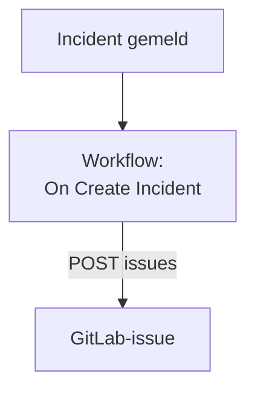

# GitLab

Open voor elk OneUptime-incident een [GitLab](https://gitlab.com)-issue, zodat het vervolgwerk wordt bijgehouden in het project waar de dienst bij hoort. Een workflow roept de [Issues API](https://docs.gitlab.com/api/issues/#new-issue) van GitLab aan, op GitLab.com of op een eigen GitLab.

:::cards
- [Het token opslaan](#het-token-opslaan): Houd het token van GitLab buiten je workflows.
- [Voor elk incident een issue openen](#voor-elk-incident-een-gitlab-issue-openen): Eén workflow, twee blokken.
- [Tips](#tips): Een eigen GitLab, projectpaden en toegewezenen.
- [Problemen oplossen](#problemen-oplossen): Wanneer GitLab een verzoek weigert.
:::

> [!NOTE]
> De AI van OneUptime werkt ook in GitLab-repository's: koppel ze in Code met een toegangstoken, en ze opent voor elke fix een merge request. Zie [Een repository verbinden](/docs/ai/ai-agent#een-repository-verbinden).

## Hoe het werkt



De workflow draait één keer voor elk nieuw incident. Zijn blok **API Post (JSON)** stuurt de titel en de beschrijving van het incident naar de issues van het project, ondertekend met een toegangstoken.

## Voordat je begint

- De ID van het GitLab-project. Selecteer op de overzichtspagina van het project het actiemenu, de verticale puntjes, en dan **Copy project ID**.
- Een GitLab-toegangstoken met de scope `api`, voor een gebruiker of bot met een rol in het project die issues mag maken: een project-, groeps- of persoonlijk toegangstoken. Maak het onder **Settings → Access tokens** in het project, de groep of je gebruikersinstellingen.
- In OneUptime het recht om workflows en globale variabelen te maken. Op OneUptime Cloud hebben workflows het **Growth**-abonnement of hoger nodig.

## Het token opslaan

:::steps
1. Ga naar **Workflows → Globale variabelen** en klik op **Workflow Variabele aanmaken**.
2. Noem hem `GITLAB_TOKEN` en klik op **Volgende**.
3. Plak het token in **Inhoud**, zet **Geheim** aan en klik op **Workflow Variabele aanmaken**.
:::

Een geheime variabele wordt in runlogs vervangen door `[REDACTED]`, dus het token verschijnt nooit in een run.

## Voor elk incident een GitLab-issue openen

:::steps
### De workflow maken

Ga naar **Workflows**, klik op **Workflow maken** en dan op **Vanaf nul beginnen**. Noem hem `Incidents to GitLab` en klik op **Workflow maken**.

### De trigger toevoegen

Klik op het gestippelde blok **Choose what starts this workflow** en kies **On Create Incident**. Klik op de trigger: de **Fields to pass on** ervan beginnen met **Titel**, dus klik op **Veld toevoegen** en kies **Beschrijving** en **Incident Number With Prefix**.

### Het issue openen

Klik op **Component toevoegen**, voeg een blok **API Post (JSON)** toe en verbind het punt **Success** van de trigger ermee. Zet zijn **URL** op `https://gitlab.com/api/v4/projects/12345678/issues`, met de ID van je project in plaats van `12345678`. Zet onder **Meer velden** zijn **Request Headers** op:

```json
{
  "PRIVATE-TOKEN": "{{global.variables.GITLAB_TOKEN}}"
}
```

En de **Request Body** op:

```json
{
  "title": "{{local.components.incident-on-create-1.returnValues.model.title}}",
  "description": "{{local.components.incident-on-create-1.returnValues.model.description}}\n\nOpened by OneUptime for incident {{local.components.incident-on-create-1.returnValues.model.incidentNumberWithPrefix}}.",
  "labels": "incident,oneuptime"
}
```

### Testen en daarna aanzetten

Klik op **Workflow uitvoeren**, kies onder **Incident** een testincident en voer hem uit. De stap **API Post (JSON)** toont een antwoord `201` met het nieuwe issue, met zijn `iid` en zijn `web_url`. Zet daarna **Ingeschakeld** aan bovenaan de **Bouwer**.
:::

Het blok stuurt JSON, dus het heeft geen header `Content-Type` nodig. GitLab maakt labels aan die het nog niet kent, dus `incident` en `oneuptime` hoeven niet te worden ingesteld. Het issue blijft open wanneer het incident is opgelost, omdat het vervolgwerk het incident meestal overleeft.

## Tips

- **Een eigen GitLab.** Stuur het verzoek in plaats daarvan naar je server: `https://gitlab.example.com/api/v4/projects/12345678/issues`. Een server op een privénetwerkadres heeft een zelf gehoste OneUptime nodig waarvan de beheerder dat toestaat: zie [Uitgaande netwerktoegang](/docs/workflows/configuration#uitgaande-netwerktoegang).
- **Het projectpad in plaats van de ID.** Het pad werkt in plaats van de ID, met de `/` geschreven als `%2F`: `projects/your-group%2Fyour-project/issues`. De URL wordt precies zo verstuurd als hij is geschreven, dus codeer hem zelf.
- **Wijs het toe.** Voeg `"assignee_ids": [42]` of `"due_date": "2026-12-31"` toe aan de body, of `"confidential": true` om het alleen aan projectleden te tonen.
- **Alleen sommige incidenten.** Zet een blok **If / Else** tussen de trigger en het API-blok, en open alleen issues aan de kant **Yes** ervan, bijvoorbeeld voor één ernst.

## Problemen oplossen

De stap **API Post (JSON)** neemt **Error** wanneer GitLab het verzoek weigert. Zijn **Response Status** en **Response Body** in de run zeggen waarom.

:::details GitLab antwoordt 401
Het token is fout, verlopen of ingetrokken. Maak een nieuw token en vervang de inhoud van `GITLAB_TOKEN`.
:::

:::details GitLab antwoordt 403
Het token heeft de scope `api` niet, of de rol van zijn gebruiker in het project mag geen issues maken. De body noemt `insufficient_scope` wanneer het aan de scope ligt.
:::

:::details GitLab antwoordt 404
De ID van het project in de **URL** is fout, of het token kan het project niet zien. GitLab antwoordt 404, niet 403, voor een privéproject dat een token niet kan zien.
:::

:::details GitLab antwoordt 400
GitLab kan de body niet lezen: `title` ontbreekt, of een veld heeft het verkeerde type. De body noemt het veld.
:::

## Volgende stappen

:::cards
- [GitHub](/docs/integrations/github): Dezelfde workflow voor GitHub, en de GitHub App.
- [Workflow-componenten](/docs/workflows/components#api): Elke instelling van de API-blokken.
- [Workflow-uitvoeringen](/docs/workflows/runs-and-logs): Lees wat elk verzoek verstuurde en terugkreeg.
- [Overzicht van integraties](/docs/integrations/index): De patronen achter elke integratie.
:::
