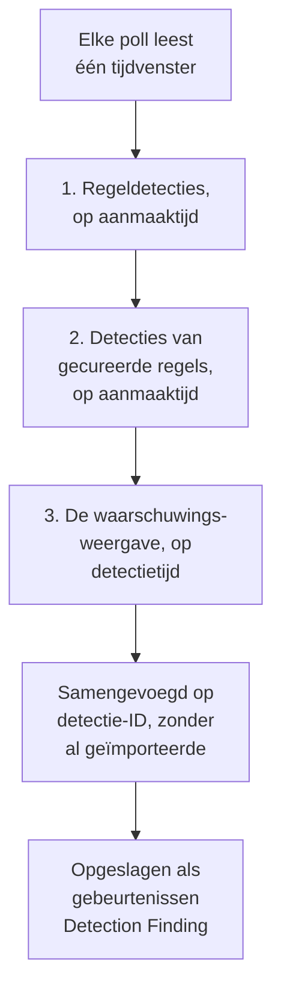

# Google SecOps

Breng waarschuwingen en detecties van [Google SecOps](https://cloud.google.com/security/products/security-operations) (voorheen Chronicle) naar de beveiligingsgebeurtenissen van OneUptime. Daar doorzoek je ze naast je logs, traces en metrics, correleer je ze met elke andere bron en roep je de dienst op voor de waarschuwingen die ertoe doen.

:::cards
- [Kiezen hoe je verbindt](#kiezen-hoe-je-verbindt): Een webhook vanuit een SOAR-playbook, de beheerde connector of UDM-doorsturing.
- [De beheerde connector instellen](#de-beheerde-connector-instellen): Een sleutel voor een serviceaccount, en het formulier van de verbinding.
- [Hoe de connector pollt](#hoe-de-connector-pollt): Drie leesrondes van elk venster, en hun budgetten.
- [Problemen oplossen](#problemen-oplossen): Wat Last Error zegt en wat je moet doen.
- [Beveiligingsgebeurtenissen naar Google SecOps sturen](#beveiligingsgebeurtenissen-naar-google-secops-sturen): De detecties van OneUptime, in Google SecOps.
:::

## Kiezen hoe je verbindt

| Weg | Wat er binnenkomt | Gebruik hem als |
| --- | --- | --- |
| Een webhook vanuit een SOAR-playbook | Elke waarschuwing die een playbook post, binnen enkele seconden | Je SOAR-playbooks draait en hun waarschuwingen zonder pollen in OneUptime wilt hebben. |
| De beheerde connector | Waarschuwingen, en desgewenst regeldetecties, gepold op een interval | Je wilt dat OneUptime ze voor je ophaalt, zonder dat er in SecOps iets te configureren valt. |
| UDM-gebeurtenissen doorsturen | Ruwe UDM-gebeurtenissen, voor volledig zoeken en correleren | Je exporteert al UDM-gebeurtenissen en wilt ze allemaal hebben. |

Elke weg normaliseert wat binnenkomt naar [OCSF](https://schema.ocsf.io/), het Open Cybersecurity Schema Framework waarin OneUptime elke beveiligingsgebeurtenis opslaat, zodat detectieregels en dashboards hetzelfde werken, wat de bron ook is.

## Voordat je begint

- Voor de beheerde connector in OneUptime de rol Project Owner, Project Admin of Security Admin. Security Member en Security Viewer kunnen verbindingen lezen, maar niet aanmaken.
- Voor de webhook en UDM-doorsturing een opnamesleutel: open **Projectinstellingen → Telemetrie & APM → Ingestiesleutels** en klik op **Inname-sleutel aanmaken**.
- Voor de beheerde connector het recht om een Google Cloud-serviceaccount aan te maken in het project waaraan je SecOps-instantie is gekoppeld.

## Waarschuwingen sturen vanuit een SOAR-playbook

SOAR-playbooks van Google SecOps kunnen waarschuwingen naar elk HTTP-eindpunt posten. Richt er een op de opname van beveiligingsgebeurtenissen van OneUptime.

:::steps
### Een actie HTTP request toevoegen

Voeg in je SOAR-playbook van SecOps een actie **HTTP request** toe die op nieuwe waarschuwingen draait.

### Hem op OneUptime richten

Zet de **Method** op `POST` en de **URL** op `https://oneuptime.com/security-events/v1/ingest`, of `https://<your-host>/security-events/v1/ingest` op een zelf gehoste installatie. Voeg deze headers toe:

```text
Content-Type: application/json
x-oneuptime-token: <your telemetry ingestion key>
```

Stuur de JSON van de waarschuwing als **Body**. Een detectie, regelgegevens met de overeenkomende UDM-gebeurtenissen onder `collectionElements`, wordt vanzelf herkend, opgeslagen als een gebeurtenis Detection Finding, en de gebruikers, hosts en IP's van haar overeenkomende gebeurtenissen worden bewaard als observables.

### Controleren dat waarschuwingen aankomen

Voer het playbook uit. De waarschuwingen ervan verschijnen binnen enkele seconden in **Producten → Security Events**.
:::

## UDM-gebeurtenissen doorsturen

Stuur voor volledig zoeken en correleren de UDM-gebeurtenissen zelf door, bijvoorbeeld vanuit een BigQuery-exportpipeline, een Cloud Function of elke forwarder die je al draait:

```bash
curl -X POST "https://oneuptime.com/security-events/v1/ingest?format=udm" \
  -H "Content-Type: application/json" \
  -H "x-oneuptime-token: <your telemetry ingestion key>" \
  -d '{
    "events": [
      {
        "metadata": {
          "event_type": "USER_LOGIN",
          "event_timestamp": "2026-08-21T10:00:00Z",
          "vendor_name": "Google",
          "product_name": "Google SecOps"
        },
        "principal": { "user": { "userid": "alice" }, "ip": ["203.0.113.7"] },
        "target": { "hostname": "vpn-gw-01" },
        "security_result": [{ "severity": "HIGH", "action": ["BLOCK"] }]
      }
    ]
  }'
```

- `format` kan `udm`, `ocsf`, `google-secops-alert` of `generic` zijn. Laat je het weg, dan wordt het formaat per gebeurtenis bepaald.
- De body kan één gebeurtenis zijn, een lijst gebeurtenissen of `{ "events": [...] }`.
- `x-oneuptime-service-name` noemt de telemetrieservice waartoe de gebeurtenissen behoren. Zonder deze header horen ze bij de service die naar het product van de payload is genoemd.

## De beheerde connector instellen

OneUptime pollt de detecties en waarschuwingen van je tenant op een interval, zonder SOAR-configuratie. Google SecOps is een provider van Security Event Connections, dus hij wordt op dezelfde pagina en op dezelfde manier aangemaakt, getest, gepold en gediagnosticeerd als elke andere beheerde connector.

:::steps
### Een sleutel voor een serviceaccount maken

Maak in Google Cloud een serviceaccount aan in het project waaraan je SecOps-instantie is gekoppeld, en geef het de rol **Chronicle API Viewer** (`roles/chronicle.viewer`). Die rol bevat de machtigingen `legacySearchDetections`, `legacySearchCuratedDetections`, `countAllCuratedRuleSetDetections` en `legacyFetchAlertsView` waarmee de connector leest.

Voeg op het tabblad **Keys** van het serviceaccount een sleutel van het type **JSON** toe en download die. Je plakt het hele bestand in de verbinding. De `token_uri` ervan moet een `https`-URL op een Google-host zijn, wat een sleutel die uit Google Cloud is gedownload al is.

### De regio en de resourcenaam van de instantie vinden

Open in Google SecOps **SIEM Settings → Profile**. De resourcenaam van de instantie heeft de vorm `projects/{project}/locations/{location}/instances/{instance}`, waarbij het instantiedeel de ID van de SecOps-instantie is; een weergavenaam van een verbinding of de naam van een serviceaccount is geen vervanging. De regio is het regionale eindpunt dat die locatie bedient, en ze moet overeenkomen met het locations-segment van de resourcenaam van de instantie, anders wordt de verbinding bij het opslaan geweigerd.

### De verbinding toevoegen

Open **Producten → Security Events → Verbindingen** (`/dashboard/{projectId}/security-events/connections`), selecteer **Verbinding toevoegen**, kies **Google SecOps** en vul het formulier in met de instellingen uit de tabel hieronder.

### Testen voordat je opslaat

Selecteer **Deze instellingen testen** onder **Testen voor het opslaan** voordat je opslaat. De test draait met de waarden uit het formulier zonder iets op te slaan, dus een misvormde sleutel, een ontbrekende rol of een verkeerde instantie wordt opgemerkt voordat de verbinding bestaat. In het bewerkformulier test dezelfde knop de **Regio**, **Resourcenaam van de instantie** en **Data to import** die op het scherm staan, met de opgeslagen sleutel; een leeg gelaten referentieveld behoudt de opgeslagen sleutel. Wanneer iets wat je test afwijkt van wat de verbinding heeft opgeslagen, ook een nieuw ingevoerde sleutel, wordt er geen rij in de runhistorie vastgelegd, omdat de verbinding die instellingen nog niet heeft.
:::

| Instelling | Waar je haar vindt | Verplicht |
| --- | --- | --- |
| **Regio** | Het regionale eindpunt van Google SecOps (`us`, `europe`, `asia-southeast1`, ...) dat overeenkomt met de locatie in de resourcenaam van je instantie. Er is geen standaard, zodat een tenant buiten de VS niet per ongeluk het verkeerde eindpunt opslaat. | Ja |
| **Resourcenaam van de instantie** | Google SecOps **SIEM Settings → Profile**: `projects/{project}/locations/{location}/instances/{instance}`. | Ja |
| **Waarschuwingen sluiten wanneer hun zaak sluit** | In de laatste stap van het formulier, uit totdat je het aanzet. Aan sluit het sluiten van een zaak de Google SecOps-waarschuwingen ervan: zie [Waarschuwingen sluiten wanneer hun zaak sluit](#waarschuwingen-sluiten-wanneer-hun-zaak-sluit). | Nee |
| **JSON van het serviceaccount** | Google Cloud, het tabblad **Keys** van het serviceaccount. Plak het hele JSON-sleutelbestand. Alleen schrijven: versleuteld opgeslagen, nooit door de API teruggegeven, nooit meer op de pagina getoond. Gebruik **Inloggegevens bijwerken** op de verbinding om de sleutel te vervangen. | Ja |
| **Data to import** | **Waarschuwingen** worden altijd geïmporteerd, omdat de waarschuwings-API van Google ze altijd teruggeeft. Selecteer **Detecties** om ook regeltreffers te importeren die geen waarschuwing hebben opgeleverd. Dit stuurt geen ruwe UDM-gebeurtenissen door: die stuur je zelf door, zoals hierboven. | Waarschuwingen altijd |

De pollstap van het formulier vraagt om een **Naam**, een optionele **Beschrijving**, de instelling **Ingeschakeld** van de verbinding en het **Opvraaginterval (minuten)**: een geheel getal van `1` tot `1440`, standaard `5`. Alles buiten dat bereik wordt bij het opslaan geweigerd.

Nieuwe detecties worden geïmporteerd als gebeurtenissen Detection Finding die worden toegeschreven aan een telemetrieservice `Google SecOps`.

## De gezondheid van de verbinding lezen

De lijst met verbindingen toont **Naam**, **Provider** (met de keuze Data to import van de verbinding eronder), **Status** (Enabled of Disabled), **Gezondheid**, **Interval (minuten)**, **Laatst opgevraagd**, **Laatste geslaagde opvraging** en **Laatst geïmporteerde gebeurtenis**. Wanneer een verbinding een fout heeft, verschijnt **Fout bekijken** in haar kolom **Acties**, naast **Verbinding testen**, **Nu uitvoeren**, **Diagnose**, **Bewerken** en **Inloggegevens bijwerken**. Enabled betekent dat automatisch pollen is ingesteld. Last Polled legt een poging vast; een geslaagd leeg venster bewijst niet dat een bepaalde detectie is geïmporteerd.

**Gezondheid** toont **Last poll succeeded** pas zodra er een gebeurtenis is geïmporteerd. Tot dan toont een verbinding die slaagt **Polling, no events imported yet**, en dat is de toestand om met Verbinding testen te onderzoeken. De andere toestanden zijn **No records returned**, **Partial import**, **Catching up**, **Last poll failed**, **Poll overdue**, **Schedule paused** en **Wacht op het eerste ophalen**; beweeg de muis over een toestand om te zien wat hij betekent.

> [!NOTE]
> De connector gebruikt de oude detectie- en waarschuwings-API's `v1alpha` van Chronicle, die Google als pre-GA levert. Wanneer een poll mislukt, bewaart het veld **Laatste fout** van de verbinding de volledige foutmelding met referenties gemaskeerd, achter een voorvoegsel dat de mislukte stap noemt, ook als Chronicle `200` antwoordt en de weigering in de body zet. Selecteer **Fout bekijken** in de kolom **Acties** van de verbinding om het bericht te lezen, en daarna **Fout kopiëren** in het dialoogvenster om het voor support te kopiëren.

## Hoe de connector pollt



Eén keer per minuut zet een achtergrondworker een poll in de wachtrij voor elke ingeschakelde verbinding waarvan het interval sinds de vorige poll is verstreken. Elke poll is een run in de historie van de verbinding, uitgevoerd door een worker. Hij leest één tijdvenster op drie manieren en voegt de resultaten samen op detectie-ID, zodat een record dat door meer dan één ronde wordt teruggegeven één keer wordt opgeslagen:

1. **Regeldetecties op aanmaaktijd.** `legacy:legacySearchDetections` met `ruleId=-` (elke revisie van elke regel) en `listBasis=CREATED_TIME`, waarbij `nextPageToken` wordt gevolgd tot de pagina de laatste is.
2. **Detecties van gecureerde regels op aanmaaktijd.** `legacy:legacySearchCuratedDetections`, op dezelfde manier, één keer per gecureerde (door Google geschreven) regel. Dat eindpunt neemt één ID van een gecureerde regel (`ur_...`) en heeft geen jokerteken voor "elke regel", dus de ronde roept eerst `:countAllCuratedRuleSetDetections` aan voor de week vóór het venster tot het einde ervan, en doorzoekt elke gecureerde regel die detecties opleverde. Een gecureerde regel die in die week niet is afgegaan, heeft niets te importeren. Een tenant zonder toegang tot gecureerde regels beantwoordt deze ronde met `400`, `403` of `404`; dat wordt als waarschuwing bij de run vastgelegd, niet als fout.
3. **De waarschuwingsweergave op detectietijd.** `legacy:legacyFetchAlertsView`, die telemetriewaarschuwingen, SOAR-waarschuwingen en waarschuwingen van machine-intelligentie dekt, naast regelwaarschuwingen. Het eindpunt heeft geen paginering, dus een antwoord dat Google beperkt, wordt opgesplitst in kleinere vensters en opnieuw gelezen.

De waarschuwingsweergave kan alleen op detectietijd filteren, en Google maakt een waarschuwing vaak pas lang na haar detectietijd leesbaar (opnamevertraging, geplande regels, herhalingen over late gegevens). Een geplande poll **doorzoekt daarom ook de waarschuwingsweergave over de 24 uur vóór zijn venster**, alleen waarschuwingen, vastgelegd als de controle **Read late alerts by detection time**. Al geïmporteerde records worden overgeslagen, dus de herhalingen van die doorzoeking verschijnen onder **Already imported**. De doorzoeking is naar beste vermogen: als Google haar beperkt, haar budget opraakt of ze mislukt, krijgt de run een waarschuwing, maar de poll wordt niet Partial of Mislukt en de cursor schuift toch door, omdat de dag waarop ze terugkijkt al door eerdere polls is gelezen.

Pollen op **aanmaaktijd** is het hele ontwerp. Een regel van Google SecOps draait volgens een schema (elke 10 minuten, elk uur, elke dag), en de detectie die hij maakt, draagt een `detectionTime` die het einde van het tijdvenster van de regel of de tijd van de overeenkomende gebeurtenis is, terwijl `createdTime` aangeeft wanneer de detectie-engine haar werkelijk maakte. Een detectie die om 10:05 is gemaakt voor een venster dat om 09:00 eindigt, heeft een detectietijd die al achter een cursor ligt die een paar polls geleden voorbij 09:00 ging, dus een connector die op detectietijd pollt, ziet haar nooit, en ook geen gebeurtenis die te laat binnenkomt. Lezen op aanmaaktijd laat elke poll vragen: "wat heeft Google gemaakt sinds ik voor het laatst keek", en dat is de vraag waarop een antwoord bestaat. Elke run legt zijn aanmaakvertraging vast, hoeveel opgehaalde records meer dan één pollinterval (plus een minuut) na hun detectietijd zijn gemaakt, en het grootste verschil, zodat het effect zichtbaar is in Diagnostics.

De eerste poll van een nieuwe verbinding kijkt **24 uur** terug op aanmaaktijd. Elke poll daarna gaat verder vanaf de opgeslagen cursor van de verbinding met een overlap van **1 minuut**; een record dat op een venstergrens is gemaakt, wordt door beide polls gelezen en één keer opgeslagen, omdat polls gebeurtenissen overslaan die al met dezelfde bron-ID zijn opgeslagen. Elke geplande poll leest hooguit **24 uur** voorbij de cursor, dus een verbinding met een oudere opgeslagen cursor haalt de achterstand in met opeenvolgende vensters van 24 uur (Health toont **Catching up**) in plaats van de tussenliggende detecties te laten vallen. Gebruik **Import this time range** in Diagnostics voor records die vóór het eerste venster van 24 uur zijn gemaakt.

### Wanneer een venster meer bevat dan één poll kan lezen

De connector geeft elke poll vaste budgetten: de ronde voor regeldetecties heeft **20** zoekpagina's, de gecureerde ronde tot **200** verzoeken (de telling plus minstens één pagina per gecureerde regel die de afgelopen week afging, de drukste regels eerst), de waarschuwingsweergave en haar doorzoeking naar late waarschuwingen delen **16** verzoeken, en het hele lezen stopt na **4 minuten**. De gecureerde ronde begint aan geen gecureerde regel meer zodra 60% van die tijd op is, zodat de waarschuwingsweergave toch draait. Kan een poll niet elke actieve gecureerde regel doorzoeken, dan legt hij een waarschuwing vast die noemt hoeveel er niet zijn doorzocht, in plaats van de cursor vast te houden, omdat een korter venster nog steeds al die regels zou moeten doorzoeken. Een ronde die een budget halverwege stopte, wordt vastgelegd als een waarschuwingscontrole die het budget noemt (bijvoorbeeld `Read rule detections by created time was stopped by the request budget after 20 requests.`), en een ronde die het budget nooit liet beginnen, is een overgeslagen controle met dezelfde reden in de waarschuwingen van de run, nooit een succes. Een venster met meer detecties dan dat, kan niet in één poll worden gelezen, en het pollen leest nooit eindeloos hetzelfde venster opnieuw:

1. **Verkleinen.** De zoekeindpunten van Google geven de nieuwste detecties eerst terug, dus een poll die vroeg stopt, heeft geen punt om verder te gaan. De poll wordt vastgelegd als **Gedeeltelijk**, de cursor blijft waar hij was en de volgende poll leest een venster dat half zo lang is vanaf hetzelfde beginpunt, met de waarschuwing `This window holds more records than one poll can read; the next poll reads a {n} minute window from the same starting point.` Het halveren gaat door tot één minuut, tot een venster past.
2. **Weer groeien.** Elke volledige poll verdubbelt het volgende venster, tot het maximum van 24 uur, zodat een uitbarsting een paar korte polls kost in plaats van een blijvend trage verbinding.
3. **Voorbij één minuut gaan.** Als zelfs één minuut meer detecties bevat dan een poll kan lezen, zet het pollen de cursor voorbij die minuut, zodat nieuwere detecties blijven binnenkomen. De run is **Gedeeltelijk** en dezelfde tekst staat vooraan in **Laatste fout**: `More records were created in the one minute from {start} to {end} than one poll can read. Polling moved past this minute so newer records keep arriving; use Import this time range in Diagnostics on this minute to recover what one run can read.` Om terug te halen wat één run kan lezen, open je **Diagnose**, kies je een aangepast bereik dat die minuut dekt (de bereikvelden gebruiken je lokale tijd; het bericht is in UTC) en voer je **Import this time range** uit; een import heeft dezelfde grenzen per run als een poll. Al geïmporteerde detecties worden overgeslagen.

Een poll die Partial is, slaat zijn waarschuwingen ook op in **Laatste fout**, waar ze blijven tot een volledige poll ze wist. Een poll die volledig mislukt (een fout, niet te veel records), behoudt zijn cursor en vensterlengte en wordt bij de volgende tik opnieuw geprobeerd. De enige uitzondering is een verzoek dat een time-out kreeg: de volgende poll leest een venster dat half zo lang is vanaf hetzelfde beginpunt (`The source did not answer in time for this window; the next poll reads a {n} minute window from the same starting point.`), omdat een venster dat te zwaar is om op tijd te beantwoorden anders bij elke nieuwe poging een time-out zou krijgen. Een korter pollinterval verandert hier niets aan: het venster wordt bepaald door de cursor en de uitkomst van de laatste poll, niet door hoe vaak polls draaien.

## Verbinding testen

**Verbinding testen**, op de rij van de verbinding of in **Diagnose**, draait synchroon in het API-proces. Het heeft geen achtergrondworker nodig, en precies daarom kan het je vertellen wanneer er geen worker draait. De controlelijst:

1. **Configuratie**: elk veld is aanwezig en goed gevormd: een ondersteunde **Regio** die overeenkomt met de locatie van de instantie, een **Resourcenaam van de instantie** in de juiste vorm en een sleutel **JSON van het serviceaccount** met `client_email`, een leesbare `private_key` en een `token_uri` van Google. Er wordt niets benaderd als dit mislukt.
2. **Authenticate with Google**: de sleutel wordt bij het OAuth-eindpunt van Google ingewisseld voor een toegangstoken, voordat Chronicle wordt benaderd.
3. **Read rule detections**, **Read curated rule detections** en **Read the alerts view**: een proef met één record per ronde over de afgelopen 24 uur. De gecureerde controle leest de tellingen van gecureerde regels voor de afgelopen 7 dagen en test de gecureerde regel met de meeste detecties; als in die week geen gecureerde regel afging, slaagt ze zonder iets te testen. Een gecureerde leesactie die met `400`, `403` of `404` wordt beantwoord, is een waarschuwing, omdat de tenant misschien gewoon geen toegang tot gecureerde regels heeft.
4. **Detections available to import**: wat Google heeft met de opgeslagen keuze **Data to import** en met de andere (alleen Waarschuwingen, of Waarschuwingen en **Detecties**) over de afgelopen 24 uur en de afgelopen 7 dagen: het aantal treffers van de waarschuwingsweergave en één zoekpagina op aanmaaktijd per bereik, gemeld als getal of als `1000+`. Heeft de opgeslagen keuze niets maar de andere wel, dan waarschuwt de controle: je regels maken detecties, maar waarschuwen is er niet voor ingeschakeld. Bewerk de verbinding en selecteer **Detecties** onder **Data to import**, of schakel waarschuwen voor de regels in Google SecOps in.
5. **Background workers**, **Poll scheduler** en **Security event storage**: of een proces de Worker-wachtrij van OneUptime afwerkt, of de poll-job met een ritme van een minuut is geregistreerd, en of de opslag van beveiligingsgebeurtenissen dezelfde duplicaatzoekopdracht beantwoordt die pollen vóór elke invoeging uitvoert, zodat een kapotte analysedatabase hier met een naam faalt in plaats van een uur later als pollfout.
6. **Scheduled polling** (alleen opgeslagen verbindingen): of pollen is ingeschakeld, of een run in de wachtrij vastzit in afwachting van een worker, en of de verbinding volgens schema wordt gepold.

Elk verzoek in een test heeft een deadline van 20 seconden. Tests laten de pollcursor en de gebeurtenisopslag ongemoeid. Een opgeslagen verbinding die met haar opgeslagen instellingen wordt getest, krijgt een rij in de runhistorie van het type test, en de details van de rij tonen dezelfde controlelijst.

## Bekijken, uitvoeren en importeren op verzoek

Open **Diagnose** bij een verbinding om recente runs te zien en de connector te bedienen. Projecteigenaren, projectbeheerders en beveiligingsbeheerders kunnen bewerkingen starten. Beveiligingsleden en -kijkers kunnen de historie lezen.

- **Nu uitvoeren** zet meteen een poll in de wachtrij, met de normale cursor en opnameroute, ook als gepland pollen is uitgeschakeld. De toestanden in de wachtrij en actief blijven zichtbaar terwijl de worker het verzoek uitvoert. Blijft een run in de wachtrij staan, controleer dan of workers de Worker-wachtrij verwerken; de controle **Background workers** in Verbinding testen zegt of er een proces is dat dat doet.
- **Preview detections** leest een gekozen tijdsbereik zonder te importeren of de cursor te wijzigen. Gebruik het afgelopen uur, 24 uur, 7 dagen of een aangepast bereik van maximaal 7 dagen. Het bereik komt overeen met de waarschuwingsweergave van SecOps, die op detectietijd leest, en de twee zoekrondes lezen zowel detecties die erin zijn gemaakt als detecties waarvan de detectietijd erin valt, dus een voorbeeld van gisteren toont ook detecties die gisteren zijn gemaakt over oudere gebeurtenissen. Het voorbeeld toont detectietijd en aanmaaktijd apart. De resultaten volgen de opgeslagen keuze **Data to import** van de verbinding.
- **Import this time range** importeert het gekozen bereik, nadat je bevestigt, zonder de pollcursor te verplaatsen. Zo haal je ook een minuut terug waar het pollen voorbij is gegaan, zoals hierboven beschreven. Bekijk het bereik eerst. Herhaalde polls en imports slaan gebeurtenissen over die al met dezelfde bron-ID in het project zijn opgeslagen. Imports kunnen ingestelde detectieregels en monitoren activeren, net als gepland pollen.

De details van elke run tonen het **Requested window (UTC)**, de keuze **Data to import** van de verbinding en vijf aantallen:

| Aantal | Wat het telt |
| --- | --- |
| **Returned by Google SecOps** | Records die Google over de drie rondes teruggaf, na samenvoegen op ID. |
| **Imported into OneUptime** | Rijen die naar de gebeurtenisopslag zijn geschreven. |
| **Already imported** | Records die zijn overgeslagen omdat dezelfde bron-ID al in dit project is opgeslagen; de overlap van 1 minuut en herhalingen maken dit normaal. |
| **Afgewezen** | Teruggegeven objecten die geen detecties van Google SecOps zijn. Ze worden geteld en gemeld, nooit opnieuw geprobeerd, en houden de cursor niet vast. |
| **Mislukt** | Records die niet konden worden genormaliseerd. Een poll probeert ze opnieuw in een korter venster. |

**Provider details** voegen de **Time basis read** toe, de records **Returned by each pass** (regeldetecties, detecties van gecureerde regels en de waarschuwingsweergave) en de **Creation lag**. Daarna volgen de controles, één per ronde, de waarschuwingen en voorbeelddetecties. De details van een geplande poll tonen ook het **Window read by this poll** en wat de **Next scheduled poll reads**, en een poll die Partial is, zegt of hij zijn beginpunt heeft behouden en het volgende venster heeft verkleind, of voorbij één minuut is gegaan die hij noemt. **Succes**, **No records returned**, **Gedeeltelijk** en **Mislukt** zijn verschillende uitkomsten.

Gebruik **View events in this time range** bij een run om het gebeurtenistijdbereik te openen van de detecties die hij teruggaf. Een detectie die vandaag is gemaakt met de detectietijd van gisteren, kan anders worden verborgen door een filter op recente gebeurtenissen. De runhistorie bewaart fouten nadat een latere volledige poll Last Error heeft gewist. Gebruik **Copy diagnostics** wanneer je contact opneemt met support; referenties van het serviceaccount en tokens worden nooit meegenomen.

## Waarom zie ik geen gebeurtenissen?

Loop deze punten in volgorde door. Elk is van het volgende te onderscheiden in **Diagnose** of met **Verbinding testen**.

1. **Data to import.** Standaard worden alleen **Waarschuwingen** geïmporteerd, en een regeldetectie is alleen een waarschuwing als waarschuwen voor de regel in Google SecOps is ingeschakeld. Een tenant waarvan de regels detecties zonder waarschuwen maken, pollt voor altijd eerlijk leeg. Voer **Verbinding testen** uit: de controle **Detections available to import** telt met en zonder **Detecties** en zegt het wanneer selecteren records zou toevoegen. Bewerk de verbinding en selecteer **Detecties** onder **Data to import**, of schakel waarschuwen voor de regels in.
2. **Draaifrequentie van regels en detectievertraging.** Detecties worden gemaakt wanneer de regel draait, en dat kan tot een uur of een dag na de gebeurtenissen zijn die ze beschrijven. De connector pollt op aanmaaktijd, dus ze komen binnen bij de eerste poll nadat Google ze heeft gemaakt, niet op hun detectietijd. Een regel die je net hebt ingeschakeld, heeft nog niets gemaakt, en een rustige tenant heeft niets te maken. De beschikbaarheidscontrole meldt hoeveel detecties in de afgelopen 24 uur en 7 dagen zijn gemaakt; nul met en zonder **Detecties** betekent dat Google nog niets heeft wat OneUptime kan importeren.
3. **Lees de aantallen van de laatste run.** In Diagnostics is **Returned by Google SecOps** met nul bij **Imported into OneUptime** en een passend aantal bij **Already imported** de connector die werkt zoals bedoeld: die detecties zijn door een eerdere poll geïmporteerd. **Afgewezen**-records zijn objecten die Google teruggaf en die helemaal geen detecties zijn.
4. **Wordt er überhaupt gepold?** Last Polled met `Never` en een lege Last Error betekent dat er voor deze verbinding geen poll is voltooid. Verbinding testen meldt **Background workers** (processen die de Worker-wachtrij afwerken), **Poll scheduler** (de registratie van de planner met een ritme van een minuut) en **Scheduled polling** (het eigen schema van deze verbinding, met een achterstallige poll of een run die in de wachtrij vastzit). Zie het onderdeel Problemen oplossen hieronder voor de deployment-instellingen die dit veroorzaken.
5. **Kijk op de juiste plek.** Gebeurtenissen worden opgeslagen onder hun detectietijd, die uren of dagen kan liggen vóór het moment waarop ze zijn gemaakt en geïmporteerd, dus een filter "afgelopen uur" in Security Events verbergt een detectie over gisteren die een minuut geleden is geïmporteerd. Gebruik **View events in this time range** bij een run in Diagnostics: het opent het gebeurtenistijdbereik van de detecties die die run teruggaf.

## Hoe de ernst wordt bepaald

Google SecOps slaat de ernst van een detectie op verschillende plekken op, afhankelijk van wie de regel schreef, en OneUptime leest ze in deze volgorde en gebruikt de eerste die een ernst noemt:

1. **De eigen ernst van Google** (`detection[].severity`). Google stelt die in bij gecureerde regels, zoals Applied Threat Intelligence en de gecureerde regelsets.
2. **De ernst van de waarschuwing** (de `severity` van de Collection), voor SOAR-waarschuwingen en webhook-bodies.
3. **De `meta`-ernst van de regel.** Bij een aangepaste YARA-L-regel laat Google `detection[].severity` leeg en geeft het de sectie `meta` van de regel terug als `ruleLabels`. OneUptime leest het label `severity`, de waarde die het regeldashboard van Google SecOps toont. Info, Informational, Low, Medium, High en Critical worden herkend, in elke combinatie van hoofd- en kleine letters.
4. **De `$risk_score`-uitkomst van de regel**, als de regel geen ernst instelt, ingedeeld met de [door Google aanbevolen bereiken](https://docs.cloud.google.com/chronicle/docs/yara-l/outcome-syntax): 90–100 Critical, 80–89 High, 50–79 Medium, 20–49 Low, 1–19 Informational. OneUptime gebruikt alleen een score die de regel zelf instelt. Het negeert de `riskScore` die Google invult voor regels zonder score (40 voor waarschuwende regels, anders 15), omdat die standaardwaarde niets zegt over hoe ernstig de detectie is.

Een detectie die door geen van deze wordt ingedeeld, wordt getoond als Unknown. Om een aangepaste regel in te delen, voeg je in Google SecOps een ernst toe aan de sectie `meta` ervan, bijvoorbeeld `severity = "High"`, of stel je `$risk_score` in de sectie `outcome` in. Detecties die de regel daarna maakt, worden met die ernst geïmporteerd.

## Waarschuwingen sluiten wanneer hun zaak sluit

Met **Waarschuwingen sluiten wanneer hun zaak sluit** aan sluit het sluiten van een [beveiligingszaak](/docs/telemetry/security-cases#een-zaak-sluiten) de Google SecOps-waarschuwingen waaruit die zaak kwam. Elke waarschuwing wordt als gesloten gemarkeerd met het oordeel van de zaak, een True Positive als kwaadaardig en een False Positive of Benign Positive als niet kwaadaardig, samen met de sluitnotitie van de zaak en een link terug naar de zaak. De tijdlijn van de zaak vertelt hoeveel waarschuwingen zijn gesloten.

- Het serviceaccount heeft `chronicle.legacies.legacyUpdateAlert` nodig, dat de rol `roles/chronicle.editor` heeft. De rol `roles/chronicle.viewer` leest waarschuwingen maar kan ze niet sluiten, en een `403` staat dan bij de zaak.
- Een waarschuwing die Google SecOps niet meer heeft, wordt overgeslagen. Als Google SecOps niet bereikbaar is, probeert OneUptime het ongeveer een uur opnieuw en schrijft daarna bij de zaak wat het niet kon sluiten.

## Je andere gebeurtenissen controleren op zijn indicatoren

Een [threat-intelfeed](/docs/telemetry/threat-intelligence#hoe-google-secops-wordt-gelezen) met **Google SecOps** als **Bron** leest via deze verbinding de indicatoren die de threat intelligence van Google SecOps in zijn gebeurtenissen vond, en controleert de rest van de gebeurtenissen van je project erop: de aanmeldingen, netwerkstromen en endpointgebeurtenissen die Google SecOps nooit zag.

## Beveiligingsgebeurtenissen naar Google SecOps sturen

OneUptime kan wat het vindt ook naar Google SecOps sturen, zodat de SIEM waarin uw team werkt de detecties van OneUptime naast die van zichzelf ziet. Elke beveiligingsgebeurtenis wordt geïmporteerd als UDM-gebeurtenis, met de ernst, de MITRE ATT&CK-tags en de regel die haar vond:

| Beveiligingsgebeurtenis | UDM-gebeurtenistype |
| --- | --- |
| Een aanmelding | `USER_LOGIN` |
| Een proces dat wordt gestart, geopend, geïnjecteerd of beëindigd | `PROCESS_LAUNCH`, `PROCESS_OPEN`, `PROCESS_INJECTION`, `PROCESS_TERMINATION` |
| Een proces dat zijn rechten verhoogde | `PROCESS_PRIVILEGE_ESCALATION` |
| Elke andere procesactiviteit | `PROCESS_UNCATEGORIZED` |
| Een netwerkverbinding | `NETWORK_CONNECTION` |
| Al het andere, of een gebeurtenis zonder de velden die haar type nodig heeft | `GENERIC_EVENT` |

In een procesgebeurtenis is `principal` het proces dat handelde en `target` het proces waarop het handelde: bij een start het bovenliggende proces en het proces dat het startte.

:::steps
### Een sleutel maken die gebeurtenissen mag importeren

Maak in Google Cloud een serviceaccount aan in het project waaraan uw SecOps-instantie is gekoppeld, en geef het een rol met de machtiging `chronicle.events.import`, zoals **Chronicle API Editor** (`roles/chronicle.editor`). Voeg op het tabblad **Keys** een sleutel van het type **JSON** toe en download die.

### De bestemming toevoegen

Open **Producten → Security Events → Verbindingen**. Klik onder **Naar uw SIEM sturen** op **Bestemming toevoegen**, kies Google SecOps onder **SIEM** en klik op **Volgende**. Kies de **Regio**, vul de **Resourcenaam van de instantie** in zoals bij de connector hierboven en plak de sleutel in **JSON van het serviceaccount**.

### Een testgebeurtenis versturen

Klik op **Testgebeurtenis verzenden**. Eén `GENERIC_EVENT` van het product `OneUptime Security Events` gaat met de instellingen uit het formulier naar Google SecOps, en er wordt niets opgeslagen. Het verschijnt binnen enkele minuten in Google SecOps.

### Kiezen wat er wordt verstuurd

Houd onder **Wat te verzenden** de keuze **Alleen detecties**, dus wat uw regels en dreigingsinformatie vonden en de waarschuwingen van uw gekoppelde producten, of kies **Alle beveiligingsgebeurtenissen**. Klik op **Beginnen met verzenden**.
:::

- Een bestemming verstuurt de gebeurtenissen die binnenkomen vanaf het moment dat ze is opgeslagen, nooit de geschiedenis van het project, en verstuurt nieuwe elke minuut.
- Waarschuwingen die OneUptime uit Google SecOps heeft geïmporteerd, worden er nooit naar teruggestuurd.
- Als Google SecOps niet antwoordt of een batch weigert, houdt de bestemming haar plaats vast en probeert ze het bij de volgende run opnieuw. Haar **Status** staat dan op **Mislukt**, en **Fout bekijken** laat zien wat Google SecOps antwoordde.

## Problemen oplossen

:::details Detecties van aangepaste regels tonen ernst Unknown, terwijl gecureerde zijn ingedeeld
De regel stelt geen ernst in. Voeg `severity = "Low"`, `"Medium"`, `"High"` of `"Critical"` toe aan de sectie `meta` van de regel, of stel `$risk_score` in de sectie `outcome` in (zie [Hoe de ernst wordt bepaald](#hoe-de-ernst-wordt-bepaald)). Versies van vóór deze wijziging negeerden ook de `meta`-ernst van een aangepaste regel; een upgrade deelt de detecties die die versies importeerden opnieuw in, met de regellabels die bij elke detectie zijn opgeslagen.
:::

:::details Waarschuwingen verschijnen in Google SecOps, maar nooit in OneUptime
Upgrade naar een versie die detecties van gecureerde regels één gecureerde regel tegelijk leest en de waarschuwingsweergave doorzoekt op late waarschuwingen. Eerdere versies stuurden `ruleId=-` naar `legacySearchCuratedDetections`, dat geen jokerteken heeft, dus Google beantwoordde elke gecureerde zoekopdracht met een leeg succes; en ze lazen de waarschuwingsweergave alleen over de paar minuten detectietijd van de poll zelf, dus een waarschuwing die Google later leesbaar maakte, werd nooit gezien. Beide leken op een gezonde, rustige verbinding. Gebruik na de upgrade **Import this time range** in Diagnostics om de afgelopen 7 dagen te importeren.
:::

:::details Google geeft nul records terug
Controleer in Diagnostics het exacte tijdvenster, de tijdsbasis en de opgeslagen keuze **Data to import**, en voer Verbinding testen uit om de beschikbaarheidsaantallen met en zonder **Detecties** te lezen. Een regeltreffer zonder waarschuwing vereist het selectievakje **Detecties**. Bekijk een periode die zowel de detectietijd als de aanmaaktijd dekt. De eerste geplande poll kijkt 24 uur terug op aanmaaktijd; gebruik **Import this time range** voor oudere records.
:::

:::details Health is Partial import
Open de laatste run in **Diagnose** en lees de waarschuwingen ervan; dezelfde waarschuwingen staan in Last Error. `This window holds more records than one poll can read; ...` betekent dat het pollen zijn venster vanaf hetzelfde beginpunt verkleint en dat je niets hoeft te doen: het groeit weer zodra polls volledig zijn. `More records were created in the one minute from ...` betekent dat het pollen voorbij die minuut ging; importeer haar met **Import this time range** om de overgeslagen detecties terug te halen. Een waarschuwing die zegt dat een ronde door het verzoekbudget of het tijdbudget van de poll is gestopt of daardoor niet is uitgevoerd, noemt de ronde die werd afgebroken. Een korter pollinterval verandert het venster niet. Een lege Last Error alleen bewijst geen volledige dekking.
:::

:::details Health is Poll overdue
Geplande polls draaien niet op tijd. Controleer de workerwachtrij en voer Verbinding testen uit voor de controles **Background workers** en **Scheduled polling**.
:::

:::details Status is Disabled
Gepland pollen slaat de verbinding over. Gemachtigde gebruikers kunnen nog steeds testen, een voorbeeld bekijken, een poll uitvoeren met **Nu uitvoeren** of importeren vanuit Diagnostics.
:::

:::details Last Polled is `Never` en Last Error is leeg
Er is voor deze verbinding geen poll voltooid. Open **Diagnose**: als de runhistorie geen poll bevat, of alleen een die in de wachtrij vastzit, heeft de achtergrondworker de poll-job helemaal niet uitgevoerd, dus er heeft nooit iets Chronicle bereikt. Bij zelf gehoste deployments is de gebruikelijke oorzaak `DISABLE_QUEUE_WORKERS=true` op de app-container zonder aparte worker-deployment die de wachtrijen afwerkt. Zet `DISABLE_QUEUE_WORKERS=false` (de standaard in `config.example.env` waarmee Docker Compose wordt geleverd), of draai de aparte worker-deployment (Helm: `worker.enabled: true`, dat standaard `false` is). Verbinding testen meldt dit als een mislukte controle **Background workers**, **Poll scheduler** of **Scheduled polling**. Een poll die wel draaide maar stopte voordat hij de verbinding bereikte, is in plaats daarvan een mislukte run in die historie: `Another poll or import for this source is still running in this project` betekent dat een andere poll of import van Google SecOps in dit project de bronvergrendeling had, en de verbinding wordt bij de volgende tik opnieuw in de wachtrij gezet. Een planner die zelfs geen poll in de wachtrij kon zetten, schrijft `Scheduler could not queue a poll:` en de reden in Last Error.
:::

:::details Last Error is gevuld
Er is een poll geprobeerd en daarin ging iets mis, een poll kon zijn hele venster niet lezen, of de planner kon geen poll in de wachtrij zetten. Bij een mislukte poll bewaart het veld de volledige foutmelding met referenties gemaskeerd. Wanneer een verbinding een fout heeft, selecteer je **Fout bekijken** in haar kolom **Acties** om de volledige melding te openen, en daarna **Fout kopiëren** in het dialoogvenster om haar voor support te kopiëren. Het veld wordt bij de volgende volledige poll gewist, waarmee ook de actie **Fout bekijken** verdwijnt; de runhistorie bewaart haar. Lees eerst het voorvoegsel. Een melding die begint met `More records were created in the one minute from` is die overgeslagen minuut en geen fout; zie **Health is Partial import** hierboven. Slechts vier voorvoegsels dragen een HTTP-status, dus een melding zonder status is geen bewijs van een fout aan de kant van OneUptime:

- `Google token exchange failed (HTTP ...)`: de referentie van het serviceaccount werd geweigerd bij het OAuth-eindpunt van Google, voordat Chronicle ooit werd benaderd. Meestal een misvormde, ingetrokken of bij het verkeerde project horende sleutel.
- `Google token exchange returned ...`: datzelfde OAuth-eindpunt antwoordde, maar met iets onbruikbaars: geen `access_token`, of een body die geen JSON is. Nog steeds vóór Chronicle, en meestal een proxy of gateway ertussen in plaats van de sleutel zelf.
- `Google SecOps detections search failed (HTTP ...)`: Chronicle zelf weigerde de zoekopdracht op aanmaaktijd (`legacySearchDetections` of `legacySearchCuratedDetections`). Een `403` betekent meestal dat het serviceaccount de rol **Chronicle API Viewer** mist op het project waaraan de instantie is gekoppeld; bij de gecureerde ronde wordt een `400`, `403` of `404` afgezwakt tot een waarschuwing, omdat de tenant misschien gewoon geen toegang tot gecureerde regels heeft.
- `Google SecOps detections search returned ...`: Chronicle antwoordde `200` op de zoekopdracht, maar de body was geen leesbare pagina met detecties: leeg, geen JSON of een vorm die de parser niet herkent. Gemeld in plaats van als rustig venster geteld, zodat de cursor niet voorbij het gemiste kan schuiven.
- `Google SecOps curated rule detection counts failed (HTTP ...)`: Chronicle weigerde `countAllCuratedRuleSetDetections`, de aanroep die de gecureerde regels noemt die de gecureerde ronde doorzoekt. Een `400`, `403` of `404` wordt om dezelfde reden als bij de gecureerde zoekopdracht afgezwakt tot een waarschuwing; al het andere laat de poll mislukken.
- `Google SecOps curated rule detection counts returned ...`: Chronicle antwoordde `200` op de tellingen van gecureerde regels, maar de body was leeg, geen JSON of een vorm die de parser niet herkent. Gemeld in plaats van gelezen als "geen gecureerde regel ging af", zodat gecureerde detecties niet stilletjes worden overgeslagen.
- `Google SecOps alerts fetch failed (HTTP ...)`: Chronicle zelf weigerde het verzoek aan de waarschuwingsweergave. Een `403` betekent meestal dat het serviceaccount de rol **Chronicle API Viewer** mist op het project waaraan de instantie is gekoppeld; een `404` betekent meestal dat de resourcenaam van de instantie naar een andere instantie wijst, of dat het regiovoorvoegsel er geen is dat Chronicle bedient.
- `Google SecOps alerts fetch returned ...`: Chronicle antwoordde `200`, maar de body was geen leesbare stroom van detectiewaarschuwingen: leeg, geen JSON of een vorm die de parser niet herkent. Dit wordt met opzet gemeld in plaats van als leeg venster geteld: een body die niet gelezen kon worden als "geen waarschuwingen" behandelen, zou de cursor voorbij alles schuiven wat gemist is.
- `Google SecOps alerts query was rejected by Chronicle on an HTTP 200`: Chronicle accepteerde het verzoek, voerde het uit en weigerde de query in de body die het teruggaf (`validSnapshotQuery` of `validBaselineQuery` false, of `queryValidationErrors`). Dit is de weigering van Google, en er staat nergens een HTTP-status in.
- `timed out after 60 seconds with no response`: noch het OAuth-eindpunt van Google noch Chronicle antwoordde voordat de client opgaf (een verbindingstest gebruikt een deadline van 20 seconden per verzoek en meldt dezelfde tekst met dat getal). Er kwam niets terug, dus de melding wijst geen kant aan; controleer het uitgaande verkeer van de OneUptime-worker en ook de tenant.
- Een melding die op niets hierboven past, kwam niet van Google. Een die begint met een veldnaam, `Region`, `Instance resource name` of `Service account JSON`, betekent dat de opgeslagen instellingen niet door de validatie komen: bewerk de verbinding, of vervang de sleutel met **Inloggegevens bijwerken**. Een verbinding die is meegekomen van de eerdere Google SecOps-connector en waarvan de opgeslagen instellingen niet meer door de huidige regels komen, belandt hier tot ze wordt bewerkt. Anders lag de fout aan de kant van OneUptime: meestal kwamen de detecties binnen en mislukte het schrijven ervan naar de telemetrieopslag.
:::

:::details Last Error citeert `Unknown name "pageSize": Cannot bind query parameter`
De melding luidt `Google SecOps alerts fetch failed (HTTP 400)` en wijst een niet-ondersteunde verzoekparameter bij de waarschuwingsweergave aan. Upstream **13.0.0** heeft bij dat eindpunt `pageSize` al vervangen door `alertListOptions.maxReturnedAlerts`. Controleer de werkelijke app- en worker-images, ook eigen builds en apart gedeployde workers, als deze fout nog verschijnt. De sleutel van het serviceaccount vervangen corrigeert geen niet-ondersteunde queryparameter. Een geslaagde OAuth-tokenuitwisseling bevestigt dat de referentie is geaccepteerd; de weigering van de parameter alleen bewijst geen authenticatie of autorisatie.
:::

### Een waarschuwingsverzoek geeft nog steeds `400 INVALID_ARGUMENT` terug

Een geslaagde OAuth-tokenuitwisseling bevestigt dat Google de referentie van het serviceaccount heeft geaccepteerd. Ze bevestigt niet de resourcenaam van de SecOps-instantie of het recht om die instantie te lezen. Een algemeen antwoord `Request contains an invalid argument` zegt niet welk argument mislukte.

De upstream-versie **13.0.0** gebruikt bij de waarschuwingsweergave al `alertListOptions.maxReturnedAlerts`. Als een deployment die die versie meldt daar nog steeds `pageSize` stuurt, controleer dan de werkelijke images die elke pollende worker gebruikt, ook apart gedeployde workers en eigen builds.

1. Controleer de **versies van de draaiende app- en worker-images**. Een lokaal bronbestand van de connector bijwerken of de JSON van het serviceaccount opnieuw uploaden, werkt een gedeployde container niet bij. Deploy een image met de correctie van de connector op elke app of aparte worker die de poll-job uitvoert. Bouw je je eigen image, bouw het dan opnieuw met de gecorrigeerde bron en deploy een nieuwe, onveranderlijke tag; een pod met het oude image herstarten is niet genoeg.
2. Controleer het verzoek aan de waarschuwingsweergave tegen de [Google API-referentie](https://docs.cloud.google.com/chronicle/docs/reference/rest/v1alpha/projects.locations.instances.legacy/legacyFetchAlertsView). Het gebruikt `timeRange.startTime`, `timeRange.endTime`, `snapshotQuery=` (een lege waarde neemt alle waarschuwingsstatussen mee), `alertListOptions.maxReturnedAlerts` en `includeNonAlertingDetections`, expliciet ingesteld vanuit de opgeslagen keuze **Data to import**. Het mag bij dat eindpunt geen `pageSize` of `pageToken` sturen. De twee rondes op aanmaaktijd gebruiken [`legacySearchDetections`](https://docs.cloud.google.com/chronicle/docs/reference/rest/v1alpha/projects.locations.instances.legacy/legacySearchDetections) en `legacySearchCuratedDetections`, waar `ruleId`, `listBasis`, `alertState`, `pageSize` en `pageToken` de gedocumenteerde parameters zijn, en hun fouten dragen in plaats daarvan het voorvoegsel van de detectiezoekopdracht. `legacySearchCuratedDetections` krijgt altijd één ID van een gecureerde regel, nooit `-`. Vervang dit niet door een filter dat gesloten waarschuwingen uitsluit, want daarmee gaan detecties verloren.
3. Vergelijk de volledige resource `projects/{project}/locations/{location}/instances/{instance}` met de waarden in de tenantinstellingen van je Google SecOps. Het instantiedeel moet de ID van de SecOps-instantie zijn; een weergavenaam van een verbinding of de naam van een serviceaccount is geen vervanging. Bevestig dat het regionale eindpunt overeenkomt met de locatie van de instantie.
4. Wacht na afronding van de uitrol op het volgende ingestelde pollinterval. **Laatst opgevraagd** zou moeten doorschuiven en **Laatste fout** zou bij een volledige poll moeten worden gewist. Bevat het venster detecties, dan zouden ze onder **Producten → Security Events** moeten verschijnen; een rustig venster kan terecht nul gebeurtenissen opnemen.

Blijft dezelfde fout bestaan, open dan **Fout bekijken** in de kolom **Acties** van de verbinding, gebruik **Fout kopiëren** in het dialoogvenster en geef support die melding, de image-tag of -digest, de regio en de resourcenaam van de instantie. Referenties in de vastgelegde melding zijn gemaskeerd; stuur de privésleutel van het serviceaccount, de JWT-assertion of het toegangstoken niet apart mee. Fouten die vóór de upgrade zijn vastgelegd, kunnen al ingekort zijn; een latere mislukte poll legt de volledige melding vast. Een mislukte poll behoudt zijn venster voor een nieuwe poging, en een poll die Partial is, verkleint zijn volgende venster of gaat voorbij één minuut die hij in Last Error noemt. Gepland inhalen verwerkt tot 24 uur per run.

## Upgraden vanaf de eerdere Google SecOps-connector

Google SecOps had vroeger een eigen verbindingskaart, API en poller. Het is nu een provider van Security Event Connections, en een upgrade verplaatst bestaande verbindingen voor je.

- **Verbindingen verhuizen automatisch.** Wanneer de bijgewerkte versie haar datamigraties uitvoert, wordt elke Google SecOps-verbinding naar Security Event Connections gekopieerd met provider `google-secops`. Ze behoudt haar ID, naam, **Regio**, **Resourcenaam van de instantie**, sleutel van het serviceaccount, toestand **Ingeschakeld**, pollinterval, keuze **Data to import**, pollcursor, Last Polled, Last Successful Poll, Last Event Imported en Last Error, zodat het pollen verdergaat waar het stopte. De connector behoudt de identiteit `Google` / `Google SecOps` waaronder de eerdere importeerde, dus al geïmporteerde detecties tellen als **Already imported** in plaats van twee keer te worden opgeslagen.
- **Recente runhistorie gaat mee.** De 500 meest recente runs van elke verbinding worden naar haar runhistorie in **Diagnose** gekopieerd. Een run die nog in de wachtrij stond of actief was, wordt als mislukt gekopieerd met `This operation was still in progress when Google SecOps moved to Security Event Connections, so its outcome was not recorded here. Check the imported security events before running it again.`
- **De eerdere rijen worden uitgeschakeld, niet verwijderd.** Een oude worker die tijdens een rolling deploy nog draait, kan dezelfde instantie dus niet een tweede keer pollen. Terugrollen naar een versie met de eerdere connector vereist dat je die rijen weer inschakelt.
- **Een verbinding die niet kan worden verplaatst, blijft waar ze was.** Een zonder opgeslagen sleutel, of waarvan de sleutel niet kan worden ontsleuteld met de `ENCRYPTION_SECRET` van deze server, wordt overgeslagen en in het workerlog genoemd; voeg haar opnieuw toe onder **Producten → Security Events → Verbindingen**. Een waarvan de opgeslagen instellingen niet meer door de huidige validatie komen, wordt toch verplaatst, en haar polls mislukken met een melding die het veld noemt tot je haar bewerkt. Een die door een tijdelijke databasefout werd onderbroken, wordt verplaatst wanneer de migratie bij de volgende start van een worker opnieuw draait, en het pollen gaat verder vanaf haar gekopieerde cursor.
- **De API-routes zijn gewijzigd.** De routes `/google-secops-connection` en `/google-secops-connection-run`, inclusief `/google-secops-connection/test` en `/google-secops-connection/:connectionId/run`, worden vervangen door `/security-event-connection` en `/security-event-connection-run` met provider `google-secops`; de bewerkingen zijn `/security-event-connection/test` en `/security-event-connection/:connectionId/run`. De eerdere velden op het hoogste niveau verhuizen naar `config` en `secrets`:

  ```json
  {
    "data": {
      "name": "Google SecOps production",
      "provider": "google-secops",
      "config": {
        "region": "us",
        "instanceResourceName": "projects/{project}/locations/{location}/instances/{instance}"
      },
      "secrets": {
        "serviceAccountJson": "<the service account key file, as a JSON string>"
      },
      "alertingOnly": true,
      "pollIntervalInMinutes": 5,
      "isEnabled": true
    }
  }
  ```

  `alertingOnly` is het omgekeerde van de eerdere `includeNonAlertingDetections`: zet het op `false` om ook **Detecties** te importeren. `secrets` is alleen-schrijven, zoals `serviceAccountJson` was.

- **Gebeurtenissen dragen een nieuw verbindingsattribuut.** Detecties die vóór de verhuizing zijn geïmporteerd, behouden het attribuut `oneuptime.google_secops.connection_id`. Detecties die daarna zijn geïmporteerd, dragen `oneuptime.security_connection.id` (met `oneuptime.security_connection.provider` op `google-secops`), zoals elke beheerde connector. Beide bevatten dezelfde verbindings-ID, dus filter op beide om over de upgrade heen te zoeken. **View events in this time range** bij een meegekomen run gebruikt het attribuut waarmee de gebeurtenissen ervan zijn geschreven.

## Wat je krijgt

- **Zoeken.** Filter gebeurtenissen op ernst, OCSF-klasse, actor, doel of elke observable in de verkenner van beveiligingsgebeurtenissen.
- **Correlatie.** De gebruikers, hosts, IP's en domeinen van elke gebeurtenis worden geïndexeerd als observables, dus één zoekopdracht vindt alles wat een host noemt, naast de logs en metrics van die host.
- **Detectieregels.** Sigma-regels die volgens een schema over je beveiligingsgebeurtenissen draaien, waarschuwingen openen die de dienst oproepen, en gebeurtenissen Detection Finding schrijven.
- **Monitoren.** Monitoren voor beveiligingsgebeurtenissen tellen overeenkomende gebeurtenissen, en openen boven een drempel incidenten of waarschuwingen.
- **Dashboards en AI.** Widgets voor beveiligingsgebeurtenissen op dashboards, waaronder een Sankey-stroomweergave, en de AI-tools `search_security_events` en `security_event_summary` voor vragen in gewone taal.

Beveiligingsgebeurtenissen worden gefactureerd zoals de rest van je telemetrie, per opgenomen GB. Zie [Prijzen](https://oneuptime.com/pricing).

## Volgende stappen

:::cards
- [Beveiligingsgebeurtenissen](/docs/telemetry/security-events): Zoeken, correleren en waarschuwen op wat je importeert.
- [Microsoft Sentinel](/docs/integrations/microsoft-sentinel): Importeer ook de incidenten van een Sentinel-werkruimte.
- [Rollen](/docs/permissions/reference#rollen): Wat de Security-rollen kunnen zien en wijzigen.
- [Overzicht van integraties](/docs/integrations/index): De andere tools die je kunt koppelen.
:::
