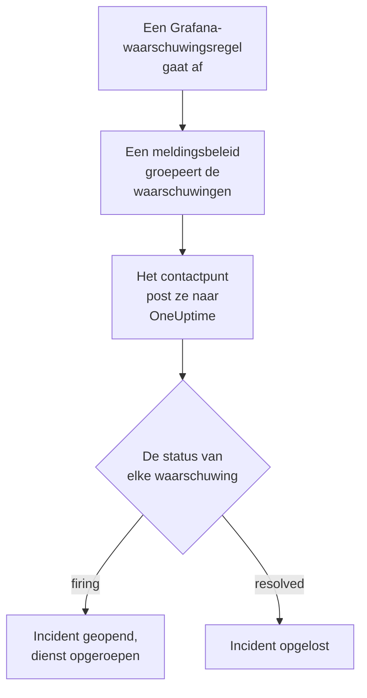

# Grafana

Stuur waarschuwingen van [Grafana](https://grafana.com) naar OneUptime, zodat elke afgaande waarschuwing een incident wordt dat je team met dienst oproept en wordt opgelost wanneer de waarschuwing herstelt. Grafana stuurt zijn waarschuwingen via een webhook-contactpunt, dus aan geen van beide kanten hoef je iets te installeren.

:::cards
- [Kiezen hoe OneUptime waarschuwingen ontvangt](#kiezen-hoe-oneuptime-waarschuwingen-ontvangt): Een Incoming Request-monitor of een eigen workflow.
- [Waarschuwingen ontvangen met een monitor](#waarschuwingen-ontvangen-met-een-monitor): Eén incident per waarschuwing, opgelost bij herstel.
- [Grafana configureren](#grafana-configureren): Een webhook-contactpunt en het beleid dat het gebruikt.
- [Problemen oplossen](#problemen-oplossen): Wanneer waarschuwingen niet aankomen of incidenten open blijven.
:::

## Hoe het werkt



De meldingsbeleidsregels van Grafana groeperen de waarschuwingen die afgaan, en een webhook-contactpunt post elke groep als één JSON-melding. Die heeft dezelfde vorm als een melding van [Prometheus Alertmanager](/docs/integrations/prometheus-alertmanager): een `status`, een lijst `alerts` waarin elke waarschuwing een eigen `status` en `fingerprint` heeft, en de `commonLabels` en `commonAnnotations` die haar waarschuwingen delen. Grafana voegt een `title` en een `message` toe die voor mensen zijn geschreven.

## Voordat je begint

- Grafana 9 of later, met Grafana Alerting, de standaard sinds Grafana 9. Het moet je OneUptime via HTTPS kunnen bereiken.
- In OneUptime het recht om monitoren aan te maken, of workflows als je die weg kiest.

## Kiezen hoe OneUptime waarschuwingen ontvangt

Stel eerst OneUptime in: dat geeft je de URL waar Grafana naartoe stuurt.

| Weg | Gebruik hem als |
| --- | --- |
| Een Incoming Request-monitor (aanbevolen) | Je wilt dat elke waarschuwing een incident is dat de dienst oproept en wordt opgelost wanneer de waarschuwing herstelt. Er valt niets te bouwen. |
| Een workflow met een Webhook-trigger | Je hebt eigen logica nodig: waarschuwingen filteren, ze omvormen of eerst andere systemen aanroepen. Een workflow opent één incident per melding, niet per waarschuwing, en lost het niet op bij herstel. |

Beide krijgen dezelfde JSON van hetzelfde contactpunt, dus je kunt met de ene beginnen en later overstappen door één URL in Grafana te wijzigen.

## Waarschuwingen ontvangen met een monitor

Een [Incoming Request-monitor](/docs/monitor/incoming-request-monitor) geeft je een URL, en zijn criteria bepalen wat elke melding doet.

:::steps
### De monitor maken

Ga naar **Monitoren** en klik op **Monitor maken**. Kies **Incoming Request** onder **Monitortype**, noem hem `Grafana` en klik op **Volgende**.

### Een incident declareren voor elke afgaande waarschuwing

Open in de stap **Criteria** het eerste criterium, het criterium dat de monitor offline zet. Zet het filter op **Verzoeklichaam**, **Bevat**, `"status":"firing"`. Dit criterium declareert al een incident wanneer het filter overeenkomt. Vul het incident in:

- **Incidenttitel**: `{{requestBody.commonLabels.alertname}}`.
- **Incidentbeschrijving**, onder **Beschrijving**: `{{requestBody.message}}`, de tekst die Grafana voor de melding schrijft.
- **Ernst**: de incidenternst die deze waarschuwingen moeten krijgen.
- **Bereikbaarheidsbeleid**, onder **Bereikbaarheid**: het beleid dat moet worden opgeroepen.
- **Incident automatisch oplossen**, onder **Meer velden**: laat het aan, zoals het begint. Zonder dit worden herstelmeldingen genegeerd en blijven incidenten open.

### Eén incident per waarschuwing openen

Open in hetzelfde criterium **Instellingen** en zet **Group incidents and alerts by a payload field** aan. Vul het in zoals hieronder, zodat elke waarschuwing een eigen incident krijgt en haar herstel het oplost:

| Veld | Waarde |
| --- | --- |
| **Open a separate incident for each…** | `requestBody.alerts[*].fingerprint` |
| **Field that signals recovery** | `requestBody.alerts[*].status` |
| **Value that means recovered** | `resolved` |

### De monitor weer online brengen

Open het tweede criterium, het criterium dat de monitor online zet, en zet het filter op **Verzoeklichaam**, **Bevat**, `"status":"resolved"`.

### De URL kopiëren

Klik op **Monitor maken**. De pagina **Overzicht** van de monitor toont zijn **Heartbeat URL**. Kopieer die voor Grafana:

```text
https://oneuptime.com/heartbeat/<secret key>
```

Een zelf gehoste installatie heeft een eigen host in plaats van `oneuptime.com`.
:::

Elke waarschuwing van een melding opent een eigen incident, tot **Max incidents per request** (`100`, tenzij je het wijzigt), en de eigen `status` van elke waarschuwing bepaalt wanneer haar incident wordt opgelost. De `fingerprint` van Grafana identificeert een waarschuwing aan de hand van haar labels, dus dat is de waarde om op te groeperen. Zie [Waarschuwingen uit een ander systeem ontvangen](/docs/monitor/incoming-request-monitor#waarschuwingen-uit-een-ander-systeem-ontvangen) voor wat elke instelling doet.

> [!WARNING]
> Groepeer niet op een label dat alle waarschuwingen van een melding delen. Het standaardmeldingsbeleid van Grafana groepeert waarschuwingen op `grafana_folder` en `alertname`, dus alle waarschuwingen van één melding hebben dezelfde `alertname`: groeperen op `requestBody.alerts[*].labels.alertname` vouwt de hele melding samen tot één incident.

`{{requestBody.commonLabels.alertname}}` en `{{requestBody.message}}` beschrijven de hele melding, en dat is onder het standaardbeleid één waarschuwingsregel. De groeperingssleutel is ook een variabele, `{{fingerprint}}`, maar het is een hash waar een responder niets aan heeft. Zie [Incident- en waarschuwingstemplates](/docs/monitor/incident-alert-templating) voor elke variabele die je kunt gebruiken.

## Grafana configureren

:::steps
### Een webhook-contactpunt toevoegen

Ga in Grafana naar **Alerting → Contact points** en klik op **+ Add contact point**. In Grafana 11 en later staat **Alerting** onder **Alerts & IRM**, en is **Contact points** een tabblad van **Notification configuration**.

Noem het contactpunt `OneUptime`, kies **Webhook** onder **Integration** en plak de gekopieerde URL in **URL**. Laat **HTTP Method** op `POST` staan en klik op **Save contact point**.

### Er waarschuwingen naartoe sturen

Ga naar **Alerting → Notification policies**. Zet het contactpunt van het standaardbeleid op `OneUptime`, of voeg een onderliggend beleid toe dat overeenkomt met de waarschuwingen die OneUptime moet krijgen, met `OneUptime` als contactpunt.
:::

Grafana stuurt `Content-Type: application/json`, wat de monitor nodig heeft om de velden van een melding te lezen. De instelling **Max Alerts** van het contactpunt beperkt de waarschuwingen van één melding: houd haar op `0`, geen limiet, of hooguit op de **Max incidents per request** van de monitor.

## Testen

1. Open in Grafana het contactpunt `OneUptime` en klik op **Test**. Grafana stuurt een afgaande testwaarschuwing, en in OneUptime gaat een incident open. Een testwaarschuwing herstelt nooit, dus los dat incident met de hand op.
2. Laat een echte waarschuwingsregel afgaan, bijvoorbeeld door haar drempel even te verlagen, en kijk hoe haar incident opengaat en daarna wordt opgelost wanneer je de drempel terugzet.

## Waarschuwingen ontvangen met een workflow

Gebruik een [workflow](/docs/workflows/index) wanneer je eigen stappen nodig hebt tussen Grafana en het incident.

:::steps
### De workflow maken

Ga naar **Workflows**, klik op **Workflow maken** en daarna op **Vanaf nul beginnen**. Noem hem `Grafana alerts` en klik op **Workflow maken**.

### De Webhook-trigger toevoegen

Klik op het gestippelde blok **Kies wat deze workflow start** en kies **Webhook**. Klik op de trigger, daarna op **URL kopiëren**, en gebruik die URL in het contactpunt in Grafana.

### Controleren dat de melding afgaat

Klik op **Component toevoegen**, voeg een blok **If / Else** toe en verbind de punt **Out** van de trigger ermee. Zet **Value to check** op `{{local.components.webhook-1.returnValues.request-body.status}}`, **Comparison** op **is equal to** en **Compare with** op `firing`.

### Het incident declareren

Voeg een blok **Create One Incident** toe en verbind de kant **Yes** van het blok **If / Else** ermee. Kies onder **Incident Template** een sjabloon dat de ernst en het bereikbaarheidsbeleid instelt dat moet worden opgeroepen (zie [Incidentsjablonen](/docs/incidents/settings#incidentsjablonen)). Stel onder **JSON Object** in wat van Grafana komt:

```json
{
  "title": "{{local.components.webhook-1.returnValues.request-body.title}}",
  "description": "{{local.components.webhook-1.returnValues.request-body.message}}"
}
```

Zonder sjabloon moet **JSON Object** ook `incidentSeverityId` bevatten, de ID van een van de incidenternstniveaus van het project.

### De workflow inschakelen

Zet **Ingeschakeld** aan bovenaan de **Bouwer**. Een uitgeschakelde workflow antwoordt Grafana met `400`.
:::

Eén run verwerkt één melding, dus hij declareert één incident, hoeveel waarschuwingen de melding ook bevat. Een melding die `resolved` is, neemt de kant **No** van het blok **If / Else**, waar niets is verbonden, dus daar stopt de run. Gebruik de monitor voor één incident per waarschuwing dat bij herstel wordt opgelost.

## Problemen oplossen

:::details Er komt niets aan in OneUptime
- Klik op **Test** bij het contactpunt: Grafana toont een fout wanneer het de URL niet kan bereiken. Het serverlog van Grafana bevat de details.
- De monitor antwoordt meteen `200`, voordat hij iets controleert, ook bij een verkeerde geheime sleutel. Kijk in de tijdlijn van de monitor of meldingen aankomen.
- Een uitgeschakelde workflow antwoordt `400`. Zet **Ingeschakeld** aan bovenaan de **Bouwer** ervan.
:::

:::details Incidenten gaan open maar worden nooit opgelost
- Het incident van het criterium heeft **Incident automatisch oplossen** nodig, onder **Meer velden**.
- **Field that signals recovery** moet `requestBody.alerts[*].status` zijn, en **Value that means recovered** precies `resolved`. De vergelijking is hoofdlettergevoelig.
- De groeperingspaden moeten met `requestBody.` beginnen, en alleen de eerste `[*]` in een pad leest een lijst. Een pad dat een van beide regels breekt, komt nergens mee overeen, zonder foutmelding.
:::

:::details Eén incident voor een melding vol waarschuwingen
Je hebt gegroepeerd op een label dat voor elke waarschuwing van een melding hetzelfde is, zoals `alertname` onder het standaardbeleid. Groepeer in plaats daarvan op `requestBody.alerts[*].fingerprint`.
:::

:::details Het incident toont een verwijzing in plaats van een waarde
Een verwijzing naar een veld dat de melding niet heeft, blijft staan zoals ze geschreven is, accolades en al. Vergelijk de naam van het veld met wat Grafana heeft gestuurd: open voor een workflow de run in **Logboeken → Uitvoeringen** en vergelijk met wat de trigger ontving.
:::

De gids voor [Prometheus Alertmanager](/docs/integrations/prometheus-alertmanager#problemen-oplossen) behandelt meer gevallen, en die gelden ook voor de meldingen van Grafana.

## Beveiliging

- **Behandel de URL als een wachtwoord.** Iedereen die hem heeft, kan incidenten openen. Lekt hij uit, stel hem dan opnieuw in: **Geheime sleutel voor inkomende aanvraag opnieuw instellen** op de pagina **Instellingen** van de monitor, of **URL opnieuw instellen** in de **Webhook**-trigger van de workflow. Werk daarna de **URL** van het contactpunt in Grafana bij.
- **Zelf gehost?** Laat Grafana je OneUptime via HTTPS door je firewall bereiken.

## Volgende stappen

:::cards
- [Inkomende-verzoek-monitor](/docs/monitor/incoming-request-monitor): Elke instelling van de monitor die je waarschuwingen ontvangt.
- [Prometheus Alertmanager](/docs/integrations/prometheus-alertmanager): Dezelfde opzet, met een dead man's switch voor je waarschuwingen.
- [Metrics-monitor](/docs/monitor/metrics-monitor): Waarschuw op dezelfde metrics in OneUptime zelf.
- [Overzicht van integraties](/docs/integrations/index): De andere tools die je kunt koppelen.
:::
