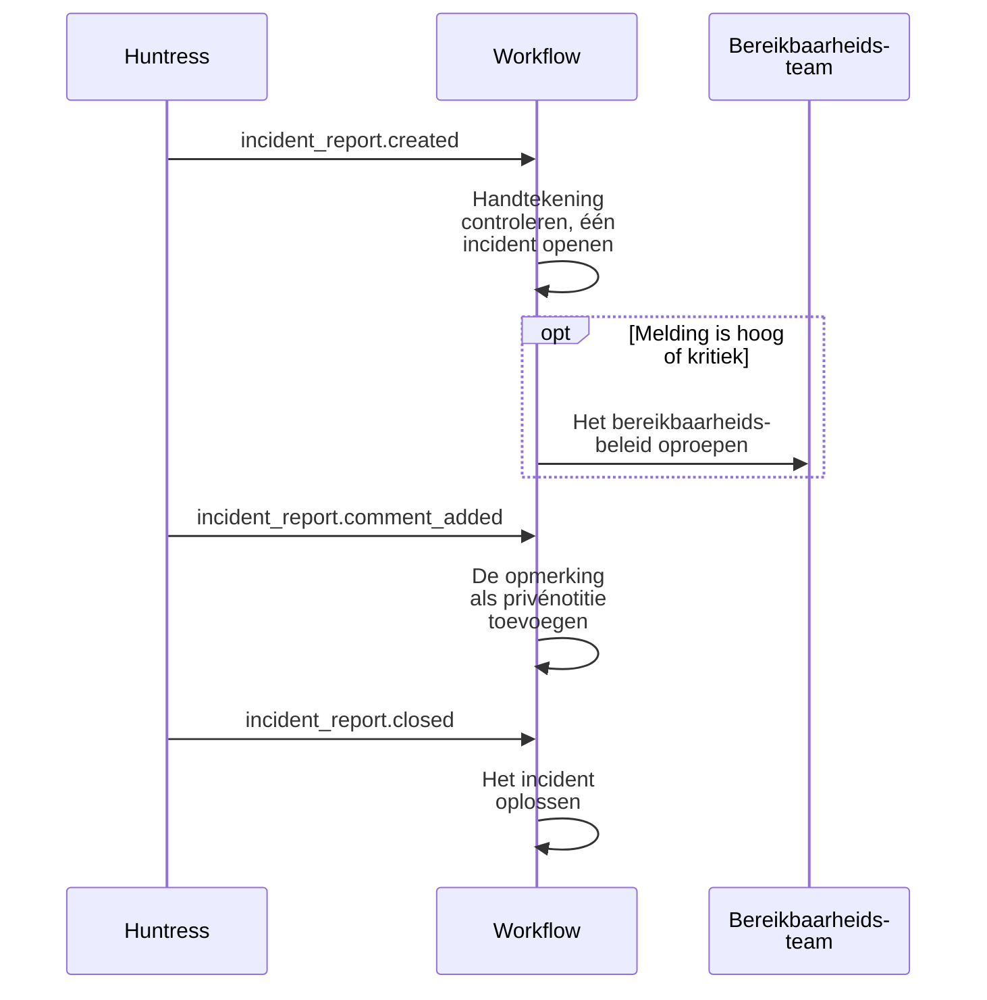

# Huntress-integratie

Roep uw bereikbaarheidsdienst op voor Huntress-incidentmeldingen, met een workflow. Wanneer het Huntress-SOC een incidentmelding over een endpoint of een identiteit stuurt, opent de workflow er één incident voor, roept hij het bereikbaarheidsbeleid op dat u kiest, voegt hij opmerkingen uit Huntress toe als privénotities en lost hij het incident op wanneer de melding in Huntress wordt gesloten.

Deze integratie is **inkomend**: Huntress stuurt elke gebeurtenis van een incidentmelding naar de eigen URL van de workflow, ondertekend met het ondertekeningsgeheim van het endpoint. OneUptime roept Huntress nooit aan en heeft dus geen Huntress-API-sleutel nodig.

:::cards
- [Hoe het werkt](#hoe-het-werkt): Wat de workflow doet met elke gebeurtenis van een melding.
- [Instellen](#de-integratie-instellen): De workflow maken, het endpoint in Huntress toevoegen, het ondertekeningsgeheim opslaan, een test sturen.
- [De trigger](#de-trigger-huntress-incident-report): De waarden die een melding aan de workflow geeft, en de instellingen van de trigger.
- [Problemen oplossen](#problemen-oplossen): Wat de fouten van de trigger betekenen en wat u moet aanpassen.
:::

## Hoe het werkt

Huntress stuurt een gebeurtenis over een incidentmelding wanneer de melding wordt verstuurd, wanneer iemand er een opmerking bij plaatst en wanneer ze wordt gesloten. De trigger **Huntress Incident Report** start de workflow één keer voor elke gebeurtenis, en zijn **Event** zegt welke het was: `created`, `comment-added` of `closed`.

1. **Controleren.** Een verzoek moet ondertekend zijn met het ondertekeningsgeheim van het endpoint, niet meer dan vijf minuten voordat het aankomt. Al het andere wordt geweigerd, en de instellingen van de trigger zeggen waarom.
2. **De workflow starten.** Elke gebeurtenis start één uitvoering, met de velden van de melding als de waarden van de trigger. Een gebeurtenis die Huntress opnieuw stuurt, start niets meer.
3. **Eén incident openen.** Bij `created` opent de workflow een incident met de naam van de melding, zoals `Huntress: Incident on DESKTOP-01 (Acme Corp)`. De beschrijving bevat de samenvatting van de melding, de ernst in Huntress, de organisatie, de getroffen host of identiteit, de indicatoren die Huntress vond en een link naar de melding in Huntress. Het incident krijgt een label met de organisatie van de melding, en roept het bereikbaarheidsbeleid op dat u kiest wanneer de melding hoog of kritiek is.
4. **De melding volgen.** Bij `comment-added` wordt de opmerking een privénotitie bij het incident. Bij `closed` wordt het incident opgelost, met de reden op de tijdlijn.

Het incident bewaart het nummer van de melding in zijn aangepaste velden, als `huntressReportId`: zo vindt de workflow het terug wanneer Huntress een opmerking bij de melding plaatst of haar sluit. Zo geopende incidenten verschijnen nooit op een statuspagina, en uw incidentregels (bereikbaarheids-, eigenaar-, label- en privacyregels) gelden voor hen zoals voor elk ander incident.

## Voordat u begint

- In OneUptime een rol die workflows kan maken en bewerken, zoals **Projecteigenaar**, **Projectbeheerder** of **Workflowbeheerder**.
- In Huntress de rol **Account Admin**: alleen accountbeheerders kunnen webhooks toevoegen.
- Een bereikbaarheidsbeleid om op te roepen.
- In OneUptime Cloud een abonnement met workflows: Growth of hoger. Elke gebeurtenis die Huntress stuurt, is één workflow-uitvoering.
- Bij een zelf gehoste installatie een OneUptime dat Huntress vanaf internet via HTTPS bereikt: Huntress stuurt webhooks alleen naar `https://`-URL's.

## De integratie instellen

:::steps
### De workflow maken

Open **Workflows** en klik op **Workflow maken**. Kies onder **Of begin met een sjabloon** de categorie **Huntress**, kies **Open an incident for each Huntress incident report** en klik op **Dit sjabloon gebruiken**.

### Kiezen wie wordt opgeroepen

Het dialoogvenster vraagt daarna wie er moet worden opgeroepen: kies onder **Who to page for high and critical reports** het bereikbaarheidsbeleid om op te roepen, of niets om niemand op te roepen, en klik op **Workflow maken**. De workflow opent in de **Bouwer**, uitgeschakeld. Om later te wijzigen wie hij oproept, klik je op zijn stap **Page an On-Call Policy** en wijzig je zijn **Bereikbaarheidsbeleid**.

### Een webhook-endpoint toevoegen in Huntress

Klik op de trigger **Huntress Incident Report** en klik onder **Voeg in Huntress een webhook-endpoint toe** op **URL kopiëren**. De URL ziet eruit als `https://oneuptime.com/workflow/huntress/<key>`; bij een zelf gehoste installatie begint hij met uw eigen host.

Open in Huntress het menu rechtsboven en kies **Integrations**. Klik op **Add an Integration**, kies **Webhooks** en klik op **Add Endpoint**. Plak de URL, zet **Incident Reports** aan en sla op. Laat **Escalations**, **Platform Actions** en **Account Notices** uit: de trigger neemt die gebeurtenissen aan en start er niets voor.

### Het ondertekeningsgeheim van het endpoint opslaan

Open in Huntress het menu van het endpoint (⋯) en kies **View Signing Secret**. Kopieer het volledig: het begint met `whsec_`. Klik in de trigger op **Ondertekeningsgeheim opslaan**, plak het en klik op **Ondertekeningsgeheim opslaan**. Het geheim wordt versleuteld en nooit meer getoond.

Zolang het geheim niet is opgeslagen, weigert de trigger elk verzoek. Huntress stuurt een geweigerde gebeurtenis later opnieuw, dus een gebeurtenis die nu wordt geweigerd, komt toch aan.

### De workflow inschakelen en een test sturen

Zet **Ingeschakeld** aan bovenaan de **Bouwer**. Open in Huntress het menu van het endpoint (⋯) en kies **Send Test**. Binnen enkele seconden toont de trigger **Ontvangt meldingen**.

> [!NOTE]
> Wat de test ook bevat, de trigger laat zien dat hij is aangekomen. Een test met een incidentmelding start de workflow zoals elke andere melding.
:::

## Wat de workflow doet

Na de trigger doet **Incident From Another Tool** wat elk **Event** vraagt, via het nummer van de melding:

| Event | Wat de workflow doet |
| --- | --- |
| `created` | Opent een incident met de **Incident Severity ID** van de trigger, met het label van zijn **Organization Label ID**. Bij een hoge of kritieke melding roept **Page an On-Call Policy** uw beleid op; een lage melding roept niemand op. Een melding die al een incident heeft, opent er geen tweede. |
| `comment-added` | Zoekt het incident van de melding en voegt de opmerking eraan toe als privénotitie. |
| `closed` | Zoekt het incident van de melding en lost het op, tenzij het al is opgelost. De reden staat op de tijdlijn: Huntress sloot de melding. |

Het is een workflow zoals elke andere, dus u kunt aanpassen wat hij doet: alleen voor kritieke meldingen oproepen door te wijzigen wat de **If / Else** na **Incident From Another Tool** vergelijkt, elke melding in een chatkanaal plaatsen met een Slack- of Microsoft Teams-stap, of elke organisatie naar haar eigen bereikbaarheidsbeleid sturen met een **Switch / Case** op **Organization**. Elke uitvoering staat bij de uitvoeringen van de workflow, met wat elke stap deed.

### Ernst

Huntress geeft elke incidentmelding een van drie ernstniveaus. De **Incident Severity ID** van de trigger is de incidenternst waarmee de melding opent: de ernst die de instelling ervoor kiest, of anders de volgorde van uw incidentniveaus, zoals **Incidenten → Instellingen → Ernst van incident** ze toont:

| Ernst in Huntress | Wat Huntress ermee bedoelt | Instelling | Incidenternst als de instelling leeg is |
| --- | --- | --- | --- |
| Critical | Aanvallers achter het toetsenbord, gevaarlijke malware of een actieve compromittering, direct in te dammen. | **Ernst voor kritieke meldingen** | De hoogste |
| High | Bevestigde malware die dringend hersteld moet worden, of een compromittering van een identiteit waarop u moet handelen. | **Ernst voor hoge meldingen** | De tweede |
| Low | Mogelijk ongewenste programma's, malwareresten en oudere bevindingen over identiteiten. | **Ernst voor lage meldingen** | De derde |

Een project met minder ernstniveaus gebruikt zijn laagste voor de rest. Een melding zonder ernst wordt als hoog behandeld. Wordt een gekozen ernst verwijderd, dan beslist de volgorde weer.

### Organisaties

De **Organization Label ID** van de trigger is een label met de naam van de Huntress-organisatie van de melding, zoals _Acme Corp_, dat hij maakt wanneer de eerste melding van die organisatie aankomt. Eén workflow ontvangt de meldingen van alle organisaties in uw Huntress-account, en **Alleen deze organisaties** van de trigger beperkt dat: één organisatienaam of -ID per regel, namen zonder onderscheid tussen hoofdletters en kleine letters.

> [!TIP]
> Om het eigen team van elke klant op te roepen, voegt u per organisatie een bereikbaarheidsregel voor incidenten toe, zoals "Als **Incident-labels** een van _Acme Corp_ heeft", die het beleid van die klant uitvoert. Zie [Bereikbaarheidsregels voor incidenten](/docs/incidents/settings#bereikbaarheidsregels-voor-incidenten).

## De trigger Huntress Incident Report

De trigger opent op Huntress: zijn URL, een vinkje naast elke afgeronde stap van de installatie en wat Huntress als laatste stuurde. Zijn instellingen, allemaal optioneel, staan ingeklapt onder **Meer velden**: **Alleen deze organisaties**, **Ernst voor kritieke meldingen**, **Ernst voor hoge meldingen** en **Ernst voor lage meldingen**.

| Waarde | Wat ze bevat |
| --- | --- |
| **Event** | `created`, `comment-added` of `closed`. Een melding die al gesloten of afgewezen is, is `closed`, welke gebeurtenis haar ook bracht. |
| **Report ID** | Het nummer van de melding in Huntress. |
| **Severity** | `critical`, `high` of `low`. |
| **Status** | De status van de melding in Huntress, zoals `sent`, `closed` of `dismissed`. |
| **Subject** | Het onderwerp van de melding, zoals Huntress het schrijft. |
| **Summary** | Wat de SOC-analist schreef. |
| **Organization**, **Organization ID** | De Huntress-organisatie waarover de melding gaat. |
| **Affected** | De host of identiteit waarover de melding gaat. |
| **Platform**, **Indicators** | Waar Huntress het vond, en wat het vond. |
| **Comment** | De opmerking die iemand toevoegde, bij `comment-added`. |
| **Report URL** | Waar de melding in Huntress opent. |
| **Incident Title**, **Incident Description** | Een titel en een Markdown-beschrijving voor een incident over de melding. |
| **Note** | Markdown voor een notitie over de gebeurtenis: de opmerking, of dat Huntress de melding sloot. |
| **Incident Severity ID**, **Organization Label ID** | De incidenternst en het label, zoals hierboven. |
| **Received At** | Wanneer OneUptime de gebeurtenis ontving. |

**Summary** en **Comment** zijn tekst die de analisten van Huntress schreven. Gebruik **Incident Description** en **Note** om ze in een incident of een notitie te zetten: die behouden de opmaak, en niets erin laadt een afbeelding of noemt iemand.

Om de workflow zonder Huntress te proberen, klikt u op **Workflow uitvoeren** in de **Bouwer** en typt u een **Event**, een **Report ID** en de velden die u nodig hebt. Gebruik hetzelfde **Report ID** om één melding van `created` tot `closed` te volgen.

## Eerder gemaakte Huntress-koppelingen

Huntress werd vroeger ingesteld onder **Incidenten → Integraties → Huntress**. Elke Huntress-koppeling werd een ingeschakelde workflow met dezelfde naam, die doet wat de koppeling deed: hij roept hetzelfde bereikbaarheidsbeleid op voor dezelfde meldingen, voegt dezelfde labels toe en lost op (of maakt alleen een notitie) op dezelfde manier. Zijn URL is nog die van de koppeling, `https://oneuptime.com/api/huntress/webhook/<connection-id>`, en zijn ondertekeningsgeheim is hetzelfde, dus in Huntress hoeft u niets te wijzigen. De incidenten die de koppeling opende, behouden het nummer van hun melding, dus de workflow vindt ze wanneer Huntress een opmerking bij die meldingen plaatst of ze sluit.

## Beveiliging

- **Alleen ondertekende verzoeken.** De trigger controleert de headers `svix-id`, `svix-timestamp` en `svix-signature` die Huntress stuurt tegen de body van het verzoek, precies zoals die aankwam. Een verzoek dat niet met het opgeslagen geheim is ondertekend, of meer dan vijf minuten eerder of later is ondertekend, wordt geweigerd.
- **Het geheim blijft geheim.** Het wordt versleuteld opgeslagen, nooit door de API teruggegeven en nooit meer getoond. **Ondertekeningsgeheim vervangen** in de trigger slaat een ander op, zoals het geheim van een nieuw endpoint.
- **De URL is een adres, geen wachtwoord.** Hij eindigt op de sleutel van de workflow; alleen een verzoek dat met het geheim van het endpoint is ondertekend, start de workflow.
- **Eén endpoint per workflow.** Elke workflow heeft zijn eigen URL en geheim. Om de meldingen van een tweede Huntress-account te ontvangen, maakt u een tweede workflow.

## E-mail gebruiken in plaats daarvan

Huntress verstuurt incidentmeldingen ook per e-mail, en een [monitor voor inkomende e-mail](/docs/monitor/incoming-email-monitor) kan uit die e-mails incidenten openen, bijvoorbeeld wanneer het onderwerp `Critical Incident Report` bevat. Hij behandelt de e-mails echter als de status van één monitor: zolang zijn incident open is, opent de volgende melding er geen, en het incident wordt opgelost door de criteria van de monitor in plaats van wanneer Huntress de melding sluit. De workflow opent één incident per melding en lost elk op met zijn melding, dus kies daarvoor. Zodra de workflow meldingen ontvangt, stuurt u de e-mails niet meer naar de monitor, anders roept elke melding twee keer op.

## Problemen oplossen

Weigert de trigger een verzoek, dan tonen zijn instellingen de reden onder **Het laatste verzoek is geweigerd**. In Huntress toont **View Delivery Attempts** in het menu van het endpoint (⋯) elke levering met het antwoord van OneUptime.

:::details "A request arrived but was refused, because no signing secret is saved for this workflow yet"
Sla het ondertekeningsgeheim van het endpoint op: zie [De integratie instellen](#de-integratie-instellen). Huntress stuurt het geweigerde verzoek opnieuw.
:::

:::details "The request's signature does not match the signing secret"
Het opgeslagen geheim hoort niet bij dit endpoint. Elk endpoint heeft zijn eigen geheim: open in Huntress het menu van het endpoint (⋯), kies **View Signing Secret**, kopieer het volledig en sla het op met **Ondertekeningsgeheim vervangen**.
:::

:::details "The request was signed more than five minutes from now"
De klokken van Huntress en uw OneUptime-server lopen meer dan vijf minuten uiteen, of het verzoek is een herhaling. Controleer bij een zelf gehoste installatie of de klok van de server klopt.
:::

:::details "A request arrived while this workflow is off"
Zet **Ingeschakeld** aan bovenaan de **Bouwer**. Huntress stuurt het geweigerde verzoek opnieuw, en dan start het de workflow.
:::

:::details "No Huntress workflow has this address."
De workflow is verwijderd of gearchiveerd, zijn trigger is niet meer **Huntress Incident Report**, of de URL van het endpoint in Huntress is niet die van de workflow. Kopieer de URL uit de trigger en plak hem opnieuw in het endpoint in Huntress.
:::

:::details Er werd geen incident geopend
Open de uitvoeringen van de workflow en de uitvoering van de melding. Mislukte **Incident From Another Tool** met `This project has no incident severities to put the incident at.`, voeg er dan een toe onder **Incidenten → Instellingen → Ernst van incident**.
:::

:::details Niemand werd opgeroepen
Een lage melding opent een incident zonder iemand op te roepen. Anders zegt de uitvoering van de melding wat **Page an On-Call Policy** deed, en de pagina **Bereikbaarheidsuitvoeringen** van het incident toont wat elk beleid deed.
:::

## Volgende stappen

:::cards
- [Workflow-triggers](/docs/workflows/triggers): De andere manieren om een workflow te starten.
- [Bereikbaarheidsregels voor incidenten](/docs/incidents/settings#bereikbaarheidsregels-voor-incidenten): Het eigen team van elke organisatie oproepen, via haar label.
- [Incidentstatussen en ernstniveaus](/docs/incidents/states-and-severities): De ernstniveaus ordenen waarmee Huntress-meldingen openen.
- [Overzicht van integraties](/docs/integrations/index): De andere tools die u kunt koppelen.
:::
