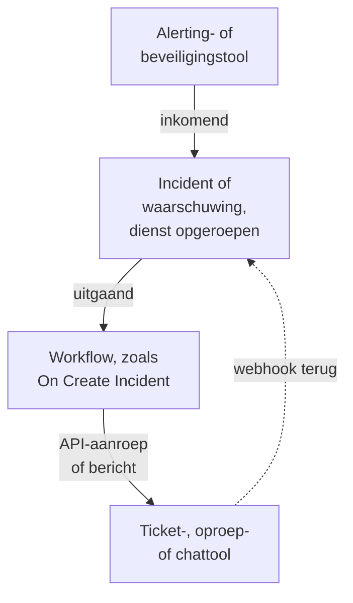

# Overzicht van integraties

OneUptime werkt met de tools die je team al gebruikt. Alertingtools openen er incidenten in, en OneUptime opent tickets, oproepen en chatberichten in andere tools. Sommige tools koppel je via een formulier, andere via een kant-en-klaar workflowsjabloon. Elke andere tool met een webhook of een API koppel je via een workflow die je zelf bouwt.

:::cards
- [Kiezen hoe je koppelt](#kiezen-hoe-je-koppelt): De vier manieren om te koppelen en wanneer je welke gebruikt.
- [Catalogus](#catalogus): Elke tool met een handleiding, gegroepeerd naar wat hij doet.
- [Je eigen integratie bouwen](#je-eigen-integratie-bouwen): De inkomende en uitgaande patronen, voor elke andere tool.
- [Inloggegevens veilig houden](#inloggegevens-veilig-houden): Geheime variabelen en de headers die elke tool verwacht.
:::

## Hoe integraties werken

Elke integratie verplaatst gegevens in één richting of in beide. **Inkomend**: een andere tool meldt OneUptime dat er iets mis is, en OneUptime opent een incident of een waarschuwing en roept het team met dienst op. **Uitgaand**: er gebeurt iets in OneUptime, en een workflow meldt het aan een andere tool: die opent een ticket, roept iemand op of plaatst een bericht.



Een tweerichtingsintegratie, zoals Jira of Dynamics 365, gebruikt beide richtingen: één workflow stuurt het incident naar buiten, en een andere, gestart door de webhook van de andere tool, brengt wijzigingen terug.

## Kiezen hoe je koppelt

| Manier | Het beste voor | Voorbeelden |
| --- | --- | --- |
| Een ingebouwde koppeling | Tools waarmee OneUptime zelf verbinding maakt. Je vult een formulier in en er valt niets te bouwen. | [Slack](/docs/workspace-connections/slack), [Microsoft Teams](/docs/workspace-connections/microsoft-teams), de koppelingen van [Beveiligingsgebeurtenissen](/docs/telemetry/security-events) |
| Een workflowsjabloon | Ticketingtools, in beide richtingen bijgewerkt, monitoringproblemen, beveiligingsincidentrapporten en chatberichten. Je kiest een sjabloon en vult een paar instellingen in. | [Jira](/docs/integrations/jira), [Microsoft Dynamics 365](/docs/integrations/microsoft-dynamics-365), [Huntress](/docs/integrations/huntress), [Zabbix](/docs/integrations/zabbix) |
| Een Incoming Request-monitor | Alertingtools die een webhook sturen. Je krijgt één incident per alert, aan de dienst doorgegeven en opgelost wanneer de alert herstelt, zonder workflow. | [Zabbix](/docs/integrations/zabbix), [Prometheus Alertmanager](/docs/integrations/prometheus-alertmanager), [Grafana](/docs/integrations/grafana) |
| Een workflow die je zelf bouwt | Elke tool met een webhook of een REST API, en elke eigen logica. | [PagerDuty](/docs/integrations/pagerduty), [Opsgenie](/docs/integrations/opsgenie), [ServiceNow](/docs/integrations/servicenow) |

Begin bovenaan de tabel: hoe hoger een manier staat, hoe minder er te onderhouden is.

## Catalogus

### Monitoring- en alertingtools

| Tool | Richting | Wat hij doet |
| --- | --- | --- |
| [Zabbix](/docs/integrations/zabbix) | Beide | Maakt van Zabbix-problemen incidenten of waarschuwingen, lost ze op bij herstel, en bevestigt of sluit de problemen vanuit OneUptime. |
| [Prometheus Alertmanager](/docs/integrations/prometheus-alertmanager) | Inkomend | Maakt van Alertmanager-meldingen incidenten. |
| [Grafana](/docs/integrations/grafana) | Inkomend | Maakt van Grafana-alerts incidenten. |
| [Datadog](/docs/integrations/datadog) | Inkomend | Maakt van alerts van Datadog-monitors incidenten. |

### Beveiligingstools

| Tool | Richting | Wat hij doet |
| --- | --- | --- |
| [Huntress](/docs/integrations/huntress) | Inkomend | Roept de dienst op voor incidentrapporten van Huntress en lost het incident op wanneer het rapport sluit. |
| [Google SecOps](/docs/integrations/google-secops) | Beide | Brengt detecties en indicatoren van Google SecOps naar Beveiligingsgebeurtenissen, en stuurt er wat OneUptime vindt naartoe. |
| [Microsoft Sentinel](/docs/integrations/microsoft-sentinel) | Beide | Brengt incidenten van Microsoft Sentinel naar Beveiligingsgebeurtenissen, en stuurt er wat OneUptime vindt naartoe. |
| [Microsoft Defender XDR](/docs/integrations/microsoft-defender-xdr) | Inkomend | Brengt alerts van Microsoft Defender XDR naar Beveiligingsgebeurtenissen. |
| [CrowdStrike Falcon](/docs/integrations/crowdstrike-falcon) | Inkomend | Brengt alerts van CrowdStrike Falcon naar Beveiligingsgebeurtenissen. |
| [Splunk Enterprise Security](/docs/integrations/splunk) | Beide | Brengt notable events van Splunk naar Beveiligingsgebeurtenissen, en stuurt er wat OneUptime vindt naartoe. |
| [Elastic Security](/docs/integrations/elastic-security) | Beide | Brengt detectie-alerts van Elastic Security naar Beveiligingsgebeurtenissen, en stuurt er wat OneUptime vindt naartoe. |
| [AWS Security Hub](/docs/integrations/aws-security-hub) | Inkomend | Brengt bevindingen van AWS Security Hub naar Beveiligingsgebeurtenissen. |
| [Okta System Log](/docs/integrations/okta) | Inkomend | Brengt aanmeldingen, accountwijzigingen en dreigingsdetecties van Okta naar Beveiligingsgebeurtenissen. |

### Ticketing en IT-servicemanagement

| Tool | Richting | Wat hij doet |
| --- | --- | --- |
| [Jira](/docs/integrations/jira) | Beide | Opent een Jira-issue voor elk incident of elke waarschuwing, en brengt statuswijzigingen en opmerkingen terug. |
| [Microsoft Dynamics 365](/docs/integrations/microsoft-dynamics-365) | Beide | Opent een Dynamics 365-case voor elk incident of elke waarschuwing, en brengt statuswijzigingen en notities terug. |
| [ServiceNow](/docs/integrations/servicenow) | Uitgaand | Opent een ServiceNow-incident voor elk OneUptime-incident en lost het samen met het incident op. |
| [GitHub](/docs/integrations/github) | Uitgaand | Opent een GitHub-issue voor een incident. |
| [GitLab](/docs/integrations/gitlab) | Uitgaand | Opent een GitLab-issue voor een incident. |

### Oproeptools

| Tool | Richting | Wat hij doet |
| --- | --- | --- |
| [PagerDuty](/docs/integrations/pagerduty) | Uitgaand | Start een PagerDuty-incident voor elk OneUptime-incident en lost het samen met het incident op. |
| [Opsgenie](/docs/integrations/opsgenie) | Uitgaand | Maakt een Opsgenie-alert aan voor elk OneUptime-incident en sluit het samen met het incident. |

### Chattools

| Tool | Richting | Wat hij doet |
| --- | --- | --- |
| [Slack](/docs/workspace-connections/slack) | Beide | Een ingebouwde koppeling: incidentkanalen, acties vanuit Slack en diensten. |
| [Microsoft Teams](/docs/workspace-connections/microsoft-teams) | Beide | Een ingebouwde koppeling: incidentkanalen, acties vanuit Teams en diensten. |
| [Mattermost](/docs/workflows/components#mattermost) | Uitgaand | Plaatst incidentupdates in een Mattermost-kanaal. |
| [Discord](/docs/integrations/discord) | Uitgaand | Plaatst incidentupdates in een Discord-kanaal. |
| [Telegram](/docs/integrations/telegram) | Uitgaand | Stuurt een bericht naar een Telegram-chat wanneer een waarschuwing afgaat. |
| [IRC](/docs/integrations/irc) | Uitgaand | Plaatst incidentupdates in een IRC-kanaal. |

> [!TIP]
> Slack en Microsoft Teams hebben ook workflowstappen. Gebruik de ingebouwde koppeling voor incidentkanalen en diensten, en een workflowstap wanneer je alleen een bericht in een kanaal nodig hebt.

### Hostingplatforms

| Tool | Richting | Wat hij doet |
| --- | --- | --- |
| [Vercel](/docs/integrations/vercel) | Inkomend | Voeg OneUptime toe vanuit de Vercel Marketplace: traces, logs, uptime-monitors en een statuspagina voor uw Vercel-projecten. |

## Overstappen van een andere tool

Om een andere tool voor diensten, uptime of statuspagina's te verlaten, haal je je team over in plaats van de twee te koppelen. **Projectinstellingen → Geavanceerd → Importeren uit een andere tool** leest je account met een API-sleutel, laat zien wat het vond en maakt aan wat je aanvinkt. Elke tool heeft een handleiding:

- Tools voor diensten en incidenten: [Opsgenie](/docs/moving-to-oneuptime/opsgenie), [PagerDuty](/docs/moving-to-oneuptime/pagerduty), [incident.io](/docs/moving-to-oneuptime/incident-io), [Splunk On-Call](/docs/moving-to-oneuptime/splunk-on-call) en [Grafana OnCall](/docs/moving-to-oneuptime/grafana-oncall).
- Tools voor uptime en statuspagina's: [UptimeRobot](/docs/moving-to-oneuptime/uptimerobot), [Atlassian Statuspage](/docs/moving-to-oneuptime/atlassian-statuspage), [Better Stack](/docs/moving-to-oneuptime/better-stack), [Pingdom](/docs/moving-to-oneuptime/pingdom), [StatusCake](/docs/moving-to-oneuptime/statuscake) en [Uptime Kuma](/docs/moving-to-oneuptime/uptime-kuma).

## Je eigen integratie bouwen

Een tool zonder handleiding past toch in een van twee patronen. Kan hij een webhook sturen, gebruik dan het inkomende patroon. Heeft hij een REST API, gebruik dan het uitgaande patroon. Beide zijn workflows: zie [Workflows – Overzicht](/docs/workflows/index) om te beginnen.

### Inkomend: een andere tool stuurt gegevens naar OneUptime

Begin voor een alertingtool met een [Incoming Request-monitor](/docs/monitor/incoming-request-monitor#waarschuwingen-uit-een-ander-systeem-ontvangen): die opent één incident per alert en lost het op bij herstel, zonder dat je iets bouwt. Bouw een workflow wanneer je eigen logica nodig hebt:

:::steps
1. Open **Workflows**, klik op **Workflow maken** en daarna op **Vanaf nul beginnen**. Geef de workflow een naam en klik op **Workflow maken**.
2. Klik op het gestippelde blok **Kies wat deze workflow start** en kies **Webhook**. Klik op de trigger en daarna op **URL kopiëren**.
3. Stuur in de andere tool de webhook naar die URL als een `POST` met `Content-Type: application/json`.
4. Voeg de blokken toe die erop reageren. Ze lezen het verzoek met verwijzingen zoals `{{local.components.webhook-1.returnValues.request-body.status}}`: een **If / Else**-blok om een veld te controleren, en daarna **Create One Incident** om een incident te melden.
5. Zet **Ingeschakeld** aan bovenaan de **Bouwer**, stuur een test vanuit de andere tool en open **Logboeken → Uitvoeringen** om te zien wat er binnenkwam.
:::

De URL is het enige inloggegeven, dus behandel hem als een wachtwoord. Zie [Webhook](/docs/workflows/triggers#webhook).

### Uitgaand: OneUptime stuurt gegevens naar een andere tool

:::steps
1. Sla de API-sleutel van de tool op als geheime globale variabele, zoals [hieronder](#inloggegevens-veilig-houden) beschreven.
2. Maak een workflow, klik op het gestippelde blok en kies een gebeurtenistrigger, zoals **On Create Incident**. Klik op de trigger: de **Fields to pass on** ervan beginnen met **Titel**, dus klik op **Veld toevoegen** en kies de andere velden die je wilt versturen, zoals **Beschrijving**.
3. Klik op **Component toevoegen** en voeg een **API Post (JSON)**-blok toe. Verbind de **Success**-punt van de trigger ermee.
4. Vul de **URL** in, de **Request Headers** met de `Authorization`-header en de **Request Body** met de velden van het incident, zoals `{{local.components.incident-on-create-1.returnValues.model.title}}`.
5. Klik op **Workflow uitvoeren**, kies onder **Incident** een incident en voer hem uit. Een testuitvoering stuurt het verzoek echt. Zet daarna **Ingeschakeld** aan.
:::

Wanneer de tool de gegevens in een andere vorm nodig heeft, voeg je tussen de twee een [Run Custom JavaScript](/docs/workflows/components#custom-code)-blok toe. Het recept is hetzelfde voor Zendesk, New Relic, AWS (via SNS), StatusCake en alle andere: alleen de URL en de body veranderen.

## Inloggegevens veilig houden

Plak nooit een API-sleutel of een token in een blok. Sla hem één keer op als geheime globale variabele:

:::steps
1. Ga naar **Workflows → Globale variabelen** en klik op **Workflow Variabele aanmaken**.
2. Geef hem een naam, zoals `JIRA_AUTH`, en klik op **Volgende**.
3. Plak de sleutel in **Inhoud**, zet **Geheim** aan en klik op **Workflow Variabele aanmaken**.
:::

Elk blok leest hem als `{{global.variables.JIRA_AUTH}}`. De inhoud van een variabele kan na het opslaan niet meer worden gelezen, en die van een geheime variabele wordt in de uitvoeringslogboeken vervangen door `[REDACTED]`. Voor tokens die verlopen, zoals die van Microsoft Entra ID, haalt een [OAuth 2.0-variabele](/docs/workflows/variables#oauth-20-variabelen-tokens-die-zichzelf-vernieuwen) zelf een nieuwe op. Zie [Workflow-variabelen](/docs/workflows/variables#globale-variabelen).

### Spiekbrief voor authenticatie

De meeste uitgaande integraties zetten de sleutel in een header van het verzoek. De gangbare vormen:

| Schema | Wat je stuurt | Gebruikt door |
| --- | --- | --- |
| Bearer-token | `Authorization: Bearer {{global.variables.TOKEN}}` | GitHub en de meeste moderne API's |
| Basic-authenticatie | `Authorization: Basic {{global.variables.BASE64_USER_PASS}}` | Jira Cloud, ServiceNow |
| Header met API-sleutel | `Authorization: GenieKey {{global.variables.OPSGENIE_KEY}}` | Opsgenie |
| Header met privétoken | `PRIVATE-TOKEN: {{global.variables.GITLAB_TOKEN}}` | GitLab |
| Sleutel in de body | `routing_key` in de JSON-body | PagerDuty Events API |
| OAuth 2.0-clientreferenties | `Authorization: Bearer {{local.variables.dynamicsAccessToken}}`, uit een OAuth 2.0-variabele | Microsoft Dynamics 365 |

Codeer voor Basic-authenticatie `username:password`, of `email:api_token`, één keer en sla het resultaat op als het geheim. Op macOS of Linux:

```bash
printf '%s' 'you@example.com:your_api_token' | base64 | tr -d '\n'
```

Gebruik `printf`, niet `echo`: `echo` voegt een regeleinde toe, dat samen met de rest wordt gecodeerd en de inloggegevens ongeldig maakt. `tr` houdt een lang resultaat op één regel.

## Zelfgehoste installaties

Een zelfgehoste OneUptime roept andere tools aan vanuit je netwerk, en andere tools roepen hem aan vanuit het hunne:

- **Uitgaand:** workflowverzoeken naar privénetwerkadressen worden geweigerd tenzij een beheerder ze toestaat. Zie [Uitgaande netwerktoegang](/docs/workflows/configuration#uitgaande-netwerktoegang).
- **Inkomend:** de webhooks van een tool moeten je OneUptime via HTTPS bereiken, dus een tool in de cloud heeft een openbaar adres nodig om aan te roepen.
- **Ingebouwde integraties** hebben elk een installatiehandleiding: [Slack](/docs/self-hosted/slack-integration), [Microsoft Teams](/docs/self-hosted/microsoft-teams-integration), [GitHub](/docs/self-hosted/github-integration), [Twilio](/docs/self-hosted/twilio-integration), [SendGrid Inbound Email](/docs/self-hosted/sendgrid-inbound-email) en [Push Notifications](/docs/self-hosted/push-notifications).

## Volgende stappen

:::cards
- [Workflows – Overzicht](/docs/workflows/index): Hoe workflows draaien en hoe je je eerste bouwt.
- [Inkomende-verzoek-monitor](/docs/monitor/incoming-request-monitor): Ontvang alerts van elke tool zonder workflow.
- [Jira](/docs/integrations/jira): Een volledige tweerichtingsintegratie, vanuit sjablonen.
- [Workflow-variabelen](/docs/workflows/variables): Geef gegevens door tussen blokken en houd geheimen erbuiten.
:::
