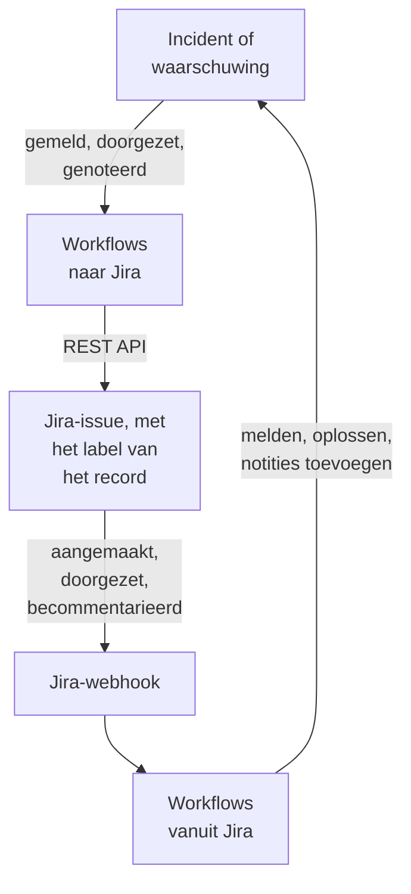

# Jira

Houd [Jira](https://www.atlassian.com/software/jira)-issues gelijk met je OneUptime-incidenten en -waarschuwingen, in beide richtingen. Kant-en-klare workflowsjablonen openen een issue voor elk incident of elke waarschuwing, zetten het door terwijl het record vordert en kopiëren notities erin als opmerkingen. Andere melden incidenten vanuit nieuwe issues en brengen statuswijzigingen, opmerkingen en bewerkingen terug. Er is geen plug-in: de workflows roepen de REST API van Jira aan, en Jira roept hun webhook-URL's aan.

:::cards
- [Beginnen met een sjabloon](#beginnen-met-een-sjabloon): De 17 sjablonen, wat ze vragen en hoe je ze instelt.
- [Hoe de sjablonen werken](#hoe-de-sjablonen-werken): Hoe issues en records gekoppeld blijven, zonder lussen.
- [Het zelf bouwen](#het-zelf-bouwen): Elke richting met de hand, voor als een sjabloon niet past.
- [Problemen oplossen](#problemen-oplossen): Wat de antwoorden van Jira betekenen.
:::

> [!NOTE]
> Atlassian hernoemt dingen in Jira Cloud: een **project** heet in een groot deel van de interface nu een **space**, en een **issue** heet een **werkitem**. Sites gebruiken beide woorden, dus waar de benaming ertoe doet, vind je hier beide.

## Hoe het werkt



Elk sjabloon is een kleine workflow, dus je neemt alleen de richtingen die je wilt, voor incidenten, waarschuwingen of beide. De sjablonen van OneUptime → Jira starten vanuit een gebeurtenis in OneUptime en roepen de REST API van Jira aan. De sjablonen van Jira → OneUptime starten vanuit een Jira-webhook. Ze vinden allemaal elkaars records via twee labels op het issue.

Alles op deze pagina is geschreven voor **Jira Cloud**. [Jira Data Center](#jira-data-center) somt op wat er verandert bij een zelfbeheerde Jira.

## Voordat je begint

- Een Jira Cloud-site, zoals `https://your-domain.atlassian.net`, en een project om issues in aan te maken.
- Een Jira-gebruiker voor de integratie en een API-token voor die gebruiker. Geef de gebruiker **Browse Projects**, **Create Issues**, **Edit Issues**, **Add Comments** en **Transition Issues** in het project.
- Een Jira-beheerder, om de webhooks te registreren die de sjablonen van Jira → OneUptime nodig hebben.
- In OneUptime het recht om workflows te maken. Op OneUptime Cloud hebben workflows het **Growth**-abonnement of hoger nodig.

## Beginnen met een sjabloon

Het dialoogvenster **Een workflow maken** heeft 17 Jira-sjablonen, onder **Jira** in de lijst met categorieën: negen voor incidenten en daarna acht voor waarschuwingen, elke groep onder een eigen kop. Ze delen één afspraak, labels op het Jira-issue, dus elke combinatie ervan werkt samen.

### Sjablonen voor incidenten

| Sjabloon | Wat het doet | Wat het vraagt |
| --- | --- | --- |
| **OneUptime → Jira** | | |
| Create a Jira issue when an incident is declared | Opent een issue voor elk nieuw incident en voegt de ID van het incident toe als label. Incidenten die vanuit Jira zijn gemeld, en privé-incidenten, worden overgeslagen. | API URL, API token, project key, issue type, OneUptime URL |
| Move the Jira issue when the incident is acknowledged or resolved | Zet het gekoppelde issue door: naar een In Progress-status wanneer het incident wordt bevestigd, en naar een Done-status wanneer het wordt opgelost. Zet het nooit terug. | API URL, API token |
| Copy incident private notes to the Jira issue | Plaatst elke nieuwe privénotitie als opmerking op het gekoppelde issue, als interne opmerking in Jira Service Management. | API URL, API token |
| Copy incident public notes to the Jira issue | Plaatst elke nieuwe openbare notitie als opmerking op het gekoppelde issue. | API URL, API token |
| Comment on the Jira issue when the incident is edited | Wanneer de titel, de ernst, de beschrijving, de hoofdoorzaak of de herstelnotities van het incident veranderen, plaatst het hoe het incident er nu bij staat, als interne opmerking in Jira Service Management. | API URL, API token |
| **Jira → OneUptime** | | |
| Declare an incident when a Jira issue is created | Meldt een incident voor elk nieuw issue, buiten je statuspagina's gehouden, met een ernst gekozen op basis van de prioriteit van het issue, en labelt daarna het issue om de twee te koppelen. | Site URL, API URL, API token en een Jira-webhook voor **Issue created** |
| Acknowledge or resolve the incident when its Jira issue moves | Bevestigt het incident wanneer het gekoppelde issue naar een In Progress-status gaat, en lost het op wanneer het issue naar een Done-status gaat. | Een Jira-webhook voor **Issue updated** |
| Add Jira comments to the incident as private notes | Kopieert elke opmerking van een gekoppeld issue naar het incident, als privénotitie. | Site URL, API URL, API token en een Jira-webhook voor **Comment created** |
| Add Jira issue changes to the incident as private notes | Noteert elke bewerking van een gekoppeld issue, zoals de prioriteit, de toegewezen persoon of de samenvatting, als privénotitie op het incident. Statuswijzigingen laat het over aan het sjabloon hierboven. | Site URL en een Jira-webhook voor **Issue updated** |

### Sjablonen voor waarschuwingen

De sjablonen voor waarschuwingen doen hetzelfde werk voor waarschuwingen. Het zijn er één minder, omdat waarschuwingen geen openbare notities hebben. [Wat er anders is voor waarschuwingen](#wat-er-anders-is-voor-waarschuwingen) somt de rest op.

| Sjabloon | Wat het doet | Wat het vraagt |
| --- | --- | --- |
| **OneUptime → Jira** | | |
| Create a Jira issue when an alert is created | Opent een issue voor elke nieuwe waarschuwing, ook elke waarschuwing die een monitor afgeeft, en voegt de ID van de waarschuwing toe als label. Waarschuwingen die vanuit Jira zijn aangemaakt, en privéwaarschuwingen, worden overgeslagen. | API URL, API token, project key, issue type, OneUptime URL |
| Move the Jira issue when the alert is acknowledged or resolved | Zet het gekoppelde issue door: naar een In Progress-status wanneer de waarschuwing wordt bevestigd, en naar een Done-status wanneer ze wordt opgelost. Zet het nooit terug. | API URL, API token |
| Copy alert private notes to the Jira issue | Plaatst elke nieuwe privénotitie als opmerking op het gekoppelde issue, als interne opmerking in Jira Service Management. | API URL, API token |
| Comment on the Jira issue when the alert is edited | Wanneer de titel, de ernst, de beschrijving, de hoofdoorzaak of de herstelnotities van de waarschuwing veranderen, plaatst het hoe de waarschuwing er nu bij staat, als interne opmerking in Jira Service Management. | API URL, API token |
| **Jira → OneUptime** | | |
| Create an alert when a Jira issue is created | Maakt een waarschuwing aan voor elk nieuw issue, met een ernst gekozen op basis van de prioriteit van het issue, en labelt daarna het issue om de twee te koppelen. | Site URL, API URL, API token en een Jira-webhook voor **Issue created** |
| Acknowledge or resolve the alert when its Jira issue moves | Bevestigt de waarschuwing wanneer het gekoppelde issue naar een In Progress-status gaat, en lost ze op wanneer het issue naar een Done-status gaat. | Een Jira-webhook voor **Issue updated** |
| Add Jira comments to the alert as private notes | Kopieert elke opmerking van een gekoppeld issue naar de waarschuwing, als privénotitie. | Site URL, API URL, API token en een Jira-webhook voor **Comment created** |
| Add Jira issue changes to the alert as private notes | Noteert elke bewerking van een gekoppeld issue, zoals de prioriteit, de toegewezen persoon of de samenvatting, als privénotitie op de waarschuwing. Statuswijzigingen laat het over aan het sjabloon hierboven. | Site URL en een Jira-webhook voor **Issue updated** |

Geen van de sjablonen van OneUptime → Jira stuurt een incident dat als [**Privé-incident**](/docs/incidents/declaring-incidents#stap-1-incidentdetails) is gemarkeerd, of een waarschuwing die als **Privéwaarschuwing** is gemarkeerd, naar Jira: niet het record, niet de status, niet de notities en niet de bewerkingen ervan, tenzij je dat aanzet. Zie [Beperkingen](#beperkingen).

### Wat er anders is voor waarschuwingen

Elk sjabloon voor waarschuwingen is stap voor stap gebouwd zoals zijn tweeling voor incidenten. Waar waarschuwingen verschillen van incidenten, verschillen de sjablonen ook:

- **Geen openbare notities.** Waarschuwingen hebben alleen privénotities, dus elke opmerking die de sjablonen voor waarschuwingen plaatsen, is een interne opmerking in Jira Service Management.
- **Geen statuspagina.** Een waarschuwing komt nooit op een statuspagina, dus **Create an alert when a Jira issue is created** schrijft de ernst, de titel, de beschrijving en `customFields.jiraIssueKey`, en verder niets.
- **Twee ernstniveaus, dus Medium wordt Low.** Een nieuw project heeft twee ernstniveaus voor waarschuwingen, High en Low, terwijl het drie ernstniveaus voor incidenten heeft. Het aanmaaksjabloon verdeelt de prioriteiten van Jira over de ernstniveaus die het project heeft. Met de twee standaardniveaus worden Highest, High, Critical en Blocker High, en wordt elke andere prioriteit Low, ook Medium en Major. Om Medium naar High te sturen, verander je `medium: 1` in `medium: 0` in `PRIORITY_RANK` in het script `prepare-alert-1`.
- **Links en labels van waarschuwingen.** Het issue linkt naar `/dashboard/<project id>/alerts/<alert id>` en krijgt het label `oneuptime-alert-<alert id>`.
- **Nummers zeggen wat ze nummeren.** Met het standaardvoorvoegsel `#` kunnen een waarschuwing en een incident allebei `#12` zijn, dus schrijven de sjablonen `Alert #12` of `Incident #12`. Een nummer met een eigen voorvoegsel, zoals `ALT-12`, wordt geschreven zoals het is.
- **Privéwaarschuwingen.** Een waarschuwing die als **Privéwaarschuwing** is gemarkeerd, met de hand of door een privacyregel voor waarschuwingen, blijft buiten Jira tenzij je `SYNC_PRIVATE_ALERTS` op `true` zet.

**Monitoren geven zelf waarschuwingen af, en soms heel veel.** **Create a Jira issue when an alert is created** opent voor elke waarschuwing een issue. Tenzij elke waarschuwing een ticket verdient, zet je een voorwaarde vóór de Jira-stap. Om alleen issues aan te maken voor waarschuwingen met High:

1. Open de **Bouwer** van de workflow en voeg een **If / Else**-blok toe.
2. Stel **Value to check** in op `{{local.components.alert-on-create-1.returnValues.model.alertSeverity.name}}`, **Comparison** op **is equal to** en **Compare with** op `High`.
3. Verwijder de lijn van `alert-on-create-1` naar `prepare-issue-1` door het uiteinde ervan van de punt af te slepen (zie [Opruimen](/docs/workflows/authoring#opruimen)). Verbind de **Success** van de trigger met het **If / Else**-blok, en de **Yes** ervan met `prepare-issue-1`.

Een waarschuwing die de **No**-kant neemt, beëindigt daar de uitvoering, en er wordt geen issue voor aangemaakt.

### Wat de sjablonen vragen

De stap **Configureren** van de aanmaakwizard vraagt om maximaal vijf waarden. De tabellen hierboven tonen welke elk sjabloon nodig heeft.

- **Jira Site URL** — het adres waarop je Jira opent, zoals `https://your-domain.atlassian.net`. Bij Jira Data Center de basis-URL, zoals `https://jira.example.com:8443` of `https://example.com/jira`. De sjablonen die Jira naar OneUptime brengen, linken het issue in de beschrijving of notitie die ze schrijven, en die link gaat altijd naar deze site, wat de gebeurtenis ook zegt. Daarom accepteert het veld het adres van een site en niets anders: een schema, een host, een poort als die er is en, bij Data Center, het pad waaronder Jira draait. Het weigert het adres van een pagina op de site, een query of een gebruikersnaam, en zegt wat je in plaats daarvan moet invullen. Een slash aan het eind is geen probleem. Als de variabele later wordt leeggemaakt, wordt het issue zonder link genoemd.
- **Jira API URL** — waar de workflow zijn Jira-verzoeken naartoe stuurt: je site, zoals `https://your-domain.atlassian.net`, zonder slash aan het eind. Met een API-token met scopes, waaronder elk token van een serviceaccount, gebruik je in plaats daarvan `https://api.atlassian.com/ex/jira/<cloudId>`. Je `cloudId` staat in de JSON op `https://your-domain.atlassian.net/_edge/tenant_info`. Met een klassiek token is dit hetzelfde adres als de **Jira Site URL**, dus in de sjablonen die om beide vragen, vult de wizard het in vanuit de **Jira Site URL** totdat je er zelf iets in typt.
- **Jira API Token (base64 of email:token)** — niet het token alleen, maar het e-mailadres van het account en het token samen gecodeerd, want zo accepteert Jira Cloud Basic-authenticatie. [Het API-token maken](#het-api-token-maken) laat zien hoe. Tokens verlopen, standaard een jaar na het aanmaken, dus noteer de datum ergens.
- **Jira Project Key** — het project (space) waarin nieuwe issues worden aangemaakt: de `OPS` in `OPS-123`.
- **Jira Issue Type** — het type issue dat wordt aangemaakt, precies gespeld zoals in dat project, zoals `Task`, `Bug` of `Incident`.
- **OneUptime URL** — het adres waarop je OneUptime opent: `https://oneuptime.com`, of je eigen host. De beschrijving van het issue linkt daarmee terug naar het incident of de waarschuwing.

### Het API-token maken

:::steps
1. Maak een token voor een aparte Jira-gebruiker, een gewoon Atlassian-account dat alleen door de integratie wordt gebruikt, in plaats van voor een persoon: issues en opmerkingen worden toegeschreven aan de eigenaar van het token. Log in als die gebruiker en maak het token aan op [id.atlassian.com/manage-profile/security/api-tokens](https://id.atlassian.com/manage-profile/security/api-tokens). Een klassiek token (**Create API token**) werkt met je site-URL. Een token met scopes (**Create API token with scopes**) werkt alleen met het `api.atlassian.com`-adres hierboven. De klassieke scopes `read:jira-work` en `write:jira-work` dekken elke aanroep die de sjablonen doen.
2. Codeer het e-mailadres van dat account en het token:

   ```bash
   printf '%s' 'jira-bot@example.com:your_api_token' | base64 | tr -d '\n'
   ```

   Gebruik `printf`, niet `echo`: `echo` voegt een regeleinde toe, dat samen met de rest wordt gecodeerd, en Jira accepteert de inloggegevens dan niet meer. Op je site-URL zie je dat zelden als een `401` (zie [Beperkingen](#beperkingen)). `tr` houdt de uitvoer op één regel: GNU `base64` op Linux breekt af na elke 76 tekens, en een huidig token is lang genoeg om af te breken.

3. Plak de uitvoer in **Jira API Token (base64 of email:token)**.
:::

Een Atlassian-**serviceaccount** werkt ook. Een organisatiebeheerder maakt het, en het token ervan, aan in [admin.atlassian.com](https://admin.atlassian.com) onder **Directory → Service accounts**. Dat token heeft altijd scopes, dus de **Jira API URL** moet het adres `https://api.atlassian.com/ex/jira/<cloudId>` zijn (de **Jira Site URL** blijft je site), en het e-mailadres dat je codeert is dat van het serviceaccount zelf. Geef het serviceaccount de projectrechten die hierboven staan, net als elke andere gebruiker.

### De workflows maken

:::steps
1. Open **Workflows → Workflow maken**. Kies onder **Of begin met een sjabloon** **Jira** in de lijst met categorieën, of typ `Jira` in **Sjablonen zoeken…**, en klik op het sjabloon dat je wilt. Het opent en laat zien wat het doet en om welke instellingen het vraagt. Klik op **Dit sjabloon gebruiken**.
2. **Naam** wordt ingevuld vanuit het sjabloon. Wijzig hem als je wilt.
3. **Configureren** vraagt om de waarden hierboven. Ze worden opgeslagen als eigen variabelen van de workflow, onder **Workflow-variabelen** in het menu ervan. Het API-token wordt als geheim opgeslagen: het wordt afgeschermd in **Logboeken → Uitvoeringen** en gaat alleen in de `Authorization`-header van de Jira-aanroepen.
4. Klik op **Workflow maken**. Elke workflow wordt uitgeschakeld aangemaakt: zet **Ingeschakeld** aan bovenaan de **Bouwer** ervan.
:::

Begin met **Create a Jira issue when an incident is declared**, of met **Create a Jira issue when an alert is created** voor waarschuwingen: elk ander sjabloon van OneUptime → Jira van dezelfde soort vindt het issue via het label dat dit sjabloon toevoegt. Zet het aan, meld een testincident of maak een testwaarschuwing aan, en open **Logboeken → Uitvoeringen** van de workflow. De laatste stap van de uitvoering hoort `✅ Created Jira issue` te tonen en het nieuwe issue te noemen.

Elke workflow houdt een eigen kopie van deze waarden bij. Wanneer je het token vervangt, werk je `jiraBasicAuthToken` bij onder **Workflow-variabelen** in elke Jira-workflow die erom vroeg. Verhuist Jira naar een ander adres, werk dan `jiraSiteUrl` en `jiraBaseUrl` op dezelfde manier bij.

### De webhooksjablonen koppelen

De sjablonen van Jira → OneUptime, vier voor incidenten en vier voor waarschuwingen, starten vanuit een [Webhook-trigger](/docs/workflows/triggers#webhook), dus Jira moet te horen krijgen waar het zijn gebeurtenissen naartoe moet sturen. Doe het in deze volgorde:

1. Maak de workflow en **zet hem eerst aan**. Een workflow die uit staat, antwoordt Jira met `400`, en Jira probeert een bezorging die met een `4xx` is geweigerd niet opnieuw. Gebeurtenissen die worden verstuurd voordat je hem aanzet, gaan verloren en komen niet in een wachtrij.
2. Open de **Bouwer** van de workflow, klik op het triggerblok **Webhook** (`webhook-1`) en klik op **URL kopiëren** bovenaan de instellingen ervan. De URL ziet er zo uit:

   ```text
   https://<your OneUptime host>/workflow/trigger/<webhook secret key>
   ```

3. Ga in Jira naar **Settings → System → WebHooks** (onder **Advanced**) en klik op **Create a WebHook**. Plak de URL, vink de gebeurtenis uit de tabel hieronder aan, onder **Issue related events**, en vul een JQL-filter in zodat alleen de issues van je project hem afvuren. Laat **Exclude body** uitgevinkt: de workflow leest alles uit de body.

| Sjabloon | Jira-gebeurtenis | JQL-filter |
| --- | --- | --- |
| **Incidenten** | | |
| Declare an incident when a Jira issue is created | **Issue created** | `project = OPS AND (labels is EMPTY OR labels != oneuptime)` |
| Acknowledge or resolve the incident when its Jira issue moves | **Issue updated** | `project = OPS` |
| Add Jira comments to the incident as private notes | **Comment created** | `project = OPS` |
| Add Jira issue changes to the incident as private notes | **Issue updated** | `project = OPS` |
| **Waarschuwingen** | | |
| Create an alert when a Jira issue is created | **Issue created** | `project = OPS AND (labels is EMPTY OR labels != oneuptime)` |
| Acknowledge or resolve the alert when its Jira issue moves | **Issue updated** | `project = OPS` |
| Add Jira comments to the alert as private notes | **Comment created** | `project = OPS` |
| Add Jira issue changes to the alert as private notes | **Issue updated** | `project = OPS` |

Vervang `OPS` door je projectsleutel. Het filter van de twee sjablonen die een record aanmaken, houdt de issues die OneUptime opende helemaal bij ze weg: ze zouden ze toch overslaan, maar een gebeurtenis die nooit aankomt, kost geen uitvoering. `labels != oneuptime` alleen zou ook elk issue zonder labels laten vallen, en daarom staat `labels is EMPTY` erbij. De andere sjablonen handelen alleen bij gekoppelde issues, dus `project = OPS AND labels = oneuptime` is voor hen een strakker filter.

Elke workflow heeft een eigen URL, dus elke workflow heeft een eigen Jira-webhook nodig. Twee sjablonen op **Issue updated** betekenen twee webhooks, en vier als je ook de versies voor waarschuwingen gebruikt.

**Gebruik je beide sjablonen die een record aanmaken?** **Declare an incident when a Jira issue is created** en **Create an alert when a Jira issue is created** luisteren allebei naar **Issue created**. Elk controleert de labels van het issue bij Jira voordat het iets aanmaakt, maar de twee bezorgingen komen tegelijk aan, dus een nieuw issue kan zowel een incident als een waarschuwing krijgen. Registreer de twee voor verschillende issues, per project of per issuetype:

```text
project = OPS AND issuetype = Incident AND (labels is EMPTY OR labels != oneuptime)
project = OPS AND issuetype = Alert AND (labels is EMPTY OR labels != oneuptime)
```

Gebruik issuetypes die in je project bestaan, gespeld zoals Jira ze spelt.

Voordat je erop vertrouwt:

- **Jira roept alleen via HTTPS aan, op zijn toegestane poorten.** OneUptime Cloud is in orde. Een zelfgehoste installatie moet vanaf internet via HTTPS bereikbaar zijn op een poort uit de lijst van Jira.
- **Iedereen met de URL kan de workflow starten.** De webhooks van Jira bevatten niets wat een workflow kan controleren, dus de URL is het enige geheim. Wie hem heeft, kan incidenten melden of waarschuwingen aanmaken (de sjablonen die een record aanmaken vragen Jira of het genoemde issue bestaat en nog niet gekoppeld is, maar nemen de titel, de beschrijving en de prioriteit uit het verzoek over) en kan incidenten en waarschuwingen doorzetten of van notities voorzien waarvan hij de ID of de Jira-issuesleutel kent. Wat zo'n verzoek zegt, wordt als tekst geschreven (zie [Beperkingen](#beperkingen)), en de link naar het issue gaat naar de site die je **Jira Site URL** noemt, wat het verzoek ook zegt. Bewaar de URL alleen in Jira. Lekt hij uit, klik dan in de **Bouwer** van de workflow op de **Webhook**-trigger, klik op **URL opnieuw instellen** en plak de nieuwe URL in de Jira-webhook. De oude URL werkt meteen niet meer.
- **Elke gebeurtenis is een uitvoering.** Op OneUptime Cloud telt elke bezorging mee voor de workflowuitvoeringen van je abonnement, ook de bezorgingen die een sjabloon overslaat. Het JQL-filter houdt dat aantal laag. Zie [Abonnementslimieten](/docs/workflows/configuration#planlimieten).

### Controleren of het werkt

Elk sjabloon eindigt met een **Log**-stap die zegt wat er gebeurde, dus de laatste stap van een uitvoering in **Logboeken → Uitvoeringen** is de plek om te kijken:

- `✅` — het heeft zijn werk gedaan en noemt het issue, het incident of de waarschuwing.
- `ℹ️` — het heeft de gebeurtenis bewust overgeslagen en zegt waarom: het issue is niet gekoppeld aan een record van deze soort, de notitie kwam uit Jira, het record is privé, of de nieuwe status heeft geen bijbehorende Jira-status.
- `❌` — een aanroep is mislukt. Bij een Jira-aanroep bevat de regel het antwoord van Jira.
- `⚠️` — een sjabloon dat een record aanmaakt vanuit een Jira-issue heeft het aangemaakt, maar Jira heeft de koppelingslabels niet geaccepteerd, dus de andere sjablonen kunnen het nog niet vinden. Voeg de labels met de hand toe.

Een overgeslagen uitvoering eindigt toch als **Uitgevoerd**. Overslaan is normaal: de meeste Jira-gebeurtenissen zijn niet de gebeurtenissen waarop een bepaald sjabloon reageert. Zie [Workflow-uitvoeringen](/docs/workflows/runs-and-logs).

## Hoe de sjablonen werken

### Hoe de twee kanten gekoppeld blijven

Jira bewaart de koppeling. Een issue dat bij een incident of een waarschuwing hoort, heeft twee labels:

- `oneuptime`, dat het issue als gekoppeld markeert.
- `oneuptime-incident-<incident id>` voor een incident, of `oneuptime-alert-<alert id>` voor een waarschuwing, dat het record noemt. De ID is het laatste deel van het adres van het record in het dashboard: `/dashboard/<project id>/incidents/<incident id>`.

De twee sjablonen die een issue aanmaken, voegen beide labels toe wanneer ze het issue aanmaken, en de twee sjablonen die een record aanmaken vanuit een Jira-issue voegen ze toe zodra het record bestaat. Alle andere sjablonen steken via die labels over: die van OneUptime → Jira zoeken in Jira naar het label van het record, en die van Jira → OneUptime lezen de ID van het record uit de labels van het issue. Hernoem of verwijder ze dus niet. Om een met de hand geopend issue te koppelen, voeg je de twee labels zelf toe, maar alleen als het record nog geen issue heeft.

**Een issue is gekoppeld aan een incident of aan een waarschuwing, nooit aan beide.** De sjablonen die een record aanmaken, slaan elk issue over dat `oneuptime` heeft, of een label dat begint met `oneuptime-incident-` of `oneuptime-alert-`, en de sjablonen van de ene soort negeren issues die aan de andere soort gekoppeld zijn. Wanneer je een issue met de hand koppelt, geef je het één recordlabel, niet een van elk.

**Een record heeft één issue.** De sjablonen die op een issue plaatsen of het doorzetten, handelen alleen wanneer precies één issue het label van het record heeft. Een issue klonen in Jira kopieert de labels ervan, dus een kloon van een gekoppeld issue claimt hetzelfde record. Vanaf dan stoppen die sjablonen, en eindigt elke uitvoering met een overslaan dat beide issues noemt:

```text
More than one Jira issue is labelled oneuptime-incident-<id> (OPS-17, OPS-30). A cloned issue copies the label: remove it from every issue except the one filed for the incident.
```

De andere richting heeft zo'n controle niet: statuswijzigingen, opmerkingen en bewerkingen op de kloon bereiken het record alsof ze op het origineel zijn gedaan. Verwijder dus beide labels van de kloon wanneer je een gekoppeld issue kloont.

Incidenten en waarschuwingen die vanuit Jira zijn aangemaakt, bewaren ook de issuesleutel in `customFields.jiraIssueKey`, geschreven bij het aanmaken. Zo weten de sjablonen die een issue aanmaken dat het record er al een heeft.

### Hoe de sjablonen lussen voorkomen

Elke schrijfactie in de ene richting is een gebeurtenis in de andere: een opmerking die in Jira wordt geplaatst, komt terug als een **Comment created**-webhook, en een notitie die in OneUptime wordt toegevoegd, laat de notitietrigger afgaan. Drie dingen stoppen de echo:

- **Markeringen in de tekst.** Elke opmerking die de sjablonen in Jira plaatsen, begint met `Synced from OneUptime`. Elke notitie die vanuit Jira wordt geschreven, en de hoofdoorzaak van elke statuswijziging vanuit Jira, begint met `Synced from Jira`. Elke richting slaat tekst over die de markering van de andere kant draagt, zelfs in een opmerking die iemand schreef en die er een citeert.
- **Labels op nieuwe issues.** Issues die OneUptime opende, hebben het label `oneuptime`, en de sjablonen die een record aanmaken, slaan ze over. Ze vragen Jira om de labels van het issue voordat ze iets aanmaken, in plaats van op de gebeurtenis te vertrouwen. Records die vanuit Jira zijn aangemaakt, hebben `customFields.jiraIssueKey`, en de sjablonen die een issue aanmaken, slaan ze over.
- **Statussen gaan alleen vooruit, aan beide kanten.** De statussjablonen schrijven een nieuwe rij in de statustijdlijn van het record, zoals de knop **Oplossen** doet, en altijd naar een latere status. Ook de transitiesjablonen zetten een issue nooit terug. Dus wanneer de ene kant oplost, is de andere al klaar en verandert niets.

Laat de markeringen staan wanneer je de sjablonen bewerkt. Het zijn de constanten `FROM_ONEUPTIME` en `FROM_JIRA` in het hulpblok bovenaan elk script. Een opmerking of notitie die zonder markering wordt geschreven, wordt meteen teruggekopieerd.

### Hoe het transitiesjabloon een status kiest

Jira heeft geen aanroep "naar Done verplaatsen". Een issue gaat verder via een transitie, en welke transities het heeft, hangt af van zijn workflow en zijn status. Daarom lezen **Move the Jira issue when the incident is acknowledged or resolved**, en zijn tweeling voor waarschuwingen, de transities die voor het issue openstaan, en kiezen ze er een op basis van de status waar die naartoe leidt:

- **Alleen vooruit.** Jira deelt statussen in drie categorieën in, To Do, In Progress en Done, en het sjabloon kiest nooit een transitie naar een eerdere categorie dan die van het issue, zelfs niet voor een status die in `STATE_TO_JIRA_STATUS` staat. Het bevestigen van een incident waarvan het issue al Done is, eindigt met `Jira issue OPS-17 is already Done, so it was not moved back to an In Progress status.`
- **De gebruikelijke namen eerst.** Voor een opgelost record wint een status met de naam Done, Resolved, Closed, Complete, Completed of Fixed. Voor een bevestigd record wint In Progress of Work in Progress. Een status met een andere naam in de juiste categorie wordt gebruikt wanneer dat de enige is die past.
- **Nooit een gok die het werk laat vallen.** Een status waarvan de naam lijkt op Canceled, Declined, Rejected, Won't Do, Duplicate, Obsolete, Waiting, Pending, Escalated, On Hold of Blocked wordt nooit gekozen, tenzij `STATE_TO_JIRA_STATUS` hem noemt. Een Jira Service Management-verzoek dat naar Resolved of naar Canceled kan, gaat dus naar Resolved.
- **Twee wegen naar dezelfde status.** Wanneer twee transities naar dezelfde status leiden, neemt het de transitie zonder scherm.

Als het daarna nog twijfelt, zet het niets door en zegt het waarom: twee statussen passen even goed, of geen van de transities is er een die het zelf mag kiezen.

```text
Jira issue OPS-17 could move to Released or Deployed for a Done status. Name the one to use in STATE_TO_JIRA_STATUS.
Jira issue OPS-17 has no transition from In Review to a Done status that can be chosen without naming it in STATE_TO_JIRA_STATUS.
```

Noem de status dan in `STATE_TO_JIRA_STATUS`, bovenaan het script `plan-transition-1`, op basis van de namen van je OneUptime-statussen. Een status die daar staat, zet het issue op naam naar die Jira-status, ongeacht de categorie, zolang dat niet achteruit is:

```javascript
const STATE_TO_JIRA_STATUS = {
  Resolved: "Resolved",
  Acknowledged: "In Progress",
};
```

### Wijzigen wat een sjabloon doet

Open de **Bouwer** van de workflow en klik op het blok dat je wilt wijzigen. De instellingen die je het waarschijnlijkst wilt aanpassen, zijn constanten bovenaan een script, de **JavaScript Code** van een **Run Custom JavaScript**-blok, net onder het gedeelde hulpblok. De versies voor incidenten en voor waarschuwingen van een sjabloon houden dezelfde constanten in dezelfde blokken:

| Constante | Sjabloon en blok | Wat het regelt |
| --- | --- | --- |
| `STATE_TO_JIRA_STATUS` | Move the Jira issue when the incident (or alert) is acknowledged or resolved — `plan-transition-1` | Koppelt een OneUptime-statusnaam aan een Jira-statusnaam, zoals `{ Resolved: 'Resolved', Acknowledged: 'In Progress' }`. Statussen die er niet in staan, gaan op betekenis: bevestigd zet het issue naar een In Progress-status, opgelost naar een Done-status, en elke andere status wordt overgeslagen. Noem hier een status wanneer het uitvoeringslogboek erom vraagt — zie [Hoe het transitiesjabloon een status kiest](#hoe-het-transitiesjabloon-een-status-kiest). |
| `PREFERRED_STATUS`, `NEVER_GUESS` | Move the Jira issue when the incident (or alert) is acknowledged or resolved — `plan-transition-1` | De statusnamen die het sjabloon verkiest wanneer het op betekenis gaat, en de namen die het nooit kiest tenzij `STATE_TO_JIRA_STATUS` ze noemt. Beide zijn reguliere expressies die met de statusnaam worden vergeleken, zonder op hoofdletters te letten. |
| `SYNC_PRIVATE_INCIDENTS` | Elk sjabloon voor incidenten van OneUptime → Jira — `prepare-issue-1`, `plan-transition-1` of `build-comment-1` | `false` houdt incidenten die als **Privé-incident** zijn gemarkeerd buiten Jira: er wordt geen issue voor aangemaakt, hun issue wordt niet doorgezet, en noch hun notities noch hun bewerkingen worden geplaatst. Zet hem op `true` om ze toch te sturen. Elk sjabloon heeft een eigen kopie, dus stel hem in elk sjabloon in dat ze moet sturen. |
| `SYNC_PRIVATE_ALERTS` | Elk sjabloon voor waarschuwingen van OneUptime → Jira — `prepare-issue-1`, `plan-transition-1` of `build-comment-1` | Hetzelfde voor waarschuwingen die als **Privéwaarschuwing** zijn gemarkeerd: `false` houdt ze op dezelfde manieren buiten Jira, en `true` stuurt ze toch. Stel hem in elk sjabloon voor waarschuwingen in dat ze moet sturen. |
| `JIRA_STATUS_TO_STATE` | Acknowledge or resolve the incident (or alert) when its Jira issue moves — `decide-state-1` | Koppelt een Jira-statusnaam aan een OneUptime-statusnaam, zoals `{ 'In Review': 'Monitoring' }`. Statussen die er niet in staan, gaan op de statuscategorie van Jira: In Progress bevestigt het incident of de waarschuwing, Done lost het op, en To Do hoort bij niets. |
| `PRIORITY_RANK` | Declare an incident when a Jira issue is created — `prepare-incident-1`; Create an alert when a Jira issue is created — `prepare-alert-1` | Koppelt een Jira-prioriteit, in kleine letters, aan `0` (je zwaarste ernstniveau), `1` of `2` (het lichtste), met de niveaus daartussen over het bereik verdeeld. Prioriteiten die er niet in staan, komen in het midden terecht. Met de twee ernstniveaus voor waarschuwingen die een nieuw project heeft, is `0` High en zijn `1` en `2` allebei Low, dus Medium wordt Low tenzij je het verandert in `medium: 0`. |
| `EVENTS` | Add Jira comments to the incident (or alert) as private notes — `read-comment-1` | De opmerkinggebeurtenissen die notities worden. Voeg `'comment_updated'` toe om ook bewerkingen te kopiëren — elke bewerking wordt een nieuwe notitie — en vink ook **Comment updated** aan op de Jira-webhook. |
| `IGNORED_FIELDS` | Add Jira issue changes to the incident (or alert) as private notes — `read-changes-1` | De Jira-velden, in kleine letters, waarvan wijzigingen geen notitie waard zijn. Een wijziging valt weg wanneer de veld-ID of de veldnaam in de lijst staat, en zo vangt `'rank'` Rank, een aangepast veld dat binnenkomt met een ID als `customfield_10019`. Status staat in de lijst omdat het statussjabloon die afhandelt. |

Status- en statusnamen die als sleutel worden gebruikt, moeten precies zo gespeld zijn als ze heten, hoofdletters inbegrepen. Houd `{{` uit de code: een script wordt vóór het draaien ingevuld zoals elke andere instelling, dus twee openingsaccolades achter elkaar zouden als een verwijzing worden gelezen.

Om meer velden mee te sturen op nieuwe issues, bewerk je de **Request Body** van het blok `create-issue-1` van de sjablonen die een issue aanmaken. Die bevat het project, het type, de samenvatting, de labels en de beschrijving van het issue, en je kunt binnen `fields` een prioriteit, componenten, een toegewezen persoon of aangepaste velden toevoegen, in de vormen die [Meer velden invullen](#meer-velden-invullen) beschrijft. Houd beide labels. De tekst van de samenvatting en de beschrijving staat in het script `prepare-issue-1`. De beschrijving geeft de ernst, de status en de beschrijving van het record, en daarna de hoofdoorzaak en de herstelnotities als die er zijn: een monitor vult die in wanneer hij een incident of een waarschuwing afgeeft, en ze verklaren het vaak.

Privénotities en bewerkingsopmerkingen worden als intern gemarkeerd door de `properties`-vermelding, `sd.public.comment`, in de **Request Body** van hun `post-comment-1`-blok. Alleen Jira Service Management leest die. Verwijder hem alleen als klanten die opmerkingen moeten zien.

### Beperkingen

- **Alleen Jira Cloud.** De sjablonen roepen de REST API v3 van Jira Cloud aan met Basic-authenticatie. Data Center heeft geen v3 en accepteert een persoonlijk toegangstoken als `Bearer`, dus elk API-blok heeft de wijzigingen uit [Jira Data Center](#jira-data-center) nodig: paden `/rest/api/2/...`, gewone strings in plaats van bodies in Atlassian Document Format, en de header. De blokken `find-issue-1` veranderen het meest: Data Center heeft geen `/search/jql`, dus ze moeten in plaats daarvan een `POST` doen naar `/rest/api/2/search`.
- **Incidenten die vanuit Jira worden gemeld, zijn stil.** Ze worden aangemaakt verborgen voor je statuspagina's, zonder abonnees van statuspagina's te waarschuwen, omdat de tekst van een issue niet voor klanten is geschreven. Om er een te tonen, zet je **Zichtbaar op statuspagina** aan op de pagina **Instellingen** van het incident (zie [Een incident van de statuspagina houden](/docs/incidents/states-and-severities#een-incident-van-de-statuspagina-houden)), of wijzig je `isVisibleOnStatusPage` en `shouldStatusPageSubscribersBeNotifiedOnIncidentCreated` in het blok `create-incident-1` van het sjabloon.
- **Privé-incidenten en -waarschuwingen blijven in OneUptime.** De sjablonen van OneUptime → Jira slaan ze over, en elk overslaan staat vermeld in **Logboeken → Uitvoeringen**. Om ze toch te sturen, zet je `SYNC_PRIVATE_INCIDENTS` of `SYNC_PRIVATE_ALERTS` op `true`. Een record later privé maken stopt de synchronisatie vanaf dat moment, maar haalt niet terug wat Jira al heeft. De sjablonen van Jira → OneUptime controleren dit niet, dus opmerkingen, bewerkingen en statuswijzigingen op een gekoppeld issue bereiken een privérecord nog steeds.
- **Niets gaat achteruit.** Een Jira-issue heropenen verandert niets in OneUptime, en een status in de categorie To Do hoort bij geen enkele status. Zie [Volgorde is een echte beperking](/docs/incidents/states-and-severities#de-volgorde-is-een-echte-beperking-geen-weergavevoorkeur). Ook de transitiesjablonen zetten een issue nooit naar een eerdere statuscategorie.
- **Elke waarschuwing krijgt een issue.** Behalve privéwaarschuwingen opent het sjabloon voor waarschuwingen dat issues aanmaakt een issue voor elke waarschuwing, ook elke waarschuwing die een monitor afgeeft. [Wat er anders is voor waarschuwingen](#wat-er-anders-is-voor-waarschuwingen) laat zien hoe je een voorwaarde toevoegt.
- **De eerste paar seconden kunnen het issue missen.** De zoekfunctie van Jira loopt even achter nadat een issue verandert, dus een notitie, statuswijziging of bewerking in de eerste seconden nadat een record is aangemaakt, kan het nieuwe issue missen en eindigen met het overslaan `No Jira issue is labelled …`. Die uitvoering wordt niet opnieuw geprobeerd. Hetzelfde geldt vlak nadat een record vanuit Jira is aangemaakt, totdat de labels ervan zijn toegevoegd.
- **Privé en openbaar betekenen in Jira iets anders.** In een Jira Service Management-project worden privénotities en bewerkingsopmerkingen, die de hoofdoorzaak en het herstel bevatten, interne opmerkingen, terwijl de openbare notities van een incident opmerkingen worden die de klant kan zien. In elk ander soort project zijn het allemaal gewone opmerkingen die iedereen die het issue kan zien, kan lezen.
- **Bewerkingsopmerkingen volgen het opslaan, niet de wijzigingen.** De detailformulieren van incidenten en waarschuwingen sturen de titel en de ernst elke keer dat ze worden opgeslagen, dus als je er een opslaat nadat je alleen de labels of de privé-instelling hebt gewijzigd, wordt er ook een opmerking geplaatst, met dezelfde waarden als de vorige. De trigger geeft de workflow het record zoals het nu is, niet wat er veranderde.
- **Opmaak gaat niet mee.** Notities worden als platte tekst in Jira geplaatst, dus Markdown komt aan als de ruwe tekens. De rijke tekst van Jira komt in OneUptime aan als de wiki-opmaak die de webhooks van Jira sturen, zoals `*bold*`, en leest precies zoals hij geschreven is: een afbeelding, een link, HTML, een diagram of een chatvermelding zoals `<!channel>` die in een issue, een opmerking, een status of een naam is getypt, verschijnt als de tekens ervan en doet niets, omdat er een onzichtbare word joiner staat na het teken waarmee het zou beginnen. Een kopie van de tekst behoudt de word joiner. De link naar het issue gaat naar de site die de **Jira Site URL** van de workflow noemt. Een workflow houdt de scripts waarmee hij is gemaakt, dus een workflow die vanuit een oudere versie van een sjabloon is gemaakt, schrijft tekst zoals die versie dat deed: maak hem opnieuw vanuit het sjabloon om dit te krijgen.
- **Workflows die vóór de Jira Site URL zijn gemaakt, linken het issue naar de site die de gebeurtenis noemt.** Een workflow houdt de scripts en instellingen waarmee hij is gemaakt, dus een workflow voor aanmaken vanuit een issue, voor opmerkingen of voor issuewijzigingen die is gemaakt voordat het sjabloon om de **Jira Site URL** vroeg, neemt de site van de issuelink nog steeds uit het adres van het issue in de gebeurtenis. Om naar je eigen site te linken, maak je de workflow opnieuw vanuit het sjabloon, dat om de **Jira Site URL** vraagt. Zet de nieuwe workflow aan, plak de webhook-URL ervan in de Jira-webhook in plaats van de oude (elke workflow heeft een eigen URL) en verwijder daarna de oude workflow.
- **Een verkeerd of verlopen token zegt dat zelden.** Op je site-URL antwoordt Jira op een aanroep die het niet kan authenticeren zoals het op een anonieme bezoeker zou antwoorden, niet met een `401`. Een verkeerd of verlopen token toont zich dus als het `The target project doesn't exist or you don't have permission to create issues in it` van het aanmaaksjabloon (een `400`), als `Issue does not exist or you do not have permission to see it` (een `404`), of als het overslaan `No Jira issue is labelled oneuptime-incident-<id>, or the Jira credentials cannot see it.` Een gewone `401` is vooral wat het adres `api.atlassian.com` antwoordt. Om de waarde te testen, stuur je hem naar `/rest/api/3/myself`: dat antwoordt met de naam en het e-mailadres van het account wanneer de waarde werkt, en met `401` wanneer niet.

  ```bash
  curl -H 'Authorization: Basic <the encoded value>' https://your-domain.atlassian.net/rest/api/3/myself
  ```

- **Dezelfde gebeurtenis kan twee keer aankomen.** Jira probeert een bezorging opnieuw die mislukte door een serverfout of een time-out. Als OneUptime de uitvoering al was begonnen, voegen de sjablonen voor opmerkingen en issuewijzigingen een tweede notitie toe. De sjablonen die een record aanmaken, maken geen tweede aan: ze vragen Jira eerst om de labels van het issue, en tegen de tijd dat een nieuwe poging binnenkomt, heeft de eerste uitvoering het issue al gelabeld. Dat helpt niet wanneer de eerste uitvoering het record aanmaakte maar Jira de labels weigerde: de uitvoering eindigt met een `⚠️`-regel, en je moet de labels met de hand toevoegen.

## Het zelf bouwen

De sjablonen dekken de gebruikelijke gevallen. Om een richting zelf te bouwen, of er meer aan te veranderen dan de constanten, bouwt deze sectie beide richtingen met de hand, voor incidenten. [Hetzelfde doen voor waarschuwingen](#hetzelfde-doen-voor-waarschuwingen) zet het om naar waarschuwingen.

### De Jira-inloggegevens opslaan

Jira Cloud accepteert Basic-authenticatie die is opgebouwd uit het e-mailadres van het account en een API-token, samen gecodeerd, zoals in [Wat de sjablonen vragen](#wat-de-sjablonen-vragen).

1. Ga naar **Workflows → Globale variabelen** en klik op **Workflow Variabele aanmaken**. Noem hem `JIRA_AUTH`, plak de gecodeerde waarde in **Inhoud**, zet **Geheim** aan en maak hem aan.
2. Maak een tweede variabele, `JIRA_URL`, met `https://your-domain.atlassian.net` zonder slash aan het eind, en laat **Geheim** uit.

Elk blok kan dan `Basic {{global.variables.JIRA_AUTH}}` als `Authorization`-header sturen, en het token verschijnt nooit in de workflow of in de uitvoeringen ervan. Met een token met scopes is `JIRA_URL` in plaats daarvan `https://api.atlassian.com/ex/jira/<cloudId>`, en elk pad hieronder hangt er ongewijzigd aan.

Tokens verlopen standaard na een jaar en worden niet vernieuwd. Om er niet een met de hand te hoeven vervangen, kan een organisatie met het centrale gebruikersbeheer van Atlassian een serviceaccount een [OAuth 2.0-referentie](https://support.atlassian.com/user-management/docs/create-oauth-2-0-credential-for-service-accounts/) geven: een client-ID en een geheim die een workflow inruilt voor een kortlevend token, zoals de pagina [Microsoft Dynamics 365](/docs/integrations/microsoft-dynamics-365) doet.

### Een Jira-issue openen voor elk incident

:::steps
1. Maak vanaf nul een workflow met de naam `Incidents to Jira`. Klik op het gestippelde blok en voeg de trigger **On Create Incident** toe. De **Fields to pass on** ervan beginnen met **Titel**: klik op **Veld toevoegen** en kies **Beschrijving** en **Incidentnummer**. De ID wordt altijd doorgegeven. Laat de **Identifier** ervan op `incident-on-create-1` staan.
2. Klik op **Component toevoegen**, voeg een **API Post (JSON)**-blok toe en verbind de **Success**-punt van de trigger ermee. Stel de **Identifier** in op `create-issue`, de **URL** op `{{global.variables.JIRA_URL}}/rest/api/3/issue` en, onder **Meer velden**, de **Request Headers** op `{"Authorization": "Basic {{global.variables.JIRA_AUTH}}", "Accept": "application/json"}`.
3. Stel de **Request Body** in op het issue, en vervang `OPS` en `Bug` door je projectsleutel en een issuetype van dat project:

   ```json
   {
     "fields": {
       "project": { "key": "OPS" },
       "issuetype": { "name": "Bug" },
       "summary": "OneUptime #{{local.components.incident-on-create-1.returnValues.model.incidentNumber}}: {{local.components.incident-on-create-1.returnValues.model.title}}",
       "labels": ["oneuptime"],
       "description": {
         "type": "doc",
         "version": 1,
         "content": [
           {
             "type": "paragraph",
             "content": [
               {
                 "type": "text",
                 "text": "{{local.components.incident-on-create-1.returnValues.model.description}}"
               }
             ]
           }
         ]
       }
     }
   }
   ```

4. Zet **Ingeschakeld** aan, meld een testincident en open **Logboeken → Uitvoeringen**. De stap `create-issue` toont een `201` en een body met de `id`, de `key` en de `self` van het nieuwe issue.
:::

De beschrijving ziet er zwaar uit omdat de v3-API van Jira Cloud rijke tekst accepteert als **Atlassian Document Format**, een documentboom in plaats van een string. De body hierboven bevat het kleinste geldige document: één alinea met één tekstknooppunt. Hetzelfde geldt voor `environment` en voor aangepaste tekstvelden met meerdere regels. Een later blok leest de nieuwe sleutel als `{{local.components.create-issue.returnValues.response-body.key}}`.

### Meer velden invullen

Binnen `fields` kun je toevoegen:

- **Prioriteit**: `"priority": { "id": "20000" }`, met een prioriteits-ID van je site.
- **Toegewezen persoon**: `"assignee": { "id": "<accountId>" }`. Jira Cloud duidt mensen aan met hun Atlassian-account-ID.
- **Labels**: `"labels": ["oneuptime", "sev1"]`, een lijst met strings zonder spaties.
- **Componenten**: `"components": [{ "id": "10000" }]`.
- **Aangepaste velden**: `"customfield_10034": "..."`, met de eigen ID van het veld. Een enkelvoudige keuzelijst neemt `{"value": "red"}`, een tekstveld met meerdere regels een document zoals de beschrijving.

Vraag Jira wat een project nodig heeft in plaats van te gokken. De eerste aanroep geeft de issuetypes van een project, en de tweede de velden van een daarvan, welke verplicht zijn, en hun `customfield_NNNNN`-ID's:

```bash
curl -u 'you@example.com:your_api_token' \
  'https://your-domain.atlassian.net/rest/api/3/issue/createmeta/OPS/issuetypes'

curl -u 'you@example.com:your_api_token' \
  'https://your-domain.atlassian.net/rest/api/3/issue/createmeta/OPS/issuetypes/10001'
```

### De incident-ID naar Jira meenemen

Elke helft van een tweerichtingssynchronisatie heeft één systeem nodig dat de ID van het andere bewaart. Bewaar de ID van het incident op het issue: Jira stuurt hem dan bij elke gebeurtenis terug, en de inkomende workflow leest hem uit het verzoek. Zet hem in een label, hetzelfde label dat de [sjablonen](#hoe-de-twee-kanten-gekoppeld-blijven) gebruiken, zodat je workflows en de sjablonen elkaars issues vinden:

```json
"labels": ["oneuptime", "oneuptime-incident-{{local.components.incident-on-create-1.returnValues.model._id}}"]
```

Een Jira-beheerder kan in plaats daarvan een kort aangepast tekstveld toevoegen, met bijvoorbeeld de naam OneUptime Incident ID, dat je instelt als `"customfield_10050": "{{local.components.incident-on-create-1.returnValues.model._id}}"`. Dat is eenvoudiger terug te lezen dan een label.

Om iedereen in Jira een weg terug te geven, voeg je na `create-issue` een **API Post (JSON)**-blok toe dat een externe link plaatst op `{{global.variables.JIRA_URL}}/rest/api/3/issue/{{local.components.create-issue.returnValues.response-body.key}}/remotelink`:

```json
{
  "globalId": "system=https://oneuptime.com&id={{local.components.incident-on-create-1.returnValues.model._id}}",
  "object": {
    "url": "https://oneuptime.com/dashboard/{{local.components.incident-on-create-1.returnValues.model.projectId.value}}/incidents/{{local.components.incident-on-create-1.returnValues.model._id}}",
    "title": "OneUptime incident #{{local.components.incident-on-create-1.returnValues.model.incidentNumber}}"
  }
}
```

Klik hiervoor in de **Fields to pass on** van de trigger op **Veld toevoegen** en kies **Project-ID**, en houd de `.value`: een kolom met de ID van een ander record komt binnen als `{"_type": "ObjectID", "value": "..."}`. De `globalId` maakt de aanroep veilig om te herhalen: Jira werkt de link bij die hem draagt in plaats van een tweede toe te voegen.

### Opmerkingen plaatsen en doorzetten terwijl het incident vordert

Bouw dit als een tweede workflow, zodat een fout hier nooit verhindert dat er issues worden geopend.

:::steps
1. Maak een workflow met de naam `Incident updates to Jira`, met de trigger **On Update Incident**. Klik in **Fields to watch** op **Veld toevoegen** en kies **Current Incident State**. Klik in **Fields to pass on** op **Veld toevoegen**, open **Current Incident State** en kies **Naam**.
2. Voeg een **If / Else**-blok toe: **Value to check** `{{local.components.incident-on-update-1.returnValues.model.currentIncidentState.name}}`, **Comparison** **is equal to**, **Compare with** `Resolved`, of de naam van je opgeloste status.
3. Zoek na de **Yes**-kant ervan het issue met een **API Post (JSON)**-blok waarvan de **Identifier** `find-issue` is, dat post naar `{{global.variables.JIRA_URL}}/rest/api/3/search/jql`:

   ```json
   {
     "jql": "project = OPS AND labels = \"oneuptime-incident-{{local.components.incident-on-update-1.returnValues.model._id}}\"",
     "fields": ["key"],
     "maxResults": 1
   }
   ```

4. Lees de ID van het issue als `{{local.components.find-issue.returnValues.response-body.issues[0].id}}`, en gebruik die in de aanroepen hieronder.
:::

Post de JQL in de body in plaats van hem in de URL te zetten: een URL wordt precies verstuurd zoals hij geschreven is, zonder voor je te worden gecodeerd, en JQL zit vol spaties, aanhalingstekens en `=`-tekens. Een query moet begrensd zijn, en daarom staat de `project =`-clausule erin. Op Cloud is het endpoint `/rest/api/3/search/jql`; het oudere `/rest/api/3/search` bestaat niet meer.

- **Opmerking**: een **API Post (JSON)**-blok naar `{{global.variables.JIRA_URL}}/rest/api/3/issue/<id>/comment`, met een document als `body`: `{"body": {"type": "doc", "version": 1, "content": [{"type": "paragraph", "content": [{"type": "text", "text": "Resolved in OneUptime."}]}]}}`.
- **Transitie**: een **API Get (JSON)**-blok op `{{global.variables.JIRA_URL}}/rest/api/3/issue/<id>/transitions` geeft de transities die vanuit de status van het issue openstaan, elk met een `id`, een `name` en de status waar ze naartoe leidt, `to`. Een **API Post (JSON)**-blok naar dezelfde URL met `{"transition": {"id": "31"}}` voert er een uit, en antwoordt `204`.

Een transitie-ID hoort bij de Jira-workflow van het issue, dus een Jira-beheerder die die workflow bewerkt, kan een vastgezette ID breken. De lijst lezen tijdens de uitvoering, zoals de sjablonen doen, voorkomt dat.

### Wijzigingen uit Jira ontvangen

Bouw eerst de ontvangende workflow:

1. Maak een workflow met de naam `Jira to OneUptime`, met de trigger **Webhook**.
2. Open de **Bouwer** van de workflow, klik op de **Webhook**-trigger en klik op **URL kopiëren** bovenaan de instellingen ervan. De URL ziet er zo uit:

   ```text
   https://oneuptime.com/workflow/trigger/<webhook secret key>
   ```

   Een zelfgehoste installatie gebruikt een eigen host. Behandel de URL als een wachtwoord: iedereen die hem heeft, kan de workflow starten. Lekt hij uit, klik dan op dezelfde plek op **URL opnieuw instellen**, en de oude URL werkt meteen niet meer.

3. Voeg vanaf de trigger een **Update One Incident**-blok toe. Stel de **Query** in op `{"_id": "{{local.components.webhook-1.returnValues.request-body.oneuptimeIncidentId}}"}`, en de **Data (JSON Object)** op de wijziging, zoals een nieuwe `currentIncidentStateId`. Een **Find One Incident State**-blok met de query `{"name": "Resolved"}` geeft je die ID als `{{local.components.incident-state-find-one-1.returnValues.model._id}}`.

Zet hem aan en laat Jira hem daarna aanroepen, vanuit een automatiseringsregel of vanuit een webhook:

:::tabs
@tab Automation rule
1. Open in Jira de automatisering van het project: **Space settings → Automation**, of **Project settings → Automation** op oudere sites. Gebruik voor meerdere projecten **Settings → System → Global automation**.
2. Maak een regel met de trigger **Work item transitioned** (**Issue transitioned** op oudere sites), ingesteld om te draaien wanneer de status naar **Done** gaat. De trigger **Work item updated** laat statuswijzigingen weg.
3. Voeg de actie **Send web request** toe: **Web request URL** de URL van de workflow, **HTTP method** `POST`, een `Content-Type: application/json`-header en een **Custom data**-body:

   ```json
   {
     "oneuptimeIncidentId": "{{issue.customfield_10050}}",
     "issueKey": "{{issue.key}}",
     "status": "{{issue.status.name}}"
   }
   ```

   Met een label in plaats van een aangepast veld stuur je `"labels": "{{issue.labels}}"`, en haal je de ID eruit met een **Run Custom JavaScript**-blok.

4. Zet de regel aan en zet een testissue naar Done. Bekijk het auditlogboek van de regel in Jira, en **Logboeken → Uitvoeringen** in OneUptime.

Om zeker te weten dat een verzoek van je regel komt, voeg je een tweede header toe, `X-OneUptime-Secret`, met een waarde die je zelf bedenkt, en gebruik je daarop de optie **Hide** van de actie. Zet in de workflow een **If / Else**-blok vóór de update: **Value to check** `{{local.components.webhook-1.returnValues.request-headers.x-oneuptime-secret}}`, **Comparison** **is equal to** en **Compare with** dezelfde waarde, bewaard in een geheime globale variabele.

Send web request roept alleen de poorten 80, 8080, 443, 6017, 8443, 8444, 7990, 8090, 8085, 8060, 8900 en 9900 aan. Jira Cloud telt regeluitvoeringen af van een maandelijks tegoed dat van je abonnement afhangt, dus een regel op elke transitie van een druk project loopt flink op.
@tab Jira webhook
1. Ga als Jira-beheerder naar **Settings → System → WebHooks** (onder **Advanced**) en klik op **Create a WebHook**.
2. Plak de URL van de workflow, vink **Issue updated** aan en vul een JQL-filter in, zoals `project = OPS AND labels = oneuptime`.
3. Lees in de workflow de eigen payload van Jira: `issue` bevat het issue, en `changelog.items` bevat elk gewijzigd veld, voor en na. Neem voor een statuswijziging het item waarvan het `field` `status` is. Een **Run Custom JavaScript**-blok is de eenvoudigste manier om het te lezen.

Een webhook kan een geheim hebben, en Jira ondertekent de body dan in een `X-Hub-Signature`-header. Een workflow kan die niet controleren, omdat de Webhook-trigger een body doorgeeft die al als JSON is gelezen. Jira probeert een mislukte bezorging tot vijf keer opnieuw, dus de workflow moet tegen dezelfde gebeurtenis twee keer kunnen.
:::

Hoe dan ook is de URL van de workflow een inloggegeven: bewaar hem in Jira en stel hem opnieuw in als hij uitlekt.

### Hetzelfde doen voor waarschuwingen

Begin met de sjablonen voor waarschuwingen in [Beginnen met een sjabloon](#beginnen-met-een-sjabloon). Om een workflow voor waarschuwingen met de hand te bouwen, volg je de stappen hierboven met de versie voor waarschuwingen van elk blok en veld:

| Incident | Waarschuwing |
| --- | --- |
| **On Create Incident** (`incident-on-create-1`) | **On Create Alert** (`alert-on-create-1`) |
| **On Update Incident** (`incident-on-update-1`) | **On Update Alert** (`alert-on-update-1`) |
| **On Create Incident Internal Note** | **On Create Alert Internal Note** |
| **On Create Incident Public Note** | Geen: waarschuwingen hebben geen openbare notities |
| `incidentNumber`, `currentIncidentState`, `incidentSeverity` | `alertNumber`, `currentAlertState`, `alertSeverity` |
| **Find One Incident State** | **Find One Alert State** |
| **Update One Incident** | **Update One Alert** |
| Label `oneuptime-incident-<incident id>` | Label `oneuptime-alert-<alert id>` |
| `/dashboard/<project id>/incidents/<incident id>` | `/dashboard/<project id>/alerts/<alert id>` |

Een workflow heeft precies één trigger, dus incidenten en waarschuwingen hebben elk een eigen workflow nodig. Om hetzelfde Jira-werk voor beide te doen, bouw je het één keer in een workflow met een **Manual**-trigger, en start je die vanuit beide met een **Execute Workflow**-blok.

## Jira Data Center

Een zelfbeheerde Jira werkt op dezelfde manier met een handvol vervangingen. Jira Server heeft in februari 2024 het einde van de ondersteuning bereikt, dus Data Center is het zelfbeheerde doel.

| Cloud | Data Center |
| --- | --- |
| `/rest/api/3/...` | `/rest/api/2/...`: Data Center heeft geen v3 |
| `POST /rest/api/3/search/jql` om met JQL te zoeken | `POST /rest/api/2/search`: Data Center heeft geen `/search/jql`. De body houdt `jql`, `fields` en `maxResults`; stuur `expand` als lijst, `["transitions"]` |
| `description` als Atlassian Document Format-document | `description` als gewone string in wiki-opmaak |
| `Authorization: Basic base64(email:api_token)` | `Authorization: Bearer <personal access token>` |
| API-token van id.atlassian.com | **Profile → Personal access tokens → Create token** op je eigen Jira-account |
| Automatiseringsactie **Send web request** | Automatiseringsactie **Send outgoing web request** |

Het blok dat het issue aanmaakt, wordt dus een `POST` naar `/rest/api/2/issue`, met een gewone beschrijving:

```json
{
  "fields": {
    "project": { "key": "OPS" },
    "issuetype": { "name": "Bug" },
    "summary": "OneUptime #123: Checkout is down",
    "description": "Plain text goes straight in here."
  }
}
```

Andere verschillen om rekening mee te houden:

- **De Jira Site URL is je basis-URL**, zoals **Administration → System → General configuration** die toont, met de poort en het pad waaronder Jira draait: `https://jira.example.com:8443` of `https://example.com/jira`. De sjablonen linken een issue op `<base URL>/browse/<key>`. Het veld accepteert een pad van één segment, zoals `/jira`, en weigert een langer pad, want dat is het adres van een pagina in Jira en niet de basis-URL ervan.
- **Persoonlijke toegangstokens** bestaan vanaf Jira Core en Jira Software 8.14 en Jira Service Management 4.15. Ze verlopen, standaard na 365 dagen. Basic-authenticatie met een wachtwoord werkt nog, maar een paar mislukte aanmeldingen activeren een CAPTCHA die het account voor de REST API blokkeert totdat iemand hem in een browser oplost. Kies liever een token.
- **Automatisering is ingebouwd** vanaf Jira Data Center 10.0. Daarvoor was het de apart geïnstalleerde app Automation for Jira.
- **Webhookbezorging is asynchroon** vanaf Data Center 10.0, dus gebeurtenissen kunnen in een andere volgorde aankomen. Zorg dat de ontvangende workflow daarmee overweg kan.

## Problemen oplossen

Open eerst de mislukte stap in **Logboeken → Uitvoeringen**. Jira antwoordt met een JSON-body die noemt wat het weigerde, en het API-blok bewaart die in `response-body`.

:::details 401 Unauthorized
Codeer `email:api_token` opnieuw met `printf`, niet `echo`, en werk het token bij: een regeleinde aan het eind is de gebruikelijke oorzaak. Controleer daarna of het account van het token issues kan aanmaken in het project. Controleer bij Data Center of je `Bearer` stuurt, niet `Basic`. Op de URL van een Cloud-site lijken verkeerde inloggegevens vaker op het volgende geval.
:::

:::details Jira zegt dat een project of issue dat bestaat niet bestaat, of een zoekopdracht vindt niets
Op de URL van een Cloud-site ligt dit meestal aan de inloggegevens, niet aan de gegevens: Jira antwoordt op een aanroep die het niet kan authenticeren zoals op een anonieme bezoeker. Stuur de gecodeerde waarde naar `/rest/api/3/myself`, zoals [Beperkingen](#beperkingen) laat zien. Antwoordt het `401`, codeer hem dan opnieuw of vervang het token. Antwoordt het met het juiste account, dan mist dat account een recht in het project: **Browse Projects** om de issues ervan te zien, **Create Issues** om er een aan te maken.
:::

:::details 400 Bad Request die een veld noemt
Het issuetype bestaat niet in het project, of het project heeft een verplicht veld dat je niet meestuurt. Voer de `createmeta`-aanroepen uit [Meer velden invullen](#meer-velden-invullen) uit voor dat project en dat issuetype, en vergelijk. Een `400` over `description` betekent dat de v3-API van Cloud een string kreeg in plaats van een Atlassian Document Format-document.
:::

:::details 404 Not Found
Controleer de basis-URL en de API-versie: `/rest/api/3/...` op Cloud, `/rest/api/2/...` op Data Center.
:::

:::details 429 Too Many Requests
Jira beperkt hoe snel je het aanroept. Het antwoord bevat `Retry-After`, in seconden. Schrijfacties op één issue zijn strak begrensd, dus een workflow die snel achter elkaar een opmerking plaatst en een transitie uitvoert, kan de grens raken. Zet een **Sleep**-blok tussen de aanroepen, of verplaats bulkwerk naar een geplande workflow.
:::

:::details De transitieaanroep antwoordt 400
De transitie-ID staat niet open vanuit de huidige status van het issue. Haal `/transitions` op voor dat issue, en gebruik een ID uit het antwoord.
:::

:::details Jira toont dat de regel of webhook draaide, maar er komt niets aan in OneUptime
Controleer eerst de poort: Jira roept alleen zijn toegestane poorten aan. Stuur daarna zelf een verzoek naar de URL van de workflow met `curl`, en zoek het op in **Logboeken → Uitvoeringen**. Komt het jouwe aan en dat van Jira niet, dan ligt het probleem aan de kant van Jira. Staat de uitvoering er wel maar is hij geweigerd, controleer dan of de workflow aan staat.
:::

:::details De workflow draait, maar het incident verandert niet
Een **Update One Incident**-blok meldt `Items Updated: 0` wanneer de query niets vond, en dat is een succes, geen fout. Controleer of de ID in het verzoek echt die van het OneUptime-incident is, en of je op `_id` zoekt.
:::

:::details Een verwijzing verschijnt zoals ze geschreven is in een Jira-issue
Een verwijzing die niet kan worden opgelost, wordt verstuurd zoals ze geschreven is, accolades en al, in plaats van te worden leeggemaakt. Op het tabblad **Stappen** van de uitvoering is de instelling waarin ze stond gemarkeerd als **Did not resolve**: meestal een verkeerd getypte blok-identifier of een hernoemde variabele.
:::

## Volgende stappen

:::cards
- [Microsoft Dynamics 365](/docs/integrations/microsoft-dynamics-365): Dezelfde tweerichtingssynchronisatie voor Dynamics 365-cases.
- [Workflow-variabelen](/docs/workflows/variables): Geheimen, en hoe je de waarden van het ene blok in het volgende leest.
- [Workflow-configuratie en veiligheid](/docs/workflows/configuration): Webhookbeveiliging, uitgaande netwerktoegang en abonnementslimieten.
- [Overzicht van integraties](/docs/integrations/index): De andere tools die je kunt koppelen.
:::
