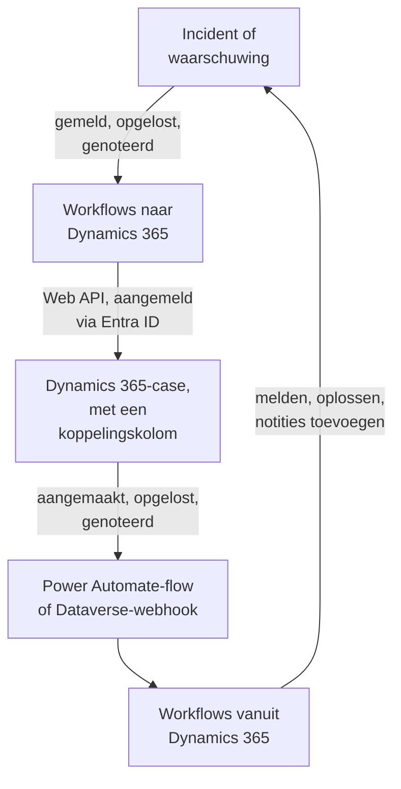

# Microsoft Dynamics 365

Houd [Microsoft Dynamics 365](https://www.microsoft.com/dynamics-365)-cases gelijk met je OneUptime-incidenten en -waarschuwingen, in beide richtingen. Kant-en-klare workflowsjablonen openen een case voor elk incident of elke waarschuwing, sluiten die wanneer het record is opgelost en kopiëren notities erin. Andere melden incidenten vanuit nieuwe cases en brengen oplossingen en notities terug. Er is geen plug-in: de workflows roepen de Dataverse Web API aan, en Dynamics 365 roept hun webhook-URL's aan.

:::cards
- [Dynamics 365 voorbereiden](#dynamics-365-voorbereiden): Een app-registratie, een toepassingsgebruiker en een koppelingskolom.
- [Beginnen met een sjabloon](#beginnen-met-een-sjabloon): De 13 sjablonen, wat ze vragen en hoe je ze instelt.
- [Hoe de sjablonen werken](#hoe-de-sjablonen-werken): Hoe cases en records gekoppeld blijven, zonder lussen.
- [Het zelf bouwen](#het-zelf-bouwen): Elke richting met de hand, voor als een sjabloon niet past.
:::

## Hoe het werkt



Elk sjabloon is een kleine workflow, dus je neemt alleen de richtingen die je wilt, voor incidenten, waarschuwingen of beide. De sjablonen van OneUptime → Dynamics 365 roepen de Dataverse Web API aan, aangemeld als toepassing via Microsoft Entra ID. De sjablonen van Dynamics 365 → OneUptime starten wanneer een Power Automate-flow of een Dataverse-webhook ze aanroept. Een tekstkolom die je aan de tabel Case toevoegt, koppelt elke case aan zijn record.

## Voordat je begint

- Een Dynamics 365-omgeving met de tabel **Case**. Cases komen uit Dynamics 365 Customer Service: een Dataverse-omgeving zonder heeft geen `incident`-tabel om in te schrijven.
- Rechten om een toepassing te registreren in **Microsoft Entra ID**, en om een toepassingsgebruiker aan te maken in de omgeving. Dat zijn vaak twee verschillende beheerders.
- In OneUptime het recht om workflows te maken. Op OneUptime Cloud hebben workflows het **Growth**-abonnement of hoger nodig.

> [!NOTE]
> Deze pagina gebruikt de namen van Dataverse, niet de labels op de Dynamics-formulieren. Een case is de tabel `incident`, de verzameling ervan in een URL is `incidents`, de sleutel is `incidentid` en de titelkolom is `title`. Het casenummer dat je ziet, is `ticketnumber`.

## Dynamics 365 voorbereiden

De sjablonen en een workflow die je zelf bouwt, hebben dit allebei nodig. OneUptime meldt zich aan als toepassing, niet als persoon, met de OAuth 2.0-flow voor clientreferenties.

:::steps
### Een toepassing registreren in Microsoft Entra ID

1. Meld je aan bij de [Azure-portal](https://portal.azure.com) als beheerder van de tenant van je Dynamics-omgeving en open **Microsoft Entra ID**.
2. Ga naar **App registrations → New registration**. Noem hem `OneUptime Integration`, laat **Supported account types** op **Accounts in this organizational directory only** staan en selecteer **Register**.
3. Kopieer op de pagina **Overview** van de app de **Application (client) ID** en de **Directory (tenant) ID**.
4. Ga naar **Certificates & secrets → Client secrets → New client secret** en kopieer de **Value** van het geheim, niet de ID ervan, voordat je de pagina verlaat: die wordt nooit meer getoond. Een clientgeheim leeft hoogstens 24 maanden, dus noteer wanneer het verloopt.

Voeg geen API-machtigingen toe en verleen geen beheerderstoestemming: zonder aangemelde gebruiker doen ze niets. Dynamics 365 bepaalt wat de toepassing mag doen, via de toepassingsgebruiker ervan.

### De toepassingsgebruiker maken

1. Selecteer in het [Power Platform-beheercentrum](https://admin.powerplatform.microsoft.com/) **Manage → Environments** en daarna je omgeving.
2. Selecteer **Settings → Users + permissions → Application users**, daarna **+ New app user** en **+ Add an app**. Kies de registratie en selecteer **Add**.
3. Kies een **Business unit** en geef hem daarna een aangepaste beveiligingsrol met het bewerkpictogram naast **Security roles**. Op het niveau Organization heeft de rol nodig:
   - **Case**: Create, Read, Write, Append en Append To.
   - **Note**: Create, Read en Append, voor de notitiesjablonen.
   - **Activity**: Create, Read en Append, omdat het sluiten van een case een Case Resolution vastlegt, en dat is een activiteit.
   - **Account**, en **Contact** als cases op naam van een contactpersoon worden aangemaakt: Read en Append To.
4. Selecteer **Save** en daarna **Create**.

Een toepassingsgebruiker kan alleen een aangepaste rol hebben: kopieer een bestaande en snoei die bij. Zonder deze gebruiker geeft Microsoft Entra ID nog steeds tokens uit, maar elke aanroep naar Dynamics 365 mislukt met `403` en `0x80072560`, "The user isn't a member of the organization."

### Een koppelingskolom toevoegen aan de tabel Case

Dataverse heeft niets zoals de labels van Jira, dus een case en een OneUptime-record vinden elkaar via een kolom die je toevoegt.

1. Kies in [make.powerapps.com](https://make.powerapps.com) je omgeving, open **Tables → Case → Columns** en selecteer **New column**.
2. Noem hem `OneUptime Link`, laat **Data type** op **Single line of text** staan en sla op. De standaard maximale lengte van 100 is ruim voldoende: de sjablonen schrijven hoogstens 55 tekens.
3. Open de nieuwe kolom en kopieer de **Logical name** ervan, zoals `new_oneuptimelink`. Het voorvoegsel komt van de uitgever van je oplossing, dus het jouwe kan anders zijn, zoals `cr4f2_oneuptimelink`.

Voeg de kolom toe aan het formulier Case als agenten de koppeling moeten zien.
:::

## Beginnen met een sjabloon

Het dialoogvenster **Een workflow maken** heeft 13 Dynamics 365-sjablonen, onder **Dynamics 365** in de lijst met categorieën: zeven voor incidenten en daarna zes voor waarschuwingen, elke groep onder een eigen kop. Ze delen de koppelingskolom, dus elke combinatie ervan werkt samen.

### Sjablonen voor incidenten

| Sjabloon | Wat het doet | Wat het vraagt |
| --- | --- | --- |
| **OneUptime → Dynamics 365** | | |
| Create a Dynamics 365 case when an incident is declared | Opent een case voor elk nieuw incident, met een prioriteit gekozen op basis van de ernst en de ID van het incident in de koppelingskolom. Incidenten die vanuit Dynamics 365 zijn gemeld, en privé-incidenten, worden overgeslagen. | De vijf Dynamics 365-instellingen, de klant voor nieuwe cases en de OneUptime-URL |
| Resolve the Dynamics 365 case when the incident is resolved | Sluit de gekoppelde case als **Problem Solved** wanneer het incident is opgelost, en legt een Case Resolution vast zoals oplossen met de hand dat doet. Heropent nooit een case. | De vijf Dynamics 365-instellingen |
| Copy incident private notes to the Dynamics 365 case | Voegt elke nieuwe privénotitie als notitie toe aan de gekoppelde case. | De vijf Dynamics 365-instellingen |
| Copy incident public notes to the Dynamics 365 case | Voegt elke nieuwe openbare notitie als notitie toe aan de gekoppelde case, zodat agenten klanten kunnen vertellen wat de statuspagina zegt. | De vijf Dynamics 365-instellingen |
| **Dynamics 365 → OneUptime** | | |
| Declare an incident when a Dynamics 365 case is created | Meldt een incident voor elke nieuwe case, buiten je statuspagina's gehouden, met een ernst gekozen op basis van de prioriteit van de case, en schrijft daarna de ID van het incident in de koppelingskolom van de case. | De vijf Dynamics 365-instellingen, en een flow of webhook voor nieuwe cases |
| Resolve the incident when its Dynamics 365 case is resolved | Lost het incident op wanneer de gekoppelde case is opgelost. | De vijf Dynamics 365-instellingen, en een flow of webhook voor statuswijzigingen van cases |
| Add Dynamics 365 case notes to the incident as private notes | Kopieert elke notitie die een agent aan een gekoppelde case toevoegt naar het incident, als privénotitie. | De vijf Dynamics 365-instellingen, en een flow of webhook voor nieuwe notities |

### Sjablonen voor waarschuwingen

De sjablonen voor waarschuwingen doen hetzelfde werk voor waarschuwingen. Het zijn er één minder, omdat waarschuwingen geen openbare notities hebben, en **Create an alert when a Dynamics 365 case is created** schrijft geen statuspagina-instellingen, omdat een waarschuwing nooit op een statuspagina komt.

| Sjabloon | Wat het doet | Wat het vraagt |
| --- | --- | --- |
| **OneUptime → Dynamics 365** | | |
| Create a Dynamics 365 case when an alert is created | Opent een case voor elke nieuwe waarschuwing, ook elke waarschuwing die een monitor afgeeft. Waarschuwingen die vanuit Dynamics 365 zijn aangemaakt, en privéwaarschuwingen, worden overgeslagen. | De vijf Dynamics 365-instellingen, de klant voor nieuwe cases en de OneUptime-URL |
| Resolve the Dynamics 365 case when the alert is resolved | Sluit de gekoppelde case als **Problem Solved** wanneer de waarschuwing is opgelost. | De vijf Dynamics 365-instellingen |
| Copy alert private notes to the Dynamics 365 case | Voegt elke nieuwe privénotitie als notitie toe aan de gekoppelde case. | De vijf Dynamics 365-instellingen |
| **Dynamics 365 → OneUptime** | | |
| Create an alert when a Dynamics 365 case is created | Maakt een waarschuwing aan voor elke nieuwe case, met een ernst gekozen op basis van de prioriteit van de case, en schrijft daarna de ID van de waarschuwing in de koppelingskolom van de case. | De vijf Dynamics 365-instellingen, en een flow of webhook voor nieuwe cases |
| Resolve the alert when its Dynamics 365 case is resolved | Lost de waarschuwing op wanneer de gekoppelde case is opgelost. | De vijf Dynamics 365-instellingen, en een flow of webhook voor statuswijzigingen van cases |
| Add Dynamics 365 case notes to the alert as private notes | Kopieert elke notitie die een agent aan een gekoppelde case toevoegt naar de waarschuwing, als privénotitie. | De vijf Dynamics 365-instellingen, en een flow of webhook voor nieuwe notities |

Geen van de sjablonen van OneUptime → Dynamics 365 stuurt een incident dat als **Privé-incident** is gemarkeerd, of een waarschuwing die als **Privéwaarschuwing** is gemarkeerd, naar Dynamics 365: niet het record, niet de status en niet de notities ervan, tenzij je dat aanzet. Zie [Wijzigen wat een sjabloon doet](#wijzigen-wat-een-sjabloon-doet).

**Monitoren geven zelf waarschuwingen af, en soms heel veel.** **Create a Dynamics 365 case when an alert is created** opent voor elke waarschuwing een case. Tenzij elke waarschuwing een case verdient, zet je een **If / Else**-blok tussen de trigger en de rest van de workflow, bijvoorbeeld op `{{local.components.alert-on-create-1.returnValues.model.alertSeverity.name}}`, en verbind je alleen de **Yes**-kant ervan verder.

### Wat de sjablonen vragen

De stap **Configureren** van de aanmaakwizard vraagt om maximaal zeven waarden: elk sjabloon vraagt de eerste vijf, de Dynamics 365-instellingen, en de twee sjablonen die een case aanmaken vragen ook de laatste twee. De stap controleert de vorm van elke Dynamics 365-instelling voordat er iets wordt aangemaakt, en zegt wat je in plaats daarvan moet invullen, omdat een waarde met de verkeerde vorm nergens een fout geeft tot er een uitvoering is.

- **Dynamics 365 Environment URL** — het adres van je omgeving, zoals `https://yourorg.crm.dynamics.com`, uit het [Power Platform-beheercentrum](https://admin.powerplatform.microsoft.com/) onder **Environments**, je omgeving, **Environment URL**. Alleen het adres: niet het Web API-endpoint, dat eindigt op `/api/data/v9.2`, en geen slash aan het eind.
- **Directory (Tenant) ID** — van de pagina **Overview** van de app-registratie.
- **Application (Client) ID** — van dezelfde pagina.
- **Client Secret Value** — de **Value** van het clientgeheim, uit **Certificates & secrets**. Niet de **Secret ID** ervan, dat is een GUID: de wizard weigert hier een GUID.
- **Case Link Column** — de logische naam van de koppelingskolom, zoals `new_oneuptimelink`.
- **Customer for New Cases** — alleen de twee sjablonen die een case aanmaken, vragen hierom. Elke case heeft een klant nodig, en een OneUptime-incident heeft er geen, dus alle nieuwe cases worden op naam van één klant aangemaakt: plak de ID van een account, of `contacts(<id>)` voor een contactpersoon. Open het record in Dynamics 365: de ID ervan is het deel na `id=` in het adres.
- **OneUptime URL** — alleen de twee sjablonen die een case aanmaken, vragen hierom: het adres waarop je OneUptime opent, zoals `https://oneuptime.com`. De beschrijving van de case linkt daarmee terug naar het incident of de waarschuwing.

**Hoe de sjablonen zich aanmelden.** De wizard slaat de tenant, de client-ID en het geheim op in één [OAuth 2.0-variabele](/docs/workflows/variables#oauth-20-variabelen-tokens-die-zichzelf-vernieuwen), `dynamicsAccessToken`, onder **Workflow-variabelen** van de workflow: Client Credentials, de token-URL `https://login.microsoftonline.com/<tenant>/oauth2/v2.0/token`, de scope `<environment URL>/.default` en het clientgeheim, verstuurd in de body van het verzoek en versleuteld opgeslagen. Elke aanroep naar Dynamics 365 stuurt `Authorization: Bearer {{local.variables.dynamicsAccessToken}}`. OneUptime haalt het token op de eerste keer dat een stap het nodig heeft, haalt een nieuw op voordat het verloopt, en vervangt het door `[REDACTED]` in uitvoeringslogboeken en staptraces.

Om de aanmelding te controleren voordat er iets draait, open je **Workflow-variabelen**, klik je bij `dynamicsAccessToken` op **Bekijken** en klik je op **Nu vernieuwen**. **Access Token Fetched** betekent dat de app-registratie klopt. Anders noemt de fout van Microsoft Entra ID wat er mis is, zoals `AADSTS7000215: Invalid client secret provided`.

Elke workflow houdt een eigen kopie bij. Wanneer je het clientgeheim vervangt, open je `dynamicsAccessToken` in elke Dynamics 365-workflow en gebruik je **Inloggegevens bijwerken**.

### De workflows maken

:::steps
1. Open **Workflows → Workflow maken**. Kies onder **Of begin met een sjabloon** **Dynamics 365** in de lijst met categorieën, of typ `Dynamics` in **Sjablonen zoeken…**, en klik op het sjabloon dat je wilt. Het opent en laat zien wat het doet en om welke instellingen het vraagt. Klik op **Dit sjabloon gebruiken**.
2. **Naam** wordt ingevuld vanuit het sjabloon. Wijzig hem als je wilt.
3. **Configureren** vraagt om de waarden hierboven.
4. Klik op **Workflow maken**. Elke workflow wordt uitgeschakeld aangemaakt: zet **Ingeschakeld** aan bovenaan de **Bouwer** ervan.
:::

Begin met **Create a Dynamics 365 case when an incident is declared**, of met **Create a Dynamics 365 case when an alert is created** voor waarschuwingen: elk ander sjabloon van OneUptime → Dynamics 365 van dezelfde soort vindt de case via de koppeling die dit sjabloon schrijft. Zet het aan, meld een testincident of maak een testwaarschuwing aan, en open **Logboeken → Uitvoeringen** van de workflow. De uitvoering hoort te eindigen als **Uitgevoerd**, en de **Response Body** van haar laatste stap, `create-case-1`, bevat het `ticketnumber` van de nieuwe case, zoals `CAS-01001-X1Y2Z3`.

### De sjablonen van Dynamics 365 → OneUptime koppelen

De sjablonen van Dynamics 365 → OneUptime, drie voor incidenten en drie voor waarschuwingen, starten vanuit een [Webhook-trigger](/docs/workflows/triggers#webhook), dus Dynamics 365 moet te horen krijgen waar het zijn gebeurtenissen naartoe moet sturen. Doe het in deze volgorde:

1. Maak de workflow en **zet hem eerst aan**. Een workflow die uit staat, weigert bezorgingen, en die komen niet in een wachtrij.
2. Open de **Bouwer** van de workflow, klik op het triggerblok **Webhook** (`webhook-1`) en klik op **URL kopiëren** bovenaan de instellingen ervan. De URL ziet er zo uit:

   ```text
   https://<your OneUptime host>/workflow/trigger/<webhook secret key>
   ```

3. Laat Dynamics 365 ernaar posten, vanuit een Power Automate-flow of vanuit een Dataverse-webhook.

Elk sjabloon hoeft alleen te weten welke rij is gewijzigd. Het leest die rij opnieuw uit Dynamics 365 voordat het iets doet, dus het neemt nooit de titel, de status of de koppeling van een case uit het verzoek over, en het maakt niet uit welke van de twee het verstuurt.

:::tabs
@tab Power Automate flow
Maak in [Power Automate](https://make.powerautomate.com) een **Automated cloud flow** met de **Microsoft Dataverse**-trigger **When a row is added, modified or deleted**, ingesteld zoals hieronder, met **Scope** op **Organization**. Voeg de ingebouwde actie **HTTP** toe: **Method** `POST`, **URI** de URL van de workflow, een `Content-Type: application/json`-header en de body hieronder, met de ID van de rij gekozen uit de dynamische inhoud van de trigger.

| Sjabloon | Change type | Table name | Select columns | Body |
| --- | --- | --- | --- | --- |
| Een incident melden / een waarschuwing aanmaken wanneer een case wordt aangemaakt | Added | Cases | | `{"PrimaryEntityId": "<Case>"}` |
| Het incident / de waarschuwing oplossen wanneer de case wordt opgelost | Modified | Cases | `statecode,statuscode` | `{"PrimaryEntityId": "<Case>"}` |
| Casenotities als privénotities aan het incident / de waarschuwing toevoegen | Added | Notes | | `{"PrimaryEntityId": "<Note>"}` |

Om alleen sommige cases te sturen, gebruik je **Filter rows** van de trigger, zoals `prioritycode eq 1` voor cases met hoge prioriteit. De body noemt de rij als `PrimaryEntityId`, zoals een Dataverse-webhook doet: de sjablonen lezen de rij zelf terug uit Dynamics 365.
@tab Dataverse webhook
Registreer de URL met de [Plug-in Registration Tool](https://learn.microsoft.com/en-us/power-apps/developer/data-platform/register-web-hook): **Register New WebHook**, met **HttpHeader**-authenticatie en een eigen header; de URL zelf is het geheim. Registreer daarna een stap erop voor elke gebeurtenis hieronder, met **Event Pipeline Stage of Execution** op **PostOperation** en **Execution Mode** op **Asynchronous**.

| Sjabloon | Message | Primary Entity | Filtering Attributes |
| --- | --- | --- | --- |
| Een incident melden / een waarschuwing aanmaken wanneer een case wordt aangemaakt | `Create` | `incident` | |
| Het incident / de waarschuwing oplossen wanneer de case wordt opgelost | `Close`, en `Update` voor statuswijzigingen door anderen | `incident` | `statecode, statuscode` (Update) |
| Casenotities als privénotities aan het incident / de waarschuwing toevoegen | `Create` | `annotation` | |

Het oplossen van een case geeft het bericht **Close**, niet **Update**, en daarom heeft dat sjabloon ze allebei nodig. Een webhook post de uitvoeringscontext van de plug-in, die de rij noemt in `PrimaryEntityId`, of voor **Close** in de `IncidentResolution` ervan, en de sjablonen lezen hem daaruit. Een Dataverse-webhook roept alleen de poorten 80 en 443 aan en heeft geen eigen rijfilter: elke nieuwe case bereikt het aanmaaksjabloon, tenzij je het beperkt met `ONLY_PRIORITIES`.
:::

Voordat je op een van beide vertrouwt:

- **Iedereen met de URL kan de workflow starten.** Omdat de sjablonen elke rij opnieuw uit Dynamics 365 lezen, kan een verzoek ze alleen naar een echte case of notitie laten kijken. Het kan de aanmaaksjablonen nog wel laten handelen op een case die nog niet gekoppeld is. Bewaar de URL alleen in de flow of de webhook. Lekt hij uit, klik dan in de **Bouwer** van de workflow op de **Webhook**-trigger, klik op **URL opnieuw instellen** en plak de nieuwe URL in de flow of de webhook. De oude URL werkt meteen niet meer.
- **Elke gebeurtenis is een uitvoering**, ook de gebeurtenissen die een sjabloon overslaat. Op OneUptime Cloud telt elke gebeurtenis mee voor de workflowuitvoeringen van je abonnement, en filteren in de flow houdt het aantal laag. Zie [Abonnementslimieten](/docs/workflows/configuration#planlimieten).
- **Gebruik je beide sjablonen die een record aanmaken vanuit een case?** **Declare an incident when a Dynamics 365 case is created** en **Create an alert when a Dynamics 365 case is created** handelen allebei op elke case die ze krijgen. Elk controleert eerst de koppelingskolom, maar twee bezorgingen voor één nieuwe case komen tegelijk aan, dus de case kan zowel een incident als een waarschuwing krijgen. Stuur de twee verschillende cases, bijvoorbeeld per casetype.

### Controleren of het werkt

De **Stappen** van elke uitvoering zeggen wat het sjabloon deed, dus open de uitvoering in **Logboeken → Uitvoeringen** en kijk hoe ze eindigde:

- **Uitgevoerd**: het deed zijn werk, en de laatste stap noemt de case, het incident of de waarschuwing.
- **Uitgevoerd**, met de stap **Check With JavaScript** op **No**: het heeft de gebeurtenis bewust overgeslagen, en de stap zegt waarom: de case is niet gekoppeld aan een record van deze soort, de notitie kwam van de andere kant, het record is privé, of de nieuwe status sluit de case niet.
- **Fout**: een stap is mislukt, en zijn vermelding in **Stappen** zegt waarom. Bij een Dynamics 365-aanroep staat het antwoord van Dynamics 365 erbij.
- **Fout** bij `link-case-1`: een sjabloon dat een record aanmaakt vanuit een case heeft het aangemaakt, maar Dynamics 365 heeft de koppeling niet geaccepteerd, dus de andere sjablonen kunnen het nog niet vinden. Typ de koppeling met de hand in de kolom van de case.

Als een uitvoering bij de eerste Dynamics 365-stap stopt met `Could not get an OAuth 2.0 access token for {{local.variables.dynamicsAccessToken}}`, kloppen de aanmeldingsinstellingen niet, en het bericht citeert het antwoord van Microsoft Entra ID. Zie [Wat de sjablonen vragen](#wat-de-sjablonen-vragen).

## Hoe de sjablonen werken

### Hoe de twee kanten gekoppeld blijven

De case bewaart de koppeling. Een case die bij een incident hoort, heeft `oneuptime-incident-<incident id>` in de koppelingskolom, en een case die bij een waarschuwing hoort, heeft `oneuptime-alert-<alert id>`. De ID is het laatste deel van het adres van het record in het dashboard.

De sjablonen die een case aanmaken, schrijven de koppeling wanneer ze de case openen, en de sjablonen die een record aanmaken vanuit een case schrijven hem zodra het record bestaat. Alle andere sjablonen steken via die koppeling over: die van OneUptime → Dynamics 365 zoeken de case op via de koppeling, en die van Dynamics 365 → OneUptime lezen de ID van het record van de case. Om een met de hand geopende case te koppelen, typ je de waarde zelf in de koppelingskolom ervan, maar alleen als het record nog geen case heeft.

**Een case is gekoppeld aan een incident of aan een waarschuwing, nooit aan beide.** Eén kolom dient voor beide soorten. De sjablonen voor incidenten negeren een case die aan een waarschuwing is gekoppeld, en omgekeerd, en de sjablonen die een record aanmaken vanuit een case laten elke case met iets in de koppelingskolom met rust.

**Een record heeft één case.** De sjablonen die naar een case schrijven, handelen alleen wanneer precies één case de koppeling van het record bevat. Wordt de koppeling naar een tweede case gekopieerd, dan stoppen ze, en eindigt elke uitvoering met een overslaan dat beide noemt:

```text
More than one Dynamics 365 case holds the link oneuptime-incident-<id> (CAS-01001-X1Y2Z3, CAS-01002-K4L5M6). Clear it on every case except the one opened for the incident.
```

Incidenten en waarschuwingen die vanuit een case zijn aangemaakt, bewaren ook de ID en het nummer van de case in `customFields.dynamicsCaseId` en `customFields.dynamicsCaseNumber`, geschreven bij het aanmaken. Zo weten de sjablonen die een case aanmaken dat het record er al een heeft.

### Hoe de sjablonen lussen voorkomen

Elke schrijfactie in de ene richting is een gebeurtenis in de andere: een notitie die aan een case wordt toegevoegd, komt terug als nieuwe notitie, en een privénotitie die in OneUptime wordt toegevoegd, laat de notitietrigger afgaan. Vier dingen stoppen de echo:

- **Markeringen in de tekst.** Elke notitie die de sjablonen aan een case toevoegen, heeft de titel `Synced from OneUptime: …`, net als het onderwerp van elke Case Resolution die ze vastleggen. Elke notitie die vanuit Dynamics 365 wordt geschreven, en de hoofdoorzaak van elke statuswijziging vanuit Dynamics 365, begint met `Synced from Dynamics 365`. Elke richting slaat tekst over die de markering van de andere kant draagt, zelfs in een notitie die iemand schreef en die er een citeert.
- **De koppeling vanaf de eerste keer opslaan.** Een case die OneUptime opent, bevat de koppeling vanaf het moment dat hij bestaat, dus wanneer zijn **Create** terugkomt, vindt het sjabloon dat een record aanmaakt vanuit een case hem gekoppeld en doet het niets.
- **`customFields.dynamicsCaseId`.** Een record dat vanuit een case is aangemaakt, draagt dit veld, en de sjablonen die een case aanmaken, slaan zulke records over.
- **Statussen gaan alleen vooruit, aan beide kanten.** Het record oplossen sluit de case, en de **Close** van de case vindt het record dan al opgelost. Wanneer de case eerst wordt opgelost, wordt het record opgelost, en de update daarvan vindt de case al gesloten. Een case die al opgelost of geannuleerd is, wordt nooit heropend.

Laat de markeringen staan wanneer je de sjablonen bewerkt. Het zijn de constanten `FROM_ONEUPTIME` en `FROM_DYNAMICS` in het hulpblok bovenaan elk script.

### Wijzigen wat een sjabloon doet

Open de **Bouwer** van de workflow en klik op het blok dat je wilt wijzigen. De instellingen die je het waarschijnlijkst wilt aanpassen, zijn constanten bovenaan een script, de **JavaScript Code** van een **Check With JavaScript**-blok, net onder het gedeelde hulpblok. De versies voor incidenten en voor waarschuwingen houden dezelfde constanten in dezelfde blokken.

| Constante | Sjabloon en blok | Wat het regelt |
| --- | --- | --- |
| `SYNC_PRIVATE_INCIDENTS`, `SYNC_PRIVATE_ALERTS` | Elk sjabloon van OneUptime → Dynamics 365 — `prepare-case-1`, `plan-case-1`, `build-note-1` | `false` houdt privérecords buiten Dynamics 365: er wordt geen case voor geopend, hun case wordt niet gewijzigd, en hun notities worden niet toegevoegd. Zet hem op `true` in elk sjabloon dat ze moet sturen. |
| `SEVERITY_TO_PRIORITY`, `DEFAULT_PRIORITY` | Een Dynamics 365-case aanmaken — `prepare-case-1` | De ernstniveaus van het project worden op volgorde over de caseprioriteiten verdeeld: het zwaarste opent een High-case (`1`), het lichtste een Low-case (`3`), en de niveaus daartussen Normal-cases (`2`). Noem een ernstniveau bij naam, in kleine letters, om zelf de prioriteit te kiezen, zoals `{ 'major incident': 1 }`. `DEFAULT_PRIORITY` (`2`) is voor een ernstniveau dat niet in de lijst van het project staat, of voor een project met maar één niveau. |
| `CASE_ORIGIN`, `CASE_TYPE` | Een Dynamics 365-case aanmaken — `prepare-case-1` | De `caseorigincode` (`3`, Web) en de `casetypecode` (`2`, Problem) van de nieuwe case. Om een andere kolom in te stellen, voeg je die toe aan `CASE` in hetzelfde script, onder de logische naam ervan. |
| `MAX_TITLE_LENGTH`, `MAX_DESCRIPTION_LENGTH` | Een Dynamics 365-case aanmaken — `prepare-case-1` | De eigen limieten van de tabel Case, 200 en 2000 tekens. De beschrijving houdt de link terug naar OneUptime, hoeveel er ook wordt afgeknipt. Verhoog ze als je tabel Case meer toestaat. |
| `RESOLVED_CASE_STATUS` | De Dynamics 365-case oplossen — `plan-case-1` | De status waarmee een opgelost record zijn case sluit: `5` is Problem Solved, `1000` Information Provided. |
| `STATE_TO_CASE_STATUS` | De Dynamics 365-case oplossen — `plan-case-1` | Sluit de case met een andere opgeloste status bij een eigen opgeloste status, op naam van de status: `{ Closed: 1000 }` sluit hem als Information Provided. Alleen het oplossen van het record verandert zijn case: een actieve status zoals Researching wordt nooit gezet. |
| `PRIORITY_RANK` | Aanmaken vanuit een Dynamics 365-case — `prepare-incident-1`, `prepare-alert-1` | Koppelt een caseprioriteit (`1` High, `2` Normal, `3` Low) aan `0` (je zwaarste ernstniveau), `1` of `2` (het lichtste). Prioriteiten die er niet in staan, komen in het midden terecht. Met de twee ernstniveaus voor waarschuwingen die een nieuw project heeft, wordt Normal Low, tenzij je `2: 1` verandert in `2: 0`. |
| `ONLY_PRIORITIES` | Aanmaken vanuit een Dynamics 365-case — `prepare-incident-1`, `prepare-alert-1` | Leeg neemt hij elke case die de flow of webhook stuurt. `[1]` maakt alleen records aan voor cases met hoge prioriteit. |
| `CASE_STATUS_TO_STATE`, `CASE_STATE_TO_STATE_FLAG` | Oplossen wanneer de Dynamics 365-case is opgelost — `decide-state-1` | Een casestatus, op naam, naar een OneUptime-status, zoals `{ Researching: 'Acknowledged' }`. Anders beslist de toestand van de case: Resolved lost het record op. Voeg `2: 'isResolvedState'` toe om het ook op te lossen wanneer de case wordt geannuleerd. |
| `MESSAGES` | Elk sjabloon van Dynamics 365 → OneUptime — `read-event-1`, of `prepare-incident-1` en `prepare-alert-1` | De gebeurtenissen waarop het sjabloon handelt. Voeg `'Update'` toe aan de lijst van het notitiesjabloon om ook bewerkte notities te kopiëren: elke bewerking wordt een nieuwe notitie. |
| `MAX_NOTE_LENGTH` | De notitiesjablonen — `build-note-1`, `read-note-1` | De langste notitie die elk schrijft: 100.000 tekens naar Dynamics 365, de eigen limiet van een notitie, en 30.000 naar OneUptime. |

Status- en statusnamen die als sleutel worden gebruikt, moeten precies zo gespeld zijn als ze heten, hoofdletters inbegrepen. Houd `{{` uit de code: een script wordt vóór het draaien ingevuld zoals elke andere instelling, dus twee openingsaccolades achter elkaar zouden als een verwijzing worden gelezen.

### Beperkingen

- **De commerciële cloud van Microsoft.** De token-URL is `login.microsoftonline.com`. Voor US Government-clouds (GCC High, DoD) of China open je `dynamicsAccessToken`, gebruik je **Instellingen bewerken** en verander je de token-URL in de aanmeldhost van je cloud, zoals `login.microsoftonline.us`.
- **Dynamics 365 kan weigeren een case op te lossen.** Je Customer Service-instellingen kunnen voorkomen dat een case wordt opgelost zolang die open activiteiten of open onderliggende cases heeft, en een bedrijfsregel of plug-in kan het ook weigeren. De uitvoering mislukt bij `close-case-1`, met de reden van Dynamics 365, en de case blijft zoals hij was.
- **Records en cases gaan nooit achteruit.** Een case heropenen verandert niets in OneUptime, en een opgelost record wordt nooit heropend. Een case die al opgelost of geannuleerd is, wordt nooit heropend om opnieuw te worden gesloten.
- **Notities en beschrijvingen zijn platte tekst.** Een notitie die in de editor voor rijke tekst van Dynamics 365 is geschreven, komt in OneUptime aan als de tekst die ze toont, en dat geldt ook voor een casebeschrijving die in de editor is geschreven of uit een e-mail komt: alinea's en regeleinden blijven, terwijl opmaak, afbeeldingen en de eigen stijlen van de e-mail verdwijnen. Een OneUptime-notitie komt in Dynamics 365 aan als de ruwe tekens, Markdown inbegrepen. Tekst uit Dynamics 365 — de titel en beschrijving van een case, een notitie, de namen van statussen, prioriteiten, klanten en mensen — leest precies zoals hij geschreven is: een afbeelding, een link, HTML, een diagram of een chatvermelding zoals `<!channel>` die erin is getypt, verschijnt als de tekens ervan en doet niets, omdat er een onzichtbare word joiner staat na het teken waarmee het zou beginnen. Een kopie van de tekst behoudt de word joiner. Een workflow houdt de scripts waarmee hij is gemaakt, dus een workflow die vanuit een oudere versie van een sjabloon is gemaakt, schrijft tekst zoals die versie dat deed: maak hem opnieuw vanuit het sjabloon om dit te krijgen. Bijlagen blijven in Dynamics 365; de notitie in OneUptime noemt het bestand.
- **Bewerkte notities worden niet gekopieerd**, alleen nieuwe, tenzij je `'Update'` toevoegt aan `MESSAGES`.
- **Privé-incidenten en -waarschuwingen blijven in OneUptime**, maar de sjablonen van Dynamics 365 → OneUptime controleren dit niet: notities en statuswijzigingen op een gekoppelde case bereiken een privérecord nog steeds.
- **Elke case krijgt een record.** Tenzij je de flow filtert of `ONLY_PRIORITIES` instelt, maken de sjablonen die een record aanmaken vanuit een case een incident of waarschuwing aan voor elke nieuwe case die ze krijgen. In een drukke klantenservice is dat veel.
- **Dezelfde gebeurtenis kan twee keer aankomen.** Een Dataverse-webhook probeert het één keer opnieuw wanneer OneUptime `502`, `503` of `504` antwoordt. Een herhaalde **Create** die aankomt nadat de eerste uitvoering de case heeft gekoppeld, wordt met rust gelaten. Eén die aankomt terwijl de eerste uitvoering nog loopt, kan een tweede record aanmaken.

## Het zelf bouwen

De sjablonen dekken de gebruikelijke gevallen. Om een richting zelf te bouwen, bouwt deze sectie beide met de hand, voor incidenten, na [Dynamics 365 voorbereiden](#dynamics-365-voorbereiden). [Hetzelfde doen voor waarschuwingen](#hetzelfde-doen-voor-waarschuwingen) zet het om naar waarschuwingen.

### Aanmelden met een OAuth 2.0-variabele

Maak het token één keer aan, voor elke workflow, als een [OAuth 2.0-variabele](/docs/workflows/variables#oauth-20-variabelen-tokens-die-zichzelf-vernieuwen):

1. Ga naar **Workflows → Globale variabelen**, open het menu **Meer** (**⋯**) naast **Workflow Variabele aanmaken** en kies **Create OAuth 2.0 Variable**. Noem hem `DYNAMICS_TOKEN`.
2. Kies bij **Provider** **Microsoft Entra ID**, vervang `{tenant-id}` in de **Token-URL** door je Directory (tenant) ID en kies **Client Credentials**.
3. Vul bij **Inloggegevens** de **Client-ID** en het **Client-secret** in. Stel bij **Geavanceerd** de scope in op `https://yourorg.crm.dynamics.com/.default` en maak daarna de variabele aan.

Elk blok stuurt dan `Bearer {{global.variables.DYNAMICS_TOKEN}}` in zijn `Authorization`-header. OneUptime haalt het token op, haalt een nieuw op voordat het verloopt, en houdt het buiten de uitvoeringslogboeken.

De scope moet je omgevings-URL zijn gevolgd door `/.default`. Een verkeerde omgevings-URL is de gebruikelijke oorzaak van `AADSTS70011: The provided value for the input parameter 'scope' is not valid`.

### Een case openen voor elk incident

:::steps
1. Maak vanaf nul een workflow met de naam `Incidents to Dynamics 365`. Klik op het gestippelde blok en voeg de trigger **On Create Incident** toe. De **Fields to pass on** ervan beginnen met **Titel**: klik op **Veld toevoegen** en kies **Beschrijving** en **Incidentnummer**. De ID wordt altijd doorgegeven.
2. Klik op **Component toevoegen**, voeg een **API Post (JSON)**-blok toe en verbind de **Success**-punt van de trigger ermee. Stel de **Identifier** in op `create-case` en de **URL** op `https://yourorg.crm.dynamics.com/api/data/v9.2/incidents?$select=incidentid,ticketnumber`.
3. Stel onder **Meer velden** de **Request Headers** in op:

   ```json
   {
     "Authorization": "Bearer {{global.variables.DYNAMICS_TOKEN}}",
     "OData-MaxVersion": "4.0",
     "OData-Version": "4.0",
     "Accept": "application/json",
     "If-None-Match": "null",
     "Prefer": "return=representation"
   }
   ```

4. Stel de **Request Body** in op de case, met de GUID van het account waar je cases bij horen:

   ```json
   {
     "title": "OneUptime #{{local.components.incident-on-create-1.returnValues.model.incidentNumber}}: {{local.components.incident-on-create-1.returnValues.model.title}}",
     "description": "{{local.components.incident-on-create-1.returnValues.model.description}}",
     "caseorigincode": 3,
     "prioritycode": 1,
     "new_oneuptimelink": "oneuptime-incident-{{local.components.incident-on-create-1.returnValues.model._id}}",
     "customerid_account@odata.bind": "/accounts(00000000-0000-0000-0000-000000000000)"
   }
   ```

5. Zet **Ingeschakeld** aan, meld een testincident en open **Logboeken → Uitvoeringen**. De stap `create-case` toont een `201` en een body met de nieuwe `incidentid` en `ticketnumber`.
:::

Elke case heeft een klant nodig, dus `customerid` is verplicht. Die kan naar een account of een contactpersoon wijzen, en daarom schrijf je `customerid_account@odata.bind` of `customerid_contact@odata.bind`, precies zo gespeld. `Prefer: return=representation` maakt het antwoord `201` met de case zelf, zodat het volgende blok `{{local.components.create-case.returnValues.response-body.incidentid}}` kan lezen. Zonder deze header antwoordt Dynamics 365 met `204` zonder body.

`new_oneuptimelink` is de koppelingskolom uit [Dynamics 365 voorbereiden](#dynamics-365-voorbereiden), met dezelfde waarde die de sjablonen schrijven, zodat je workflows en de sjablonen elkaars cases vinden. Gebruik de logische naam van je kolom.

### Prioriteit en status toewijzen

Dynamics 365 levert `severitycode` met één enkele optie, dus stel in plaats daarvan `prioritycode` in, en vertak op de ernst van het incident met een **If / Else**-blok voor een prioriteit per ernstniveau. Stuur deze kolommen als getallen:

| Kolom | Waarden |
| --- | --- |
| `prioritycode` | `1` High, `2` Normal, `3` Low |
| `caseorigincode` | `1` Phone, `2` Email, `3` Web, `2483` Facebook, `3986` Twitter, `700610000` IoT |
| `casetypecode` | `1` Question, `2` Problem, `3` Request |
| `statecode` | `0` Active, `1` Resolved, `2` Cancelled |
| `statuscode` | `1` In Progress, `2` On Hold, `3` Waiting for Details, `4` Researching, `5` Problem Solved, `6` Cancelled, `1000` Information Provided, `2000` Merged |

`statuscode` kan worden aangepast, dus je omgeving kan eigen waarden hebben.

### De case oplossen wanneer het incident is opgelost

Bouw dit als een tweede workflow, zodat een fout hier nooit verhindert dat er cases worden geopend.

:::steps
1. Maak een workflow met de naam `Close Dynamics 365 cases`, met de trigger **On Update Incident**. Klik in **Fields to watch** op **Veld toevoegen** en kies **Current Incident State**. Klik in **Fields to pass on** op **Veld toevoegen**, open **Current Incident State** en kies **Is Resolved State**.
2. Voeg een **If / Else**-blok toe: **Value to check** `{{local.components.incident-on-update-1.returnValues.model.currentIncidentState.isResolvedState}}`, **Comparison** **is true**.
3. Voeg na de **Yes**-kant ervan een **API Get (JSON)**-blok toe met de **Identifier** `find-case`, dezelfde headers zonder `Prefer` en deze **URL**:

   ```text
   https://yourorg.crm.dynamics.com/api/data/v9.2/incidents?$select=incidentid&$filter=new_oneuptimelink%20eq%20'oneuptime-incident-{{local.components.incident-on-update-1.returnValues.model._id}}'
   ```

4. Voeg daarna een **API Post (JSON)**-blok toe naar `https://yourorg.crm.dynamics.com/api/data/v9.2/CloseIncident`, met dezelfde headers en deze body:

   ```json
   {
     "IncidentResolution": {
       "@odata.type": "Microsoft.Dynamics.CRM.incidentresolution",
       "subject": "Resolved in OneUptime",
       "incidentid@odata.bind": "/incidents({{local.components.find-case.returnValues.response-body.value[0].incidentid}})"
     },
     "Status": 5
   }
   ```
:::

De URL wordt precies verstuurd zoals hij geschreven is, dus de spaties in `$filter` staan er als `%20`. Een query antwoordt met een `value`-lijst, en `value[0]` is de eerste case daarin. `Status` is een `statuscode` van de toestand Resolved: `5` is Problem Solved.

Gebruik `CloseIncident` om op te lossen, in plaats van een `PATCH` van `statecode`: het legt de Case Resolution vast die een opgeloste case hoort te hebben, en een `PATCH` wordt geweigerd waar een beheerder statusovergangen heeft ingesteld. Stuur voor al het andere, zoals een prioriteit of een titel, een **API Patch (JSON)**-blok naar `https://yourorg.crm.dynamics.com/api/data/v9.2/incidents(<the case id>)` met een `If-Match: *`-header, die voorkomt dat er een nieuwe case wordt aangemaakt, en alleen de kolommen die je wijzigt.

### Wijzigingen uit Dynamics 365 ontvangen

Bouw eerst de ontvangende workflow:

1. Maak een workflow met de naam `Dynamics 365 to OneUptime`, met de trigger **Webhook**.
2. Open de **Bouwer** van de workflow, klik op de **Webhook**-trigger en klik op **URL kopiëren** bovenaan de instellingen ervan. De URL ziet er zo uit:

   ```text
   https://oneuptime.com/workflow/trigger/<webhook secret key>
   ```

   Bij een zelfgehoste installatie heeft de URL je eigen host. Behandel de URL als een wachtwoord: iedereen die hem heeft, kan de workflow starten. Lekt hij uit, klik dan op dezelfde plek op **URL opnieuw instellen**, en de oude URL werkt meteen niet meer.

3. Voeg een **If / Else**-blok toe dat vóór alles een gedeeld geheim controleert: **Value to check** `{{local.components.webhook-1.returnValues.request-headers.x-oneuptime-secret}}`, **Comparison** **is equal to**, **Compare with** een waarde die je zelf bedenkt, bewaard in een geheime globale variabele.
4. Voeg na de **Yes**-kant ervan een **Update One Incident**-blok toe. Stel de **Query** in op `{"_id": "{{local.components.webhook-1.returnValues.request-body.oneuptimeIncidentId}}"}`, en de **Data (JSON Object)** op de wijziging, zoals een nieuwe `currentIncidentStateId`. Een **Find One Incident State**-blok met de query `{"name": "Resolved"}` geeft je die ID als `{{local.components.incident-state-find-one-1.returnValues.model._id}}`.

Zet hem aan en laat Dynamics 365 hem daarna aanroepen:

:::tabs
@tab Power Automate flow
1. Maak in [Power Automate](https://make.powerautomate.com) een **Automated cloud flow** met de **Microsoft Dataverse**-trigger **When a row is added, modified or deleted**: **Change type** `Modified`, **Table name** `Cases`, **Scope** `Organization` en **Select columns** `statecode,statuscode`, zodat hij alleen bij statuswijzigingen afgaat.
2. Voeg **Get a row by ID** toe op `Cases`, met de ID van de rij uit de trigger: een update bevat alleen de kolommen die zijn gewijzigd.
3. Voeg de ingebouwde actie **HTTP** toe: **Method** `POST`, **URI** de URL van de workflow, de headers `Content-Type: application/json` en `X-OneUptime-Secret: <your secret>`, en een body die uit de rij is opgebouwd: `oneuptimeIncidentId` is de koppelingskolom zonder `oneuptime-incident-`, zoals `replace(<link column>, 'oneuptime-incident-', '')`, naast `ticketnumber` en `statecode`.
4. Sla de flow op en zet hem aan.

De Microsoft Dataverse-connector is premium: de eigenaar van de flow heeft de licentie nodig, en de flow stopt als die verloopt. Bezorging duurt meestal enkele seconden.
@tab Dataverse webhook
1. Registreer de URL van de workflow met de [Plug-in Registration Tool](https://learn.microsoft.com/en-us/power-apps/developer/data-platform/register-web-hook): **Register New WebHook**, met **HttpHeader**-authenticatie en de header `X-OneUptime-Secret`.
2. Registreer een stap voor het bericht **Update** op `incident`, met **Filtering Attributes** beperkt tot de kolommen die je nodig hebt, **PostOperation** en **Asynchronous**.
3. Lees in de workflow de payload: dat is de uitvoeringscontext van de plug-in, waarin `InputParameters` een lijst van `{key, value}`-paren is en de gewijzigde rij onder `Target` staat. Een **Run Custom JavaScript**-blok is de eenvoudigste manier om hem te lezen.

Dataverse roept alleen de poorten 80 en 443 aan, wacht 60 seconden op een antwoord en probeert het één keer opnieuw, alleen bij `502`, `503` en `504`. Een update bevat alleen de kolommen die zijn gewijzigd, dus registreer een post-image voor de andere.
:::

### Hetzelfde doen voor waarschuwingen

Waarschuwingen werken op dezelfde manier. Wissel het recordtype om, en verder verandert er niets:

| Incident | Waarschuwing |
| --- | --- |
| **On Create Incident** (`incident-on-create-1`) | **On Create Alert** (`alert-on-create-1`) |
| **On Update Incident** (`incident-on-update-1`) | **On Update Alert** (`alert-on-update-1`) |
| `incidentNumber`, `currentIncidentState`, `incidentSeverity` | `alertNumber`, `currentAlertState`, `alertSeverity` |
| **Find One Incident State** | **Find One Alert State** |
| **Update One Incident** | **Update One Alert** |

Een workflow heeft precies één trigger, dus incidenten en waarschuwingen hebben elk een eigen workflow nodig. Om hetzelfde Dynamics 365-werk voor beide te doen, bouw je het één keer in een workflow met een **Manual**-trigger, en start je die vanuit beide met een **Execute Workflow**-blok.

## Problemen oplossen

Open eerst de mislukte stap in **Logboeken → Uitvoeringen**. Beide Microsoft-endpoints antwoorden met een JSON-body die het probleem uitlegt, en het API-blok bewaart die in `response-body`.

:::details 400 met AADSTS70011, de scope is niet geldig
De scope is niet je omgevings-URL gevolgd door `/.default`. Kopieer de URL uit het Power Platform-beheercentrum en laat een slash aan het eind en elk `/api/data/...`-pad weg.
:::

:::details 401 Unauthorized van Dynamics 365
De `Authorization`-header ontbreekt of is onjuist opgebouwd. Hij moet `Bearer` bevatten, één spatie en dan het token.
:::

:::details 403 Forbidden met 0x80072560
"The user isn't a member of the organization": de toepassingsgebruiker ontbreekt, of hoort bij een andere app-registratie. Het token is in orde. Maak de gebruiker aan zoals in [Dynamics 365 voorbereiden](#dynamics-365-voorbereiden).
:::

:::details 403 Forbidden met een fout over bevoegdheden
De toepassingsgebruiker bestaat, maar zijn beveiligingsrol mist een bevoegdheid die de aanroep nodig heeft, zoals Create, Read of Write op **Case**.
:::

:::details 400 Bad Request over de klant
`customerid` is verplicht. Stuur `customerid_account@odata.bind` of `customerid_contact@odata.bind`, precies zo gespeld, met een adres zoals `/accounts(<guid>)`.
:::

:::details 404 Not Found bij CloseIncident
`CloseIncident` hoort bij Dynamics 365 Customer Service, niet bij Dataverse alleen. Zoek het op in de `$metadata` van je omgeving.
:::

:::details 412 Precondition Failed met DuplicateRecord
Een regel voor duplicaatdetectie gaf een treffer. Maak de regel nauwer, of stop met het sturen van het veld waarop hij overeenkomt.
:::

:::details 429 Too Many Requests
De servicebeschermingslimieten van Dataverse staan ongeveer 6.000 verzoeken toe, en 20 minuten uitvoeringstijd, per gebruiker in elke periode van vijf minuten. Het antwoord bevat `Retry-After`, in seconden. Zet een **Sleep**-blok in een workflow die in pieken werkt, of verplaats het werk naar een geplande workflow.
:::

:::details Er komt niets aan in OneUptime
Stuur zelf een verzoek naar de webhook-URL met `curl`, en zoek het op in **Logboeken → Uitvoeringen**. Komt het jouwe aan en dat van Dynamics 365 niet, kijk dan eerder in de keten: de uitvoeringsgeschiedenis van de flow zelf, of de mislukte System Jobs van een Dataverse-webhook.
:::

:::details De workflow draait, maar het incident verandert niet
Een **Update One Incident**-blok meldt `Items Updated: 0` wanneer de query niets vond, en dat is een succes, geen fout. Controleer of de ID in het verzoek echt die van het OneUptime-incident is, en of je op `_id` zoekt.
:::

## Volgende stappen

:::cards
- [Jira](/docs/integrations/jira): Dezelfde tweerichtingssynchronisatie voor Jira-issues.
- [Workflow-variabelen](/docs/workflows/variables#oauth-20-variabelen-tokens-die-zichzelf-vernieuwen): OAuth 2.0-variabelen en de tokens die ze vers houden.
- [Workflow-configuratie en veiligheid](/docs/workflows/configuration): Webhookbeveiliging, uitgaande netwerktoegang en abonnementslimieten.
- [IP-adressen](/docs/configuration/ip-addresses): De uitgaande adressen van OneUptime, als Dynamics 365 achter een toegestane lijst staat.
:::
