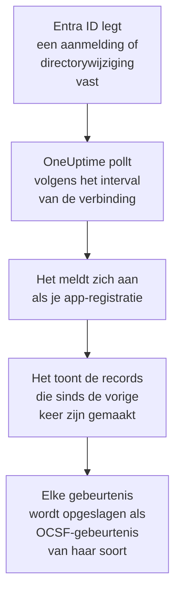

# Microsoft Entra ID

Importeer de aanmeldingen en directorywijzigingen van [Microsoft Entra ID](https://learn.microsoft.com/en-us/entra/identity/) in de beveiligingsgebeurtenissen van OneUptime en, als je wilt, de activiteit van Exchange, SharePoint, OneDrive en Teams uit het [Microsoft 365-auditlogboek](https://learn.microsoft.com/en-us/purview/audit-log-activities). Daar doorzoek je ze naast je logs, traces en metrics, correleer je ze met elke andere bron en roep je de dienst op voor wat ertoe doet. OneUptime leest ze met een app-registratie die jij maakt, en verandert niets in je tenant.

:::cards
- [De verbinding instellen](#de-verbinding-instellen): Een app-registratie, haar machtigingen en het formulier van de verbinding.
- [Wat er wordt geïmporteerd](#wat-er-wordt-geïmporteerd): Welke records, en hoe elk record een beveiligingsgebeurtenis wordt.
- [Hoe pollen werkt](#hoe-pollen-werkt): Het venster dat elke poll leest, en waarom het 30 minuten met het vorige overlapt.
- [Problemen oplossen](#problemen-oplossen): Wat elke fout betekent en wat je moet wijzigen.
:::

## Hoe het werkt

Elke minuut pollt OneUptime elke ingeschakelde verbinding waarvan het pollinterval is verstreken. Een poll meldt zich als je app-registratie aan bij Microsoft Entra ID en leest, in deze volgorde, de directorywijzigingen ([List directoryAudits](https://learn.microsoft.com/en-us/graph/api/directoryaudit-list)) en de aanmeldingen ([List signIns](https://learn.microsoft.com/en-us/graph/api/signin-list)) die sinds de vorige poll zijn vastgelegd, en daarna, als de optie **Microsoft 365-auditlogboek** aanstaat, de nieuwe inhoud van het auditlogboek ([Office 365 Management Activity API](https://learn.microsoft.com/en-us/office/office-365-management-api/office-365-management-activity-api-reference)). Elk record wordt opgeslagen als een [OCSF](https://schema.ocsf.io/)-gebeurtenis: een aanmelding als een gebeurtenis Authentication, een toegewezen rol als een gebeurtenis User Access Management, een phishingoordeel als een Detection Finding.

## Voordat je begint

- In OneUptime de rol Project Owner, Project Admin of Security Admin. Security Member en Security Viewer zien verbindingen en hun runhistorie, maar kunnen ze niet wijzigen.
- Voor aanmeldingen: Microsoft Entra ID P1 of P2, die in Microsoft 365 E3, E5 en Business Premium zitten: Microsoft Graph geeft aanmeldingen alleen aan zulke tenants. Directorywijzigingen worden in elke tenant gelezen.
- Een Entra-rol die toepassingen mag registreren, zoals Toepassingsbeheerder, en een Globale beheerder of Beheerder met bevoorrechte rol om beheerderstoestemming te verlenen.
- Voor het Microsoft 365-auditlogboek: auditing ingeschakeld voor de tenant, wat standaard zo is: in de [Microsoft Purview-portal](https://purview.microsoft.com) mag **Audit** geen **Start recording user and admin activity** aanbieden.
- Uitgaand HTTPS van de OneUptime-app en -workers naar `login.microsoftonline.com`, `graph.microsoft.com` en `manage.office.com`, of naar `login.microsoftonline.us`, `graph.microsoft.us` en `manage.office365.us` voor Azure Government.

## De verbinding instellen

De verbinding meldt zich aan met de [OAuth 2.0-flow voor clientreferenties](https://learn.microsoft.com/en-us/entra/identity-platform/v2-oauth2-client-creds-grant-flow): als toepassing, nooit als persoon, met alleen-lezenmachtigingen.

:::steps
### Een toepassing registreren

1. Meld je aan bij het [Microsoft Entra-beheercentrum](https://entra.microsoft.com) en open **App registrations**.
2. Selecteer **New registration**. Noem hem `OneUptime Security Events`, laat **Supported account types** op **Accounts in this organizational directory only** staan, laat de omleidings-URI leeg en selecteer **Register**.
3. Kopieer op de pagina **Overview** van de app de **Applicatie-ID (client)** en de **Directory-ID (tenant)**.

### Hem de logboeken laten lezen

1. Ga naar **API permissions → Add a permission → Microsoft Graph → Application permissions**, kies `AuditLog.Read.All` en selecteer **Add permissions**. Microsoft documenteert dat zijn lijst met aanmeldingen ook om `Directory.Read.All` kan vragen: voeg die toe als aanmeldingen met `403` worden geweigerd nadat de toestemming is verleend.
2. Voeg voor het Microsoft 365-auditlogboek een tweede machtiging toe: **Add a permission → Office 365 Management APIs → Application permissions**, en dan `ActivityFeed.Read`.
3. Om playbooks gebruikers te laten uitschakelen, inschakelen en afmelden (zie [Inperking](/docs/telemetry/security-cases#inperking)), voeg je op dezelfde manier `User.Read.All`, `User.EnableDisableAccount.All` en `User.RevokeSessions.All` toe. Microsoft laat het account van een beheerder alleen wijzigen door een app die ook de rol Privileged Authentication Administrator heeft.
4. Selecteer **Grant admin consent for** je tenant en bevestig. De status van elke machtiging moet **Granted** zijn: zonder toestemming wordt elke leesactie geweigerd met `403`.

### Een clientgeheim maken

Ga naar **Certificates & secrets → Client secrets → New client secret**, kies wanneer het verloopt en selecteer **Add**. Kopieer de **Value** van het geheim, niet de **Secret ID**, voordat je de pagina verlaat: die wordt nooit meer getoond. Op de dag dat het verloopt, stopt het pollen met `Microsoft Entra ID token request failed (HTTP 401)` tot je het vervangt met **Inloggegevens bijwerken**.

### De verbinding toevoegen in OneUptime

Open **Producten → Security Events → Verbindingen** (`/dashboard/{projectId}/security-events/connections`), klik op **Verbinding toevoegen**, kies **Microsoft Entra ID** onder **Identiteit** en klik op **Volgende**. Vul de instellingen uit de tabel hieronder in, klik op **Volgende** en plak de waarde van het geheim in **Clientgeheim**. Zet in de stap **Opvragen** **Microsoft 365-auditlogboek** aan om dat ook te lezen.

### Testen voordat je opslaat

Klik op **Deze instellingen testen** onder **Testen voor het opslaan**. De test meldt zich aan en leest elk logboek met de waarden uit het formulier, en slaat niets op, dus een verkeerd geheim of een ontbrekende toestemming komt aan het licht voordat de verbinding bestaat. Klik daarna op **Volgende**, geef de verbinding een **Naam** en maak haar aan.
:::

| Instelling | Waar je haar vindt |
| --- | --- |
| **Directory-ID (tenant)** | De pagina **Overview** van de app. De GUID van de tenant, of een geverifieerd domein zoals `contoso.onmicrosoft.com`. Met **Microsoft 365-auditlogboek** aan de GUID: de Management API noemt een tenant alleen daarbij. |
| **Applicatie-ID (client)** | De pagina **Overview** van de app. De GUID van de app die `AuditLog.Read.All` heeft. |
| **Cloud** | **Openbare Azure-cloud**, of **Azure Government (VS)** voor GCC High (`login.microsoftonline.us`, `graph.microsoft.us` en `manage.office365.us`). |
| **Microsoft 365-auditlogboek** | Optioneel, standaard uit. Aan leest elke poll ook het Microsoft 365-auditlogboek. De app heeft `ActivityFeed.Read` nodig. |
| **Clientgeheim** | De **Value** van het geheim. Het wordt versleuteld, nooit door de API teruggegeven en nooit meer getoond. Vervang het met **Inloggegevens bijwerken** op de verbinding. |

De stap **Opvragen** heeft ook een optionele **Beschrijving**, het **Opvraaginterval (minuten)**, een geheel getal van `1` tot `1440` dat begint op `5`, en **Ingeschakeld**, dat aan begint.

## Wat er wordt geïmporteerd

Elke gebeurtenis heeft leverancier `Microsoft` en product `Microsoft Entra ID`. Haar kenmerk `entra.log` zegt uit welk logboek een aanmelding of wijziging kwam, en de `microsoft365.contentType` van een Microsoft 365-record zijn inhoudstype.

| Record | OCSF-klasse | Ernst |
| --- | --- | --- |
| Een aanmelding die lukte | Authentication (`3002`), status `Success` | Informational |
| Een aanmelding die wacht op een tweede stap, zoals MFA (`50074`, `50076`) of een vraag om het wachtwoord te wijzigen | Authentication (`3002`), status `Interrupted` | Informational: een stap, geen fout |
| Een aanmelding die mislukte, met de reden en foutcode van Entra | Authentication (`3002`), status `Failure` | Low |
| Een aanmelding die Identity Protection als middel of hoog risico beoordeelde | Authentication (`3002`) | Medium of High |
| Een gewijzigde gebruiker, groep of rol, naar haar categorie | Account Change (`3001`), Group Management (`3006`), User Access Management (`3005`), of Entity Management (`3004`) voor de rest | Medium voor een bevoorrechte rol, zoals Global Administrator; Low voor een wijziging die mislukte |

Met **Microsoft 365-auditlogboek** aan worden de records waarop een beveiligingsteam handelt eruit geïmporteerd, en de rest, zoals een geopend bestand of een gelezen e-mail, alleen geteld:

| Microsoft 365-record | OCSF-klasse | Ernst |
| --- | --- | --- |
| Een Exchange-cmdlet, zoals `New-InboxRule` of `Set-Mailbox`, een regel voor het Postvak IN die in Outlook is gemaakt, of e-mail die als iemand anders is verzonden | API Activity (`6003`) | Medium als ze e-mail doorstuurt, met `microsoft365.forwardsMail` op `true` |
| Een toegekende postvakmachtiging, zoals `Add-MailboxPermission` | User Access Management (`3005`) | Low |
| Een bestand dat in SharePoint of OneDrive is gedeeld | File Hosting Activity (`6006`) | Low met een gast of een link die iedereen kan openen, met `microsoft365.sharedOutside` op `true` |
| Een sitecollectiebeheerder toegevoegd of verwijderd | User Access Management (`3005`) | Low |
| Malware- of phishingmail gevonden door Microsoft Defender for Office 365 | Detection Finding (`2004`) | High voor malware, Medium voor phishing |
| Een waarschuwing die Microsoft 365 gaf | Detection Finding (`2004`) | Die van de waarschuwing zelf |
| Een app, bot of connector die aan een team is toegevoegd | Application Lifecycle (`6002`) | Low |

Het eigen onderhoud van Exchange, dat onder zijn systeemaccount draait, blijft buiten beschouwing tenzij het e-mail doorstuurt. Elke gebeurtenis houdt het volledige record, afgevlakt tot sleutels met punten zoals `status.errorCode` of `Parameters.ForwardTo`, zodat een regel elk veld leest onder de naam die Microsoft eraan geeft. De regels in de bibliotheek voor Entra ID lezen ze zoals ze hier worden geïmporteerd.

Dezelfde aanmeldingen en directorywijzigingen kunnen OneUptime ook als logs bereiken, geëxporteerd door een diagnostische instelling van Azure en gelezen door [Uw logboeken](/docs/telemetry/security-events#beveiligingsgebeurtenissen-in-uw-logs-vinden). Elk record krijgt langs beide wegen dezelfde gebeurtenis-ID, maar een record dat langs beide wegen wordt gelezen, wordt twee keer opgeslagen: lees Entra ID langs één weg.

## Hoe pollen werkt

- **Records worden gelezen op het moment waarop Entra ID ze vastlegde**, `activityDateTime` voor een wijziging en `createdDateTime` voor een aanmelding.
- **De eerste poll kijkt 24 uur terug**, zodat een nieuwe verbinding meteen haar recente records toont.
- **Elke volgende poll begint 30 minuten voor de opgeslagen cursor.** Microsoft documenteert dat beide logboeken minuten te laat binnenkomen, dus de overlap leest een laat record bij de volgende poll, en duplicaten worden binnen het project op record-ID weggelaten.
- **Een poll leest hooguit 24 uur voorbij de cursor.** Een verbinding waarvan de cursor achterliep, haalt de achterstand in met een reeks vensters van 24 uur.
- **Een tenant zonder Microsoft Entra ID P1 of P2** importeert zijn directorywijzigingen, en de controle **Read sign-ins** van elke run waarschuwt dat aanmeldingen niet zijn gelezen.
- **Een mislukte run verandert niets.** Na een netwerkfout, of een foutstatus van Graph, blijven de cursor en de vensterlengte zoals ze waren, en leest de volgende poll hetzelfde venster opnieuw. De enige uitzondering is een verzoek dat een time-out kreeg: de cursor blijft staan, maar het volgende venster is half zo lang, omdat een venster dat te zwaar is om op tijd te beantwoorden bij elke poging een time-out zou krijgen.

Het Microsoft 365-auditlogboek wordt gelezen op het moment waarop Microsoft elke inhoudsblob beschikbaar maakte, een dag tegelijk, en niet verder terug dan de 7 dagen die Microsoft het bewaart. De eerste poll abonneert de app op `Audit.Exchange`, `Audit.SharePoint` en `Audit.General`, en Microsoft maakt de eerste records van een nieuw abonnement binnen 12 uur beschikbaar. Het auditlogboek houdt de logboeken van Entra ID nooit tegen: een ontbrekende machtiging is een waarschuwing en het venster schuift door, terwijl een storing aan de kant van Microsoft, zoals `HTTP 503`, de run **Gedeeltelijk** maakt zodat het venster opnieuw wordt gelezen.

### Wanneer een venster meer bevat dan één poll kan lezen

Elk logboek heeft een eigen budget: 10 pagina's van 500 directorywijzigingen, 20 pagina's van 500 aanmeldingen en, voor het Microsoft 365-auditlogboek, 120 verzoeken en 10.000 records. Een poll stopt na 4 minuten. Als een budget een logboek stopt voor het einde van zijn venster, is de run **Gedeeltelijk**, en noemt de waarschuwing het logboek en het budget. Microsoft Graph toont de nieuwste records eerst, dus OneUptime verkort het venster in plaats van de cursor voorbij records te zetten die het nooit bereikte:

1. **Verkleinen.** De volgende poll leest een venster dat half zo lang is, vanaf hetzelfde beginpunt, en blijft halveren tot een venster volledig wordt gelezen, tot één minuut. De waarschuwing van de run zegt het: `This window holds more records than one poll can read; the next poll reads a {n} minute window from the same starting point.` Records die al uit het langere venster zijn geïmporteerd, worden als duplicaten overgeslagen.
2. **Weer groeien.** Nadat een venster volledig is gelezen, gaat de cursor naar het einde ervan, en is het volgende venster weer twee keer zo lang, tot 24 uur.
3. **Voorbij één minuut gaan.** Als zelfs één minuut meer bevat dan een poll kan lezen, gaat het pollen eraan voorbij, zodat nieuwere records blijven binnenkomen. De run blijft **Gedeeltelijk**, en **Laatste fout** luidt `More records were created in the one minute from {cursor} to {end} than one poll can read. Polling moved past this minute so newer records keep arriving; use Import this time range in Diagnostics on this minute to recover what one run can read.` Importeer die minuut met **Import this time range** om terug te halen wat één run kan lezen.

Het **Opvraaginterval (minuten)** wijzigen verandert hier niets aan: het bepaalt hoe vaak een poll begint, niet waar zijn venster begint.

### Uitvoeren, bekijken en importeren op verzoek

Klik op **Diagnose** bij een verbinding om haar recente runs te zien en er met de hand mee te werken. Iedereen die de verbinding kan wijzigen, kan deze acties starten; iedereen die haar kan zien, kan de historie lezen.

- **Nu uitvoeren** start meteen een poll, met de gewone cursor, ook als de verbinding niet **Ingeschakeld** is.
- **Preview records** leest een tijdsbereik van maximaal 7 dagen en importeert niets.
- **Import this time range** importeert een bereik van maximaal 7 dagen, nadat je bevestigt, zonder de cursor te verplaatsen. Al geïmporteerde records worden overgeslagen. Microsoft Entra ID bewaart 30 dagen aanmeldingen en directorywijzigingen met P1 of P2, en 7 dagen zonder.
- **Copy diagnostics** bij een run kopieert het rapport ervan voor support. Het bevat nooit referenties.

## Verbinding testen

**Verbinding testen** op de rij van een verbinding, en **Deze instellingen testen** in het formulier, draaien in het API-proces, niet in een achtergrondworker, zodat een test ook antwoordt wanneer de workers het probleem zijn. Hij voert deze controles uit, in volgorde:

| Controle | Wat ze controleert |
| --- | --- |
| **Configuratie** | Elke instelling is aanwezig en goed gevormd. Er wordt niets benaderd als dit mislukt. |
| **Authenticate with Microsoft Entra** | Entra ID geeft de app een token voor Microsoft Graph, in de cloud die je koos. |
| **Read sign-ins** | Aanmeldingen van de afgelopen 24 uur kunnen worden gelezen. Een waarschuwing, geen fout, in een tenant zonder P1 of P2. |
| **Read directory changes** | Directorywijzigingen van de afgelopen 24 uur kunnen worden gelezen. |
| **Read the Microsoft 365 audit log** | Alleen met de optie aan: de Management API antwoordt, en op welke inhoudstypen de app is geabonneerd. |
| **Records available to import** | Hoeveel aanmeldingen en directorywijzigingen de afgelopen 24 uur bevatten, elk maximaal 500, dus `500+` betekent meer. Geen enkele is een waarschuwing. |
| **Background workers**, **Poll scheduler**, **Security event storage** | De kant van OneUptime zelf: een proces neemt de jobs van de Worker-wachtrij af, de poll-job draait elke minuut en de opslag van beveiligingsgebeurtenissen antwoordt. |
| **Scheduled polling** | Voor een opgeslagen verbinding: pollen staat aan, geen run zit vast in afwachting van een worker en polls draaien op tijd. |

Elk verzoek in een test heeft een deadline van 20 seconden. Een test importeert nooit iets en verplaatst nooit de cursor, en elke mislukte controle zegt wat je moet wijzigen.

## Problemen oplossen

De **Laatste fout** van de verbinding bewaart de volledige foutmelding, met referenties gemaskeerd. Wanneer een verbinding een fout heeft, selecteer je **Fout bekijken** in haar kolom **Acties** om hem te lezen, en **Fout kopiëren** in het dialoogvenster om hem te kopiëren. Elke melding begint met `Microsoft Entra ID`, noemt daarna het verzoek dat mislukte, en citeert de foutcode van Microsoft als die er is.

:::details Laatste fout zegt `token request failed`
- `HTTP 401` met `invalid_client`: het clientgeheim is verkeerd of verlopen. Maak een nieuw geheim en sla het op met **Inloggegevens bijwerken**.
- `HTTP 400` dat de applicatie-ID (client) of de tenant noemt: controleer beide op de pagina **Overview** van de app, en of de **Cloud** die van de tenant is.
:::

:::details Laatste fout zegt `sign-ins request failed (HTTP 403)` of `audit logs request failed (HTTP 403)`
- Foutcode `Authorization_RequestDenied`: de app mist `AuditLog.Read.All`, of de toestemming is niet verleend. Verleen beheerderstoestemming, wacht een paar minuten en test opnieuw. Verleen voor aanmeldingen ook `Directory.Read.All`.
- Foutcode `Authentication_RequestFromNonPremiumTenantOrB2CTenant`: de tenant heeft geen Microsoft Entra ID P1 of P2. Directorywijzigingen worden nog steeds geïmporteerd.
:::

:::details Het Microsoft 365-auditlogboek wordt niet gelezen
- `subscriptions request failed (HTTP 401)` of `(HTTP 403)`, met `AF10001`: de app mist `ActivityFeed.Read` van de Office 365 Management APIs, of de toestemming is niet verleend.
- `AF20010` tot en met `AF20013`: de Management API kent de **Directory-ID (tenant)** niet. Gebruik de GUID van de tenant.
- `subscription start failed` met `AF20023`: een beheerder heeft het abonnement uitgezet. Een inhoudstype waarop niet kan worden geabonneerd, wordt in de waarschuwingen van de run genoemd, en de andere worden nog steeds gelezen.
- Urenlang geen records na de eerste poll: Microsoft maakt de eerste inhoud van een nieuw abonnement binnen 12 uur beschikbaar.
:::

:::details Laatste fout zegt `did not complete`
Het verzoek kreeg geen antwoord: een time-out, een naam die niet wordt omgezet of een geweigerd adres. Controleer of de OneUptime-app en -workers de hosts uit [Voordat je begint](#voordat-je-begint) kunnen bereiken, via elke proxy die je gebruikt.
:::

:::details De test slaagt, maar Last Polled is Never
De poll-job heeft nog nooit gedraaid. Lees de controles **Background workers** en **Poll scheduler**. Op een zelf gehoste installatie is de gebruikelijke oorzaak `DISABLE_QUEUE_WORKERS=true` op de app, zonder aparte worker-deployment die de jobs afneemt: zet het op `false`, of draai de worker-deployment (Helm: `worker.enabled: true`, dat standaard `false` is).
:::

## Volgende stappen

:::cards
- [Beveiligingsgebeurtenissen](/docs/telemetry/security-events): Zoeken, correleren en waarschuwen op wat je importeert.
- [Okta-systeemlogboek](/docs/integrations/okta): Importeer de aanmeldingen van een andere identiteitsprovider.
- [Google Workspace](/docs/integrations/google-workspace): Importeer de aanmeldingen en beheerwijzigingen van Google.
- [Overzicht van integraties](/docs/integrations/index): De andere tools die je kunt koppelen.
:::
