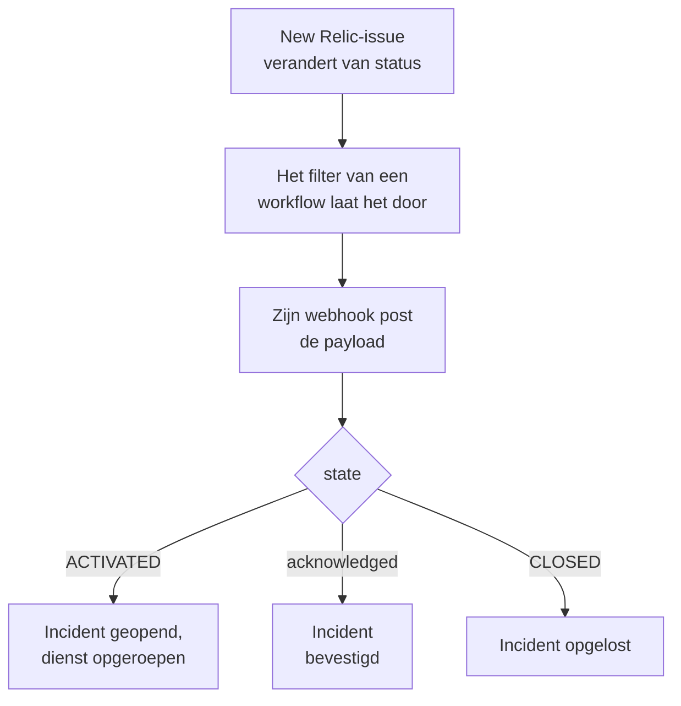

# New Relic

Stuur [New Relic](https://newrelic.com)-issues naar OneUptime, zodat elk issue een incident of een waarschuwing wordt die je bereikbaarheidsteam oproept, wordt bevestigd wanneer iemand het issue bevestigt en wordt opgelost wanneer het issue sluit. New Relic stuurt zijn issues via een [webhookbestemming](https://docs.newrelic.com/docs/alerts/get-notified/notification-integrations/), dus aan geen van beide kanten hoef je iets te installeren.

:::cards
- [Beginnen met het sjabloon](#beginnen-met-het-sjabloon): Kies wie je oproept, kopieer de URL en zie wat elk issue doet.
- [New Relic configureren](#new-relic-configureren): Een webhookbestemming, en de workflow die haar op de hoogte brengt.
- [Testen](#testen): Stuur zelf een issue, en daarna een vanuit New Relic.
- [Problemen oplossen](#problemen-oplossen): Wanneer issues niet aankomen of incidenten open blijven.
:::

## Hoe het werkt



Een New Relic-workflow kiest met zijn filter de issues die worden verstuurd, en brengt een webhookbestemming op de hoogte wanneer er een wordt geactiveerd, bevestigd of gesloten, met een JSON-payload die New Relic invult. De ID van het issue is hoe OneUptime het incident vindt dat het opende.

## Voordat je begint

- Een New Relic-account waarin je bestemmingen en workflows kunt maken.
- In OneUptime het recht om workflows te maken. Op OneUptime Cloud hebben workflows het abonnement **Growth** of hoger nodig.

## Beginnen met het sjabloon

Stel eerst OneUptime in: dat geeft je de URL waar New Relic naartoe stuurt. Het dialoogvenster **Een workflow maken** heeft twee New Relic-sjablonen, onder **New Relic** in de lijst met categorieën: **Declare an incident for each New Relic issue**, en **Create an alert for each New Relic issue** voor waarschuwingen. Beide doen hetzelfde, elk met een eigen soort record.

:::steps
1. Ga naar **Workflows** en klik op **Workflow maken**. Kies onder **Of begin met een sjabloon** de categorie **New Relic**, klik op **Declare an incident for each New Relic issue**, of op **Create an alert for each New Relic issue**, en klik op **Dit sjabloon gebruiken**.
2. Kies onder **Who to page for new New Relic issues** het bereikbaarheidsbeleid dat moet worden opgeroepen, of niets om niemand op te roepen, en klik op **Workflow maken**. De workflow opent in de **Bouwer**, uitgeschakeld.
3. Klik op de trigger **Webhook**, daarna op **URL kopiëren**, en bewaar de URL voor New Relic.
4. Zet **Ingeschakeld** aan bovenaan de **Bouwer**. Een workflow die uit staat, antwoordt New Relic met `400`.
:::

Daarna [configureer je New Relic](#new-relic-configureren) zodat het zijn issues naar die URL stuurt. De stap `read-event-1` van de workflow opent met dezelfde instelling, voor als je er in de **Bouwer** op terugkomt.

### Wat de workflow doet

Na de trigger **Webhook** leest de stap **Check With JavaScript** `read-event-1` de `state` die New Relic stuurt, en **Incident From Another Tool**, of **Alert From Another Tool** in het sjabloon voor waarschuwingen, doet wat die betekent, via de ID van het issue. Het incident bewaart de ID in zijn aangepaste veld `newRelicIssueId`.

| Wat New Relic stuurt | Wat de workflow doet |
| --- | --- |
| `state` is `ACTIVATED` of `CREATED` | Meldt een incident met de titel `New Relic: <issue>`, met de ernst waar de prioriteit van het issue op uitkomt, buiten je statuspagina's gehouden. De beschrijving linkt naar het issue in New Relic en noemt de prioriteit, de entiteiten, de beleidsregels en de condities. Het roept het bereikbaarheidsbeleid op dat je hebt gekozen. Hetzelfde issue opnieuw, zoals wanneer New Relic het naar CRITICAL verhoogt, opent geen tweede incident en roept niemand opnieuw op. |
| `state` is `ACTIVATED` en `isAcknowledged` is `true` | Bevestigt het incident van het issue, waardoor de dienst niet verder escaleert. Waarom staat op de tijdlijn ervan. |
| `state` is `CLOSED` | Lost het incident van het issue op, tenzij het al is opgelost. Waarom staat op de tijdlijn ervan. |

Een bevestiging of een sluiting voor een issue zonder incident verandert niets. Al het andere, zoals een verzoek van een ander hulpmiddel, blijft ongemoeid: `read-event-1` neemt **No**, en de **Stappen** van de uitvoering zeggen waarom. Er gaat niets terug naar New Relic: het sluit zijn eigen issues wanneer het signaal herstelt, en daarmee wordt het incident opgelost.

### Prioriteiten en oproepen

Elk nieuw issue roept het bereikbaarheidsbeleid op dat je hebt gekozen, wat de prioriteit ook is: New Relic verhoogt een issue van HIGH naar CRITICAL ter plekke, op hetzelfde issue, dus wachten op CRITICAL zou nooit oproepen voor een issue dat als HIGH opende en erger werd. Om voor minder issues op te roepen, versmal je het filter van de workflow in New Relic: alleen wat erdoor komt, bereikt OneUptime. In een nieuw project komen de prioriteiten uit op deze incident- en waarschuwingsernstniveaus:

| New Relic-prioriteit | Incident | Waarschuwing | Dienst |
| --- | --- | --- | --- |
| CRITICAL | Critical Incident | High | Opgeroepen |
| HIGH | Major Incident | Low | Opgeroepen |
| MEDIUM | Minor Incident | Low | Opgeroepen |
| LOW | Minor Incident | Low | Opgeroepen |

Met eigen ernstniveaus gaat CRITICAL naar je ernstigste, HIGH naar het middelste, en MEDIUM en LOW naar je minst ernstige. Een incident behoudt de ernst waarmee het opende wanneer New Relic zijn issue verhoogt.

Om een prioriteit op naam aan een van de jouwe toe te wijzen, bewerk je `SEVERITY_BY_NAME` in de stap `read-event-1`, zoals `{ HIGH: 'Critical Incident' }`.

## New Relic configureren

:::steps
### De webhookbestemming toevoegen

Ga in New Relic naar **Alerts → Destinations** en voeg een **Webhook**-bestemming toe. Zet **Webhook name** op `OneUptime` en **Endpoint URL** op de URL die je uit OneUptime hebt gekopieerd, en sla haar op. Laat **Use authorization** uit: de URL is het enige referentiemiddel.

### De workflow toevoegen

Ga naar **Alerts → Workflows** en klik op **Add a workflow**. Noem hem `OneUptime`. Zijn filter bepaalt welke issues OneUptime bereiken, zoals alleen CRITICAL-issues, of die van één team.

### De bestemming op de hoogte brengen

Voeg de **Webhook**-bestemming die je hebt gemaakt toe aan de workflow. Behoud de payload die New Relic invult, en voeg na `state` een regel voor `isAcknowledged` toe, zodat het incident wordt bevestigd met zijn issue:

```json
{
  "id": {{ json issueId }},
  "issueUrl": {{ json issuePageUrl }},
  "title": {{ json annotations.title.[0] }},
  "priority": {{ json priority }},
  "impactedEntities": {{ json entitiesData.names }},
  "totalIncidents": {{ json totalIncidents }},
  "state": {{ json state }},
  "isAcknowledged": {{ json isAcknowledged }},
  "trigger": {{ json triggerEvent }},
  "isCorrelated": {{ json isCorrelated }},
  "createdAt": {{ createdAt }},
  "updatedAt": {{ updatedAt }},
  "sources": {{ json accumulations.source }},
  "alertPolicyNames": {{ json accumulations.policyName }},
  "alertConditionNames": {{ json accumulations.conditionName }},
  "workflowName": {{ json workflowName }}
}
```

De regel om toe te voegen is `"isAcknowledged": {{ json isAcknowledged }},`. Klik daarna op **Update message**.

### Haar op de hoogte brengen bij activeren, bevestigen en sluiten

Klik op de drie puntjes bij de bestemming en kies **Notify when**. Laat **Activated**, **Acknowledged** en **Closed** aan.

### De workflow activeren

Klik op **Activate workflow**.
:::

De OneUptime-workflow leest deze velden van de payload en laat de andere ongemoeid:

| Veld | Wat New Relic erin zet |
| --- | --- |
| `id` | De ID van het issue. |
| `issueUrl` | Een link naar het issue in New Relic. |
| `title` | De titel van het issue. |
| `priority` | Hoe urgent het issue is: `CRITICAL`, `HIGH`, `MEDIUM` of `LOW`. |
| `state` | Waar het issue staat: `CREATED`, `ACTIVATED` of `CLOSED`. |
| `isAcknowledged` | `true` zodra iemand het issue in New Relic bevestigt. |
| `impactedEntities` | De namen van de entiteiten waar het issue over gaat. |
| `alertPolicyNames` | De namen van de beleidsregels achter het issue. |
| `alertConditionNames` | De namen van de condities achter het issue. |

## Testen

Stuur een issue naar de URL die je hebt gekopieerd, zoals New Relic dat zou doen:

```bash
curl -X POST "<url>" \
  -H "Content-Type: application/json" \
  -d '{
    "id": "7d4a2e1c-3b5f-4c8e-9a1d-2f6b8c0e4a71",
    "issueUrl": "https://radar-api.service.newrelic.com/accounts/1234567/issues/7d4a2e1c-3b5f-4c8e-9a1d-2f6b8c0e4a71?notifier=WEBHOOK",
    "title": "High CPU on checkout-service",
    "priority": "CRITICAL",
    "impactedEntities": ["checkout-service"],
    "state": "ACTIVATED",
    "isAcknowledged": false,
    "alertPolicyNames": ["Production"],
    "alertConditionNames": ["CPU above 90%"]
  }'
```

Een incident opent, met de titel `New Relic: High CPU on checkout-service`, en het bereikbaarheidsbeleid dat je hebt gekozen wordt opgeroepen. Stuur hetzelfde verzoek met `isAcknowledged` op `true`, en het incident wordt bevestigd. Stuur het met `state` op `CLOSED`, en het incident wordt opgelost.

Test daarna vanuit New Relic: open het webhookbericht van de workflow en klik op **Send test notification**. Om te zien dat het is aangekomen, open je **Logboeken → Uitvoeringen** van de OneUptime-workflow.

## Problemen oplossen

:::details Er komt niets aan in OneUptime
- Controleer dat de workflow in New Relic actief is, en dat zijn filter het issue doorlaat.
- Controleer dat de **Endpoint URL** van de bestemming de URL van de trigger **Webhook** is.
- Een uitgeschakelde workflow antwoordt `400`. Zet **Ingeschakeld** aan bovenaan de **Bouwer** ervan.
:::

:::details De workflow draait, maar opent niets
Open de uitvoering in **Logboeken → Uitvoeringen**. De vermelding `read-event-1` in de **Stappen** ervan zegt waarom hij **No** nam.

- `New Relic named no issue ID`: behoud de regel `"id": {{ json issueId }},` in de payload.
- `is in no state`: behoud de regel `"state": {{ json state }},` in de payload.
:::

:::details Incidenten worden niet bevestigd
- De payload heeft de regel `"isAcknowledged": {{ json isAcknowledged }},` nodig. Zonder die regel opent een incident en wordt het met zijn issue opgelost, maar nooit bevestigd.
- De workflow in New Relic moet **Acknowledged** aan hebben onder **Notify when**.
:::

:::details Incidenten gaan open maar worden nooit opgelost
- De workflow in New Relic moet **Closed** aan hebben onder **Notify when**.
- Open de uitvoering van de sluiting in **Logboeken → Uitvoeringen**: de laatste stap zegt waarom. De `id` van de sluiting moet die van het issue zijn, dus laat `"id": {{ json issueId }},` in de payload zoals het is.
:::

:::details De dienst wordt voor te veel issues opgeroepen
Elk nieuw issue dat OneUptime bereikt, roept op. Versmal het filter van de workflow in New Relic, zodat alleen de issues die moeten oproepen het bereiken. Zie [Prioriteiten en oproepen](#prioriteiten-en-oproepen).
:::

:::details De dienst wordt niet opgeroepen
- Een melding voor een issue dat al een incident heeft, roept niemand opnieuw op, dus een verhoging naar CRITICAL roept niemand op.
- Als in het dialoogvenster **Een workflow maken** niemand is gekozen, heeft de workflow geen stap die oproept.
:::

## Beveiliging

- **Behandel de URL als een wachtwoord.** Iedereen die hem heeft, kan incidenten openen. Lekt hij uit, klik dan op **URL opnieuw instellen** in de trigger **Webhook** van de workflow. Werk daarna de **Endpoint URL** van de bestemming in New Relic bij.
- **Links gaan naar New Relic.** Het sjabloon linkt een issue alleen op een New Relic-site, wat een verzoek ook zegt, en schrijft wat New Relic stuurde als tekst.
- **Zelfgehost?** New Relic stuurt webhooks vanaf het internet, dus je OneUptime moet er via HTTPS voor bereikbaar zijn.

## Volgende stappen

:::cards
- [Workflowsjablonen](/docs/workflows/authoring): Maak een workflow van een sjabloon en wijzig hem in de Bouwer.
- [Datadog](/docs/integrations/datadog): Hetzelfde sjabloon, voor Datadog-monitors.
- [Escalatieregels](/docs/on-call/escalation-rules): Bepaal wie een bereikbaarheidsbeleid oproept, en wanneer.
- [Overzicht van integraties](/docs/integrations/index): De andere tools die je kunt koppelen.
:::
