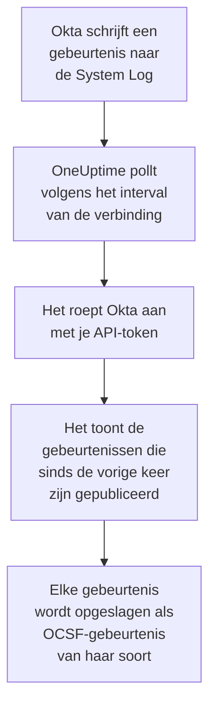

# Okta-systeemlogboek

Importeer de [Okta System Log](https://developer.okta.com/docs/reference/system-log-query/) in de beveiligingsgebeurtenissen van OneUptime: aanmeldingen, MFA-uitdagingen, account- en groepswijzigingen en de eigen dreigingsdetecties van Okta. Daar doorzoek je ze naast je logs, traces en metrics, correleer je ze met elke andere bron en roep je de dienstdoende op voor de gebeurtenissen die ertoe doen. OneUptime leest ze met een API-token dat je zelf maakt, en wijzigt niets in Okta.

:::cards
- [De verbinding instellen](#de-verbinding-instellen): Een API-token en het formulier van de verbinding.
- [Wat er wordt geïmporteerd](#wat-er-wordt-geïmporteerd): Welke gebeurtenissen, en hoe elke gebeurtenis een beveiligingsgebeurtenis wordt.
- [Hoe pollen werkt](#hoe-pollen-werkt): Het venster dat elke poll leest, en waarom het 15 minuten met het vorige overlapt.
- [Problemen oplossen](#problemen-oplossen): Wat elke fout betekent en wat je moet wijzigen.
:::

## Hoe het werkt



Elke minuut pollt OneUptime elke ingeschakelde verbinding waarvan het pollinterval is verstreken. Een poll vraagt Okta om de System Log-gebeurtenissen die sinds de vorige poll zijn gepubliceerd, en slaat elke gebeurtenis op als een [OCSF](https://schema.ocsf.io/)-gebeurtenis: een aanmelding als Authentication-gebeurtenis, een accountwijziging als Account Change, en een detectie van Okta als Detection Finding. Detectieregels, monitoren en dashboards behandelen haar daarna als een beveiligingsgebeurtenis uit elke andere bron. Het werkt met elke Okta-cel, `okta.com`, `oktapreview.com` en `okta-emea.com`, en met een organisatie op een eigen domein.

## Voordat je begint

- In OneUptime de rol Project Owner, Project Admin of Security Admin. Security Member en Security Viewer zien verbindingen en hun runhistorie, maar kunnen ze niet wijzigen.
- Een Okta-beheerder die de System Log mag bekijken, om het token te maken. Een token kan wat zijn beheerder kan, dus gebruik een Read-only Administrator: die leest de System Log en wijzigt niets. Een alleen-lezenbeheerder ziet ook gebruikers, groepen, apps en instellingen, dus bewaar het token zo veilig als een wachtwoord.
- Bij voorkeur een serviceaccount voor die beheerder. Okta deactiveert een token wanneer zijn beheerder wordt gedeactiveerd, en wanneer het 30 dagen ongebruikt blijft. Het pollen gebruikt het om de paar minuten, dus het blijft in gebruik zolang de verbinding is ingeschakeld.
- Als je organisatie API-aanroepen alleen vanuit een netwerkzone accepteert, een zone met de adressen waarvandaan OneUptime aanroept: op OneUptime Cloud de uitgaande adressen ervan, en op een zelf gehoste installatie het openbare adres van je app- en workerhosts.

## De verbinding instellen

:::steps
### Een API-token maken

1. Meld je als de alleen-lezenbeheerder aan bij de **Admin Console** van Okta.
2. Open **Security → API**, dan het tabblad **Tokens**, en selecteer **Create token**.
3. Geef het een naam, bijvoorbeeld `OneUptime security events`. Laat **Any IP** staan als herkomst van zijn aanroepen, tenzij je organisatie een zone nodig heeft.
4. Selecteer **Create token** en kopieer de **Token Value**. Okta toont die maar één keer.

Elk token mag een deel van de API-ratelimiet van de organisatie gebruiken, dat zijn rij op het tabblad **Tokens** toont. Een poll doet hooguit 20 verzoeken, dus het standaarddeel is ruim genoeg, tenzij andere tools hetzelfde token gebruiken.

### De verbinding toevoegen in OneUptime

Open **Producten → Security Events → Verbindingen** (`/dashboard/{projectId}/security-events/connections`), klik op **Verbinding toevoegen**, kies **Okta System Log** en klik op **Volgende**. Vul de instellingen uit de tabel hieronder in, klik op **Volgende** en plak het token in **API token**.

### Testen voordat je opslaat

Klik op **Deze instellingen testen** onder **Testen voor het opslaan**. De test meldt zich aan en leest gebeurtenissen met de waarden in het formulier, en slaat niets op, dus een verkeerde URL of een ongeldig filter komt aan het licht voordat de verbinding bestaat. Klik daarna op **Volgende**, geef de verbinding een **Naam** en maak haar aan.
:::

| Instelling | Wat je invult |
| --- | --- |
| **Okta organization URL** | Het adres waarop je gebruikers zich aanmelden, zoals `https://acme.okta.com`, `https://acme.oktapreview.com` of `https://login.example.com`. Het moet `https` gebruiken, zonder pad. Niet het `-admin`-adres van de Admin Console, dat de API niet aanbiedt. |
| **Event filter** | Optioneel. Een [System Log-filter](https://developer.okta.com/docs/reference/core-okta-api/#filter) dat de te importeren gebeurtenissen kiest, zoals `eventType sw "user.session" or eventType sw "security"`. Leeg importeert de families hieronder. Hooguit 2.000 tekens, op één regel, en niet op `published`: OneUptime stelt het tijdsbereik zelf in. |
| **API token** | De waarde van het token, op zichzelf: OneUptime voegt het schema `SSWS` zelf toe. Het wordt versleuteld, nooit door de API teruggegeven en nooit opnieuw getoond. Vervang het met **Inloggegevens bijwerken** bij de verbinding. |

De stap **Opvragen** heeft ook een optionele **Beschrijving**, het **Opvraaginterval (minuten)**, een geheel getal van `1` tot `1440` dat begint op `5`, en **Ingeschakeld**, dat aan begint.

## Wat er wordt geïmporteerd

Zonder **Event filter** importeert OneUptime de gebeurtenisfamilies die een beveiligingsteam in de gaten houdt, op voorvoegsel van `eventType`. Een eigen filter vervangt deze lijst, in plaats van eraan toe te voegen:

| Voorvoegsel | Gebeurtenissen |
| --- | --- |
| `user.session` | Aan- en afmeldingen, toegang tot de Admin Console, imitatie |
| `user.authentication` | Authenticatieresultaten, inclusief single sign-on |
| `user.mfa` | Registratie, uitdagingen en resets van factoren |
| `user.account` | Wachtwoordwijzigingen en -resets, blokkeringen, profiel- en rechtenwijzigingen |
| `user.lifecycle` | Gebruikers die zijn gemaakt, geactiveerd, opgeschort, gedeactiveerd en verwijderd |
| `security.` | ThreatInsight, meldingen van verdachte activiteit en de andere detecties van Okta |
| `policy.` | Evaluaties van aanmeldbeleid, en beleidswijzigingen |
| `system.api_token` | Gemaakte en ingetrokken API-tokens |
| `application.user_membership` | App-toewijzingen |
| `group.user_membership` | Wijzigingen in groepslidmaatschap |

Elke gebeurtenis wordt één OCSF-gebeurtenis, met leverancier `Okta` en product `Okta System Log`, van de klasse die haar `eventType` vraagt:

| `eventType` | OCSF-klasse | Activiteit |
| --- | --- | --- |
| `user.session.start` | Authentication (`3002`) | `Logon` |
| `user.session.end` | Authentication (`3002`) | `Logoff` |
| `user.authentication.*` | Authentication (`3002`) | `Logon` |
| `user.mfa.*` | Authentication (`3002`) | `Authentication Ticket` |
| Andere gebeurtenissen `user.session.*` | Authentication (`3002`) | `Other` |
| `user.account.*`, `user.lifecycle.*` | Account Change (`3001`) | Het laatste deel van het gebeurtenistype, zoals `Update Password` |
| `group.*` | Group Management (`3006`) | Het laatste deel van het gebeurtenistype, zoals `Add` |
| `security.*`, en een `policy.evaluate_sign_on` die toegang weigerde | Detection Finding (`2004`) | `Create`, met het gebeurtenistype als regelnaam |
| Al het andere | `0`, vernoemd naar het gebeurtenistype | Het laatste deel van het gebeurtenistype |

Een gebeurtenis die in geen van deze klassen valt, houdt toch elk veld en blijft op elk daarvan doorzoekbaar. Elke gebeurtenis vult deze kolommen:

| Okta-veld | OneUptime-kolom |
| --- | --- |
| `uuid` | Gebeurtenis-UID, waarop ook duplicaten worden verwijderd |
| `published`, wanneer de gebeurtenis plaatsvond | Tijd van de gebeurtenis |
| `displayMessage`, anders het gebeurtenistype en `outcome.reason` | Bericht |
| `severity`: `DEBUG` en `INFO` zijn Informational, `WARN` Medium, `ERROR` High | Ernst |
| `outcome.result`, zoals `SUCCESS`, `FAILURE`, `ALLOW` of `DENY` | Status |
| `actor.alternateId`, anders `actor.displayName`; `client.ipAddress` | Gebruiker en IP van de actor |
| De `alternateId` van de `User` in `target` | Doelgebruiker |
| De `alternateId` van de `AppInstance` in `target` | Doelresource |
| De actor, elk doel en het IP van de client | Observables |
| De hele gebeurtenis, plat gemaakt tot sleutels met punten, zoals `client.userAgent.browser` en `debugContext.debugData.requestUri` | `attributes` |

Een mislukte of geweigerde aanmelding op `INFO` wordt verhoogd naar Low, zodat ze opvalt naast een geslaagde. De System Log bevat geen MITRE ATT&CK-verwijzingen, dus die kolommen blijven leeg.

## Hoe pollen werkt

Elke poll toont de gebeurtenissen die in zijn venster zijn gepubliceerd, de oudste eerst, 1.000 per pagina, en volgt de link `next` die Okta stuurt tot de laatste pagina:

```text
GET {Okta organization URL}/api/v1/logs?since={window start}&until={window end}&sortOrder=ASCENDING&limit=1000&filter={Event filter}
```

- **De publicatietijd is de cursor.** Een System Log-gebeurtenis is de activiteit zelf, dus `published` is zowel wanneer ze plaatsvond als wat het pollen leest.
- **De eerste poll kijkt 24 uur terug**, zodat een nieuwe verbinding meteen haar recente gebeurtenissen toont.
- **Elke volgende poll begint 15 minuten voor de opgeslagen cursor.** Okta waarschuwt dat een verzoek met een eindtijd vertraagde gebeurtenissen kan weglaten, wat het zelden noemt. De overlap leest ze bij de volgende poll. Een gebeurtenis die meer dan 15 minuten is vertraagd, kan achter de cursor vallen: importeer haar tijdsbereik om haar terug te halen.
- **Een poll leest hooguit 24 uur voorbij de cursor.** Een verbinding waarvan de cursor achterliep, haalt de achterstand in met een reeks vensters van 24 uur, en haar **Gezondheid** toont **Catching up**.
- **Duplicaten worden verwijderd op `uuid`** binnen het project, zodat de overlap, een herhaald venster en een import een gebeurtenis nooit twee keer opslaan.

Een link `next` die ergens anders heen wijst dan je **Okta organization URL**, wordt nooit gevolgd, omdat het token met elk verzoek meegaat.

### Wanneer een venster meer bevat dan één poll kan lezen

Een poll leest hooguit 10.000 gebeurtenissen, in hooguit 20 verzoeken. Wanneer een venster er meer bevat, is de run **Gedeeltelijk**, met een waarschuwing zoals:

```text
Stopped after collecting 10000 events; the window holds more. The last event read was published at 2026-09-14T08:12:44.000Z.
```

Gebeurtenissen worden de oudste eerst gelezen, dus OneUptime zet de cursor op de publicatietijd van de laatst gelezen gebeurtenis, en de volgende poll begint daar, zonder de overlap van 15 minuten, met dezelfde vensterlengte. Een drukke organisatie haalt zo 10.000 gebeurtenissen per poll in, in plaats van steeds dezelfde opnieuw te lezen. De overlap komt terug zodra de cursor 15 minuten voorbij dat punt is.

Wanneer een run helemaal niet voorbij de opgeslagen cursor komt, bijvoorbeeld omdat de 15 minuten overlap alleen al meer dan 10.000 gebeurtenissen bevatten, maakt OneUptime het venster in plaats daarvan korter:

1. **Verkleinen.** De volgende poll leest een venster dat half zo lang is, vanaf hetzelfde beginpunt, en blijft halveren tot een venster volledig wordt gelezen, tot één minuut. De waarschuwing van de run zegt het: `This window holds more records than one poll can read; the next poll reads a {n} minute window from the same starting point.`
2. **Weer groeien.** Nadat een venster volledig is gelezen, is het volgende weer twee keer zo lang, tot 24 uur.
3. **Voorbij één minuut gaan.** Als zelfs één minuut meer bevat dan een poll kan lezen, gaat het pollen eraan voorbij, zodat nieuwere gebeurtenissen blijven binnenkomen, en de overlap van latere polls reikt er niet meer in terug. De run blijft **Gedeeltelijk**, en **Laatste fout** luidt `More records were created in the one minute from {cursor} to {end} than one poll can read. Polling moved past this minute so newer records keep arriving; use Import this time range in Diagnostics on this minute to recover what one run can read.` Importeer die minuut met **Import this time range** om terug te halen wat één run kan lezen, of beperk het **Event filter**.

Een run die volledig mislukt, met een fout van Okta, behoudt de cursor en de vensterlengte, en de volgende poll leest hetzelfde venster opnieuw. De enige uitzondering is een verzoek dat een time-out kreeg: de cursor blijft staan, maar het volgende venster is half zo lang, omdat een venster dat te zwaar is om op tijd te beantwoorden bij elke poging een time-out zou krijgen. Het **Opvraaginterval (minuten)** wijzigen verandert hier niets aan: het bepaalt hoe vaak een poll begint, niet waar zijn venster begint.

### Uitvoeren, bekijken en importeren op verzoek

Klik op **Diagnose** bij een verbinding om haar recente runs te zien en er met de hand mee te werken. Iedereen die de verbinding kan wijzigen, kan deze acties starten; iedereen die haar kan zien, kan de historie lezen.

- **Nu uitvoeren** start meteen een poll, met de gewone cursor, ook als de verbinding niet **Ingeschakeld** is.
- **Preview log events** leest een tijdsbereik van maximaal 7 dagen en importeert niets.
- **Import this time range** importeert een bereik van maximaal 7 dagen, nadat je bevestigt, zonder de cursor te verplaatsen. Al geïmporteerde gebeurtenissen worden overgeslagen. Okta bewaart 90 dagen System Log.
- **Copy diagnostics** bij een run kopieert het rapport ervan voor support. Het bevat nooit referenties.

## Verbinding testen

**Verbinding testen** op de rij van een verbinding, en **Deze instellingen testen** in het formulier, draaien in het API-proces, niet in een achtergrondworker, zodat een test ook antwoordt wanneer de workers het probleem zijn. Hij voert deze controles uit, in volgorde:

| Controle | Wat ze controleert |
| --- | --- |
| **Configuratie** | Elke instelling is aanwezig en goed gevormd. Er wordt niets benaderd als dit mislukt. |
| **Authenticate with Okta** | Okta accepteert het token voor de System Log, met één gelezen gebeurtenis en geen filter. |
| **Read System Log events** | Eén gebeurtenis uit de laatste 24 uur kan worden gelezen via het filter dat het pollen gebruikt, het jouwe of het standaardfilter, dus een ongeldig **Event filter** mislukt hier in plaats van bij de eerste poll. |
| **Events available to import** | Hoeveel gebeurtenissen er in de laatste 24 uur en de laatste 7 dagen zijn gepubliceerd, elk één pagina van 1.000, dus `1000+` betekent meer. Geen in 7 dagen is een waarschuwing, geen fout. |
| **Background workers**, **Poll scheduler**, **Security event storage** | De kant van OneUptime zelf: een proces neemt de jobs van de Worker-wachtrij af, de poll-job draait elke minuut en de opslag van beveiligingsgebeurtenissen antwoordt. |
| **Scheduled polling** | Voor een opgeslagen verbinding: pollen staat aan, geen run zit vast in afwachting van een worker en polls draaien op tijd. |

Elk verzoek in een test heeft een deadline van 20 seconden. Een test importeert nooit iets en verplaatst nooit de cursor, en elke mislukte controle zegt wat je moet wijzigen.

## Problemen oplossen

De **Laatste fout** van de verbinding bewaart de volledige foutmelding, met referenties gemaskeerd, achter een voorvoegsel dat de mislukte stap noemt. Wanneer een verbinding een fout heeft, selecteer je **Fout bekijken** in haar kolom **Acties** om hem te lezen, en **Fout kopiëren** in het dialoogvenster om hem te kopiëren. Elke melding begint met `Okta System Log events request`, en citeert na de status de eigen foutcode van Okta; lees wat erop volgt.

:::details Last Error zegt `failed (HTTP 400)`
Okta weigerde de parameters van het verzoek, `E0000053`. Als het token werkte, is het bijna altijd het **Event filter**: controleer de operatoren, `eq`, `ne`, `co`, `sw`, `ew`, `pr`, `gt`, `ge`, `lt` en `le`, de `and` en `or`, en de dubbele aanhalingstekens rond de waarden, of maak het leeg om de standaardfamilies te gebruiken. Bij een import kan het ook betekenen dat het bereik meer dan 180 dagen geleden begint.
:::

:::details Last Error zegt `failed (HTTP 401)` of `failed (HTTP 403)`
- `HTTP 401`: Okta accepteerde het token niet, `E0000011`. Het is ingetrokken, is 30 dagen ongebruikt gebleven, of is met zijn beheerder gedeactiveerd; of het is geplakt met `SSWS` of met een teken te veel. Maak een nieuw token als alleen-lezenbeheerder en sla het op met **Inloggegevens bijwerken**.
- `HTTP 403`: het token meldt zich aan, maar zijn beheerder mag de System Log niet lezen, `E0000006`. Maak het als Read-only Administrator of Super Administrator, en controleer of zijn netwerkzone de adressen toestaat waarvandaan OneUptime aanroept.
:::

:::details Last Error zegt `failed (HTTP ...)` met een andere status
- `HTTP 404`: de URL biedt de API van Okta niet aan. Gebruik het eigen adres van de organisatie, zoals `https://acme.okta.com`, zonder pad en niet het `-admin`-adres.
- `HTTP 3xx`: Okta stuurde het verzoek door, en doorverwijzingen worden geweigerd, omdat het token met elk verzoek meegaat. Gebruik het eigen adres van de organisatie.
- `HTTP 429`: Okta beperkt het token, `E0000047`. De volgende poll probeert het opnieuw. Blijft het gebeuren, verhoog dan het deel van de ratelimiet van het token op het tabblad **Tokens**, geef OneUptime een eigen token, of poll minder vaak.
- `HTTP 5xx`: Okta faalde, of de query duurde langer dan de limiet van 30 seconden van Okta, `E0000009`. De volgende poll probeert het opnieuw; blijft het gebeuren, kijk dan op [status.okta.com](https://status.okta.com).
:::

:::details Last Error zegt `returned` of `did not complete`
- `returned a non-JSON body.` of `returned an unrecognized response shape`: iets anders dan de API van Okta antwoordde, zoals een aanmeldpagina of een proxy, of Okta antwoordde met een fout. Dit wordt gemeld in plaats van als leeg venster opgevat, zodat de cursor nooit voorbij gebeurtenissen gaat die niemand heeft gelezen.
- `returned a next link outside the Okta organization URL`: een link `next` wees ergens anders heen, en werd niet gevolgd. Okta zelf doet dat nooit: zoek een proxy die headers herschrijft.
- `did not complete`: het verzoek kreeg geen antwoord: een time-out, een naam die niet wordt omgezet, een certificaat dat OneUptime niet vertrouwt, of een geweigerd adres. Controleer of de OneUptime-app en -workers je organisatie via HTTPS kunnen bereiken, via de proxy die je eventueel gebruikt.
:::

:::details Last Polled is Never en Last Error is leeg
Er is voor deze verbinding nog geen poll voltooid. Voer **Verbinding testen** uit: de controles **Background workers** en **Poll scheduler** noemen de oorzaak. Op een zelf gehoste installatie is de gebruikelijke oorzaak `DISABLE_QUEUE_WORKERS=true` op de app, zonder aparte worker-deployment die de jobs afneemt: zet het op `false`, of draai de worker-deployment (Helm: `worker.enabled: true`).
:::

:::details Een run is Partial
- `Stopped after collecting 10000 events`: het venster bevatte meer dan de 10.000 gebeurtenissen die één run leest. Er gaat niets verloren: de volgende poll begint na de laatst gelezen gebeurtenis. Een verbinding die poll na poll **Gedeeltelijk** blijft, haalt een achterstand in, en haar **Laatst opgevraagd** en **Laatst geïmporteerde gebeurtenis** blijven vooruitgaan. Haalt ze die nooit in, dan publiceert de organisatie meer overeenkomende gebeurtenissen dan een pollinterval kan bevatten: beperk het **Event filter**, of maak het **Opvraaginterval (minuten)** korter.
- `More records were created in the one minute from ... than one poll can read`: het pollen ging voorbij die minuut. Importeer haar met **Import this time range** in **Diagnose**. Een import leest net zoveel als een poll.
:::

:::details De test slaagt, maar er wordt niets geïmporteerd
Lees **Events available to import** in het testrapport. Met het standaardfilter publiceert een organisatie met gebruikers voortdurend aanmeldingen, dus `0` in de laatste 7 dagen betekent dat de URL een sandbox of een ongebruikte organisatie is. Met je eigen **Event filter** betekent het dat het filter niets vond: vergelijk het met de gebeurtenistypen in de System Log van de Admin Console.
:::

## Wat je krijgt

- **Zoeken.** Filter aanmeldingen, MFA-resultaten, accountwijzigingen en detecties van Okta op ernst, status, gebruiker, IP of elke observable in de verkenner van beveiligingsgebeurtenissen, naast elke andere bron.
- **Correlatie.** De gebruikers, apps en IP's van elke gebeurtenis worden geïndexeerd als observables, dus één zoekopdracht vindt alles wat één gebruiker deed, naast de eigen logs van zijn app.
- **Detectieregels.** Sigma-regels die volgens een schema over je beveiligingsgebeurtenissen draaien, zoals mislukte aanmeldingen per IP of MFA-weigeringen per gebruiker, en waarschuwingen openen die de dienstdoende oproepen.
- **Monitoren.** Monitoren voor beveiligingsgebeurtenissen tellen overeenkomende gebeurtenissen en openen boven een drempel incidenten of waarschuwingen.

Beveiligingsgebeurtenissen worden gefactureerd zoals de rest van je telemetrie, per opgenomen GB. Zie [Prijzen](https://oneuptime.com/pricing).

## Volgende stappen

:::cards
- [Beveiligingsgebeurtenissen](/docs/telemetry/security-events): Zoeken, correleren en waarschuwen op wat je importeert.
- [AWS Security Hub](/docs/integrations/aws-security-hub): Importeer ook de bevindingen van je cloud.
- [Rollen](/docs/permissions/reference#rollen): Wat de Security-rollen kunnen zien en wijzigen.
- [Overzicht van integraties](/docs/integrations/index): De andere tools die je kunt koppelen.
:::
