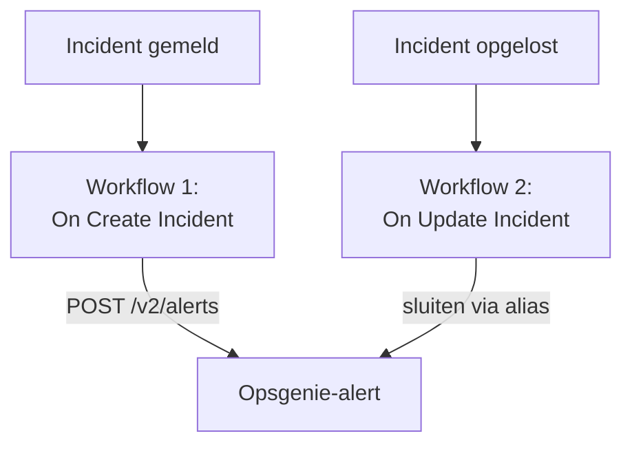

# Opsgenie

Stuur OneUptime-incidenten naar [Opsgenie](https://www.atlassian.com/software/opsgenie). Eén workflow maakt een Opsgenie-alert aan wanneer een OneUptime-incident wordt gemeld, en een tweede sluit hem wanneer het OneUptime-incident is opgelost. Gebruik dit zolang Opsgenie je team nog oproept en OneUptime je systemen bewaakt.

:::cards
- [De API-sleutel opslaan](#de-api-sleutel-opslaan): Houd de sleutel van Opsgenie buiten je workflows.
- [Opsgenie-alerts aanmaken](#een-opsgenie-alert-aanmaken-voor-elk-incident): Eén workflow, twee blokken.
- [Ze sluiten](#de-opsgenie-alert-sluiten): Een tweede workflow die de status van het incident volgt.
- [Problemen oplossen](#problemen-oplossen): Wanneer Opsgenie een verzoek weigert.
:::

> [!IMPORTANT]
> Atlassian is in juni 2025 gestopt met de verkoop van Opsgenie en beëindigt de ondersteuning in april 2027. OneUptime roept ook mensen op, met bereikbaarheidsbeleid, roosters en escalatieregels. Om je team over te halen, zie [Overstappen van Opsgenie](/docs/moving-to-oneuptime/opsgenie): een import haalt je gebruikers, teams, roosters en escalaties over.

## Hoe het werkt



Beide workflows roepen de [Opsgenie Alert API](https://docs.opsgenie.com/docs/alert-api) aan. De eerste geeft de alert een `alias` die is gemaakt van de ID van het OneUptime-incident, en de tweede sluit de alert via die alias.

## Voordat je begint

- Een Opsgenie-integratie van het type **API** en de **API Key** ervan. Voeg er een toe onder **Settings → Integrations** in Opsgenie, of onder de **Integrations** van een team om alerts naar dat team te sturen.
- Je Opsgenie-regio. Accounts in Europa, die inloggen op `app.eu.opsgenie.com`, gebruiken `api.eu.opsgenie.com`. Alle andere gebruiken `api.opsgenie.com`.
- In OneUptime het recht om workflows en globale variabelen te maken. Op OneUptime Cloud hebben workflows het **Growth**-abonnement of hoger nodig.

## De API-sleutel opslaan

:::steps
1. Ga naar **Workflows → Globale variabelen** en klik op **Workflow Variabele aanmaken**.
2. Noem hem `OPSGENIE_KEY` en klik op **Volgende**.
3. Plak de API-sleutel in **Inhoud**, zet **Geheim** aan en klik op **Workflow Variabele aanmaken**.
:::

Een geheime variabele wordt in de uitvoeringslogboeken vervangen door `[REDACTED]`, dus de sleutel verschijnt nooit in een uitvoering.

## Een Opsgenie-alert aanmaken voor elk incident

:::steps
### De workflow maken

Ga naar **Workflows**, klik op **Workflow maken** en daarna op **Vanaf nul beginnen**. Noem hem `Incidents to Opsgenie` en klik op **Workflow maken**.

### De trigger toevoegen

Klik op het gestippelde blok **Kies wat deze workflow start** en kies **On Create Incident**. Klik op de trigger: de **Fields to pass on** ervan beginnen met **Titel**, dus klik op **Veld toevoegen** en kies **Beschrijving**.

### De alert aanmaken

Klik op **Component toevoegen**, voeg een **API Post (JSON)**-blok toe en verbind de **Success**-punt van de trigger ermee. Stel de **URL** in op `https://api.opsgenie.com/v2/alerts`, of `https://api.eu.opsgenie.com/v2/alerts` in Europa. Stel onder **Meer velden** de **Request Headers** in op:

```json
{ "Authorization": "GenieKey {{global.variables.OPSGENIE_KEY}}" }
```

En de **Request Body** op:

```json
{
  "message": "{{local.components.incident-on-create-1.returnValues.model.title}}",
  "alias": "oneuptime-{{local.components.incident-on-create-1.returnValues.model._id}}",
  "description": "{{local.components.incident-on-create-1.returnValues.model.description}}",
  "priority": "P1",
  "source": "OneUptime"
}
```

### Testen en daarna aanzetten

Klik op **Workflow uitvoeren**, kies onder **Incident** een testincident en voer hem uit. De stap **API Post (JSON)** toont een `202`-antwoord, en de alert verschijnt kort daarna in Opsgenie. Zet daarna **Ingeschakeld** aan bovenaan de **Bouwer**.
:::

Het schema van Opsgenie is het woord `GenieKey`, een spatie en dan de sleutel. Opsgenie beperkt `message` tot 130 tekens, en de prioriteiten lopen van `P1` tot `P5`: zie [Prioriteiten toewijzen](#prioriteiten-toewijzen) om die van elk incident mee te sturen.

## De Opsgenie-alert sluiten

Een workflow heeft één trigger, dus voor het sluiten is een tweede workflow nodig, die start wanneer de status van een incident verandert.

:::steps
### De trigger On Update Incident toevoegen

Maak een workflow met de naam `Close Opsgenie alerts` en kies **On Update Incident** als trigger. Klik in **Fields to watch** op **Veld toevoegen** en kies **Current Incident State**, zodat hij alleen draait wanneer de status verandert. Vraag in **Fields to pass on** of de nieuwe status een opgeloste status is: klik op **Veld toevoegen**, open **Current Incident State** en kies **Is Resolved State**. Of klik op **Bewerken als JSON** en vervang de JSON door:

```json
{ "_id": true, "currentIncidentState": { "isResolvedState": true } }
```

### Controleren dat het incident is opgelost

Voeg na de trigger een **If / Else**-blok toe. Stel **Value to check** in op `{{local.components.incident-on-update-1.returnValues.model.currentIncidentState.isResolvedState}}` en **Comparison** op **is true**.

### De alert sluiten

Voeg na de **Yes**-kant een **API Post (JSON)**-blok toe, met dezelfde **Request Headers** en deze **URL**:

```text
https://api.opsgenie.com/v2/alerts/oneuptime-{{local.components.incident-on-update-1.returnValues.model._id}}/close?identifierType=alias
```

Stel de **Request Body** in op `{ "source": "OneUptime", "note": "Resolved in OneUptime" }`.

### Hem aanzetten

Zet **Ingeschakeld** aan en los daarna in OneUptime een testincident op. Opsgenie sluit zijn alert.
:::

`identifierType=alias` vertelt Opsgenie dat het adres de alert aanduidt met zijn alias, niet met zijn eigen ID.

## Prioriteiten toewijzen

Om de ernst van elk incident als Opsgenie-prioriteit mee te sturen, voeg je tussen de trigger en het **API Post (JSON)**-blok een **Run Custom JavaScript**-blok toe.

1. Klik in de **Fields to pass on** van de trigger op **Veld toevoegen**, open **Ernst van incident** en kies **Naam**.
2. Stel de **Arguments** van het blok in op `{ "severity": "{{local.components.incident-on-create-1.returnValues.model.incidentSeverity.name}}" }`, en de **JavaScript Code** op:

   ```javascript
   // Your incident severities, by name, to Opsgenie's priorities.
   const PRIORITY = {
     "Critical Incident": "P1",
     "Major Incident": "P2",
     "Minor Incident": "P3",
   };

   return { priority: PRIORITY[args.severity] || "P3" };
   ```

3. Stel in de body van het verzoek `"priority"` in op `"{{local.components.javascript-1.returnValues.returnValue.priority}}"`.

De namen hierboven zijn de drie ernstniveaus waarmee een nieuw project begint. Gebruik je eigen namen als je ze hebt hernoemd.

## Problemen oplossen

:::details Opsgenie antwoordt 401 of 403
De sleutel klopt niet, of hij hoort bij de andere regio. Controleer of de header `GenieKey`, een spatie en de sleutel bevat, of de sleutel van een **API**-integratie is, en of de host bij je regio past: `api.opsgenie.com` of `api.eu.opsgenie.com`.
:::

:::details Het sluiten antwoordt 404
Geen enkele alert heeft die alias. Beide workflows moeten de alias op dezelfde manier opbouwen, `oneuptime-` gevolgd door de `_id` van het incident, en de URL moet eindigen op `?identifierType=alias`.
:::

:::details De alert verschijnt nooit, hoewel de stap 202 toont
Opsgenie antwoordt `202` voordat het verzoek is verwerkt, dus een verzoek dat het later weigert, toont toch `202`. Zoek het verzoek op in de logboeken van Opsgenie om te zien waarom het werd geweigerd, bijvoorbeeld een uitgeschakelde integratie.
:::

:::details De workflow draait nooit
Controleer of hij aan staat: **Ingeschakeld**, bovenaan zijn **Bouwer**. Open daarna **Logboeken → Uitvoeringen**: een uitvoering die de **No**-kant van het **If / Else**-blok nam, is een update die geen oplossing was.
:::

## Volgende stappen

:::cards
- [Overstappen van Opsgenie](/docs/moving-to-oneuptime/opsgenie): Haal je team, roosters en escalaties over voordat Opsgenie stopt.
- [Escalatieregels](/docs/on-call/escalation-rules): Roep mensen op vanuit OneUptime zelf.
- [PagerDuty](/docs/integrations/pagerduty): Dezelfde twee workflows voor PagerDuty.
- [Overzicht van integraties](/docs/integrations/index): De patronen achter elke integratie.
:::
