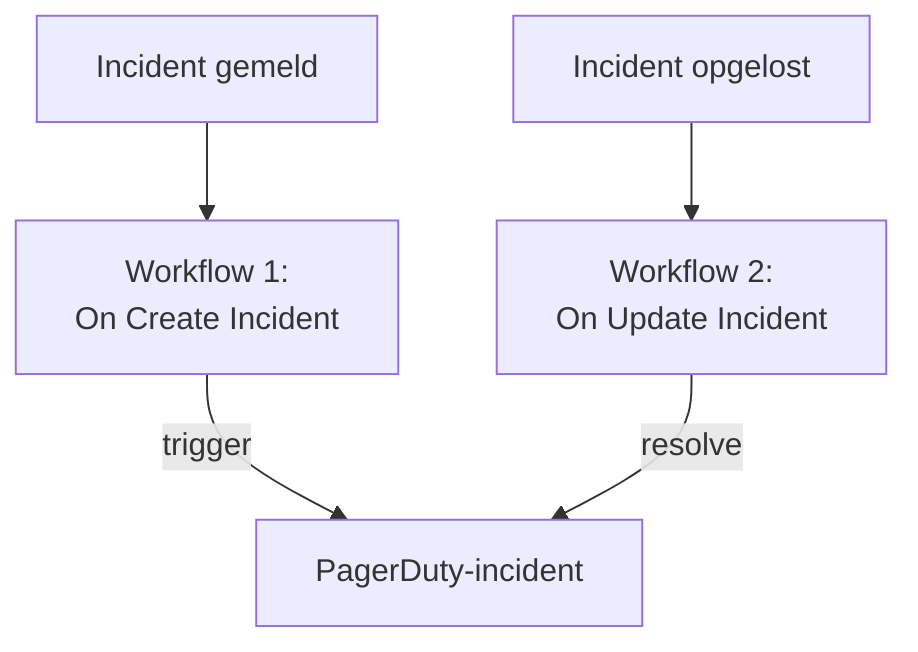

# PagerDuty

Stuur OneUptime-incidenten naar [PagerDuty](https://www.pagerduty.com). Eén workflow start een PagerDuty-incident wanneer een OneUptime-incident wordt gemeld, en een tweede lost het op wanneer het OneUptime-incident is opgelost. Gebruik dit wanneer PagerDuty je team oproept en OneUptime je systemen bewaakt.

:::cards
- [De routing key opslaan](#de-routing-key-opslaan): Houd de sleutel van PagerDuty buiten je workflows.
- [PagerDuty-incidenten starten](#een-pagerduty-incident-starten-voor-elk-incident): Eén workflow, twee blokken.
- [Ze oplossen](#het-pagerduty-incident-oplossen): Een tweede workflow die de status van het incident volgt.
- [Problemen oplossen](#problemen-oplossen): Wanneer PagerDuty een gebeurtenis weigert.
:::

> [!TIP]
> OneUptime roept ook mensen op, met bereikbaarheidsbeleid, roosters en escalatieregels. Om je team van PagerDuty te laten overstappen, zie [Overstappen van PagerDuty](/docs/moving-to-oneuptime/pagerduty): een import haalt je gebruikers, roosters en escalatiebeleid over.

## Hoe het werkt



Beide workflows roepen de [Events API v2](https://developer.pagerduty.com/docs/events-api-v2/overview/) van PagerDuty aan met dezelfde `dedup_key`, gemaakt van de ID van het OneUptime-incident. Aan die sleutel ziet PagerDuty dat de resolve-gebeurtenis het incident sluit dat de trigger-gebeurtenis opende.

## Voordat je begint

- Een PagerDuty-service met een Events API v2-integratie. Open in PagerDuty de service, daarna **Integrations**, klik op **Add an integration** en kies **Events API V2**. Kopieer de **Integration Key**: de Events API noemt die de routing key.
- In OneUptime het recht om workflows en globale variabelen te maken. Op OneUptime Cloud hebben workflows het **Growth**-abonnement of hoger nodig.

## De routing key opslaan

:::steps
1. Ga naar **Workflows → Globale variabelen** en klik op **Workflow Variabele aanmaken**.
2. Noem hem `PAGERDUTY_ROUTING_KEY` en klik op **Volgende**.
3. Plak de integratiesleutel in **Inhoud**, zet **Geheim** aan en klik op **Workflow Variabele aanmaken**.
:::

Een geheime variabele wordt in de uitvoeringslogboeken vervangen door `[REDACTED]`, dus de sleutel verschijnt nooit in een uitvoering.

## Een PagerDuty-incident starten voor elk incident

:::steps
### De workflow maken

Ga naar **Workflows**, klik op **Workflow maken** en daarna op **Vanaf nul beginnen**. Noem hem `Incidents to PagerDuty` en klik op **Workflow maken**.

### De trigger toevoegen

Klik op het gestippelde blok **Kies wat deze workflow start** en kies **On Create Incident**. Klik op de trigger: de **Fields to pass on** ervan beginnen met **Titel**, dus klik op **Veld toevoegen** en kies **Beschrijving**.

### De trigger-gebeurtenis sturen

Klik op **Component toevoegen**, voeg een **API Post (JSON)**-blok toe en verbind de **Success**-punt van de trigger ermee. Stel de **URL** in op `https://events.pagerduty.com/v2/enqueue` en de **Request Body** op:

```json
{
  "routing_key": "{{global.variables.PAGERDUTY_ROUTING_KEY}}",
  "event_action": "trigger",
  "dedup_key": "oneuptime-{{local.components.incident-on-create-1.returnValues.model._id}}",
  "payload": {
    "summary": "{{local.components.incident-on-create-1.returnValues.model.title}}",
    "source": "OneUptime",
    "severity": "critical",
    "custom_details": {
      "description": "{{local.components.incident-on-create-1.returnValues.model.description}}"
    }
  }
}
```

### Testen en daarna aanzetten

Klik op **Workflow uitvoeren**, kies onder **Incident** een testincident en voer hem uit. De stap **API Post (JSON)** toont een `202`-antwoord met `"status": "success"`, en PagerDuty opent een incident. Zet daarna **Ingeschakeld** aan bovenaan de **Bouwer**.
:::

Het blok stuurt JSON, dus het heeft geen `Content-Type`-header nodig. De `severity` van PagerDuty is een van `critical`, `error`, `warning` en `info`: zie [Ernstniveaus toewijzen](#ernstniveaus-toewijzen) om die van elk incident mee te sturen.

## Het PagerDuty-incident oplossen

Een workflow heeft één trigger, dus voor het oplossen is een tweede workflow nodig, die start wanneer de status van een incident verandert.

:::steps
### De trigger On Update Incident toevoegen

Maak een workflow met de naam `Resolve PagerDuty incidents` en kies **On Update Incident** als trigger. Klik in **Fields to watch** op **Veld toevoegen** en kies **Current Incident State**, zodat hij alleen draait wanneer de status verandert. Vraag in **Fields to pass on** of de nieuwe status een opgeloste status is: klik op **Veld toevoegen**, open **Current Incident State** en kies **Is Resolved State**. Of klik op **Bewerken als JSON** en vervang de JSON door:

```json
{ "_id": true, "currentIncidentState": { "isResolvedState": true } }
```

### Controleren dat het incident is opgelost

Voeg na de trigger een **If / Else**-blok toe. Stel **Value to check** in op `{{local.components.incident-on-update-1.returnValues.model.currentIncidentState.isResolvedState}}` en **Comparison** op **is true**.

### De resolve-gebeurtenis sturen

Voeg na de **Yes**-kant een **API Post (JSON)**-blok toe, met dezelfde **URL** en deze **Request Body**:

```json
{
  "routing_key": "{{global.variables.PAGERDUTY_ROUTING_KEY}}",
  "event_action": "resolve",
  "dedup_key": "oneuptime-{{local.components.incident-on-update-1.returnValues.model._id}}"
}
```

### Hem aanzetten

Zet **Ingeschakeld** aan en los daarna in OneUptime een testincident op. PagerDuty lost zijn incident op.
:::

Controleren op `isResolvedState` in plaats van op de naam van een status blijft werken wanneer je je statussen hernoemt. Zie [Incidentstatussen en ernstniveaus](/docs/incidents/states-and-severities).

## Ernstniveaus toewijzen

Om de ernst van elk incident mee te sturen, voeg je tussen de trigger en het **API Post (JSON)**-blok een **Run Custom JavaScript**-blok toe, en lees je het antwoord ervan in de body.

1. Klik in de **Fields to pass on** van de trigger op **Veld toevoegen**, open **Ernst van incident** en kies **Naam**.
2. Stel de **Arguments** van het blok in op `{ "severity": "{{local.components.incident-on-create-1.returnValues.model.incidentSeverity.name}}" }`, en de **JavaScript Code** op:

   ```javascript
   // Your incident severities, by name, to PagerDuty's.
   const SEVERITY = {
     "Critical Incident": "critical",
     "Major Incident": "error",
     "Minor Incident": "warning",
   };

   return { severity: SEVERITY[args.severity] || "info" };
   ```

3. Stel in de body van het verzoek `"severity"` in op `"{{local.components.javascript-1.returnValues.returnValue.severity}}"`.

De namen hierboven zijn de drie ernstniveaus waarmee een nieuw project begint. Gebruik je eigen namen als je ze hebt hernoemd.

## Problemen oplossen

:::details PagerDuty antwoordt 400
De body van het antwoord zegt wat PagerDuty weigerde, en de stap **API Post (JSON)** van de uitvoering toont dat. Meestal is de routing key geen Events API v2-integratiesleutel: kopieer hem opnieuw uit de **Integrations** van de service. Een gebeurtenis zonder `summary`, `source` of `severity` wordt ook geweigerd.
:::

:::details De resolve-gebeurtenis sluit niets
Beide gebeurtenissen moeten precies dezelfde `dedup_key` hebben. Controleer of beide bodies hem opbouwen als `oneuptime-` gevolgd door de `_id` van het incident, en of de resolve-workflow aan staat.
:::

:::details De workflow draait nooit
Controleer of hij aan staat: **Ingeschakeld**, bovenaan zijn **Bouwer**. Open daarna **Logboeken → Uitvoeringen**: een uitvoering die de **No**-kant van het **If / Else**-blok nam, is een update die geen oplossing was.
:::

:::details PagerDuty toont een verwijzing in plaats van een waarde
Een verwijzing die niet kan worden opgelost, wordt verstuurd zoals ze geschreven is, accolades en al. Controleer de identifier van het blok, de veldnaam en de naam van de variabele, die hoofdlettergevoelig is. Op het tabblad **Stappen** van de uitvoering is een instelling met zo'n verwijzing gemarkeerd als **Did not resolve**.
:::

## Volgende stappen

:::cards
- [Overstappen van PagerDuty](/docs/moving-to-oneuptime/pagerduty): Haal je team, roosters en escalatiebeleid over.
- [Escalatieregels](/docs/on-call/escalation-rules): Roep mensen op vanuit OneUptime zelf.
- [Opsgenie](/docs/integrations/opsgenie): Dezelfde twee workflows voor Opsgenie.
- [Overzicht van integraties](/docs/integrations/index): De patronen achter elke integratie.
:::
