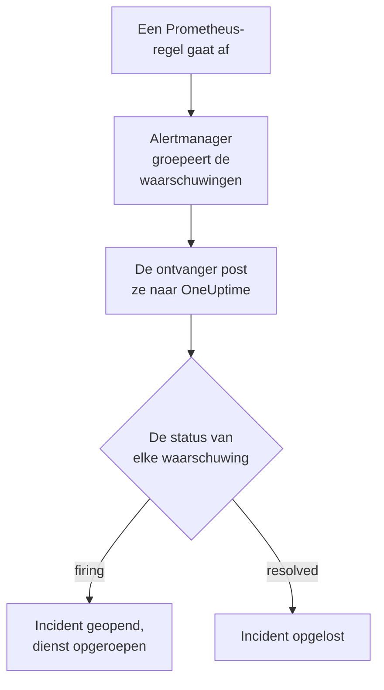

# Prometheus Alertmanager

Stuur waarschuwingen van [Prometheus Alertmanager](https://prometheus.io/docs/alerting/latest/alertmanager/) naar OneUptime, zodat elke afgaande waarschuwing een incident wordt dat je team met dienst oproept en wordt opgelost wanneer de waarschuwing herstelt. Alertmanager post zijn meldingen naar een webhook-ontvanger, dus aan geen van beide kanten hoef je iets te installeren.

:::cards
- [Kiezen hoe OneUptime waarschuwingen ontvangt](#kiezen-hoe-oneuptime-waarschuwingen-ontvangt): Een Incoming Request-monitor of een eigen workflow.
- [Waarschuwingen ontvangen met een monitor](#waarschuwingen-ontvangen-met-een-monitor): Eén incident per waarschuwing, opgelost bij herstel.
- [Alertmanager configureren](#alertmanager-configureren): Een webhook-ontvanger en de route die hem gebruikt.
- [Problemen oplossen](#problemen-oplossen): Wanneer waarschuwingen niet aankomen of incidenten open blijven.
:::

## Hoe het werkt



Prometheus evalueert je waarschuwingsregels en stuurt de waarschuwingen die afgaan naar Alertmanager. Alertmanager groepeert ze op de labels in de `group_by` van je route en post elke groep als één JSON-melding naar de webhook-ontvanger. De lijst `alerts` van de melding bevat elke waarschuwing van de groep, elk met een eigen `status`, `firing` of `resolved`, eigen labels en annotaties, en een `fingerprint` die haar identificeert.

## Voordat je begint

- Een Alertmanager waarvan je `alertmanager.yml` kunt bewerken en die je OneUptime via HTTPS kan bereiken.
- In OneUptime het recht om monitoren aan te maken, of workflows als je die weg kiest.

## Kiezen hoe OneUptime waarschuwingen ontvangt

Stel eerst OneUptime in: dat geeft je de URL waar Alertmanager naartoe stuurt.

| Weg | Gebruik hem als |
| --- | --- |
| Een Incoming Request-monitor (aanbevolen) | Je wilt dat elke waarschuwing een incident is dat de dienst oproept en wordt opgelost wanneer de waarschuwing herstelt. Er valt niets te bouwen. |
| Een workflow met een Webhook-trigger | Je hebt eigen logica nodig: waarschuwingen filteren, ze omvormen of eerst andere systemen aanroepen. Een workflow opent één incident per melding, niet per waarschuwing, en lost het niet op bij herstel. |

Beide krijgen dezelfde JSON van dezelfde ontvanger, dus je kunt met de ene beginnen en later overstappen door één URL in `alertmanager.yml` te wijzigen.

## Waarschuwingen ontvangen met een monitor

Een [Incoming Request-monitor](/docs/monitor/incoming-request-monitor) geeft je een URL, en zijn criteria bepalen wat elke melding doet.

:::steps
### De monitor maken

Ga naar **Monitoren** en klik op **Monitor maken**. Kies **Incoming Request** onder **Monitortype**, noem hem `Alertmanager` en klik op **Volgende**.

### Een incident declareren voor elke afgaande waarschuwing

Open in de stap **Criteria** het eerste criterium, het criterium dat de monitor offline zet. Zet het filter op **Verzoeklichaam**, **Bevat**, `"status":"firing"`. Dit criterium declareert al een incident wanneer het filter overeenkomt. Vul het incident in:

- **Incidenttitel**: `{{requestBody.commonLabels.alertname}} on {{requestBody.commonLabels.instance}}`.
- **Ernst**: de incidenternst die deze waarschuwingen moeten krijgen.
- **Bereikbaarheidsbeleid**, onder **Bereikbaarheid**: het beleid dat moet worden opgeroepen.
- **Incident automatisch oplossen**, onder **Meer velden**: laat het aan, zoals het begint. Zonder dit worden herstelmeldingen genegeerd en blijven incidenten open.

### Eén incident per waarschuwing openen

Open in hetzelfde criterium **Instellingen** en zet **Group incidents and alerts by a payload field** aan. Vul het in zoals hieronder, zodat elke waarschuwing een eigen incident krijgt en haar herstel het oplost:

| Veld | Waarde |
| --- | --- |
| **Open a separate incident for each…** | `requestBody.alerts[*].fingerprint` |
| **Field that signals recovery** | `requestBody.alerts[*].status` |
| **Value that means recovered** | `resolved` |

### De monitor weer online brengen

Open het tweede criterium, het criterium dat de monitor online zet, en zet het filter op **Verzoeklichaam**, **Bevat**, `"status":"resolved"`.

### De URL kopiëren

Klik op **Monitor maken**. De pagina **Overzicht** van de monitor toont zijn **Heartbeat URL**. Kopieer die voor Alertmanager:

```text
https://oneuptime.com/heartbeat/<secret key>
```

Een zelf gehoste installatie heeft een eigen host in plaats van `oneuptime.com`.
:::

`[*]` leest elke waarschuwing van een melding, dus een melding met drie waarschuwingen kan drie incidenten openen, tot **Max incidents per request** (`100`, tenzij je het wijzigt). De eigen `status` van elke waarschuwing bepaalt wat er met haar incident gebeurt: wanneer één waarschuwing van een melding is opgelost en er nog twee afgaan, wordt alleen het incident van de opgeloste waarschuwing gesloten. Zie [Waarschuwingen uit een ander systeem ontvangen](/docs/monitor/incoming-request-monitor#waarschuwingen-uit-een-ander-systeem-ontvangen) voor wat elke instelling doet.

> [!WARNING]
> Groepeer op een waarde die binnen één melding per waarschuwing verschilt. De `fingerprint` van Alertmanager is een hash van de hele labelset van een waarschuwing, dus die verschilt altijd. Een label in de `group_by` van je route verschilt nooit: dat is juist wat de waarschuwingen in één melding zet. Groeperen op `requestBody.alerts[*].labels.alertname` met de route hieronder vouwt elke waarschuwing van een melding samen tot één incident, dat de status van de eerste waarschuwing krijgt.

## De incidenten een naam geven

De titel hierboven leest labels die alle waarschuwingen van de melding delen: `commonLabels` bevat die labels, en `commonAnnotations` de annotaties die ze delen. Met de route hieronder, die groepeert op `alertname` en `instance`, zijn beide aanwezig. Geef het incident onder **Beschrijving** een **Incidentbeschrijving** zoals:

```text
{{requestBody.commonAnnotations.summary}}

{{requestBody.commonAnnotations.description}}
Severity: {{requestBody.commonLabels.severity}}
Alertmanager: {{requestBody.externalURL}}
```

- De groeperingssleutel is ook een variabele, genoemd naar het laatste segment van zijn pad: `{{fingerprint}}`. Het is een hash, dus een responder heeft er niets aan.
- `{{requestBody.alerts[0].annotations.summary}}` leest de eerste waarschuwing van de melding, en dat is niet altijd de waarschuwing waarvoor het incident is geopend.
- Een verwijzing naar een veld dat de melding niet heeft, blijft staan zoals ze geschreven is, accolades en al, in plaats van leeg te worden.

Zie [Incident- en waarschuwingstemplates](/docs/monitor/incident-alert-templating) voor elke variabele die je kunt gebruiken.

## Alertmanager configureren

:::steps
### Een webhook-ontvanger toevoegen

Voeg in `alertmanager.yml` een ontvanger toe die naar de gekopieerde URL stuurt, en maak hem de ontvanger van de route:

```yaml title="alertmanager.yml"
route:
  receiver: oneuptime
  group_by: ["alertname", "instance"]

receivers:
  - name: oneuptime
    webhook_configs:
      - url: "https://oneuptime.com/heartbeat/<secret key>"
        send_resolved: true
```

`send_resolved: true` is de standaard van Alertmanager, uitgeschreven zodat het aan blijft: zonder dit hoort OneUptime nooit dat een waarschuwing is hersteld. Alertmanager stuurt `Content-Type: application/json`, wat de monitor nodig heeft om de velden van een melding te lezen.

### Alertmanager herladen

Herlaad de configuratie, of herstart Alertmanager:

```bash
curl -X POST http://localhost:9093/-/reload
```
:::

De route houdt de standaardtijden van Alertmanager aan. Ze wacht `30s` voordat ze een nieuwe groep stuurt (`group_wait`), `5m` voordat ze een groep met nieuwe waarschuwingen opnieuw stuurt (`group_interval`) en `4h` voordat ze een ongewijzigde melding herhaalt (`repeat_interval`).

## Testen

Stuur OneUptime een melding met twee afgaande waarschuwingen, zoals Alertmanager dat zou doen:

```bash
curl -X POST "https://oneuptime.com/heartbeat/<secret key>" \
  -H "Content-Type: application/json" \
  -d '{
    "version": "4",
    "status": "firing",
    "receiver": "oneuptime",
    "groupLabels": { "alertname": "DiskFull", "instance": "web-1" },
    "commonLabels": { "alertname": "DiskFull", "instance": "web-1", "severity": "critical" },
    "commonAnnotations": { "summary": "Disk almost full on web-1" },
    "externalURL": "http://alertmanager:9093",
    "alerts": [
      {
        "status": "firing",
        "labels": { "alertname": "DiskFull", "instance": "web-1", "severity": "critical", "device": "/dev/sda1" },
        "fingerprint": "a1b2c3d4e5f60001"
      },
      {
        "status": "firing",
        "labels": { "alertname": "DiskFull", "instance": "web-1", "severity": "critical", "device": "/dev/sdb1" },
        "fingerprint": "a1b2c3d4e5f60002"
      }
    ]
  }'
```

Er gaan twee incidenten open, één per `fingerprint`, elk met de titel `DiskFull on web-1`. Stuur hetzelfde verzoek met elke `status` op `resolved`, en beide worden opgelost.

Om het hele pad vanaf Alertmanager te testen, laat je een waarschuwing afgaan met `amtool`. Alertmanager stuurt haar na `group_wait` en stuurt daarna haar herstel wanneer de waarschuwing een paar minuten later verloopt:

```bash
amtool alert add test_alert severity=warning \
  --annotation=summary="Test from Alertmanager" \
  --alertmanager.url=http://localhost:9093
```

## Waarschuwingen ontvangen met een workflow

Gebruik een [workflow](/docs/workflows/index) wanneer je eigen stappen nodig hebt tussen Alertmanager en het incident.

:::steps
### De workflow maken

Ga naar **Workflows**, klik op **Workflow maken** en daarna op **Vanaf nul beginnen**. Noem hem `Alertmanager alerts` en klik op **Workflow maken**.

### De Webhook-trigger toevoegen

Klik op het gestippelde blok **Kies wat deze workflow start** en kies **Webhook**. Klik op de trigger, daarna op **URL kopiëren**, en gebruik die URL in de ontvanger in `alertmanager.yml`.

### Controleren dat de melding afgaat

Klik op **Component toevoegen**, voeg een blok **If / Else** toe en verbind de punt **Out** van de trigger ermee. Zet **Value to check** op `{{local.components.webhook-1.returnValues.request-body.status}}`, **Comparison** op **is equal to** en **Compare with** op `firing`.

### Het incident declareren

Voeg een blok **Create One Incident** toe en verbind de kant **Yes** van het blok **If / Else** ermee. Kies onder **Incident Template** een sjabloon dat de ernst en het bereikbaarheidsbeleid instelt dat moet worden opgeroepen (zie [Incidentsjablonen](/docs/incidents/settings#incidentsjablonen)). Stel onder **JSON Object** in wat van Alertmanager komt:

```json
{
  "title": "{{local.components.webhook-1.returnValues.request-body.commonLabels.alertname}}",
  "description": "{{local.components.webhook-1.returnValues.request-body.commonAnnotations.summary}}\nAlertmanager: {{local.components.webhook-1.returnValues.request-body.externalURL}}"
}
```

Zonder sjabloon moet **JSON Object** ook `incidentSeverityId` bevatten, de ID van een van de incidenternstniveaus van het project.

### De workflow inschakelen

Zet **Ingeschakeld** aan bovenaan de **Bouwer**. Een uitgeschakelde workflow antwoordt Alertmanager met `400`.
:::

Eén run verwerkt één melding, dus hij declareert één incident, hoeveel waarschuwingen de melding ook bevat. Een melding die `resolved` is, neemt de kant **No** van het blok **If / Else**, waar niets is verbonden, dus daar stopt de run. Gebruik de monitor voor één incident per waarschuwing dat bij herstel wordt opgelost.

## Alertmanager zelf bewaken

Geen van beide wegen merkt het wanneer Prometheus of Alertmanager stopt met werken: geen waarschuwingen ontvangen ziet er precies zo uit als alles in orde. Stuur daarom een waarschuwing die altijd afgaat naar een tweede monitor, die een incident declareert wanneer die waarschuwing niet meer aankomt. [kube-prometheus-stack](https://github.com/prometheus-community/helm-charts/tree/main/charts/kube-prometheus-stack) levert zo'n waarschuwing mee, met de naam `Watchdog`. Voeg op een gewone Prometheus een waarschuwingsregel met de naam `Watchdog` toe waarvan de expressie altijd waar is, zoals `vector(1)`.

:::steps
### De watchdog-monitor maken

Maak een tweede Incoming Request-monitor, met de naam `Alertmanager watchdog`. Zet het filter van het eerste criterium, het criterium dat de monitor offline zet, op **Incoming Request**, **Not Recieved In Minutes**, `10`, en het filter van het tweede criterium op **Incoming Request**, **Recieved In Minutes**, `10`. Het dashboard spelt beide zo. Kopieer de **Heartbeat URL** van de nieuwe monitor.

### De watchdog-waarschuwing ernaartoe sturen

Voeg een ontvanger toe voor de URL van de watchdog-monitor, en een route die `Watchdog` er elke vijf minuten naartoe stuurt. Een onderliggende route wordt gecontroleerd vóór de ontvanger van zijn bovenliggende route, dus `Watchdog` gaat naar de watchdog-monitor en alle andere waarschuwingen gaan nog steeds naar de eerste:

```yaml title="alertmanager.yml"
route:
  receiver: oneuptime
  group_by: ["alertname", "instance"]
  routes:
    - receiver: oneuptime-watchdog
      matchers:
        - alertname = "Watchdog"
      group_wait: 0s
      group_interval: 5m
      repeat_interval: 5m

receivers:
  - name: oneuptime
    webhook_configs:
      - url: "https://oneuptime.com/heartbeat/<secret key>"
        send_resolved: true
  - name: oneuptime-watchdog
    webhook_configs:
      - url: "https://oneuptime.com/heartbeat/<watchdog secret key>"
```
:::

Wanneer de watchdog-waarschuwing tien minuten niet is aangekomen, gaat de watchdog-monitor offline en declareert hij een incident. De volgende watchdog-melding brengt de monitor weer online en lost het incident op.

## Problemen oplossen

:::details Er komt niets aan in OneUptime
- Zoek in het log van Alertmanager naar fouten bij het afleveren aan de ontvanger.
- De monitor antwoordt meteen `200`, voordat hij iets controleert, ook bij een verkeerde geheime sleutel. Kijk in de tijdlijn van de monitor of meldingen aankomen.
- Een uitgeschakelde workflow antwoordt `400`. Zet **Ingeschakeld** aan bovenaan de **Bouwer** ervan.
:::

:::details Incidenten gaan open maar worden nooit opgelost
- Controleer dat geen enkele ontvanger `send_resolved: false` instelt: dan stuurt Alertmanager nooit een herstel.
- Het incident van het criterium heeft **Incident automatisch oplossen** nodig, onder **Meer velden**.
- **Field that signals recovery** moet `requestBody.alerts[*].status` zijn, en **Value that means recovered** precies `resolved`. De vergelijking is hoofdlettergevoelig.
- Waarschuwingen van een melding boven **Max incidents per request** worden helemaal niet gelezen, dus hun herstel gaat ook verloren.
- Een herstel dat in een uitbarsting is overgeslagen (zie hieronder) laat zijn incident voorgoed open: Alertmanager herhaalt afgaande waarschuwingen, maar nooit een herstel. Los zo'n incident met de hand op.
:::

:::details Er gaat geen incident open
De groeperingspaden moeten met `requestBody.` beginnen, en alleen de eerste `[*]` in een pad leest een lijst. Een pad dat een van beide regels breekt, komt nergens mee overeen, zonder foutmelding.
:::

:::details Eén incident voor een melding vol waarschuwingen
Je hebt gegroepeerd op een label dat voor elke waarschuwing van een melding hetzelfde is, meestal een label uit de `group_by` van je route. Groepeer in plaats daarvan op `requestBody.alerts[*].fingerprint`.
:::

:::details Het incident toont een verwijzing in plaats van een waarde
Een verwijzing naar een veld dat de melding niet heeft, blijft staan zoals ze geschreven is, accolades en al. Regels zetten verschillende annotaties, dus gebruik de velden die jouw regels zetten: in `commonAnnotations`, of in de `annotations` van elke waarschuwing.
:::

:::details Te veel incidenten
Groepeer je route op minder labels, of verhoog `group_interval`, zodat Alertmanager samenhangende waarschuwingen samen stuurt. Een lagere **Max incidents per request** beperkt de incidenten van één melding, maar waarschuwingen boven de grens worden niet gelezen, dus hun herstel gaat ook verloren.
:::

:::details Meldingen worden tijdens een uitbarsting overgeslagen
Wanneer een nieuwer verzoek een monitor bereikt voordat een eerder verzoek is geëvalueerd, evalueert OneUptime alleen het nieuwste, zodat één afzender een monitor niet kan overspoelen. De laatste melding van een uitbarsting wordt altijd geëvalueerd, maar een eerdere over andere waarschuwingen kan worden overgeslagen, omdat Alertmanager elke groep naar dezelfde URL stuurt. Verhoog `group_wait` en `group_interval` om de meldingen te spreiden. Zet op een zelf gehoste installatie `INCOMING_REQUEST_INGEST_COALESCE_ENABLED=false` in de omgeving van de OneUptime-app om elk verzoek te evalueren.
:::

## Beveiliging

- **Behandel de URL als een wachtwoord.** Iedereen die hem heeft, kan incidenten openen. Lekt hij uit, stel hem dan opnieuw in: **Geheime sleutel voor inkomende aanvraag opnieuw instellen** op de pagina **Instellingen** van de monitor, of **URL opnieuw instellen** in de **Webhook**-trigger van de workflow. Werk daarna de `url` van de ontvanger in `alertmanager.yml` bij.
- **Zelf gehost?** Laat Alertmanager je OneUptime via HTTPS door je firewall bereiken.

## Volgende stappen

:::cards
- [Inkomende-verzoek-monitor](/docs/monitor/incoming-request-monitor): Elke instelling van de monitor die je waarschuwingen ontvangt.
- [Grafana](/docs/integrations/grafana): Dezelfde opzet, voor Grafana-waarschuwingen.
- [Escalatieregels](/docs/on-call/escalation-rules): Bepaal wie een bereikbaarheidsbeleid oproept, en wanneer.
- [Overzicht van integraties](/docs/integrations/index): De andere tools die je kunt koppelen.
:::
