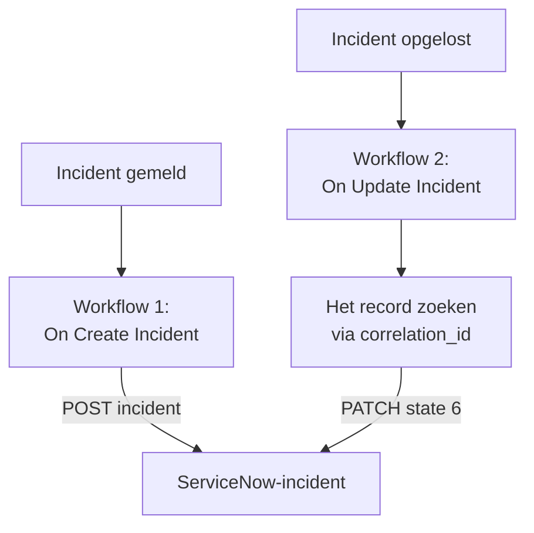

# ServiceNow

Open een [ServiceNow](https://www.servicenow.com)-incident voor elk OneUptime-incident en los het op wanneer het OneUptime-incident is opgelost, zodat je servicedesk volgt wat je monitoring ziet. Twee workflows roepen de [Table API](https://developer.servicenow.com/dev.do#!/reference/api/latest/rest/c_TableAPI) van ServiceNow aan.

:::cards
- [De inloggegevens opslaan](#de-inloggegevens-opslaan): Houd het ServiceNow-wachtwoord buiten je workflows.
- [ServiceNow-incidenten openen](#een-servicenow-incident-openen-voor-elk-incident): Eén workflow, twee blokken.
- [Ze oplossen](#het-servicenow-incident-oplossen): Het record zoeken en daarna sluiten.
- [Problemen oplossen](#problemen-oplossen): Wanneer ServiceNow een verzoek weigert.
:::

## Hoe het werkt



De eerste workflow schrijft de ID van het OneUptime-incident in de `correlation_id` van het record. De tweede zoekt het record via die ID en lost het daarna op.

## Voordat je begint

- Een ServiceNow-instantie, zoals `https://your-instance.service-now.com`.
- Een ServiceNow-gebruiker voor de integratie die records in de tabel `incident` kan aanmaken en bijwerken, meestal met de rol `itil`. Zijn naam en wachtwoord ondertekenen de verzoeken.
- In OneUptime het recht om workflows en globale variabelen te maken. Op OneUptime Cloud hebben workflows het **Growth**-abonnement of hoger nodig.

## De inloggegevens opslaan

De Table API accepteert Basic-authenticatie: de naam en het wachtwoord van de gebruiker, samen gecodeerd.

:::steps
1. Codeer ze één keer, op macOS of Linux:

   ```bash
   printf '%s' 'integration.user:password' | base64 | tr -d '\n'
   ```

   Gebruik `printf`, niet `echo`: `echo` voegt een regeleinde toe, dat samen met de rest wordt gecodeerd en de inloggegevens ongeldig maakt.

2. Ga in OneUptime naar **Workflows → Globale variabelen** en klik op **Workflow Variabele aanmaken**. Noem hem `SERVICENOW_AUTH` en klik op **Volgende**.
3. Plak de gecodeerde waarde in **Inhoud**, zet **Geheim** aan en klik op **Workflow Variabele aanmaken**.
:::

## Een ServiceNow-incident openen voor elk incident

:::steps
### De workflow maken

Ga naar **Workflows**, klik op **Workflow maken** en daarna op **Vanaf nul beginnen**. Noem hem `Incidents to ServiceNow` en klik op **Workflow maken**.

### De trigger toevoegen

Klik op het gestippelde blok **Kies wat deze workflow start** en kies **On Create Incident**. Klik op de trigger: de **Fields to pass on** ervan beginnen met **Titel**, dus klik op **Veld toevoegen** en kies **Beschrijving**.

### Het record aanmaken

Klik op **Component toevoegen**, voeg een **API Post (JSON)**-blok toe en verbind de **Success**-punt van de trigger ermee. Stel de **URL** in op `https://your-instance.service-now.com/api/now/table/incident`. Stel onder **Meer velden** de **Request Headers** in op:

```json
{
  "Authorization": "Basic {{global.variables.SERVICENOW_AUTH}}",
  "Accept": "application/json"
}
```

En de **Request Body** op:

```json
{
  "short_description": "OneUptime: {{local.components.incident-on-create-1.returnValues.model.title}}",
  "description": "{{local.components.incident-on-create-1.returnValues.model.description}}",
  "urgency": "1",
  "impact": "1",
  "correlation_id": "oneuptime-{{local.components.incident-on-create-1.returnValues.model._id}}"
}
```

### Testen en daarna aanzetten

Klik op **Workflow uitvoeren**, kies onder **Incident** een testincident en voer hem uit. De stap **API Post (JSON)** toont een `201`-antwoord met het nieuwe record, met zijn `sys_id` en zijn `number`, zoals `INC0012345`. Zet daarna **Ingeschakeld** aan bovenaan de **Bouwer**.
:::

`urgency` en `impact` nemen `1` voor hoog, `2` voor gemiddeld en `3` voor laag, en ServiceNow leidt de prioriteit uit die twee af. Elke andere kolom van de tabel `incident` kan in de body, onder zijn kolomnaam.

## Het ServiceNow-incident oplossen

Een workflow heeft één trigger, dus voor het oplossen is een tweede workflow nodig, die start wanneer de status van een incident verandert.

:::steps
### De trigger On Update Incident toevoegen

Maak een workflow met de naam `Resolve ServiceNow incidents` en kies **On Update Incident** als trigger. Klik in **Fields to watch** op **Veld toevoegen** en kies **Current Incident State**, zodat hij alleen draait wanneer de status verandert. Vraag in **Fields to pass on** of de nieuwe status een opgeloste status is: klik op **Veld toevoegen**, open **Current Incident State** en kies **Is Resolved State**. Of klik op **Bewerken als JSON** en vervang de JSON door:

```json
{ "_id": true, "currentIncidentState": { "isResolvedState": true } }
```

### Controleren dat het incident is opgelost

Voeg na de trigger een **If / Else**-blok toe. Stel **Value to check** in op `{{local.components.incident-on-update-1.returnValues.model.currentIncidentState.isResolvedState}}` en **Comparison** op **is true**.

### Het record zoeken

Voeg na de **Yes**-kant een **API Get (JSON)**-blok toe, met dezelfde **Request Headers** en deze **URL**:

```text
https://your-instance.service-now.com/api/now/table/incident?sysparm_query=correlation_id=oneuptime-{{local.components.incident-on-update-1.returnValues.model._id}}&sysparm_fields=sys_id&sysparm_limit=1
```

### Het record oplossen

Voeg na de **Success** van het zoekblok een **API Patch (JSON)**-blok toe, met dezelfde **Request Headers** en deze **URL**:

```text
https://your-instance.service-now.com/api/now/table/incident/{{local.components.api-get-1.returnValues.response-body.result[0].sys_id}}
```

Stel de **Request Body** in op:

```json
{
  "state": "6",
  "close_code": "Solution provided",
  "close_notes": "Resolved in OneUptime"
}
```

### Hem aanzetten

Zet **Ingeschakeld** aan en los daarna in OneUptime een testincident op. Het ServiceNow-incident ervan gaat naar Resolved.
:::

`state` `6` is Resolved in de standaard incidentstatussen van ServiceNow. `close_code` moet een van de oplossingscodes van je instantie zijn. Veel instanties lossen een incident niet op zonder oplossingscode en notities, dus stuur ze allebei mee.

## Problemen oplossen

:::details ServiceNow antwoordt 401
De inloggegevens kloppen niet. Codeer `username:password` opnieuw met `printf`, niet `echo`, en vervang de inhoud van `SERVICENOW_AUTH`.
:::

:::details ServiceNow antwoordt 403
De gebruiker mag niet schrijven naar de tabel `incident`. Geef hem de rol `itil`, of een rol met dezelfde rechten, en controleer of geen toegangsregel de Table API voor hem blokkeert.
:::

:::details ServiceNow antwoordt 400, of het oplossen verandert niets
Een kolomnaam of een waarde past niet bij je instantie: een aangepaste `state`-lijst, of een `close_code` die je instantie niet heeft. Vergelijk met de tabel `incident` onder **System Definition → Tables** in ServiceNow, en met het formulier van het record zelf.
:::

:::details Het oplossen antwoordt 404
De zoekstap vond geen record, dus de URL hield de verwijzing zoals die geschreven is. Controleer of de eerste workflow `correlation_id` schreef, en of beide workflows hem op dezelfde manier opbouwen: `oneuptime-` gevolgd door de `_id` van het incident.
:::

## Volgende stappen

:::cards
- [Jira](/docs/integrations/jira): Een tweerichtingsintegratie, bijgehouden door kant-en-klare sjablonen.
- [Workflow-componenten](/docs/workflows/components#api): Elke instelling van de API-blokken.
- [Workflow-uitvoeringen](/docs/workflows/runs-and-logs): Lees wat elk verzoek verstuurde en terugkreeg.
- [Overzicht van integraties](/docs/integrations/index): De patronen achter elke integratie.
:::
