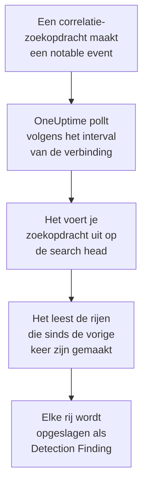

# Splunk Enterprise Security

Importeer de notable events die de correlatiezoekopdrachten van [Splunk Enterprise Security](https://www.splunk.com/en_us/products/enterprise-security.html) maken in de beveiligingsgebeurtenissen van OneUptime. Daar doorzoek je ze naast je logs, traces en metrics, correleer je ze met elke andere bron en roep je de dienstdoende op voor de events die ertoe doen. OneUptime leest ze door een zoekopdracht op je search head uit te voeren, als een Splunk-gebruiker die je zelf maakt, en wijzigt niets in Splunk. Omdat het gewoon een zoekopdracht is, importeert het elke index of de uitvoer van elke opgeslagen zoekopdracht, niet alleen notable events.

:::cards
- [De verbinding instellen](#de-verbinding-instellen): Een token, een rol en het formulier van de verbinding.
- [Wat er wordt geïmporteerd](#wat-er-wordt-geïmporteerd): Hoe elke rij van de zoekopdracht een beveiligingsgebeurtenis wordt.
- [Hoe pollen werkt](#hoe-pollen-werkt): Het venster dat elke poll leest, en wat een drukke search head daarmee doet.
- [Problemen oplossen](#problemen-oplossen): Wat elke fout betekent en wat je moet wijzigen.
:::

## Hoe het werkt



Elke minuut pollt OneUptime elke ingeschakelde verbinding waarvan het pollinterval is verstreken. Een poll voert je zoekopdracht uit via de REST API van de search head, over de rijen die sinds de vorige poll zijn gemaakt, en slaat elke rij op als een [OCSF](https://schema.ocsf.io/) Detection Finding-gebeurtenis (klasse `2004`). Detectieregels, monitoren en dashboards behandelen hem daarna als een beveiligingsgebeurtenis uit elke andere bron.

## Voordat je begint

- In OneUptime de rol Project Owner, Project Admin of Security Admin. Security Member en Security Viewer zien verbindingen en hun runhistorie, maar kunnen ze niet wijzigen.
- Een search head met Splunk Enterprise 9.0.1 of hoger, of Splunk Cloud Platform. OneUptime praat met de REST API ervan op de beheerpoort, meestal `8089`. Splunk Web, op poort `8000`, biedt de REST API niet aan.
- Een Splunk-gebruiker voor OneUptime, met een rol die de capability `search` heeft en de index kan lezen die de zoekopdracht leest: `notable` voor notable events. De rollen `ess_analyst` en `ess_user` van Enterprise Security geven allebei. De verbinding leest alleen, dus de rol heeft verder niets nodig.
- Een search head die OneUptime via HTTPS kan bereiken. OneUptime Cloud maakt verbinding vanaf het internet, dus de search head heeft een openbaar adres nodig: privéadressen worden geweigerd. Een zelf gehoste OneUptime maakt verbinding vanuit zijn app- en workercontainers, en kan een search head op je privénetwerk bereiken, tenzij `DATA_SOURCE_BLOCK_PRIVATE_ADDRESSES` `true` is.

## De verbinding instellen

De verbinding authenticeert met een Splunk-authenticatietoken, of met een gebruikersnaam en een wachtwoord.

:::steps
### Een authenticatietoken maken

1. Open in Splunk Web **Settings → Tokens**. Als Splunk zegt dat tokenauthenticatie is uitgeschakeld, selecteer dan eerst **Enable Token Authentication**.
2. Selecteer **New Token**. Vul bij **User** de Splunk-gebruiker in die voor OneUptime is gemaakt, en zeg bij **Audience** waarvoor het token dient, bijvoorbeeld `OneUptime security events`.
3. Kies een **Expiration**, of geen. Een token dat verloopt, stopt de verbinding tot je het vervangt.
4. Selecteer **Create** en kopieer het token. Splunk toont het maar één keer.

Wil je in plaats daarvan met een wachtwoord authenticeren, sla deze stap dan over en houd de naam en het wachtwoord van de gebruiker bij de hand.

### De verbinding toevoegen in OneUptime

Open **Producten → Security Events → Verbindingen** (`/dashboard/{projectId}/security-events/connections`), klik op **Verbinding toevoegen**, kies **Splunk Enterprise Security** en klik op **Volgende**. Vul de instellingen uit de tabel hieronder in, klik op **Volgende** en plak het token in **Authentication token**, of het wachtwoord in **Wachtwoord**.

### Testen voordat je opslaat

Klik op **Deze instellingen testen** onder **Testen voor het opslaan**. De test authenticeert en voert je zoekopdracht uit met de waarden in het formulier, en slaat niets op, dus een verkeerde poort of een ontbrekende rol komt aan het licht voordat de verbinding bestaat. Klik daarna op **Volgende**, geef de verbinding een **Naam** en maak haar aan.
:::

| Instelling | Wat je invult |
| --- | --- |
| **Splunk management URL** | De REST API van de search head, bijvoorbeeld `https://splunk.example.com:8089`. Hij moet `https` gebruiken, zonder querystring. Een pad blijft behouden, voor een reverse proxy die de API onder een pad aanbiedt. |
| **Zoeken** | De zoekopdracht die kiest wat er wordt geïmporteerd, `index=notable` zolang je hem niet wijzigt. Beperk hem, bijvoorbeeld met `index=notable urgency IN (high, critical)`. OneUptime voegt het tijdsbereik zelf toe, dus de zoekopdracht kan `earliest` en `latest` niet instellen en niet met een pipe beginnen. Een `search` vooraan wordt weggehaald. |
| **Gebruikersnaam** | De naam van de Splunk-gebruiker, alleen als die met een wachtwoord authenticeert. |
| **Authentication token** | Het token uit de eerste stap. Wanneer er een token is opgeslagen, wordt dat gebruikt, en niet de gebruikersnaam of het wachtwoord. |
| **Wachtwoord** | Het wachtwoord van de Splunk-gebruiker, alleen wanneer er geen token wordt gebruikt. |

**Authentication token** en **Wachtwoord** worden versleuteld, nooit door de API teruggegeven en nooit opnieuw getoond. Vervang er een met **Inloggegevens bijwerken** bij de verbinding. Om van de ene authenticatie naar de andere over te stappen, vul je daar de nieuwe in en zet je **Remove the stored Authentication token** of **Remove the stored Password** aan.

De stap **Opvragen** heeft ook een optionele **Beschrijving**, het **Opvraaginterval (minuten)**, een geheel getal van `1` tot `1440` dat begint op `5`, en **Ingeschakeld**, dat aan begint.

## Wat er wordt geïmporteerd

Elke rij die de zoekopdracht teruggeeft, wordt een Detection Finding-gebeurtenis (OCSF-klasse `2004`), met leverancier `Splunk` en product `Splunk Enterprise Security`. Voor een notable event:

| Splunk-veld | OneUptime-kolom |
| --- | --- |
| `event_id`, anders `_bkt` en `_cd`, anders een hash van de rij | Gebeurtenis-UID, waarop ook duplicaten worden verwijderd |
| `_time`, wanneer de correlatiezoekopdracht het notable event maakte | Tijd van de gebeurtenis |
| `rule_name`, anders `search_name`, anders `source` | Regelnaam |
| `search_name`, anders `source`, anders `rule_name` | Regel-ID |
| `rule_title`, anders `rule_description`, anders de regelnaam | Bericht |
| `urgency`, anders `severity` | Ernst |
| `status_label`, anders `status_description`, anders de naam van de beoordelingsstatus die `status` bevat | Status |
| `annotations.mitre_attack`, en velden zoals `mitre_technique_id` en `mitre_tactic` | MITRE ATT&CK-tactieken en -technieken |
| `user` of `src_user`; `src`, `src_ip` of `src_host`; `process`, `process_name` of `parent_process` | Gebruiker, IP, host en proces van de actor |
| `process_name` of `process_exec`, `process_path` en `process`; `parent_process_name` of `parent_process_exec`, `parent_process_path` en `parent_process` | Naam, pad en opdrachtregel van het proces; naam, pad en opdrachtregel van het bovenliggende proces |
| `dest_user`; `dest`, `dest_ip` of `dest_host`; `dest_port` | Gebruiker, IP, host en poort van het doel |
| `file_path`, `url` of `risk_object` | Doelresource |
| Elke gebruiker, host en IP, plus `dvc`, `host`, `file_hash`, `file_name`, `url`, `domain`, `query` en `risk_object` | Observables |
| Elk veld van de rij, bijvoorbeeld `security_domain`, `owner`, `orig_sid` en `_raw` | `attributes`, onder de eigen naam van het veld |

Een rij uit een andere index wordt op dezelfde manier geïmporteerd. De kolommen die haar velden niet vullen, blijven leeg, en elk veld blijft doorzoekbaar in `attributes`.

## Hoe pollen werkt

Elke poll voert een exportzoekopdracht uit over zijn venster, de oudste eerst:

```text
POST {Splunk management URL}/services/search/v2/jobs/export
    search=search index=notable | fields * | sort 0 _time | head 10001
    earliest_time={window start}
    latest_time={window end}
    output_mode=json
```

- **De aanmaaktijd is de cursor.** Het venster gaat over `_time`, wat voor een notable event het moment is waarop de correlatiezoekopdracht het maakte, niet wanneer de gevonden activiteit plaatsvond. Een zoekopdracht die elk uur draait, dateert haar notable events op het tijdstip van haar run, dus er valt er geen achter de cursor.
- **De eerste poll kijkt 24 uur terug**, zodat een nieuwe verbinding meteen haar recente notable events toont.
- **Elke volgende poll begint 1 minuut voor de opgeslagen cursor**, zodat een rij die op de grens van twee vensters is gemaakt nooit wordt gemist.
- **Een poll leest hooguit 24 uur voorbij de cursor.** Een verbinding waarvan de cursor achterliep, haalt de achterstand in met een reeks vensters van 24 uur, en haar **Gezondheid** toont **Catching up**.
- **Duplicaten worden verwijderd op `event_id`**, of op de eigen `_bkt` en `_cd` van Splunk, binnen het project, zodat de overlap, een herhaald venster en een import een rij nooit twee keer opslaan.

Een search head van vóór 9.0.1 antwoordt `404` op het verzoek aan `search/v2/jobs/export`. OneUptime stuurt het dan naar het verouderde `search/jobs/export`, en de run zegt dat in een waarschuwing. Werk de search head bij: huidige versies schakelen dat endpoint uit.

### Wanneer een venster meer bevat dan één poll kan lezen

Een poll leest hooguit 10.000 rijen. Wanneer een venster er meer bevat, is de run **Gedeeltelijk**, met een waarschuwing zoals:

```text
Stopped after collecting 10000 records; the window holds more. Records are read oldest first, and the last one read was created at 2026-09-14T08:12:44.000Z, where the next poll can resume.
```

De zoekopdracht sorteert het venster op `_time`, de oudste eerst, dus OneUptime zet de cursor op de aanmaaktijd van de laatst gelezen rij, en de volgende poll begint daar met dezelfde vensterlengte. Een drukke search head haalt zo 10.000 rijen per poll in, in plaats van steeds dezelfde opnieuw te lezen. De rijen die op hetzelfde moment zijn gemaakt, worden twee keer gelezen, en de duplicaatcontrole verwijdert de tweede kopie. Splunk sorteert het hele venster voordat het een rij teruggeeft, dus een zoekopdracht in **Zoeken** die veel meer vindt dan nodig, maakt elke poll trager. Houd haar gericht.

Wanneer een run helemaal niet voorbij de opgeslagen cursor komt, maakt OneUptime het venster in plaats daarvan korter:

1. **Verkleinen.** De volgende poll leest een venster dat half zo lang is, vanaf hetzelfde beginpunt, en blijft halveren tot een venster volledig wordt gelezen, tot één minuut. De waarschuwing van de run zegt het: `This window holds more records than one poll can read; the next poll reads a {n} minute window from the same starting point.`
2. **Weer groeien.** Nadat een venster volledig is gelezen, is het volgende weer twee keer zo lang, tot 24 uur.
3. **Voorbij één minuut gaan.** Als zelfs één minuut meer bevat dan een poll kan lezen, gaat het pollen eraan voorbij, zodat nieuwere notable events blijven binnenkomen. De run blijft **Gedeeltelijk**, en **Laatste fout** luidt `More records were created in the one minute from {cursor} to {end} than one poll can read. Polling moved past this minute so newer records keep arriving; use Import this time range in Diagnostics on this minute to recover what one run can read.` Importeer die minuut met **Import this time range** om terug te halen wat één run kan lezen.

Een run die volledig mislukt, met een fout van Splunk, behoudt de cursor en de vensterlengte, en de volgende poll leest hetzelfde venster opnieuw. De enige uitzondering is een verzoek dat een time-out kreeg: de cursor blijft staan, maar het volgende venster is half zo lang, omdat een venster dat te zwaar is om op tijd te beantwoorden bij elke poging een time-out zou krijgen. Het **Opvraaginterval (minuten)** wijzigen verandert hier niets aan: het bepaalt hoe vaak een poll begint, niet waar zijn venster begint.

### Uitvoeren, bekijken en importeren op verzoek

Klik op **Diagnose** bij een verbinding om haar recente runs te zien en er met de hand mee te werken. Iedereen die de verbinding kan wijzigen, kan deze acties starten; iedereen die haar kan zien, kan de historie lezen.

- **Nu uitvoeren** start meteen een poll, met de gewone cursor, ook als de verbinding niet **Ingeschakeld** is.
- **Preview notable events** leest een tijdsbereik van maximaal 7 dagen en importeert niets.
- **Import this time range** importeert een bereik van maximaal 7 dagen, nadat je bevestigt, zonder de cursor te verplaatsen. Al geïmporteerde rijen worden overgeslagen.
- **Copy diagnostics** bij een run kopieert het rapport ervan voor support. Het bevat nooit referenties.

## Verbinding testen

**Verbinding testen** op de rij van een verbinding, en **Deze instellingen testen** in het formulier, draaien in het API-proces, niet in een achtergrondworker, zodat een test ook antwoordt wanneer de workers het probleem zijn. Hij voert deze controles uit, in volgorde:

| Controle | Wat ze controleert |
| --- | --- |
| **Configuratie** | Elke instelling is aanwezig en goed gevormd. Er wordt niets benaderd als dit mislukt. |
| **Authenticate with Splunk** | Splunk accepteert het token, of de gebruikersnaam en het wachtwoord, en noemt de gebruiker en zijn rollen, zodat je ze kunt vergelijken met de rol die je wilde toekennen. |
| **Run the search on Splunk** | De zoekopdracht uit **Zoeken** draait over de laatste 24 uur, voor één rij, en zegt welk export-endpoint antwoordde. |
| **Notable events available to import** | Hoeveel rijen de zoekopdracht uit **Zoeken** vindt in de laatste 24 uur en de laatste 7 dagen. Geen in 7 dagen is een waarschuwing, geen fout. |
| **Background workers**, **Poll scheduler**, **Security event storage** | De kant van OneUptime zelf: een proces neemt de jobs van de Worker-wachtrij af, de poll-job draait elke minuut en de opslag van beveiligingsgebeurtenissen antwoordt. |
| **Scheduled polling** | Voor een opgeslagen verbinding: pollen staat aan, geen run zit vast in afwachting van een worker en polls draaien op tijd. |

Elk verzoek in een test heeft een deadline van 20 seconden. Een test importeert nooit iets en verplaatst nooit de cursor, en elke mislukte controle zegt wat je moet wijzigen.

## Beveiligingsgebeurtenissen naar Splunk sturen

OneUptime kan wat het vindt ook naar Splunk sturen, via de HTTP Event Collector (HEC), zodat je zoekopdrachten en dashboards de detecties van OneUptime naast die van jezelf zien. Elke beveiligingsgebeurtenis is één HEC-gebeurtenis met de sourcetype `oneuptime:security`, met velden die heten zoals het Common Information Model van Splunk ze noemt: `src`, `src_ip`, `src_user`, `dest`, `dest_ip`, `dest_port`, `user`, `signature` en `severity`.

:::steps
### Een HEC-token maken

Open in Splunk Web **Settings → Data inputs → HTTP Event Collector** en klik op **New Token**. Geef het een naam, kies de indexen waarin het mag schrijven en de standaardindex, en kopieer de waarde van het token. Op Splunk Cloud luistert HEC op `https://http-inputs-<stack>.splunkcloud.com`; op Splunk Enterprise op poort `8088` zodra **Global Settings** tokens aanzet.

### De bestemming toevoegen

Open **Producten → Security Events → Verbindingen**. Klik onder **Naar uw SIEM sturen** op **Bestemming toevoegen**, kies Splunk onder **SIEM** en klik op **Volgende**. Vul de **HEC-URL** in en plak het token in **HEC-token**. **Index** en **Brontype** zijn optioneel: leeg gelaten gaan gebeurtenissen naar de standaardindex van het token met de sourcetype `oneuptime:security`.

### Een testgebeurtenis verzenden en beginnen met verzenden

Klik op **Testgebeurtenis verzenden**: één informatieve gebeurtenis gaat met de instellingen van het formulier naar Splunk, en er wordt niets opgeslagen. Zoek haar met `sourcetype="oneuptime:security"`. Laat daarna onder **Wat te verzenden** de keuze **Alleen detecties** staan of kies **Alle beveiligingsgebeurtenissen**, en klik op **Beginnen met verzenden**.
:::

- De **HEC-URL** moet `https` gebruiken, met een certificaat dat OneUptime vertrouwt: certificaatcontroles worden nooit overgeslagen.
- Gebeurtenissen gaan in batches van maximaal 500. Een gebeurtenis die Splunk weigert, wordt weggelaten en genoemd in **Fout bekijken**, een drukke collector (`503`) wordt opnieuw geprobeerd, en een geweigerd token of een geweigerde index stopt het verzenden totdat je het oplost.
- Notable events die OneUptime uit Splunk heeft geïmporteerd, worden nooit naar Splunk teruggestuurd.

## Problemen oplossen

De **Laatste fout** van de verbinding bewaart de volledige foutmelding, met referenties gemaskeerd, achter een voorvoegsel dat de mislukte stap noemt. Wanneer een verbinding een fout heeft, selecteer je **Fout bekijken** in haar kolom **Acties** om hem te lezen, en **Fout kopiëren** in het dialoogvenster om hem te kopiëren. Lees eerst het voorvoegsel.

:::details Last Error begint met `Splunk Enterprise Security authentication request`
- `Splunk Enterprise Security authentication request failed (HTTP ...)`: Splunk weigerde te zeggen wie de aanroeper is.
  - `HTTP 401`: Splunk accepteerde de referenties niet. Het token is fout, verlopen of verwijderd, tokenauthenticatie is uitgeschakeld op de search head, of de gebruikersnaam of het wachtwoord is fout. Maak een nieuw token en sla het op met **Inloggegevens bijwerken**.
  - `HTTP 404`: de **Splunk management URL** is niet de REST API. Hij wijst naar Splunk Web op poort `8000`, of heeft een pad dat de search head niet aanbiedt.
- `Splunk Enterprise Security authentication request returned ...`: iets anders dan de REST API van de search head antwoordde, zoals de HTML van Splunk Web op poort `8000` of de pagina van een proxy. Laat de URL naar de beheerpoort wijzen.
:::

:::details Last Error begint met `Splunk Enterprise Security search export` of `Splunk Enterprise Security count search`
- `Splunk Enterprise Security search export failed (HTTP ...)`: Splunk weigerde de zoekopdracht uit te voeren.
  - `HTTP 400`: Splunk kan de zoekopdracht niet ontleden. Voer de zoekopdracht uit **Zoeken** uit in Splunk Web om de fout te lezen.
  - `HTTP 403`: de rol van de gebruiker mist de capability `search`, of kan de index niet lezen. Voeg `notable`, of je index, toe aan de indexen die de rol mag doorzoeken.
  - `HTTP 404`: geen van beide export-endpoints bestaat op die URL, dus het is niet de beheerpoort van een search head.
  - `HTTP 429` of `HTTP 5xx`: Splunk beperkt de gebruiker, is overbelast, of de zoekopdracht liep tegen een van haar limieten aan. De volgende poll probeert het opnieuw.
- `Splunk Enterprise Security search export was rejected by Splunk on an HTTP 200`: Splunk antwoordde, maar stopte de zoekopdracht met een fout. Het bericht citeert die.
- `Splunk Enterprise Security search export returned a body that is not newline-delimited JSON.`: iets anders dan de REST API antwoordde, zoals Splunk Web of de aanmeldpagina van een proxy. Dit wordt gemeld in plaats van als leeg venster opgevat, zodat de cursor nooit voorbij rijen gaat die niemand heeft gelezen.
- `Splunk Enterprise Security count search ...`: dezelfde fouten, uit de telling van **Notable events available to import**, die alleen een test uitvoert.
:::

:::details Last Error eindigt op `did not complete`
`Splunk Enterprise Security search export did not complete`, en hetzelfde voor de andere stappen, betekent dat het verzoek geen antwoord kreeg: een time-out, een naam die niet wordt omgezet, een certificaat dat OneUptime niet vertrouwt, of een geweigerd privéadres. Controleer of de OneUptime-app en de workers een HTTPS-verbinding met de beheerpoort kunnen openen. Een search head die andere verzoeken beantwoordt maar bij de zoekopdracht een time-out krijgt, sorteert te veel: de volgende poll leest een venster dat half zo lang is, en een gerichtere zoekopdracht in **Zoeken** lost het voorgoed op.
:::

:::details Last Polled is Never en Last Error is leeg
Er is voor deze verbinding nog geen poll voltooid. Voer **Verbinding testen** uit: de controles **Background workers** en **Poll scheduler** noemen de oorzaak. Op een zelf gehoste installatie is de gebruikelijke oorzaak `DISABLE_QUEUE_WORKERS=true` op de app, zonder aparte worker-deployment die de jobs afneemt: zet het op `false`, of draai de worker-deployment (Helm: `worker.enabled: true`).
:::

:::details Een run is Partial
- `Stopped after collecting 10000 records; the window holds more`: het venster bevatte meer dan de 10.000 rijen die één run leest. Er gaat niets verloren: de volgende poll begint na de laatst gelezen rij. Een verbinding die poll na poll **Gedeeltelijk** blijft, haalt een achterstand in, en haar **Laatst opgevraagd** en **Laatst geïmporteerde gebeurtenis** blijven vooruitgaan. Haalt ze die nooit in, dan vindt de zoekopdracht uit **Zoeken** meer dan 10.000 rijen per pollinterval: beperk haar, of maak het **Opvraaginterval (minuten)** korter.
- `More records were created in the one minute from ... than one poll can read`: het pollen ging voorbij die minuut. Importeer haar met **Import this time range** in **Diagnose**. Een import leest net zoveel als een poll.
:::

:::details De test slaagt, maar er wordt niets geïmporteerd
Lees **Notable events available to import** in het testrapport. `0` in de laatste 7 dagen betekent dat de zoekopdracht uit **Zoeken** niets in Splunk vond: controleer in Incident Review of correlatiezoekopdrachten zijn ingeschakeld en notable events maken, en of de zoekopdracht uit **Zoeken** niet smaller is dan bedoeld.
:::

## Wat je krijgt

- **Zoeken.** Filter notable events op urgentie, status, regel, gebruiker, host of elke observable in de verkenner van beveiligingsgebeurtenissen, naast elke andere bron.
- **Correlatie.** De gebruikers, hosts, IP's en domeinen van elke rij worden geïndexeerd als observables, dus één zoekopdracht vindt alles wat ze noemt.
- **Detectieregels.** Sigma-regels die volgens een schema over je beveiligingsgebeurtenissen draaien, en waarschuwingen openen die de dienst oproepen.
- **Monitoren.** Monitoren voor beveiligingsgebeurtenissen tellen overeenkomende gebeurtenissen, bijvoorbeeld nieuwe kritieke notable events, en openen boven een drempel incidenten of waarschuwingen.

Beveiligingsgebeurtenissen worden gefactureerd zoals de rest van je telemetrie, per opgenomen GB. Zie [Prijzen](https://oneuptime.com/pricing).

## Volgende stappen

:::cards
- [Beveiligingsgebeurtenissen](/docs/telemetry/security-events): Zoeken, correleren en waarschuwen op wat je importeert.
- [Elastic Security](/docs/integrations/elastic-security): Importeer ook de detectie-alerts van een Elastic-stack.
- [Rollen](/docs/permissions/reference#rollen): Wat de Security-rollen kunnen zien en wijzigen.
- [Overzicht van integraties](/docs/integrations/index): De andere tools die je kunt koppelen.
:::
