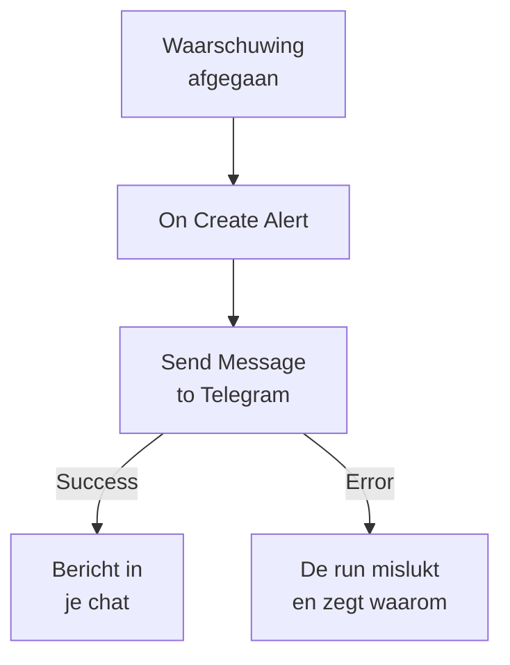

# Telegram

Stuur een bericht naar een [Telegram](https://telegram.org)-chat, -groep of -kanaal wanneer een waarschuwing afgaat of een incident wordt geopend. De workflowstap **Send Message to Telegram** van OneUptime stuurt het als een bot die je zelf maakt, en een kant-en-klaar sjabloon bouwt de workflow voor waarschuwingen. Deze integratie is **uitgaand**: de bot stuurt berichten en leest niet wat er in de chat wordt gezegd.

:::cards
- [Hoe het werkt](#hoe-het-werkt): Wat de workflow doet wanneer een waarschuwing afgaat.
- [Instellen](#de-integratie-instellen): Een bot, zijn chat, dan de workflow: vanuit het sjabloon of vanaf nul.
- [Tips](#tips): Platte tekst, lange berichten en incidenten.
- [Problemen oplossen](#problemen-oplossen): Wat de fouten van Telegram betekenen en wat je moet aanpassen.
:::

## Hoe het werkt



De stap stuurt de **Message Text** naar de chat, als je bot, via de Bot API van Telegram. Hij neemt zijn uitgang **Success** wanneer Telegram het bericht aanneemt, en zijn uitgang **Error**, met de reden van Telegram, wanneer Telegram het weigert. Is er niets op **Error** aangesloten, zoals in het sjabloon, dan mislukt een run die niet kon versturen, en zijn **Stappen** zeggen waarom.

## Voordat je begint

- Een Telegram-account, om de bot te maken en aan de chat toe te voegen.
- In OneUptime het recht om workflows en variabelen te maken. Op OneUptime Cloud hebben workflows het abonnement **Growth** of hoger nodig.

## De integratie instellen

:::steps
### Een bot maken

Stuur in Telegram `/newbot` naar [@BotFather](https://t.me/BotFather) en beantwoord zijn vragen. Hij geeft je het token van de bot, zoals `123456789:ABCdefGhIJKlmnoPQRstuVWxyz`. Iedereen die het token heeft, kan als je bot berichten sturen, dus bewaar het zo veilig als een wachtwoord.

### De ID van de chat vinden

1. Voeg de bot toe aan de groep, of maak hem beheerder van het kanaal. Om een persoon te berichten, begint die eerst een chat met de bot.
2. Stuur in de groep een bericht dat de bot noemt, zoals `/start@your_bot`, zodat de bot het ziet.
3. Open `https://api.telegram.org/bot<token>/getUpdates` in een browser, met het token van de bot in plaats van `<token>`.
4. Zoek `"chat":{"id":` in het antwoord. Het getal erna is de ID van de chat. De ID van een groep begint met `-`, die van een grote groep met `-100`.

Een openbaar kanaal kun je in plaats van met een ID met zijn `@username` aangeven.

### De workflow bouwen

Begin vanuit het sjabloon, dat de hele workflow voor waarschuwingen bouwt, of vanaf nul.

:::tabs
@tab Vanuit het sjabloon
1. Open **Workflows** en klik op **Workflow maken**.
2. Typ `Telegram` in **Sjablonen zoeken…**, klik op **Tell Telegram when an alert fires** en dan op **Dit sjabloon gebruiken**.
3. Houd de naam **Notify Telegram on new alert** of wijzig hem, en klik op **Volgende**.
4. Plak het token in **Telegram Bot Token** en de ID in **Telegram Chat ID**, en klik op **Workflow maken**.

De workflow opent in de **Bouwer** met twee stappen: **On Create Alert** en **Send Message to Telegram**, die het nummer, de titel, de ernst en de status van de waarschuwing stuurt. Het token wordt opgeslagen als geheime variabele `telegramBotToken` van de workflow, en de ID als `telegramChatId`.
@tab Vanaf nul
1. Sla het token op als geheime globale variabele: ga naar **Workflows → Globale variabelen**, klik op **Workflow Variabele aanmaken**, noem hem `TELEGRAM_BOT_TOKEN` en klik op **Volgende**. Plak het token in **Inhoud**, zet **Geheim** aan en klik op **Workflow Variabele aanmaken**.
2. Ga naar **Workflows**, klik op **Workflow maken**, kies **Vanaf nul beginnen**, geef de workflow een naam en klik op **Workflow maken**.
3. Klik in de **Bouwer** op **Kies wat deze workflow start** en kies **On Create Alert** onder **Populair**. Klik op de trigger: de **Fields to pass on** ervan beginnen met **Titel**, dus klik op **Veld toevoegen** en kies de andere velden die je bericht toont, zoals **Alert Number With Prefix**.
4. Klik op **Component toevoegen**, zoek naar `telegram` en klik op **Send Message to Telegram**. Verbind de uitgang **Success** van de trigger met deze stap.
5. Klik op de nieuwe stap. Klik in **Telegram Bot Token** op **{ }** en kies `TELEGRAM_BOT_TOKEN` onder **Global variables**. Vul de ID van de chat in bij **Chat ID**, schrijf het bericht in **Message Text** en voeg de velden van de waarschuwing in met **{ }**.
:::

Een bericht vanaf nul leest de velden van de waarschuwing met verwijzingen zoals deze:

```text
🚨 Alert {{local.components.alert-on-create-1.returnValues.model.alertNumberWithPrefix}} fired
Title: {{local.components.alert-on-create-1.returnValues.model.title}}
```

### Aanzetten en testen

Zet **Ingeschakeld** aan bovenaan de **Bouwer**. Vanaf nu wordt elke nieuwe waarschuwing naar de chat gestuurd.

Om te testen zonder een waarschuwing te laten afgaan, klik je op **Workflow uitvoeren** en kies je onder **Waarschuwing** een waarschuwing die je al hebt: de meest recente staan in de lijst, en door het nummer of een deel van de titel te typen vind je een andere. Klik op **Workflow handmatig uitvoeren** en bevestig met **Uitvoeren**. Het paneel **Workflow-uitvoering** volgt de run, en het bericht verschijnt in de chat. Neemt de stap in plaats daarvan **Error**, dan mislukt de run, en de vermelding van de stap in **Stappen** zegt waarom: zie [Problemen oplossen](#problemen-oplossen).
:::

## Tips

- **Platte tekst.** De stap stuurt de tekst zoals hij is getypt, zonder de opmaak van Telegram, dus `*` en `_` verschijnen zoals ze zijn.
- **Let op de limiet van 4.096 tekens.** Telegram neemt berichten tot 4.096 tekens aan. Een langer bericht wordt ingekort en eindigt op "… (truncated — see OneUptime for the full text)", in plaats van te worden geweigerd.
- **Ook incidenten.** Bouw dezelfde workflow op **On Create Incident**, of op **On Update Incident** voor statuswijzigingen. Om alleen sommige waarschuwingen te sturen, zet je een blok **If / Else** voor de stap.
- **De vorm van het token wordt gecontroleerd.** Een token dat niet de vorm `123456789:ABCdef…` heeft, stopt de run voordat er iets wordt verstuurd, en het token wordt nooit naar het log geschreven.

## Problemen oplossen

Wanneer de stap **Error** neemt, mislukt de run, en de vermelding van de stap in de **Stappen** van de run geeft de reden van Telegram. De bot moet in de chat zitten, dus controleer dat eerst.

:::details Telegram antwoordt "Bad Request: chat not found"
De **Chat ID** is fout, of de bot kan de chat niet zien: voeg de bot toe aan de groep, maak hem beheerder van het kanaal, of vraag de persoon een chat met de bot te beginnen. De ID van een groep begint met `-`.
:::

:::details Telegram antwoordt "Forbidden: bot was blocked by the user" of "bot is not a member"
De persoon heeft de bot geblokkeerd, of de bot is uit de groep of het kanaal verwijderd. Voeg hem opnieuw toe, of stuur naar een andere chat.
:::

:::details Telegram antwoordt "Unauthorized"
Telegram accepteerde het token niet: het is ingetrokken bij @BotFather, of verkeerd gekopieerd. Kopieer het huidige token van de bot bij @BotFather en vervang de waarde van de variabele.
:::

:::details Telegram antwoordt "Too Many Requests: retry after"
Telegram beperkt hoe snel één bot berichten stuurt, vooral naar een groep. Een piek van waarschuwingen kan die grens raken: stuur minder berichten, bijvoorbeeld alleen voor sommige ernstniveaus.
:::

## Volgende stappen

:::cards
- [Workflow-componenten](/docs/workflows/components#telegram): Elke instelling van de stap en wat de uitgangen betekenen.
- [Discord](/docs/integrations/discord): Hetzelfde idee, in een Discord-kanaal.
- [Workflow-uitvoeringen](/docs/workflows/runs-and-logs): Lees wat elke run van de workflow heeft gedaan.
- [Overzicht van integraties](/docs/integrations/index): Het uitgaande patroon en de andere tools die je kunt koppelen.
:::
